# 2025-09-04从0到1打造海外Web产品：首单突破 & 黑客松铜奖

> 来源：https://xuqiwei1986.feishu.cn/docx/PEFvd75HWoL5NHx4FiFcv5f1nXw

> 🔗 原文链接：https://scys.com/articleDetail/xq_topic/8854585812111282

大家好，我是轩辕。一个曾经典型的 职场螺丝钉 ，从0到海外出单的完整历程，3个月走通出单闭环，拿到黑客松铜奖，我想这个也许正是多数普通人的镜像。

# 当前成绩

已经开了2单，9.95美金，虽然不多，但对我来说意义很大，因为毕竟用户是在用美金给自己的网站投票。

如果按第一单算，那就是2个半月出第一单，现在在研究流量获取。

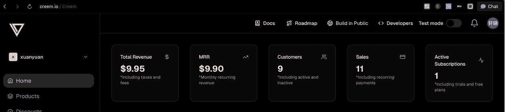

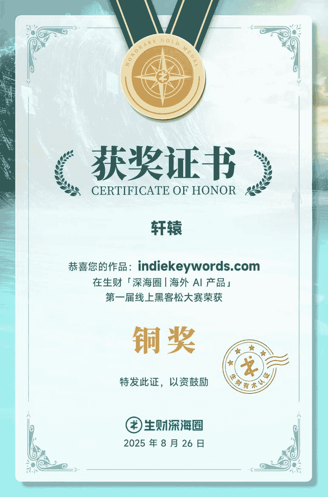

能在100多位参赛者里拿到铜奖并出单，对我这种从职场螺丝钉转型的人来说，是个很大的正反馈。我觉得可以在这个赛道干10年以上了，毕竟我喜欢做能长期躺赚的项目，热衷于养金鹅。

# 轩辕背景情况

在参加深海圈之前有参加web航海的，能上线单页网站，有产品经理、程序员职业背景，但是没有web开发经验，上站也是web航海学的，我不能算毫无技术功底的画像，但我觉得我自己算有螺丝钉相关职业生涯的典型画像，也就是多年在公司负责整个工作流程的一个环节，但自己无法独立完成整个业务。

所以，我深知这个群体可能会遇到的问题，估计也是大多数职场人可能会遇到的问题。在公司的时候，哪怕你公司营收高，用户多，广告多，融资好，但都会有个隐藏前提：

在已经验证好的业务链上添砖加瓦

我遇到的问题可能大部分职场人都会遇到：

| 问题 | 工作时候的情况 |
| --- | --- |
| 做什么需求好？怎么验证？ | 业务已经是明确的呀 |
| 登录怎么对接？支付怎么对接？ | 这些都有了呀 |
| 做完了怎么推广？ | 不是我们部门负责的 |

所以我的经历应该对这类多年的职场人比较有借鉴意义。

# 我的上站历程

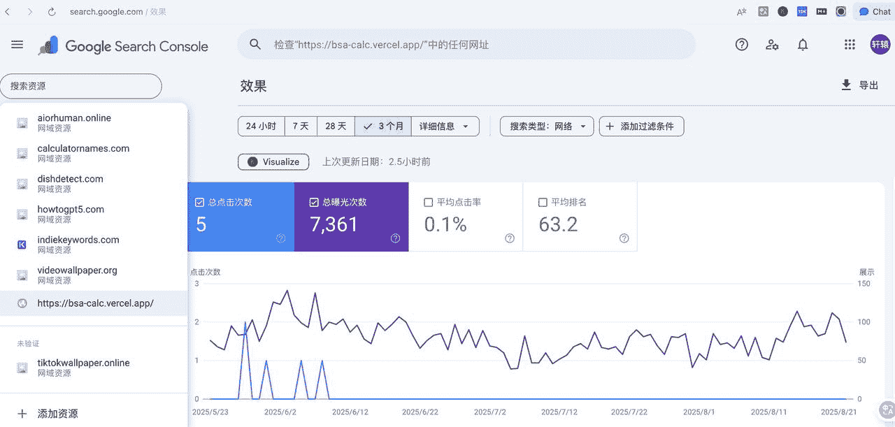

## 单页网站阶段：先跑通上站

这种类型单页面网站（代码随机生成结果，连`API`都没有调用的），如果不是热词，不会有啥流量，端正预期，就是练习上站流程，web航海有认真学就能做到：

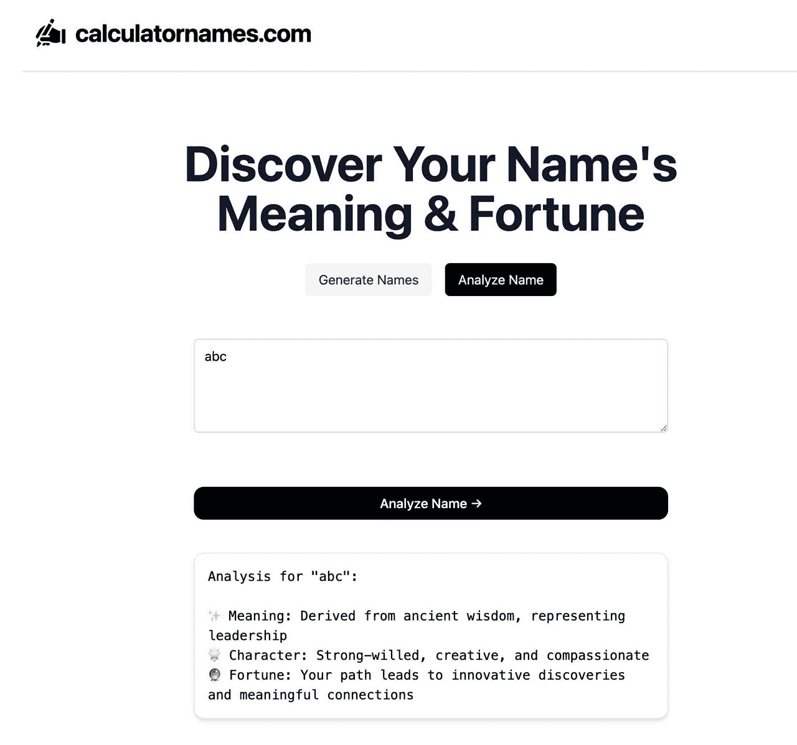

上了几个这种程度的单页网站，这时候目标就要清楚，先掌握上站流程，`clouldflare`、`vercel`，域名购买，AI编程，这些。

新手 我推荐直接`vercel`，先不用去接触`clouldflare`。

这类单页网站，我唯一做了功能的是这个tiktok壁纸下载，可以把壁纸视频中的壁纸提取出来，但是`tiktokwallpaper`的域名很快被封了， 后面换成`videowallpaper.org` 这个域名，`clouldflare`说我网络钓鱼，也封了😭，这钓啥鱼，无语。

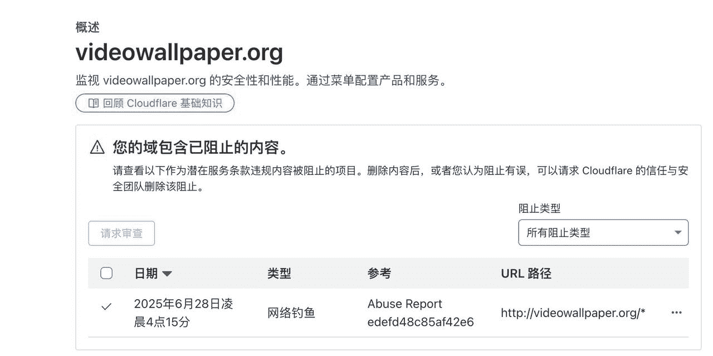

既然是`clouldflare`封的，那我就换到了`vercel`部署，就解决了。


得到经验：

带有大品牌词的域名能注册也没用，别人会投诉。

单页网站阶段得到一个结论：

单页网站`MVP`一定要实用功能闭环！

## API网站阶段：跑通驾驭`API`能力

学小排老师课程的时候刚好在减肥，学了对接`API`，用上了大语言模型的能力，就做了这样一个工具自己用（因为传统的工具要自己录、要么就识别不准确，后面发现也有些人甚至圈友也做这块的）

`https://www.dishdetect.com`

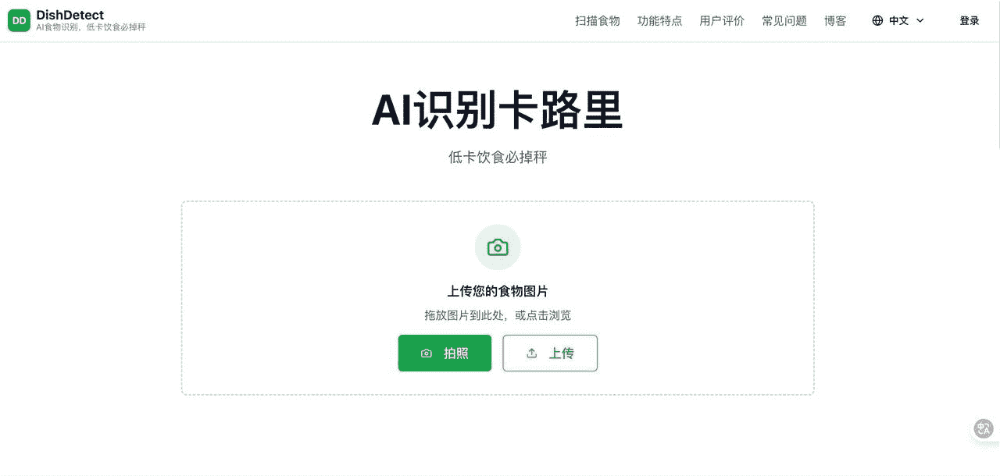

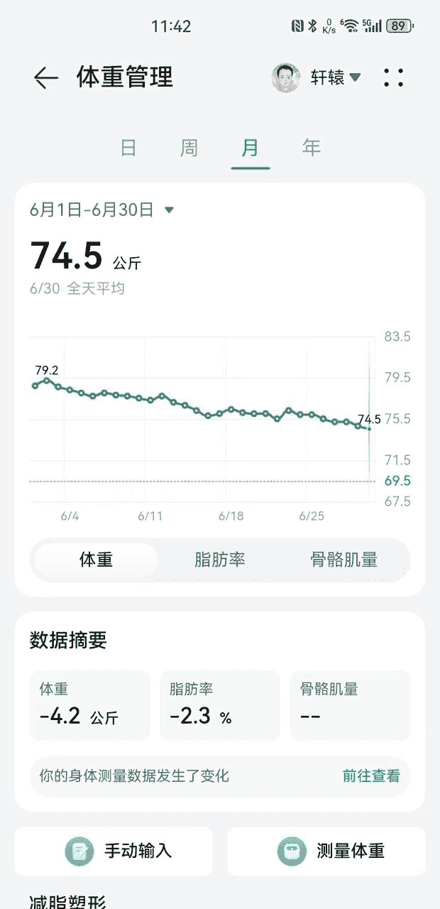

那时候2个半月减了20斤，现在是72.5公斤（179身高），所以对减肥我也是颇有心得的。

这个工具经验是：

1. 是不是减肥人群最大的痛点，不确定。（因为我开始的时候不是先调研，是学课程练手加自用）

2. 哪怕工具好，没有目标人群的推广方法也白搭。

所以先放着，等啥时候找到目标用户，受激发了，再看。

这个时候最大的体会是：

1. 学会用`API`和大模型，就能创造很多解决问题的产品。

2. 会做好的产品还不行，还需要找准需求，要会推广！

## 当前作品 `indiekeywords.com` ：跑通出单

`https://indiekeywords.com/`

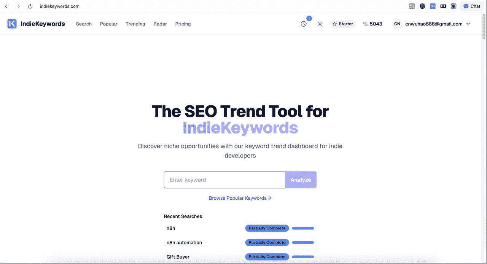

定位：

解决独立开发者（`Indie Dev`）寻找蓝海关键词（`Keywords`）的问题

功能：

拥有完整登录、支付流程

围绕着 高信噪比 进行设计：

> “在界面或通信渠道中，信噪比代表相关信息与无关信息的比例…”

比如：

1. 趋势获取核心能力

2. 获取前20%的信息源`radar`、`workflows`页面

3. 多层过滤算法

4. AI分析功能

5. 严格筛选关键词`trending`页面

追求交付结果、交付关键信息。

### 我为什么会做这个网站

web航海手册仔细看完就会知道：

发现一个优质的关键词 = 好的流量 = 该做什么

因为做网站都离不开全球最大的搜索引擎谷歌，而用户共同想要的东西往往都会在谷歌进行搜索，如果能找到这样的关键词：

1. 有一定搜索量

2. 能用网站给到用户解决方案

3. 当前已经满足用户需求的网站不大、不多

那这就是一个优质的关键词！

但原理是知道了，那我又该如何去找到这些优质关键词呢？

航海手册有很多方法，就是通过谷歌搜索的下拉建议，相关搜索得多的词一定会出现在谷歌联想的建议词里，也就是a~z大法，最早的帖子应该可以上溯到龙哥找海外需求的帖子：


但这样只能获得10个搜索建议，怎样能获取齐全呢？可以这样：


用词根 比如 上图的 `AI for` 加上 a~z 就能把所有用户有搜索可能是AI工具意图的关键词全部找出来了。

`AI for` 就是个很好的词根，搜索这个词根的用户很明显有某些方面的AI工具查找需求，那么搜索得多的具体关键词，就会是做 AI web 网站很好的机会。

但，怎么知道哪些词搜索量比较多呢？

后面从哥飞那学到可以用谷歌趋势官网与一些搜索量比较稳定的词进行对比，就知道哪些关键词搜索量比较多，比如跟`gpts`对比：

（`gpts`日搜索量大约5k~8k）

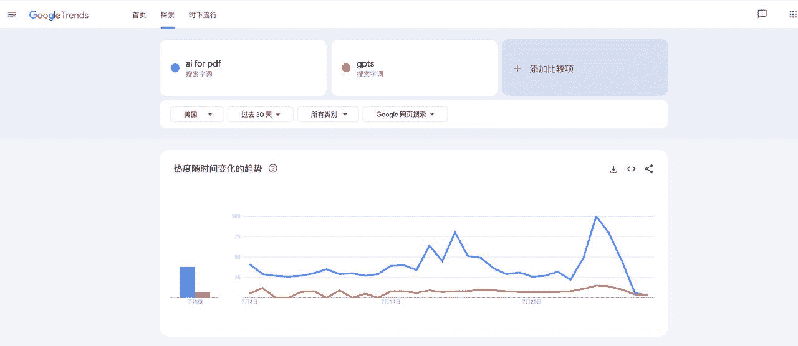

如图所示，这样就能知道 `ai for pdf` 这个关键词是有普遍搜索需求的关键词，如果此时继续用`ai for pdf` 作为词根，那就更加清楚用户需要用AI工具处理pdf的哪方面需求，如这样：

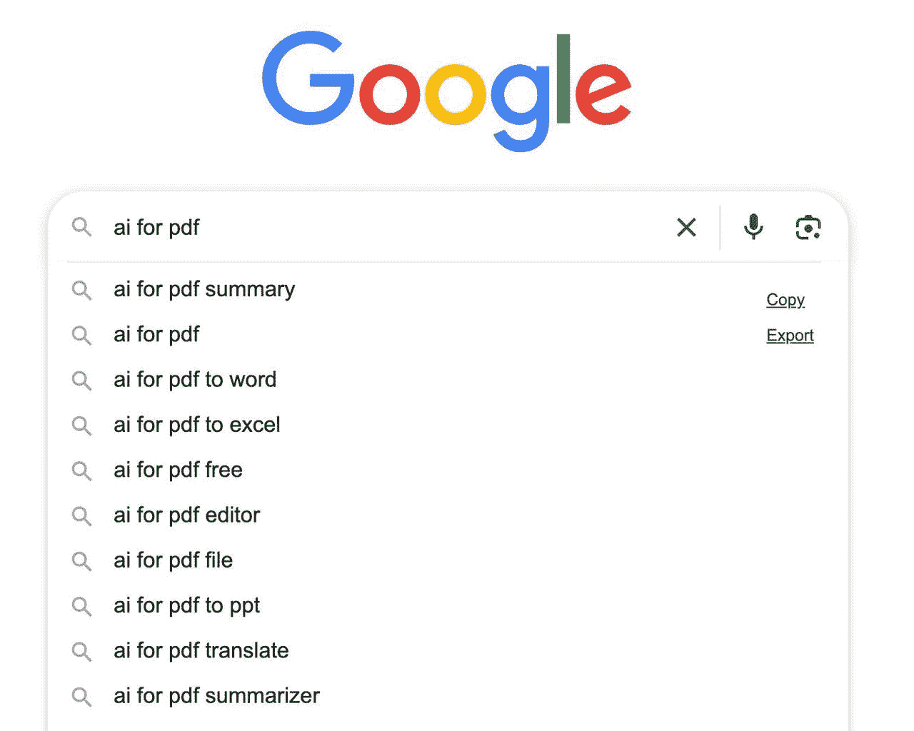

那么接着再看看搜索你目标关键词谷歌出现能直接满足需求的网站多不多，做得好不好，就知道是否值得自己做一个网站来满足用户了，如果竞争少那就做，如果竞争大，那就找下一个词。

比如下图这样，就是满屏都是精准满足这个词的完整，付费投流都很多，免费的都是老网站、大流量，那咱们是新手，就别想了。

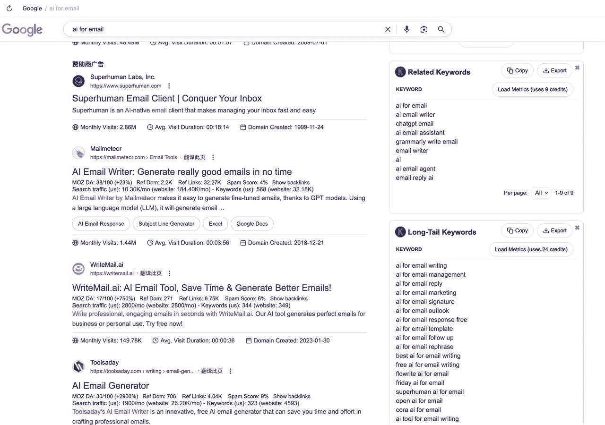

问题来了，很多常见的关键词都会有很多聪明的站长去做了网站满足用户的需求，经常需要继续找下一个关键词，而反复手工执行上方的操作，是很累的，尤其是知道搜索量那步，大部分关键词虽然出现在谷歌搜索建议里，但搜索量并不大，只有真正有普遍需求的少部分关键词才会有可观搜索量。

那样这些步骤就要反复执行很多遍，怎么办？

所以我想到，不如学以致用，于是，`indiekeywords.com` 诞生了，这是我做的第一个正式面向用户的网站，如下图：

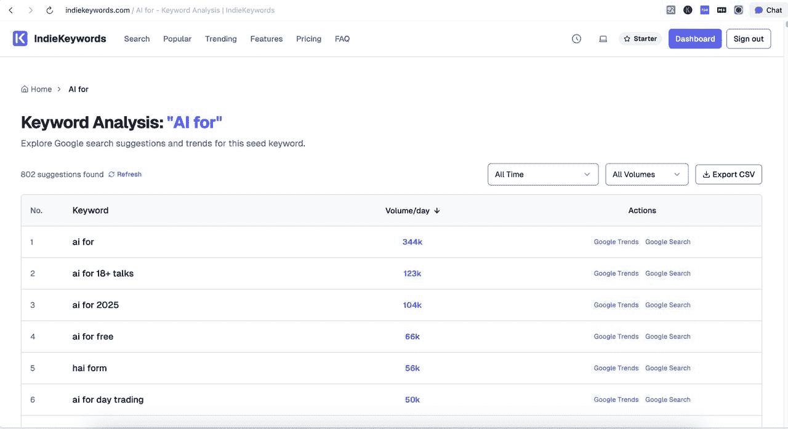

`indiekeywords`它可以依据词根自动获取包含此词根的 所有下拉建议 + 自动批量获取谷歌趋势值估算搜索量。

我想快速验证一个关键词的可行性，哪怕只是一个灵感碎片，也可以立即判断：

- 有没有人在搜这个？

- 这个词的趋势是在上涨还是下跌？

- 竞争程度大不大？

- 基于这个词更细化的需求是什么？

所以我做了一个工具，数据导向，而不是凭感觉。

潜在关键词（词根）→搜索量可观的关键词→竞争小→明确了项目（需求、产品、`SEO`词）

### 差异化

#### 差异1：实时获取`google trends`数据

比`SEMrush`更准确，实时获取当前谷歌趋势数据（获取任务排到了就是实时，当然付费`VIP`任务排前面，免费用户只能获取52个词）

`claude code mcp` 我显示6k日均搜索量

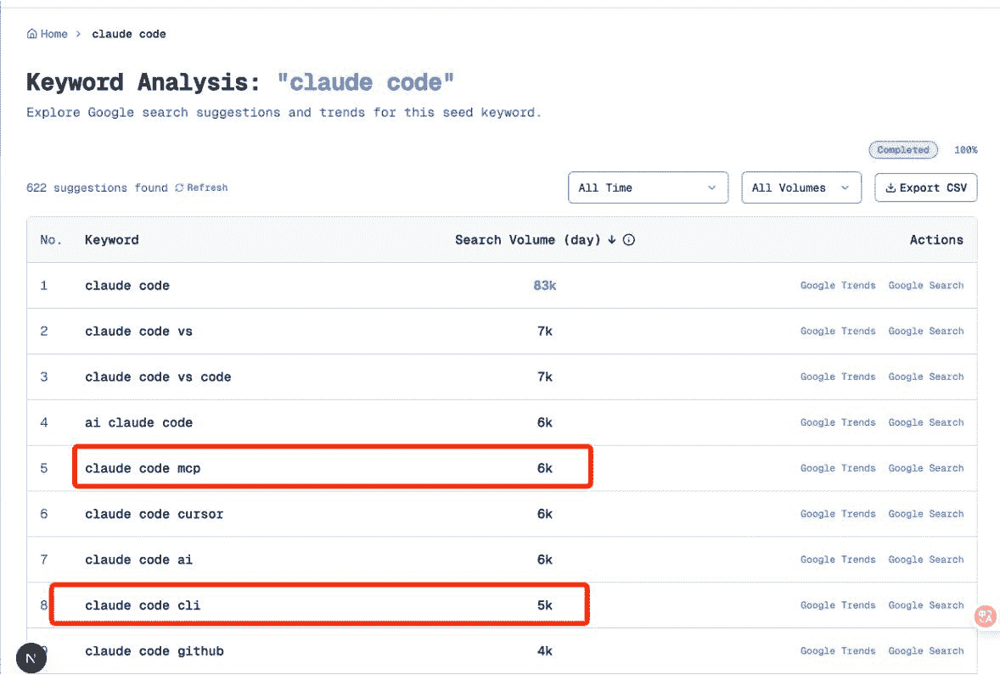

`semrush`显示日均170次搜索量

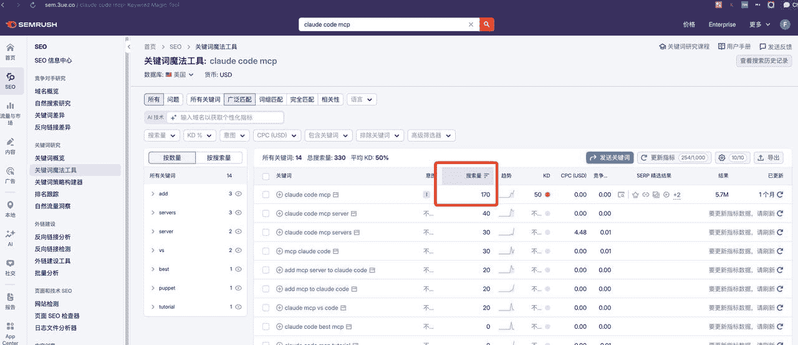

谷歌趋势显示已经超过`gpts`

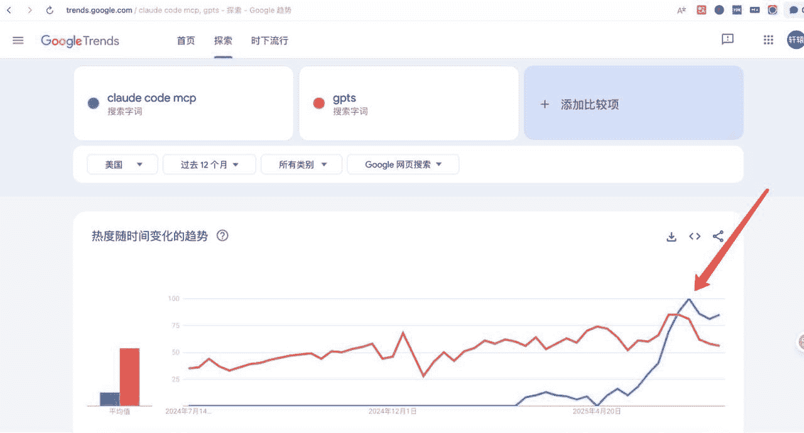

#### 差异2：关键词雷达

为独立开发者提供最新热门信息源、关键词。

获取`GitHub`、`Reddit`、`Hacker News`、`Twitter`、`Medium`热门信息并经过层层算法和AI过滤。

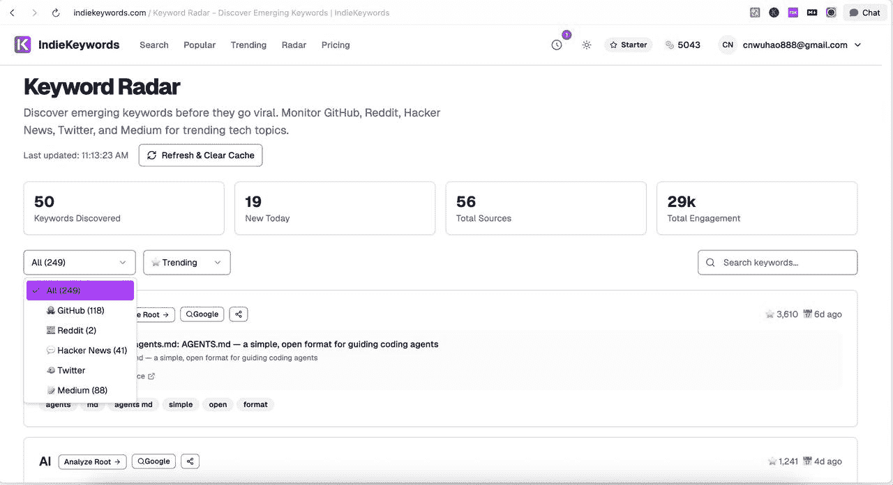

#### 差异3：工作流雷达（预热）

监控最新的热门工作流。

自动监控工作流官方网站，如`n8n`等最新的使用用户在20%前的工作流，并自动提取常见搜索关键词、进行建站机会AI分析。

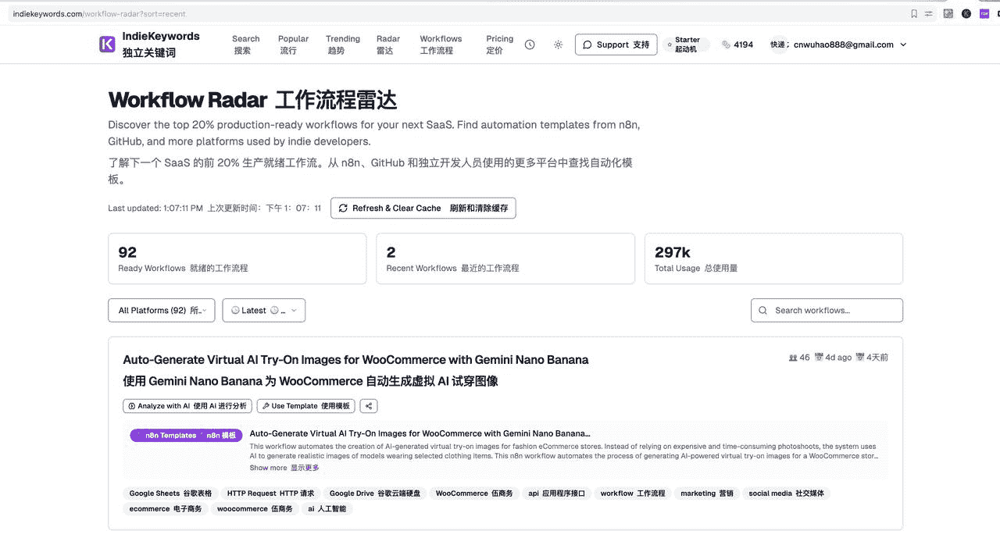

#### 差异4：爆款蓝海词

定位：第一时间发现新词、蓝海热词

整个网站监控的信息源，包括`google trending now`、每天监控近170多个通用词根+大平台词根新增搜索词、上方各热门平台最新信息源提取的关键词、付费AI模型给的热词等等，除了用户搜索的词进行了隐私保护以外，进行比如谷歌趋势搜索量、人名地名赛事名等层层过滤条件的会出现在这里。

但这个功能我还不够满意，好像最后漏斗下来剩下的词没有预想的好，不过朝着这个定位不断迭代吧，总有一天会达到我想要的效果。

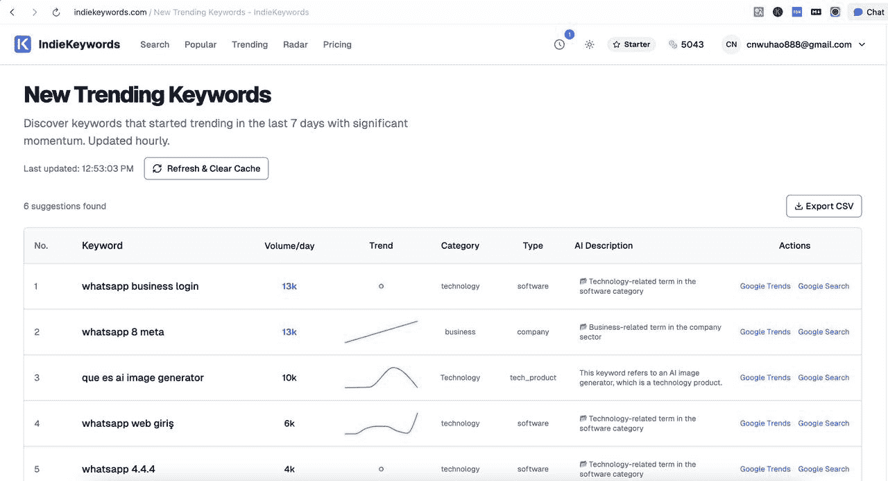

#### 差异5：监控词根

可以在仪表盘监控自己想要监控的词根

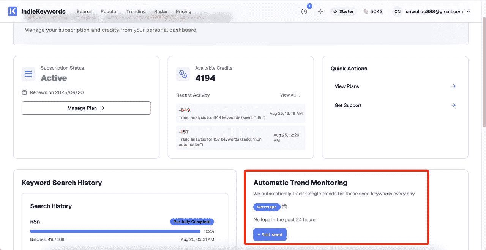

可以长期监控指定词根有没有产生新的词 或 突然某个下拉关键词 搜索量暴增。

目前系统级的监控就有170多个通用词根 和 平台词根。

# 方法论

## 最重要的三要素

很多文章都有提到，但我依然想强调，并且会说说我的理解，咱们做海外站需要三个要素都做成才能成，分别是 需求、产品、流量 。

### 需求

真需求，要确认是真实需求，而不是只有你自己这么想的需求。

普遍需求，要确认是普遍需求，而不是个别需求。

最好且方便的方式，就是自己是用户的需求，比如：

- 自己是一个圈子的人群之一——减肥人群

- 兴趣爱好——阅读、打游戏、旅游

- 擅长领域——电商、📕、广告投放、`YouTube`

这种情况下，你比较清楚需求的细节、痛点，而且容易找到跟你类似的几个人，确认一下，他们是不是有相同的问题，如果做一个`xxx`的网站来解决，他们会不会付费购买？（方便调研）

阻力小，你才好启动，才好获得种子用户，难道不是么。

前期把项目启动起来，有点小变现最好，预期要合理。

不要妄想去找到一个自己不熟悉的人群、大需求，做出一个惊为天人的产品，放出去就能赚一大把钱，反正我没这样的想法。

小众群体的普遍需求，你也是这个群体里的人，小而美，就是最适合你的项目！

如果认同，做法其实很简单，海外独立开发者圈子、航海手册、小排老师，全都有提到过，就是记录你自己日常遇到的问题，一段时间后从里面挑出一个来，去多问几个人，需求就有了。

持续保持，最后你的生产力只会跟不上你的需求积累的速度。

`indiewords.com` 就是来源于我要找词找需求，不知道做什么词，我看群里其他人也一样，就这么来的。

### 产品

完成下方内容，产品环节就不会有大问题的了，因为大部分东西AI都能帮你搞定，你主要是负责学习、思考、安排AI工作。

#### 第1步：参加web航海

如果你完全不懂网站从未接触过编程，我建议先参加web航海，做到可以上线单页面网站，弄懂整个过程中的各个概念。

此时你应该掌握了：

1. 问AI问题，通过AI学习概念

2. 知道网页呈现在浏览器上具体的原理、技术

3. 会使用AI编程工具比如`cursor`

4. 在海外能付款买东西

5. 会使用`github`、`vercel`（可以先不涉及数据库、登录、收款）

6. 会购买域名、配置域名

7. 使用单`HTML`页面（`js`、`css`直接写进去）

8. 在编程工具中提交`github`就能自动触发`vercel`自动部署网站最新版

能达到把你的单页`HTML`网站通过你买的域名发出去给朋友看的效果。

#### 第2步：参加深海圈

接着加入深海圈，最好先达成第一步后加入，否则你也累、老师也累，循序渐进最好。

如果没有涨价，价格就是5000元或5枚龙珠碎片，服务周期12个月，还是顶级老师带队，其实很划算的。

此时你应该掌握了：

1. 对接`API`调试`API`

2. 使用`claude code`

3. `nextjs`、`typescript`、`tailwind` 技术栈

4. 使用数据库，比如`supabase`

5. 对接登录

6. 对接支付

7. 使用`Starter kit`

都认真学，认真实操了，你也一样可以做出优秀的网站，小排老师的那个词“扎实”就讲得很好，关键要学扎实。

不要小看这一节这一点字，已经是我知道的最短路径了，捷径了。

### 流量

这块也是我最不擅长的地方，所以更多的可能是当前的认知或学到的信息，大家参考着看就好了。

热词打法，自带流量。

产品打法，种子用户群打磨通过，去目标用户集中的地方去推广。

`seo`打法，持续稳定，但见效慢，蓝海相对快点（那也是2~3个月），很多人熬不到。

现在我这个`indiekeywords.com` 算产品的传统打法，因为我自己本身是独立开发者，天天监控热词很累，所以就解决自己的需求顺便共享出来给其它独立开发者使用。

目前虽然有用户付费，线上黑客松也获得了铜奖，但我觉得还是属于种子用户群阶段，直接交付蓝海词、新词，这个能力我还不够满意，只能达到我心目中一半的程度吧，所以就边用边迭代，目标要做到直接交付结果，目前信息类的功能是属于全免费开放状态。

#### 我推广到种子用户的方式

1. 私聊、拉小群相熟的独立开发者，邀请他们使用。

2. 适当在大群宣传，别太多了，太多会惹人厌，你的东西有用自然就会有反响，要根据反应情况审时度势，你的东西不行，天天群发都没用，最后只会起到反效果。

3. 参加能帮助到你宣传的活动，比如：黑客松、分享、写帖子

几十位种子用户，这种方式就能触达得到了。（我现在走到的是这一步，注册用户200个，付费用户2个）

再往后就是千位数的用户，得要去更大的公域去，比如通过前面的打磨，去`product hunt`、`hacker news`这类新产品发布平台，如果你能争取到前面的种子用户的支持，帮你点赞、写分享感受，是最好的。

如果干得好， 你能排到当天前几名，那就会被`newsletter`等邮件继续推流，也会被其它媒体网站甚至自媒体抓到去宣传。 （所以在这些知名网站发布项目是为了这些）

#### 我准备应用的推广方式

`SEO优化`

有一次我发现`bing`引擎收录了我这个`https://www.indiekeywords.com/root/shein`地址： `https://www.indiekeywords.com/root/shein`

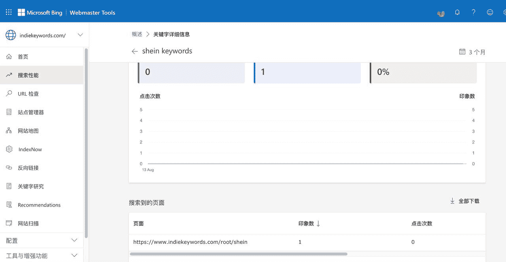

这个是搜索了`shein`这个词根的分析结果页面，那我就想到，那是不是我所有搜索过的词根，都可以有办法让搜索引擎去收录，在用户主动搜索这个关键词的时候，把我的分析结果页面呈现出来？

然后我就立刻跟AI讨论方案，就做出了一个动态站点地图，自动提交搜索引擎的功能。（调用搜索引擎的`API`就可以了）

效果：

他会在我网页功能分析完词根后，写出一个`https://www.indiekeywords.com/root/shein`这样的地址放到`sitemap.xml`里，然后调用搜索引擎`API`自动提交给搜索引擎进行收录。

这个功能不会泄露用户隐私，因为别人使用搜索引擎搜这个词的时候，说明别人也已经知道这个词了。

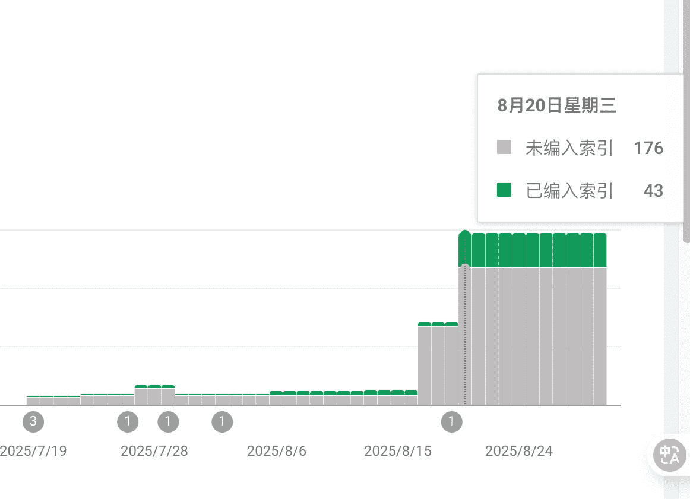

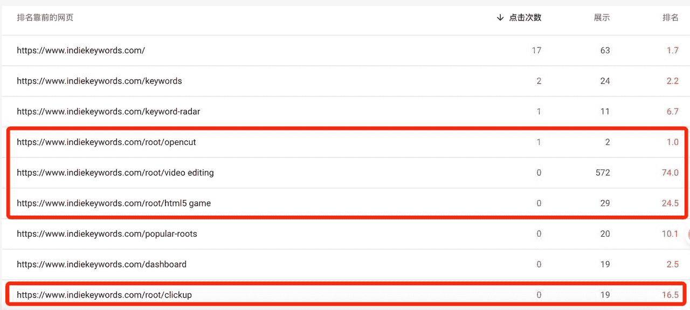

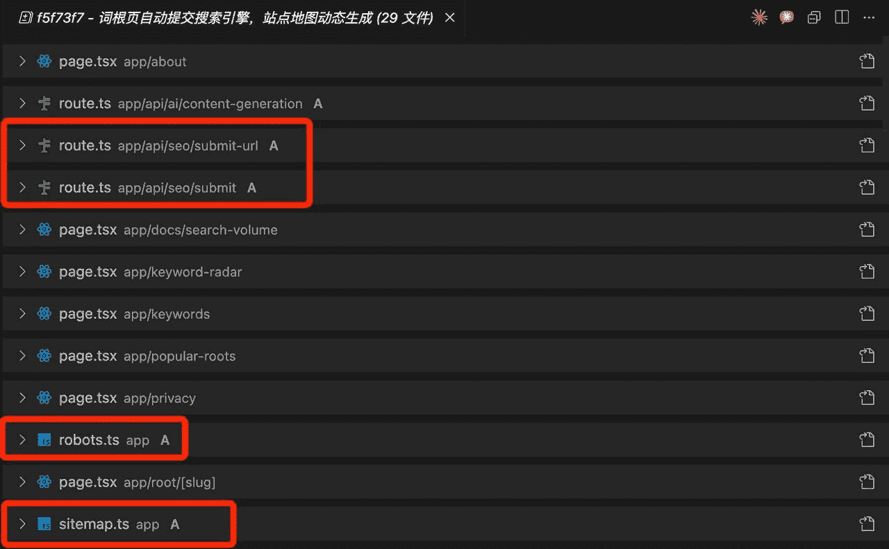

提示词参考：（你需要结合自己网站业务调整）

```
textjavascripttypescriptcsshtmlbashjsonmarkdownpythonjavaccpprubygorustphpsqlyaml Copy
```


# 搜索引擎收录分析及优化计划

基于对您网站的分析，我现在为您制定一个详细的搜索引擎收录优化计划。

## 🔍 当前收录原理分析

您的词根页面能被Bing收录（关键词“shein keywords”）的原因：

- 动态页面生成：`/root/[slug]/page.tsx` 生成动态关键词页面
- SEO元数据优化：页面已包含完整的`title`、`description`等元数据
- 内容相关性：页面包含与“shein”相关的关键词分析内容
- URL结构清晰：`/root/shein` 的URL结构搜索引擎友好

## 📋 搜索引擎收录优化计划

### 阶段一：技术基础优化

生成动态`sitemap`

创建自动生成包含所有词根页面的`sitemap`

添加`lastmod`、`priority`等标签

设置定期更新机制

优化`robots.txt`

明确允许爬取 `/root/` 路径

添加动态`sitemap`链接

实现结构化数据

为词根页面添加JSON-LD结构化数据

包含关键词、分析数据等信息

### 阶段二：内容优化

增强页面内容质量

为每个词根添加独特的描述

增加相关关键词建议

添加趋势分析摘要

内部链接优化

在热门词根页面间创建交叉链接

从主页链接到高价值词根页面

创建词根目录页面

### 阶段三：技术SEO增强

页面加载优化

实现服务端渲染(SSR)优化

减少JavaScript依赖

优化关键CSS内联

URL优化

考虑为热门词根创建静态URL

实现URL预渲染机制

添加面包屑导航

### 阶段四：提交与监控

主动提交

向Google Search Console提交`sitemap`

向Bing Webmaster Tools提交

使用Indexing API加速收录

监控优化

设置收录状态监控

分析搜索表现数据

持续优化高价值页面

## 🎯 预期效果

实施这个计划后，您的词根页面收录率预计可以提升：

- Bing收录率：从当前的偶发收录提升到60-80%
- Google收录率：从几乎不收录提升到40-60%
- 搜索可见性：关键词相关搜索的排名显著提升

## ⚠️ 注意事项

- 避免重复内容：确保每个词根页面有独特的价值
- 平衡动态性：保持内容新鲜度同时确保可爬取性
- 用户体验优先：SEO优化不能影响用户体验

```typescript
export default async function sitemap(): Promise<MetadataRoute.Sitemap> {
  try {
    // Get all keywords for dynamic routes
    const keywords = await getAllKeywords();

    // Build static routes
    const staticRoutes: MetadataRoute.Sitemap = STATIC_ROUTES.map((route) => ({
      url: `${BASE_URL}${route.url}`,
      lastModified: route.lastModified,
      changeFrequency: route.changeFrequency,
      priority: route.priority,
    }));

    // Build dynamic keyword routes
    const keywordRoutes: MetadataRoute.Sitemap = keywords.map((keyword) => ({
      url: `${BASE_URL}/root/${encodeURIComponent(keyword.keyword)}`,
      lastModified: new Date(keyword.updated_at || keyword.created_at),
      changeFrequency: 'weekly' as const,
      priority: 0.6,
    }));

    // Combine all routes
    const allRoutes = [...staticRoutes, ...keywordRoutes];

    console.log(`Generated sitemap with ${allRoutes.length} URLs (${staticRoutes.length} static + ${keywordRoutes.length} dynamic)`);

    return allRoutes;
  } catch (error) {
    console.error('Error generating sitemap:', error);

    // Fallback to static routes only if dynamic generation fails
    return STATIC_ROUTES.map((route) => ({
      url: `${BASE_URL}${route.url}`,
      lastModified: route.lastModified,
      changeFrequency: route.changeFrequency,
      priority: route.priority,
    }));
  }
}
```

# 先开发产品还是先找用户？

Tony Dinh的观点我非常认同：

如果你从未构建过产品，那么就先做产品，如果你构建过多个了，那就先找用户。

特别有道理，如果你从未完整开发过产品（对接到支付、给到种子用户使用），那就先开发产品，完成产品研发的闭环，去体感自己一开始想的需求到底是不是普遍需求，你的解决方案用户用不用（先不说付不付费，当然付费最好），再去体感一下推广。

当你已经走过了这个过程了，那就是需求倒做是最好的：

- 找到用户就是找到需求
- 找到多个用户就是找到共性需求
- 找到一群用户就是找到推广方式

然后就做MPV，给他们，去验证。

## 捷径

热度新词=需求明确+自带流量

蓝海词=需求明确+易得流量

有了这类型的词，需求和流量部分就都解决了，那接下来只需要跟AI讨论好方案，让AI牛马去干活就好了，产品就是相对容易的部分。

所以为啥 indiekeywords.com 有 `trending`、`radar`、`workflows`页面，每天监控google trends、社交媒体、AI模型、需求词根、平台词根，就是为了第一时间发现这些关键词和项目资源。

当然，如果你有好的方法，但需要每天都手工看，不想麻烦又生怕错过，可以跟我联系，我也觉得合适，就可以把功能做到网站中，采纳了需求的，我还会送你免费会员作为感谢。

既然我已经能闭环了，有底气了，不断迭代这些挖掘新词、蓝海词的能力，合适的上新站，也会是我接下来的重点之一。

# 赚钱圈友复利：终身5折券

[https://www.indiekeywords.com/?discount=SHENGCAI#pricing](https://www.indiekeywords.com/?discount=SHENGCAI#pricing)

只要未取消订阅就是终身5折，可能会随时关闭，使用不了就是关了。

# 总结

## 产品端

未具备上站能力路径：

通过web航海上单页面网站→参加深海圈学会完整建站

未构建过产品就先构建产品再找用户。

## 需求端

很多人都通过观察自己生活、工作发现需求，养好随时记录灵感的习惯。

关键词 即 需求，有时候也等于流量。

## 流量端

在有鱼的地方钓鱼，海外用户在社交媒体和垂直社区聚集，比如：reddit、twitter。

有流量天赋的就从流量角度发力，接触的同一人群多了，需求自然就明确了。

倒做需求，一切水到渠成。

## 捷径

热度新词=需求明确+自带流量

蓝海词=需求明确+易得流量

在 indiekeywords.com 说不定就能找到一个词同时解决需求和流量，常来看看，有啥想法给我反馈。

都看到这了，还不给我星球帖点个赞么？
