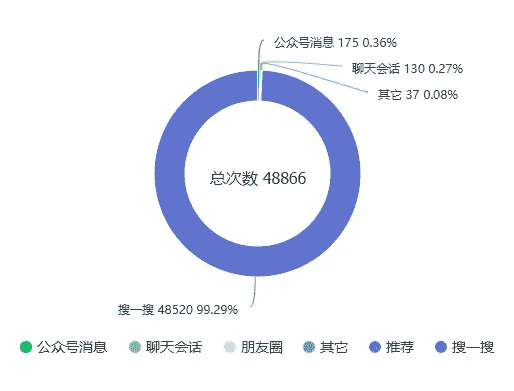
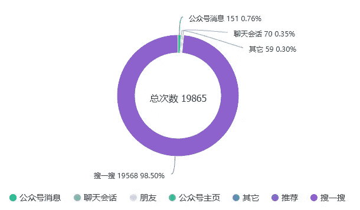
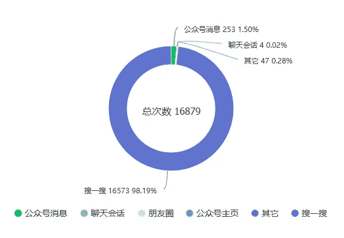
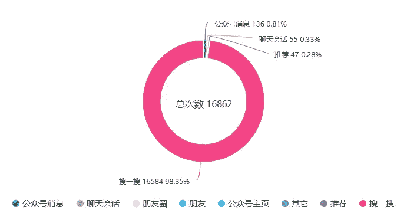
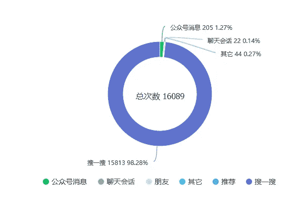
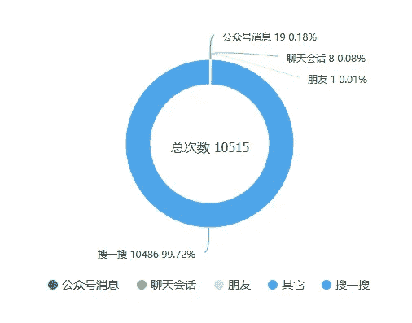
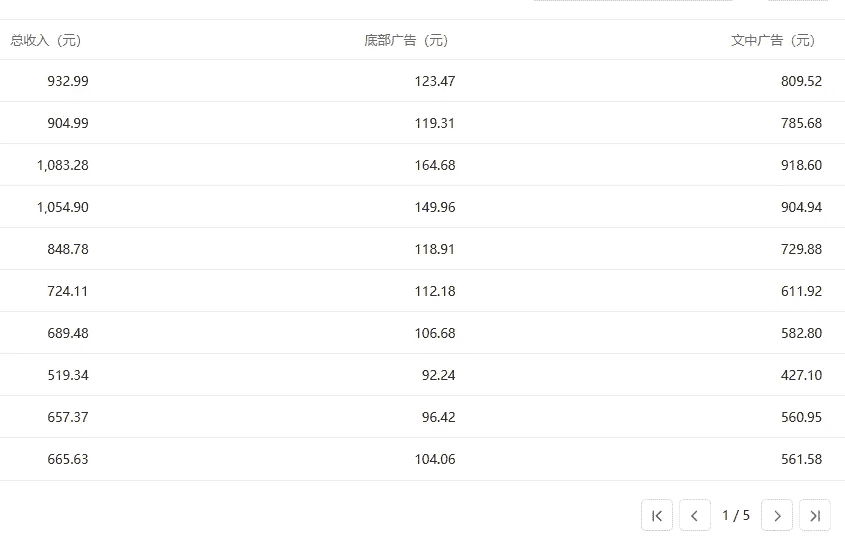
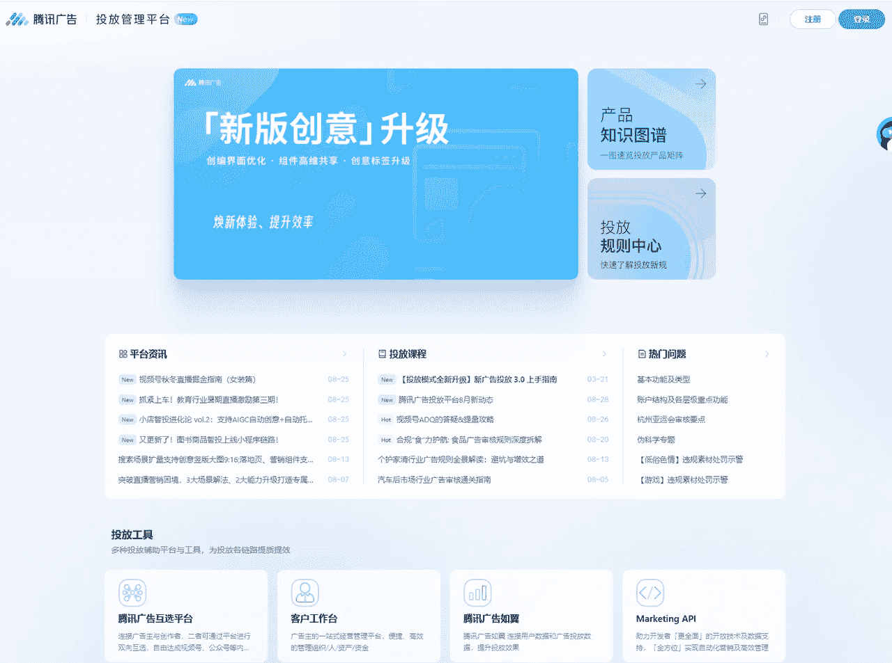
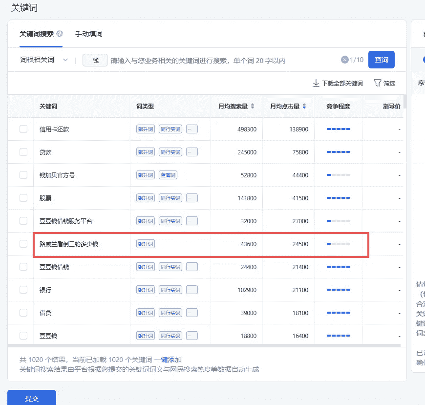

# 流量主变现的另外一条路——搜索流量

> 来源：[https://xuqiwei1986.feishu.cn/docx/QZoddKNoPobcdUx1vWzcWBj1nnE](https://xuqiwei1986.feishu.cn/docx/QZoddKNoPobcdUx1vWzcWBj1nnE)

说起流量主，大家第一反应都是做👸号的爆款文章，然后靠进推荐池拿流量，进而获取收益。这确实是目前的主流玩法，很多人也在这条路上取得了不错的成绩。

但实际上，还有另外一条路，就是做搜索流量，靠"搜一搜"来获取流量。

这两者有什么不同呢？让我们来对比一下：

推荐流量需要抓住用户的情绪，让用户看到标题或图片后点击进来，或者追逐某个热点。这样的流量可能不太稳定，今天爆了明天可能就没了。而且在进入推荐池之前，基本上是没有任何收益的，只有进池后才会有收益，这个过程充满了不确定性。

搜索流量则完全不一样。搜索流量因为用户已经有明确需求，去**搜索时是带着问题来的，所以流量比较**稳定。打个比方，推荐流量像是在大街上发传单，而搜索流量像是客户主动走进你的店铺。

尤其是我们在选择内容时，有工具进行数据参考，能够清楚地看到哪些关键词有人在搜、搜索量有多大。

这样我们在选题的时候就不会迷茫，不会只能"找对标、模仿对标、再找对标"，然后写完文章后忐忑不安地等待数据反馈，不停地测试才能够慢慢找到感觉。

而有了数据支撑，你会很明确地知道我做这个内容是可行的，是有人搜索的。只要**我提供的内容质量足够好，能**够获取到比较好的排名，这个流量就一定会到我的账号里来。它是一个确定性很高的事情。

很多人对于搜索流量的理解可能比较片面，觉得搜索流量应该只有几个、几十个，流量比较低。但实际上，如果你真的做好了，它的流量并不低。我们可以看一下下面这几张流量图表。

有的人可能会说，这么点流量也不高啊。按照平时的计算方法，1万阅读也就十几块钱，4万阅读也就40多块钱。

但实际上，推荐流量和搜索流量的单价是完全不一样的。因为搜索流量进来的用户价值更高，他们更精准。

**为什么这么说呢？**

我们知道，ECPM（千次展示收益）考察的是完读率、点击率，还有广告的拉取和展现率。像这种有明确需求的流量，它的完读率特别高，跳出率很低。而且，用户会认真阅读，让文中的两条广告和底部广告都能够充分展现，因此它的ECPM值要高得多。

比如说，下面这个收益案例，这是文章发布后7天的数据，只有1.3万的阅读量，但实际上它的收入已经将近1000块钱了。相当于每千次阅读收益达到了60多元，是普通推荐流量的好几倍！

而且，只要我们的文章排名稳定不掉，流量就是持续的。也就是说，如果你的账号有20篇文章的排名都在第一，那么你就能持续获取这20个关键词的流量。

所以，**搜索流量是有累积效应的**，不像推荐流量，今天发一篇明天就没流量了。搜索流量是一个稳定的、可持续的收入来源。

因此，即使单篇文章的流量看起来不高，但累积起来，整体的流量和收益是很可观的。这就像是建立了一个个小型的"流量资产"，每天都在为你产生收益。

相[**信看到这里，你也想**](http://ad.qq.com)**要了解到底怎么来**做这个搜索流量。其实方法也比较简单，我们需要用到一个腾讯官方的工具——ad.qq.com（腾讯广告平台）

无论我们做什么内容，使用官方的广告投放后台查询到的关键词数据是最准确的。既然我们要做🛰️的搜索流量，那么就要用腾讯广告推广后台来查询数据。这个工具可以用个人资质免费注册，主要是用来查询关键词，不需要充值。

如果有公司资质的话，用公司资质注册会更方便一些。

注册后，我们创建搜索推广计划，然后选择关键词工具，输入想要查询的词就可以看到详细的数据了。

这里我给大家举个例子，比如查询"钱"相关的关键词。可以看到，下面有很多搜索量和点击量都比较高的长尾词，而且竞争程度显示为"低"。

### 如果无法成功注册AD.🐧，可以使用AiDSO工具。

AiDSO的数据和ad.qq是同步的，选择WSO就是🛰️官方平台的数据。搜索量和点击量都是一致的，避免自己再去重新注册执照开通ad.qq了。

> 【圈友福利】免费领AIDSO VIP会员

+   这种词就是我们要找的"黄金关键词"——有搜索量、竞争小、容易拿排名。我们针对这些词来编写标题和内容，就很容易获得好的排名和稳定的流量。

拿到关键词以后，建议先去🛰️搜一搜查询一下，看看这个词目前有哪些👸号写了相关文章，竞争情况如何。

如果发现相关文章很少或者都是很久以前的，那效果会更好。为什么？因为我们新发布的内容属于"信息增量"，这是平台乐意看到的。平台会优先展示新鲜、及时的内容。

通过搜索，我们可以看到现有文章的发布时间。如果排名靠前的都是几个月前甚至去年的文章，那我们新发布的内容就有很大机会获得更好的排名。因为平台希望用户看到最新的信息，担心过时的内容会影响用户体验，所以我们提供的新内容往往会获得更好的展现机会。

整个搜索流量的操作流程总结一下：

1.  通过腾讯广告后台查找有搜索量、低竞争的关键词

1.  分析现有内容的竞争情况

1.  创作高质量的原创内容

1.  优化标题和内容结构

1.  持续监测排名和流量情况

只不过，我们需要不断地去挖掘新的关键词，找到适合自己账号定位的关键词，以不断提高账号的权重。这个过程和我们做网站SEO是类似的道理。

如果你可以运营多个账号，去覆盖更多的领域和更多的关键词，效果会更好。这就像是在不同的地段开了多家店铺，每家店都能带来稳定的客流。

最后说一个需要注意的事项：现在平台对于纯AI生成的内容有一定的识别和限制，所以我们拿到关键词以后，还是要认真研究如何编写高质量的原创内容。工具只是辅助，内容质量才是核心竞争力。

我们做搜索流量的目的是拿到精准、稳定的流量，但不要觉得这个事情太简单。它虽然比推荐流量的前期正反馈来得更快、更确定，但想要做好、做长久，还是需要持续的努力，需要长期的维护和内容更新。

> **记住：搜索流量是一场马拉松，不是百米冲刺。坚持下去，你会**发现这是一条值得长期投入的稳定收益之路。

**希望大家都能够拿到自己想要的结**果，在流量主这条路上走得更稳、更远！我是西昂，让我们一起龙哥盟！