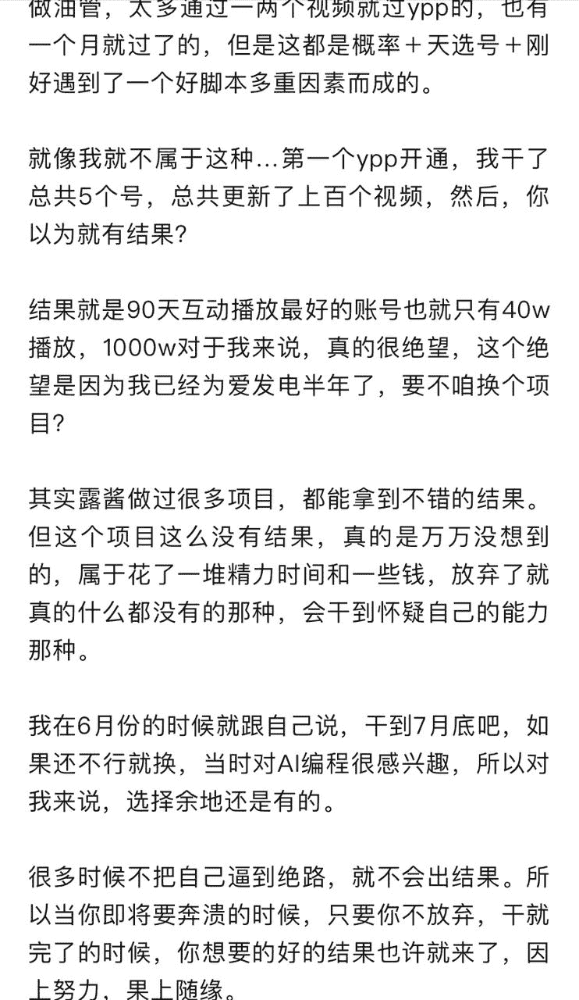

# 「我的黑历史：油管首个YPP花了半年」VS「我的曙光：单视频带货GMV1万美金＋」

> 来源：[https://xuqiwei1986.feishu.cn/docx/IwxsduM68oTZKbxZqXmceF4knj9](https://xuqiwei1986.feishu.cn/docx/IwxsduM68oTZKbxZqXmceF4knj9)

# **自我介绍：**

简单做下自我介绍，都可以叫我露酱，主要经历就是电商（打工的管理）——微商（团队千人）——电商（自己干，细分类目第一，品类做到独创，同行来模仿）我的经历大致可以归成上面三步骤。

因为做过微商，所以不想带团队，想一个人没有枷锁「不好意思脸」，所以电商也是单干，也不想放大规模，一年营业额差不多五六十万，利润也不错，时间又自由，而且还在上升趋势，为此，我还买了两三万的设备，有自己的仓库，自己做产品研发这些，但是因为个人方面原因，天天跑医院，没办法干需要固定场所48小时内响应的活了，所以才想着转型。

**想转型****只需要一台电脑就行的项目**，对出海特别感兴趣，那个时候，龙哥发了超级风向标，特别吸引我，所以我就在2024.11底就立马把赚钱里所有有关油管的分享贴全部看了一遍，直接开始做了5个号，12月份又迎来了油管的第一次航海，跟着航海猛猛干。

结果我的黑历史哈哈，5个号陆续0播，过完年后，直接放弃了这个项目，不想干了，对AI编程很感兴趣，报名了AI编程的航海上船。我还计划干100个网站呢！当我在陆续做了第三个网站的时候，刚好遇到4月底波妮教练的视频号直播，于是就顺带听了下。

**深海圈****五****千块****好****贵啊，毕竟我门票花了两千块，再加五千块，远远超出我预期啊，根本不可能花这个****钱啊，还没赚到钱，跑医院跑**的钱都快花完了？！结果？受不住诱惑啊，毕竟摔倒的疼是记忆深刻的，听了直播，立马打了钱😂我就不相信自己干不成了……

4月底，5月开始，深海圈的新人营一个月，我吭哧吭哧从早到晚做视频，一天能做4-5个手搓视频，结果6月份一点结果都没有，群里报喜不断，我的心里深受打击，然后我告诉自己，干到7月底，毕竟重新开始干的，5-6-7再给自己3个月的期限，如果还没结果，就去干AI编程。

**6月开**始，我重新梳理了下我自己的思路，就一下子打开了，6月中旬，迎来了我的第一个亿播YPP号，7月份我又开通了2个YPP号，如果我没加入深海圈，没有深海圈大家一起冲努力的氛围，还有那么多干货，我早就坚持不下去了哈哈哈，虽然我很会CPU自己，但是也要看你身处在什么环境中，去CPU自己，方向不对，努力白费！

**下图是响应龙哥老大公****众号垂直****小**号号召，来自【露酱油管日记】之前写的：

# **一、带货篇**

## **1、事先申明：**

**以下经验，非****常浅薄，****因为就火了一条视频，但是真的很香，**一条视频现在8.30已经跑了一万多GMV了，佣金收入一百多美金（实在是没品可选啊，佣金太低！），我本来不想说的哈哈哈...因为我现在太弱鸡了，还在各种尝试中，但是这不是为了曹教练的百万带货目标，大家可以一起冲刺，可以拿到更好的资源嘛！

> **这里也响应一下，各位跨境的大佬们，一堆YPP号等着找****合适的品带货呢！还自己广告****投流花一堆钱？还在苦苦的运营社媒没流量？赶紧这里看过来，走过**路过不要错过这么好的带货资源通道哈，@曹教练@波妮教练，我们的深海圈太低调了👀

## **2、焦虑阶段：**

言归正传，截止7月底，8月开始，开通YPP之后，手握3个YPP号，就想着能搞钱了，结果7月份到8月份一直焦虑，因为虽然开通了，但是收益每天零点几美元，要么一两块美金，这样根本不行啊！！

我私信过我们小组的冠卓教练，大家可以看截图，就可以看出来我有多么的焦虑又纠结了，现在大家KPOP做的火热，好多圈友都火了，但是其实也有没有吃到这波流量红利的圈友在默默流泪着- -。我想说，咱们别焦虑，今天这篇文看完，我想可以给你有一点帮助的哈~

8月初开始，我就天天刷油管，三个账号分别虽然各有四千多万、三千多万、两千多万、一千多万的爆款视频，但是，不是每条复刻都能爆千万级的量，大部分都是几万、十万、零星百万，持续做出爆款的能力不足，选择观看百分之八十多，只给三四万播放，账号好像也没什么权重，完全靠运气。

## 3、怕什么人群定位，印度号也是宝藏啊！

我记得我之前还在群里举手问过大家，大家的RPM在多少，开YPP之前就看流量，奔着1000互动播放去，但是开通后，必须看RPM了，于是我开始研究起来，最终就是选定老美，老美那就直接上了语言类的山海经，因为本身我就在做真人复刻类的山海经，所以就只要加上语言英语就行，没想到我就测试了第3条，就爆了一条，爆的这一条，大家可以看下图数据。

**这条视频8.3发布的，一个星期左右时间涨了十万粉...这是我没想到的，美国占比24%，累计到现在，今天截图**时间是8.23，刚好20天时间，764.3美金中，带货收入116.97元，这也是我没想到的，原来老美的消费能力是很强的！

8.3这条视频是我这个号的重新定位视频，因为这个号是我之前亿播账号，但是这个亿播账号名不副实啊，之前我群里有说过，我这个第一个YPP是兵行险招，冒着风险过了的，在开通前，我直接删除了好几个千万播放、百万播放的视频，所以开通YPP之后，我本身就打算转型的，收益真的很惨淡。所以我都没什么分享欲，其实有跟波妮教练说过，我写一篇帖子，希望她指导下，但是迟迟不动手写的原因也在这里，请看数据。

删了的就剩下这一条千万视频，这个视频的长尾我都不想说，请看下面数据大屏幕，6.12号发布的8秒视频，现在每天还有流量！！！但是RPM0.001，就是忽略不计那种哈哈，观众都是贫苦地区，所以这个就是我账号8万多粉丝号的人群画像！！

> **所以，在账号转型担忧上，我真的觉得，大家不用瞎担心了吧！短**视频，真的就看你内容，不管你粉丝画像如何，油管真的能帮你找到你的精准流量的，只要你用心做好作品。

下**图就是我8.3发了第一条转型视频之后，到现在的联盟营销收**益情况，最近主要在做其他内容，所以本来计划日更的，断更了几天的，爆了这一条九百多万的视频后，基本稳定每个视频的流量都在3万左右徘徊，但是三万左右徘徊也香啊...

> **请看很香的****3万左右徘徊的数据，6.69*7=46块钱人民币做一条视****频，还是很愿意的，**是吧？两块多的带货收益，大家点开看大图：

以上内容，主要是想说下，大家不用担心自己的账号人群画像问题，我八万多的大部分印度观众粉丝的账号都能做起来这么香的收益，你说你能不能行？那么账号人群定位的问题讲完了，接下来说带货的内容。

## **4、怎么带货？**

我看群里好多开通了联盟营销的没带货，我看到就捉急，下金蛋的鸡，你怎么不捉住！！

我们来看一个账号，风向标里，很有意思，大家肯定都看过！我有一天研究了下这个风格的两个账号，带货超牛思路啊，每个视频带货，这个账号的带货能力肯定很强，所以立刻复制了这个思路。请看下面4张图，相信有一点点带货经验的人，都能秒懂这个思路。

现在大部分圈友都在做故事号对吧，相信看了上面这个，都能秒懂了吧？我们做好脚本，要在生图环节的时候，就可以去考虑你这个视频要植入什么品了，想不到植入什么品？那就直接去逛下沃尔玛链接直达：https://www.walmart.com/

我找过很多个佣金高的平台，最后都选择了沃尔玛，因为有些佣金高的平台，你虽然能上去链接，但是终端跳转却无法点击进去商场里，所以最后还是选择了沃尔玛，毕竟大众熟知，购买转化率肯定更高，虽然佣金低，毕竟现在没有更好的选择。

关于选品我来打个比方，真的很好植入：

[videoplayback.mp4](https://internal-api-drive-stream.feishu.cn/space/api/box/stream/download/all/KrYfbG72KoManexGtZtcuEAhnQp)

比如这个视频（不是我的号啊，随机下了个视频发上来的），你做好分镜脚本之后，大家最先想到的是什么？哈哈，上面案例中的眼镜是不是可以？那我们去沃尔玛搜下眼镜关键词，你可以看到一堆都是我们可以选择的，我会怎么选？

原则就是一句话，请以买家的角度去选品，就是你要去买眼镜，你是不是先看销量如何？再看评价如何？再看价格如何？价格合适，评价又好，销量多，肯定就是首选了，要木棍人带上眼镜，SORA直接截图你要带货的眼镜，去生图戴眼镜的木棍人就OK了，所以我会选择九块多美元的那款，当然那个颜色更多选择的那款也是不错的，如果纠结的时候，我们就要看佣金了，哪个高肯定选哪个了。

好了，写到这里，遇到了个0佣金的，哈哈哈，笑s，那这个眼镜关键词的是坚决不能带货的，请果断换品！！！！！

接下来可能大家会想到衣服，但真的可植入的我举例个另外的，发散下思维，这个椅子是不是也可以？对了，那桌子是不是也可以？嗯，客单高的当然可以尝试，一单如果佣金高，直接收益不要太香了！这里就自己去搜索沃尔玛去看市场和佣金情况吧，不重复说了。还有其他的吗？图二的仙女棒是不是也可以？

搜索关键词“Fairy wand”，前面几个品没什么评分和销量，那就拉下去，找到一款有一百多个评价，4.6评分的，很好，点进去看，3.6%佣金，那就sora做图的时候，选这款仙女棒就OK啦，点击保存，到时候上传视频的时候，选择这款就行。

## 5、选品提醒，特别说明，来自曹教练的友情提示见下图：

非常重点的划线提示，所以我这里去拉取了下数据，截图了一下部分将GMV近万刀的老美用户究竟都买了啥，大家可以进一步去研究自己想要推的品，也算是有点方向感。

**这**就是最简单的一个选品方式，脚本还是那个脚本，只是我们在做视频的时候，多了一个步骤，就是植入带佣金的产品，可以给我们额外的收益支持。

那往期的视频也想植入产品，但是却没有可植入的品，那就直接通用产品，山海经衣服，比如你有卡布奇诺角色，但是整个视频没有出现木棍人，你就一定要放带卡布奇诺印花的产品，不要放只有木棍人的，带印花的产品衣服、帽子、抱枕、毛绒玩具，或者山海经角色集合的产品，可以直接搜卡布奇诺关键词，也就都出来了。

## 6、添加带货商品的具体操作流程

**下**面是开通带货功能之后，添加谷歌的插件，可以点击进入产品介绍购买页面后，查询对应产品佣金和保存产品的油管插件，带货必备。

1）去谷歌商店搜索添加”YouTube shopping“的插件(https://chromewebstore.google.com/detail/youtube-shopping/ighjodkhjaliganonnlmdedfgnomaebi?hl=zh-CN&utm_source=ext_sidebar)，注意节点要选择带货国家的节点，节点要相对纯净，避免出现搜索不到的情况，如果搜索不到，那就换贵点的节点搜索。

### 注意：有些指纹浏览器需要自己去团队扩展里，上传油管插件，把这个链接复制到扩展URL中，确定，就可以了（https://chromewebstore.google.com/detail/youtube-shopping/ighjodkhjaliganonnlmdedfgnomaebi?hl=zh-CN&utm_source=ext_sidebar）

### 另外，关于扩展插件的相关官方说明，请看官方链接指南：https://support.google.com/chrome_webstore/answer/2664769?sjid=10697347297210482111-NA

2）安装好插件之后，打开沃尔玛去选品，直达链接再发一遍：https://www.walmart.com/。打开产品页面，然后点击右上方的插件，点击”YouTube shopping“的插件，就能提示出来对应的佣金是多少，如果佣金合适，就点保存按钮就行

3）最后来到我们发布视频的页面，点击下图中的红框标注产品按钮，去选择我们保存好的产品，就完成设置啦！具体点击图片放大看哈~

附上油管官方带货帮助说明：https://support.google.com/youtube/answer/12257682?hl=en

## 7、查询自己是否开通YPP的联署营销计划

**1）有圈友反馈自己的带货页面好像不太一样，这里跟大家强调一下，创收里的购物功能开通，未必就是联署营销计**划开通了，粉丝需要1W以上，耐心等待会自动开通，开通的时候，油管会发邮件给你，然后创收-购物页面就变成下图那样了，看图~

2）另外，风儿教练私信我说了下她的情况，有两个YPP账号，四万多和一万多粉丝，却迟迟没有开通联署营销计划，其实开通联署营销的邮件也收到了，但是后台却没开通，跟官方沟通后，才发现原来是因为在开通后，更改了频道地址导致了无法使用或取消，如果遇到类似情况，大家可以同样联系官方重新申请下。

以下为官方通道相关链接：

https://support.google.com/youtube/answer/13376398?hl=zh-Hans&co=GENIE.Platform%3DAndroid

https://docs.google.com/forms/d/e/1FAIpQLSfFe96IBoaLS-c7xQ4rP3PqIbptS3lHfJ1vcrNEaq0jV2lqdQ/viewform?resourcekey=0-15R0uD-2Q86A23ka0nwTYA&pli=1

## 8、关于版权音乐无法带货的问题

几秒的转绘类视频，是不会检测版权的。这里我也特别说明下，如果大家要在故事带货，可以在高潮部分用几秒原版权音乐，另外版权音乐做个背景音乐的适当覆盖，也是不会被检测版权的，具体我的操作可以听下下方的音乐都懂了。

[0828.MP3](https://internal-api-drive-stream.feishu.cn/space/api/box/stream/download/all/InfKbaojEoeDnfxrZ5cc4n4BnTc)

最后，如果大家流量爆了，一定要同步去尝试下直播带货，这个我还没去尝试过，期待好消息哈哈！！带货可以挖掘的点真的太多了！！

## 9、深海圈部分优秀圈友战绩截图

越分享越幸运！！通过这次的分享，咱们深海圈成立的【深海圈】带货突击队，我也很荣幸成为了带货突击队的小队长，所以作为小队长，我这里也要来做一下我们更多优秀圈友的战绩截图，大家都很低调，又非常厉害！！所以期待更多的跨境大佬们，来多多链接，咱们一起共谋大事哈哈！！

900万播放带货收益

3亿播放带货收益

1.4亿播放，挂车商品为山海经娃娃，成交商品大部分为日用品

2000万流量，商品为山海经和鱿鱼游戏T恤、盲盒，成交品大部分为各类食品

长视频18万流量，商品为山海经挂件

800万流量，商品为山海经挂件

# 二、语言类山海经故事

## 1、事先申明：

这里我不分析reddit故事解说类的，因为解说类的我还没有很好的测试，而且这类已经有非常多的大佬分享了独家技能了，我觉得也是超级潜能的赛道，非常值得深耕！！

我这次要说的是语言「山海经」故事类的，虽然我也是浅尝状态，根本还没开始深耕啊，但是这是我自己的重要“战略方向”哈哈哈……【别笑话我这个小白】！！因为前面分享的高收益、高带货转化的视频都是语言类山海经，我再截几张图片大家感受下吧（最低最差的情况也有两块多，最后一张4W播放一块多美金是无语言的，就立刻至少减半）。

这里我不得不说下昨天8.23号线下聚会，我在波妮教练的直播链接里去听，听到曹教练吐槽我的话了哈哈哈，然后我就去跟他说明他误会我了哈哈哈，然后才有了这次的分享，不然可能我继续做我的视频去了。

这次分享，就是来强调这个赚美金的重要性的，语言「山海经」故事类，为什么要加“「」”，因为这个逻辑大家如果明白，除了山海经，什么角色上都可以做啊，除了英文，其他什么小语种，也可以上啊！！！只不过我们现在抓的是山海经这波流量，只不过我们首先想到的就是老美用户，市场很大，等着大家去探索。

## 2、分类

现在油管在做语言山海经故事类的，我目前看到的主要就两种：

一种是解说旁白形式的PPT或者视频形式的，

另一种就是我重点要说的对话形式的山海经故事类。

来看几个案例就能一目了然：

[①解说旁白形式：

https://youtube.c](https://youtube.com/@enxzx?si=Gyrdv_mtdctdNq6s)om/@enxzx?si=Gyrdv_mtdctdNq6s 英文

https://www.youtube.com/@MindsetSutra6524/shorts 8.24开始更新视频旁白变成英文

https://www.youtube.com/@Alokaishorts-01/shorts 印度文

https://www.youtube.com/@VitalisWay/shorts 英文

[

②对话形式：

https://youtube.com/@r](https://youtube.com/@rolestoon?si=eqV7gQzZEXEMSjaC)olestoon?si=eqV7gQzZEXEMSjaC 英文，类印度无厘头形式

https://www.youtube.com/@rxtu4343/shorts PPT形式越南语

https://www.youtube.com/@LoventoToons/shorts 印度文故事

https://www.youtube.com/@TheFootballFusions/shorts PPT形式英文

https://www.youtube.com/@MATEOOsync/shorts KPOP英文

## 3、实操

现在AI做的语言类，案例上面几个是非常非常经典的，也是可以直接对标抄的方向。解说旁白类型的是最简单的，视频做好，直接加个语音旁白+字幕就行，这个是最容易的，自动化也非常容易，这里就不多说了。我这次重点要说的是对话形式的山海经故事类，为什么是这个，我后面会讲到。

有圈友可能有这个苦恼，有语言的对话，是不是还要对口型啊，那样太麻烦了，直接制作单视频的时长又要加至少半小时？其实我现在做的视频，都是不对口型的。

### 1）我的操作方式就是两种：

①直接对标视频就有语言的，那复刻就行

②对标视频是无语言的，脚本爆，那创造对话就行

举例口红的，原视频是没有文案的，第二个视频是我加了英文语言的，可以直接让aistudio帮你写，你再修改下，或者直接谷歌翻译里，你自己写就行。实例的视频是我直接自己写的。

[videoplayback (1).mp4](https://internal-api-drive-stream.feishu.cn/space/api/box/stream/download/all/UJklbZt3Mok6Fqx3JAlcDZJhnMb)

[8月24日.mp4](https://internal-api-drive-stream.feishu.cn/space/api/box/stream/download/all/Sjwpb3hLWonK8NxacR5cavVvnRf)

### 2）配音

写好台词，就去https://try.elevenlabs.io/454y8ld2j1zm 这个网站配音，这个配音我个人感觉用起来最好。

（1）直接用官方的配音，注册好之后，有赠送5000免费额度，看上面图二，选择Text to speech，输入配文，右侧选择自己想要感觉的声音即可点击生成。

（2）自己设计音色，免费账户有3个音色额度可用，不想要了可以删除，重新设计，音色设计直接问aistudio，让他给你出提示词，然后复制过去，选择自己喜欢的音色，不喜欢就重新多生成几次，然后选择你要生成的对应国家的语言，命名下，点保存，就可以使用了，详细看下面图片哈~~

（3）一般直接选择模型2就行，如果讲话要更有情感，可以选择模型3，说话更有感情。

### 3）图生视频骚操作，模拟对口型？！

我现在图生视频，全都依赖即梦3.0完成的，我搞了10个即梦账号，所以每天如果视频没做几个，根本浪费积分，没有用完，真的好可惜...所以我分享的也是即梦的操作，其他图生视频我想理论上应该也可以，大家可以各种尝试下，然后给下反馈哈。

这个视频更直观点，可以看骚操作的效果哈哈

[8月25日 (1)(1).mp4](https://internal-api-drive-stream.feishu.cn/space/api/box/stream/download/all/KXyzb3hSvo8tuMxZDaXcqKw7n3c)

视频本身就有台词的情况下，先是提取视频台词，我会先让GAS分析分镜，分析完再给我每个分镜台词，两段提示词去提取。这里会有一个角色的总结，这个对我来说，我觉得挺必要的，因为有时候确实看完了整个视频，但是角色通过GAS再次提取总结下，我可以更好的快速去对标我想要对标的角色，这个大家自行判断哈~~

上图写的格式，就可以直接去即梦图生视频使用了，即梦会直接生出角色在说话的视频，外加对应角色的动作表情，当然，**这个对应的动作、表情，当你一个画面多角色的时候，即梦3.0会有搞不**清楚“她/ta”指的是谁，你直接把她换成角色名字就行，这里有个小诀窍也告诉下大家，即梦3.0可以和sora一样，在开头设定好角色，即可在下方提示词中，进行简写，这个很方便，也是我这两天发现的，看下图。

以上就是骚操作全部内容，你的角色讲英文，那你就写英文具体内容，讲中文，就写中文具体内容，就酱啦！！其实就是让人物的嘴动起来，看起来像在说话，具体说的对不对配音，其实也并没有那么重要。

剪辑我想不用我再说了吧，哈哈，接下来再讲个划重点内容，也是我要去深耕的事，可惜YPP号太少了，真的很着急啊~~

最后友情提示，**我**们即便添加了英文语言，其实每个视频的后台都可以设置翻译各国语言的，所以这个也是很好的全球化的点，收益高的国家，都可以主动设置下的，其实油管也有自带的语言翻译功能，我们即便不设置，观众端也有语言翻译功能可以设置，所以这个看大家因人而异哈。

这个设置如果是我们主动去设置的话，是不能批量设置，需要单个视频一个个去设置，我这里说下大概的流程，最后一张图那里就是设置你想要设置的对应国家的翻译语言。

其实全球的语言很多，这里我也问了GAS给大家罗列了下，可以错位竞争，小语种也是暗暗的很香的哈哈，看图说话：

### 4）IP人设关乎卖货好坏？

敲黑板，划重点！

这个群里有发过，大家应该都知道吧，AI版本的音乐小明星，看评论区可以发现，喜欢的人很多，也有人调侃说，AI明星至少不会塌房，哈哈，这意味着啥？人设可以随便立，你想让她咋样，她就是咋样的人！

国内做AI视频的这么多，为什么这个唱歌的AI人脱颖而出，我觉得一方面可能是打广告打的挺猛的哈哈，但也有一方面因为这人唱歌的歌词搭配表情动作，我觉得也挺有意思的，一看这个视频就能被记住。

这个单独来讲，就是上面说的，为什么要做对话类山海经故事，因为对话类山海经，你去立人设会更有血有肉，更让人有亲近感，还可以有更多的语言梗可以去研究，去发掘。

关于亲近感，KPOP为什么美国人喜欢，我觉得很大一部分原因是首发版本就是英文的，大家喊RUMI就很有亲近感，所以英文语言类国家的人会首先喜欢，但是我们如果叫中文的“鲁米”？是不是就差那么一大节，所以我认为亲近感也是停留的重要点。最简单的比方就是国内打差异化，讲自己家乡的方言，肯定一堆老乡粉丝吧，一个道理哈哈。

回到山海经故事号，现在其实我已经看到很多账号在固定角色了，就像之前我们在群里讨论的大白和皮卡丘，这！兄弟们，真的是超级好的方向啊！请赶紧冲！是不是只要你看了，就会立刻记住这个账号，很特别，对吧？其实差别就是加了那么嗲的语言！

固定角色这一方面，真的不得不提谷梓超圈友的号，就像动画片的猫和老鼠一样，发现没有？都有固定人设！一个是调皮捣蛋，一个是蠢萌可爱，这个组合谁不爱，如果加上点台词，美国观众肯定也爱死了，不用担心其他受众，通俗易懂的故事，其实台词看不懂，也能看懂内容，这是一方面，另一方面有英文的融入，增加价值更高的人群的注意力，结合带货，我的个人感觉，收益肯定更高的，我是有打算搞这么一个组合去测试的，我昨天8.23看到不知道是不是圈友号（我觉得铁定是哈哈），2天鱿鱼游戏爆了千万播放的，这个时候还能通过鱿鱼游戏爆千万播放我觉得是很难的了，但是架不住CP定的好啊，外加脚本，我觉得真的是情理之中。

**为什么我那个视频会直接涨粉**十万＋，其实也是因为我开始立人设了，AI是没感情的，但是我们有感情，我们要对一件事物喜爱上，必定是我们认可的，为什么一开始故事号大家都觉得持久？就是因为你故事中的角色所做的某个事情，用户是喜欢的，一旦喜欢就会关注。

身边的案例：

就像我们大家其实如果不是线下见面，就是互联网网友对吧？网友的温度我们如何感知？我们自己是如何塑造自己的立体形象的？是不是通过大家在群里互动文字聊天、通过大家的自我介绍（自己给自己立的人设，你是男是女，从哪里来，有什么经历，喜欢什么，都是通过你自己写出来的，而不是网友给你立的）了解，但是还是不够了解，但是我们了解的更多的是谁？

了解更多的是不是曹教练、波妮教练，还有直播的嘉宾，通过视频或语音的形式。

哦？原来他的经历这么厉害，他的声音还这么好听？

还长的不错？？

哦？原来曹教练不仅给我们输出这么多干货，脾气性格还好，有这么多经历，长的像那个谁？

曹教练挺高的，就是现在胖胖的，但是他在减肥，瘦下来的照片我还在群里看到过？

还参加过好声音？

是不是人物的立体感会越来越强？

你要打造的角色在人们心中的形象越来越立体，就是人设IP的塑造过程。

经典卡通动画片：蜡笔小新人设

我想不用我介绍了吧？如果蜡笔小新只有一集？会知名吗？肯定不会，是吧？所以人设也是靠一个个的视频积累而来的。流量要一阵风还是要经典，这是一个值得思考的问题。

其实现在还没必要这么深入，曹教练要我展开说说，我就上面简单说一下哈，继续回来强调语言😂重要性哈哈哈

为啥大家都喜欢听音乐，声音是最能让人有情感共鸣的，我们视频都会加音效，但是大家不会记住你的音效，音乐配乐短视频也是标配，但是现在最稀缺的就是你的角色如果能开口说话，能够自己来表达我要说什么！！

**注意这里我说的所有大前提是，你需要经营一个正式的高级Y**PP号了！所以我们在复刻真人视频的时候，虽然我们在追求爆款，但是也可以去找你的固定角色对应的人设故事去找爆款，做故事，这样粉丝会更爱，也会吸引更多新粉，现阶段我是这么认为的。

就是无意又刷到你这个账号：咦，这个木棍人就是我那天看到的最特别的那个木棍人！进去你的主页刷视频，发现这个木棍人除了泛娱乐的内容，还有爱？经常帮助他人？做了很多很棒的事？或者特别搞笑？特别聪明？……这样就会对这个木棍人有感情，只要有感情，就不会骂你就是个破AI生成的了（此处无奈脸，是不是经常被骂“AI”哈哈哈，习以为常了- -）。

带货？为什么明星带货能力就强？我们凡人没粉丝就弱？对，就因为没有真正的粉丝！没有粉丝就不会为你买单，很好理解。有粉丝了，你说啥都是香的！这个方向大家真的值得好好去探索一下，好啦点到为止，我觉得我已经说的很明白了吧哈哈。

最后，感谢深海这个有爱的圈子，大家的分享精神，真的好感动啊！！所以我还没迈出腿的时候，就来分享这点浅薄认知了，希望对大家有启发，狠狠赚美金啊，一起加油！！！从来没有见过这么有爱的圈子，点赞10086＋N！！