# AI同城流量超级术：AI赋能本地生活流量的系统化打法

> 来源：[https://xuqiwei1986.feishu.cn/docx/Uz7LdHhuhopKL8xu66WcLlnpnfc](https://xuqiwei1986.feishu.cn/docx/Uz7LdHhuhopKL8xu66WcLlnpnfc)

## 一、【战略】认知觉醒：AI正在如何对传统同城生态进行降维打击？

### 1.1 AI视频，一开始叫好不叫座

#### 1.1.1 6月AI视频航海，会做视频不会变现

大家好，我是坤晟，之前一直在实体行业。我是2019年加入的赚钱，一直把赚钱当做优质信息源来用，没怎么做分享。

今年6月参加AI视频航海后，我用自己的品牌形象「熊猫店长卖火锅」做出一些 “还不错” 的短视频。

[下载 (14).mp4](https://internal-api-drive-stream.feishu.cn/space/api/box/stream/download/all/SARtbQP5qonx7JxdgBUcwwsQnLg)

[下载 (15).mp4](https://internal-api-drive-stream.feishu.cn/space/api/box/stream/download/all/FhzYbYys3oywjoxRNmlcq6nmn6d)

[15天，13版提示词框架，小白用AI做出商用级短视频](https://pvr85v059lf.feishu.cn/wiki/DeDBws9jrigqlMkm4TpcTetKn5i)

上面这篇文章是我在航海时有幸被松石领队看见，应领队之邀做的分享，分享后答疑到深夜，第二天上午还有一波圈友在群里问问题，当我用自己的经验帮助到大家的时候，我感到前所未有的满足，也坚定了我拿到结果后分享出来的信心。

当时人物一致性和镜头转场已经做的很不错了，群里航海的圈友都说做的不错，很羡慕，但我明白，这些视频发出去没什么流量，只是停留在爱好者的阶段，做不到变现，叫好不叫座。6月底之前，航海快结束的时候，心中越来越焦虑，AI视频方向好像是没错，但变现之路在哪里？

#### 1.1.2 赚钱超级标里找到方向

6月底航海快靠岸了，看到龙哥在6月18日超级标08 Youtube AI 中长视频 中的一句话，让我对AI视频有了不一样的想法：

> “我有一个朋友，做 tiktok 投流卖货业务，他们现在用 AI 生产的视频素材，质量已经远超他们找真人拍的，而且成本几乎为 0。”

关键词：

+ 投流卖货（赛道垂直）

+ 远超真人（质量上乘）

+ 成本几乎为零（成本极低）

这不就是AI视频如何赚钱的答案吗？你只用找到垂直的赛道、做出成本几乎为0的高质量视频，不就成了吗？

**这条路真的被我找到了**，航海结束之后一个月，通过改变思路，用更简单的方法，轻松就能做出爆款视频。

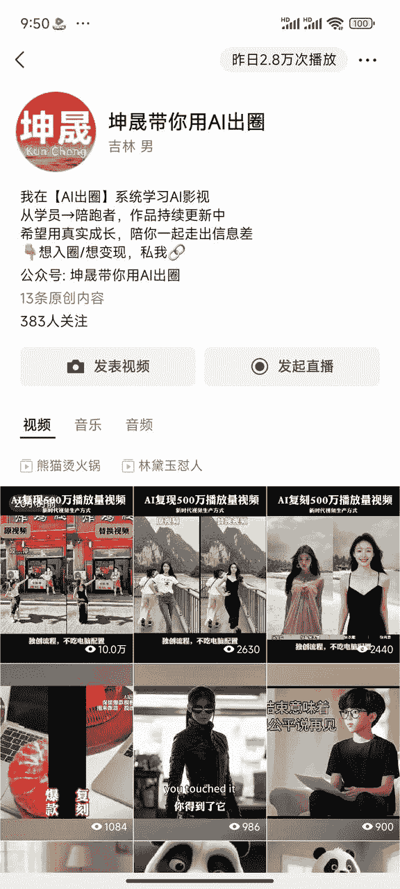

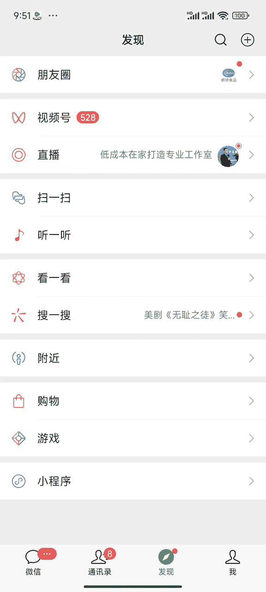

**这套方法**不仅让我收获了海啸般的流量，更重要的是，它具有极强的可复制性，希望能帮助大家在AI视频领域少走弯路，快速拿到结果。

**一切源于赚钱**，所以我在这个复盘里，会详细拆解这种AI同城视频，必爆的底层逻辑。

用这个方法，每一位完整参加AI视频航海的圈友，跟着做都能做出一样的效果。

如果你也为AI视频流量发愁，这篇文章就是你的转折点。

### 1.2 同城赛道机会巨大

#### 1.2.1 为什么选择同城赛道

在6月航海快结束的时候，有幸认识了赚钱航海家7先生并加入了他的AI视频创作组织，发现自己的影视基本功太差，又回头补了传统影视剪辑的课、又开始学习 PR/PS/AE ，不得不说，想做好视频，基本功是少不了的，但人的本能是回避高难度的学习，何况是短时间高强度的学习。

在AIGC创作领域，难道就没有边学习边赚钱的路径吗？做视频，能否另辟蹊径，让小白在学习的同时也拿到正反馈？

把心中的疑惑与7先生交流之后，7先生认为我之前就在实体行业，鼓励我先从同城这个熟悉的领域切入，用AI的能力复刻同城爆款，达到低成本高流量的效果。

#### 1.2.2 同城复刻逻辑：低成本一比一原创爆款

之前做同城的逻辑是，我们想在全网做出爆款很难，但做同城流量由于竞争对手能力一般，所以我们稍微努力就能在同城做的挺好。

现在逻辑完全反过来了，现在有AI的加持，我们可以全网筛选同城最火爆的视频，用AI极低成本复刻。

在赚钱经常听到一句话 “任何行业都值得用AI重做一遍”，但在AI视频领域，对于参与者，想轻松拿到结果的圈友，我想说的是 “任何同城视频都值得用AI重做一遍”，因为这个赛道的视频如果用AI复刻，完美符合上文所说的三个要素：赛道垂直、质量上乘、成本极低。

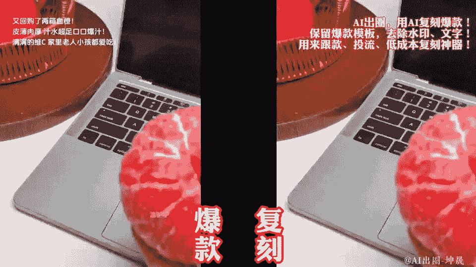

[下载 (17).mp4](https://internal-api-drive-stream.feishu.cn/space/api/box/stream/download/all/CA17bk5tToMIEZxCjLEckv3JnNf)

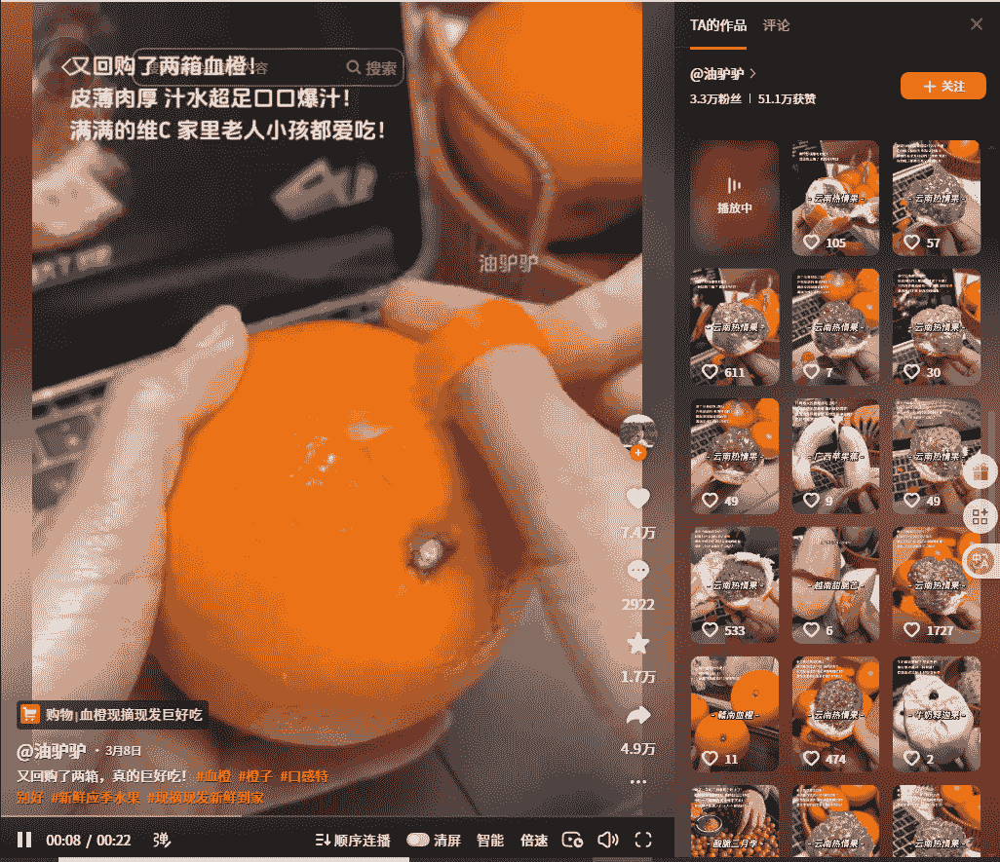

像这种视频，卖水果的。正常视频几个点赞到几百点赞，突然出来个 **几万点** 赞，找到这种视频就是找到宝了，这个异常值说明，这条视频所传达出来的画面和情绪是非常能打动人的，赚钱的圈友应该都能明白这种异常值的价值，无脑复刻就好。之前你想复刻这样的视频，从拍摄到剪辑，还是费点事的，用AI就太方便了，分分钟就复刻出来了。

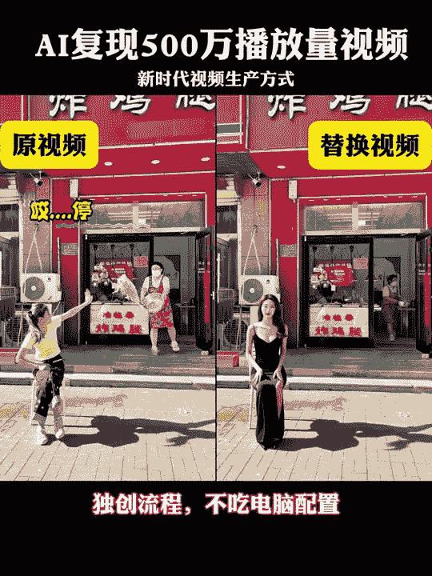

[下载 (18).mp4](https://internal-api-drive-stream.feishu.cn/space/api/box/stream/download/all/N0gobbEG1oCgVbxU4f0czFONnnh)

这种是有人物的，口型要想完美，需要抽卡，我这个为了省积分没怎么抽卡，基本是一遍过。但就是这个明显有瑕疵的复刻视频，一发出去就爆了。

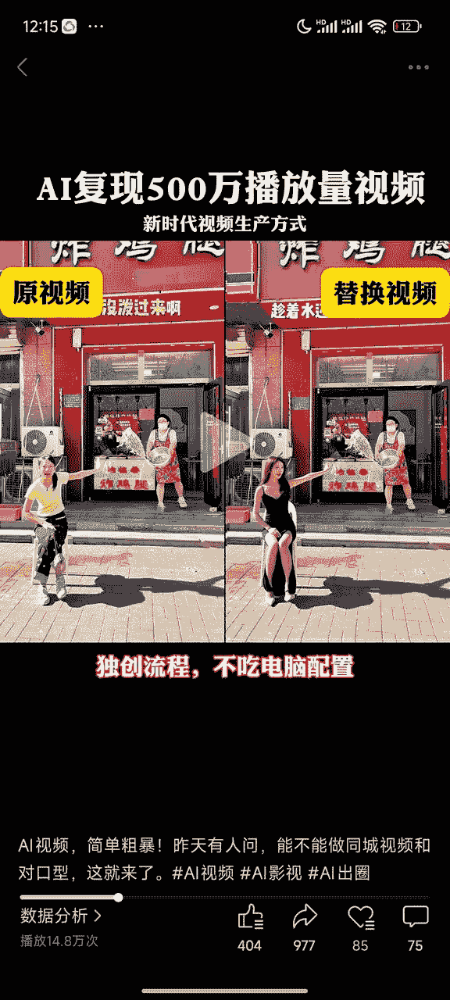

一天时间，播放十几万、涨粉500多、转发上千。这个数据虽然不是非常大的爆款，但在同城足够了。

更重要的是，这种视频制作成本极低，可重复性极强，并不是运气型爆款。

#### 1.2.3 为什么说，任何同城视频都值得用AI重做一遍？

我在实体行业多年，从抖音开放本地生活领域就开始做同城视频，最早做小酒馆，当时这个品类很难申请，需要报白才能入驻，当时还研究了抖音来客报白技术。后来做火锅食材云连锁、冷冻食品、烧烤，所用手法都是批量混剪，之前平台审核不严，一个新店2周内基本稳拿当地销量第一。

从抖音来客入驻申请到单量破千，当地销量第一，往往在2周之内：

但痛点长期存在：

找达人拍视频成本太高，不是大活动根本用不起。

让店长或老板出镜太难培养，大多数人连对着镜头说一句完整的话都费劲。

好用的脚本翻来覆去拍，一波之后就没流量了，又得找脚本。

##### 1.2.3.1 传统同城视频的三座大山：

+ 成本高（拍摄、真人出镜）

+ 效率低（制作周期长）

+ 创意枯竭（内容同质化严重）

有了AI就不同了，之前我们对标一个同行好的脚本，只能借鉴创意，仍然得拍摄、试吃、人员出镜，成本并不低。

最大的难度是人，当时使用的出镜员工，高底薪+提成，比她自己干收益高一倍，但仍不满足，动不动在拍摄的时候发脾气，有时让一群等一个人，管理成本沟通成本太高了，现在回想仍感觉心有余悸。

##### 1.2.3.2 AI带来的降维打击：

+ **成本革命：** 从几百上千每条的成本，降至几乎为0。

+ **效率革命：** 一个脚本素材 从按天录制到按分钟生成，实现工业化生产。

+ **创意革命：** 从模仿爆款到量产爆款，甚至超越爆款。

AI视频在同城赛道的核心优势不是“以假乱真”，而是成本和效率的绝对碾压，这才是真正的护城河。

### 1.3 哪些同城领域适合用AI视频复刻爆款？

带货视频的三要素，就是人、货、场，AI视频的优势，在于保留三要素的同时，用AI技术低成本复现。

这三个要素中，人的复现相对最难，特别是动作比较多、口播比较长的，复刻相对困难，目前的模型对口型还是不太自然；我们制作中有选择时，优先用台词少的爆款，制作简单效果好。

货和场的复现，非常完美，有些视频做出现，甚至肉眼难以分辨，但新视频的确是用AI重新生成的。

#### 1.3.1 主要展示人的视频：

AI复刻适合的人物形式：

+ 无台词，展示美食制作过程

+ 无台词，展示服装及模特转场

+ 有台词，人物非特写

+ 有台词，但不用精准对口型

像这种视频，就很适合低成本AI复刻：

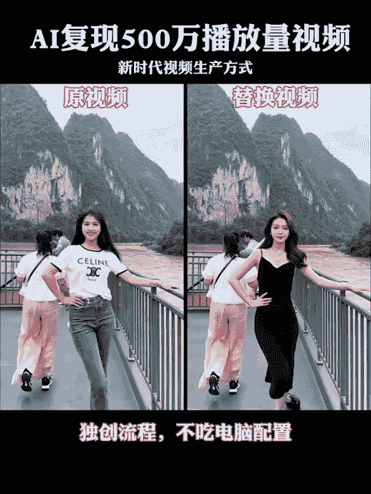

[下载 (24).mp4](https://internal-api-drive-stream.feishu.cn/space/api/box/stream/download/all/EstLbmEetoQ7XixAANWcS7fCn0g)

AI复刻不适合的人物形式（能做，但成本高）：

+ 长台词，人物面对镜头讲解类

+ 多台词，多人物对话类

+ 无台词，人物运动轨迹太大

#### 1.3.2 主要展示货的视频：

餐饮美食、水果、零食、服装、电器。

**几乎所有产品展示类视频**，都适合AI完美复刻，目前遇到最难的复刻是 手撕橙子上的薄膜 ，但抽卡几次仍然能完美复刻。

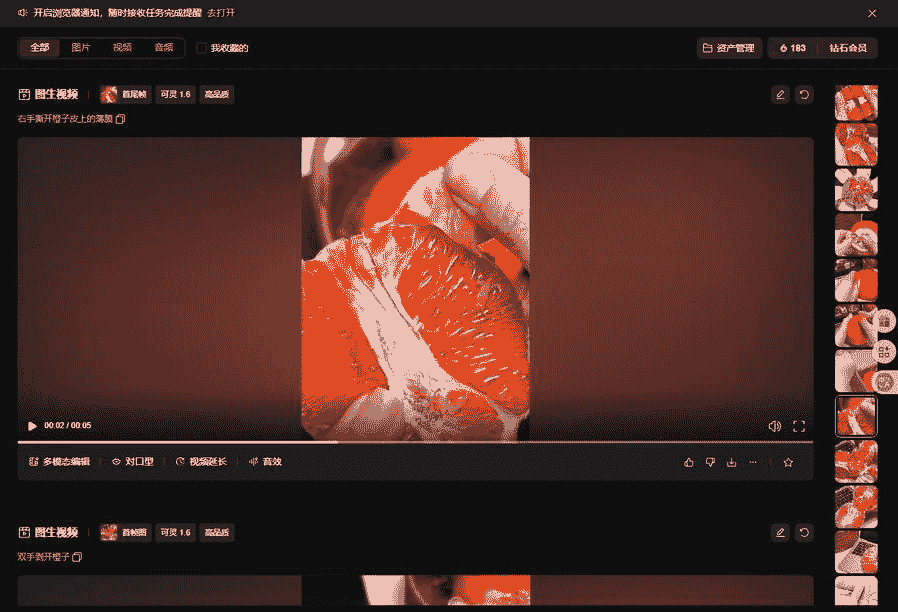

#### 1.3.3 主要展示场的视频：

花草植物类、房产类、旅游类，有场景展示的视频，用AI复刻基本都很完美，并且上手极为容易，新手半个小时就能出视频。

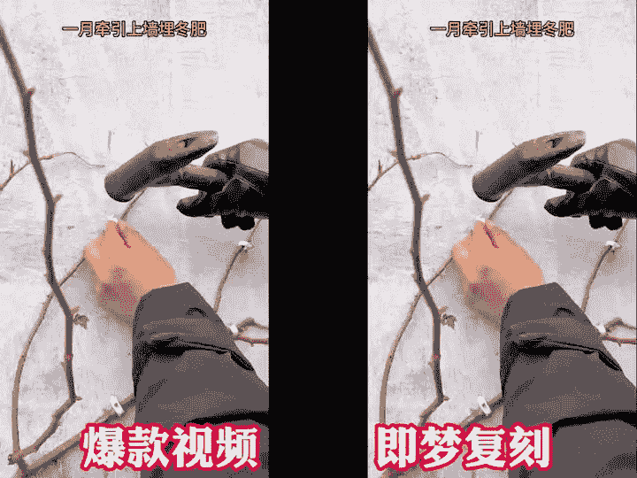

[花草.mp4](https://internal-api-drive-stream.feishu.cn/space/api/box/stream/download/all/Tf9JbMVQhoDziVx8nWCczhAon5d)

这类视频一般使用首尾帧方式，就是把视频片段的首帧和尾帧截取，重新生成和原视频同样角度、运镜、氛围的视频。

## 二、【战术】AI视频，从复刻到创造

### 2.1 【核心战术】用AI一比一复刻同城爆款，保姆级教程

下面，我们就用一份保姆级教程，来详细拆解AI如何一比一复刻同城爆款。

#### 2.1.1 无人物：水果类视频复刻方式

核心流程：剪映分镜 → 做出首尾帧 → 图转视频 → 剪辑还原

第一步：把对标视频下载，导入剪映用 `智能镜头分割` 功能把视频按分镜分割出来。

+ 原理：找到每一个分镜的首尾帧，重新生成画面，肉眼看起来视频一模一样，却是完全原创的。

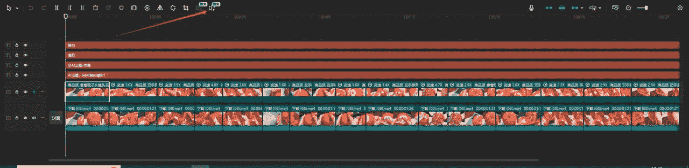

第二步：选中分割好的视频，右键 `导出所选片段` ，就能轻松把视频按片段导出。

+ 出来的视频会按顺序排列：`视频-1`、`视频-2`、`视频-3`......

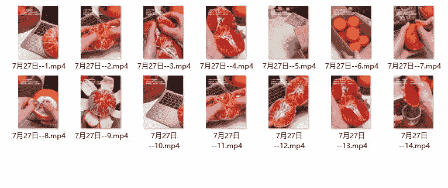

第三步：打开视频的每个片段，用 `Ctrl + E` 截取当前源画面 功能截图，依次截取首帧和尾帧，保存备用。每一个片段会产生两个图片，按顺序排列好，后面就不会乱。如 `1-1`、`1-2`，`2-1`、`2-2`......

+ 电脑自带播放器很难截图，我测试出来最好用的播放器，下载链接会放在本章最后。

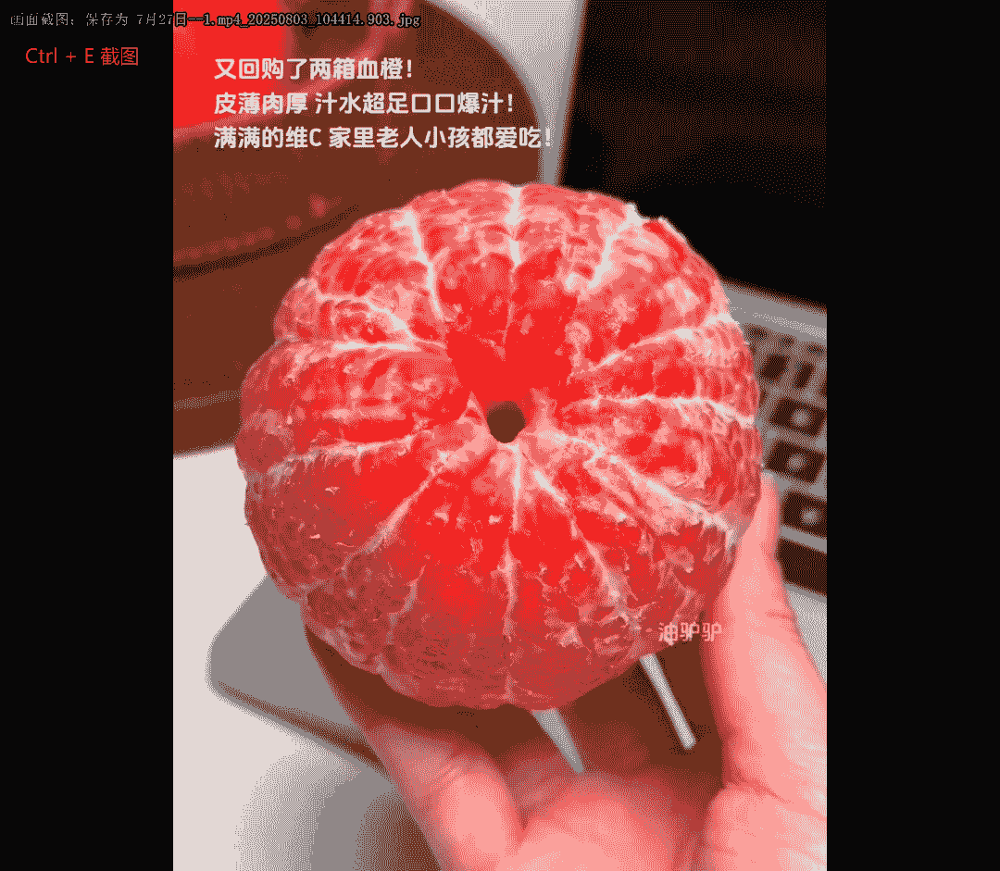

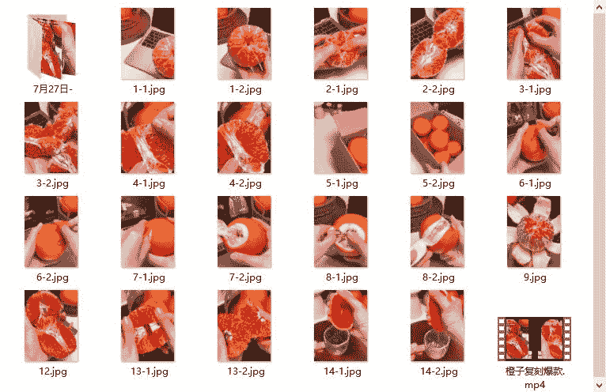

第四步：图片处理，用WPS最方便，统一处理为9：16，扩图2-4倍，一键去水。重要：图片清晰度决定了视频清晰度。

+ 反复对比过多个工具，WPS最快，最好用。会员可以在闲鱼买，一天1毛5。

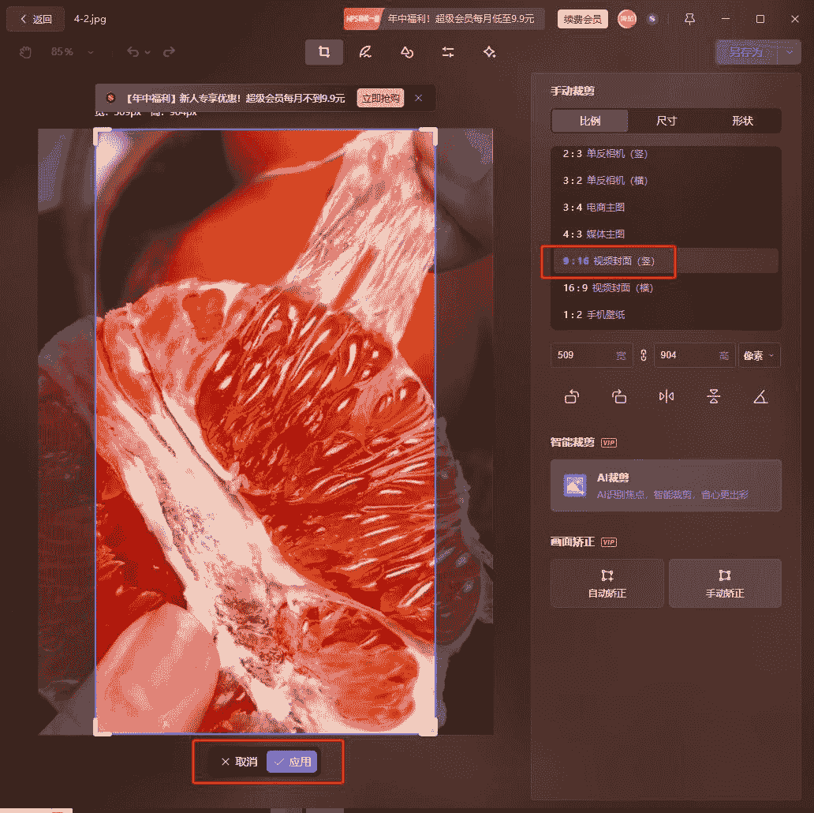

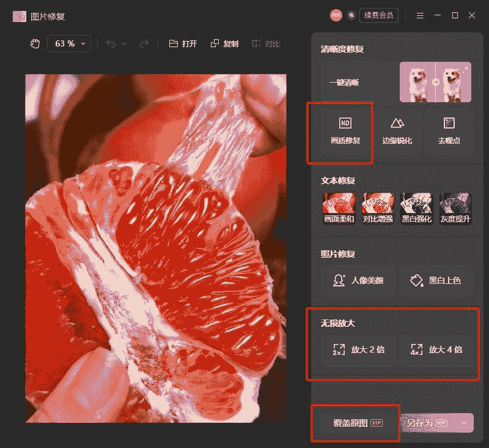

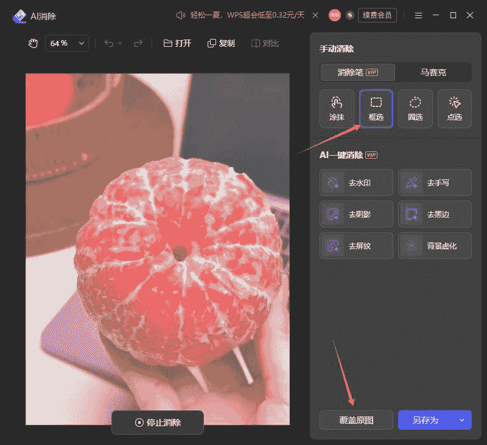

第五步：图生视频，用可灵的首尾帧功能，生成视频。注意提示词，有些镜头有必要提示AI怎么运镜。下图这种是最难生成的，要让AI复现撕掉橙子皮，这要求首尾帧必须截的容易理解，稍微错一点AI就理解不了。

+ 为什么用可灵？1.积分几乎可以无限白嫖；2.生成视频画面极稳定。

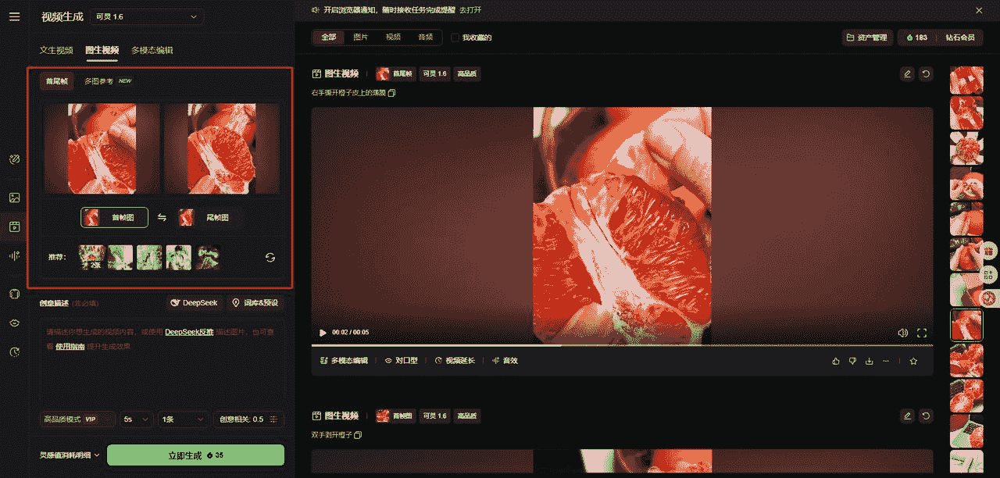

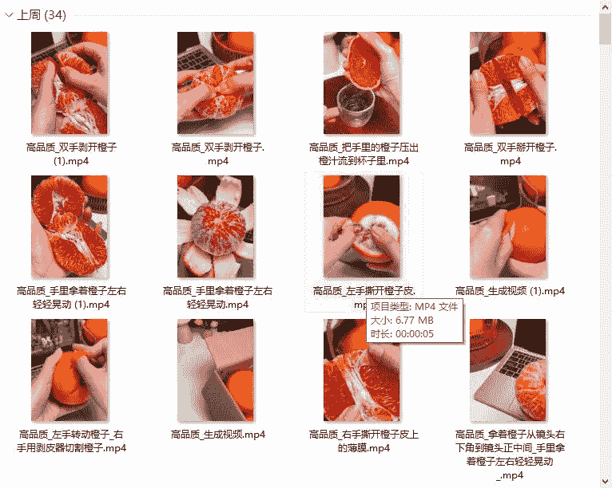

第六步：剪映成片，所有视频导入剪映，把生成的视频调整为原视频一样的速度、长度，音乐卡点都能对应的上。一条和爆款一模一样的视频就出来了，关键是原创的！

+ 如果想增加原创度，可以稍微切割原视频音乐，再另外加几个合适的音效，原创度更高。

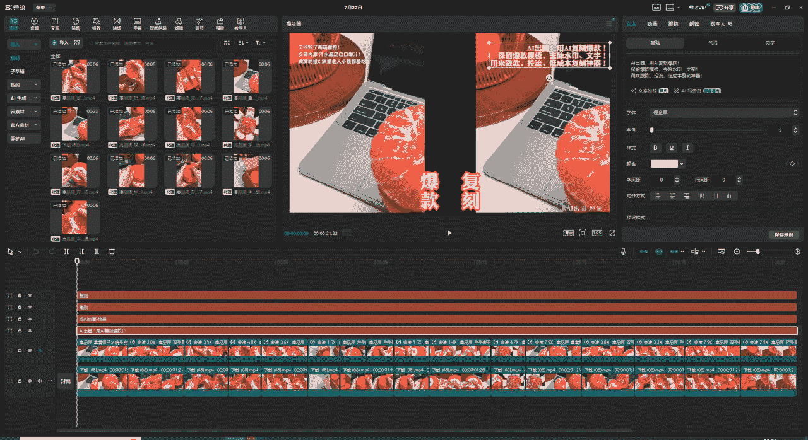

#### 2.1.2 有人物：同城引流类视频复刻方式

核心流程：剪映分镜 → 制作人物形象参考图 → 多模态换人 → 剪辑出片

第一步：下载对标视频，导入剪映，速度调为 `0.4-0.8` 之间，分割为 `00：00：05：03` 的长度导出。

+ 速度调慢才能精细化还原人物动作、口型

+ 分割长度是5秒零3帧，这是因为可灵生成的视频是这个长度

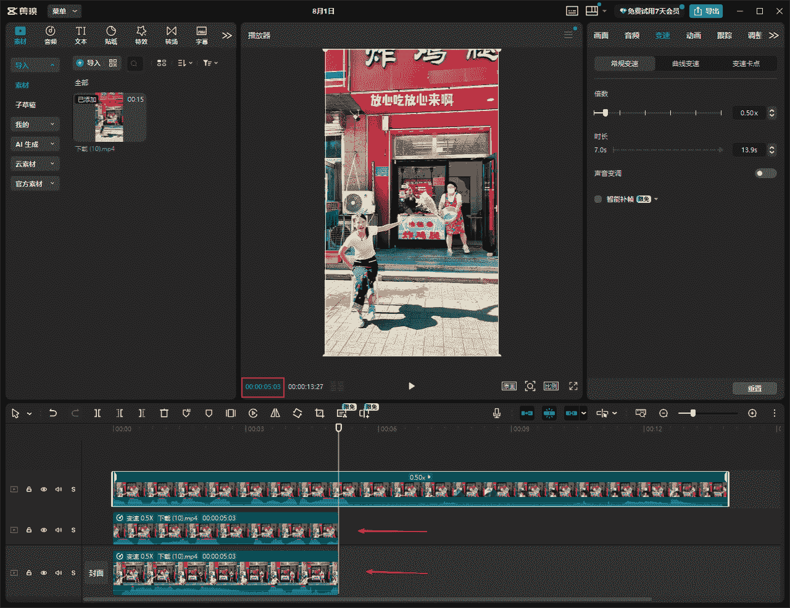

第二步：选中分割好的视频，右键 `导出所选片段` ，就能轻松把视频按片段导出。

+ 导出来的视频会按顺序排列：`视频-1`、`视频-2`、`视频-3`......

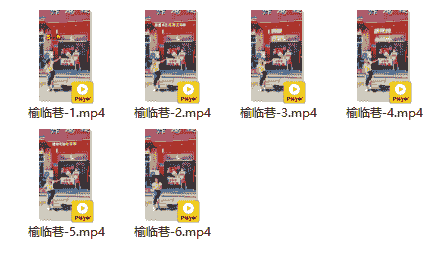

第三步：用可灵生成你要用的人物形象，对标视频是全身，就生成全身；对标视频是半身，就生成半身。提示词开头要这么写：`苹果手机实拍`。这样生成的人物才真实，不然会有二次元风格，放到同城视频上直接穿帮了。

+ 背景必须是纯色，推荐纯白，如果能抠像只保留人物效果更好。

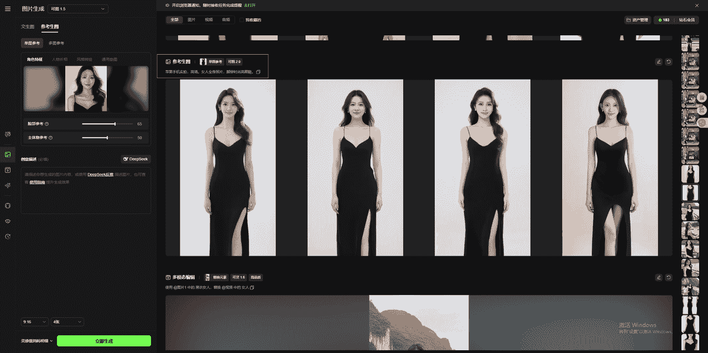

第四步：用可灵的 `视频生成→多模态编辑` 功能，按视频片段上传视频，会跳转到多模态编辑页面，用 `增加选区` 功能点击原视频的人物，每隔一秒都选中一次，确保整体视频都准确选中人物，还可以预览是否完美选中，确认后点 “确定”。点击上传人物形象做为参考图，可以一键选择人物，生成的视频干扰会少很多。

+ 选区很关键，选中后一定要预览，因为选的不干净，视频直接会报废。

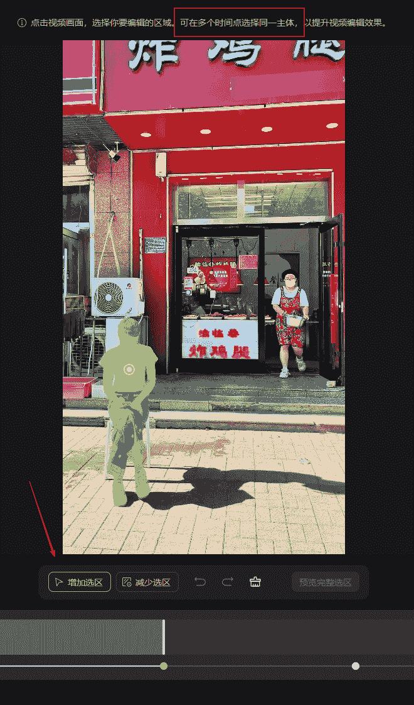

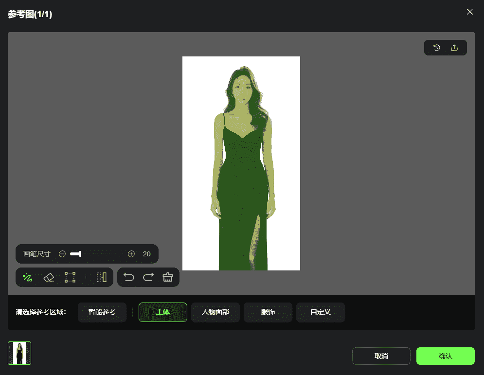

第五步：创意描述里写明白 “使用【`@图片`】中的 【】，替换【`@视频`】中的 【】”，后面跟上 “使用原视频的光源和人物动作”，提交时建议选择高品质，高品质是50积分，比普通35积分生成的效果稳定，抽卡少了反而省积分。

可灵有无限积分的玩法，用起来基本是0成本，但我在6月航海时分享过即梦的白嫖玩法被赚钱删掉了，可能赚钱不支持这种薅羊毛的作法。圈友们想省钱的，可以去搜搜，这里就不详细说了。

+ 提示词不改效果就挺好，想效果更好可以加上：`使用原视频光源和人物动作`。

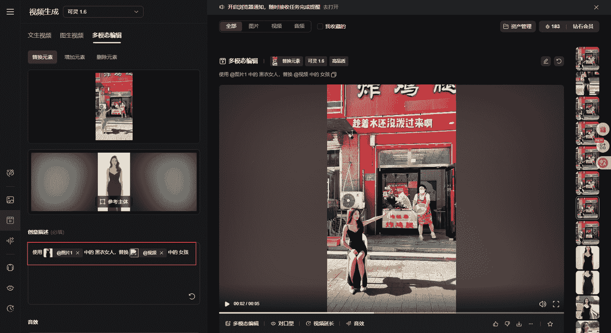

第六步：下载可灵生成的视频，导入剪映，你会发现刚好是 `5秒零3帧`，和第一步切割分段的长度完美对应。

要注意，在第一步我们特意把视频调慢了，目的是为了尽量的完美还原人物动作和口型，在这步要把可灵生成的视频再加速，就能和原视频同步了。比如我在切割时把原视频调为 `0.5倍速`，那么可灵生的视频得调为 `2倍速`，就可以和原视频同步了。

音乐卡点全部不用调，导出就是视频成品。

+ 唯一不是原创的就是声音，可以把声音稍微切割再加点音效，声音也是原创的了。

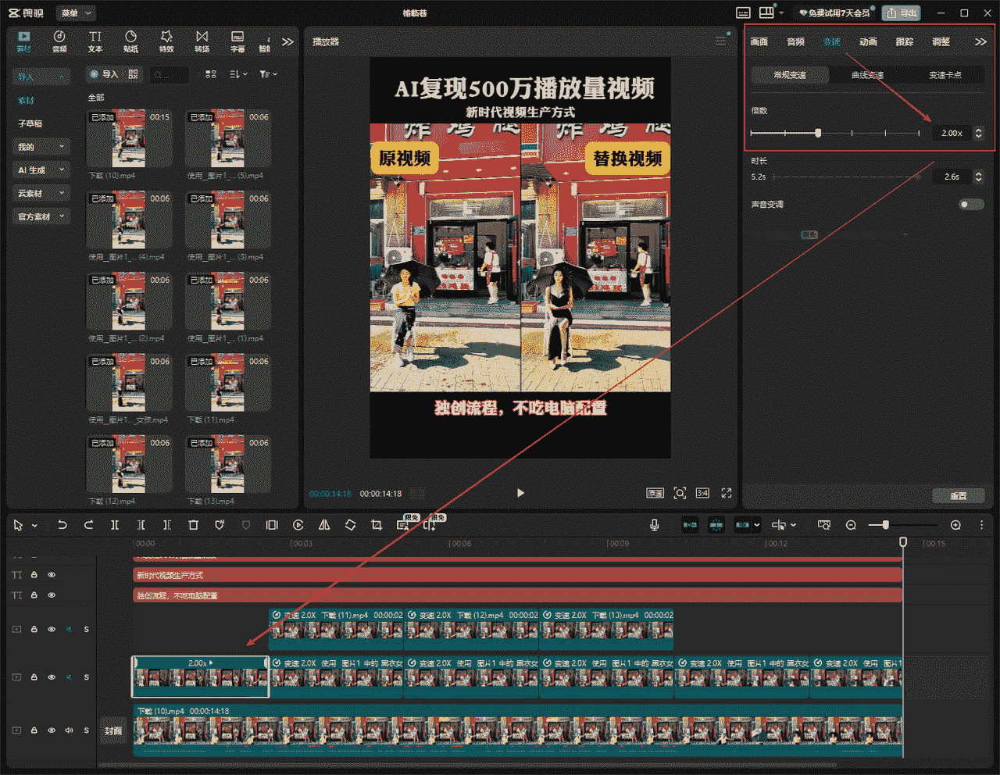

总结：

这种一比一复刻方法的本质是开卷考试，借用已经被市场验证过的场景、文案、情绪、节奏和内容框架，是做出爆款成功率最高的打法。

### 2.2 【进阶战术】批量矩阵法：规模覆盖，以量取胜

核心原理： `一个爆款脚本 + N个AI变量 = N条原创视频`

#### 2.2.1 换背景

同一个人物形象，更换不同背景，生成的视频就完全不同，适合已有脚本只需要填充素材的模板。

### 2.2.2 换主角

同一个脚本和背景，换成不同风格的AI人物形象，适合固定场景但缺乏内容素材（御姐、萌妹、大叔、动物）。

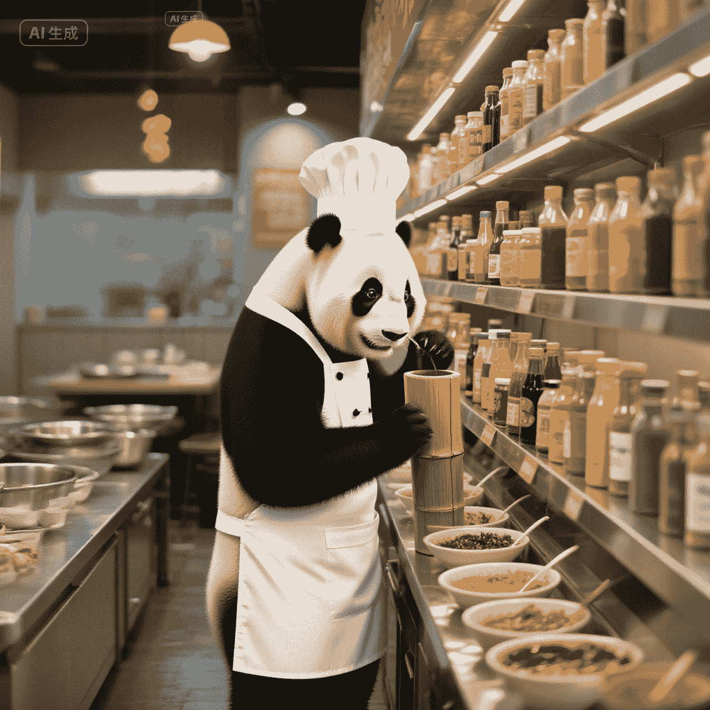

### 2.2.3 换产品

比如水果店，同一个场景，展示不同的水果（今天卖草莓，明天卖樱桃）。

或者你不想更换人物形象，只想更换菜品，都适合换产品的方法。

如果做探店，博主形象就不能更换，很适合这种方案。

## 2.3 【终极战术】零素材生成法：4条AI视频制作原则

当本地市场没有可供复刻的爆款时，如何自己创造？

有时候，我们不得不自己制作图片、声音，怎么能让AI按我们的心意输出作品呢？

生图提示词技巧在这时就显得尤为重要了，提示词（Prompt）是决定生成结果的关键，可以根据你的具体需求，以如下方式拼接你的提示词：[ 主体描述 ] + [ 风格设定 ] + [ 细节要求 ] + [ 视觉氛围 ] + [ 分辨率/比例 ]

我还整理了4条视频制作时要遵循的原则，能让你生成的视频镜头感更好、

### 2.3.1 图内元素检查

这里所说的图内元素是指文字生图时，描述词的生成要考虑到图生视频时的镜头转折和必要的元素。因为当你生成图片之后，如果没有指定xx元素，而图生视频时又提到xx元素，AI就会迷惑，就会给你生成一些莫名其妙的东西出来。你不能让AI瞎猜，一切镜头都得建立在图里有的东西上。

+ 比如：坐在桌边的女孩，面前是餐厅的桌子，通过玻璃能看到外面的夜景，城市霓虹闪烁。这种图片，才会生成 “中景→推镜头到街道外景” 的视频。

### 2.3.2 一致性核查

图像风格、光影设定、人物特征、关键道具这些内容，提示词设定的是否全部一致？

+ 可参考提示词框架来核查：[全链路创作准则与提示词框架 (V13.1)](https://pvr85v059lf.feishu.cn/wiki/H3jewIWuhiE0o5kOMEOcD2hKnwc)

### 2.3.3 多镜头结构

为了增加效果节省积分，提示词是否完全考虑到多镜头结构？多镜头是否基于图内已出现的角色或物体？

+ 多镜头案例：中景→特写→转场，消耗同样的积分，得到三个分镜。

[jimeng-2025-06-19-318-前1.5秒，荣老板听着电话，表情慌乱。第1.5到3秒，切换到他的脸部特写，他的表情从慌乱变为“没问题，交给我”的坚定和责任感。后两秒，镜头快速切换到背景中被....mp4](https://internal-api-drive-stream.feishu.cn/space/api/box/stream/download/all/X2qJbO0IIome10xgFHZcquF0nEf)

### 2.3.4 软件的分工边界

Gemini 2.5 → 豆包 → 即梦3.0 → 剪映，是我常用的创作路径，不同软件的能力需要明确告诉AI，不然AI很擅长“全面性”，给出的提示词喜欢让生视频时“LOGO和Slogan缓缓浮现”，当告诉AI不同软件的分工边界，明确让他知道AI暂时还不擅长文字性内容的处理，该交给剪映的就交给剪映，AI会理解并记住“边界”，就不会经常提示一些超出AI生图生视频能力的提示词。

## 2.4 发布的三种方式

### 2.4.1 以带货视频的方式发布

这种就是直接发视频带货，目标客户是同城消费者，变现是根据视频个数收费或根据销量赚佣金，变现最直接。

和探店达人，好物种草的逻辑是一样的。

### 2.4.2 以对比视频的方式发布

这种是以两个视频并排对比的方式发布，目标客户是对这种AI视频技术感兴趣的群体，变现路径是加到私域后转化知识付费课程。如下图。

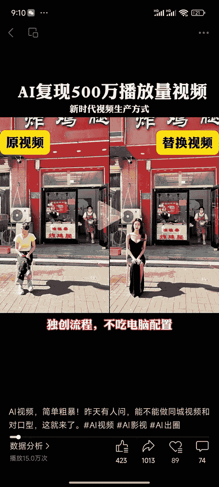

### 2.4.3 以拆解视频的方式发布

这种发布方式主要是呈现对视频的拆解过程，目标客户是想学这种AI技术的人群，变现路径是加到群或私域卖工作流。如下图。

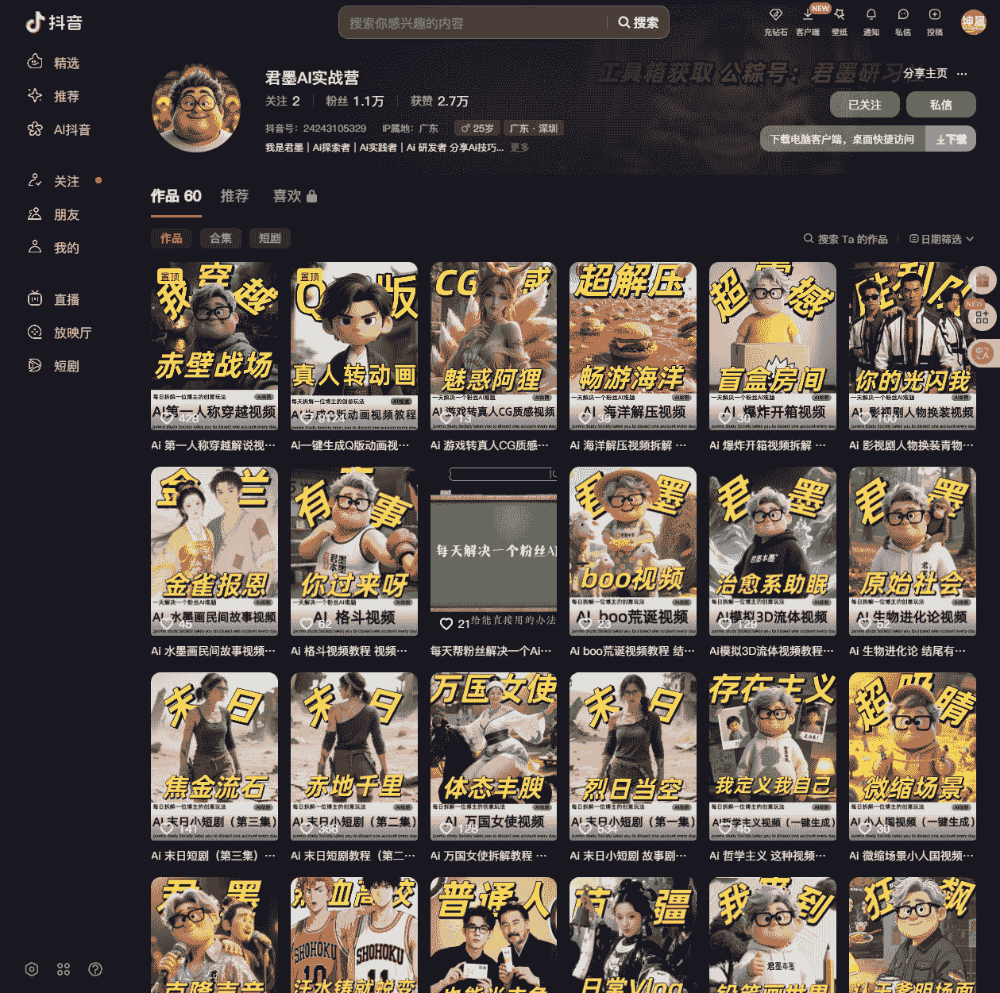

## 视频播放软件下载

这个爆款复刻的方法需要大量截图，但大多播放器截图功能极不友好，反复对比发现一款最好用的，快捷键截图很方便，其它功能也强大，需要的圈友可以直接下载。

两个文件，一个是32位，一个是64位，根据电脑系统选择。

[`PotPlayerSetup.exe`](https://internal-api-drive-stream.feishu.cn/space/api/box/stream/download/all/TE3cbeLiDojAcuxEs2fcjMrxn9e)

[`PotPlayerSetup64.exe`](https://internal-api-drive-stream.feishu.cn/space/api/box/stream/download/all/ZiOhbKYrBo5jt3xdhpGcNHpnnth)

# 三、【原则】磨刀不误砍柴工：AI同城视频创作原则与10大天坑

工欲善其事，必先利其器。

在AI视频创作的战场上，工具本身不是最重要的，但一套顺手的工具组合，能让你在执行战术时如虎添翼。

同时，了解前人踩过的天坑，能让你省下大量的时间和金钱。

在这一章，我将毫无保留地分享我个人正在使用的全套AI工具组合，并为你揭示新手最容易踩的10个天坑。

这部分内容，建议你在实操时反复观看，仅仅是省下的平台积分也很受用。

## 3.1 AI视频创作原则：选题大于一切

做AI视频比做传统视频省心多了，视频爆不爆完全取决于对标视频有多爆，之前做视频就算找到对标的爆款可能也没法模仿，技术上或人员上不具备相关的条件，找到爆款也无法落地为自己的内容。

现在用AI做视频，完全没有限制，我们可以放心大胆的一比一复刻爆款，所以选题大于一切，找对标只找全网最爆火的对标即可。

我选择对标是直接在平台搜关键词，就是直接在搜索栏搜索，不用像之前一样要用抖音热点宝之类的做精华化搜索，因为我们的方案成本低到了极致，没有必要精细化筛选对标。

AI视频的世界不做选择，我们全都要。

直接在抖音搜索栏搜索你的行业关键词，点视频栏，这个关键词相关的全网最火爆视频就全部出来了，根据复刻的技术难度选择，低成本对标全网最火爆视频：

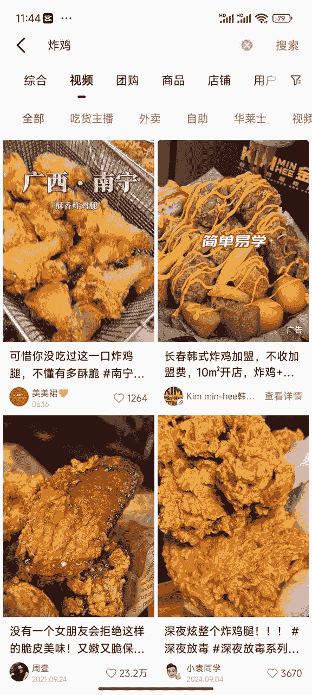

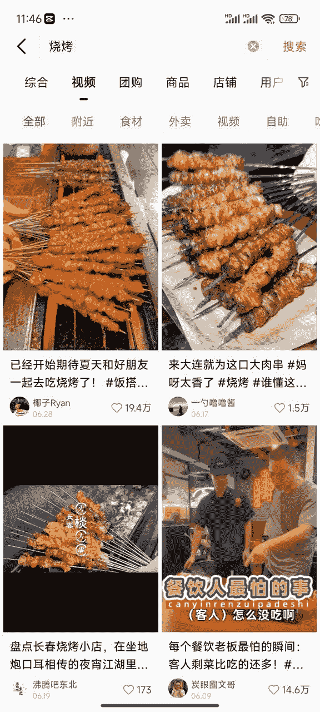

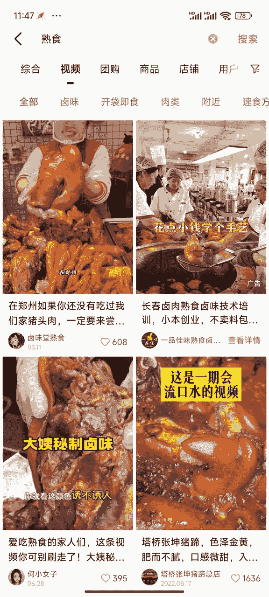

## 3.2 新手必踩的10大天坑（避坑指南）

> 工具是死的，人是活的。以下10个坑，是我和许多圈友用真金白银的“积分”和时间趟出来的，希望能帮你完美避开。

天坑一：AI味太重，视频一眼假

生成的AI人物皮肤光滑如假人，有塑胶感，表情僵硬，让人感觉不真实甚至有点诡异。

+ 在提示词里规避，让AI知道你要求的是真实感。我比较常用的提示词就一句话：苹果手机实拍。后面接上正常提示词。

天坑二：对口型完全错位

人物嘴巴在动，但和声音完全对不上。或者口型很夸张，让观众产生不适感。

+ 可以按我教程中的方法，放慢原视频速度再分段处理，一般能解决。另外在选择对标的时候，尽量直接放弃动作和台词太长的视频。

天坑三：无视版权招惹麻烦

视频火了，但收到了原作者的投诉或平台因搬运导致的限流。

+ 建议：人声100%原创！这是铁律。使用原视频的BGM一般是安全的，对标的人声千万不要抄。

+ 要尊重肖像权，非公众人物千万不要直接使用对方的形象，一投诉一个准。

天坑四：大量浪费积分

不断抽卡，追求完美镜头，积分

+ 先完成，再完美。80分的视频已经能打败大多数对手。

+ 积极利用平台的积分任务，如可灵的会员发布作品得积分，只要把你练手的视频上传发布，就能获得灵感值，没学会赚钱之前，最好先学会省钱。

+ 其实很多视频虽然不完美，剪切一下完全能用，高手并不是抽卡抽出来的，达成结果的方法很多，不要死磕模型的概率。

天坑五：沉迷工具忽视内容

天天津津乐道的是平台新功能出了没，哪个模型又更新了，但自己一个月没发一个视频。

+ 记住，用户只为好内容停留，不为新技术喝彩。你的核心是复刻爆款内容的情绪和节奏，AI只是降本增效的工具。用好手里的可灵和剪映，比追求新技术新模型重要100倍。

天坑六：账号没有统一性，内容不垂直

今天发动漫风，明天发写实风，账号看起来像个AI工具展示橱窗。

+ 在开始前，用Midjourney或可灵生成一个AI人物形象，并确保所有视频的风格、色调、主角形象保持一致，建立账号的品牌认知。

天坑七：不落地，AI视频不像在本地

视频很精美，但感觉像在任何一个城市，没有本地特色。

+ 一定要记住，你做同城，你的客户就是同城，外地流量毫无意义。

+ 想办法加入本地元素，如配音用本地方言，背景用本地标志地标，前期标签不准的时候还可以在标题中写上自己的城市名。

天坑八：剪辑节奏平淡如水

视频素材不错，但成品平铺直叙，没有重点，让观众感觉索然无味。

+ 短视频时代是注意力经济，前三秒一定要抓住眼球，不然后面提供再多价值也没意义。

+ 严格对齐原爆款视频的剪辑节奏，注意BGM的每一个鼓点，每一个转场的时间点。

+ 我们这套打法的精髓就是复刻情绪节奏，而节奏是由剪辑决定的。

天坑九：文案不说人话

视频的标题和文案，充满了技术术语或缩写，不知所云。

+ 把自己当成小学生，对标怎么写你就怎么写，不要创新，不要创新，不要创新！

+ 直接抄本地最火视频的文案风格。他们怎么写，你就怎么写。数据验证过的东西，不用质疑。

天坑十：完美主义，永远发不出第一条

总觉得自己的视频还有瑕疵，不敢发布，每天都很努力的在学新技术新思路，其实是虚假努力。

+ 请记住，在同城赛道，60分的原创AI视频，就已经碾压了大多数商家0分的线上内容。

+ 发布，是治愈一切精神内耗的良药。

# 四、【变现】打通商业闭环：从流量到变现的四种路径

## 4.1 【生存层】单兵作战：用AI复刻爆款，快速变现

个人能做，利润可观，上手快，一两个视频爆了就能打出名气。无论是赚取佣金，还是为本地商家提供单次视频制作服务，都能让你迅速获得正反馈，拿到第一桶金。

### 4.1.1 你的产品是什么？

大家切记，产品不是视频，而是AI爆款复刻服务。

我之前接本地生活商单就很吃亏，商家会以为你是个 “做视频的”，价格按视频数量算，能把价格压到最低，同时又得承担从抖音来客注册到套餐上架做图等一系列免费工作，商家根本就不领情。

我们复刻爆款这个打法，视频打爆轻轻松松，谈客户要有底气，定位要定准，我们就是提供爆款复刻服务的，按视频个数收费，不额外做其它工作。有爆款案例，有收钱底气，收钱反而容易。

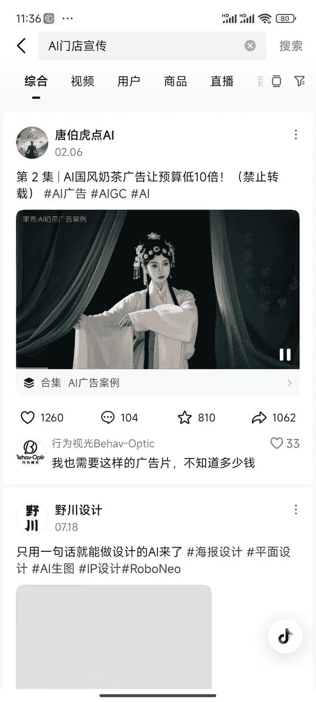

### 4.1.2 如何定价？

钩子产品：

前三条视频免费体验，只为交个朋友，见证效果。用零成本的AI视频换取一个宝贵的本地商家案例。

+ 适用于必爆的产品，比如远低于市场价的开业优惠，或商家下重金打造的网红套餐。这种产品普通推广也能爆，在没业务的时候可以考虑卖个人情免费推广一次，目的是借助商家的势能让自己一战成名。

单次服务：

500元/条或1000元/条的套餐，专门针对那些尝试性促销需求的商家，这种商家离互联网很远，基本不会回购。

+ 这种推广一次抠抠搜搜的小商家，不会复购，容易扯皮，一定要先收钱。

按效果付费：

直接在视频里挂载商家的团购链接，从销售额中抽取10%-20%的佣金。这是最考验效果，也是最有说服力的模式。这种商家已经是老玩家了，不会听你讲个概念就轻松付费，他们也踩过无数不靠谱探店达人的坑，想赚他们单个视频的钱很难。好处是这种商家有效果是真给钱，不扯皮，会长期合作。

+ 这种商家更容易被动成交，看到你的案例会主动找过来合作，成交链路极短。

### 4.1.3 第一批客户从哪里来？

地推拜访：

直接拜访本地餐饮店，地推效率虽然不高，在起步期仍然是值得使用的方式，能积累第一批用户，商家抱着试一试的态度，也能成交一部分。

线上截流：

做几个不错的视频，在抖音团购搜索本地商家，给商家的视频点赞、进主页查看，会吸引一批商家回来看你主页，视频质量可以的话，会有主动询单。

评论区成交：

这是我喜欢用的方式，成交链路短，极为丝滑。先做出爆款，然后评论区会有商家直接问价格，记得加上联系方式之后，把问价的评论及时删掉，能有效防止跟你同一段位的选手在你的评论区截流。

## 4.2 【发展层】工作室模式，建立壁垒

成为品牌方的全案服务商，批量制作视频保证流量供给。可以让其它学AI视频的圈友远程协作，视频单子分给圈友，建立起一个轻资产的远程协作团队，赚取批发差价。

### 4.2.1 身份转变：从视频制作到资源整合

你的核心工作不再是视频制作，而是项目管理和资源整合。从一个单点的技能转变成项目经理的角色，上游对接品牌商家，谈定交付标准和价格。中游规范接单流程和作业流程，让干活的人有标准可以遵循。下游对接视频制作的个人或小工作室，明确制作标准，负责审片定稿。

### 4.2.2 服务产品是什么？要做到套餐化

包月套餐：

+ 基础版：1999元/月，每周2条视频，每月8条AI复刻视频 + 账号基础运营。

+ 进阶版：4999元/月，包含15条AI视频（含2-3条轻度原创）+ 每周数据反馈 + 评论区维护。

全案服务：

不仅提供AI视频，还整合本地的探店达人，为中大型商家提供“AI+真人”结合的整合营销服务，客单价可达万元以上。探店达人的视频爆不爆是有概率的，组织一波真人探店的最终目的，是能新筛选出几个爆款模板，然后用AI视频复刻放大。循环往复，有用不完的爆款模板，这些模板经过市场验证，复刻也会爆。

### 4.2.3 工作室模式如何建立壁垒？

建立SOP：

将你的爆款复刻方法论，制作成内部的SOP文档，让任何一个新人都能快速上手，保证交付质量。

+ 内容要足够傻瓜，细节要规范，如视频尺寸比例、导出像素、交付链接等等。

发单逻辑：

我们给同行发单，或给个人剪辑发单，一般会要求对方按模板标准制作出一个视频，合格后才合作。

这一步骤能减少漫长的沟通过程，不然来回修改沟通的人力成本，比自己亲自做视频成本还高。

我们建立了发单SOP制度之后，客服成本大大降低，之前100个人的群需要几个人忙活，客服加财务弄的手忙脚乱仍然出错。现在一个客服管2-3个群很轻松，3-4个客服配一个财务就够用。

+ 一定要重视，我们沟通上踩了很大的坑，时间成本也是成本，甚至是更高的成本。

这是我们正在用的 发单SOP，需要的圈友自取：

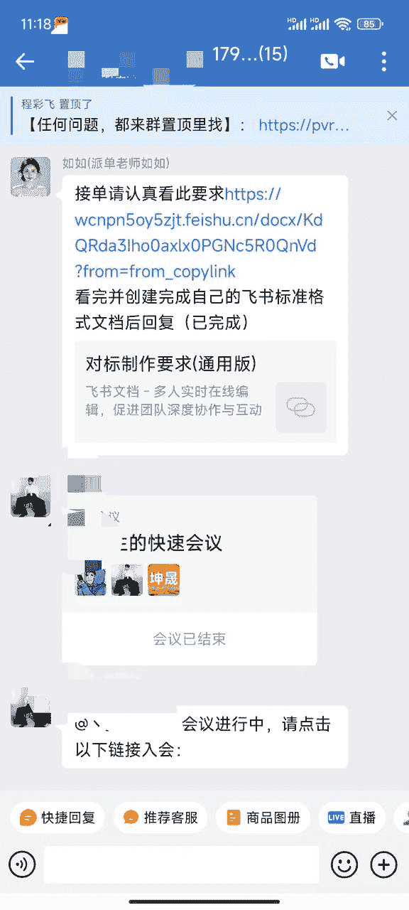

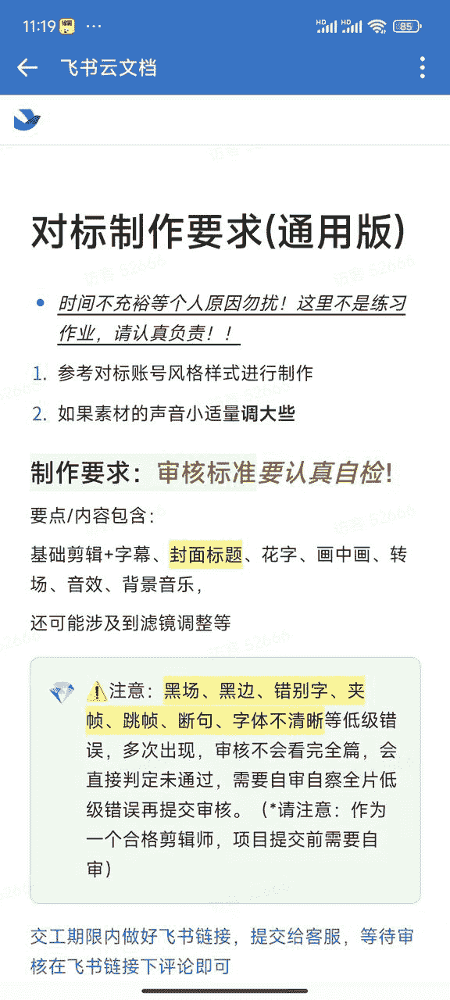

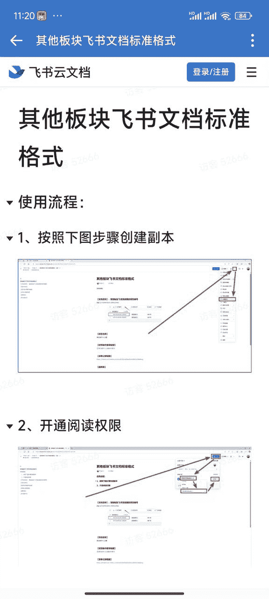

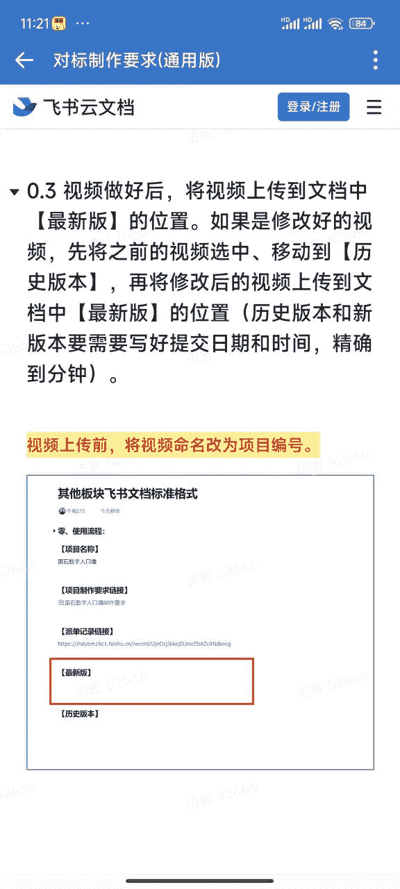

圈友协作网络：

在赚钱社群里，找到愿意接单的圈友，建立一个远程协作群。你负责对接客户和审核终稿，他们负责执行，你赚取20%-50%的差价。

+ 几乎所有品牌甲方都需要开发票，发单前也要说清楚，给圈友的价格含不含税点。

## 4.3 【引领层】知识变现：梳理方法论，成为AI淘金的卖水人

可以直接卖课，方法简单上手快，课程能卖几百元，赚取知识付费的收入。

我的视频爆了之后，一条视频过来加好友的上百人，都是在问视频怎么做，部分人有付费意向。

操作也简单，仅仅是把这篇文章打包售卖，价值也够票价了。

### 4.3.1 你的知识产品是什么？

9.9元引流课：

把这篇文章的核心教程部分录制成一个1小时的视频课程，作为你的引流产品。网络上加过来的千万不要推高阶课，一开始我的视频爆了之后就踩了这个坑，这种粉丝缺乏信任，不可能成交高阶课，不要推超过20块钱的产品。

999元实战营：

提供为期21天的社群服务，包含作业点评、每周直播答疑、最新AI工具分享。

这种实战营只能卖给和你深聊过，有主动付费意愿的人。

**9999元私教服务：**

针对想成为工作室的学员，提供一对一的指导和资源对接。

这种利润极高，交付并不重，把你工作室的全套方案资料复制一份，有基础的人就能干起来了，主要的交付是以年度为单位的不定期咨询。

### 4.3.2 你的人设是什么？

每个人可能有不同的思路，有些喜欢建立专家型人设，有些喜欢接地气一点，没有对错之分，就看适不适合。

我个人的体感是，IP要更真实、更有共鸣。

所以我不标榜我是AI大神，基至我在视频号的签名里特意写明我是 “从学员→陪跑者” ，想学AI视频的人可能更信任一个从0到1用AI在同城赛道拿到结果的实战派。

### 4.3.3 获客式IP成交链路

你做的每一条爆款同城视频，都是你最好的招生广告。在账号主页留下你的联系方式，自然会有人付费学习。

我们实测出来的最佳路径是通过👸号中转，很丝滑，让用户先关注👸号，这一步很案例的把用户留在你的浅层私域里，关注的自动回复和👸号菜单，都是引导用户加🛰️的。

经过中转之后，引流基本就不怎么触发违规了，还多沉淀一个浅层的👸号私域。

## 4.4 【平台层】官方下场，圈友抱团

### 4.4.1 赚钱官方带圈友下场

在赚钱这么好的平台，以线下航海或类似的形式，组织一帮圈友下场，做各自区域市场的王者，并不是难事，技术上容易学，业务上好落地。视频爆了之后，业务并不局限于当地，因为有爆款案例作信任背书，客户都是主动找过来，异地业务也能接。

### 4.4.2 自建区域AI媒体

如果不想等待赚钱官方下场，每个跑通前三项的圈友，都可以凭自己成为一个区域平台。做为本地生活同城赛道的从业者，在这个赛道只拿走一小部分，也是一个巨大的市场。目前传统的探店博主竞争白热化，商家严重缺乏靠谱的流量供应团队。

根据艾媒咨询的数据，2024年国内本地生活的市场规模将达到2.8万亿元人民币，而到2025年，这一数字预计将达到35.3万亿元人民币。目前线上渗透率仅为12.7%，该赛道仍有巨大的增长潜力。从行业构成来看，本地生活服务的餐饮食品占据最大份额，约为52%。

但是在这里，我们不再谈论万亿市场的宏大叙事，而是谈论如何在你的一亩三分地里，利用这个市场，构建属于你的生态系统，打造一个本地生活AI媒体：

+ **做什么：** 不再为单个商家服务，而是创建一个属于你**自己**的本地生活账号，例如 xx探遍广州 或 武汉吃喝玩乐。你就是媒体，你拥有最终的流量和粉丝。

+ **如何盈利：**

+ **探店广告：** 商家想上你的号？需要付费。一条视频报价可以从1999到9999不等，取决于你的粉丝量。

+ **付费内容：** 制作 “XX年度必吃榜单TOP10” 等付费合集。

+ **流量分成：** 你为商家带来多少顾客，就从流水中拿分成。

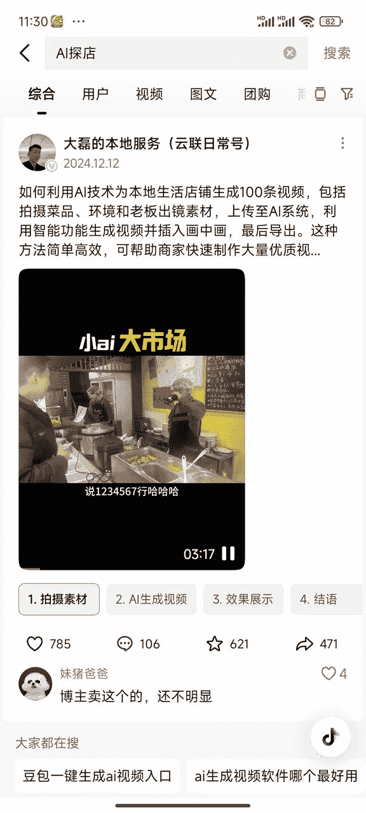

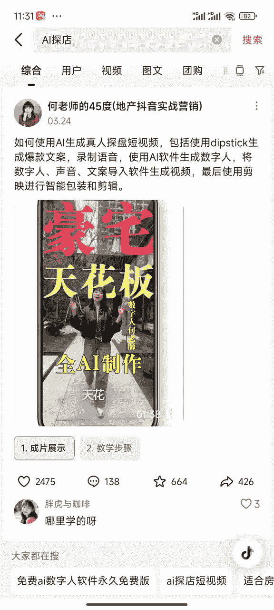

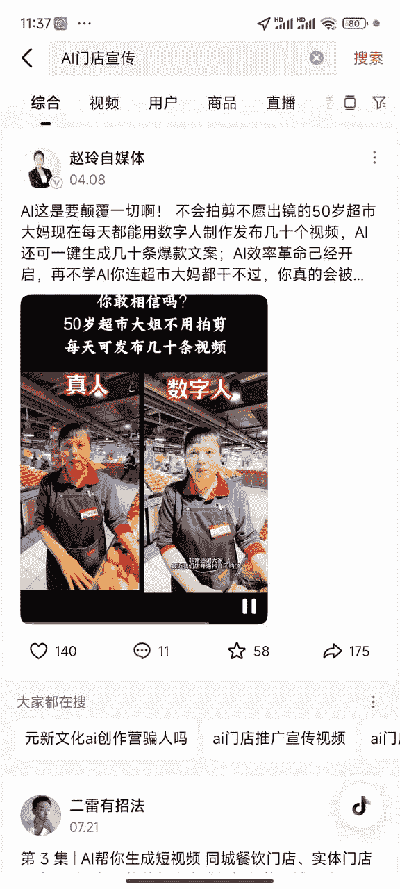

### 4.4.3 成为AI视频MCN

+ **做什么：** 你不再亲自服务商家或教学员，而是签约探店博主 。你为他们提供全套的AI视频制作支持，帮他们提升内容生产效率和质量。

+ **如何盈利：** 从签约博主的广告收入中抽取20%-30%的分成。你赋能了10个博主，就等于拥有了10个流量渠道的被动收入。

### 4.4.4 为什么这是平台层？

+ 因为在这两个路径中，你不再是单纯的“服务提供者”。

+ 在路径4.2.2，你**掌控了流量和话语权**；

+ 在路径4.2.3，你**掌控了生产力和人才**。

+ 你从一个游戏玩家，变成了搭建游戏舞台、制定游戏规则的人。

+ 这是在借助AI的情况下，一个人能做到的、真正的平台思维。

# 五、【抱团】你不是一个人在战斗，我们一起爆！

我们正站在一个前所未有的十字路口。

过去，做好一个本地账号，需要拍摄、剪辑、运营，耗时耗力。我在2024年帮本地商家混剪视频，竞争到最后100条视频才收500块钱。

而现在，AI给了我们普通人一把神兵利器，让我们能够以几乎为零的成本，对本地市场的传统玩家进行降维打击。

这个方法我测试过，简单高效、成本极低、重复可用，只要你肯动手，就能看到结果。

我不是技术大牛，但这套方法让我从“小白”到“爆款”，只用了一个月。

欢迎正在和准备做同城视频的圈友，**提出意见和建议，优**化再优化，我们一起做 各自区域市场的王者。

最重要的是：

这不是一个人的战斗，是一群人联合起来，攻下AI视频同城高地的战争。

如**果你也准备好了，不妨留言**说一声「我来了」，或者提个建议、丢个问题，让我们在评论区集结，一起把这条赛道打穿！我们一起干一票大的！🔥
