# 【📕虚拟资料】参加航海后，继续打卡一个月，单号单品月入6w

> 来源：[https://xuqiwei1986.feishu.cn/docx/PzqKdrAipoUcv5xqTVZcuWuHnnd](https://xuqiwei1986.feishu.cn/docx/PzqKdrAipoUcv5xqTVZcuWuHnnd)

Hi，大家好～

新一期航海已经开始报名啦，作为参加完6月的📕虚拟资料航海的电商新手，

我在航海结束后的第一个月，坚持🧣打卡航海日志，实现了月入6万

第二个月单号单品月入10万

在参加航海之前，只参加过📕商单，但是没有任何虚拟资料的经验

这篇文章就分享一些我的心得，希望能帮到报名虚拟资料的圈友～

## 1 前言

在此之前，我也是航海常客，但每次结束之后，都不了了之

所以这次航海结束，我意识到**「航海的结束，只是新的开始」**

所以，七月毕业后，我都按照航海日志的要求，自行在🧣打卡

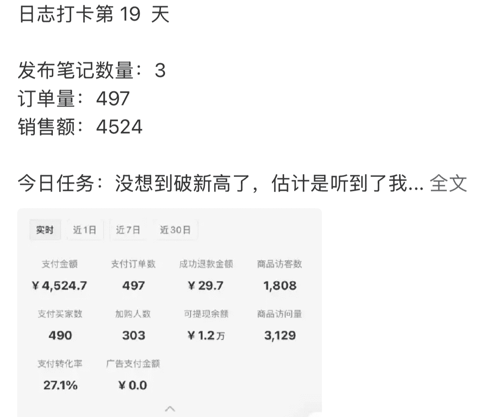

航海期间，我卖整理好的资料，靠搜索流量，每天也有一两百，但是涉及版权问题，太容易被举报违规了

歇了一周后，我决定做原创资料+IP，每天更新4-5篇挂车笔记

7.4上架原创资料，7.9单日破百，13号的时候还在发愁，感觉到8月份，距离自己最初的目标，单日访客1000、日单150也很困难

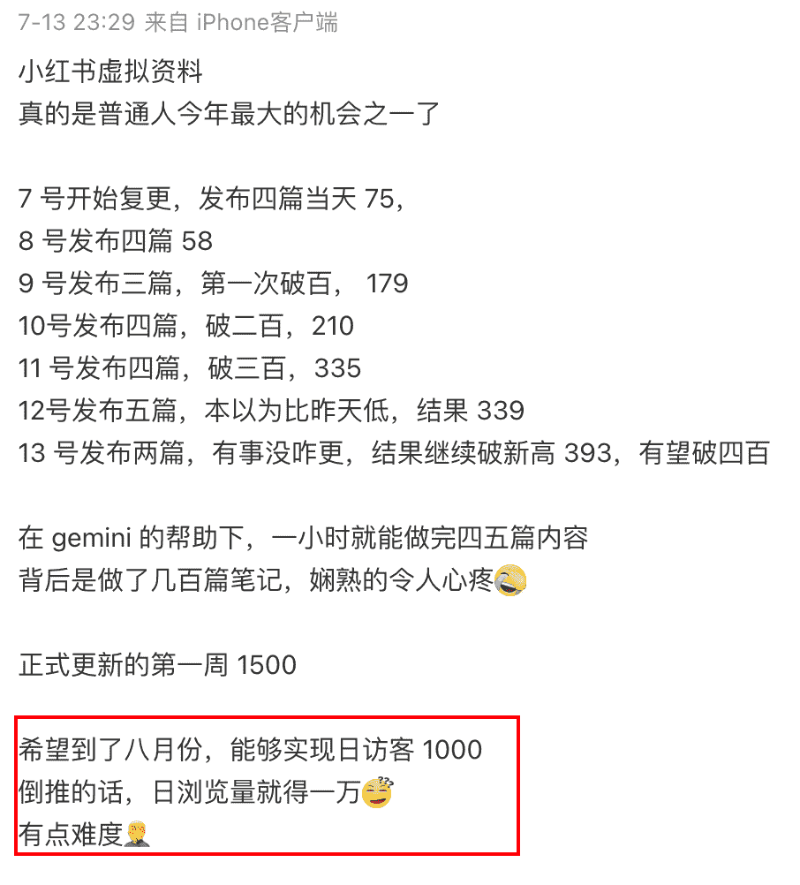

然而三天后的7.16，我就实现了八月份的目标

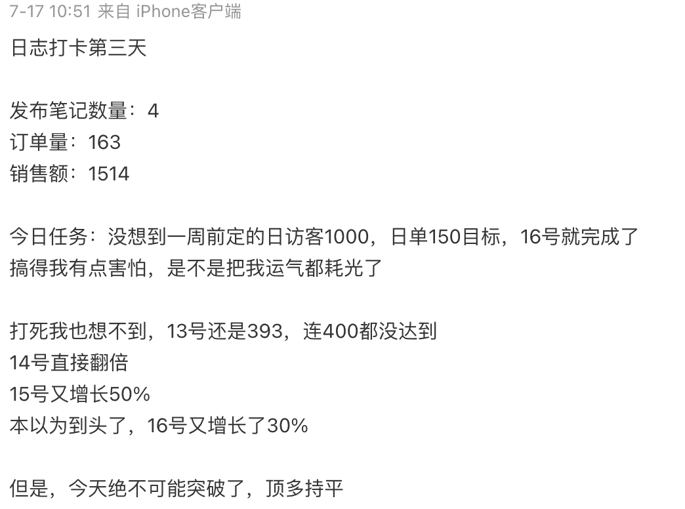

至此以后，我每天打卡的内容就是：

「今天打卡，收益绝对就到头了，明天肯定下降」

「第二天打卡，没想到又破新高了」

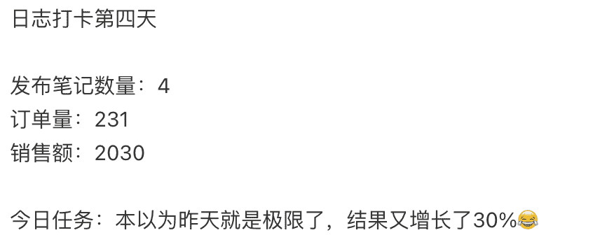

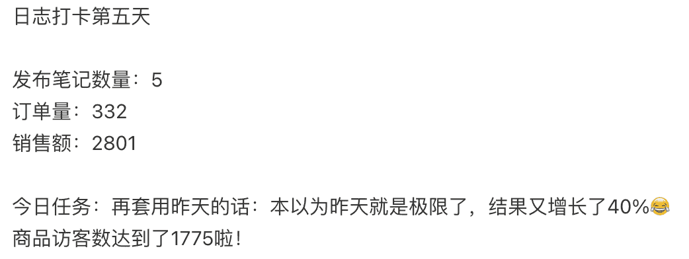

7月15号单日收入破千，17号破两千，20号破三千，21号破四千，退货率1%出头，涨粉3k+

一8.1号再次破新高，7月份，📕虚拟资料的第一个月，加上一个合作，虚拟资料收入来到了6万

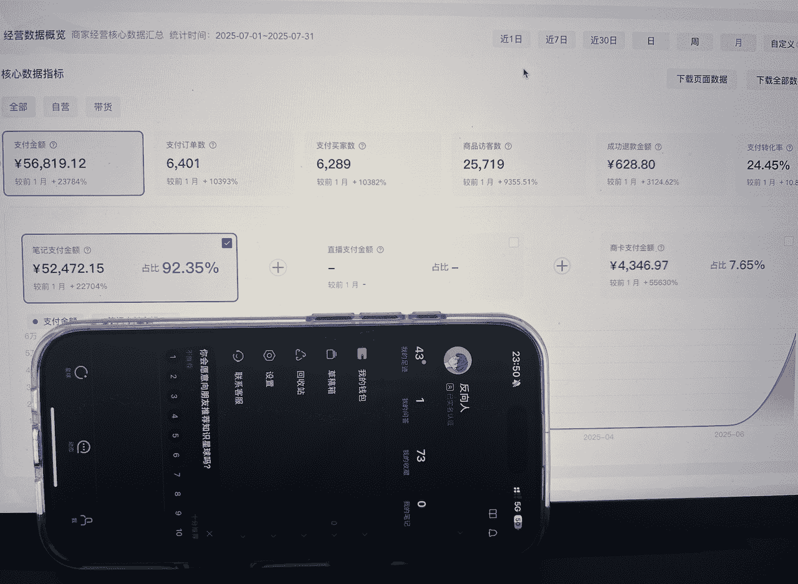

八月份

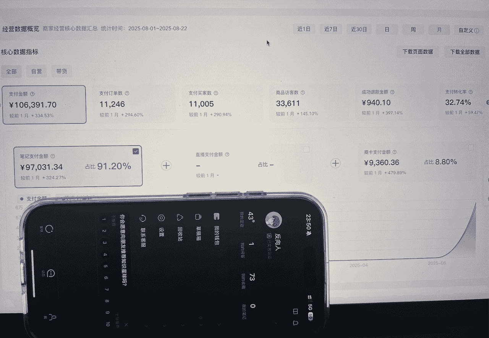

近三十天，每天收益很稳定，每天3-6k

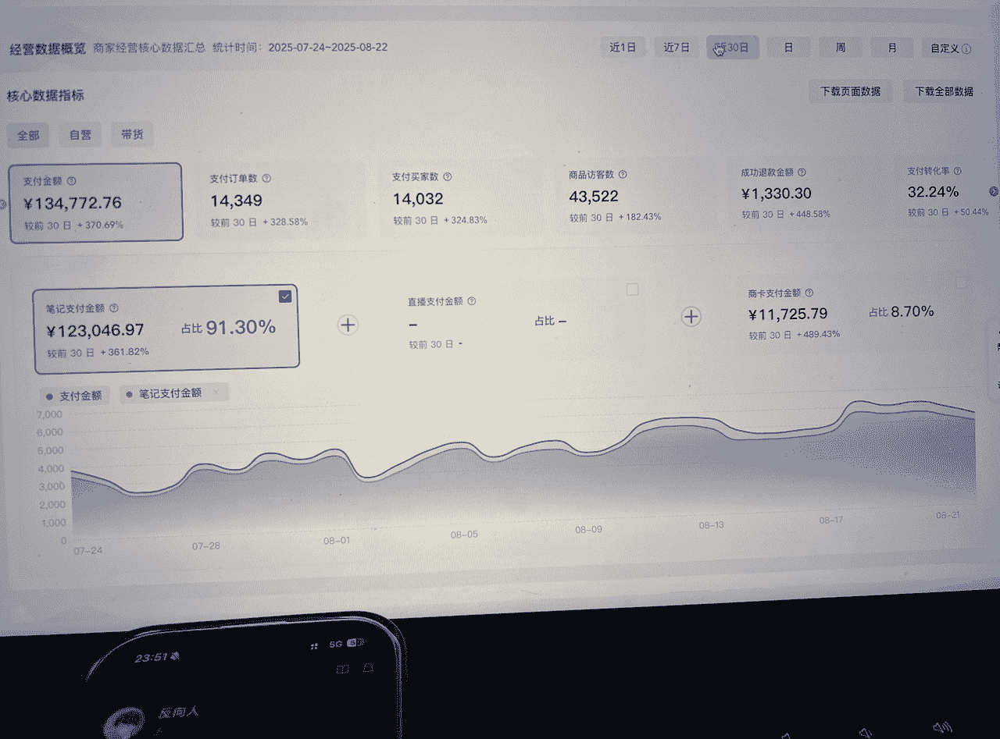

> 直到改稿子的8.23号，商品上架50天，单店单号单品收入16万

而且我发布的笔记，98%都是商品笔记，记得航海教练说过挂车笔记和普通笔记是两个流量池

我也觉得特别神奇，自己不挂车发笔记，只有两三百小眼睛，挂车保底两三千，真的很倒反天罡

期间也出了两篇点赞几千的10万+小眼睛笔记，一篇出了1000单，另一篇出了800多单

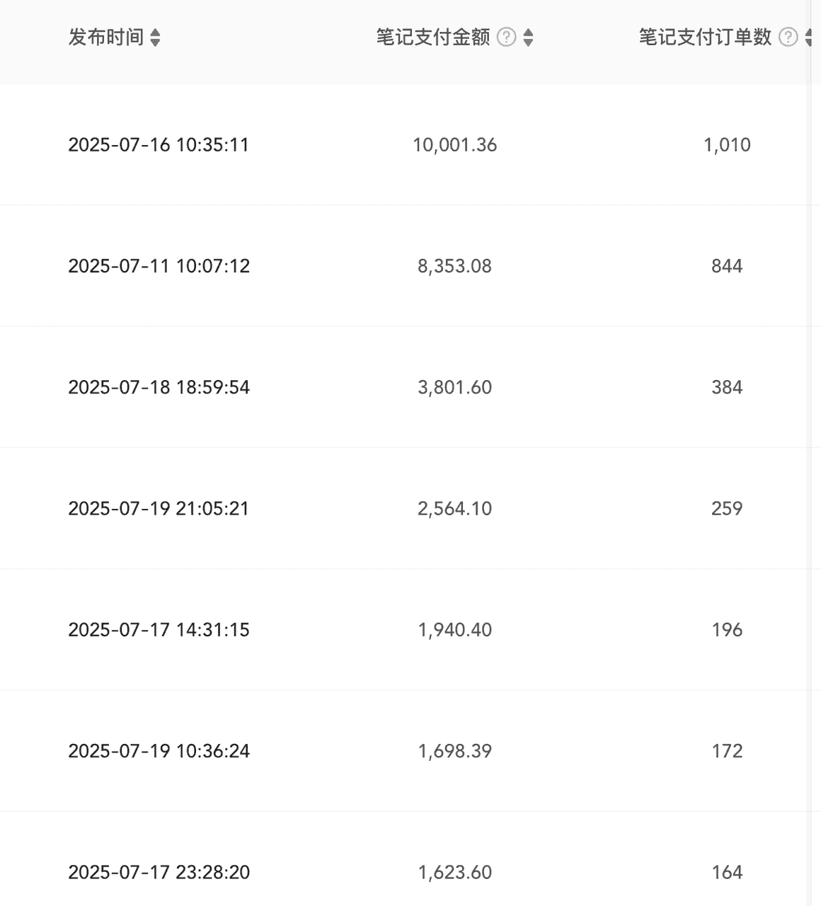

8月初的时候，97篇挂车笔记，有93篇都出单了，单月72w阅读量，

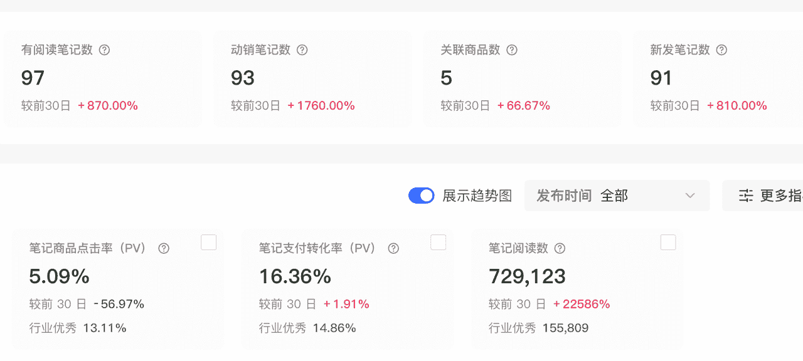

8.22号的时候，最近三十天阅读量119w，93%的笔记都能出单

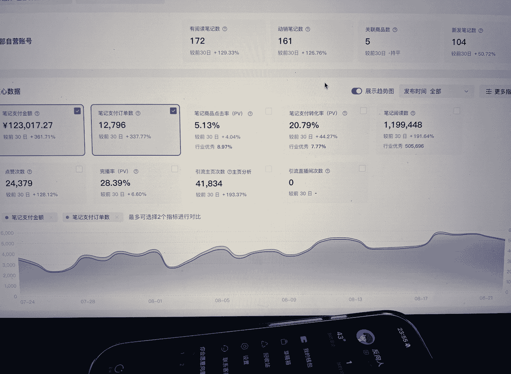

ok，说完了7月份的打卡心路历程，接下来就分享一下，我是怎么在航海结束后，没人指导的情况下，也没人交流，靠着自己摸索第一个月、第二个月做到上述成绩的

## 2 选题和内容制作

### 2.1 定赛道

首先还是老生常谈的——确定账号定位，选赛道，你到底要卖什么资料？

[关于这一点航海手册](https://scys.com/view/docx/CgTEdsFPjo6FM5xp9LmcfvGPnhb)写的特别详细，龙哥盟·资料文档

如果没有想法，建议反复看，至少看10遍！

我的看法是：从自己熟悉的方向入手，最好你就是这个方向的资深玩家/用户，取得过不错的成绩，有一定的优势或者信息差

从职业、爱好、特长、过往经历等等方面，进行思维拓展

比如教育赛道特别火也特别卷，那是因为大多数人都上过学，大家多少都熟悉，

从启蒙、小学、初中、高中、大学、研究生，读过研的可以卖考研赛道资料，小升初，初升高，上大学，专升本，出国留学....数都数不过来😂

比如职业，自己在考公考编上岸了，做销售，在法律、教育、银行上班，很多内部资料、知识、技巧，这就是你的优势；

比如过往经历，自己租房、装修、知识付费踩过很多踩坑，也可以卖租房合同、离婚合同

比如爱好，自己喜欢旅游，去过很多城市，做一份某个国家的旅游攻略

个人不太建议，什么火就去做什么，有点像无头苍蝇，拿不到结果，只会越做越着急

聚焦于自己熟悉的领域，这样你才更懂用户的痛点，以后做原创资料，定笔记选题，写文案才会得心应手

**最好在这个领域，有强烈的表达欲，别**人捂嘴都捂不住，不说出来，我憋着难受啊！

### 2.2 找选题

确定了赛道，下一步就是确定选题，到底要卖哪些资料，要写什么样的笔记才能出单

前期不要天马行空，突发异想觉得“xxx资料没人卖，自己可以搞，肯定能大卖！”

这就像学数学一样，九九乘法表还没背熟练，就要独创数学公式😂

还是老生常谈的这句话：「同行就是我们最好的老师，先抄再超」

有没有至少3～5个同行在卖，销量能否破千

如果都是几块钱资料月销几百单，一个月也没多少钱，说明市场太小

只要能找到一个对标账号，再通过关键词搜索，就能找到大量对标账号，把百赞笔记的标题、链接都整理到表格

> 这是我的整理表格，非常简单，也非常好用

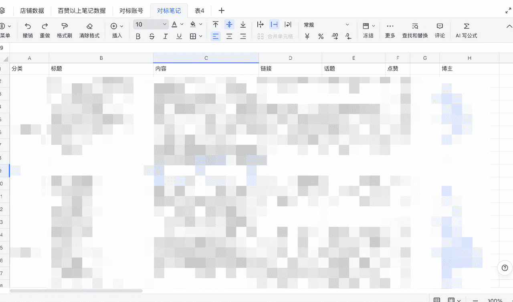

你可以借助大模型分析，但是不要过度依赖大模型

整理的时候一定要有自己的思考，千万别干等着大模型给出分析结论

就像西风说的，你得有那个「核」

大模型更多是给我们提供更多灵感、拓展思维，但最终思考、拍板决策、确定选题的，始终是人

而且不要只关注开店铺的账号，那些引流账号的笔记也要重点关注

我就是结合了引流笔记的标题、挂车笔记的封面、参考两者的文案，甚至参考👸号、B站等其他平台，并且结合自己的想法，得到最终文案

也算是航海手册里说的「杂交法」了🤣

### 2.3  做内容

确定好选题就该做内容了，我在找选题的时候，就收录了大量的爆款笔记、对标账号、对标笔记，像上面那张图，把笔记汇总的Excel表格里

写文案的大模型，经过多方对比，我选择了谷歌的gemini ，它不仅有记忆功能，而且AI味更淡，更接近真人的写作风格

前期需要调整几次，对话次数多了，后期文案一遍就能出！

> 我的建议，真的不要用deepseek了，不是说他不好，r1刚出的时候确实很惊艳，但已经半年多过去了，已经有非常非常多比ds好用的大模型了，不要停留在过年期间，自媒体造神deepseek的时候了😂

我用的是谷歌gemini 2.5pro，需要🪜以及闲鱼上买账号，一年就三十块钱就搞定，

我都为gemini打抱不平，这么好用的大模型，居然这么便宜！

实在不会用，国内就选择豆包，提示词写的详细点，背景、任务、要求都告诉大模型，

我的gemini分成了三个对话框，两个对话框用于写笔记（2.5pro和2.5flash模型），一个用来运营账号、分析选题等功能

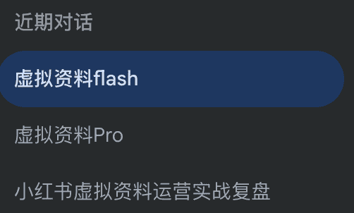

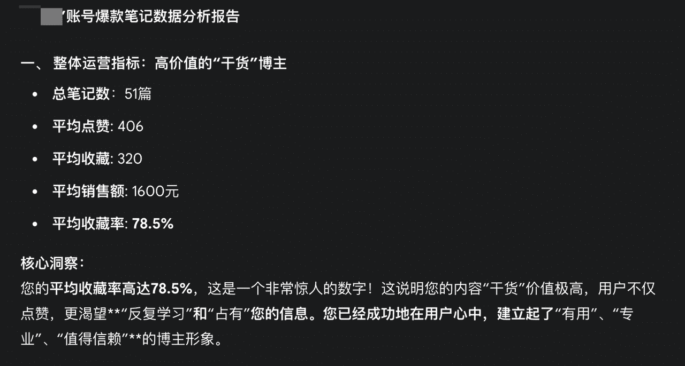

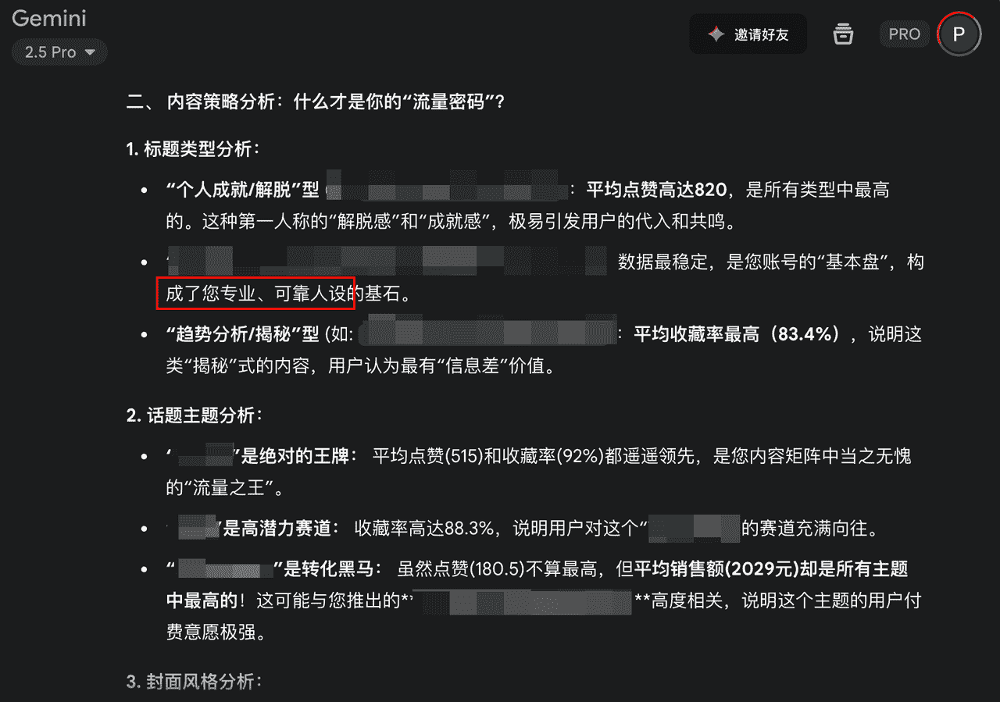

而且AI写文案，不是800字的语文作文，给个题目就让AI自由发挥

是一道填空题，需要把你的思路、文案的框架告诉他；

千万别“写一篇400字左右的📕笔记”.... 一句话带过也太潦草了😂

**还是那句话：你糊弄AI，AI同样糊弄你，它不是你**肚子里的蛔虫，不知道你想要什么风格的内容

**前提是，你得有「核」，有表达欲**

**提问的质量越高，回答的质量才高**

不然AI味太浓啦！一眼就能看出来！

而且我认为被系统推流最重要的一点是 —— 我的笔记内容是平台、读者、作者三方共赢

我的账号有IP属性，算半个带货，而且每篇笔记字数在300-600字之间，只在文案结束，用不到80字顺便介绍一下产品，前面的几百字都是干货内容！过渡到产品非常自然

笔记就表达出一个观点：「不下单也无所谓，只要这篇内容对你有帮助就行」

对平台来说，我的笔记丰富了这个领域的内容，尊重平台规则，不做小动作，也不引流私域，积极运营账号，提高用户留存，保持日更，没有一昧制造“垃圾笔记”

（尤其是“飞书+deepseek，10分钟生成100篇笔记”，看似很多，其实一个都没法用🤦‍♂️）

对读者来说，深入了解他们的痛点和需求，看笔记学到了知识，有获得感；并不是把其他人的资料汇总打包糊弄事，是自己原创内容，不要把用户当傻子

对我来说，释放了表达欲，积累了📕虚拟资料的经验，还获得了不错的收益

一举三得！这种做法，就算不卖货，还可以转型做IP

当然了，都这么做了，肯定卖得出去啦～

## 3笔记优化和后续运营

### 3.1 笔记优化

做完内容就是：发笔记=》得到反馈 =》反复优化=》继续发笔记

如果是单人单号，建议大家不要过度追求数量，在保证质量的同时，每天3-5篇就够

前期不确定封面和标题的风格，可以分批测试

刚开始做的时候，我是每天两篇大字报+两篇实拍，发现实拍封面流量更好，后续90%的封面都变成实拍了

每天都会统计店铺的数据，商品访问、商品访客、笔记商品点击率、转化率等等

因为自己有精力，懂得用户痛点，文案一直在改进

评论区、私信、客服遇到问题，都是读者的痛点，记下来！

所以支付转化率从16%，一路优化到27%，最近稳定在25-28%之间，在朝着30%努力💪

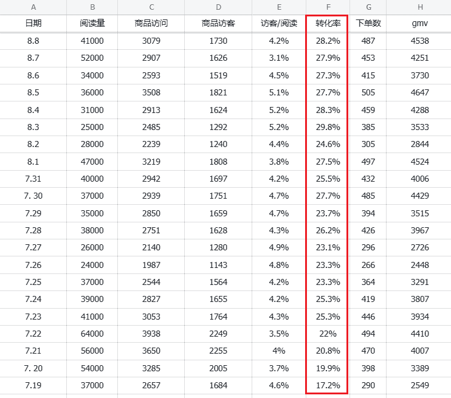

> **近半个月的优化，支付转化率**站上了30%，这就是有IP、有人设的好处

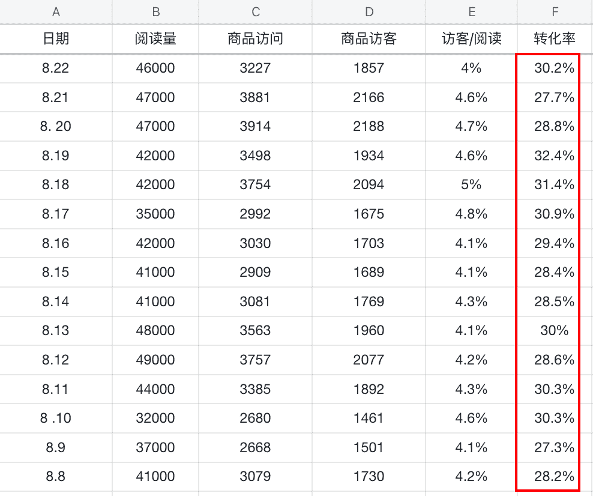

前段时间发现笔记商品点击率比较低，继续优化，在标题、文案、图片中反复提及产品，提高曝光度

我的优化比较保守，只是在文案开头或者图片多提了一次产品，

以用户真实反馈为开头，类似“上个月用我资料复习的宝子，昨天报喜，说成绩提高了xx分”

然后渲染焦虑，直击痛点，给出方法论干货，损失厌恶，结尾CTA，顺带提一下自己的产品，一套组合拳下来库库造

### 3.2 后续运营

#### 3.2.1 IP和人设

因为有好多付费用户问“下单后有无群聊”

我的账号有IP属性，所以建了群，每天也会发一些干货信息，跟用户聊天，了解他们的真实痛点

出乎意料的是，很多读者发现盗卖资料的人，会私信告诉我

某一天突发奇想，把抄袭我的人发到群里，有小一百人帮我举报，突然想起来梨云三年前的精华帖

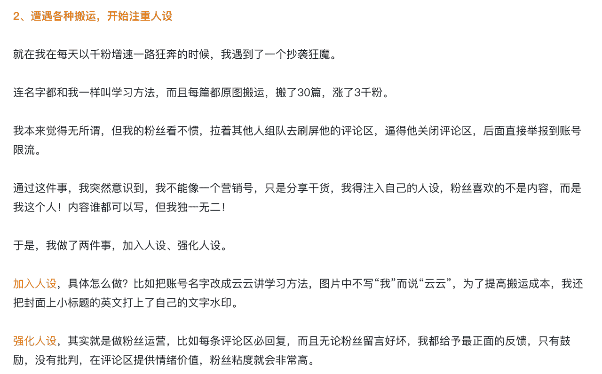

**原来这就是IP，这就是人设呀！**

现在回看赚钱的📕精华帖，才发现，很多帖子的内容，并没有看完就忘，它内化成我的一部分，下意识就会这么做

所以精华帖，都非常有价值，经典不过时！

就算不是虚拟资料，也能学到很多📕其他方面的知识，大家千万别错过啊，多去翻翻

顺着IP属性继续说，我觉得账号IP、打造人设，对笔记，对支付转化率都有帮助

用户面对的，不是一个个冰冷的“大学资料包” “小升初资料库”这样冰冷的店铺

而是一个个，真实存在，有温度，懂自己的IP

如果允许，尤其是单人单号的个人玩家，大家一定要试着打造账号的IP、人设

因为真的太香了！因为用户信任你，省掉了很多客服回消息的操作

#### 3.2.3 数据复盘

大家发完笔记，📕后台、千帆的数据都要看

比如航海期间我卖的资料，80%都是搜索流量，在千帆能看到高频搜索词

那我把这些词记下来，下次AI写文案，注意笔记的SEO，标题、正文、标签都要有这些搜索词……

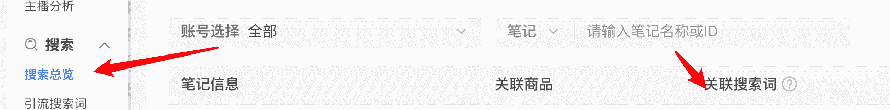

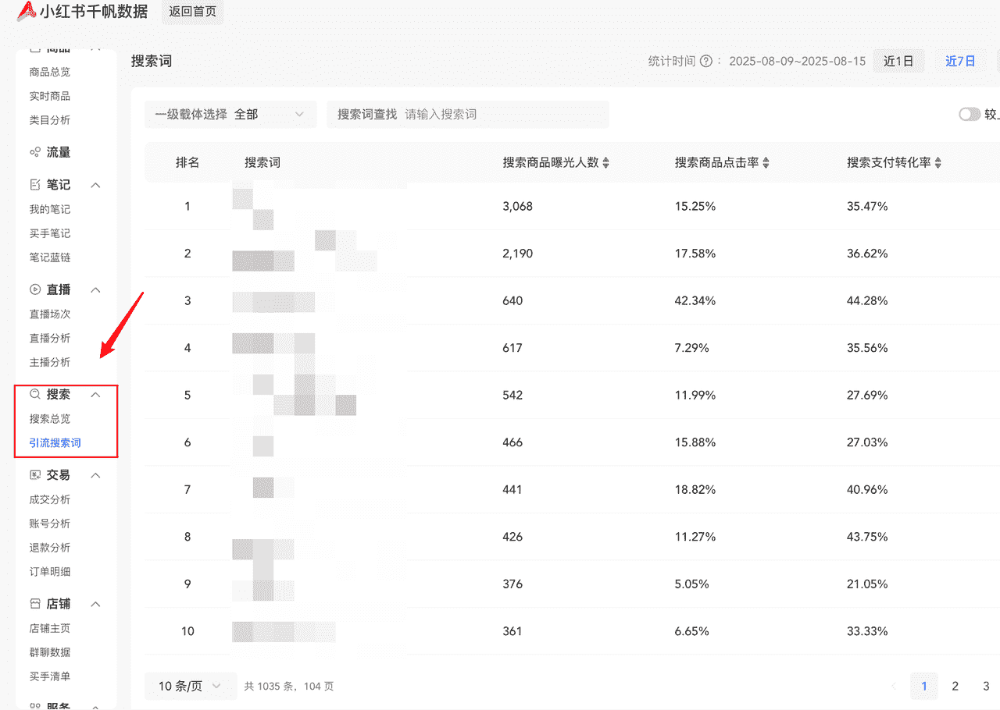

建议大家把千帆数据后台的每个页面，都点一遍，保持对数据的好奇心！

至少每周要全方面看一遍数据，检查一下，不断的发现问题，解决问题，优化数据……

#### 3.2.3其他

记得每周领千帆官方任务，会给笔记曝光和直播曝光

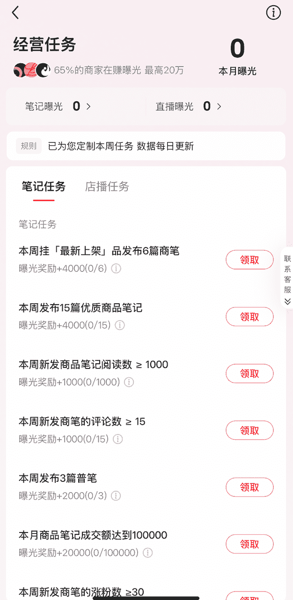

而且运营群聊，也有相应的奖励

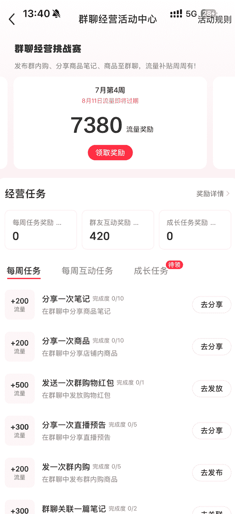

#### 3.2.4 商品评价

除了以上操作，还有商品评价，是我观察其他博主，或者闲鱼都有的操作

**——确认收货后好评，额外送资料**

📕的提现周期是确认收货后+4/7天

但很多用户并不会点确认收货，意味着回款周期是11/14天

而且好评送的资料，一定是对用户有吸引力的，可别送一堆看起来很多，但没啥用的资料

赠送的资料，最好跟卖的资料强相关！

我自己花了一小时，又整理了一份原创资料，同行都还卖好几块，我整理好直接送

在阿奇索设置好内容，【确认收货，点亮很满意+评价+晒图】送价值xx元的xx资料

通过这个方法，商品的好评数：销量达到了4：10，每10个用户，就有4条晒图好评

除了能增强读者信任，提高下单率，用户的评价还会作为笔记的评论，留在评论区，增强新笔记的转化

我觉得「好评晒图送资料」非常重要，没有这步操作，很多读者都会提问，我们会挑一个典型的问题回答，评论区置顶

有了好评，用户点开评论区，都是清一色的晒图好评，稍微看一下，直接下单了，特别省事！

还有客服的态度！

不管是下单的，还是买前咨询，对话结束，我都发一句祝语福

让用户看到你的真诚

发祝福语，不是你为了提高销量，让他们付费或者回购

就是单纯的、发自内心的祝福，没有别的目的

用户收到之后，能快拉近距离，不少付费用户都资源介绍给其他朋友，我的不少铁粉、群聊活跃用户、帮我举报盗版、经常给我点赞的，就是他们！

**当然，这一切的前提是，你的产品，质量真的高，不是随便糊弄，**买几个同行拼起来，或者让AI帮你改写😂

东西好不好，从退货率就能看出来，用户也不是傻子，谁好谁坏，谁真诚谁虚伪，都能看出来

最后一点，笔记流量的周期，并不是只有一周

前面说的出单一千的笔记，现在又跑到了一千六百单，前十五天都是推荐流量（占了85%），后十五天都是搜索流量（占40%）

当你的账号、笔记被系统打上了标签，权重会很高，后续发的笔记流量也能保证破千；

高质量的笔记，真的顶几十篇“粗制滥造”的笔记

如果你是个人玩家，没有那么多账号，不妨试试我这种方式

况且这种“高质量”笔记，我现在二三十分钟，就能写一篇

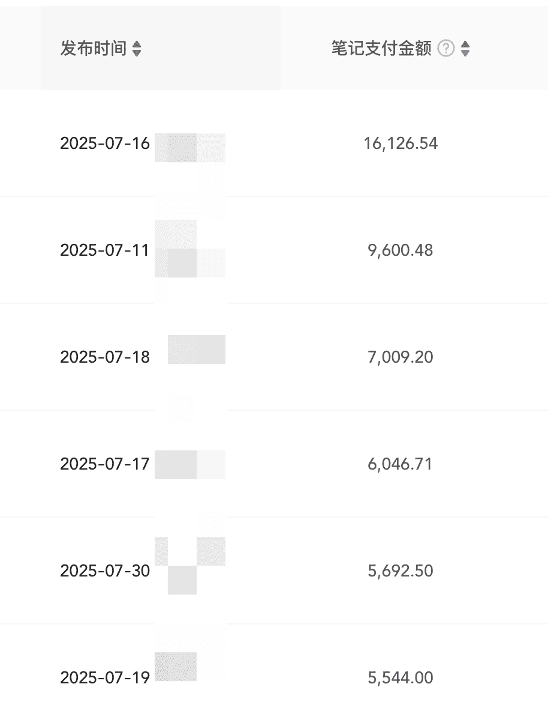

经过上述的步骤，不断不断优化，打磨细节，每周阅读量25-30w，支付转化率接近30%，退货率1%，近30天快破12万啦

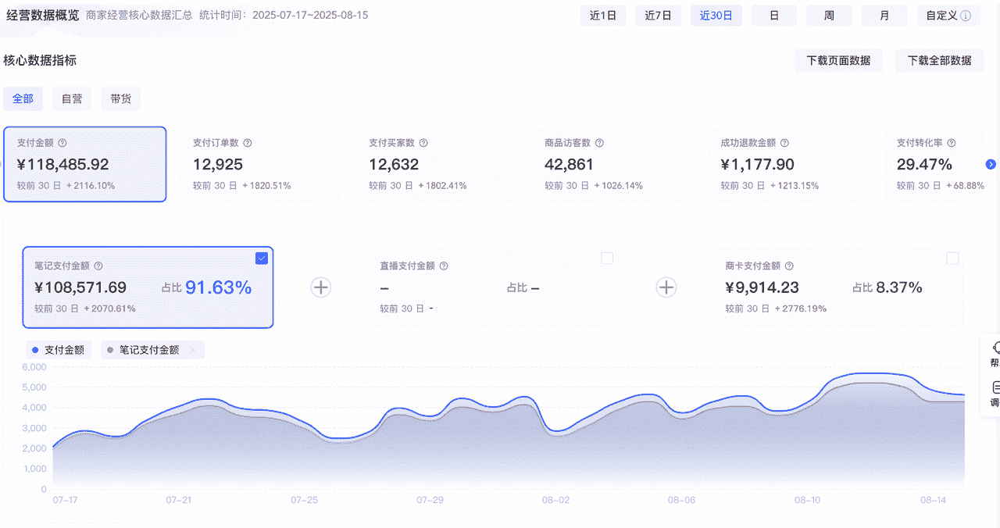

看似是虚拟资料的卖货号，其实跟商单号差不多了……

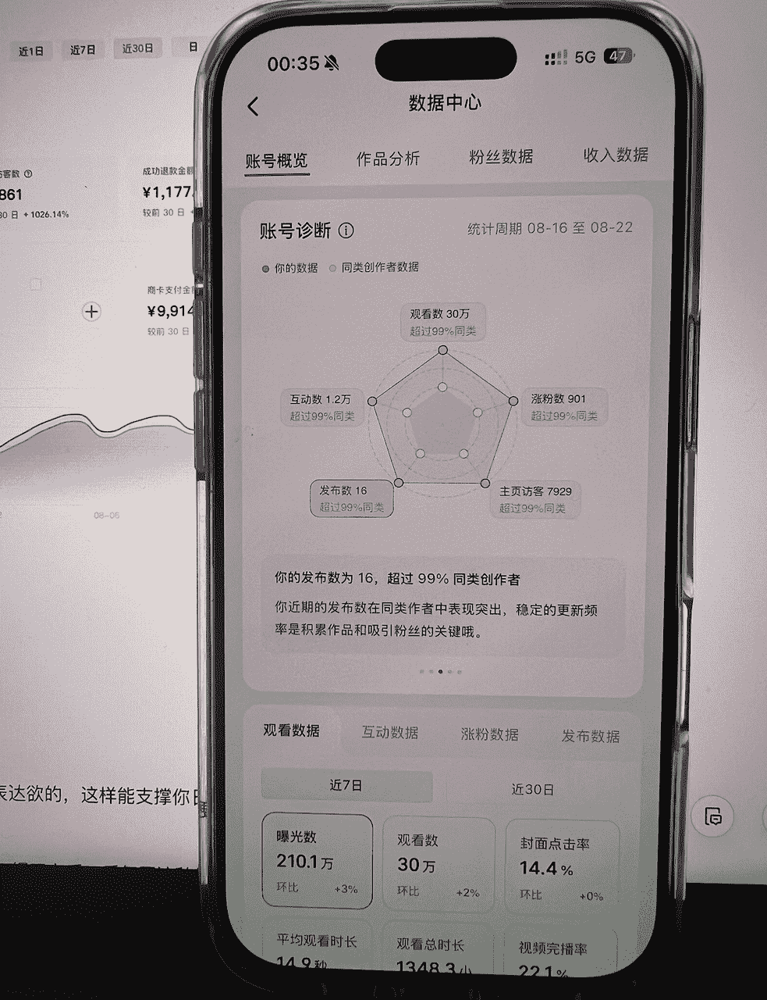

## 总结

ok，最后总结一下

1、定赛道，选择自己擅长、有经验、资深玩家、感兴趣、有强烈表达欲的，这样能支撑你日更、懂用户痛点

2、选题先看同行，然后微创新，可以选两三种模式，然后反复测，爆了之后，反复写这种类型

3、做内容，即便是AI写文案，也要认真，有一个笔记的框架，让AI做填空题

4、产品质量真的高，而且花费心思整理，肯定对得起定价

5、平台、用户、作者三方共赢，做高质量笔记、卖高质量资料、有高质量收入

6、不断根据数据、读者评论、客服问题，优化内容，支付转化率、商品点击率，搜索流量or推荐流量？

7、个人玩家，精力有限，可以打造IP、营造人设，提高读者信任，像我这样单店单号单品，打爆一个品

8、真诚永远是必杀技！

9、最后一点，跟着航海节奏来，每天打卡航海日志，即便航海结束，也坚持打卡！