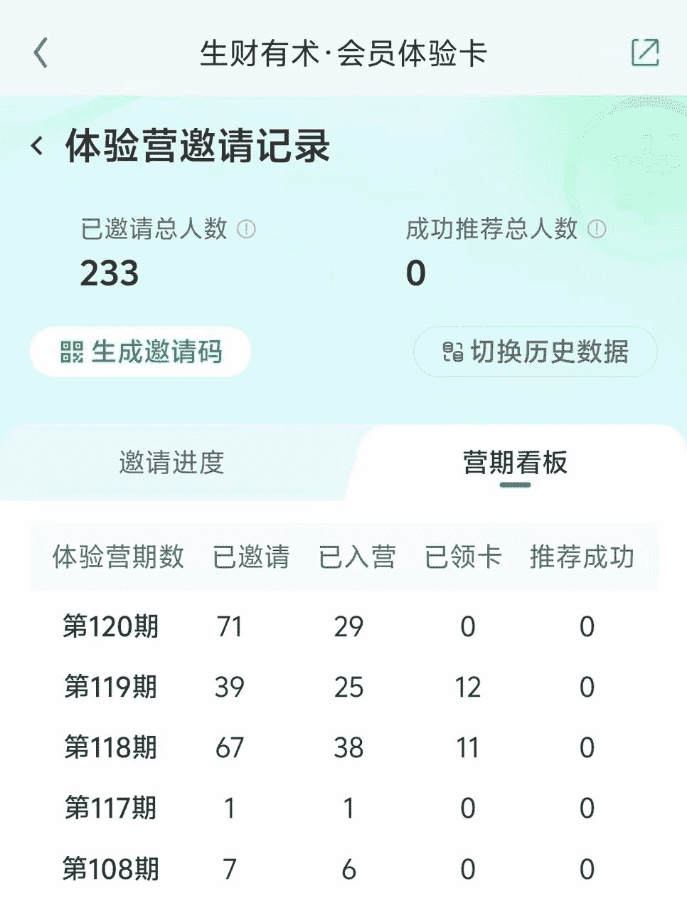
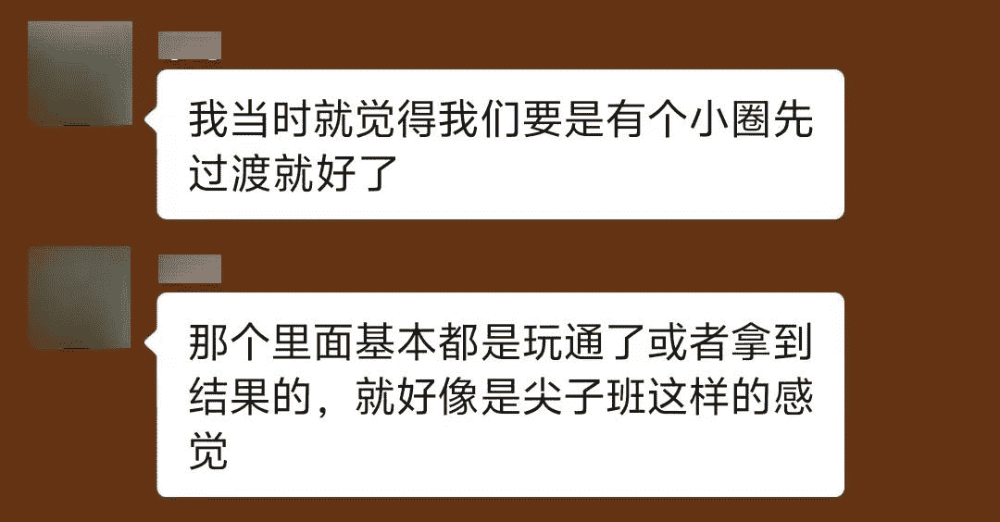
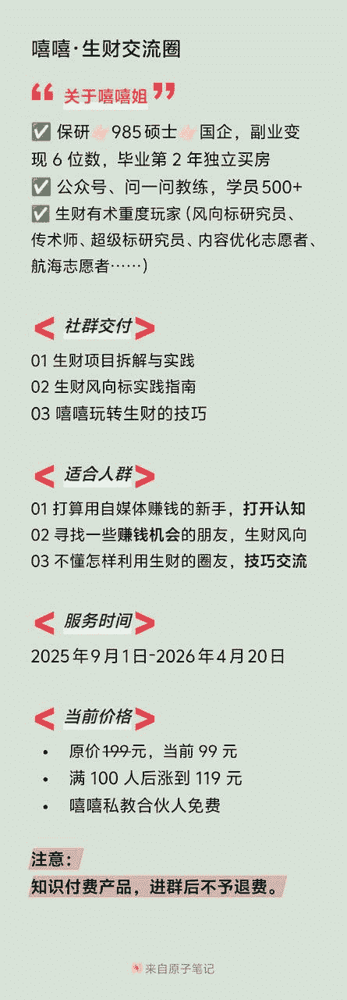
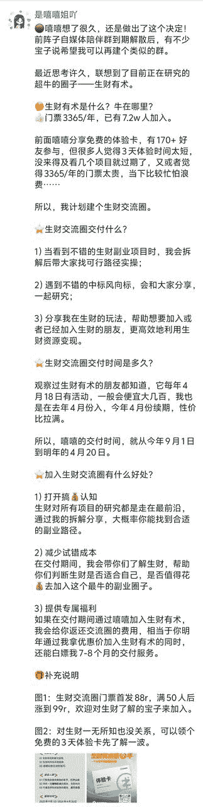
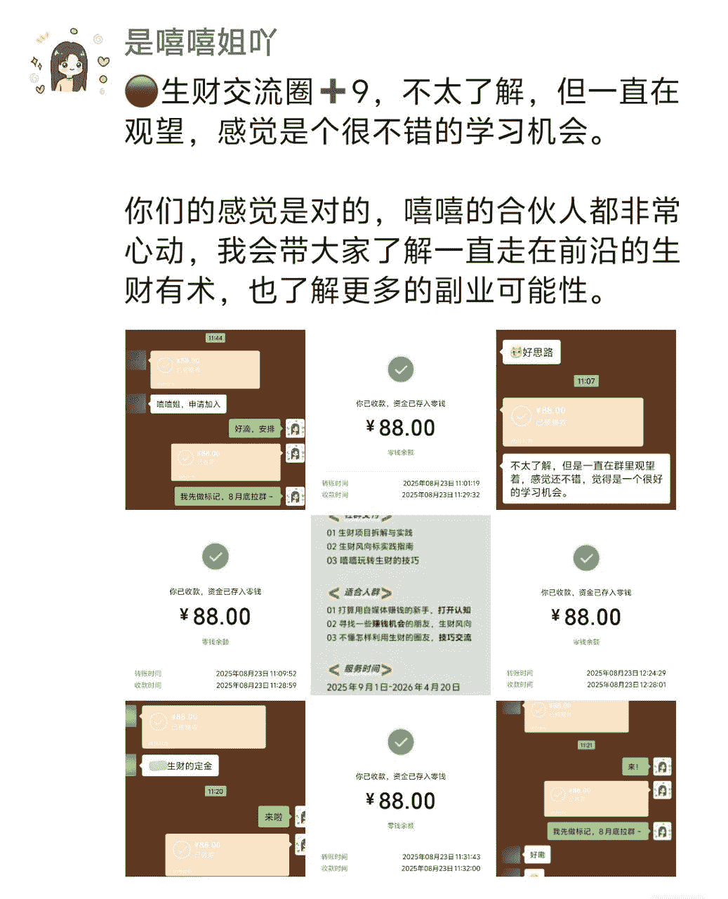
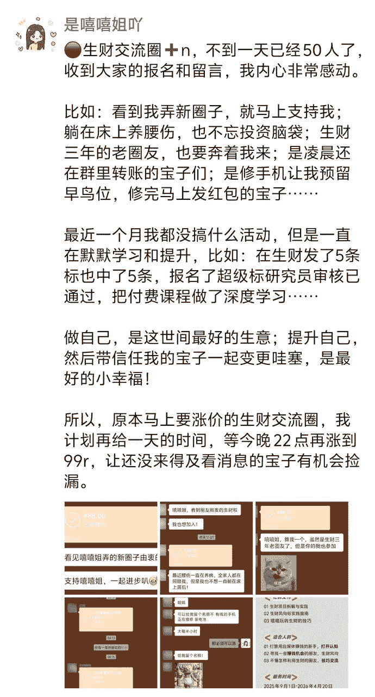
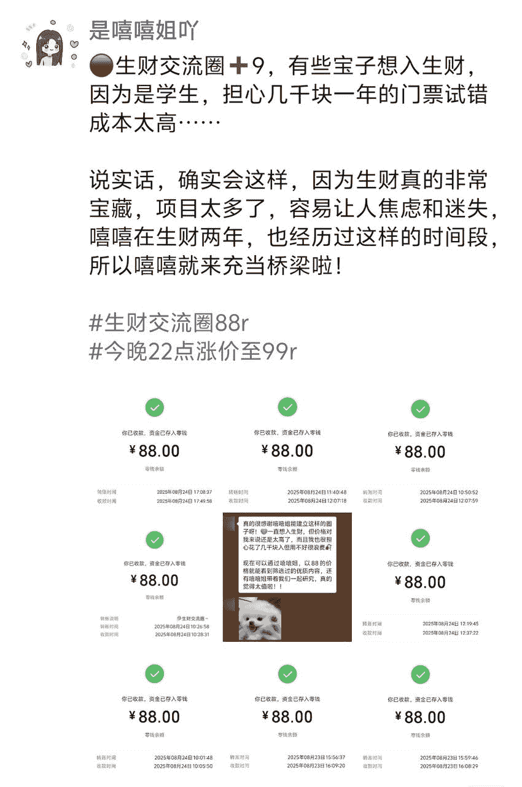

# 《普通人也能复制！1 小时构思 + 2 天执行种草，我挣到了 2 张赚钱门票》

> 来源：[https://xuqiwei1986.feishu.cn/docx/YbOXdISOiogJ50xAlwuc60FunTc](https://xuqiwei1986.feishu.cn/docx/YbOXdISOiogJ50xAlwuc60FunTc)

大家好，我是嘻嘻姐。

98年农村女孩，读研靠自媒体挣到人生第一个 20w，毕业第2年独立买房，之前跑通的项目有保研辅导和👸号，均变现6位数，目前主要在做私域变现。

**通过周末两天的构思和宣传，我建**立种草的赚钱交流圈，变现了近 2 张赚钱门票的收入，还新增了 70+ 体验营参与者。

而且在小鱼和种草群圈友的认可下，我发现这种产品的思路，完全是可复制的，所以在这里分享给大家，希望给新老圈友一些启发。

# **01 为什么会做赚钱交流圈**

### **1.1 开始种草的背景**

两周前，因为在朋友圈安利了不少赚钱体验卡，受小鱼的邀请参加了赚钱的种草活动。

两周过去，种草人数翻了一番，目前已经安利了 200+人来了解赚钱，还有人因此加入龙哥盟成为一名正式圈友。

所以在这里要超级感谢小鱼的提醒和邀请啦！赚钱官方工作人员真的都很细节，一有什么异常值，都会得到眷顾。不论是这次的种草官俱乐部邀请，还是之前小武的精华帖邀请，都让我爱上赚钱更多一点了！

### **1.2 种草时遇到瓶颈**

但是苦恼的是，我这个种草的**转化率太低**了。

别人可能发十几二十张就安利成功了一两个，我这边还极低，于是，我做了个追踪和复盘，这才发现了我这边用户的特点。

我主要的用户群体都是大学生或者研究生，这类用户的消费水平有限，对付费通常都比较谨慎，如果学习压力大，也很难下定决心来了解赚钱。

前面嘻嘻分享免费的体验卡，有 170+ 好友参与，也是很多人觉得 3 天体验时间太短，没来得及看几个项目就过期了，又或者觉得项目太复杂，担心 3365r/年的门票太贵，怕浪费……

所以，我就在思考一个问题：

**有没有办法可以促进转化率？**

### **1.3 赚钱交流圈诞生**

周五晚上想着想着，突然就有了灵感**——结合**种草营和体验营的构思，我想到了“自己转化”这一点。

是**的，如果我自己**给这些有意向的人拉个群，以我自身的经验出发，带大家去了解赚钱，再让他们做判断，是不是会更具有性价比，毕竟她们本就是基于对我的信任才去了解赚钱这个星球。

思考完，马上就开始行动了！

# **02 如何做这个赚钱交流圈**

在这个部分，来分享我可复制的几点社群核心要素，从文案到小巧思，全部拆解分享给大家。

### **2.1 我的私域转化文案**

两天一共发了 7-8 条朋友圈，分享主要的 4 条转化朋友圈。

+   第 1 条朋友圈：**详细介绍**赚钱交流圈，减少后期解释成本；

+   第 2 条朋友圈：说明已经**有朋友加入**，降低用户心理成本；

+   **第 **3 条朋友圈：展示我建社群的优势，让大家更加信任我；

+   **第 **4 条朋友圈：用客户证言展示痛点，说明社群的可行性。

### **2.2 赚钱官方资源加成**

#### **巧思1：抽奖《赚钱宝典》5本**

报名官方种草活动，可以获得官方的福利，这一期种草福利就是 5 本《赚钱宝典》，可以填不同的地址。

相当于我可以做为福利给到想要加入赚钱的朋友，而且不需要自己的快递成本。

#### 巧思2：赚钱 418 优惠提前锁

很多人觉得三千多的赚钱门票太贵，像我这样的老圈友，知道每年 4.18 会有优惠，而且我通过体验营已经验证了大家对赚钱的兴趣。

我就直接提前搭建社群，将大家集中起来，通过超预期交付，培养信任度在，这样如果后面他们想进赚钱就会优先找我。

#### **巧思3：交流圈门票=赚钱定金**

我的赚钱交流群收门票，而不是免费，并承诺大家，如果在社群交付期间，通过嘻嘻入了赚钱，可以返还 99r 的门票。

那现在交的门票钱，就类似于赚钱明年门票的定金，提前锁定。

#### **巧思4：赚钱官方的种草手册**

赚钱的种草活动，不会只开一次，因为现在已经有了种草手册的雏形了，完全有可能后续继续开，那咱们这样的活动就完全可以复制。

不论是新圈友，还是像我一样逐渐熟悉了赚钱使用方法的圈友，都可以搭建类似的社群。

#### **巧思5：体验营作为介绍入口**

在首发的朋友圈中，除了介绍赚钱交流圈这个社群，我还埋了钩子——放了赚钱体验营的二维码，当时发出去就有60+人绑定。

这对于完全不了解赚钱的人来说，也非常友好，因为可以领个免费的 3 天体验卡先了解一波。

总之，这些巧思，也算是完美地融合了赚钱官方给到的种草资源。

# **03 做这个社群有什么好处**

### 3.1 他律促自律，深入了解赚钱

刚进入赚钱的圈友，一定有过这种感觉——赚钱就像一个巨大的图书馆，我们身处其中，完全不知道从哪里开始，随手点开一篇精华帖，都是海量的知识扑面而来。

看到别人不断挣钱，好像自己也变得更焦虑了。

这时候，其实解决办法只有一个，让行动更具体。我待在赚钱的第一年里，一直都在研究赚钱的风向标，当时刚好建立了一个副业陪伴群，就经常尝试从中找风口项目，然后分享给其他人，带身边人行动。

我发现，这种要带别人行动的他律，能促进我拆解更多的帖子和风向标。

而且也因此，让我对风口变得更加敏锐，在今年 8 月份已经连中了 5 条风向标。

如果你不知道从何开始了解赚钱，或者对海量的资源望而生畏，那这样一个他律促自律的社群，就非常有必要。

尤其是新人，哪怕是建立一个免费社群，去分享一些自己的感悟或者实践心得，都非常好。

像种草社群里有位圈友就是通过建免费群的方式，一个月种草了 50+ 位圈友正式加入，真的是社群种草达人了。

### 3.2 借力来打力，挣回赚钱门票

做这个赚钱交流圈，最直接的好处就是门票收入，我的社群初始定价是 88r，两天时间来了 60+ 位朋友加入，而且招募时间还没有结束，后期慢慢悠悠增长，也会带来一些新人。

除了交流圈的直接门票，在交付期间内，也可能通过我的介绍和交付，成功吸引群友加入赚钱，获得进一步的分销收入，算是实现了一鱼多吃。

以上就是我的全部分享，认为有启发的朋友可以给我点个赞呀~