# N8N与Docker中文版部署教程分享

> 来源：[https://xuqiwei1986.feishu.cn/docx/UY05d0IarodNSpxYxjQcBsAgnbf](https://xuqiwei1986.feishu.cn/docx/UY05d0IarodNSpxYxjQcBsAgnbf)

> 最近报名了N8N的航海，下载了Docker并本地化部署了N8N，但是界面都是英文的，使用得非常痛苦，所以找了下完整的汉化教程和步骤，实操已完整汉化，现在看着舒服多了，而且少了一个被动放弃的理由。

# 一、汉化概述

## 1.2 汉化思路

> 通过在git中下载对应汉化包并替换对应文件或挂载文件实现汉化。

## 1.2 汉化效果

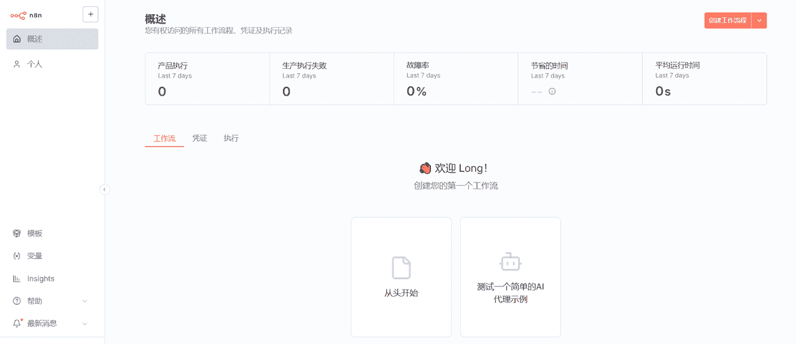

# 二、Docker Desktop汉化步骤

## 2.1 查看DockerDesktop版本

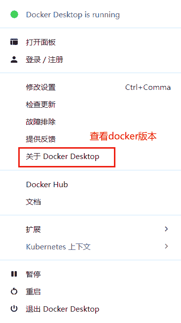

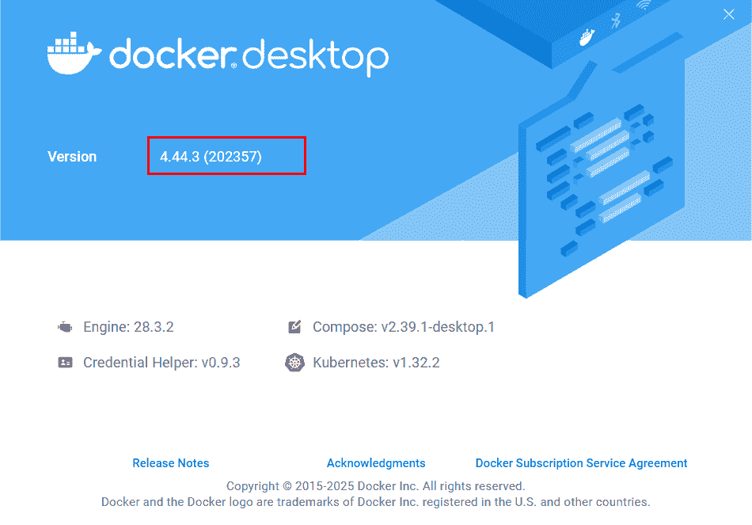

## 2.2 下载DockerDesktop 汉化包

+   访问git地址下载对应版本的汉化包

https://github.com/asxez/DockerDesktop-CN

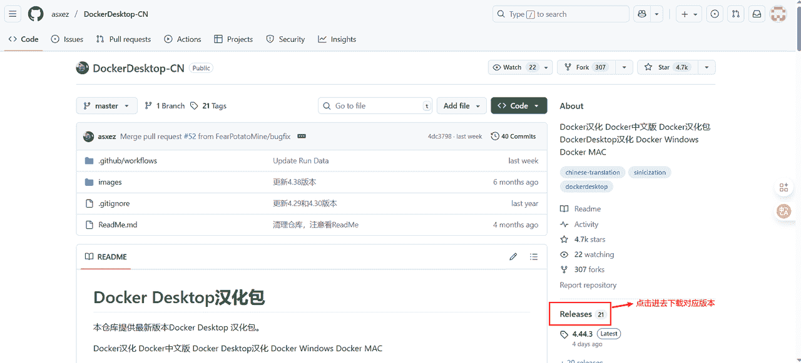

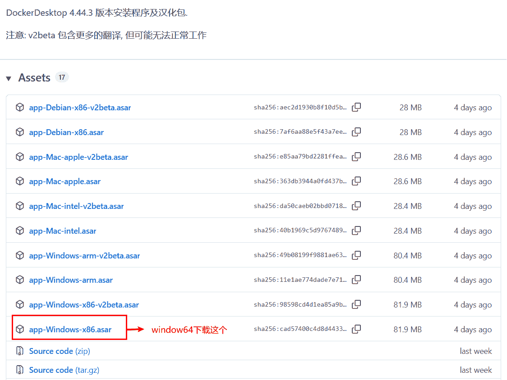

## 2.3 替换DockerDesktop 汉化包

> 【替换文件前记得先停止Docker Desktop】

> 1、下载解压后是一个asar文件，调整文件名称为"app.asar"。

> 2、进入Docker资源路径 。

> C:\Program Files\Docker\Docker\frontend\resources

> 3、备份历史的app.asar文件，然后将下载的文件复制进来。

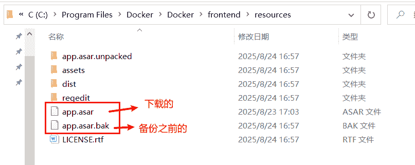

## 2.3 重启DockerDesktop就可以看到汉化效果了

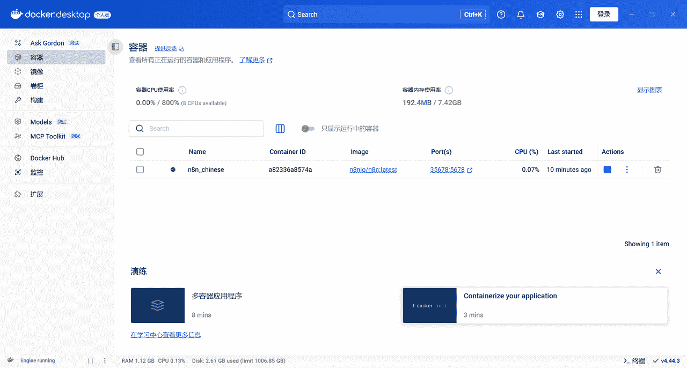

# 三、N8N下载与汉化步骤

## 3.1 下载拉取N8N镜像

> 在Docker Hub中搜索并Pull N8N镜像

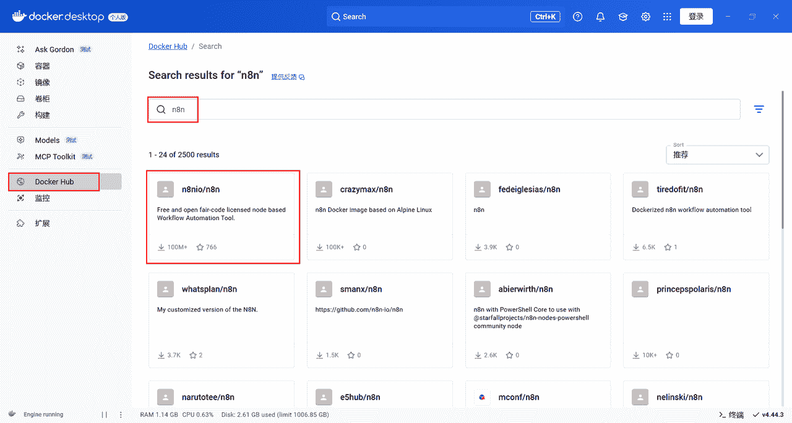

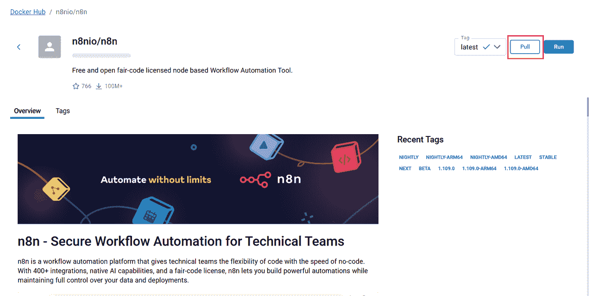

## 3.2 **查看N8N版本**

> 拉取镜像后，可以在镜像菜单中看到对应镜像，点击可下钻查看N8N对应版本

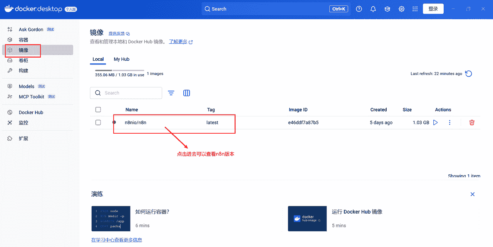

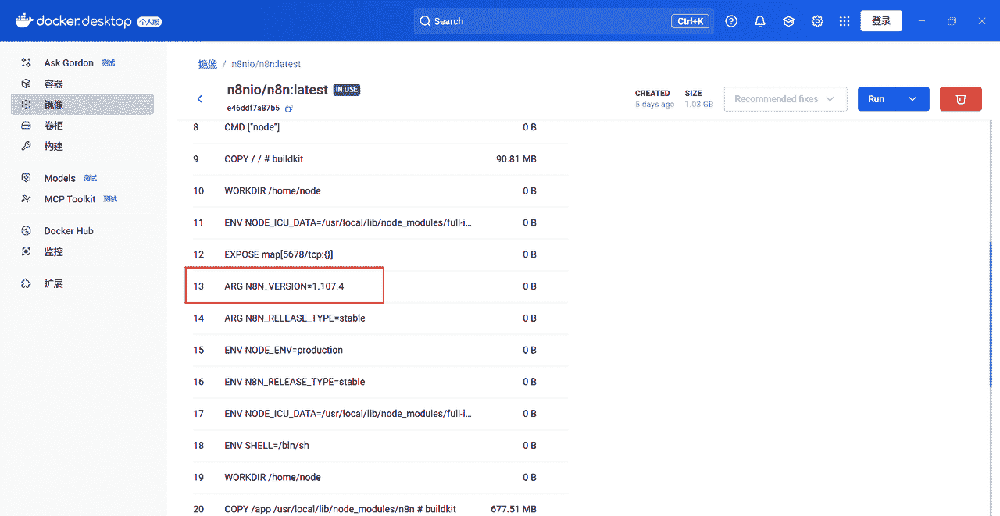

## 3.2 **下载并解压N8N汉化包**

+   访问git地址下载对应版本的汉化包

**https://github.com/other-blows**now/n8n-i18n-chinese

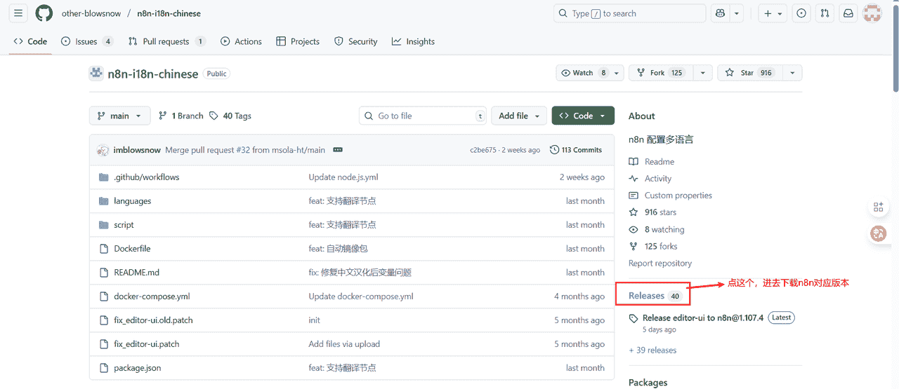

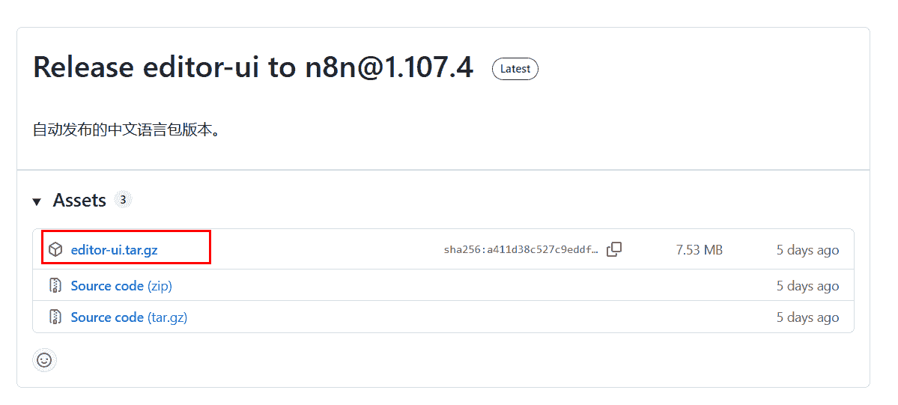

+   解压文件，可以调整文件夹名称也可以不调整

> **解压后是一个dist**的文件夹，将文件夹拷贝到自己想放的地方（如D:\repository\n8n\dist），后面可以直接引用

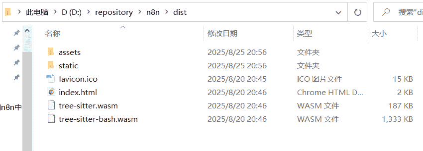

## 3.3 运行配置N8N镜像

+   运行N8N镜像

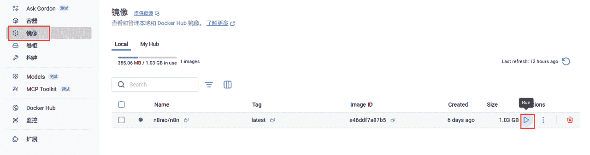

> 运行的时候一定要配置以下参数，**运行后参数就不能调整啦**，只能删除容器重新运行镜像

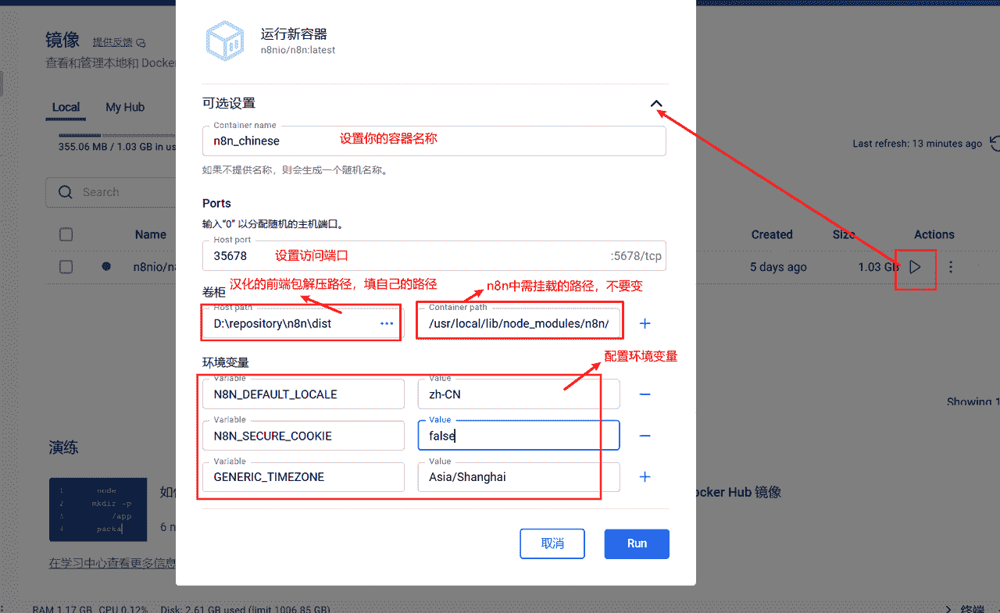

+   配置挂载

> **Host Path**: 填写你解压后的dist目录的完整路径（如D:\n8n\dist）

> **Container Path**: 填写 /usr/local/lib/node_modules/n8n/node_modules/n8n-editor-ui/dist

+   设置环境变量（左边是键右边是值）

> N8N_DEFAULT_LOCALE=zh-CN

> **N**8N_SECURE_COOKIE=false

> TZ=Asia/Shanghai

## 3.4 测试验证

+   点击容器里面你设置的端口或者浏览器直接输入对应地址（如localhost:35678），就可以访问了

