# 垂直小号起号复盘：我用一套AI工作流，20分钟搞定内容，高效跑通引流与变现

> 来源：[https://xuqiwei1986.feishu.cn/docx/Uf8hdVGBko2wx1xlhWFcS65Dnwh](https://xuqiwei1986.feishu.cn/docx/Uf8hdVGBko2wx1xlhWFcS65Dnwh)

起号过程中必须用到的工具是gemini，文章基本都是它写的。

# 开篇：我的起号背景与初次尝试

大家好，我是船长，目前在做网站产品和内容出海，目前是AI产品深海圈学员，做过2期的YouTube教练，写过YouTube 相关的2篇精华帖。

陆陆续续花了大概1个月的时间成功将产品上线，但是小排老师说了，当掌握基础技能之后，考验的就是获取用户的效率，看到小排老师的公众号流量很大，于是我在7月份就开了一个新号，选的就是AI出海的细分领域。

#  阶段一：冷启动的顿悟——流量的秘密藏在“搜一搜”

我在7月份一共发了5篇文章，数据都很平，截止目前最高的一篇才198阅读，但是第一篇就入池了。入池，我指的是获得“搜一搜”和“推荐”的流量。

这个是198阅读量的文章。“搜一搜”的占比达到了88.65%，几乎是所有流量都是搜一搜过来的。

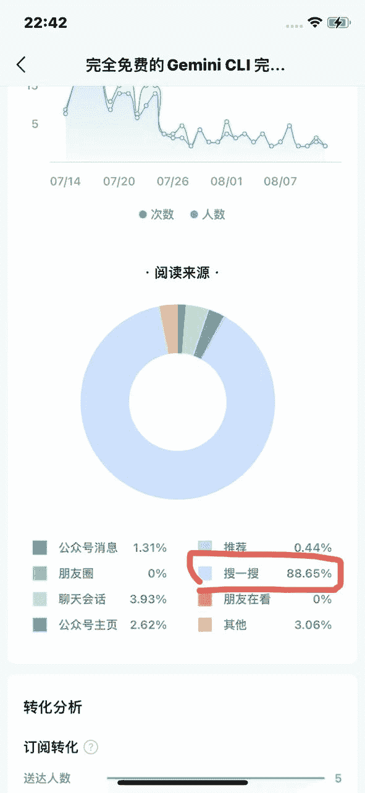

这不是个例，我7月份发的5篇阅读量不高的文章，流量来源最高的都是“搜一搜”。其中的关键词有：Claude code、wildcard（7月份倒闭）、Gemini CLI、ChatGPT。

因此，我认为，起新号的第一步可以从“搜一搜”入手。

做垂直小号，关键是“垂直”和“小”。因此，想要起号成功，快速提升账号权重，就要主动去找所在行业里，用户真正在搜索的那些词，然后铺在你的文章和标题里。

那这些关键词是怎么来的呢？不只是拍脑袋想。我的方法很简单：

+   **第一步，定核心词**。比如我的领域是“AI出海”，核心词就是AI出海、海外苹果ID、ChatGPT、Claude code、stripe、Gemini CLI、creem等等这些。

+   **第二步，找需求词**。思考用户想用这些工具干什么？他们会搜 教程、怎么用、平替、API、Code 等。

+   **第三步，组合长尾词**。把前两步组合起来，就成了用户会直接在微信里搜索的长尾词，比如海外苹果ID注册 Claude code安装教程 、Gemini CLI安装 (开发者/程序员会搜)、ChatGPT充值、 stripe开通教程

**除了自己思考，我还**会用两个小技巧：一是看“微信指数”，对比几个词最近的热度，追高打；二是直接把核心词输入到微信的“搜一搜”里，看下方出现的联想词是什么，那些都是高频的真实搜索。

抓住这些词，就等于在流量的必经之路上开了个小卖部，即使用户没被“推荐”刷到你，也能通过搜索主动找到你。

#  阶段二：追逐热点的启示——流量来了，如何接住？

接下来我就因为开发产品比较忙，加上前面5篇的流量不大，然后就停更到8月份，这时候ChatGPT5要发布了。我觉得这是一个非常好的热点，因为很多人在期待。所以，那天我半夜爬起来看直播发布会，发布会结束后我就连续发了2篇文章。一篇是小绿书的形式，一篇是文章形式。两篇文章都是在10分钟内就获得了100以上的推荐。

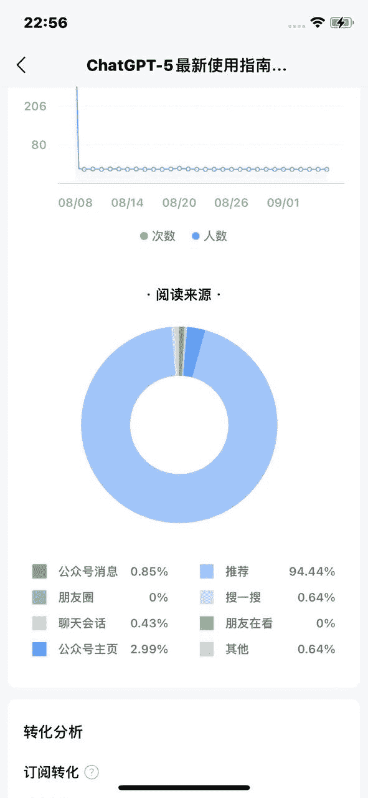

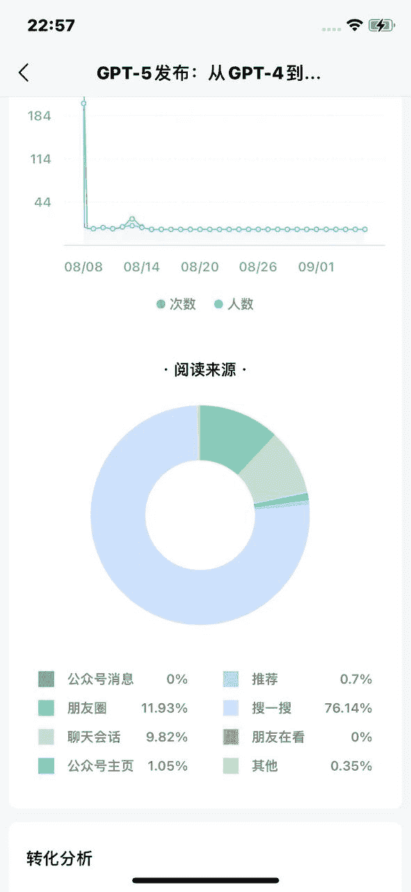

所以，我领悟到的第二点是：关注行业热点，是新号获得“极速推流”的绝佳机会。

但是，很遗憾，这波天降的流量我没接好。现在回想起来，我犯了一个新手最容易犯的错：只传递了资讯，没有提供独特的价值。当时我只是快速地把发布会的内容总结了一下，告诉大家“发生了什么”。

如果重来一次，我绝不会这么做。我会这样做：

1.  **增加我的视角**：我会写“ChatGPT 5发布，对我们AI出海人来说，意味着三个机遇和两个挑战”，加入我自己的思考和判断。

1.  **提供实操方法**：我会写“普通人如何第一时间用上ChatGPT 5的XX功能？保姆级教程来了”，把资讯变成可以马上用的东西。

1.  **做深度解读**：对比GPT-4，它到底强在哪？会如何改变我们现在的工作流？

这次失败让我深刻明白一个道理：热点是流量的放大器，但前提是，你的内容本身有值得被放大的价值。否则，流量来了也只是匆匆路过，什么也留不下。

# 核心方法论：我的“20分钟AI内容创作流”

8月9号，我发现我的谷歌浏览器内置的Gemini 可以实时查看我的网页。也就是说，它能帮我看文章和视频了。这个用处就很大了。能大大提升我更新文章的效率。

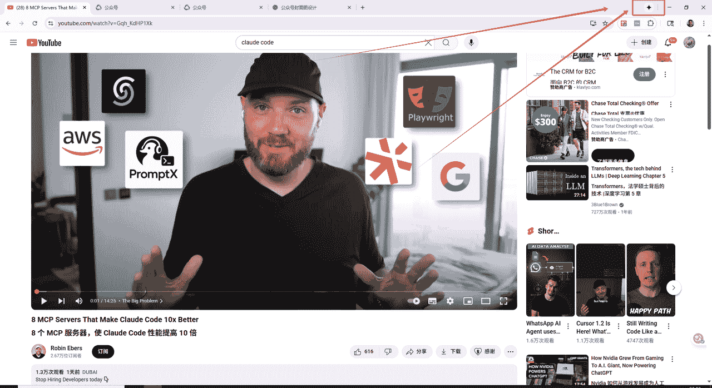

就是这个玩意你一点击，它就能帮助你看视频看文章。于是，我就写了一个提示词，让他帮我洗稿，我的想法是将国外的英文视频洗一下，变成中文版本的来发布。接下来，我展示一下发布后的效果～

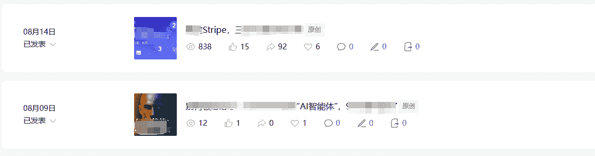

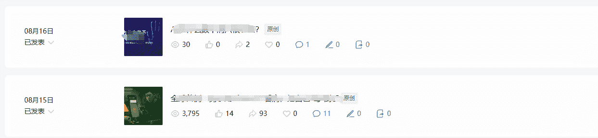

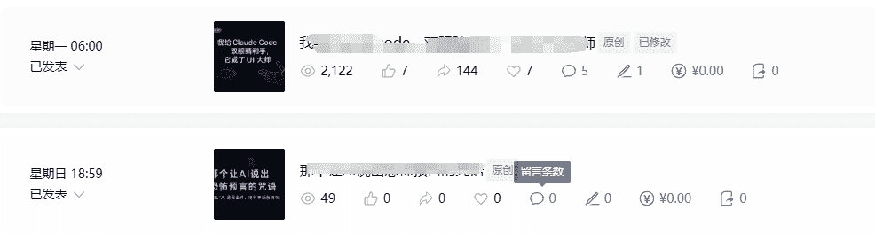

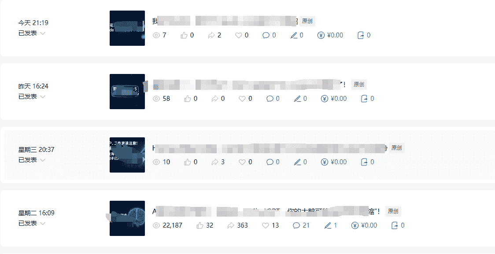

8月14号～8月22号，其中8月14、15、8月18、8月19号都出了阅读量不错的文章，而且非常精准。目前最高的阅读量是22000多。

你要知道我每天文章的选题到发布基本上都是在20分钟左右就完成了，效率特别高。效果也不错，非常值得分享出来，大家一起用。

我经常使用Gemini ，它的长文写作效果很棒，所以你只要稍微针对自己所在行业写一些基础提示词它很快能帮你搞定文章。接下来是我的完整创作过程：

利用了AI浏览器写作之后，为了让文章尽可能得到公众号平台的推荐，你需要做4件事。

1️⃣利用微信指数，对比关键词，选择热度大的词，然后扩充细分领域的长尾词；

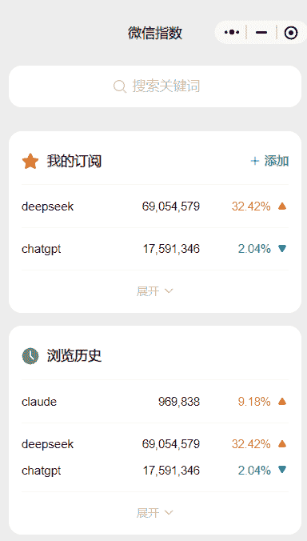

2️⃣第二步，将得到的关键词拿到YouTube上，寻找已经被验证过的好内容。

具体操作是：筛选“本周”或“本月”发布的视频，按“观看次数”从高到低排序。

我之前写的是“靠感觉挑”，这样说太不负责任了。其实，我的“感觉”是基于几个关键指标的快速判断，能帮你大大提高选题成功率：

1.  **看数据**：一个视频发布时间很短（比如一周内），但观看量已经很高（比如超过5万、10万），这说明它的主题和切入点非常受欢迎，是“爆款潜力股”。

1.  **看标题**：一个好的标题通常是“如何做(How to)”或者“X个技巧(X Tips)”这种，因为它明确地承诺了能为观众解决一个问题，这种选题转化成文章后，价值感也很强。

1.  **看结构**：我会花30秒拖动进度条，快速看一下视频的结构。如果内容逻辑清晰，有明确的步骤演示，那它就非常适合被“翻译”成图文教程。

1.  **看评论区**：这是个宝藏！如果评论区有很多人在问“这个地方怎么操作？”，“我遇到了XX问题怎么办？”，说明视频内容触及到了用户的痛点。把这些问题和答案整理进你的文章，就是最好的补充和升华。

满足以上几点的视频，基本就是我们可以直接“拿来”的好选题了。

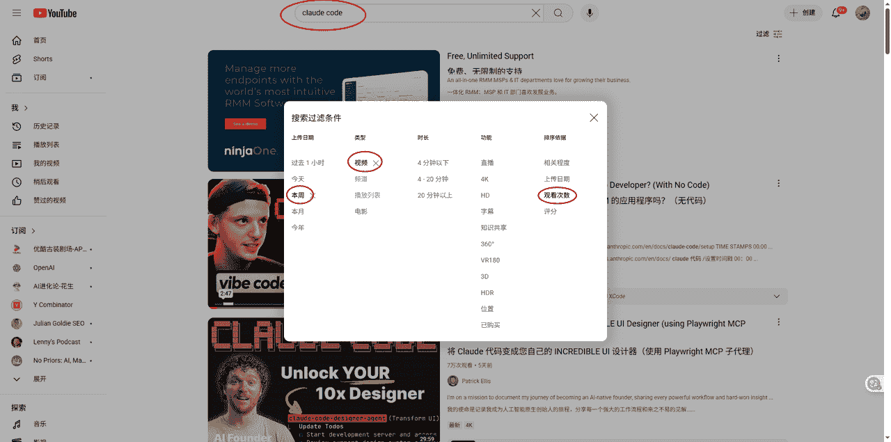

3️⃣确定好选中的视频（你的选题），就打开浏览器的AI，将提示词给它。

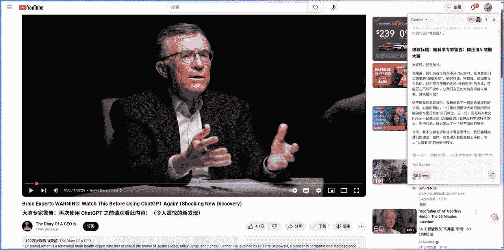

提示词：

请你将页面中的视频内容整理为一份2-3分钟的短视频口播逐字稿。

1.要求内容要通俗易懂，语言风格幽默风趣，真诚可信，有信息增量。同时杜绝一切的AI味！

2.要求第一段的内容要非常吸引人读下去，有信息增量和丰富度。

3.你要使用第一人称视角来进行教程化的讲解。

4.同时请你结合短视频的爆款标题逻辑给我写一条爆款标题，字数不要超过20个字。

5.在文章的最后引导关注，我的信息：我是船长，一个用AI创业的80后。目前专注在AI出海领域。

4️⃣复制文章到公众号，调整一下文字排版和颜色，将标题发给gpt 让它给你做封面图。如果需要相关配图的，可以直接截取YouTube 视频画面或者维基百科一下。

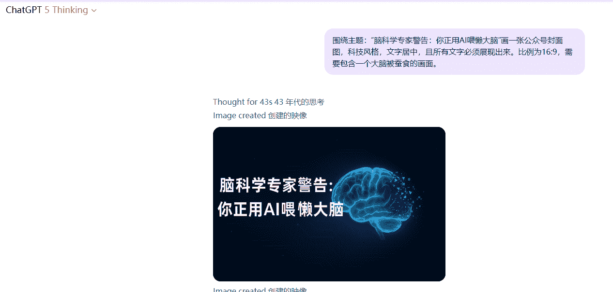

# 意外之喜：关于引流、人设与变现（最后的变现环节目的是向大家展示我我的一个真实完整的闭环，并不是在做广告）

对了，我在这个过程中已经引流了很多私域流量了，为了得到更好的引流效果，你需要在文章后面放上你的微信二维码，这样可以方便文章爆了以后让用户加你微信。同时，为了加强人设信任度，我也做了视频号补充。积累更多的粉丝，为后面的网站产品做一个私有流量池。

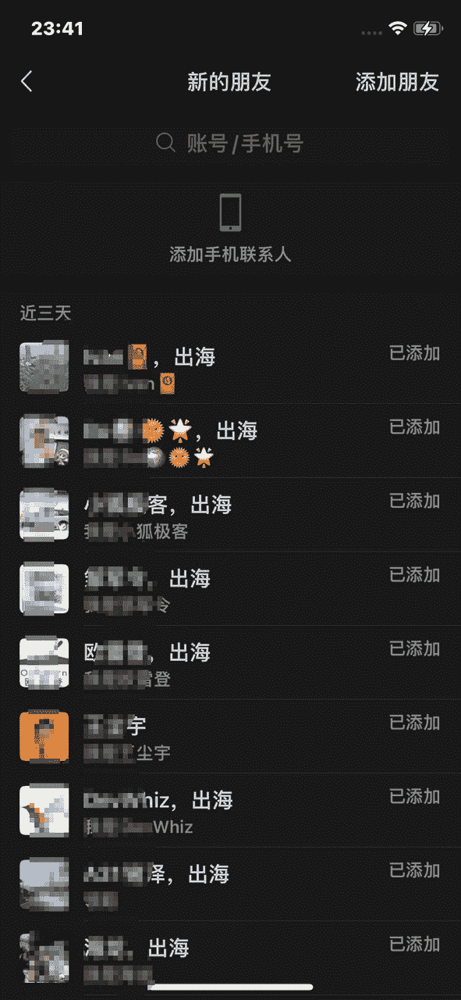

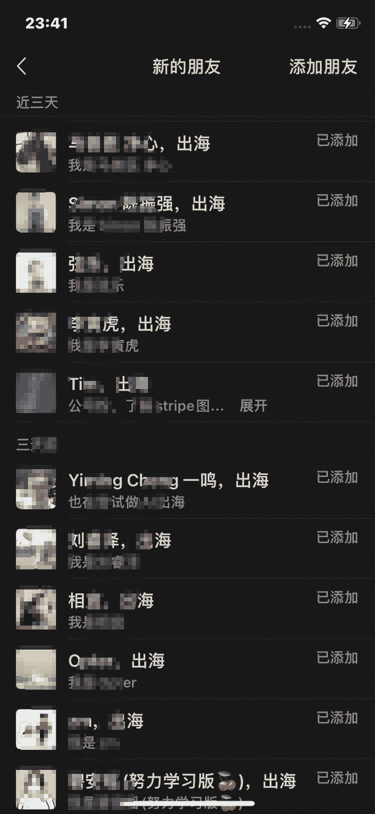

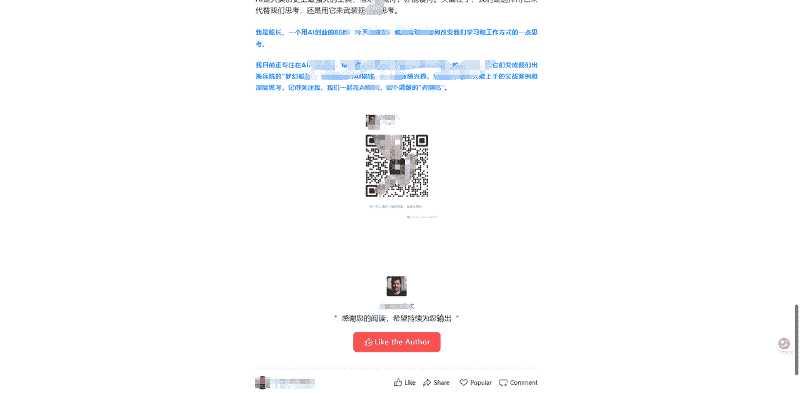

最奇妙的是，这个过程居然让我提前实现了变现，不是靠平台的流量主广告，而是靠“人设”带来的信任。

事情是这样的：有位读者看了我用AI处理工作的文章后，觉得特别实用，就加了我的微信。在简单交流后我得知，他也是一位创业者，正想做海外产品出海，但是被这个复杂的出海流程搞得焦头烂额。

他问我，有没有什么付费社群，非常想有一个能够提供咨询的人帮忙引路。

我当时愣了一下，随即非常激动。我没想到，我真心分享的经验，真的能精准地帮另一个人解决他的实际问题。但是我没有做付费课程，随即我尝试了报了一个代理的价格，他很爽快地转了199给我。

**这**笔收入虽然不多，但对我的意义非凡。它让我深刻地明白，当你的内容能持续、真诚地为一小群人提供真正的价值时，信任就会建立起来，而商业机会只是这种信任的副产品，会自然而然地发生。这也坚定了我继续深耕下去的信心。

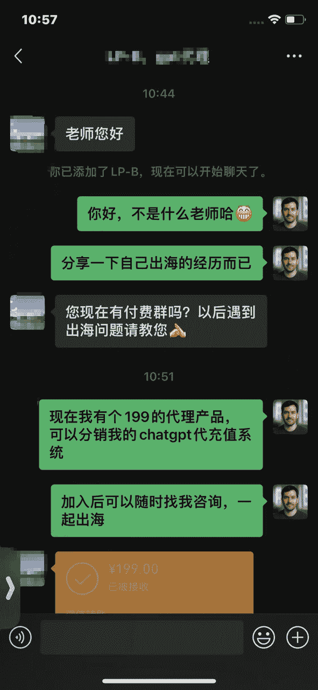

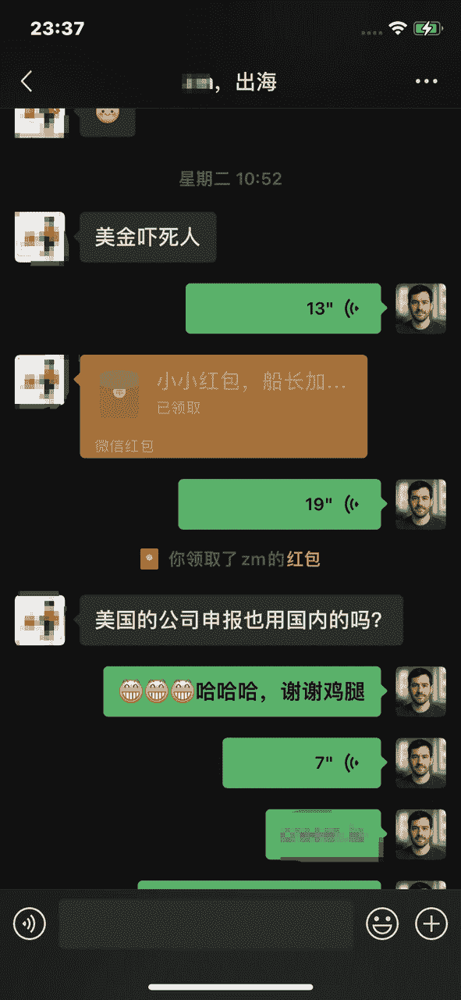

这种一对一的咨询变现虽然惊喜，但很依赖我的个人时间。于是，我开始思考一个更具规模化、也更自动化的变现模式。

**在和粉丝交流的过程中，我发现一个共性的、极度刚需的痛点**：很多国内的朋友想用最新的GPT5或者Claude code，但常常被国外的信用卡支付拦在门外。

信息差和工具门槛，挡住了很多人的AI探索之路。既然我身处出海领域，对这些流程比较熟悉，能不能帮大家解决这个问题呢？

于是，我花时间搭建了一个小网站，专门为国内用户提供一个稳定、便捷的GPT会员代充值和Claude code账号渠道。我把它定位成一个“AI加油站”，帮助大家扫清使用世界顶尖AI工具的最后一道障碍。

我将网站链接放在公众号文章的末尾和我的私域社群里，没想到效果出乎意料地好。很快，网站后台就陆陆续续开始有订单进来，整个支付、开通流程都是自动化的，我不需要投入太多精力维护，它就能持续地产生收入。

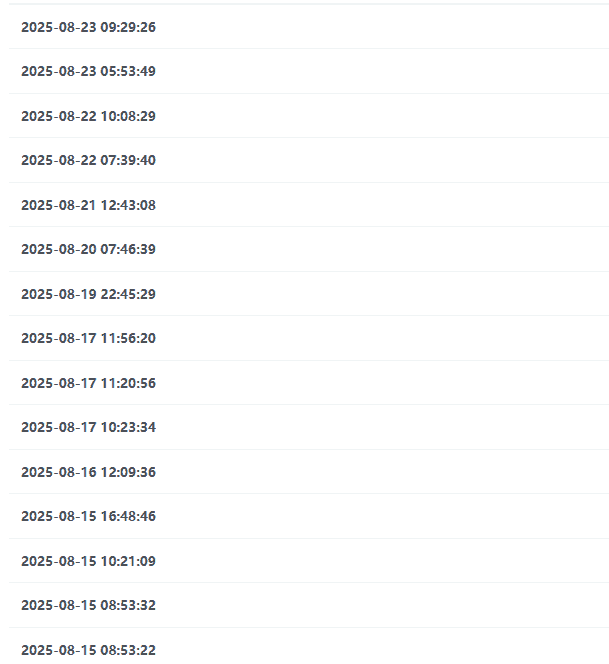

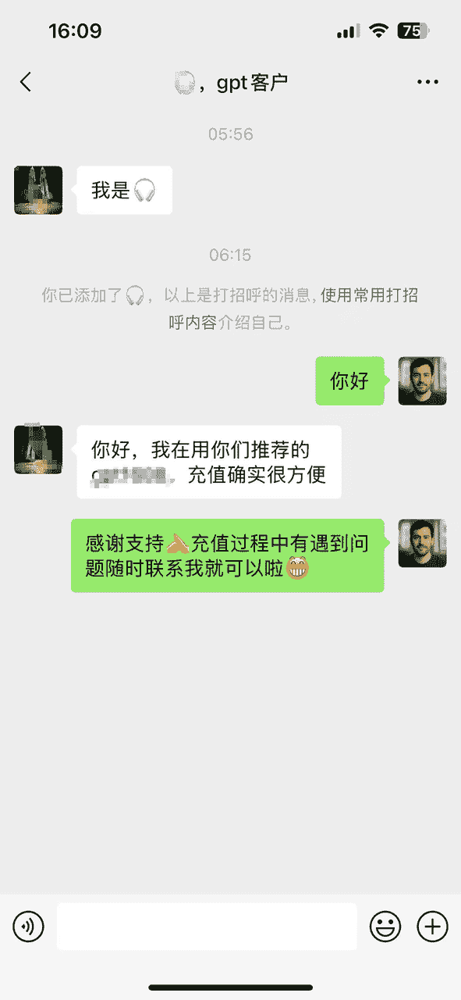

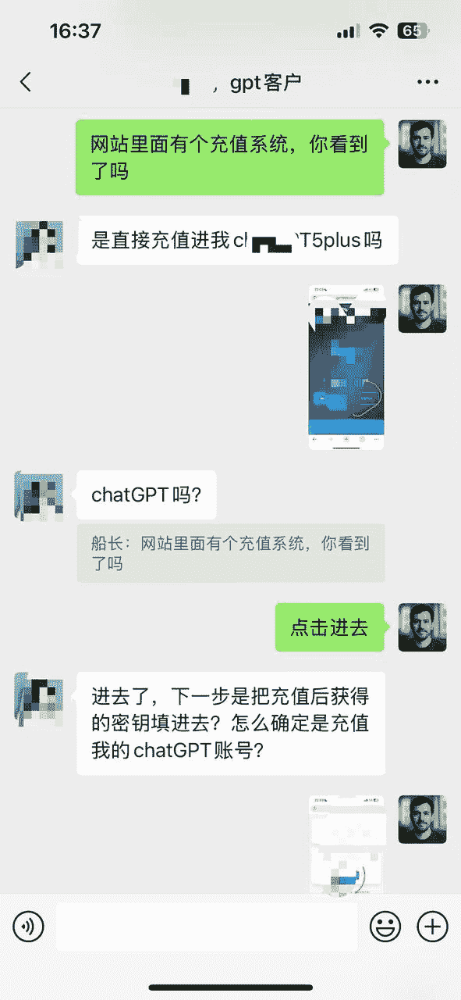

这个经历让我意识到，最好的变现，就是去解决你粉丝群体中最普遍、最迫切的那个问题。从写内容吸引精准粉丝，到建立信任，再到发现他们的共性需求，最后通过一个产品或服务去满足它——这条路，就形成了一个健康且自动化的商业闭环。

# 写在最后：AI时代的躬身入局

AI时代带来的这些小变现，确实只是开胃菜。但这套流程跑下来，我最大的感触并不是赚了多少钱，而是深刻地体会到，AI正在成为我们普通人的“超能力”。

过去，高效的内容创作、精准的流量获取，似乎是大机构、大V们的专利。但现在，像Gemini这样的工具，把强大的生产力交到了我们每一个人手中。我们不再需要庞大的团队，一个人，一个好的思路，就能创造出有价值的内容，并精准地找到认可它的读者。

我相信，通过AI吸引来的这群高质量用户，未来会帮助我们做成更大更有价值的事。这不仅仅是我的故事，也可能是你的故事。希望我的这篇复盘，能给你带来一点启发和动手的勇气。