# 一周内3位10亿级滋补品牌大佬问我：喜纯你怎么看；我：挂逼！！

> 来源：[https://xuqiwei1986.feishu.cn/docx/THTAdRD10oD0vuxBSejcY7FAn6c](https://xuqiwei1986.feishu.cn/docx/THTAdRD10oD0vuxBSejcY7FAn6c)

喜纯是最近两年新起的中式滋补品牌

列几个三方平台看到的数据，大概就有概念为什么大佬们会对他很感兴趣

2023年底，公司注册

2024年初，正式入驻抖音

2024年7月，单月销售额破千万

2025年2月，单月销售额破亿

（对比实际肯定略有出入，但整体趋势可参考）

至于怎么看，一句话极简回答

稍微展开一点，用游戏圈的话就是：挂逼！！

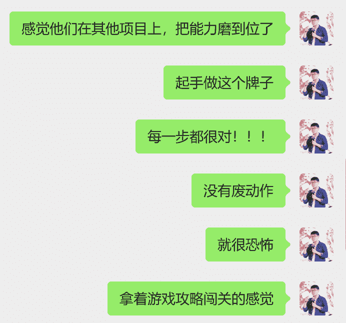

要知道，企业最大的成本不是原料、不是生产、不是人力、甚至不是营销成本

是走错的每一步，付出的沉没成本

在我看来，喜纯在【犯错】这部分的成本，无限趋近于0

查了查资料果不其然，喜纯的老板，李鹤，原曦子科技（西子健康、西子电商的母公司）股东

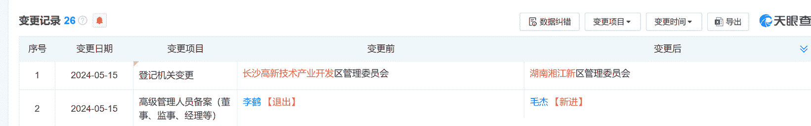

西子健康这家公司，如果不是湖南电商圈的可能不太熟悉，说说他们的旗下品牌：

Fiboo、谷本日记、她练、Foyes

做大健康食品的朋友们，是不是如雷贯耳！

在正式开始详细拆解之前，先说明下，为什么大佬们会问我看法：

+   作为合伙人，做成过一个大几亿的食品品牌。有从0.1到1的完整经验

+   在平台做过策略、也管过行业。有平台视角，甚至直接参与过平台流量分配机制设计

+   最早的时候还在代运营当过大头兵，对实操有最真实最细节的体感

+   作为合伙人，搞砸过两个滋补项目，有亲历的失败经验

下面用营销4P的结构：选品、定价、渠道、推广四个方面进行分析，说说李解对喜纯这个滋补超新星品牌的理解

前面两个选品、定价对一线运营小伙伴会很无聊，可以划过去直接看渠道、推广

## 选品定江山

### 品类上，为什么是中式滋补，不是西式保健？

对新品牌来说，越标品，越难做。

标品容易被比价，一旦陷入比价陷阱，只有头部品牌，只有全产业链效率优胜者会赢

相比来说，保健更标品，滋补更非标

中式滋补是对大健康新品牌更友好的品类选择

### 可是极致非标品，没有价值共识，教育成本太高了，怎么办？

讲一个新概念，恨不得要在《养生堂》节目讲个一小时

要不就是，线下拉用户到大会议室，搞个养生医疗大讲堂

这效率也太低了，怎么办呢？

中式滋补大品类中，虽然配方、价格、剂型并不标准

但很多细分品类、产品有极高的价值共识

比如以形补形

比如红色补血、黑色养发、白色养胃

比如各种耳熟能详的散、膏、汤、丸的名字

所以要在非标行业中，找价值共识，作为开品切入点

这样既规避了标品比价的尴尬，又能借助消费者已有的心智概念，降低教育门槛

我推测，正是因此，才有了喜纯的核心爆品，玉灵膏

### 产品选定了，配方、工艺、剂型是做更科学的创新，还是遵照古法古方？

遵照古法，必须遵照古法！！

创新是大企业才能做的事！！

当你经历过调整配方，加入了更科学的，效果更好的小众原料

你会发现，小众原料种植生产，因为没有规模化、工业化

剧烈的价格波动，会让你辛苦一整年，只为原料商打工

当你经历过优化工艺，用更好的提取技术，达到更好的吸收效果

你会发现，更好的提取意味着更新、更贵的技术

在成品中，原料更无法直接用眼睛看到

消费者购买就需要更高的信任成本，更长的决策周期

这些都不是一个新品牌能承受的

外行看上面，可能觉得：没错，逻辑上说得通

内行能知道，老李曾经经历过怎样的痛苦

所以我推测，正是因此，喜纯的玉灵膏，配方、工艺、剂型完全遵照清代中医名家王孟英（王士雄）的著作《随息居饮食谱》。

膏体可以做的更细腻吗？

工艺上当然可以，但消费者认知上不接受

膏体可以直接变成提取液吗？

工艺上当然可以，但消费者认知上不接受

甚至，连看上去是个破绽的原料，西洋参都保留了。

朴素地认为，西洋参不是个新玩意么，怎么还在清代的方子里出现了

我查了一下，无懈可击！

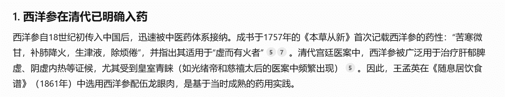

### 但是药食同源，尊重古方古法都没问题，但是功效、药方来源都违反广告法呀，怎么办呢？

这个具体在渠道推广部分做详细拆解。

## 定价定生死

定价，是老板、合伙人会关心的关键决策点

渠道负责人往往更关注流量、转化打法，这些看上去更高级

但是定一个售价数字，确定一个毛利

这个最不性感，看上去最没水平的业务动作，才是定生死的关键点。

### 产品毛利大概有多少？是割韭菜吗？

1688上查一下西洋参、龙眼肉、玻璃瓶的价格，我就不贴图了

考虑到各种产品包装、工艺人力成本，以及大规模生产、采购的规模优势

玉灵膏一瓶69的定价，产品成本控制在20%以内，不是难事

算上仓储物流耗材的成本，销售毛利应该稳在75%以上

算是滋补行业的常规定价区间了

### 对比竞品有优势吗？

对比竞品价格数据如下，截图取自https://mp.weixin.qq.com/s/VCClHi-jPxkPDnhA6N9ztw

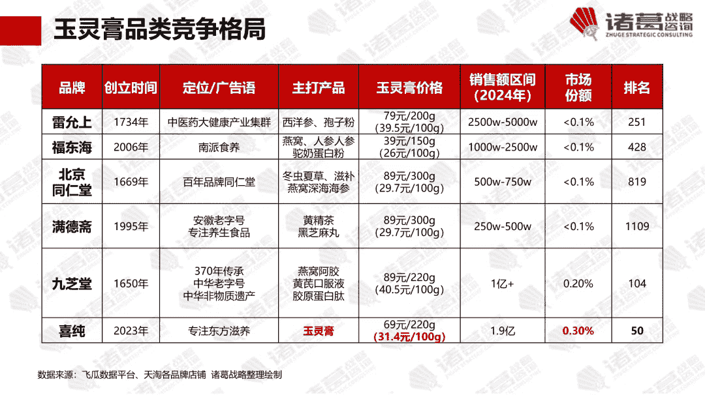

对比竞品，单价算是中等。

但考虑到其他几家品牌的成立时间和广泛的消费者共识，一个新品牌做这个价格，算是偏高的了

推测内部决策逻辑：玉灵膏这个小品类，用户有一定的价值共识、功效共识，但并没有价格共识

作为新品牌，在控制好总价的前提下，毛利高一点不影响转化，且有更多预算可以做推广投放

靠内容拉成交，更重要的是靠内容拉品类新客（即第一次购买该品类的消费者）

这波消费者对比价的敏感度更低，只对总价的敏感度高一些（经验值，不要超过100块）

### 微调组品规格，消费者人均利润翻倍

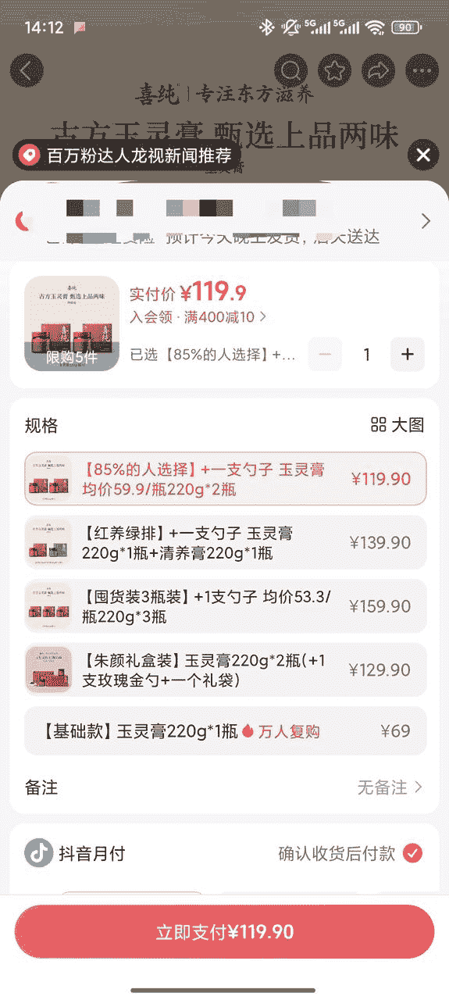

老板们有兴趣的话，可以算算两种组品方案

单瓶购买 VS 两瓶立省+买赠

按照前面测算的毛利率，当抖音ROI分别为2、1.75、1.5的时候

两种组品方案，在不做管理费用均摊时，消费者人均利润能差多少

又是一个不起眼的微操，但大比例影响利润

对了，直播间的组品客单更高，更激进~

有很多人问过老李，电商运营到底是干啥的

即使我已经干了十年了，还是说不清楚

但显然，刚刚说的这个小技巧，就是电商运营的本职之一

选品、定价，都很无聊，但都很本质

说完两个无聊的，后面来说说看上去更高级，更时尚的渠道、推广

## 渠道、推广定规模

### 老法师说，中式滋补在小红书很好做，为啥要选抖音这么卷的渠道呀？

最简单的答案就是

肉不够吃啊！

中式滋补单品，百元以内单价

自营商笔、直播配合投放，再加达人分销，月销售额做到100万，已经算是顶尖选手，想突破200万，难如登天！

回头看看前面的抖音单渠道数据

200万/月在抖音，才算刚刚上道

更何况，抖音的卷，对于新手来说，是雷区

但是对老法师来说，正是舒适区

### 那淘系呢，为什么不在那里起盘？

因为淘系的核心还是搜索。

只要还是搜索，就必须回答的问题是

在淘宝APP搜索框中，用户敲出来的搜索词，是从哪里来的？

用户为什么会搜这个词？

他之前的信息获取来自哪里？

如果最后承接品是玉灵膏，我们期待用户搜的是什么？

膏方？不对，没有功效指向，用户不会这么泛泛的搜

玉灵膏？也不对，这玩意听着熟悉，但真让一个人去搜这三个字，可能吗？

喜纯？还是不对，一个新品牌，除了公司的运营，谁会搜一个新品牌的品牌名呢？

所以，起盘只能在内容平台

让目标消费者，从没有任何产品、品牌、功效认知，通过精心打磨的内容，一步跨进A3（认可）乃至A4（购买）人群

### 抖音起盘要怎么起呢？第一个业务重心要放在哪里呢？短视频？直播？自营？分销？商城货架？

但凡做过抖音的，都或多或少听说过这个版本的答案：

抖音起盘靠KOC分销。

跟当年的淘宝天猫，用淘客起盘类似，纯佣、风险小、试错空间大

不延展，快速说一下其他几个模块为什么大概率不行：

自播：成本高：主播、设备、投放预算、素材制作人力等，自然风险也就高

有坑位费的KOL短直分销：头部达人，新品选不上；中腰部，聚焦各自垂类，也不会选你；尾部小达人，你图他便宜能出量，他图你没量也有坑位费

商城货架：跟淘系一样的问题，初始曝光哪里来？

### 我的业务在抖音，能不能也用KOC分销起盘呢？

上截图！

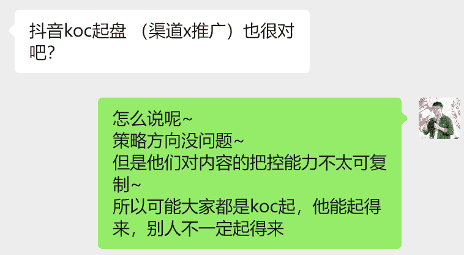

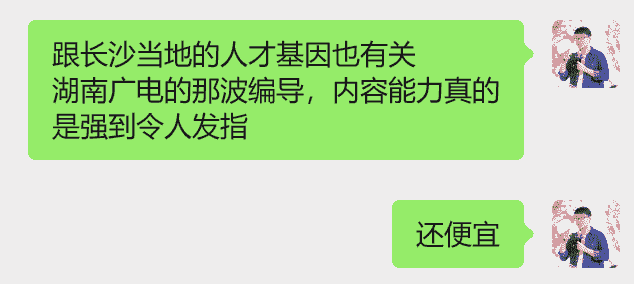

### 所以，KOC分销起盘的胜负手到底是什么？

业务小白以为，KOC业务的账是这么算的：

我找1000个KOC，人均产出1000块，最终100万到手

但实际上，大概率是

找1000个KOC，900+KOC，一毛钱成交都没有

50+KOC，100块以内

10+KOC，1000块

2~3个KOC，一人卖了10万

最大的1个，一人卖了100万

所以，KOC起盘的胜负手是什么？总结起来两个半

一个：用内容，提升概率

一个：用数量，堆平概率

半个：用投放，放大好内容，对抗低概率

**关于内容**

我翻了一下朋友圈记录，发现圈子里最早讨论到他的达人内容，是这个

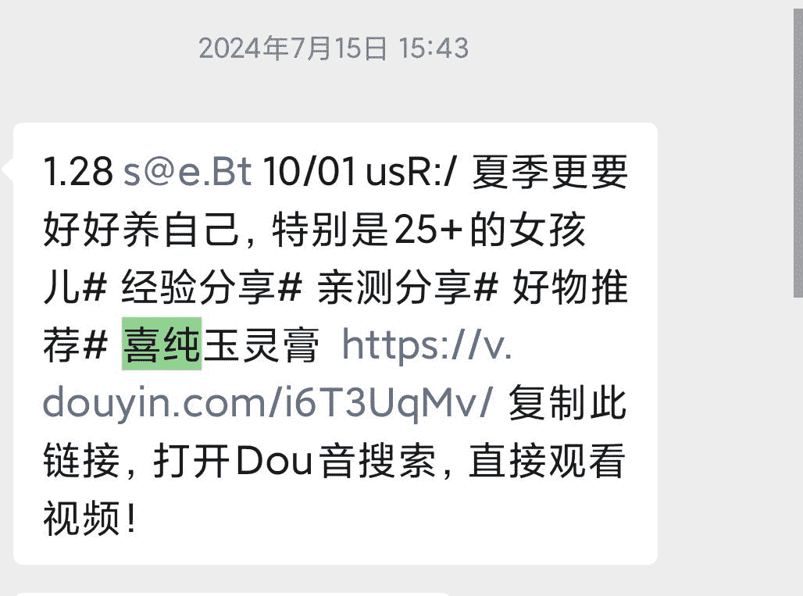

我把原视频录屏放在这里。老板们看完，评论区可以聊聊看完这条内容的感受

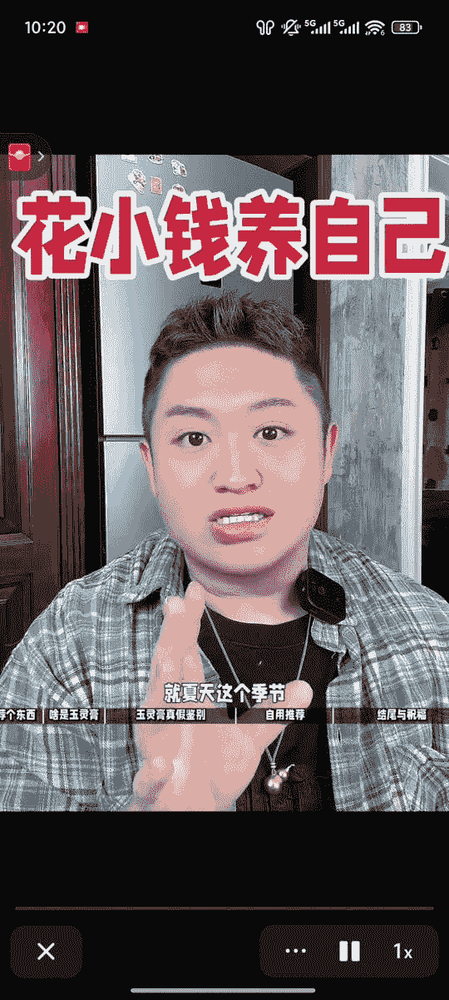

[Screenrecorder-2025-08-21-10-20-35-217.mp4](https://internal-api-drive-stream.feishu.cn/space/api/box/stream/download/all/XBzqbKdnhozMaIxxVATc9Xwgndb)

还有最近的两条，看看达人筛选，内容脚本的迭代方向，评论区见~

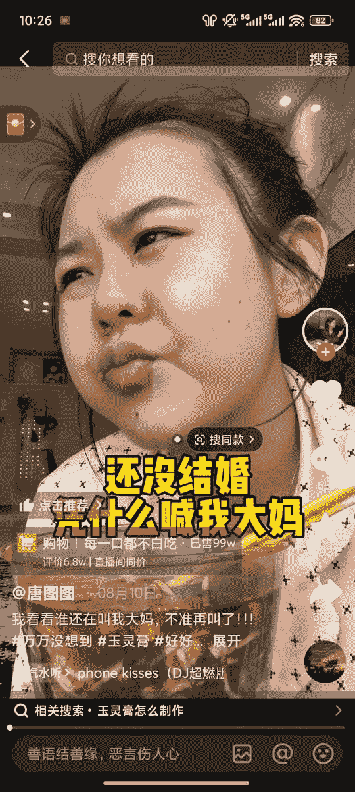

[Screenrecorder-2025-08-21-10-26-00-29.mp4](https://internal-api-drive-stream.feishu.cn/space/api/box/stream/download/all/QthSbwpEYoS4IjxrArtcJsbRnvf)

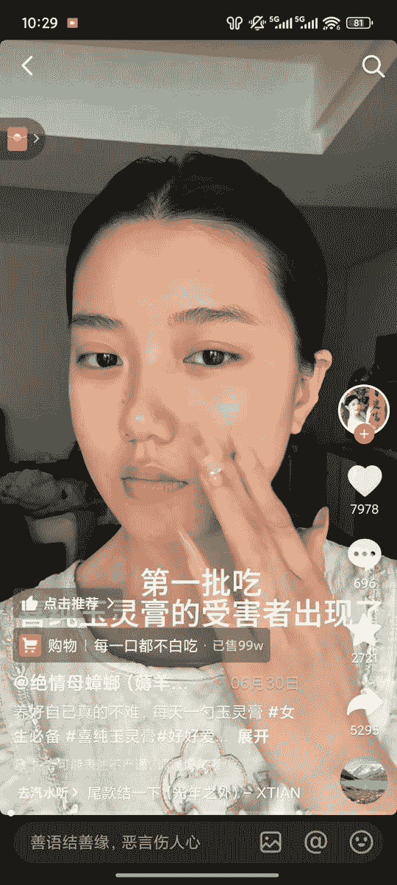

[Screenrecorder-2025-08-21-10-29-17-24.mp4](https://internal-api-drive-stream.feishu.cn/space/api/box/stream/download/all/QiCzbUwQiortrhxYzSJc3LGwnOP)

对了，别看这两条数据好。

这俩达人其他带货视频点赞量都不过20，盲猜播放量过千都悬

虽然大概率有投流加热的影响，但显然内容也已经好到算的过来账了，要不然也不会投这么多。

还有一个非常有意思的细节，看看他们的评论区

提醒！！别光看梗，猜猜哪些是自己人的评论引导

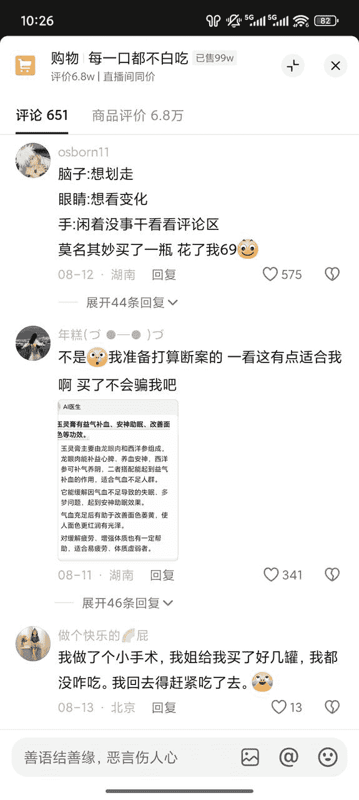

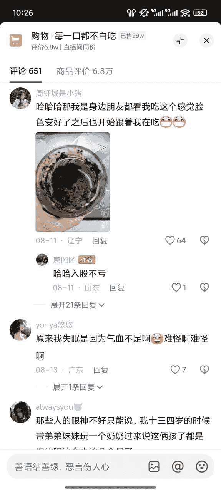

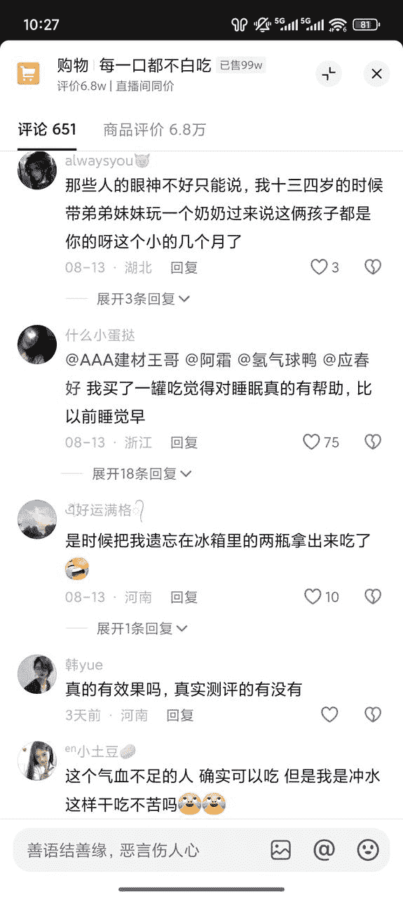

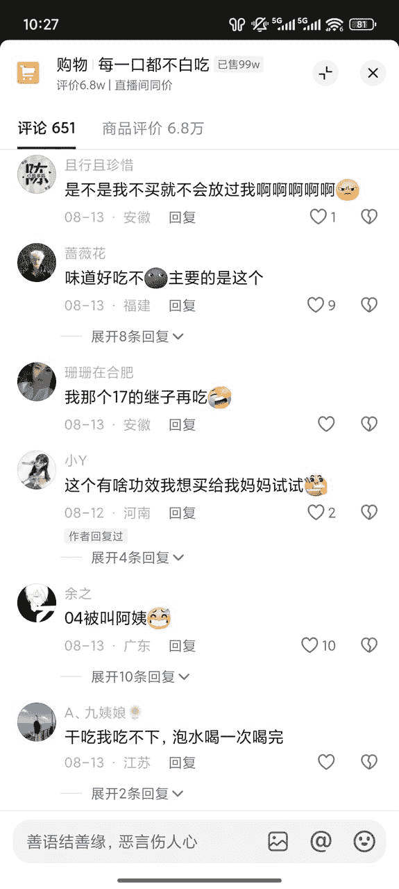

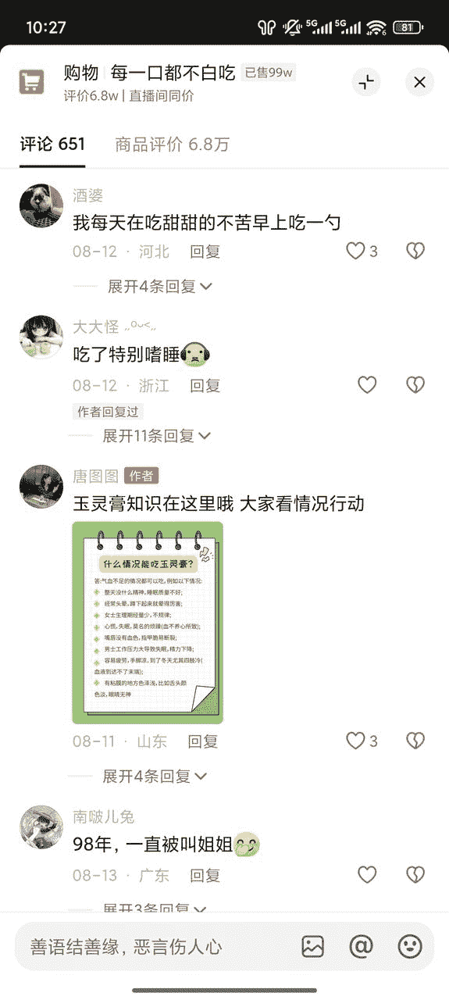

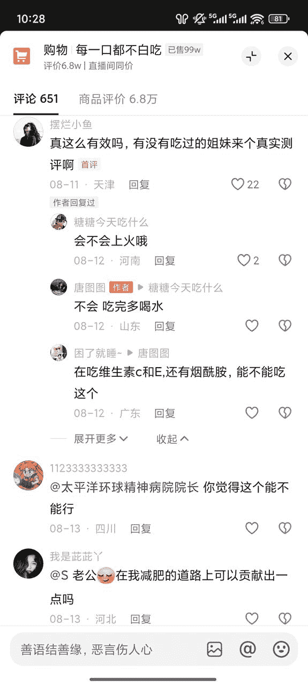

至于我们做业务的时候有啥可抄的，这里就不展开了，实在是太长了

可以去视频号-李解的理解预约直播，回头直播间聊聊

**关于数量**

不是几十，不是几百，是上千个达人！

这是2024年的全年

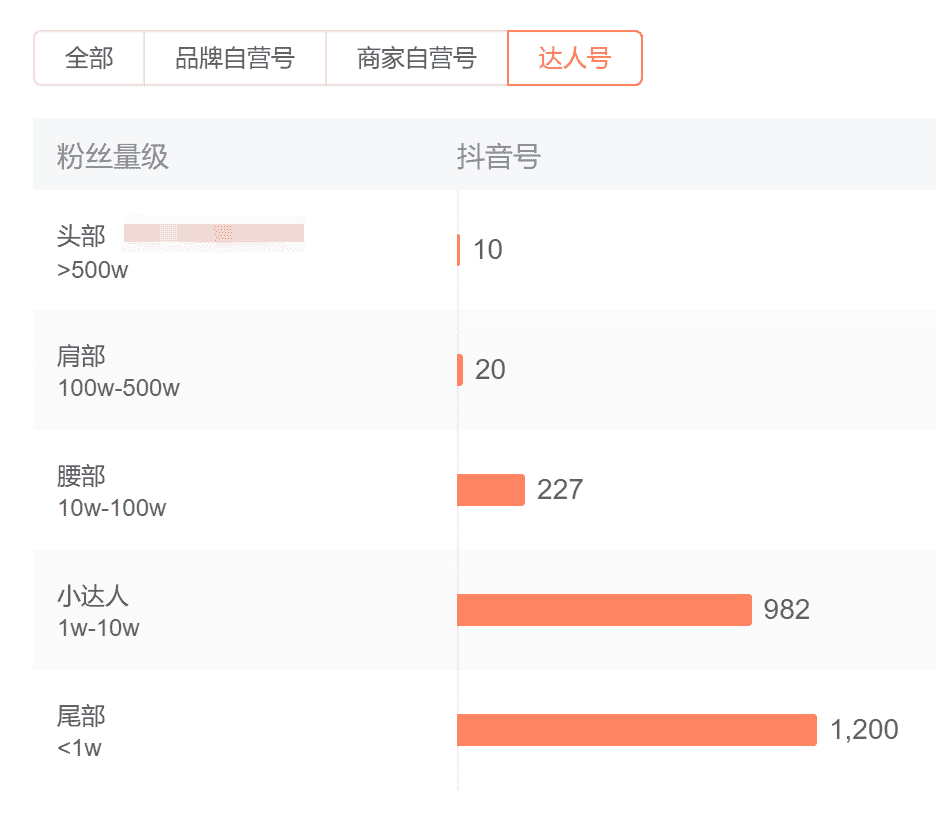

关于投放

数据看不到，不敢瞎说~

### KOC分销的规模好像是有上限的，怎么突破这个规模呢？

纵然喜纯们在优化KOC拍摄脚本时，会尽量把拍摄难度，和对KOC的素质要求降到最低，以求最大量的KOC覆盖

但这种方式能覆盖的量还是相当有限的。

想要突破这个规模，就得上直播了。

不管是达人直播，还是自播。

短视频和直播是完全两个流量池

如果再算上付费，那就更刺激了~

### 直播搞了！那怎么突破直播规模呢？核心靠什么呢？

达人直播本质还是商务拓展逻辑，这里不详细展开

（主要是因为想要详细分析单品牌达播效果太费时间了，顶不住顶不住）

这里主要聊聊自播业务。

常规的直播间的人货场优化，以及话术优化，是个精细活，也不在这里多聊

有兴趣的，还是预约视频号-李解的理解 直播间吧，那里可以聊的更尽兴一些

聊到自播，所有尝试过一段时间的老板们都多多少少有下面的疑问：

为什么隔壁品牌自播月销几千万

我特么同品类，自播月销只有百万上下？？！！

我特么天天研究他直播间的搭建、背景设计、话术

我连主播都直接找跟他们主播长得像的

为啥还差这么多！！！

因为投放~

不对呀，我也投了呀，钱没少花，利润都打平了，甚至都已经亏了，这量还是上不去

因为投放素材~

不对呀，我也1:1照抄了他们的素材，为啥还是跑不动

因为人群规模~

相同素材，A1~A3人群规模大小，直接影响综合投放成本

简单说就是，一对双胞胎，姐姐品学兼优，自己做个人ip，还经常参加线下聚会

妹妹，内向的不行，虽然长相和穿衣品味跟姐姐类似

但同样要找对象的时候，姐姐有明显优势，因为圈子里的人对她更熟悉

这里更多聊的是逻辑。

主要也是因为喜纯的投放素材，我刷了一下，系统退给我的并不多

不像KOC的内容，可以直接搜出来

就不特别进行针对性分析了

前面写过一个另一个香氛类目的投放素材分析，也有发在生财，可以翻翻看看

## 总结

很多人说，电商最让人绝望的，是打法每天在变。今天的头部，明天就是尘土

可为什么总有团队，总有品牌能够穿越周期，持续在场？

电商毕竟本质是消费品

纵然打法在变，基础的分析决策框架，不会变化

如果你还没拿到过结果，不要急着追逐潮流，先用扎实的框架拿到第一个结果。

如果你已经有成功案例，花更多时间洞察一个又一个成功品牌背后【不变】的本质，才是持续成功的关键。

电商的世界，没有捷径，但有方法。

穿越周期，持续在场，不下牌桌！