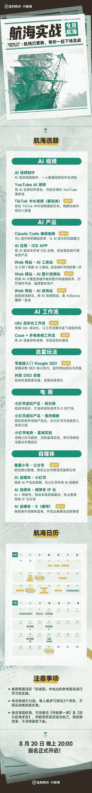

# 2025-08-19【超级标11】n8n

> 来源：[https://xuqiwei1986.feishu.cn/docx/NTS1deL62oXKLkxOE8SckQL2nLc](https://xuqiwei1986.feishu.cn/docx/NTS1deL62oXKLkxOE8SckQL2nLc)

> 🔗 原文链接： h[ttps://scys.com/ar](https://scys.com/articleDetail/xq_topic/2852118144252251)ticleDetail/xq_t...

>

本文核心价值在于强调AI工作流的重要性及价值，尤其以n8n为例，适合想在AI领域掘金、提升工作效率的创业者及职场人士。

+   AI最大机会在垂直领域的Agent，工作流是其前置，且自动化工作流搭建能力未来很值钱。

+   n8n调用AI能力强，国外开源协作使其软件易打通，国内深度集成平台的工作流价值高。

+   赚钱星球有近2000篇相关帖子，集中在内容创作、电商等6大场景，爆款即定制工作流。

+   圈友通过售卖工作流等方式变现，如来来、李香君等，n8n社区生态强，学习研究有多种切入点。

总之，AI工作流潜力巨大，掌握相关技能与工具，可实现自动化创作、运营及变现，开启财富新路径。

0**11 7月底的时候，我在星球问**大家最想学习的技能有哪些？ 排名第一的大家猜是什么？ 是 n8n、coze、AI 工作流。 果然赚钱圈友是识货的，有点东西！ 我认为未来对于普通人而言， AI 的**最大机会，是在 垂直领**域**的 AI Agent** **。通用大模型肯定**和我们没关系，那是大厂之间的竞赛。但无数细分领域的需求，需要各种 Agent 来满足，那就是我们这帮蚂蚁雄兵的机会。 现在的 AI Agent 现在**已**经**可以完全做**到，从创意到内容生成到发布甚至到营销，全部自动化，且内容质量不低于大多数创作者生成的，相比于之前有人介入，成本应该说可以降到 0 了。 最近对aiagent的理解有升... 而 AI Agen**t 的前一步是什么？是搞****定工作流。 越是在垂****直行业基于实践总结出来的**工作流，越有价值，越有机会进化成 AI Agent。 说实话，其实这条超级标早就[在选题库里了。我也在不](https://scys.com/articleDetail/xq_topic/4848115458812548)**少帖子里提到过这个技****能： 包括我自己也付费买了一****条 5 位数的 n8n 工作**流研**究学习； 包括超级术里，**我推荐的2篇帖子都和工作流自动化相关； 目前我认为对生**财圈友而言，应该聚焦在 AI 的三大板块去学**习和研究**： 第一个是 AI 编****程 ，用 AI 来做网**站、做app、做小程序，现在我们和小排带着很多人在通过 AI 做 Web 网站就是**这个方向去突破； **第二个是 AIGC ，用 AI 来生成文字、图**片、音频、视频、数字人甚至直播**，而我认为，其中现在空间最大的有巨大上升潜力的就是 AI 生成视频 ，我们从去年开始带着大家**借助 AI 做 Yo**uTub**e 视频就是往这个方向突破，目**前星球有很多人跟着做并且赚到钱，有几个圈友已经实现月入过万美金。 而第三个，就是今天我发布的超级标： AI 工**作流。 工作流对编程能力**要求不**高**，**普通人也能搭建起工作流，工作流搭建起来，下一步就是AI** Agent。 毫不夸张的说，未来最值钱的技能之一就是自动化工作流的搭建能力。 对于能够在团队里面稳定的持续的搭建能实际应用的工作流的人，**我应该会非常愿意给他涨工资**发奖金。未来也有很多老板愿意花钱找人定制个性化工作流。 而在 AI 工作流里面相关的几个工具或者软件或者技能是，国外的n8n、国内的coze、以及rpa。 所以，今天的超级标我们重点来讲： n8n。 1/ 为什么以前也有工作流，而现在却到了一个值得非常重视的阶段？ 因为 AI 的出现，相当于工作流有了大脑 ，以前的工作流只有手，涉及到判断的地方需要人工介入，不够自动化智能化。但现在 AI 的判断能力，在很多地方已经超越了人，用 AI 的圈友已经有深刻的感受。 而调用 AI能力上，n8n是最强的，因为国内的很多产品，涉及到政策，不允许调用外部的大模型，所以，你是愿意你的工作流调用 claude、gemini、chatgpt，把它们引入到你的工作流作为你的大脑，还是其他模型？ 2/ 国外崇尚开源和协作，各种软件几乎都可以打通。 就以我买的那条 n8n 工作流为例，我只需要输入一个简单的想法，就可以一键实现生成脚本、生成图片、存储图片、合成视频、配音、自动上传到 youtube，背后是各种软件之间以接口或者其他形式的合作，而这在国内是很难想象的，大家都自成一派。 当然，正因为国内自成一派，深度集成平台的一些工作流价值也非常高。 比如前段时间，国平老师分享的他们的一条📕工作流就很有价值： 通过📕评论识别意向用户，定向沟通引流到🛰️，并根据用户信息输出个性内容引导成交，最终实现卖出一套房的例子。 3/ 目前在 赚钱星球有将近2000多篇帖子与工作流相关 ，目前主要集中在以下6个场景： 场景一：内容生成/创作 ，用AI+流程生成文章、脚本、视频、图像，进行内容创作； 场景二： 电商场景 ，自动生成图册图、换模特图、AI详情页、包装图替换等； 场景三：自动提取/分析 ，内容/数据的结构化处理、文本提取、信息分析（如📕/B站内容提取、结构化为表格）比较有代表性的帖子应该就是@富贵那篇了，大家感兴趣的话，不妨点击链接查看； 龙哥盟·会员主题贴 场景四：分发/同步 ，AI生成结果自动发布、同步到多维表格/🛰️/油管等平台； 场景五：对话/客服/小程序 ，智能体接入（如Coze）、AI客服、内容工具封装为🛰️小程序； 场景六：SaaS/服务产品 ，用AI+流程生成文章、脚本、视频、图像，进行内容创作。 ...... 发现没，从产品开发、内容创作、流量获取，只要你敢想，他就能做，所以你要做的就是尽可能梳理清楚你的工作流程，然后把能力复制给它。 4/ 爆款就是工作流。 如果你理解这句话，就理解了矩阵化自动化做内容的关键。每一个爆款，其实就是一个定制的工作流。 爆过的内容会重复爆，只是形式略有差别。其中的差别，就是工作流完成的。 不管是爆款文章，还是爆款图片、爆款视频，背后都是一个定制的工作流，也都可以定制成工作流。 记得我昨晚发的帖子吗？ 当你入场就是以矩阵化工作流的视角去看各种内容时，你的赚钱之路注定和别人是不一样的。 所以，大家可以理解为什么很多做油管的圈友，在那几个赛道持续产生收益，什么达人秀，山海经，动物救援，reddit故事等等。 如果你具备了识别爆款并把爆款生成自动化工作流的能力，你就掌握了财富密码，或者一定会有人愿意找你买财富密码。 5/ 说完了场景，聊点我看到的圈友变现案例： @来来，据说来来依靠liblib引流以及转介绍 售卖电商场景的工作流 ，每个月的变现空间已经做到3-5W+了； @李香君，他自己做的 YouTube工作流 ，可以实现热点→脚本→配图→剪辑→自动发视频的闭环，至于结果短视频15 天拿 YPP；长视频日产 20 条，一条 5–10 刀； @三笙，视频号服饰类目赛道，用 AI批量生产内容 ，目前生产成本在4元一条，每天生产100条，然后混剪成1000条以上； @半糖梦呓， 📕电商的半自动化运营体系 ，5月份教弟弟（没有任何自媒体经验）操作整套流程，6月已经有5万GMV了，教另一个朋友4月中旬开始操作，6月也卖了12万GMV了； ....... 大家能感受到这个过程中，工作流带来自动化、半自动化的魅力没？ 6/ 很关键的一点，n8n的社区生态非常强 n8n 起步阶段是完全免费的，你可以拿着市面上别人搭建好的工作流去调试和学习，特别是 n8n 结合营销增长的工作流，我的观察正在处于爆发的边缘 ，越来越多的人在关注和学习。 如果你收集能力强，可以自己挖掘到几千条 n8n 营销相关工作流。 7/ 对你来讲，如果希望学习和研究n8n，有一些具体的切入点 a. 提供n8n定制服务 很多中小企业、创业团队没有技术资源，但有自动化需求（比如客服、财务报表、跨境电商、AI内容生产）。所以如果你能提供“自动化顾问 + 代建”服务，用 n8n 给他们搭建工作流，就有很高的价值。 单次收费几千到几万，闲鱼或者国外的一些论坛比如reddit或者fiverr、upwork上有人在卖这样的工作流。 关键词：n8n automation b. 做垂直领域的n8n工作流市场 就像我上面提到的，营销增长领域的工作流、短视频营销领域的工作流，以及ai写作、ai生成朋友圈、ai客服、社群运营、内容分发等， 越接近流量的工作流越能卖个好价钱 。 c. 把工作流封装成 ai agent 我前面提到过，AI Agent的前面一步是工作流。所以，研究出或者找到成熟的工作流，把工作流封装成产品，可以直接做成订阅收费网站。 我们现在很多做出海 AI 产品的圈友，干的就是这个事情，只是可能自己还不清楚。 d. 找到在国内的IP生态位 目前国内对于n8n的分享和研究整体上比较少，赚钱星球里面的n8n相关内容已经属于比较前沿了，但说实话，距离国外的社区分享还是有很大差距，需要有这样的研究员，研究、拆解、分享， 形成在国内n8n 及其细分领域的专家 ，未来商业化路径很清晰，最简单的就是做咨询、做定制，以及未来会有非常多的企业有工作流培训需求。 另外， 结合上一个我发布的“垂直小号”超级标，在👸号的内容生态中，n8n还缺少有影响力的IP，值得投入进去。 8/ 国外n8n，国内coze 为什么我会把这条超级标定为 n8n，因为我希望更多圈友开始学习去赚美金， 如果肉身无法出海，我们的生产力得出海，这样才能对冲未来极高的不确定性，也算一种重要的资产配置 ，这个不能展开讲，但希望大家能懂。 如果你的业务是在国内，那么与coze、飞书多维表格、rpa的结合会强一点，也可以关注，上面讲的所有机会，对coze同样适用。 9/ 最后再讲一下 如果你已经看了马上要开的航海，就能惊喜的发现，这一期的航海选题，竟然有： n8n 竟然还有 coze +多维表格。 不得不喊一声，赚钱真牛逼。

钟Lilian 、 安宇轩~ 、 潘潘 、 涓涓 、 ian 、 逆扬 、 瓦香鸡教主 、 见山 、 JC 、 罐子哥 等972人点赞