# 【万字长文】入局油管2个月创作一个亿播AI视频的过程案例讲解和思考

> 来源：[https://xuqiwei1986.feishu.cn/docx/Da1jdVdbWoZKLxx6QV0c1MHDnhb](https://xuqiwei1986.feishu.cn/docx/Da1jdVdbWoZKLxx6QV0c1MHDnhb)

这个文档除了介绍经历，心态，工具，带货，还有一些提问，思考，

标签都在目录上，有【干货】也有【思考】大家按需阅读。

不一定按顺序阅读，可以根据目录选择性阅读

先展示下数据，实打实的1.39亿播放，还有一个2千万的

收益就不放出来了，避免大家焦虑，用交流的心态来看待这个文档吧

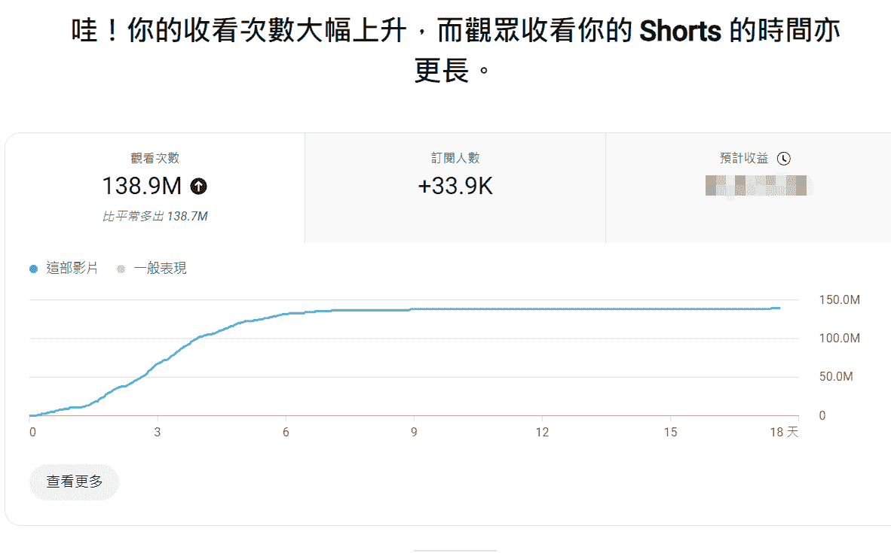

# 【经历】看我的经历和心态可以看这里

## 1.1 缘起

我是在4月份的时候，看到了【狗狗救援】这个赛道的视频，

当时触动到我的是【狗狗救起来落水的宝宝，把他带到妈妈身边】，

这个过程写了一个简单但是非常感人的故事，自由职业探索了一年，也想做一些能够长久持续性的有意义的项目。只有自己热爱的才能做的下去，让人觉得有价值（不一定是实用价值还有情绪价值）的东西做的也有成就感

5月初第二期深海圈开放报名后，我就跟着这种类型的视频，复刻了一个老虎妈妈叫人救小老虎的故事。

学习做ai视频的能力，当时我连配音bgm都不知道怎么解决，还是圈友跟我说下载原视频，用原视频的音乐，把视频放到对应的位置上就行。当时做视频也挺慢的，

于是过了几天，我看到小狗救美人鱼的故事，又复刻了一个狗狗救小鸟的故事。但是都没发出来，

刚开始连视频都不太会做，尺寸都是1:1的，都不是9:16的。

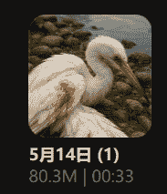

[5月7日 (1).mp4](https://internal-api-drive-stream.feishu.cn/space/api/box/stream/download/all/MKzpbQXGDo5gESxXnsucVfbsnDb)

[d9fe855f3282f2c0b4aa422b1fbb256f.mp4](https://internal-api-drive-stream.feishu.cn/space/api/box/stream/download/all/Yotnb1SqwoIEf4xJ3LPctf4cnNA)

第一个卡点是， 人物一致性怎么保证，试了好几个软件都不知道怎么搞，那时候还没进入深海圈，还是蔡喵喵圈友告诉我gpt可以保持人物一致性，我才有继续做下去的动力，不然我都要放弃youtube了

## 1.2 加入深海圈

小声说下，当时是想着加入后觉得不满意也可**以全额退款，毕竟5**k的客单价也不算少了，但是错过了就很可惜，反正可以全额退款就先加入看看。

现在想想，这5k也太值了吧，交付的内容和深度也太多了，而且教练还在开发新方向，还在迭代交付内容，还在录制视频。

5月中旬加入深海圈后，刚开始做油管的时候很兴奋，一发视频就是几万的观看，全是正反馈，跟小红书比起来太香了吧，小红书就那么抠抠搜搜几十个小眼睛。

接着就是日常卡3w播，**第一个槛出现了**

5月中旬那段时间我是全职all in 油管的，作息时间如下：

8点半-12点到自习室开始做视频，吃饭+午休2h

14点-17点半回自习室做视频，发布视频

20点-23点在吸收信息，有油管相关的，也看生财。

离开房间后确实有种上班的感觉了，效率自然也是比较高的

看到风向标感兴趣的赛道后，那时候一下子做了10个号，每个号都是gpt出图，非常痛苦，出图很慢。我自己也会做点小工具提高下效率，但是没啥用，时不时开始断更，坚持了一星期就开始想放弃了，经历了第一次崩溃+焦虑，对标一直在爆，我的视频一直没动静，就是不知道为什么。迷茫啊特别迷茫。教练说更新个十来天会迎来第一个爆款，那能怎样，也只能继续做下去了

也有点因素是因为用力过猛吧，刚看到的一个有希望的赛道就逼着自己去死磕。也忽略了运动，导致每天晚上12点睡不着都得出门散步运动

然后重新回到赛道选择，开始去油管首页刷shorts，看各种七七八八的类型

之前太依赖风向标了。看公域的信息感觉打开了新世界的大门。

看惯了风向标就能看出来很多公域视频确实做的不咋地，当然了也有很多优质的

没啥用，还是卡3w播

积攒了一些问题后开始约教练1v1咨询

在教练提供新玩法后，到了5月底开始，流量没有想象中的那么好，一次就爆的概率太低了，只能继续框框肝了。新玩法要靠时间去积累，确实也能看到开ypp的希望，在6月份也让我快速开通了一个高级ypp。

但是我不知道做什么赛道了，又开始陷入迷茫焦虑了，毕竟都想找一个简单的常青的赛道

有了ypp后想要更高的收益也是要打磨作品的质量的，前期都是一定要经历的，做视频的基本功是要慢慢磨练的，有些路该走的就是要耐下心去走。

这也是看了很多项目从0-1后获得的收获，一定是看好一个方向后，去死磕，去做，大方向没错的话，一定会有收获的

然后我又开始狂刷油管首页，看了很多视频，一直在做笔记，分析视频类型，有时候半夜12点半也在看。把生财关于油管的所有帖子都去看了一遍，有时候1点多也在做视频，深海圈还有更卷的，越越这个边上班还边肝的分享了特别多好用的干货。卷王太多了

## 1.3 转折

发现了一个常青的赛道，一种模板可以一直获取收益的方法。

是故事类赛道，在分析这个账号的时候获得的灵感，大家可以看下这个视频

这个是直播里讲了一丢丢但是没有完全讲的东西

一个shorts是有生命周期的，如果你账号不去优化的话，有个爆款视频后，再怎么发同样的视频，都是日常3w播没流量的，也是教练实测出来的

那什么样的赛道是常青的赛道呢？

**故事类赛道！**

爆款的故事内容在YouTube一直是常青赛道，完全可以走故事类赛道。

为什么这么说呢？大家可以看看这个账号，一年前有一亿播放，一年后还有一亿的播放

| https://www.youtube.com/shorts/7pNu-w0Lcrw | https://www.youtube.com/shorts/5armB0KQFX8 |  |
| --- | --- | --- |
| 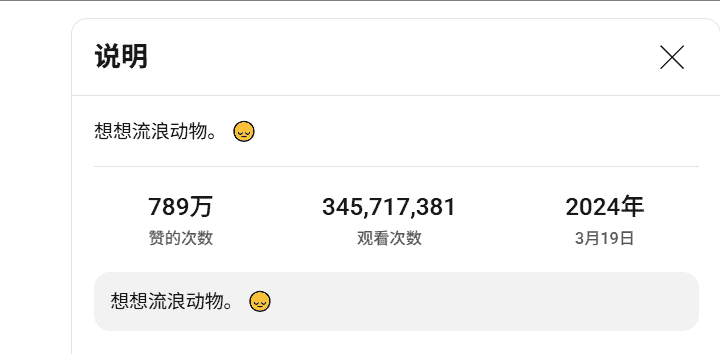 | 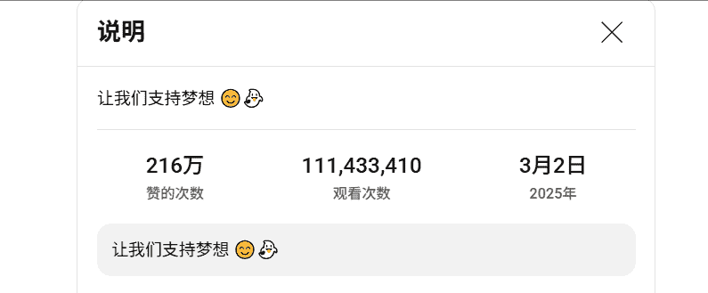 |  |
| 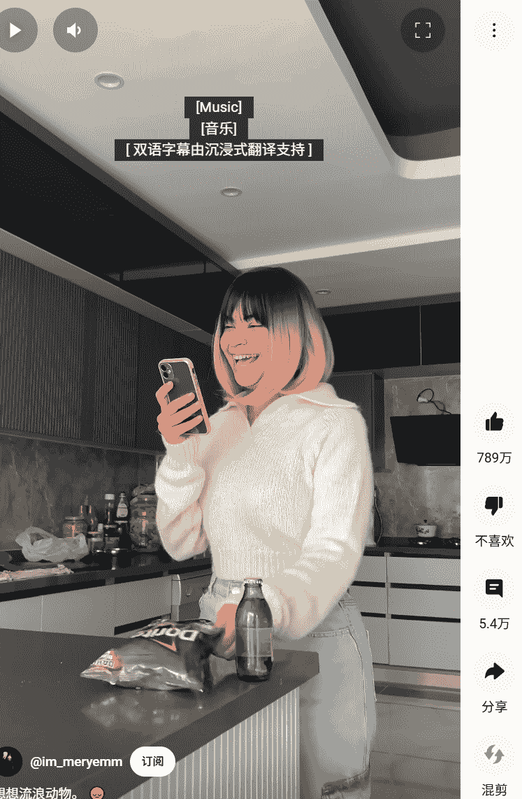 | 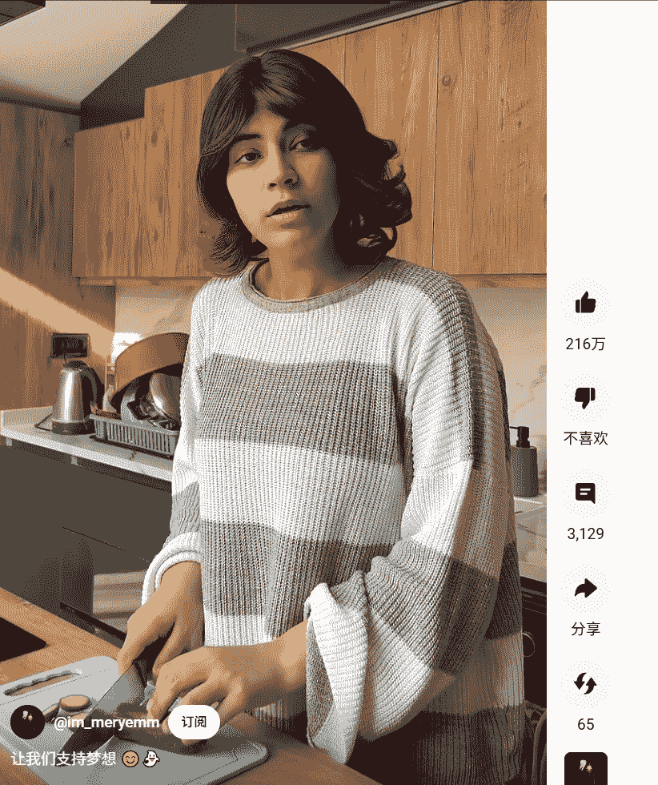 |  |

故事类赛道可以用真人演绎，可以用山海经演绎，也可以用名人演绎。

意思就是说同样的故事题材可以换角色

名人故事-C罗、特朗普等等

山海经角色

labubu角色

同样的故事情节换当前爆火的角色，选择你喜欢的角色去搜集其他类型爆火的故事题材也能爆

来看看这个视频，名人自带流量的故事类赛道

https://www.youtube.com/shorts/me7nyFIDNSQ

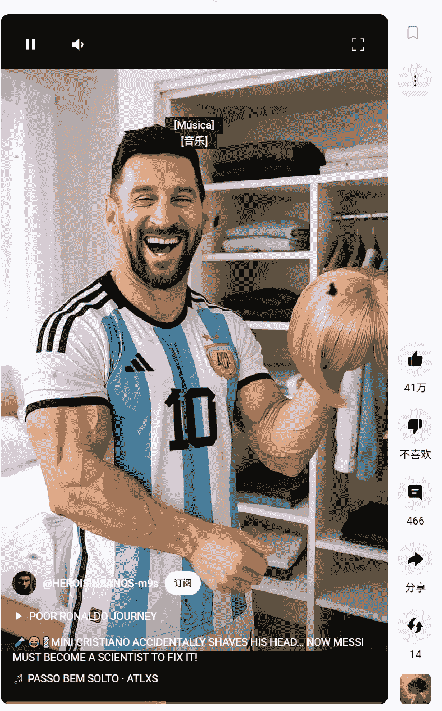

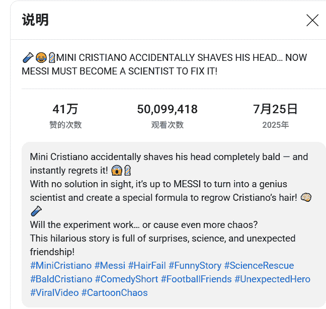

形式可以有什么？纯故事类的？PPT类的？双图转绘？四宫格？

好了不展开了，大家感兴趣去了解就能体会到了

故事号的盘子足够大，有一个亿的播放的视频，也能装下一个千万播放的复刻视频，所以故事号也是不错的选择

所以就是看到这个机会后，去坚持复刻，去感受每一个细节的爆点

**感受不出来的话怎么办？**

把视频丢给gemini，让它分析，google ai stdio不止能拆出镜头的脚本，还能分析镜头的具体内容，

多去开发AI的功能吧，不止是别人告诉你的，或者问ai还能做什么

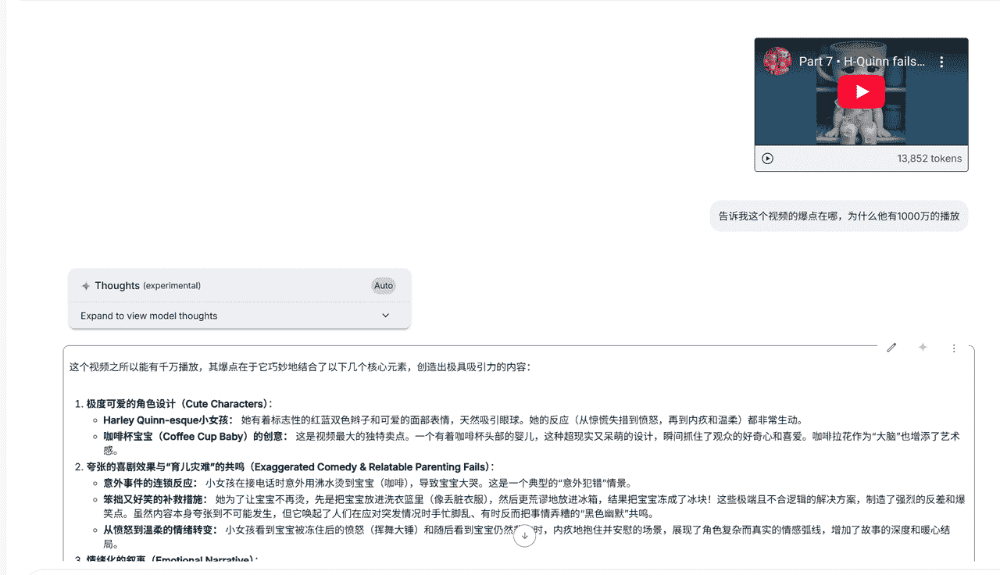

**网址：**https://aistudio.google.com/prompts/new_chat

**使用方法：**把youtube链接复制到对话框里，它会自动识别，然后输入你想提问的就行

当然了其他赛道也是有很多机会的，不止是all in故事号，还有reddit，mv故事等等大家做自己感兴趣的赛道。

有一句话在这里想分享给大家，是一个投资人对一个团队说的，出自哪里有点忘记了

**我不确定你**们能不能成功，但是我确定你们能死磕

## 1.4 深度拆解这个视频的爆点吧

这个3亿播放的视频很多东西值得学习

访问不了的可以看右边

先看完视频再看我讲解，大家也可以自己记录下觉得值得参考的或者爆款的原因是什么？

| https://www.youtube.com/shorts/7pNu-w0Lcrw |
| --- |

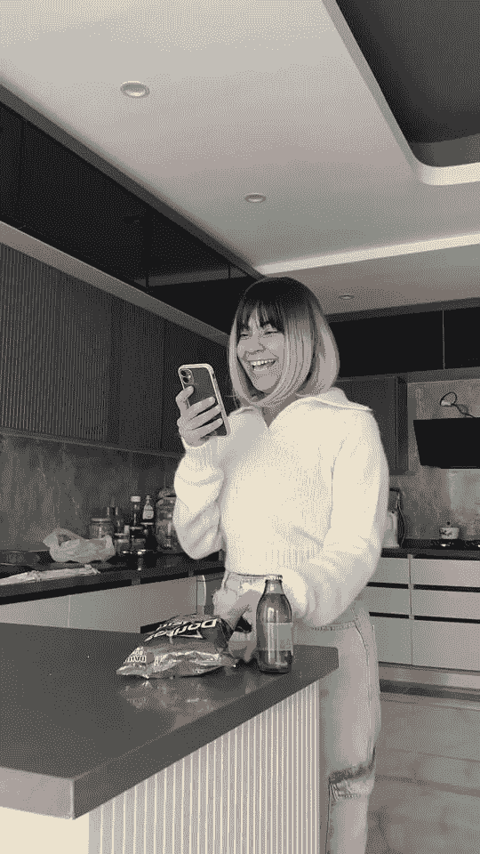

[youtube_7pNu-w0Lcrw_Q720P.mp4](https://internal-api-drive-stream.feishu.cn/space/api/box/stream/download/all/TX0zbLksbootxhxWTMlcrFzMnWf)

ok这是我的分析，大家也可以补充交流。

是不是可以开一个共创活动？，比如说用山海经复刻、用labubu复刻、用名人复刻等等

每周一次，哈哈，突然来的灵感

好了现在聊聊爆点：

+   前3s瓶子碎裂的声音，以及她深吸一口气的慌乱，一下子就吸引人的注意力，让他们仿佛置身事发现场，感受到那种突如其来的混乱。

+   第7s倒垃圾的时候但是不倒，一个深思的动作会让用户好奇她在想什么，为什么不直接丢

+   第31s音乐的刚好到高潮部分，加之从故事演绎，到反应现实的流浪猫，让人在这一刻马上泪崩！

+   主题是一个很正能量的行为，处理碎玻璃的时候包裹住了避免清理人员&流浪动物受到伤害，正能量积极向上，用户会自发去转发

也有可能有其他的爆点我没看到，也可以评论交流

# 【经历】想了解线下聚会的经历和收获看这里

## 2.1第一次参加生财的线下聚会

我是属于线下聚会的收益者了，早在23年3月刚开始加入生财的时候，就去参加了3月底的全国见面会，两天一夜，当时我还是一个all in技术的程序员，在线下的时候整个人都懵圈了，大佬就在身边侃侃而谈，打开了新世界的大门，听着每个人不一样的经历。

对于技术人来说第一次感受到如此多样化精彩的人生就在你身边，在这之前总以为离自己很遥远，搞技术的一坐就是一天，日复一日去深度研究一个细分赛道的技术。感谢生财真的是改变了我的人生

在23年疫情结束后，9月开始大规模搞同城线下聚会，就报名了线下聚会志愿者，开始各种参加线下局，对于各个行业的了解也更深刻，深刻体会到线下局的价值所在-快速成长、快速链接

## 2.2 加入深海圈后就开始盘算怎么搞线下

第一次刚好在广州航海家大会曹教练和方波妮教练分享的东西巨干货，奈何时间很宝贵一会得去听夜话就结束了，

心心念念的好不容易来一次深圳，想再从教练那边薅干货（不是），想为圈友谋福利，作为刚加入深海圈的圈友急需线下一起打鸡血深度交流的小伙伴，毕竟别人起步好几个月了，想知道别人是怎么做youtube的，积攒下来的心态，方法，踩坑的经验，这些在线下聊的场域，状态跟线上完全不一样。毕竟看到了，信念就更强了

在线下聚会的时候收获到了非常多，强烈建议i人勇敢走出来，去线下聚会，感受下每个人表达时候的经历，不仅是youtube局，其他的娱乐局也可以，在出门之后你会惊讶发现大佬竟然就在我身边！原来大佬也是迷茫过来的，大佬能成为大佬一定是有原因的

## 2.3 没有局怎么办？

勇敢去组局

感觉自己能力不足怎么办？

从娱乐局开始，从邀请嘉宾开始

广州航海家大会结束后回到深圳，想链接总教练的时候都有点慌，觉得自己是小白，教练会不会拒绝我。后来想了下大不了就自己组局，被拒是很正常的事情，降低自己的期待就好了，就像发笔记发视频没有爆是很正常的。

（先PUA自己）

意外的是教练一下子就同意了，接着就是在深海圈捞深圳的圈友，邀请一起参加线下局，感谢曹教练1v1的专属答疑，一个下午的时间根本听不够，直接让新手少走了好多坑，狠狠打了鸡血

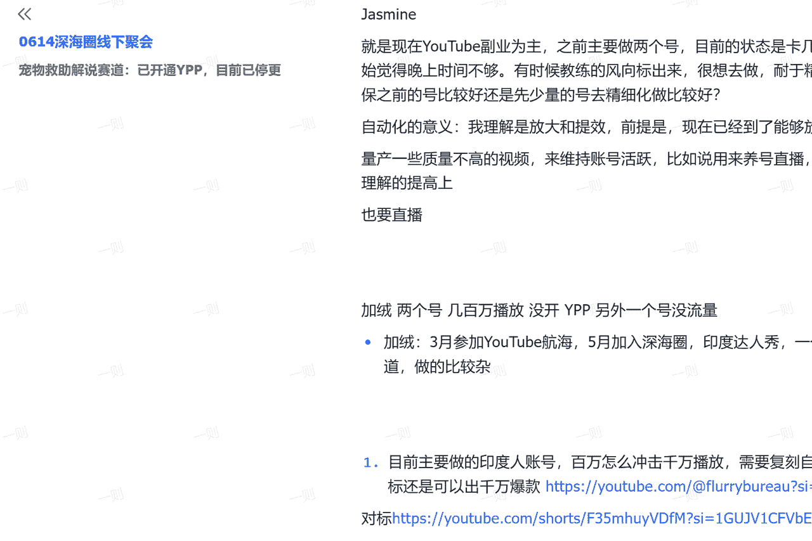

ps：参加深圳线下局的加绒圈友结束后也爆了千万爆款的视频

https://t.zsxq.com/PzuFf

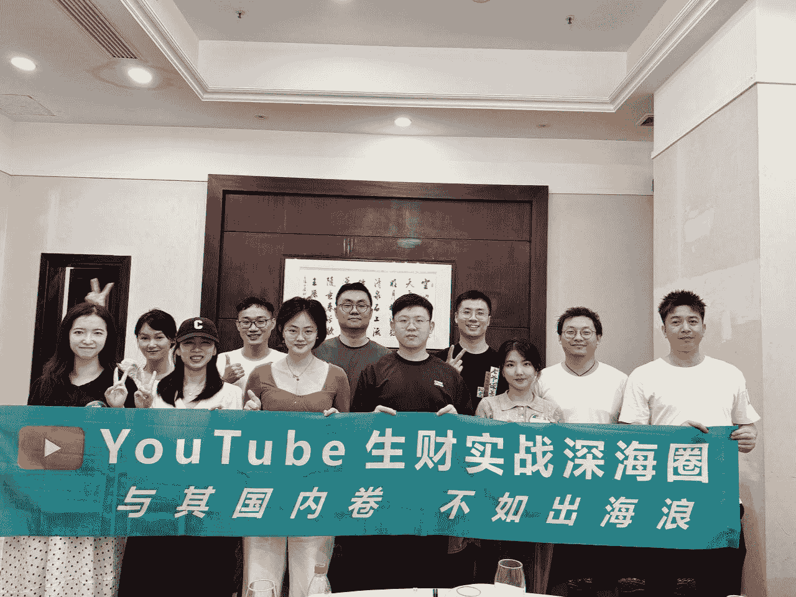

## 2.4 怎么用好线下聚会

插个题外话，很多人参加线下聚会，结束了就结束了，日抛圈友

多可惜啊，能来参加聚会已经是筛选过一波的人了，对这个主题感兴趣了，在线下的时候多加好友，在线上的话就可以针对一些话题展开讨论了，比如去复盘这次线下交流的地方，当然了不要去主动灵魂拷问，可以分享下自己的思考，邀请看看别人的见解

把期待降低，大不了就是人家不回你，或者回你一个【嗯】，然后去找下一个人交流就好了

做过销转和引流的人都知道，客户不回复你是正常的

但是如果展开交流了，你的深度交流伙伴+1.这个价值就很大了。

算算roi ，你的成本就是一个发送的动作，roi这么高的事情为什么不做呢？

记住一点，被拒绝是常态就好了

# 我日常是怎么出图出视频的

出图的话我用的是即梦和**书虫的api，大臣的软件**，生成图片的价格一张￥0.02。2分钱啊，还要什么自行车，给大家看看画质，非常细腻，电影级别了

出视频的话当然是**四舍五入不要钱的智谱**，复杂动作要求比较高再上即梦、可灵、长视频的话就是veo3

veo3能做竖屏吗？

原生不支持，但是有没有骚操作？有的，有人在帖子里也写过，等你去挖掘了

骗你的，veo3的横屏转竖屏的帖子在这里了

https://scys.com/mobile/post/xq_topic/4845212224541148

**干货**

工具借用的是大臣的帖子提供的

https://scys.com/articleDetail/xq_topic/5125415884825484

感谢@大臣，这边是根据大臣源码封装成的exe

[sora批量出图0724.exe](https://internal-api-drive-stream.feishu.cn/space/api/box/stream/download/all/SDKzbj01vo8iMSx3agtc46Qan1g)

windows环境下可以借用这个软件，双击就可以运行了，不用去配置环境了

mac用户还是辛苦点配置环境吧，或者有其他圈友也可以封装一下，本window用户用不来mac电脑

# 【干货】案例演示：如何用api生成质感非常强的图片

**出图的技巧：**

我是截图**一个目标对象让gpt反推提示词，**再告诉它我想要的场景帮我重新修改提示词。

注意，目前gpt没办法反推卡布奇诺女人的头，所以在gpt出来提示词后要告诉他这个是卡布奇诺女人的头

## 4.1.打开gpt，让他反推提示词

> 给我这张图的中文提示词，我要用在midjourney上，要非常详细

为啥是这个提示词，因为我觉得告诉它mj的话它给我的细节就很到位

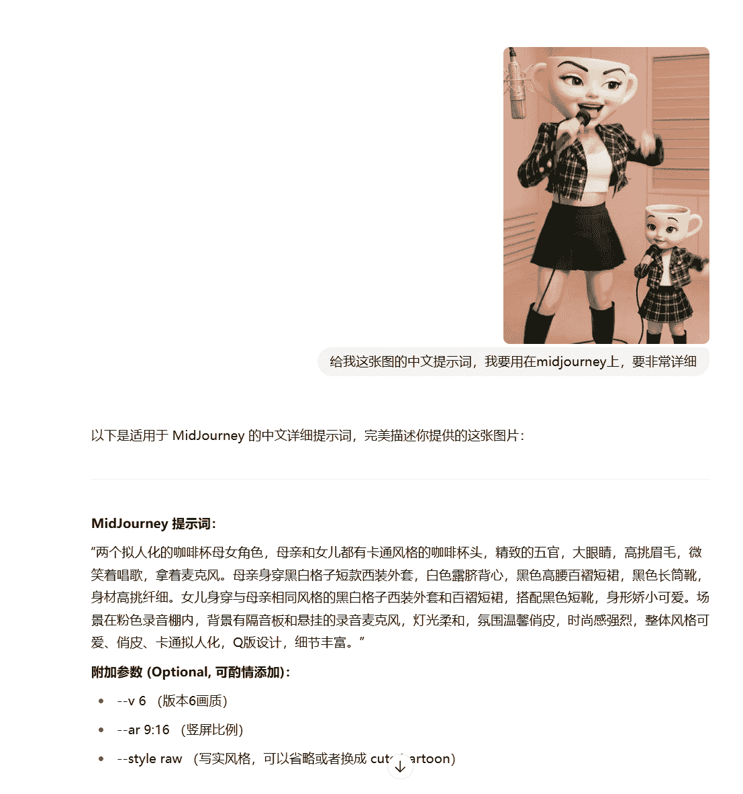

## 4.2.修改提示词

在AI给出提示词后的图生成的图不一定是山海经风格，所以我们要加上卡布奇诺咖啡头标志性的文本：

这个提示词是教练测试出来可以不垫图出咖啡头像的：

> 一个拟人化的女性角色，她的头就是一个完整的白色陶瓷咖啡杯。她那张风格化的精致五官——大眼睛、细长的眉毛和嘴唇——是直接长在咖啡杯的表面上的。杯子里装着拿铁咖啡，上面有【心形的】拉花。整体为3D角色艺术，皮克斯动画风格，色彩鲜艳，细节丰富。

>

> 这个是人物头部的描述词，用这个帮我优化下上面图片反推的提示词，包括画面风格我也给你了

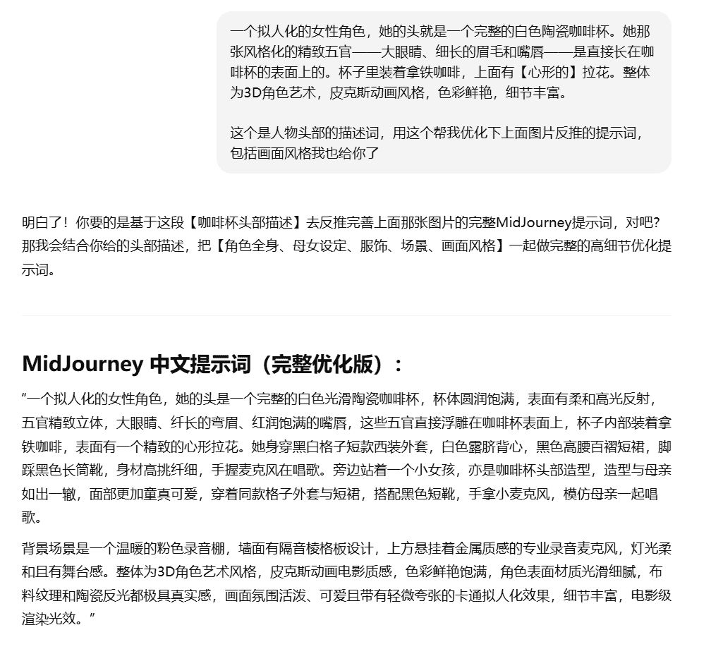

## 4.3.改动作/改背景

这个训练好后，我们就获得了卡布奇诺的提示词，接着就可以让他改动作了

> 把2个咖啡女性改成一起坐在沙发上看书

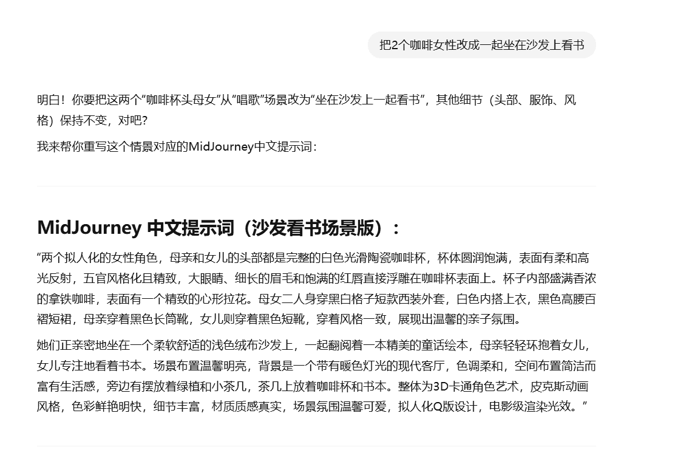

这个就是ai生成的提示词：

## MidJourney 中文提示词（沙发看书场景版）：

> “两个拟人化的女性角色，母亲和女儿的头部都是完整的白色光滑陶瓷咖啡杯，杯体圆润饱满，表面有柔和高光反射，五官风格化且精致，大眼睛、细长的眉毛和饱满的红唇直接浮雕在咖啡杯表面上。杯子内部盛满香浓的拿铁咖啡，表面有一个精致的心形拉花。母女二人身穿黑白格子短款西装外套，白色内搭上衣，黑色高腰百褶短裙，母亲穿着黑色长筒靴，女儿则穿着黑色短靴，穿着风格一致，展现出温馨的亲子氛围。

> 她们正亲密地坐在一个柔软舒适的浅色绒布沙发上，一起翻阅着一本精美的童话绘本，母亲轻轻环抱着女儿，女儿专注地看着书本。场景布置温馨明亮，背景是一个带有暖色灯光的现代客厅，色调柔和，空间布置简洁而富有生活感，旁边有摆放着绿植和小茶几，茶几上放着咖啡杯和书本。整体为3D卡通角色艺术，皮克斯动画风格，色彩鲜艳明快，细节丰富，材质质感真实，场景氛围温馨可爱，拟人化Q版设计，电影级渲染光效。”

这个是操作的界面：

主要是这几个方面：

设置好平台，选择竖屏，导入提示词（可以批量，多个提示词），开始生成

更详细的可以看大臣的文档

https://scys.com/articleDetail/xq_topic/5125415884825484

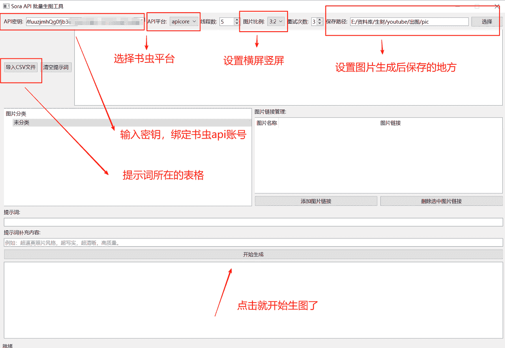

## 4.4 同时生成横屏竖屏

既然有一个脚本了，如果只做竖屏的话未免太浪费了，那么要做横屏视频怎么办？选择尺寸在生成一次？

ok这个当然是可以的，

但是这个软件是可以多开的，启动完一次后再双击启动就可以了，也就是说导入同一个表格，【保存路径】换一下就可以同时生成横屏和竖屏的图了

为什么要换【保存路径】，同样的表格上面的序号代表着文件名，同一个输出路径的话会导致文件名重复覆盖掉，这个小问题规避下就行

注意。**横屏视频要避免音乐版权问题**

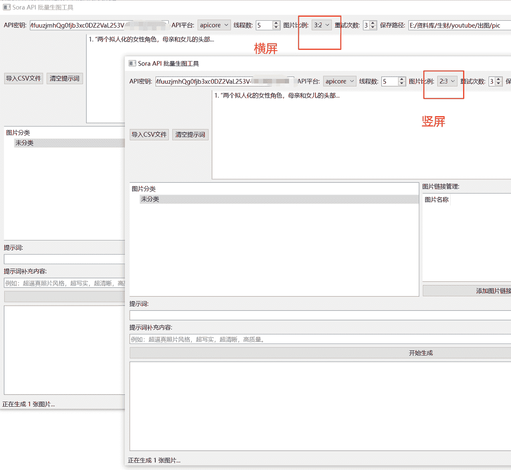

出来的效果如下：

## 4.5 批量操作

大臣的软件是可以批量生图的，这样就可以一次性生成n张图了，也不用再苦苦等待gpt出图了

感受到效果的小伙伴可以去测试看

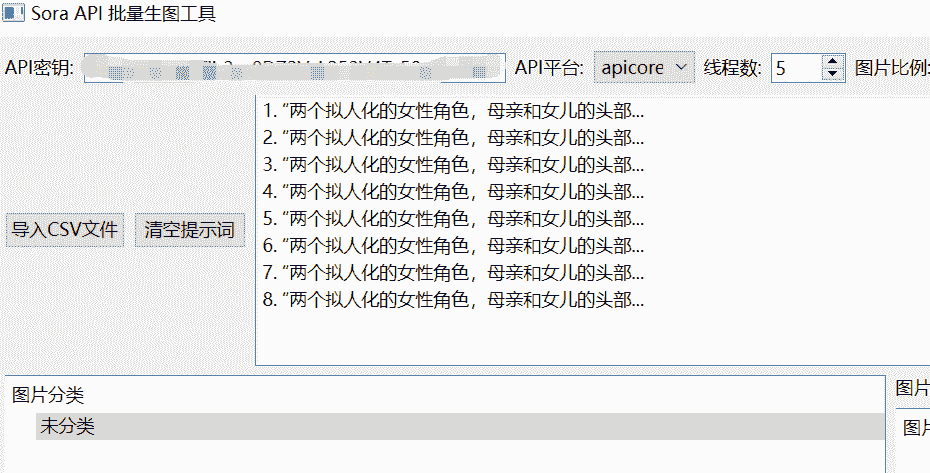

#

#

# 【思考】短视频的推流机制

## **5.1 眼见为实**

之前**教练们都在说坚持日更，一定会有正反馈的，但是**新手刚做的时候很焦虑啊，都在想自己啥时候会有推流啊，尤其是上班族可难受了，每天很少的空余时间都投入做这个了，在我做了10来个账号，每天日更一些垃圾视频后，看到自己几个小号偶尔还有一两个几十万播放的数据，就更加相信了，为什么要做爆款，什么时候会爆发？

为什么要做爆款？

在你活跃一段时间后，油管会给你一波推流，如果你接住了这波推流，你的视频就能冲上几十万，几百万，几千万。

下图是我小号的小爆款

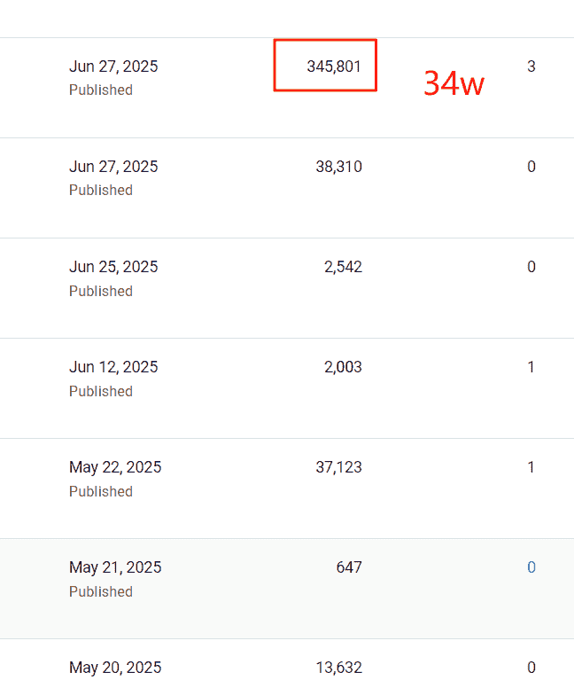

## 5.2 什么时候会爆发？什么时候给你推流？

我也不知道，教练也不知道，谁也不知道，只知道大概一个十来天之后，只要你坚持日更，会到来的，所以我们把每个视频都打磨好，等待它爆发的一刻就好了。等待冲上几十万，几百万，几千万，一个亿，10个亿

关于这点，这个youtube视频讲解的非常详细

https://www.youtube.com/watch?v=4CH7SFCaejA

截取下这个博主其中一个片段的推流分析数据，相信大家看了信心就会好很多

记住一句话：**视频的爆发一定是有原因的**

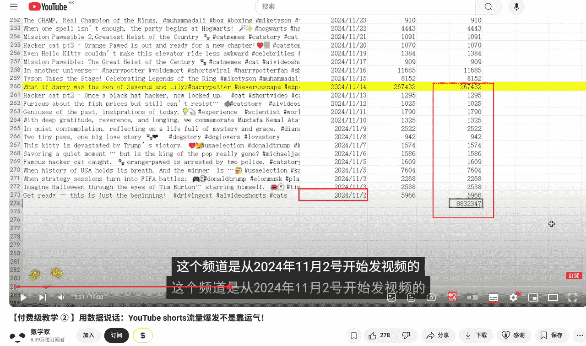

## 5.3 二次推流

回头看，这个亿播视频给我带来的二次推流，直接把整个账号的数据拉升起来了，

所以前期做好的视频虽然质量高没播放，但是只要你是冲着大爆款的就不要担心这个问题，如果中途放弃的就当我没说

而且再回顾下之前说的，做一个优质的视频，播放数据固然能带来很多正反馈，但是也是在打磨你做视频的能力，有了这个能力你去换赛道，做精品，做长视频都是ok的，不仅是youtube赛道，ai视频也可以在tk赛道，抖音，工作生活中都是一个技能的加持，技术学到的都是自己的

# 【干货】爆款出现后要做的动作

## 6.1 猛猛干

之前曹教练就说过了，爆款后会迎来一大波推流，但是这个推流爆款是有时间限制的。

所以在爆款后要多发视频，猛猛干啊！每天熬夜到一两点睡，多做视频多发。

这里送大家一个手机壁纸

看了晓言的帖子后深刻感受到的，激情满满，强烈建议心力低的圈友去看看，感受一下00后的冲劲，虽然不一定做这个项目，但是多了解下有点灵感也不错

https://scys.com/articleDetail/xq_topic/8852121811815482

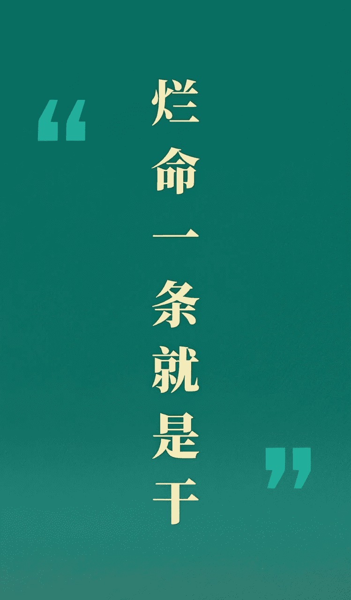

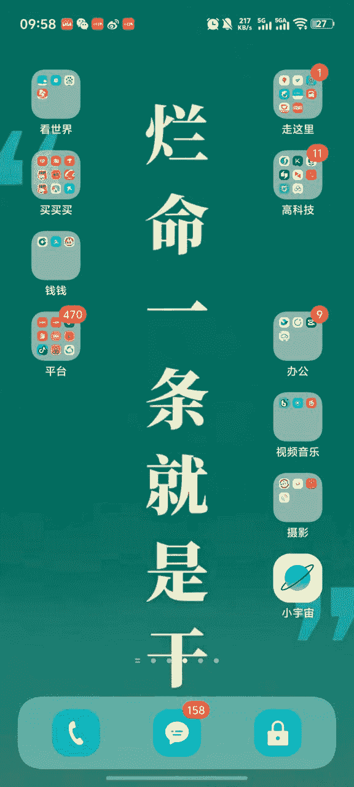

回过来讲，看到爆款出现后我就从一天一更转为一天2更，只要第一波推流趋于平稳后我就马上发下一个视频。

从下图可以看到我一天发了2个视频，几乎每个视频都是几百万都播放，

所以大家有爆款后可以马上多怼几个，把这波流量吃下来。感觉自己1天2个还是发少了，就该发三四个的。

第一次照书养，第二次照猪养了，下次猛猛发

不知道其他亿播圈友的动作是怎样的，欢迎一起探讨交流。

透个底，深海圈现在有40多个亿播圈友了，都是大神级别的啊。

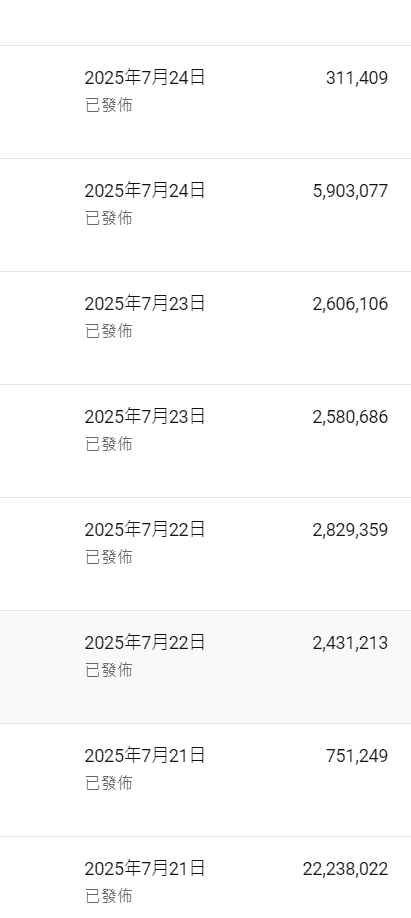

## 6.2 怎么看视频推流是否是平稳的？

很简单，我们可以看看视频流量的上升曲线是不是已经开始趋于平缓了，在第一波推流周期过了，就可以马上发下一个，

我在普通账号（没开通ypp的号）上同时发2个视频的时候只有一个视频会给流量，第二个就是个位数，所以按照我自己的经验，等第一波推流后再发第二个视频，差不多间隔8小时，发布后很快流量就上去了。也欢迎其他有经验的小伙伴一起交流经验，听说是高级权限开了后就不会互相影响，但是不确定，还是得看实测效果

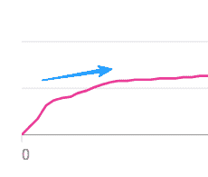

## 6.3 同款视频小号也发起来

在这个爆款出现后，我在五六个小号上都发了类似的视频，算是把这个流量也吃下一部分了

数据最好的小号出现了500w的播放，也有2个200w的播放，几十万的播放也出现了好几个，在其他号上也能跑起来

说明这个确实是个新爆款，新爆款在多个号都能同时爆那确实要马上跟，在这里再次发个壁纸：

## 6.4 短视频带动长视频

尝试了一个很简单的长视频，就是把shorts转成横屏视频，空余部分用模糊填充，shorts的关联视频选择这个长视频，就可以给长视频带来比较高的互动（原谅我这个视频做的太粗糙了，带不动）之前没有做长视频的经验，加上航海家大会比较忙，也有其他事情。精力实在顾不动了错过了这个风口，大家日常也可以都尝试下，别等到爆款来临时候的措手不及

这个是我做的，在一个shorts上加个背景填充就好了，这个技能也是三人小组圈友告诉我的，之前我有印象在深海圈大群看到过，但是没啥印象了，后来问了下就知道了

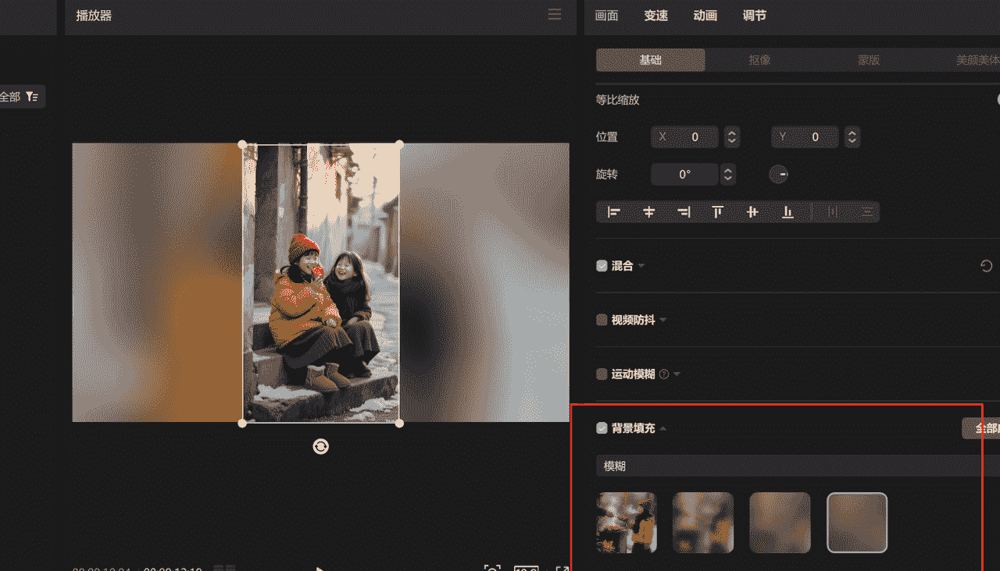

长视频是真的猛，我一个随便搞的长视频都快半个月了还在推流，其中70%来自shorts，所以短带长大家重视起来，肯定能带来很大的价值的，包括这两天跟潇潇圈友聊的也是，这个也是深海圈带来的收获

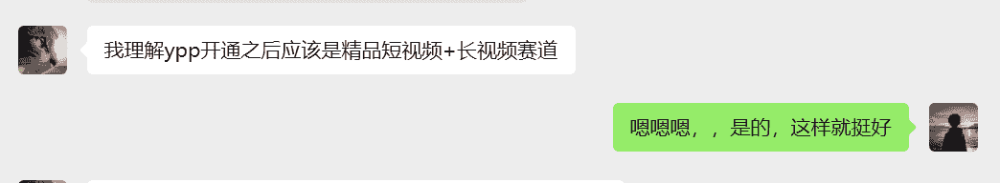

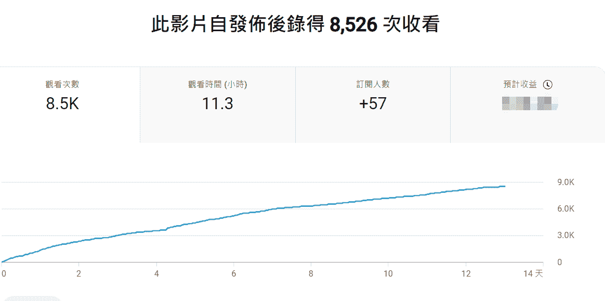

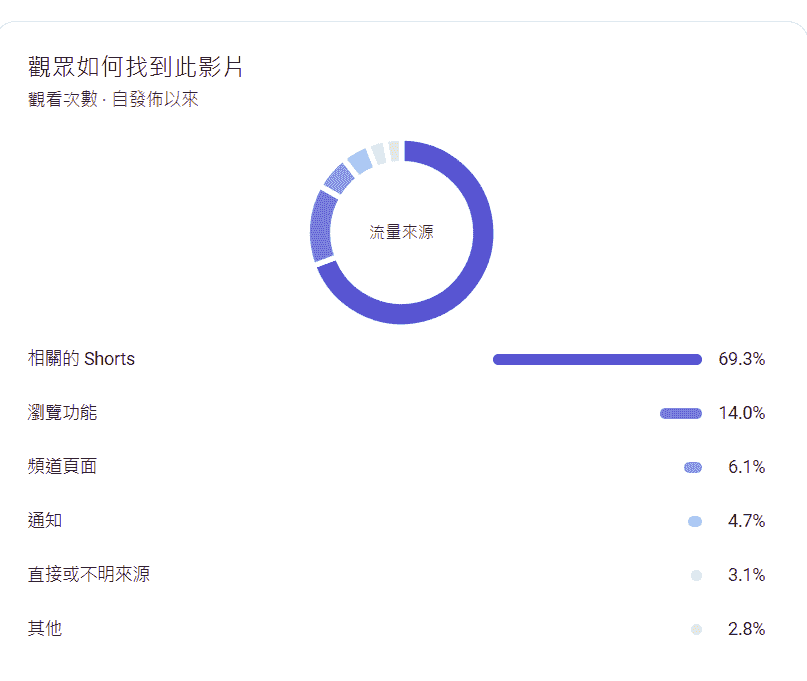

## 6.5 应该还可以开直播的，

这个我没做，有做直播或者直播还能带来什么收益的欢迎大家交流

目前已知的：直播可以挂商品链接，直播回放也有广告收益

## 6.6 联盟购物（类似抖音的精选联盟）

亿播之后我还做了什么？带货

先给大家看看带货成绩，4.6k的点击，一共160个订单，总带货成绩1.2w刀，佣金257刀，差不多2.1%的佣金

这个睡后收入啥也不用干就有的东西太香了，每个视频都不要嫌麻烦，随手挂个商品，说不定就爆了呢

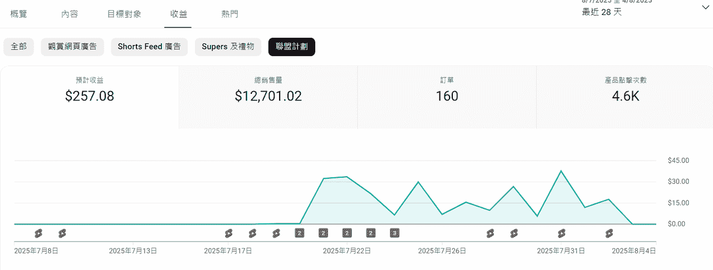

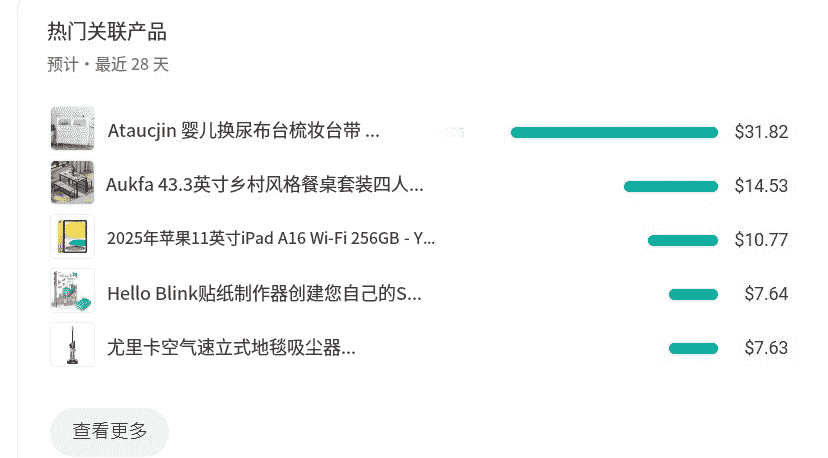

## 6.7 插播一个教学。

这个手机壁纸怎么做的呢？（设计师会失业吗）

之前圈友做的【一起生财有术】的壁纸，直接用即梦让它改文字。图生图

用的是即梦，即梦的文字支持比较好：

https://jimeng.jianying.com/ai-tool/home

> 提示词：把图片中的“一起生财有术”改成： 烂命一条就是干

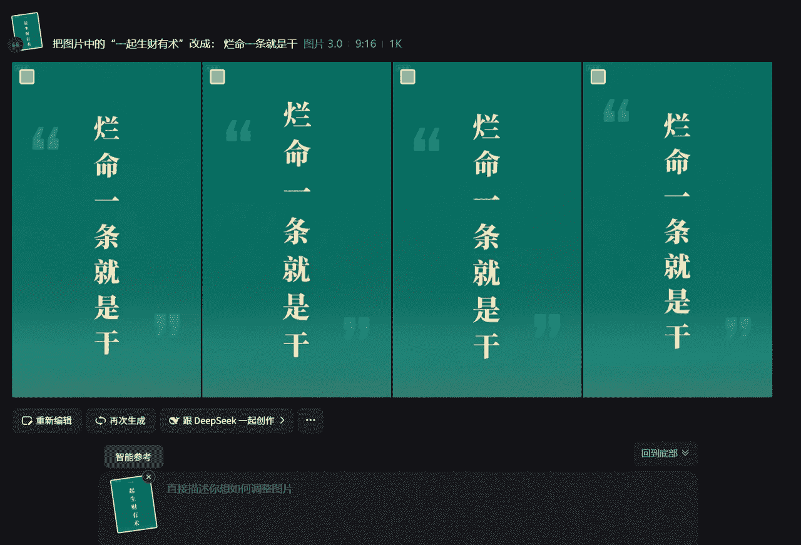

## 6.8 其他

大家还有什么其他动作也可以互动下，后续大家出爆款也可以借鉴下

# 【干货】补充一下没什么人讲的带货原理

## 7.1 什么是购物

只要你的账号有了购物功能，你就可以像精选联盟那样带货，不用考虑发货售后的事情，只做流量端

在哪里看自己的账号有购物带货功能？

在【收益】标签页，点击购物就出来了

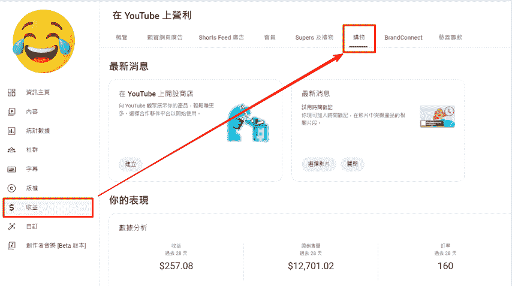

不是所有开通ypp都有购物功能的

有没有购物状态可以在这里看，下图左边的红框就是有购物状态，右边没有购物渠道的就没法带货了

| 有购物功能的账号 | 没有购物功能的账号 |
| --- | --- |
|  | 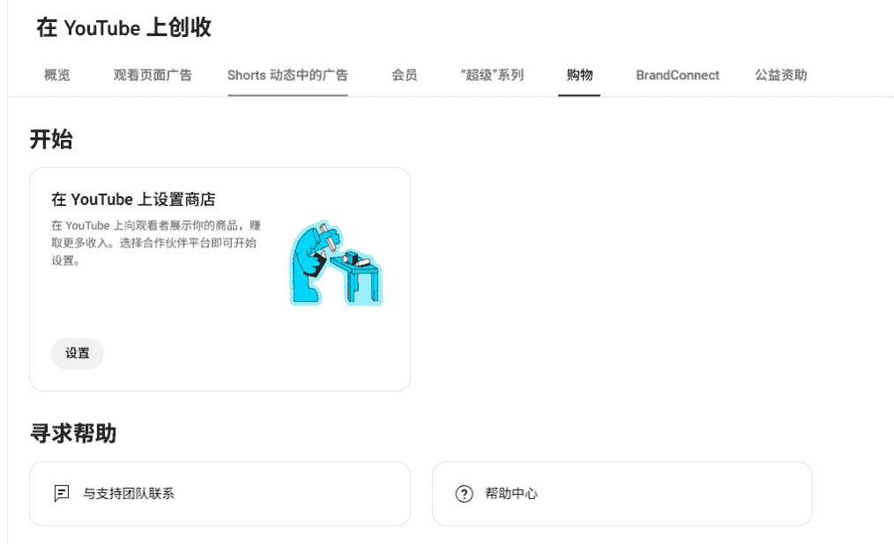 |

注意，如果账号之前违规过，在违规解除前是无法购物的（比如伤害儿童被判警示了）

我的这个号刚开通ypp的时候也是没有购物功能的，后面也是发了七八个视频后自然就有了，可能也是得等你正常活跃后才给你吧

## **7.2 有了购物后怎么带货呢？**

在上传视频后的第三个标签页【影片元素】有个标记产品，可以搜索视频相关的商品，然后点击添加产品

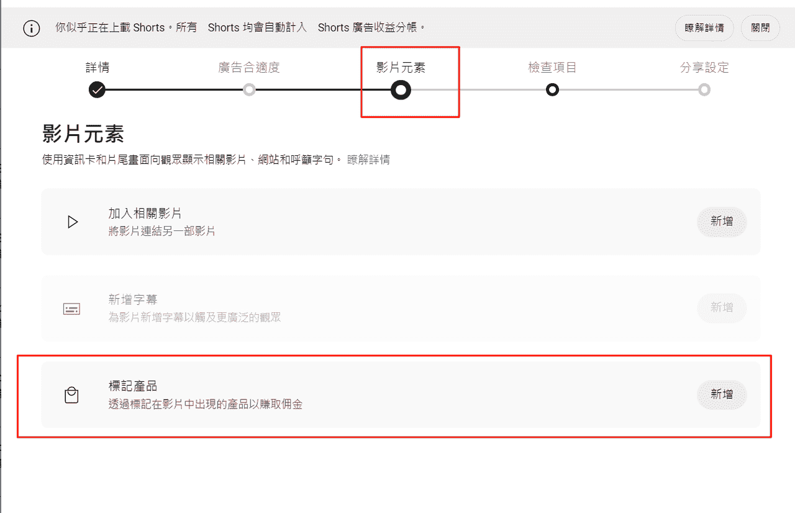

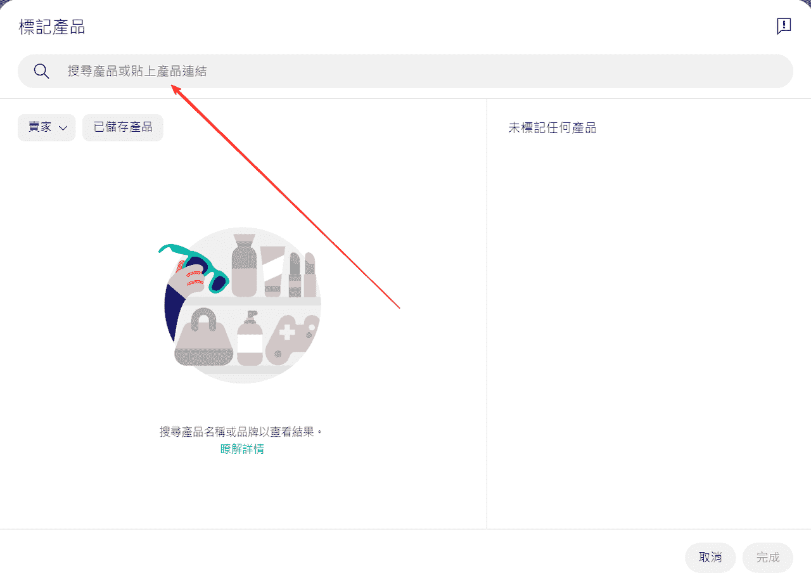

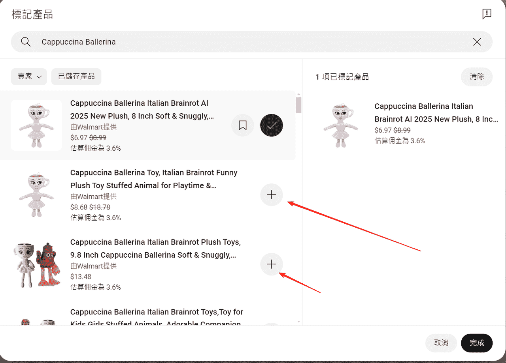

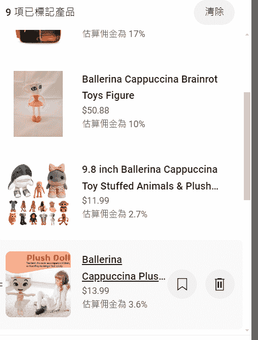

## 7.3 只有挂车的产品才有佣金吗

细心的小伙伴就会觉得很奇怪，明明带货搜的是【Cappuccina Ballerina】 ，

挂车也是这几个商品，为什么卖出去的是什么【梳妆台、餐桌套装、吸尘器】这些百货商品？

原因是这样的，点击带货会跳转到对应购物平台页面，可以是【沃尔玛、虾皮】等等平台，用户在跳转到这个平台后下单的佣金收益都是你的，所以看到这些跟挂车的毫不相关就很正常了。

**换个思路，这个链接挂上独立站，或者自己在虾**皮，沃尔玛开店是不是可以实现卖自己的货？

只能挂平台的货吗？

不是的也可以自己开店，之后的流程做tk带货的小伙伴比我还熟悉了，期待一起交流

直播也是可以挂链接的，直播的商品跳转是不是也可以卖自己的货？

用户在观看视频的时候看到的页面状态是怎样的？

PC端视频的详情页，

我们看看这个很火的美国山海经。它带的就是虾皮的商品

https://www.youtube.com/shorts/1dr9_xPEbeU

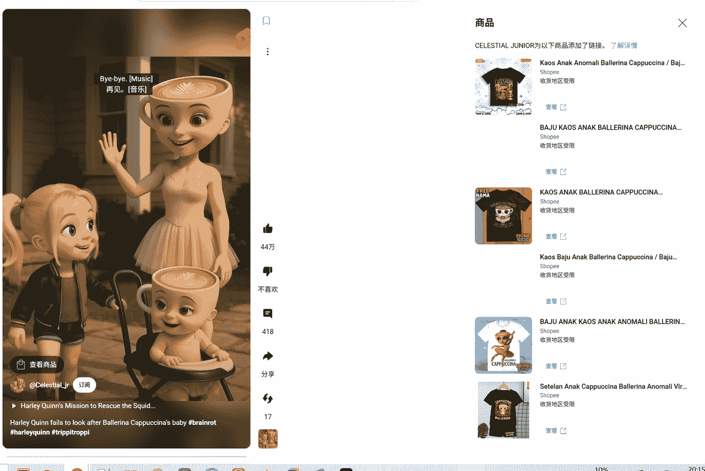

# **亿播视频带来的二次推流：**

2个月之前发的所有视频都开始二次推流，焕发第二春。

算是意外之喜吧，踏实去做好每一步

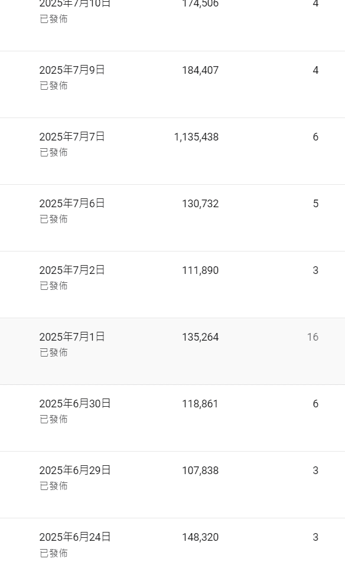

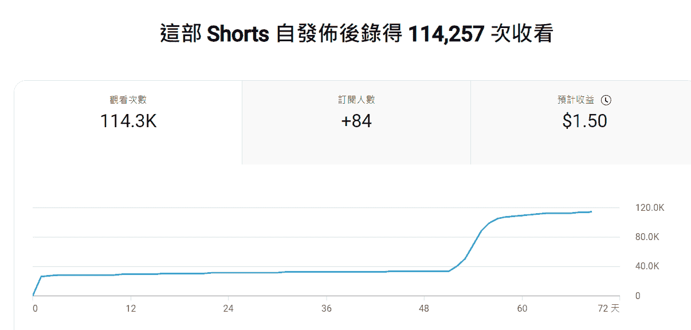

# 【思考】还可以挖掘的方向

这个是我的思考，不一定是对的，轻点喷。。。

欢迎评论区补充交流，也可以给其他人启发

## 9.1 长视频

目前长视频教练也一直提到是蓝海赛道，长视频方向有什么？

传统故事号、ai故事、山海经mv等等非常多

山海经mv第一次震撼到我的是这个视频：

https://www.youtube.com/watch?v=6onc3rpArns

这个太有感觉了！DJ的节奏感特别强，原来还能这么做视频。。

## 9.2 海外自媒体

海外自媒体太香了，不仅可以吃到视频播放的ypp流量收益，还可以接商单。发到b站的视频完全可以在油管上分发

https://www.youtube.com/@muziailab/videos

一定是ai自媒体吗？显然现在这个时代AI自媒体固然是个热点，能带来很大的流量加成，那么不是专门做ai自媒体博主在youtube上能有做起来的机会吗？一定要用英语表达吗？

不是的✖

看看这个博主

https://www.youtube.com/@GrowWithDami/videos

4月之前还在发AI相关的视频，天天追AI热点，哪里火了做哪里，但是追热点的小伙伴都能感受到一定要跟着时代的脚步，就怕哪天遗漏了什么热点，这种类型适合所有人吗？显然不是的，博主就放弃了收入很高的AI领域，转为做励志博主看下一张图

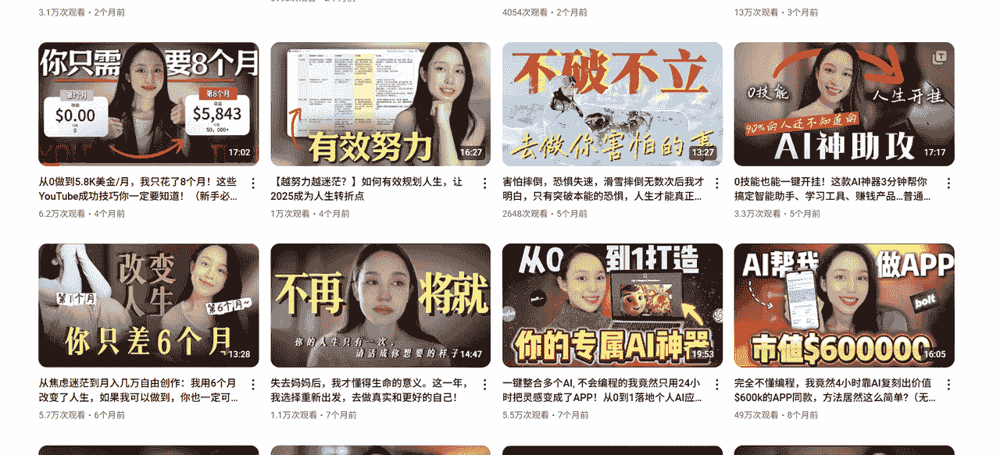

从这张图可以看到博主转行离开了AI领域，重新开始去做自己喜欢的赛道，虽然没有一开始AI赛道的播放量高，但是转赛道后也在慢慢变好

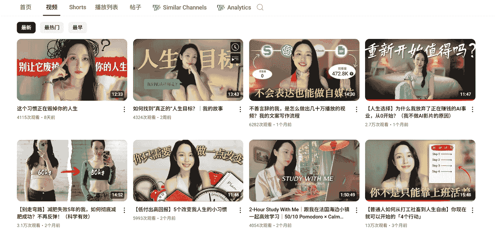

人生秘籍这个账号，有没有很熟悉的抖音的感觉，抖音上已经很成熟的赛道完全可以在油管上再去做。

https://www.youtube.com/@TheLife-ht6ef/videos

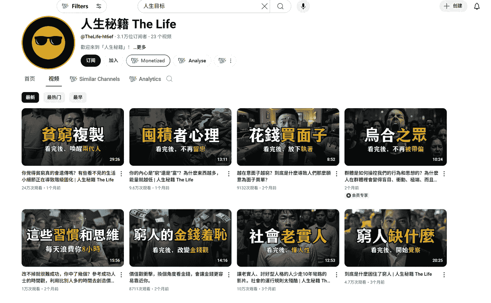

借助youtube平台让我成功出海，踏实去做一个项目才能了解这个项目背后的信息源，比如在做油管的时候大家你会经常听到suno ，reddit，twitter，作为国外社交媒体最活跃的twitter，还有什么机会呢？能不能联动youtube呢？

这就不得不提到阿西了，阿西周六在杭州还分享了一次线下mini航海，听说干货特别足哈哈

那么除了twitter还有什么机会呢？threads呢？

titok的中视频计划，同样是视频平台，分发到titok收益怎样？veo3的出来席卷了视频频道，这个就是曹教练说的，形式创新，一个切水果火爆全网，接着就是穿越古代采访，veo3的能力正在慢慢展示出来

那么titok是不是也有这样的机会？

只有入局才能感受到，在岸上听到的终究是别人说的，实测效果是怎样的？榜单上的数据可以窥见一斑，等tk的大佬补充分享。

tk的榜单我不太清楚，但是youtube 的榜单可以参考这个网站

https://www.viewstats.com/home

## 9.3 英文长视频

当然了给歪果仁看的肯定是英文长视频，有能力的也可以做英文长视频，用文字生成语音，这个我没做过就不展开讲了，既然是做海外了，英文的市场肯定比中文大

# 【干货】我现在常用的工具

| 油管下载工具： | https://greenvideo.cc/youtube | 免费 |
| --- | --- | --- |
| 智谱（生视频） | https://chatglm.cn/video?lang=zh | 某鱼一个月5r，无限生成视频，虽然质量一般，但是无水印1080p 无限生成，同时可以生成4个视频，还要啥自行车，这不得多买几个号 |
| 即梦 | https://jimeng.jianying.com/ai-tool/generate/?type=video | 每天80积分，可以多个号 |
| veo3 | https://gemini.google.com/gem | gemini每天可以白嫖3个，就是切西瓜的那个 |
| veo3 | https://labs.google/fx/zh/tools/flow/ | flow这个入口每个月有1000个积分，可以做50个视频 |
|  | https://aistudio.google.com/prompts/new_chat |  |
|  | [如何傻瓜式的进行油管爆款视频复刻](https://irxd56ii8t.feishu.cn/docx/EGW6dX8cxoBWJKxP5Mxc5G21nH2?from=from_copylink) |  |
| gpt | https://chatgpt.com/ | 出图慢，但是效果好啊 |
| 豆包（出图） | https://www.doubao.com/chat/ | 出图快，某些场景下出图跟即梦一样好，可以白嫖 |
| 文本朗读 | https://elevenlabs.io/ | 文本朗读会更真人化 |
| 爆款视频排行榜 | https://www.viewstats.com/home |  |
| 大臣的软件，调用了书虫的api |  | 出来的是电影质感，绝了，参考第4点 |
| 有想到再补充 |  |  |

[sora批量出图0724.exe](https://internal-api-drive-stream.feishu.cn/space/api/box/stream/download/all/EbNbbxi4AougZmxr6i5c4ZTSn7c)

# 【可借鉴】深海圈民间三人小组

## 10.1 三人小组在交流什么

5月份刚加深海圈的时候在群里看到2个熟悉的圈友，拉了个小群进行了深度的交流

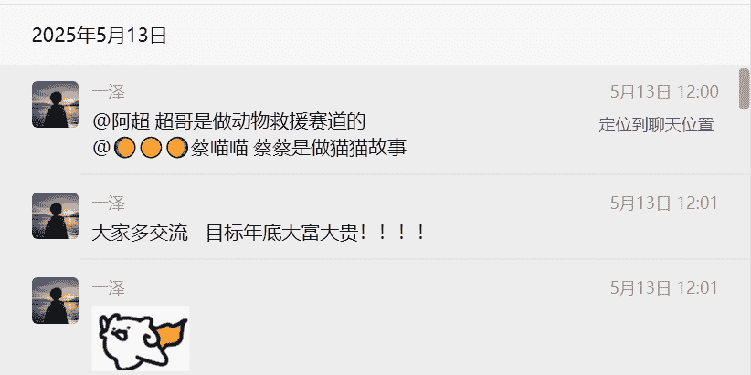

深海圈的信息太密集了，航海手册巨无敌细致，还有教练直播和群交流，教练分享，看不完根本看不完

信息爆炸怎么办？

我们3人小组在分享交流收获最大的点，确保彼此不会错过重要信息、新的玩法工具等等，

包括新出的ip，爆款的原因，好用的工具，在大群里看到的都会转发过来

在公域上看到的也会转发过来

现阶段项目的重心是什么，具体都可以做哪些行动，在项目中遇到的卡点以及内耗，也都会互相交流开导分享

3个人的视角远超1个人的想法

对i人极其友好，很多i人不敢在大群发言的，但是在小群就可以想说什么就说什么了

三分钟热度怎么办?看到群里小伙伴还在吭哧吭哧干活，觉得也很有动力了

不止是youtube深海圈这个项目，如果你是做小红书方向的，公众号方向的，搞个小群也是同样的，很快找到同行的小伙伴

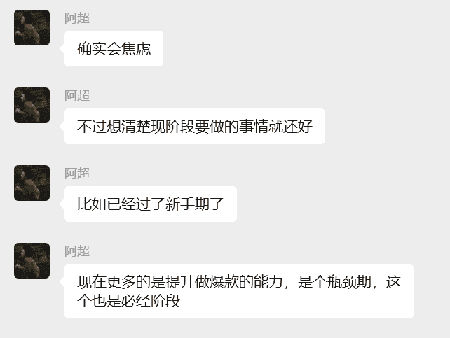

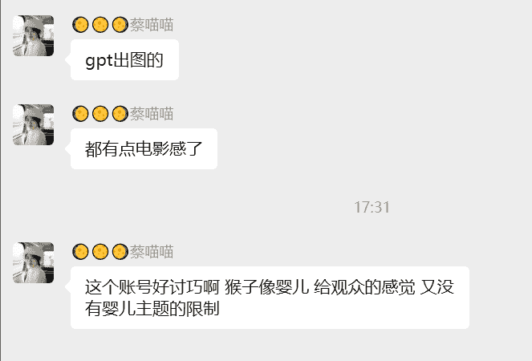

日常的飞书会议

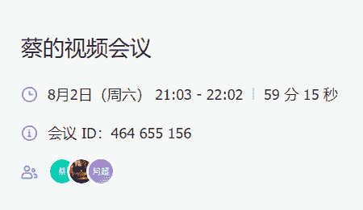

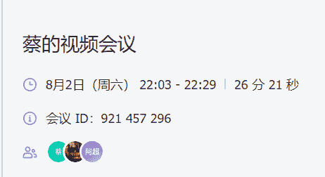

做项目不是过家家，是真的把它当成一个项目认真去对待

## 10.2 三人小组成绩

截止目前（入局2个月）

阿超圈友4个ypp，已经有10w粉丝了，YouTube银牌也申请下来了

我有2个ypp，单条视频亿播

蔡喵喵有2个ypp，联通ai创作大赛3等奖

当然了，生财还有很多低调的大佬，很多人现在手上都是十几个ypp的。比不了比不了。

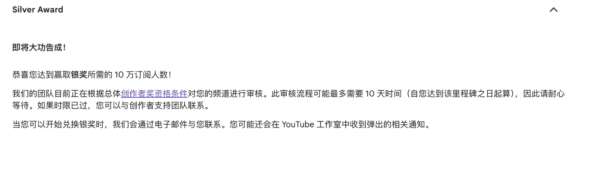

## 10.3 三人小组怎么薅资源的

日常的小问题我们在小群里都互相解决了，因为刚开始都是新手，问的都是新手问题，i人不敢提问就发小群里，也不会说怕打扰到教练说一直问这些小白问题

我们解决不了的有的有发群里，有的会汇总起来，在深海圈里每个月有一次1v1咨询教练的机会，我们3个就是一个月初，一个月中，一个月末去咨询，这样把【一个月一次咨询】变成了【一个月3次咨询】，成功薅到资源

**上次直播间分享这个信息后，看到也有圈友也**开始组建自己的三人小群了，勇敢者享受世界

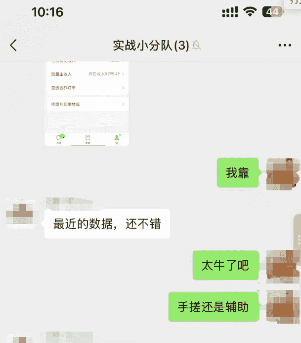

# 深海圈教练的大力支持

开头先感谢下教练让我们薅资源哈哈！！！

很多人遇到问题不敢跟教练沟通，其实教练也挺希望大家互动的，教练也是圈友，也是愿意去互相交流的，先打消下i人小白的害怕

## 11.1 咨询答疑

在咨询教练的时候会先把对标账号和我的账号的情况整理成飞书文档，把要咨询的问题点写好，这样教练大概知道你要问什么，也可以更全面的去提前帮你找到解决方案，实名感谢我的教练-六只猫教练

大群里的教练答疑也很有耐心，现在回过头看新手群里问的很多是心态，小白的问题，教练都是不厌其烦的去答疑，还给情绪价值，真的对刚入行的小白带来很大的助力了

教练直播分享的干货也超级有帮助，现在看了下还有好多东西没消化完，给的真的太多了，看不完真的看不完。当成知识库积累了，比如我现在要搞长视频，就回头去看直播回放，看看教练分享的干货文，每次看都有新的收获

如果是新手的话就不急着all in全部看完，大概知道有什么就行，然后kuku开始做视频，不同阶段看视频的感受是不一样的，吸收消化能力也是不一样的，项目前期唯一的难度就是执行力+坚持了，

去做了思考了才有问题

## 11.2 曹教练

印象最深刻的是曹教练的解答，每次线下局都带来巨无敌干的干货，就怕漏掉什么干货。

全场静悄悄，十几双眼睛都盯着曹教练...

强烈建议离得近的可以蹲教练的线下聚会

## 11.3 直播

还有一点其实大家都没注意到，除了kuku做视频，方波妮教练也提供了出镜直播的机会，很多人是没有直播经验的，一般没啥事的话也不会去直播，谁能想到视频做起来了也有直播的机会呢？

做项目是为了搞钱，搞钱是为了更好的生活，不要本末倒置了只看到了搞钱，直播也是一个新的体验，尤其是对i人小伙伴来说，认真去做了生财能提供很多机会。第一次尝试露脸直播，感受自己的场域。

有成绩的小伙伴别藏了，快去私聊方波妮教练约直播间吧

# 最后

能看到最后的多多少少是会认可一点的，非常感觉大家花费宝贵的时间来看完我的复盘贴

发个自我介绍下

我是一泽，6年程序员，23生财3月加入生财，性格从 infj -> entj

因为技术的优势，担任过RPA教练、AI编程教练、0代码自动化教练

发过2个精华帖，感兴趣可以看下

保姆级教程|coze+剪映批量制作火柴人心理学玩法

影刀RPA 0基础新手如何一天抓取500本孔夫子二手书ISBN的方法

youtube相关的大家可以一起交流，视频的爆点、

也可以交流怎么最大化利用好线下聚会、怎么去社交

所有文字全靠手打，没有经过任何AI，

在AI提效自动化的时代，做精品最真诚的方式就是用自己粗糙的表达去一个字一个字敲，透过真诚的文字能看到背后作者立体的人设，视频也是一样，想做精品就慢慢打磨，去展示自己的理解，去感受每个爆点。

每个视频的制作思路和原理都可以去单独开一个讲解教学视频，展示出自己拆爆款的能力

感受下1个亿的增长曲线，祝大家人手至少1个亿，月入10万刀

