# 写风向标路上，如何从新手进阶到中标高手？

> 来源：[https://xuqiwei1986.feishu.cn/docx/Tj8pdYYpWoQBeLxAonxcWj56ngg](https://xuqiwei1986.feishu.cn/docx/Tj8pdYYpWoQBeLxAonxcWj56ngg)

hello，大家好，我是小熊，专注于知识管理赛道，龙哥盟5期圈友。

关于写风向标 ，2021年第一次加入龙哥盟我就很向往，为什么高手们看到一个内容这么敏感，能分析到背后这么多的做法和变现模式。我甚至一度怀疑，这不会都是他们自己的账号？不然怎么写的这么好？

带着好奇心，我去参加了风向标的航海，无奈那会疫情，我赶上打卡那段时**间家人**和自己陆续阳了，全身的疼痛让我无心学习，打卡挑战失败。但是我学到了一个词：异常值。

我查了一下异常值的意思：指数据集中明显偏离其他观测值的数值，也称为离群值或极端值。带着对这个词语的好奇琢磨了一阵子，没琢磨明白我又放下了，索性干脆先去实战📕吧，整整2年我把📕干到4万+粉丝，通过📕变现了80-100万。

也是这两年，我获得了较强的中标能力，第一次中标是2023年12月14日发的，过了一两天我就收到龙哥大大给我的中标提醒。从对风向标稀里糊涂，到成功中标我终于悟了，这几天我收到龙哥盟工作人员楞楞的约稿，我开始认真回顾我学会找风向标的心法。

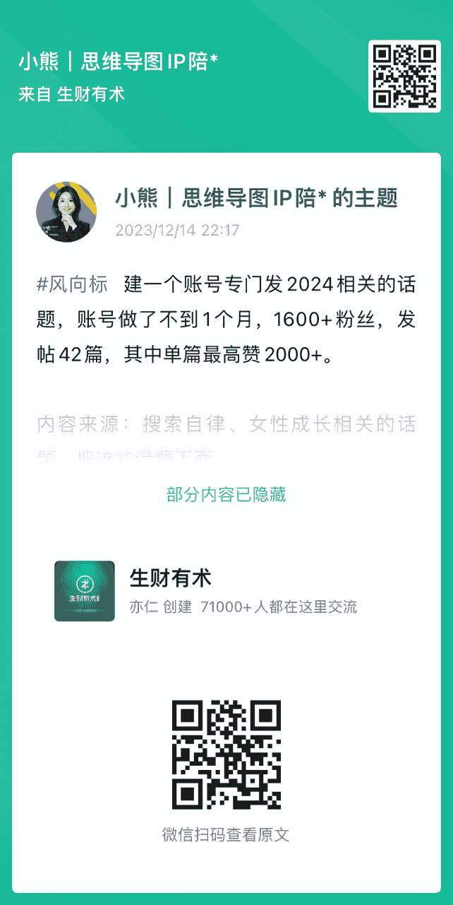

我用一个我自己总结的解决问题很好用的模型（IDEA)来展开我的分享，希望这个分享能对部分圈友有些启发：

> 1.I-找出问题—建立内容观察库：系统浏览目标领域的高互动内容，熟悉或者感兴趣的领域最优

> 2.D-定义目标—锁定标杆案例：筛选互动量超过行业基准值的优质内容，观察用户的互动情况

> 3.E-套用模型—解析盈利路径：拆解内容流量转化至商业收益的具体环节，识别关键价值传递节点

> 4.A-开始行动—启动最小实践：要么自己做要么把观察结果和思考发出去

# 1.I-找出问题—建立内容观察库：熟悉或者感兴趣的领域/平台最优

找出问题，我现在的问题是找到个人成长赛道下面近期数据好的内容？

那怎么找呢？这也是我们大多数圈友找风向标时候遇到的第一个大疑问。

当我们用手机点开任意一个平台，你随意浏览内容，加上对风向标不够敏感，是很难找到的，完全就是脑瓜一团浆糊，看谁都像风向标，看完又不像。所以我们的前提是找准自己感兴趣的平台或者领域，这会让你更敏感，也更容易get到内容背后的东西。

记住关键，从自己感兴趣的领域/平台开始！！！

我举个例子，我感兴趣的就是**个人成长**板块，我感兴趣的平台是**📕**平台，所以我就去📕搜索个人成长，看了一次两次三次，下次你点开📕，平台就会给你推荐个人成长的内容，而且是那种数据很好的笔记，我写帖子的时候一边写一边实战刷📕，我就把我实时看到的内容给大家演示。

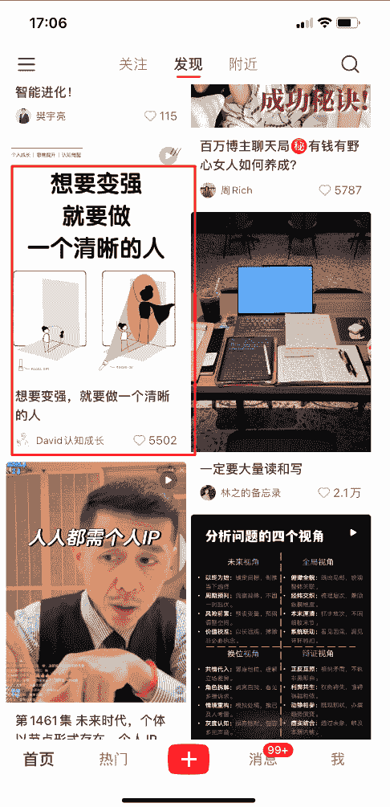

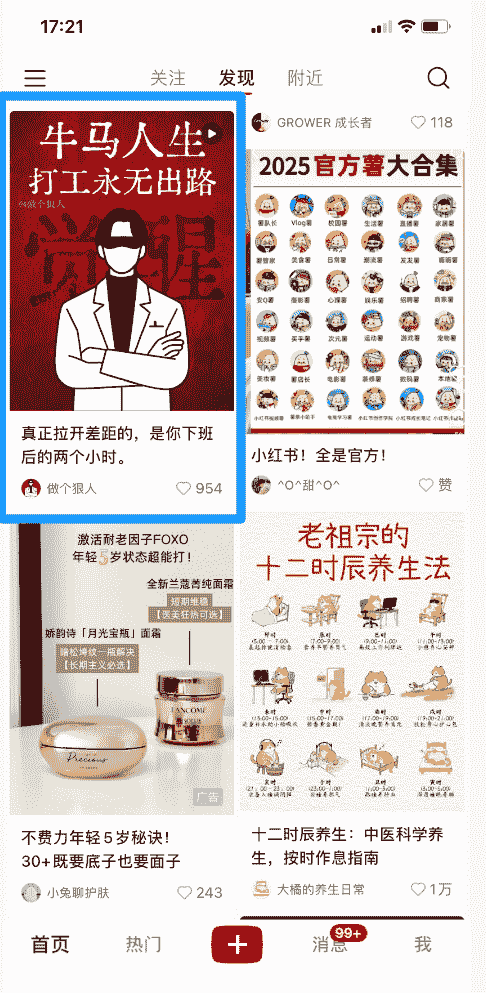

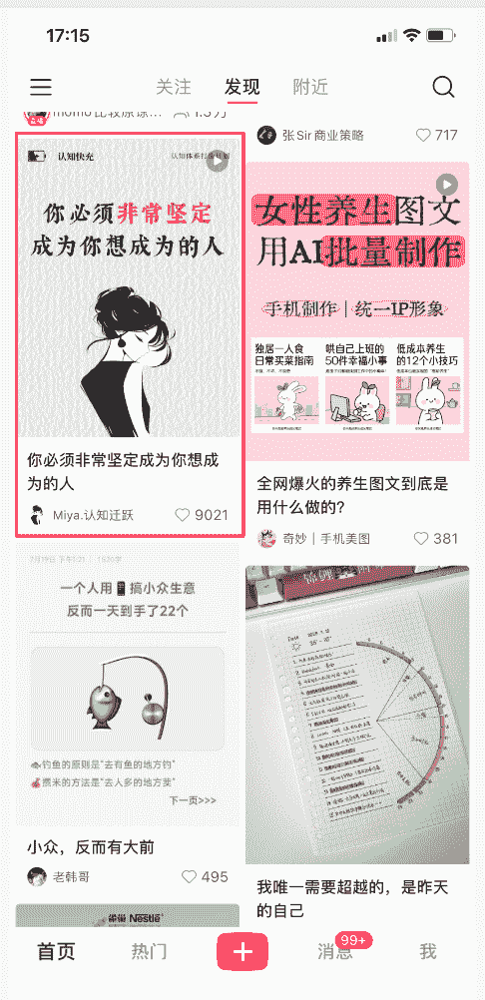

我刷的过程，看到三张图片中分别截图了一张，我为啥会选中这几张，因为这是我感兴趣的赛道，并且我发现他们的标题很醒目，一种人间清醒的感觉，标题一看就是爽文、狠角儿。

既然这么会写标题，封面也整的这么好看，那多少是有点东西呀，所以我就会点开这条笔记去看看，观察这个笔记的笔记内容到底有什么不同，这条笔记的输出形式是什么。

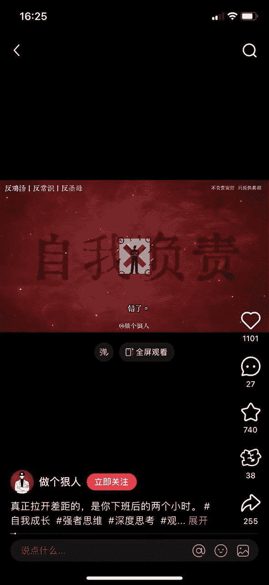

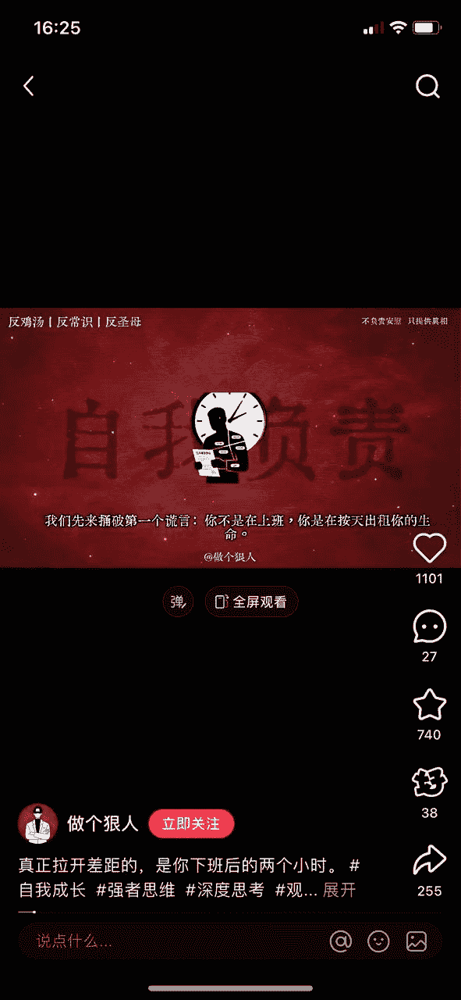

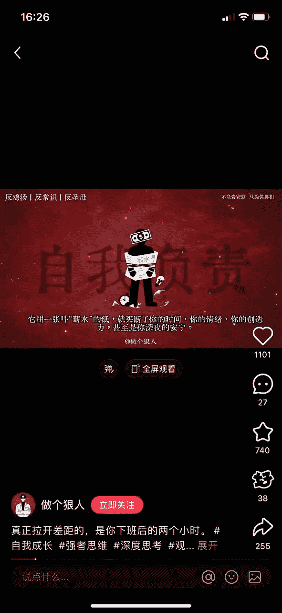

进去一看，视频形式的输出，这些视频看着好像也不是很难，PPT播放+AI文案+剪映配音就可以完成。圈友会纳闷你咋知道就是这样做的，其实我也不知道，我只是站在我的认知里猜想或者觉得这样也可以做到他的效果。你们日常在星球多刷风向标会看到很多分享AI技能的小伙伴拆解什么工具做的，你就会积累越来越多的储备。

再者做智能体很厉害的圈友，直接做一个这样的智能体那不就是更牛了，效率更高。

我认真的看完他的视频，发现视频的逻辑从一个观点给你拆解这事情他的思考逻辑，拆解的还挺有道理，但是他不拆解透彻，最后会说如果你拥有我这50个思维模型，你也能和我一样快速的认清真相，成为一个狠角色。你看这就是植入软广，直接看完的就会被种草。

我就发现，这个可以好好挖掘。

# 2.D-定义目标—锁定标杆案例：筛选高互动量内容，观察用户的互动情况

于是就开启我们的第二个步骤，我拆解这个账号的我的目标是什么呢？

我想拆解透彻去星球发风向标或者我想学习这个账号的变现模式或者我想从这个账号的背后找到可迁移内容到我自己的账号里面。

不管是哪个目标，我们在写风向标的时候都尽可能会覆盖这些内容，让看完你找到的这条风向标的圈友恍然大悟。

看完一条我觉得有意思，我就会去看这个账号的多条视频，尤其是点赞高的视频，用户在评论区说什么。一方面挖掘用户对这类内容的需求，一方面挖掘这内容啥时候发的，帮我们保持基础的敏感度。

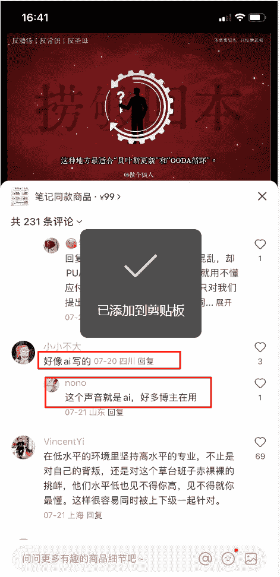

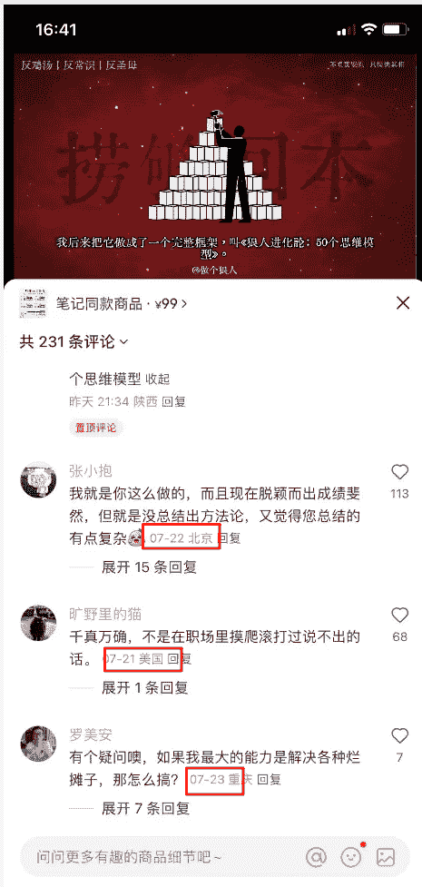

看完这条最高赞的视频评论区，我收获了四条信息：

①这条视频是7月20号左右发的（你把评论全部划拉完大致看看评论日期）

②这条视频的用户几乎都是职场人，估计这个账号大多数也是职场人

③评论区挂了他的产品50个思维模型，那么这些模型也是针对职场人的

④才一个月的时间不大，这条视频就有2万赞，这个关于草台班子的选题可以思考下

OK，解决了评论区的基本情况，我们接下来就锁定这个账号的盈利模式，以及可以让大家都能有机会切入低成本学习复制它的方法，这是我们找风向标的核心。

# 3.E-套用模型—解析盈利路径，识别关键价值传递节点

**套用模型，**我自己在拆解风向标最常用的一个四拆模型，我自己琢磨的，当然你也可以理解是你拆解的一种结构或者方法论。

> 四拆模型：

> 

> 1.拆解账号的定位

> 2.拆解账号的基础数据

> 3.拆解账号的内容形式

> 4.拆解账号的变现模式

## ①拆解账号的定位

拆解账号的定位很简单，要么直接一目了然在账号的名字或者简介中可以看出。再不行刷一刷整体的内容也会得到基本的答案。

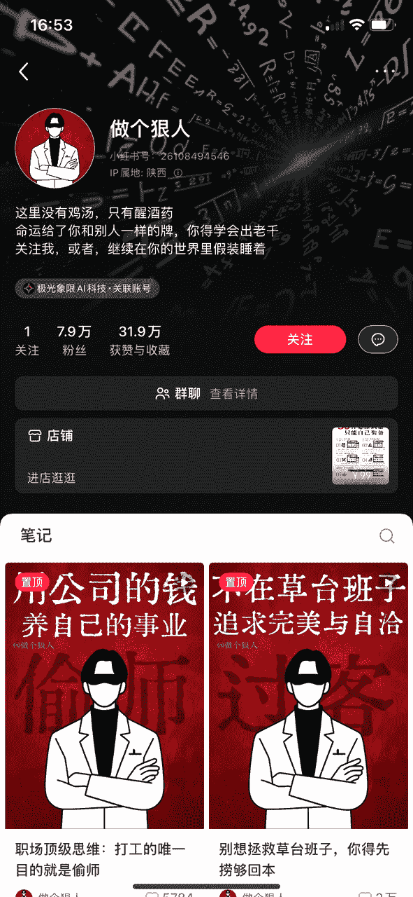

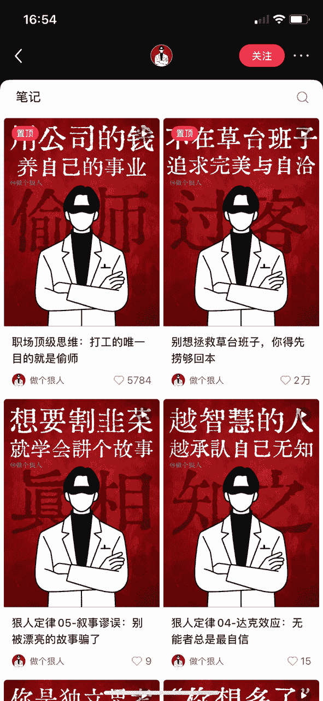

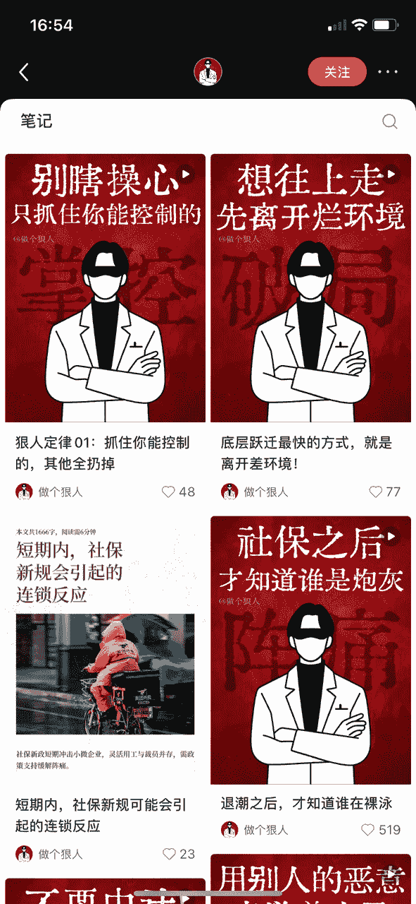

很明显这个账号主打观点标新立异，打破传统观点，让稀里糊涂的职**场人变得人**间清醒，所以整体可以理解是分享职场新思维的一个账号。

## ②拆解账号的基础数据

拆解账号的基础数据，除了粉丝量和点赞量，我们要拆解它发了几篇帖子，他什么时候开始做的账号。

粉丝量、点赞量和发帖数量这个直接在账号主页就能看到，那么什么时候开始做的这个账号我们要怎么去挖掘呢。

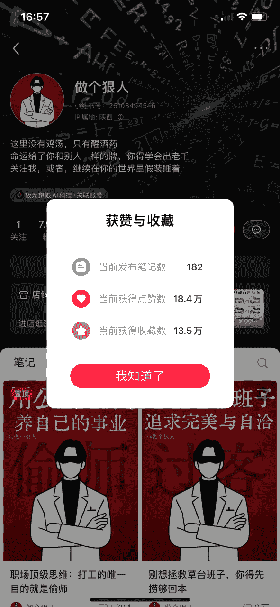

你使劲地把该账号的主页笔记往下划拉，划拉到第一条，去看第一条评论区的所有评论日期，不要看博主自己的评论日期，要看用户评论的日期。我一看差不多是6月10号左右开始起号的，那么现在是8月中旬，这个账号也才做了2个月，粉丝量7.8万，发帖量有183篇。

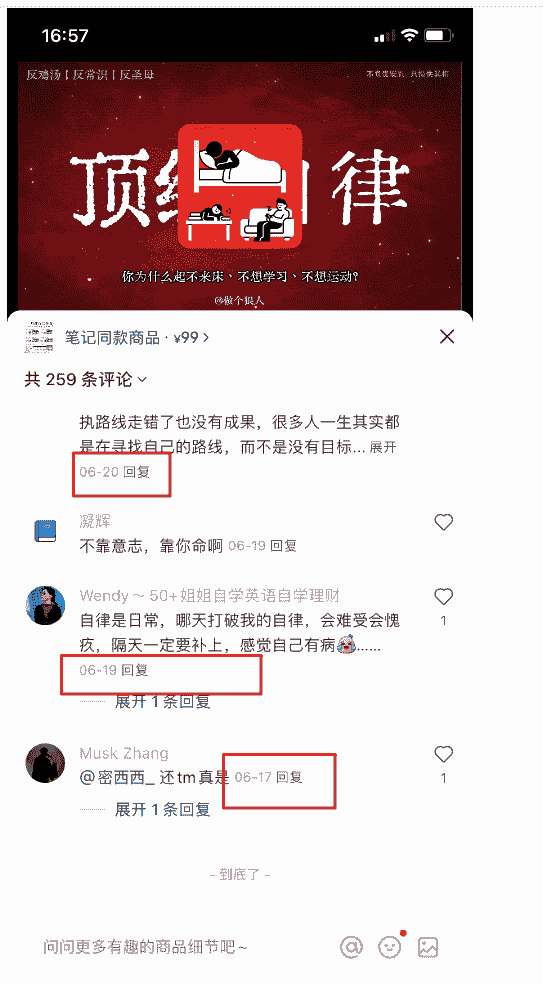

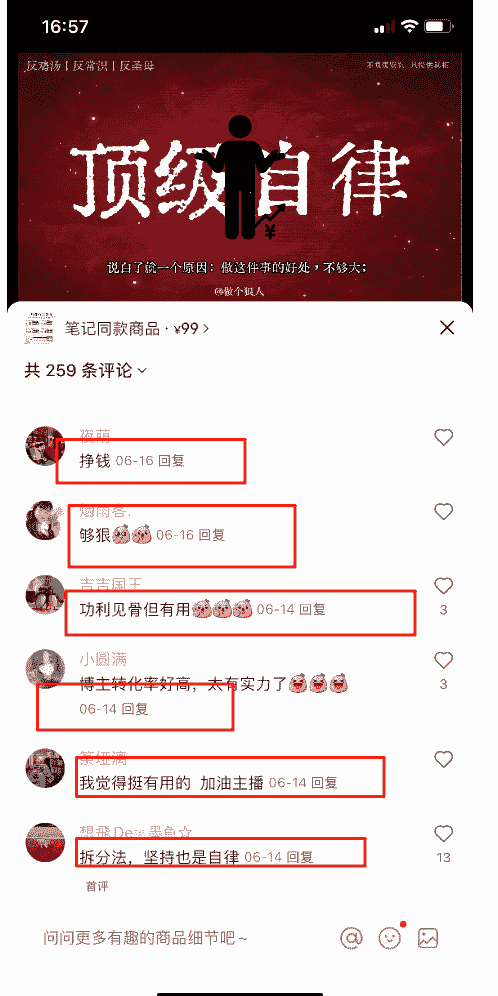

选题好，质量高，更新也很勤快。突然就会明白，没有谁的成功是随便来的。

## ③拆解账号的内容形式

拆解账号的内容形式，就是拆解这个账号怎么做内容的，如果别人想要去模仿这个账号，它可以怎么去开启。

我理解这个账号的复制模式就是两种：

第一种，圈友中会做智能体的，按照这个形式做一个智能体，借助智能体一天直接出好几篇笔记都行。

第二种，圈友把这个账号里面的视频文案全部提取出来喂给AI，然后根据合适的选题让AI模仿这个风格给出文案，再去用PPT加上一些图标，再到剪映里面把PPT+音频一起融合做成一条视频。

所以这个内容的呈现形式就是这些，你们发现没，会AI就是效率高呀，所以AI时代下，每天都在学习新技能。

## ④拆解账号的变现模式

来到变现模式的环节了。这个环节决定我们广大圈友愿不愿意去做这件事儿，因为要看到可复制的前提下，还要看到高变现空间，ROI的投产比呀。

那在拆解其他账号的变现模式之前，咱们先要确认清楚📕账号的变现模式一般有哪些。

📕的变现形式我归为三大类，接广告、开📕店铺/直播卖货、引流到私域卖产品。

**接广告：**在📕的笔记内容中是可以穿插商品的链接的，由此看出我们就可以实现带货变现。

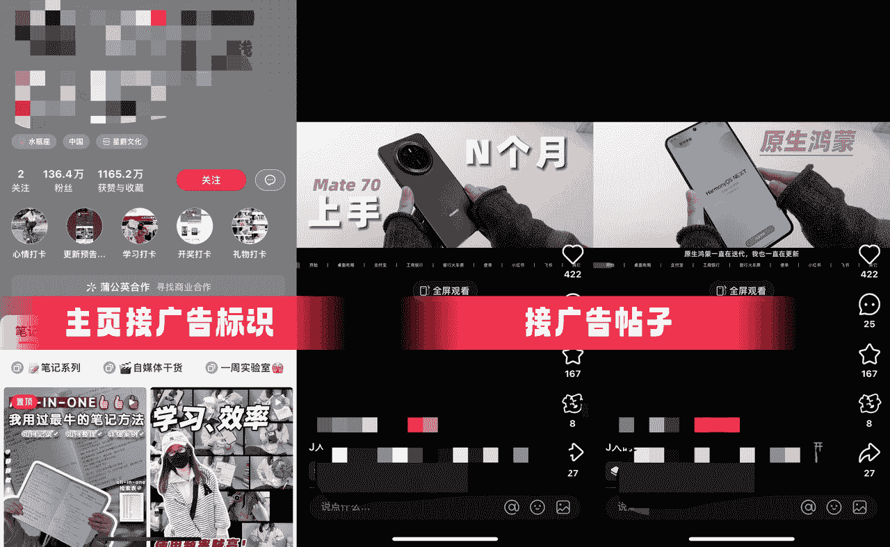

**开📕店铺/直播卖货：**在账号主页看到店铺，挂链接，通过卖别人的产品赚佣金或者直接卖自己的产品变现。

**引流到私域卖产品：**在主页账号有群聊，通过群聊形式引流人去私域，私域卖实体产品、咨询产品、训练营或者课程都可以。

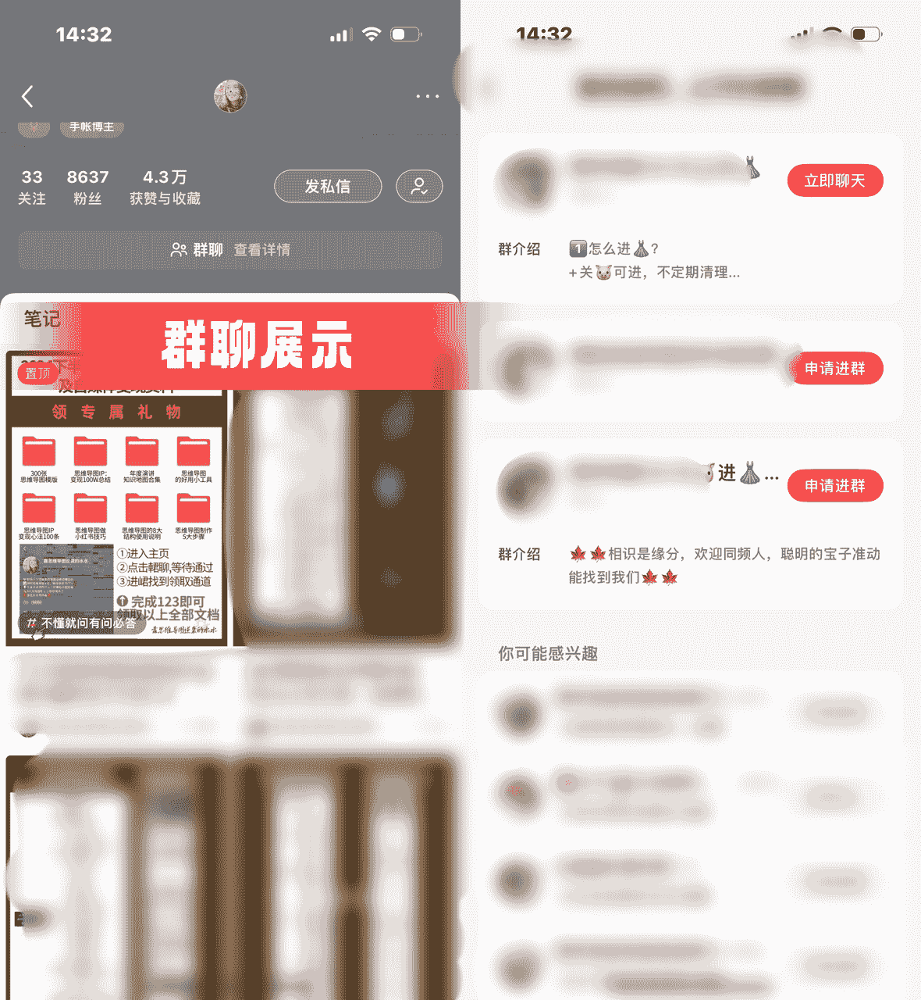

很明显，这个账号的主页有群聊，也有店铺链接。

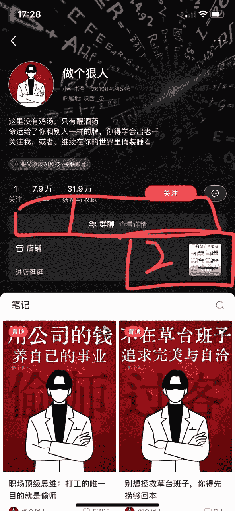

群聊设置的目的大多数是为了引流到私域，那到私域去卖什么呢，你感兴趣可以申请进去群聊看它群里的情况，如果他发了🛰️你进去看，到底是在私域做什么。

店铺链接，是一个狠人50个思维模型，99块钱，已经卖了将近950份，这样一算就是9万+的收入，账号开了2个多月，变现情况还是很乐观的。

然后点开他的店铺一看，这个账号是极光象限AI科技下面的一个关联账号，所以这个账号只是他们AI技能产品孵化出来的一个打样账号，最终还是为了引流人去卖他们的AI产品。

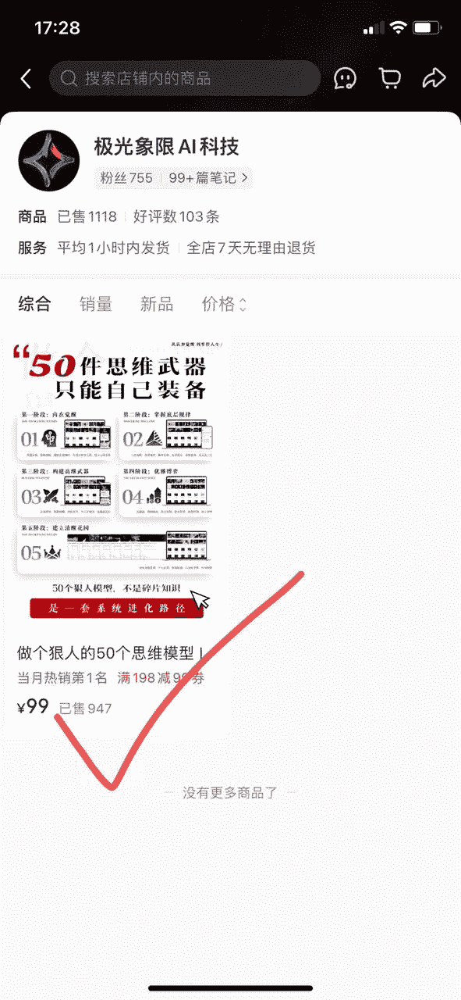

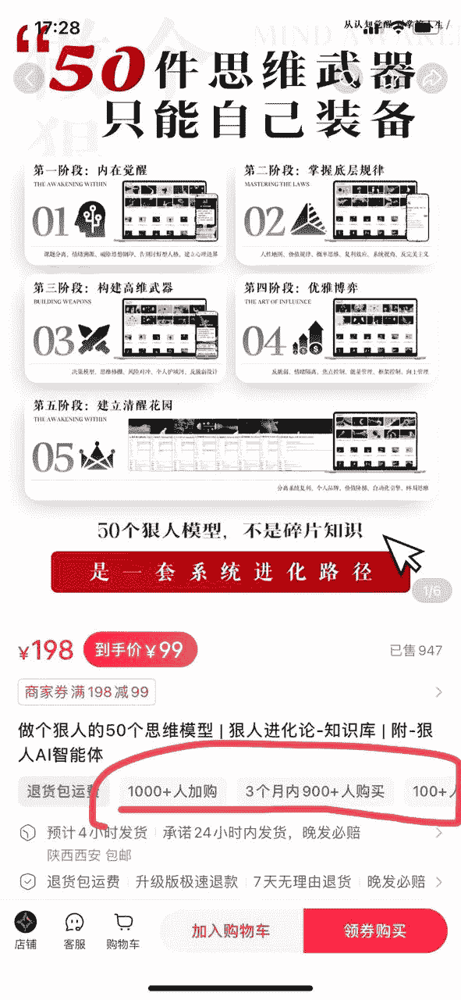

所以你看这么一拆解，这个账号的基本情况咱们也就清楚了，它的可复制性、变现空间我们都差不多清楚了。

# 4.A-开始行动—启动最小实践：要么自己干要么给别人启发

最后，把整个拆解情况全盘的梳理到一起，我一般会这样去发风向标：

①一句话总结这个项目

②分析项目的内容情况

③分析项目的变现模式

④圈友可以借鉴或者迁移的点

打个样就是这样子展示：

用AI做职场人间清醒赛道，2个多月账号累计7.8万粉丝，2条2万赞的大爆款，变现9万+。

**内容上：**找准职场人感兴趣的扎心话题，通过大字报标题+耍酷人物图标做封面，非常吸睛。点击内容进去是视频形式解说这个标题下面他的人间清醒的观点，打破我们传统的认知，引得大家频频点头关注。视频的文案可以直接AI生成，视频制作是一张背景+不同的图标+剪映配音即可实现。

每段视频结束部分都会软植入广告:如果你也拥有我的50个狠角色思维模型，你也可以......

**

变现模式上**：开店铺直接卖50个思维模型，99元一套。已经卖了947套，并且关联账户是一个AI科技公司，所以后续还有可能从这批人中转化到AI系列的产品，再次变现。50个思维模型网上一堆，甚至100个都有，直接去网上找，借助一些AI工具批量生成好看的图片。

**可迁移点：**最近👸号很火，那是不是可以把这些文案的形式拿过来去写👸号文章，分享职场人间清醒的各种思维。又或者一些会做智能体的圈友直接开始设计一个这样的智能体拿出去卖钱。

然后，这样一段话+截图发到风向标里面去，龙哥大大会根据项目的可复制性、变现的空间、跟当下热点的结合度，甚至说是否是信息差情况等各个维度评估你的这条风向标。

同时，你要是拆解完自己心动了，那就直接干起来。

好啦，以上就是我关于如何写风向标的一些方法，希望能够对圈友们有帮助哦~也欢迎其他小伙伴多多交流，分享更多方法，我们一起龙哥盟。