# 外卖CPS航海，直播一周2W单+，全面复盘

> 来源：[https://xuqiwei1986.feishu.cn/docx/Ua8idLtqWo0PjAxRm0Pc3qFInyd](https://xuqiwei1986.feishu.cn/docx/Ua8idLtqWo0PjAxRm0Pc3qFInyd)

圈友们好，我是慢途，一位一线创业者。（去年做短剧分发，俩月做了60多个，目前有3个AI号和一个AI古人说话号在持续变现。）

这一次的外卖小航海，我团队的数据，航海一周20145单，最高单天8500单，现在平均每天1000-2000单。

但我不是来交作业的，是来展示如何把血泪变成下一次冲锋的弹药库。

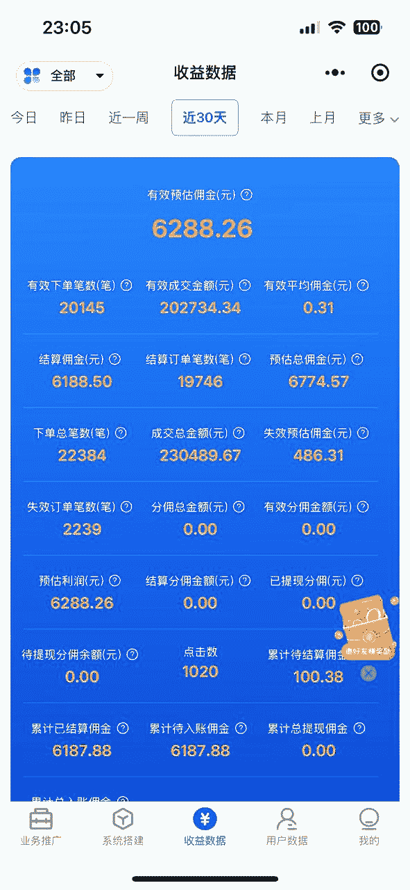

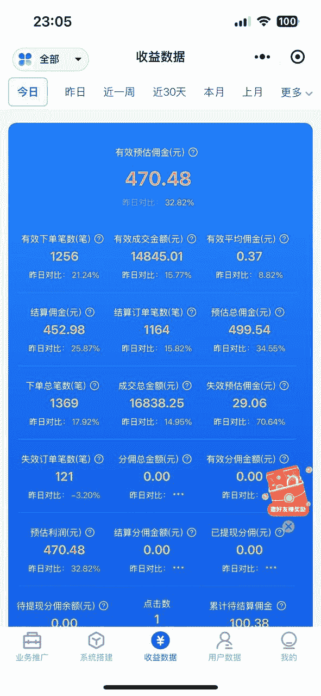

## 自媒体项目的核心命脉：执行力即生存力

龙哥老大说：”先下场，把手搞脏“

我在七月十八号左右在另一个付费兼职网站上看见了外卖9.9抢年卡的文章，当时我感觉这事儿，真能做的话，可能可以拿到不小的结果。

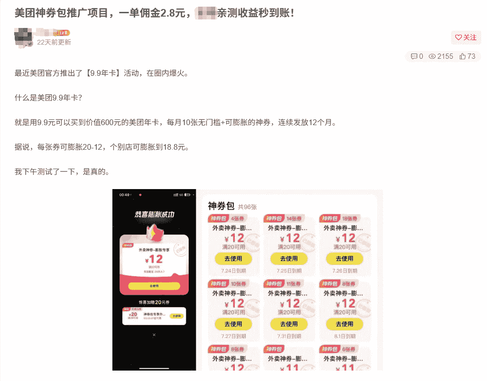

我第一时间回赚钱搜关于外卖CPS的贴子，果然发现[外卖推客新人入场保姆教程](https://vpbq24ngx4.feishu.cn/docx/AG84dd2GNoK8GFxQkoGcg14znBd)龙哥老大的超级标和涛涛大佬的保姆及教程

老大发的超级标+大佬下场做的数据，让我更加坚定要去做这个事情。

当即，我就去“美团联盟”这个平台上去测试了“美团9.9买年卡，用自己朋友圈的资源测试了一波。出数据后，果断报名小航海。

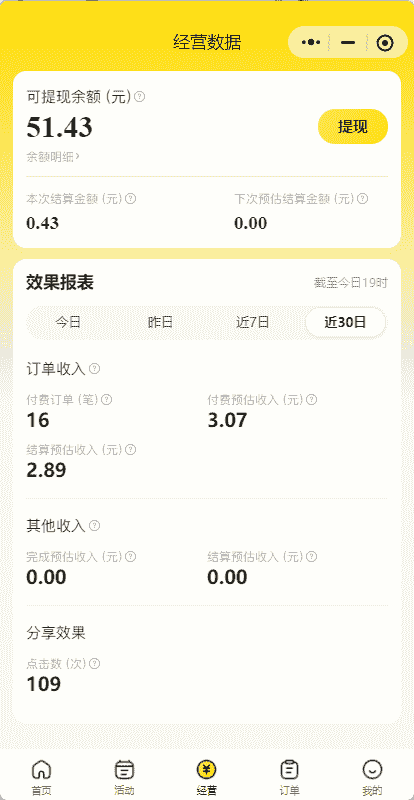

## **项目复盘**

### **一、数据****：数据>概念**

我坚持：”脚沾泥巴的数据才有效“

航海开启还有一段时间，这段时间不能闲着，正是找对标，拉数据的好时候。

###### 拉什么数据？

**各大平台政策、各个推广平台、对标账号、对标直播****，****平台活动解析，通通拉**了个遍，也拆了个遍，同行群都进了20来个。

PS：数据一定要手动拉，哪怕是借助平台，也要自己手打一遍。这样才会有印象。

###### 找活动数据

官方群很好找，到每个官方指定活动发放的地方，都能找到。

比如美团，去美团联盟小程序，点击下方——我的——再找到常见问题，点进去就有推广交流群。

活动数据除了官方群，同行群每天也在实时更新，

同行群是一定要进的，多进几个也没关系，就在抖音上去找到一些正在直播，而且在线人数在50人以上的，关注他，先进他的抖音粉丝群，大概率他的群公告上，就有加他VX粉丝群的方法。

###### **平台活动梳理**

一开始我也很乱，单一个平台，活动就非常非常多，而且平台给的介绍也不是特别清晰。

我的做法是：**先选平台，再选活动**

1.  先确定自己要做哪些平台（我定的淘宝和美团，因为这俩激励多）

1.  然后去研究这俩平台的活动，对我们激励大的有哪些，用户福利又是什么。从中选出几个活动主推。（我选了5个：美团2个、淘宝3个）

1.  收集活动日期较短，但用户福利大的活动，可以用于社群的维护。

1.  用一些几率性的，可抽奖的活动，后期可以拉直播间人气，如：

+   某东的大额福利

+   淘宝抽奶茶免单卡

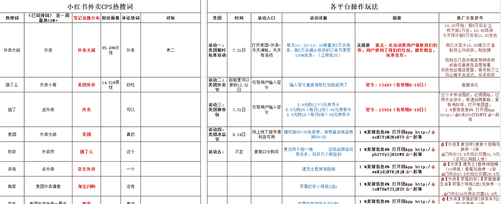

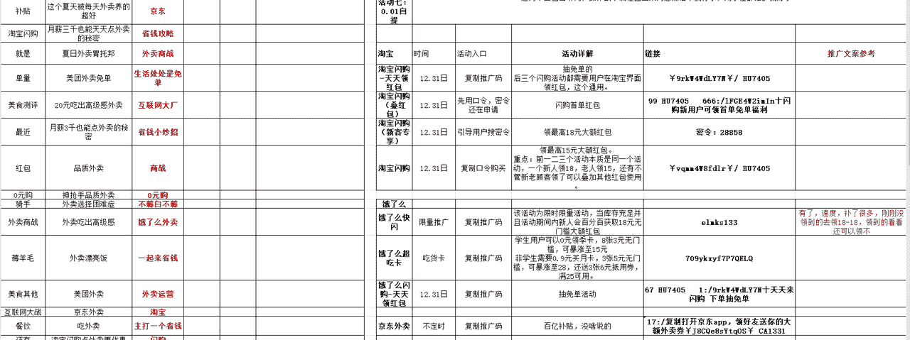

### 二、短视频

###### 哪里找对标？

我是拉的短视频、📕及平台长期、短期活动的数据。

先找这个项目的内容标题，我是按照“外卖优惠券、餐饮团购、大额优惠券”等方向搜的。

+   📕用的新红数据拉热词，从热词中去找对标，然后拆解他们的模板（新红可以在咸鱼可买1天的）

+   抖音短视频更简单一些，直接去搜相关的一些标题，筛第一遍对标（50人），从中筛第出二遍对标（10人）

###### **手动拆解，分层狙击**

对标不是抄作业，而且解剖对手基因库

前期所有的动作，都是为了筛选

50个对标出来，到底抄谁，怎么抄，为什么抄他，要把这个搞清楚。

####### 第一步：找对标，找相同点，从而发掘爆点。

拆解对标如下图：

| 个人简介 | 视频名称 | 话题 | 点赞评论收藏数量 | 视频类型 | 关键词 | 剪辑手法 | 评论区高互动话题 |
| --- | --- | --- | --- | --- | --- | --- | --- |
|  |  |  |  |  |  |  |  |

把对标视频从这些方面一个号一比一的拆出来。

你一定会发现它们之间有**相同****的****点（大概率就是爆点**）

####### 第二步：数据说话，找到爆点

公式一：爆款率>15%留下，纯怼视频量的淘汰

公式二：筛选近期新增分享量高于50%

公式三：从中选出其中0-10万粉，爆款多的账号，重点拆解：爆款结构、高频关键词、高赞高评论、是否有主动制造争议话题

这里我用的是巨量算数，筛选到这一步，到这儿剩下的账号基本都是不错的账号了

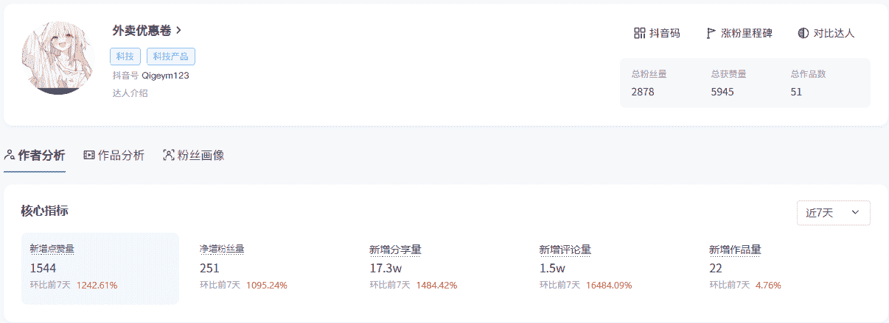

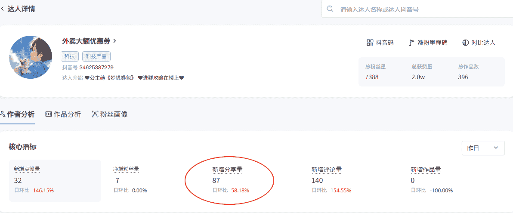

###### 上手实操，测视频数据

短视频制作没有太多讲的，也是准备了几个账号每天去发，卡点是有的：我多号发出去几乎无数据，且我发现群里的圈友大多也是如此。

**所**以我目前反其道而人行之，去找不同点，去找这10个对标与其他账号的不同点在哪儿：为什么有的账号抖+抖能投出去，有的账号一点流量不给，也不判。

基于上，也在从不同的角度去测，目前我跑出来有数据的号，都是**避免了有引导性的词语**。

短视频上的大结果还没有拿到，有些思路也刚开始跑，如果圈友们有这方面的经验和想法，欢迎交流

### 三、直播

外卖的短视频上没有拿到太好的结果，直播肯定也是要试一试的，没想到直播拿到结果了

这段时间有很多圈友问我，我直播怎么弄的，想进我的直播间看看学习学习。有的圈友甚至还叫我“直播大佬！”

对此我只想说，熟悉我的圈友都知道，我是深耕短视频流量的，对于外卖cps的直播来说，我也是小白。

**我想说，没有捷**径，就是多练，我相信，在任何项目的前期，执行力>专业。

###### 直播前准备

因为没有开播过，我们为此准备了，为期三天的直播“魔鬼训练”

+   一开始人对人练

+   人对电脑练，把屏幕当作人脸

+   开直播练，既然是小白，那我就不怕封号，封一个我再拉一个。（目前封俩了，正在又拉新号，今天才有时间来写复盘，哈哈哈哈哈）

###### 直播时间

这个问题吧，我觉得没啥可讲的，没想到问的人还挺多的，反正我测出来的时间高峰期应该是早上10-1点，晚上5点-7点。

我播的时间不定的，我有一个小团队，每天轮流着播。

###### 直播间一些小技巧

+   统计每天各个平台的活动

比如京东7-6、淘宝闪购抽奶茶免单，淘宝抽免单15-15商超果蔬红包买矿泉水等等。以这些免费活动获取流量，再讲解自己的密令。

+   直播时漏一下镜头，展示自己薅的羊毛订单，然后结合自己的密令讲解。

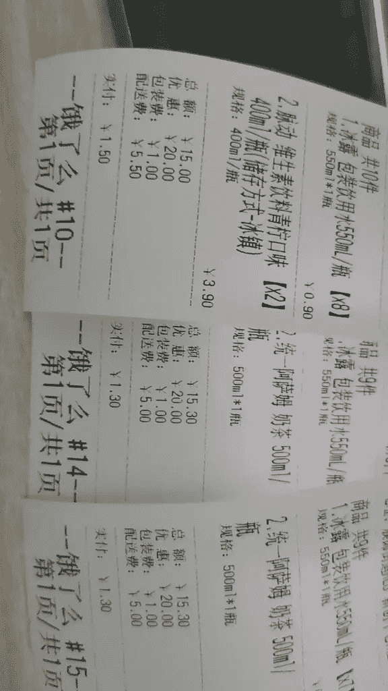

**例：**想要跟主播一样一两个包子就薅一大堆水和饮料吗，打开某宝闪购第一步：搜XXXXX（自己的密令）（16-15和15-13）第二步搜XXXXX（15-15果蔬和10-10的商超）

+   还有一些奶茶的活动，同理~

+   每天多在同行群里蹲，还有一些👸号每天都会发活动。**我觉得比较详细的一个👸号是《丐帮线报**》标注：不是我的👸号，我不引流，单纯觉得新手玩家刚上手时很有用，哈哈哈哈哈哈。

+   直播间人流量的重点，是活动、活动、活动，重要的事儿说三遍！！！

###### 直播团队

团队小伙伴能做出来，这两点我觉得是关键的：

+   **“死磕精神”是突围的关键**

+   数据驱动决策，从经验主义到算法优化

刚入这条赛道，不懂直播，也不知道这条赛道的高峰时期，我采用了一个笨办法：

把我们四人设计为柔性架构：**（1****直播成员+****1****运营****）****成立一个小组+****2个****直播人员灵活用工**，

设：“高峰期突击小组”24小时响应，通过两个通宵的鏖战，拿下了平时与周末的高峰简版数据。

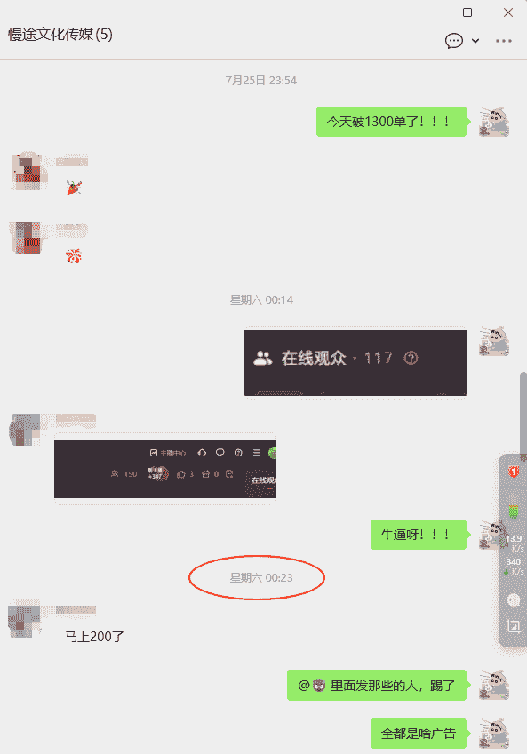

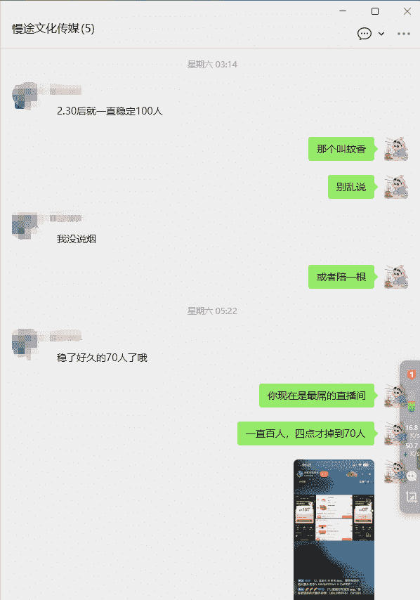

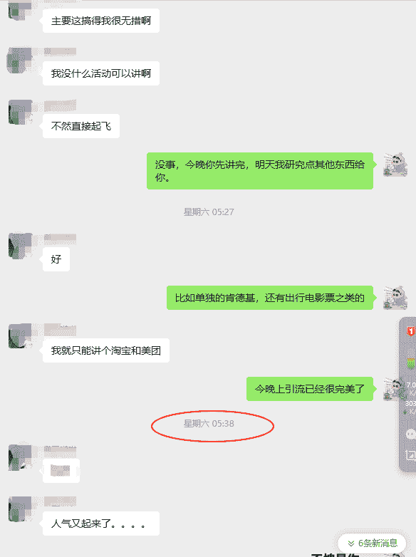

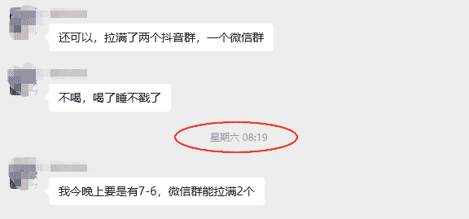

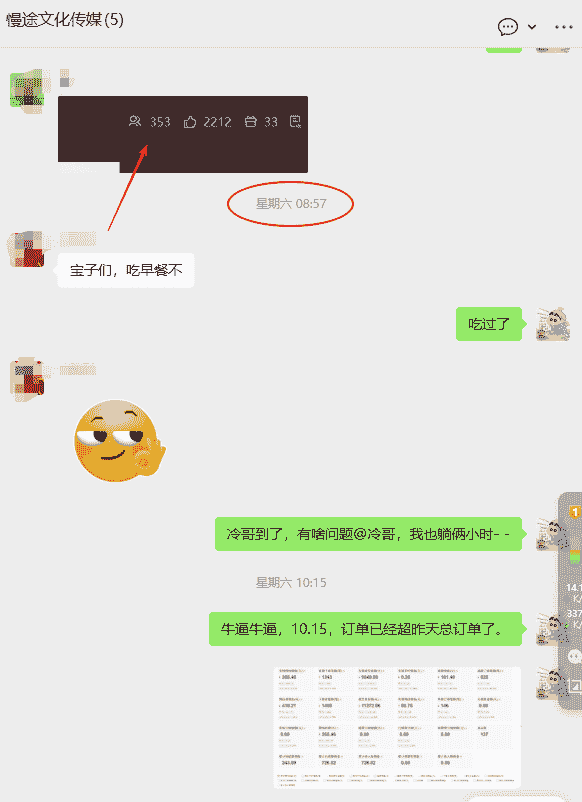

算法优化的部分目前正在监控，时间太短，还体现不出来什么。

主要方向：

短视频核心监控指标（短视频正在搭建，期望能达到）

+   内容维度：完播率≥50%，互动指数（点赞评论≥5%）为合格

+   增长维度：粉丝净增量——日增0.2%为健康（这条赛道要求的低）

直播核心监控指标

+   平均观看时长>90秒

+   互动率≥5%

目前只监控这两点。对于这条赛道感觉已经够了。

### **四、没有密令怎么直播**

这个问题是群里圈友问的特别特别多的了

以我一开始对平台的调查，各平台都出现密令短缺的问题，有的平台甚至是只给每周持续出多少订单的推广者申请密令。

我当时想着，小航海下去八百多人，可能会出现密令不够的情况。所以没等航海的免费密令，提前把所有密令全买了。（也等了一周左右才全买齐）

没密令之前，我的所有动作是引导入粉丝群。

“今天某宝的活动力度特别大，特别是一两个包子就能买10多瓶矿泉水，想要薅这个羊毛的主播带你们薅啊，方法我都放在群里了，重要的是，从群里还可以分享给你的家人闺蜜一起去薅啊，大家加一下主播的粉丝群，快到群里去薅，晚了就没了”

+   然后在粉丝群里教他们操作，群公告挂的飞书云链接，把链接都做在里面，附上每个步骤的截图。

+   飞书云底部再留一个🛰️群二维码~。

我知道有密令和没密令的效果肯定是不一样的，但是我也希望圈友们不要完全纠结于此，有密令有有密**令的打法，没有也有没有的打法**，不要因为暂时没有密令就停止不前，借用涛哥的一句话“别做完美主义，要做完善主义”。

把重心放在活动力度上，用免费的、大的活动来引流，用自己的推广来出单。

### **五****、私域**

这是一个一定不要去忽视的点，只要量够，有时候私域的出单，比引流来的更快。

虽说企业🛰️接流量会更好，但现在不是条件不允许嘛，那牌差也有牌差的打法，以下我做的一些动作：

###### 🛰️群分成两种：**羊毛群与互助群**

解释一下为啥分两种，

京东、以及淘宝有时候会出一些活动，需要大家互相分享，才能叠加更多的红包，甚至我们有时候在引流时，公屏上也全都是分享链接信息。

这类用户本就是薅羊毛的，你不给他薅，就会流失，给他薅，群就容易炸，甚至还有很多打广告的浑水摸鱼。

那我就干脆换个🛰️，给他们一个互助群，他们愿意互相分享是他们的事儿，羊毛群禁言，每天把整理好的活动以及自己的链接不定时在群里发布。

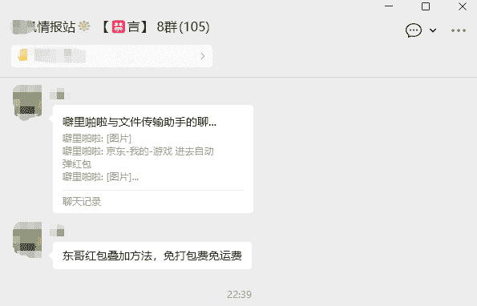

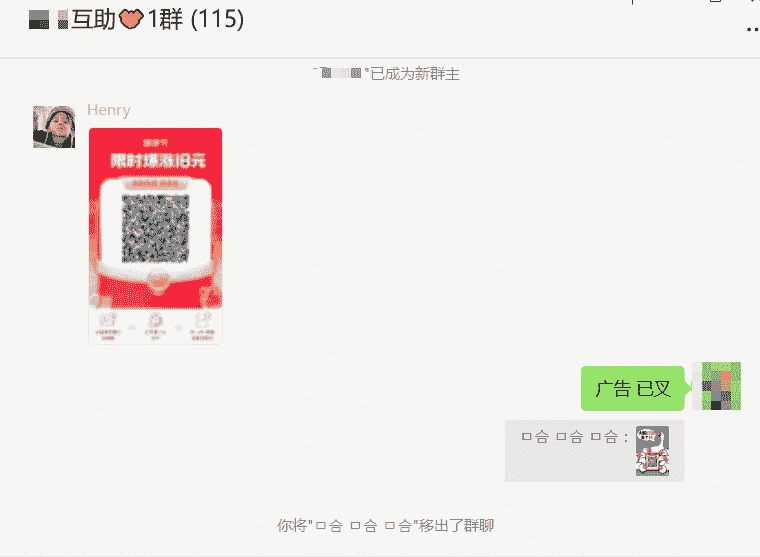

###### 定时发布活动消息进行转化

+   早：7点，中午：11点，下午5点，晚上12点，

+   **自己推广**信息，云瞻采集群活动消息（记得转链）以及同行群活动信息，如下图：

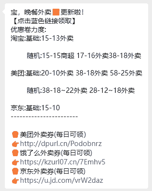

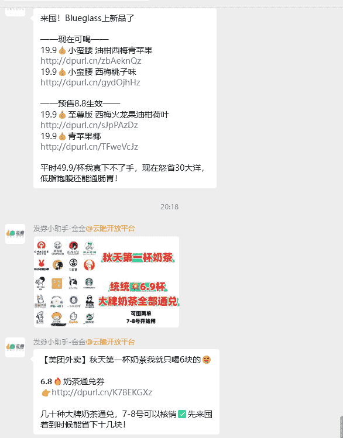

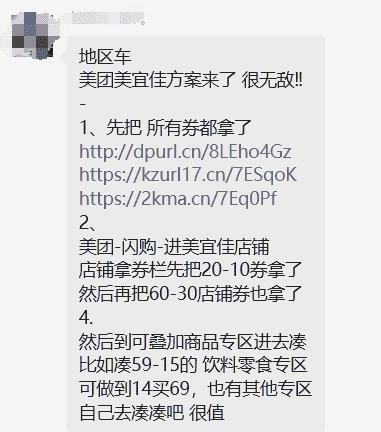

### 一些心得

1.  别纠结密令，重点放在活动力度上。活动才是直播间流量来源的关键。谁说没有枪头就捅不死人？

1.  前期没起量得时候别想着转化多少，所有动作全引群。（我两个直播账号都被封了，18个抖音群、7个🛰️群，每天靠往群里发发活动一两千单）

1.  不要有流量焦虑，不要因为没流量到处问别人为什么，你应该问自己为什么。没效果就找原因，错了就改正。

1.  成绩=执行力+专业，前期执行力权重占比70%以上

1.  **三板斧：直播做日常订单的稳定输出，短视频**做福利的更大曝光。客服精细化运营私域用户。

1.  不要怕封号，做流量封号是常态，制定好计划，封的始终是账号，而不是做账号的能力。

1.  很多圈友问我，账号是新号还是以前的号，统一回答一下：我用的号均是去年做短剧的号。

### 总结一下

1.  先拉满执行力，做好调研和数据，做好蛮干死磕的准备。

1.  有团队的话，高效搭配团队，拒绝“全能型选手”，他不适合蛮干。

1.  **内容矩阵先不考虑****，这类项目生态化**布局不一定能有效果，先把0-1走出来，再去想如何工业化创作。

1.  用数据说话，从经验主义到算法优化

1.  多复盘，多拆解对标，将经验转化为SOP，持续进化执行力，从蛮干到体系化迭代

此贴为复盘贴，如果有新圈友有兴趣可以先看涛涛大佬的新人保姆级教程，我一开始也学的他，哈哈哈哈

啰嗦一句：我一开始的目的是想用它去切入本地生活的赛道，没想到拿到这样的结果~

最后，感谢龙哥盟的团队，感谢教练的付出和领队对我的支持~