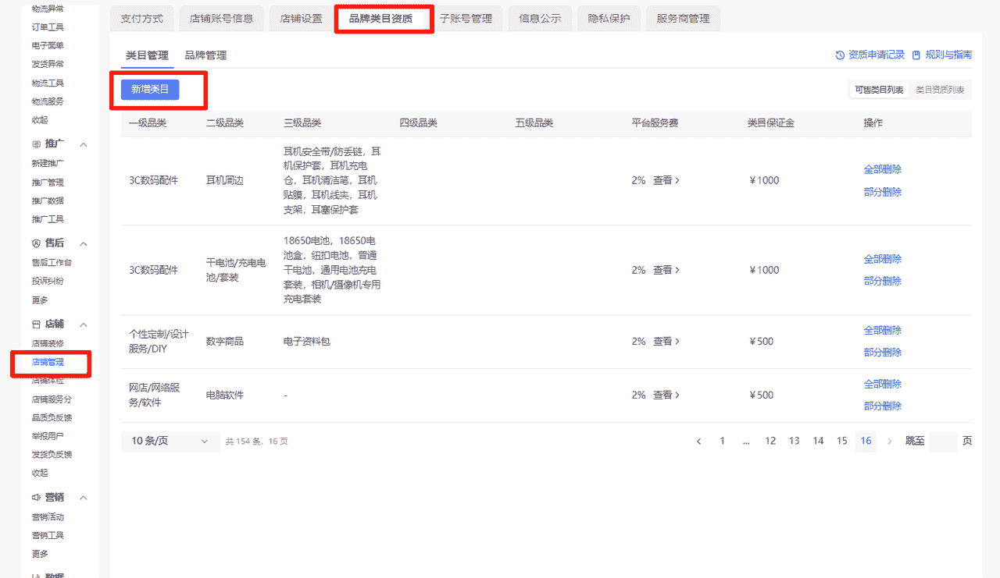

# 【全程自动化】的小红书虚拟项目到底是怎么做的（附代码）

> 来源：[https://xuqiwei1986.feishu.cn/docx/SflKdlT1PorNZhxRQ6CcZIrRnVW](https://xuqiwei1986.feishu.cn/docx/SflKdlT1PorNZhxRQ6CcZIrRnVW)

大家好，我是纸壳，上一篇《理论结合实践 -2 个月从 0 到 10 跑通小红书虚拟资料》，发出去之后，收到了非常多的反馈，也获得了加精推荐，让我距离“资深传术师”一步之遥。同时大家对于红虚项目的热情超乎我的想象，很多朋友找到我问了好多问题，也给了我很多启发，从上次分享到现在，流程又做了很多优化，那这一篇就给大家做一个详细的攻略

后续内容

[小红书虚拟资料店群进阶玩法--如何做到稳定出单](https://md8vbz6pkh.feishu.cn/docx/UfCHdJPAmo85Y0x2wXvczZ1EnTb)

[告别低水平重复！小红书虚拟项目做好的核心：持续迭代 + 打怪升级](https://md8vbz6pkh.feishu.cn/docx/VfSYdufjtoT49jxleBmcip8cngf)

好，话不多说，进入正题

# 一、项目整体介绍

## 项目是做什么？

+   小红书虚拟资料类产品

+   笔记挂链接，不直播

+   自然流+微付费

如图所示

## 变现流程

+   注册账号开通店铺---添加商品---发布带货笔记---出单淘宝采购发货

## 项目的特点与优势

+   项目简单，对能力要求不高，基本不存在太多的个体能力差异

+   确定性高，只要做就能拿到结果，不损失时间成本

+   纯原创，不存在搬运等问题

+   90%自动化，解决人工问题，就流程和难度来说，已经被优化成一个非常简单的项目了

+   本质是数学问题，谁的号多品多笔记多，谁就赚的多

## 新手做项目的流程

### 第一阶段

1.  帐号准备（前期 3 个红书店、1 个淘宝店，第 1 天）

1.  选品上品及违规处理（第 1-2 天）

1.  笔记制作及发布（第 2-3 天）

1.  账号运营（咨询、出单、售后，第 4-15 天）

### 第二阶段

1.  付费（第 3-4 天）

1.  刷单（第 5 天）

1.  批量复制账号（第 15 天左右）

## 常见问题

1.  废号吗？

不废号，但是账号进入稳定期需 2 个月左右

1.  起号成功率有多少？

出单算起号的话，起号率 100%，一般发笔记 1-3 天就开始出单

稳定出单算起号的话，也是 100%，只不过有的号 1 个月就能稳定，有的号 2 个月才稳定

1.  盈利能到多少？

稳定后，单账号的月利润大概 2000-4000 左右（说的是杂货铺模式，不清楚的看上一篇）

1.  1 人能做多少个号？

用自动化工具，1 个人可以负责 20-30 个号

# 二、项目准备

## 帐号准备

+   前期准备 3-5 个店

+   可以用个人店，身份证实名即可；也可以用个体店，需要个体执照（个体店不用交 600，不用交！！！)

+   **每个身份证可实名 1 **个个人店、每张执照可开4个个体店

+   开通店铺，不需要交保证金，后续出单够 1000，可自动充值到保证金

+   后期帐号越多越好

## 资金准备

+   软件购买：软件层面，我们团队已经可以实现全流程免费，以前必备的淘宝上品、红书上品、开通类目之类的成本，已经完全由自动化替代，不用再花一分钱。而其它非必备的软件也都有替代方案，也可以不用花钱（后面都会讲）

+   投流成本，前期每个号每天充值 10-20 元，根据自己准备做多少号计算成本，后期看 roi 酌情增加

+   资料采购费用，平均每单 1 元，可忽略不计

## 硬件准备

+   手机，承接账号，安卓机可开微信分身，1 机 2 号，不能太卡。优先使用苹果手机，出单后有提醒

+   电脑，能日常发布即可

## 软件准备

**谷歌浏览器**

> 账号多开，非必备，其他多开浏览器也可

> 下载链接：Google Chrome 网络浏览器

**影刀**

> 工作流工具，必备

> 下载链接：[影刀 RPA - 影刀官网](https://www.yingdao.com/product/)

**稿定设计**

> 批量作图，非必备，其他做图软件也可

> 下载链接：[稿定设计-在线设计平台](https://www.gaoding.com/)

**百度网盘**

> 保存资料，非必备，可以直接把采购的链接发给用户或者开通会员转存后再发给用户（建议开通会员）

> 下载链接：[百度网盘](https://pan.baidu.com/disk/main#/index?category=all)

**至尊宝插件**

> 获取淘宝商品链接，非必备，其他找货插件也可

> 下载链接：[至尊宝找货助手](https://zzbtool.com/update/index.html)

**阿奇索**

> 自动发货软件，非必备，后期出单多可开通（店铺服务市场）

## 红书店注册

+   注册网址：[小红书招商官网](https://zhaoshang.xiaohongshu.com/merchant/login)

+   输入账号密码登录

+   个人店、个体店，按要求填写资料提交审核即可（个体店不用交 600，不用交！！！)

+   设置店铺信息：支付方式、地址和物流模板

+   开通电子资料类目，店铺管理--品牌类目资质--新增类目--电子资料包--提交

+   注意事项

之前注册过的小红书号，只要没有严重违规都可以用，有违规的注销掉重新注册，最好还是用新号

# 三、选品上品 2.0

> 上一篇帖子写的选品上品需要用到淘宝店铺蚂蚁搬家等等，属于 1.0 阶段，目前已经进入 2.0 版本，工作流自动化上品，不需要花钱，也不需要开淘宝店

## 1、选品方法及标准

+   **其**实这个项目不存在选品的概念，只要符合要求不违规的品都可以上， 主要是测品，要大量的发笔记，让出单品和爆品自己长出来，所以，矩阵矩阵矩阵！！！

+   根据关键字和品去淘宝搜索，关键词：人事制度、财务模板、活动策划、运营模板、仓库管理、合同模板等等

+   选择图片质量高的店铺点进去，看店铺整体质量，选择合适的店铺和品，复制上品链接（至尊宝插件）

+   店选择标准：**近半年有销量加购等，店铺等级较高不是新店，整体风格统一**者优先，一般老店铺卖的品搬过来风险都很小

+   品选择标准：图片整洁清晰，内容较新，不带各种水印、二维码等

+   以下类型品不能选：带有人名、机构名、明星、肖像、涉及版权等

## 2、表格筛选

+   将复制的商品链接，保存到表格中，去重，以及删除不合格的品

+   筛选关键词：教程、9.9、免费、2020/2021/2022/2023/2019 等，将筛选出的产品删掉

## 3、调用扒品工作流，抓取商品图片

### 演示视频

[扒品工作流完整版.mp4](https://internal-api-drive-stream.feishu.cn/space/api/box/stream/download/all/OctnbK0aZoskgxxAPmAcIHocnhh)

### 代码截图

+   直接复制代码到影刀中，1:1 照抄

### 使用方法

+   运行工作流

+   将选好商品链接表，填写到影刀弹窗中，运行

+   需要把哪些品就在表格内填入哪些品的链接

+   等待运行结束，查看表格内的执行情况

## 4、调用上品工作流，将商品上传至小红书店铺

### 演示视频

[上品工作流完整版.mp4](https://internal-api-drive-stream.feishu.cn/space/api/box/stream/download/all/OIMebz2Q7oA6rExIGs2cGl3BnHh)

### 代码截图

+   直接复制代码到影刀中，1:1 照抄

### 使用方法

+   将下载好的图片压缩包进行解压，统一存放

+   将需要上传至小红书店铺的上品，保存至表格内，按照视频中的操作，提取商品 ID

+   运行工作流，在影刀弹窗内，选择表格、图片文件夹、要上传的账号，设置价格，然后运行

+   等待运行结束，查看表格内的执行情况

### 商品违规处理

+   上品上架后，有些商品需要整改，目前需要手动操作，点进需要整改的商品详情，按照系统提示进行修改即可（自动修改的工作流已经在开发中了）

+   图片问题：删除相应图片

+   显示冻结的商品：直接删除

## 5、创建商品数据库

#### 演示视频

[创建数据库完整版1.mp4](https://internal-api-drive-stream.feishu.cn/space/api/box/stream/download/all/TSREbzt9Oo0SD6xhvfncwAGRnmJ)

#### 代码截图

+   直接复制代码到影刀中，1:1 照抄

#### 使用方法

+   创建商品数据库表格

+   运行工作流，选中数据库表格，填写要抓取的页码，和要抓取的账号

+   将下载的图片按照账号重新命名后，将图片名称添加到数据库表

# 四、笔记制作及发布

## 笔记制作

+   创建发布表，将需要发布笔记的商品标题和 id 添加到发布表

### 文案制作

+   打开豆包，创建小红书笔记智能体

+   复制这段提示词给智能体

> 你是一个小红书资深达人，很擅长笔记编写，接下来每次发给你不同的内容，都要写成一篇适合发小红书的推广笔记，以表格的形式发送给我，表格第一列是标题，将我发你的内容总结至 18 个字以内，不允许增加或者减少；第二列是正文，根据标题自动生成，要求字数不低于 50 字；第三部分：添加 5 个相关话题，每个话题单独 1 列保存。

+   将发布表内的商品标题，发送给智能体

+   将豆包编写的内容添加到发布表里

### 图片制作

+   商品原图可以直接使用发布，但是会有几率报相似度过高

+   也可以将需要发笔记的图片进行批处理，此处用到美图秀秀批处理软件，也可用其他批处理软件代替

+   将处理后的图片名添加到发布表，发布表就准备好了

## 笔记发布

### 演示视频

[发布笔记完整版.mp4](https://internal-api-drive-stream.feishu.cn/space/api/box/stream/download/all/MlHZbH0sqoIBIFxy24Ic5r69nPZ)

### 代码截图

+   直接复制代码到影刀中，1:1 照抄

### 使用方法

+   运行工作流，选择发布表，和要发布的账号

+   执行后，等待完成即可

## 笔记违规处理

### 查看违规位置：[小红书创作服务平台](https://creator.xiaohongshu.com/new/note-manager?source=official)

### 违规类型及处理方式

+   相似度较高，主要是图片重合度较高，可以到稿定设计里，做一张原创图，替换图片重新发布

+   美观度低，排版混乱，主要是图片问题，到稿定设计里，做一张原创图，替换图片重新发布

+   违反平台规则的，直接笔记删掉，然后把品也删掉

+   高风险的，品和笔记都删掉

+   跨账号重复发文，删除笔记和品，同时在上品的时候注意规避相同产品

+   同账号重复发文，删除笔记，注意第二轮发布用原创图

# 五、账号日常运营

## 乘风投放及违规处理

### 操作流程

+   每天发完笔记后，给发布的笔记创建投放计划

+   每条计划选 30 篇笔记，计划可以用数字递增命名

+   设置出价 2-4、关闭直播快投、选择匀速投放；新号没有搜索快投

### 违规处理

+   全额退款类，将笔记从计划中删除，笔记本身不用删

+   如果是平台限制推广或违反其他规定类的问题，从计划中删掉该笔记，根据实际情况判断是否要删除品和笔记

## 出单及售后

### 出单处理

+   复制出单品标题，到淘宝搜索同款商品

+   优先选择低价、其次选择出单多的

+   下单后拿到资源链接，转存到我们的百度网盘呢

+   生成分享链接，发送给用户，私信发一次，出单列表发一次

+   发完后进资源文件内，查看有没有引流信息或陈旧信息，删除掉

+   自动发货-阿奇索

稳定出单后可开通阿奇索自动发货，一年 140 左右，在服务市场搜索 阿奇索，按照提示使用

### 售后及咨询

+   用户咨询尽量在 3 分钟内回复，电脑安装千帆服务台，可以多账号登录

+   开通智能客服

+   常用回复语

**资料怎么看：**复制链接到电脑浏览器或百度网盘 app，即可查看下载，链接永久有效

**问资料内容：**内容可查看商品详情，以图片展示为准，如与详情介绍不符，可无条件退款

**保存不了、要会员：**文件过大，可点进文件夹内，分批保存

+   发货后申请退款

看是什么原因，非内容质量问题，拒绝退货，理由写：该商品为电子资料，具备可复制性，暂不支持退货，如有任何问题可与客服协商处理

质量问题，私信用户修改退货原因为协商一致，不然会影响店铺服务分

+   店铺分

4.6 分以上有流量加持，4.7 分以上结算周期减少 4 天，所以店铺服务分还是要尽量维护

## 笔记任务

+   每周任务尽量完成，任务给的流量非常精准，易出单

+   任务流量给的是完成任务的那几篇笔记，因此做任务的商笔要选质量高的（易出单或出过单的）

+   任务每周一刷新，需要手动点击参与

+   性价比比较高的任务主要有：新品商笔、优质商笔、潜力商笔、普笔

### 优质商笔任务

+   优质商笔标准：3 张以上图片、标题大于 8 个字、正文大于 50 字、话题大于 5 个

+   前期随便选品发，后期出单品多了，尽量把任务留给出单品笔记

### 新品笔记任务

+   7 天内上的品都算新品，点击去发布可查看有哪些新品

+   新品任务和潜力品对应，7 天内上过新品，则显示新品任务，没上过新品，则显示潜力品任务

+   新品笔记对图片数量、字数等没有要求，只要是新品且挂商品链接即可

### 潜力品任务

+   潜力品很随机，没有明显规律，日常发布商笔就能顺手完成

### 普笔任务

+   普笔即不挂商品链接的笔记，可在发布完成任务后，重新编辑添加商品链接

# 六、总结

## 关于工作流程

1.  每天早上上班执行工作流发布笔记，每台电脑挂 10 个号左右，几台电脑一起跑，新号发 30 篇，老号发 10 篇

1.  过程中偶尔盯一下，防止报错，同时用另外的电脑，统计昨天的出单，付费支出收益等数据，新出单品统计到出单品数据库和二轮发布表

1.  1-2 小时执行结束，去给新发的笔记建计划，建完计划修改笔记违规和计划违规

1.  下午先执行二轮发布工作流，然后开始刷单，给每个号刷一遍，大概 2-3 小时

1.  刷完单，准备第二天要发的笔记内容

1.  过程中有出单和咨询，及时回复发货

## 关于项目

+   这个项目的核心就是堆量，因此把流程设计的足够简单，不需要精细化选品，不需要精细化笔记，目的就是为了更简单的复制，在源源不断个 70 分面前，100 个 1000 个 90 分都不值一提。

+   **85%的出单来自搜索流量，我们要做的**是堆更多的品和笔记、占更多的搜索词，介入微付费，让用户能搜索到我们的笔记和品，其他都不是重点，包括选品，不需要精细化选品，只要符合要求的就上

+   有些太繁琐的动作想不清楚该不该干的时候，用批量思维，假如你有 100 家店，还能支撑做这些动作吗，不能的话现在就不做，把精力放在核心动作上

+   当然不是每个号都能跑的很好，有的号自然流稳定出单不用投流，有的号需要投流才出单，有的号就不怎么出单。但是整体是赚钱的就可以，还是按批量思维，每个号都做一样的动作，正常发笔记，投流，刷单。我们要做的就是成为机械的流水线

+   对了，周末订单减少是正常的，测试很久了，每到周末订单量会少很多

+   这篇有些没讲到的细节，去看上一篇，就不重复造轮子了《理论结合实践 -2 个月从 0 到 10 跑通小红书虚拟资料》

# 还记得《黑客帝国》里面控制地球的人工智能叫什么吗

# **矩阵**