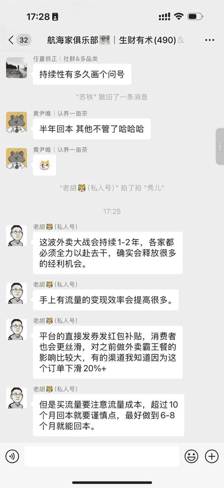
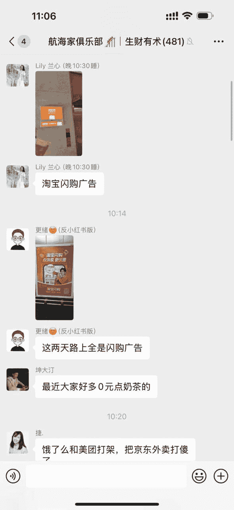
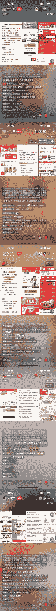
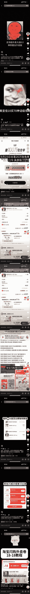
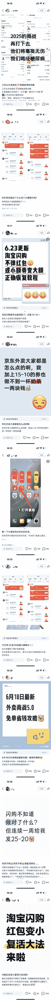
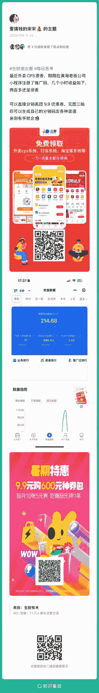

# 2025-07-11【超级标09】 外卖内容推客

> 来源：[https://xuqiwei1986.feishu.cn/docx/PCg4dxd1AoHASExVF6KcUmXRnSf](https://xuqiwei1986.feishu.cn/docx/PCg4dxd1AoHASExVF6KcUmXRnSf)

> 🔗 原文链接： h[ttps://scys.com/ar](https://scys.com/articleDetail/xq_topic/5125828555418484)ticleDetail/xq_t...

本文介绍了适合普通人的“外卖内容推客”项目，通过在内容平台推广外卖业务赚取佣金，具有低门槛、高确定性特点。适合想利用平台大战红利赚钱的人群。

+   外卖平台商战开启，补贴多，是普通人赚钱红利期，如淘宝闪购、美团外卖等不断破单日订单记录。

+   在抖音、📕等平台，以图文、视频等形式推广外卖业务，赚CPS或CPA佣金，可叠加多种方式放大。

+   已有圈友靠此赚钱，如个人玩家拉单量可观，大学生测试短视频引流月入过万，且基本靠自然流。

+   主流玩法是用内容吸流，根据实时佣金推相应平台，关键在于找高价值命令词及讲好省钱逻辑。

总之，外卖内容推客项目机会大，上手容易，只要抓住平台大战机遇，做好内容获流量，就能赚取佣金，实现增收。

09 这条超级标，非常适合普通人， 可能是最不需要技术含量只需要无脑执行力的超级标项目 ，如果你对AI的各种应用，比如AI编程或者AI做视频，感觉到很困难，那请**认真看这条超级标**。 这个机会，我们持续追踪和研究了一个月，也和非常多的人聊了，非常确认，这是一个超级好机会。什么是好机会，就是普通人随便做做也能看到收益的那种，虽然不多，但反馈很强，可能当天就能看到收益。至于能做多大，完全看能力和资源，做的大的，一天几万都有。 我先给这条超级标命个名： 外卖内容推客。

1/ 外卖平台最近开启大型商战，相信大家已经能感受到了，流传这么一句话：淘宝闪购、京东外卖、美团外卖再这么打下去，他们将毫发无损，我们将喝成糖尿病。最直观的感受是外卖红包满天飞，各种补贴都来了，淘宝闪购、美团外卖、京东外卖都在不断的破单日订单记录。

2/ 平台大战期，必然是普通人赚钱的红利期。 平台指尖漏出来的一些补贴，随随便便几百亿，都能让很多抓住机会的个人和团队实现财务自由。当然我们圈友，不指望靠这个财务自由，但每个月多赚几千块钱，赚点生活费，还是可能性很大的。

3/ 到底怎么做？具体来讲， **在内**容平台：抖音、📕、B站、视频号、快手等内容流量平台，以图文、视频、直播、评论等形式，推广淘宝闪购、美团外卖、京东外卖等业务，赚到外卖cps佣金或者cpa，叠加矩阵、私域、投流等方式放大。

4/ 上面的 n 种组合可以出现非常多非常的玩法， 每一种玩法你去对应的内容平台搜索关键词 ，就立刻能看到有人正在持续做，说明有人正在靠这个赚钱，你要做的是，学习模仿。

5/ 补充两个背景，今年315之后，星图和抖音中台类广告投放**审核趋严，原来需要靠****投放才能起量的词， 现在**外溢到了自然流 ，靠内容也能跑量了。 京东、淘宝、饿了么等平台在 大幅提高CPS和CPA ，上周淘宝刚宣布拿出几百亿补贴闪购，很多原本低利润的拉新动作，突然变成了“有套利空间”的项目，各家“百亿补贴”背后的机会值得关注。

6/ 在我们调研期间和很多圈友聊的过程中，已经有圈友在赚钱了： 有推客靠命令词引流，一天给苹果带来了1000万GMV； 有个人玩家用京东外卖命令词**拉了5万单，饿了么2~3万单； 有大学生测试短**视频引流，30天、每天做3条内容，累计收入1.4万，单人日均产值接近500元。 他们不是团队，基本都是一两个人， 不靠广告投放，靠的就是纯内容自然流，当然背后也有封号风险，这是正常的，账号是易耗品。

7/ 目前主流玩法是这样的， **在各个内容平台，用内容吸流，比如0元喝奶茶、请你喝瑞幸，再根据实时佣金，生成推广命令词，哪个高就推哪个，或者几**家一起推；简单**说，平台打架，我们选佣金高的的那一边帮他推，平台负责出补**贴、福利，我们只需要搞定流量，拿到转化就有佣金。 8/ 项目还是比较好上手的，团队有小伙伴测试了一下，以淘宝闪购命令词为例：用户输入**推广命令词后，可领18元无门槛，拉新成功你拿1-2元CP**A，下**单成功再拿0.4-2元CPS，单个用户带来的收益1-4元左右。 这里关键有两个点： 1. 你能不能找到高价值命令词（有**补贴、CPS高）； 2.你能不能用内容讲明白，把“省钱**”逻辑变成“动机驱动”。 至于具体的形式并不重要，图文、短视频**[、直播甚至地推，都有人](https://scys.com/articleDetail/xq_topic/8852151282488582)[拿到了结果。 9/ 但](https://scys.com/articleDetail/xq_topic/2852151858854281)[在刚开始，高价值命令词](https://scys.com/articleDetail/xq_topic/5125828241282114)[也没那么重要，先启动起](https://scys.com/articleDetail/xq_topic/8852151555881252)来，看链路能不能跑通，等持续[跑通后，可以再想办](https://scys.com/search?query=DJo418YaAq195Jy5x1AMtB8xbRzWfLZZ4Ke2VGaw9zEhfNa5)法找高价的佣金渠道，这块赚钱也可以帮助你链接到相关渠道。 最重要的，是先做内容搞定流量。 最重要的，是先做内容搞定流量。 最重要的，是先做内容搞定流量。 重要的事情说三遍，在我这篇帖子发出去后，你就应该立刻的做几张图发到📕，看有没有人回应你，甚至在你没有推广口令的情况下，最快的测试方法。 10/ 这个机会刚开始了1个月，预计还能有一段时间的增长势头，做的好的团队一个月做了近150万单，只要这场战争持续，外卖内容推客的机会就会持续存在。引 用黄海老板的一句话：一个月百万什么的机会可能没有了，但是一个月赚个1-2万、2-3万真的不难。 11/ 如果你已经具备内容制作能力，这是一个低门槛、高确定性的练手项目。 建议从以下几个方向切入： 去各大平台观察当前热门命令词（尤其是有补贴政策的）； 学习内容表达中如何“讲省钱逻辑”，而不是“发券推广”； 快速测试图文、短视频、直播等不同形态下的转化效率； 另外，思考一下，如果你是想找外卖券的用户，你的痛点是哪些，围绕这些痛点去做内容。 不要过度追求爆款，那个大学生测试30天的案例，很多视频点赞我看都是1-2个，偶尔几条视频几十个赞，但不耽误他变现，一个月也能赚到上万。这种内容不要看点赞。 12/ 就说这么多，剩下的大家去搜索感受下。我发几张调研过程中看到的图，让你增强体感。另外， 如果点赞人多的话，可能下周我们就推出一个 mini 航海，带着一部分人先干起来。 再补充看一些帖子： 龙哥盟·会员主题贴 龙哥盟·会员主题贴 龙哥盟·会员主题贴 龙哥盟·会员主题贴 更多的，请进入龙哥盟官网 scys.com 搜索 外卖，看对应帖子。

大葱 、 阿阿阿萌 、 人间有味是清欢 、 身心疗愈中 、 卍 、 lucky 、 🛰️用户 、 hui 、 嘉子～^_^ 、 777 等1633人点赞