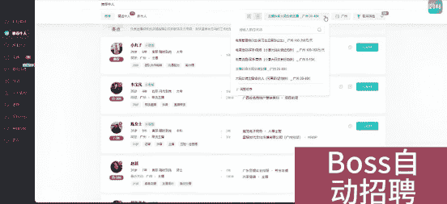
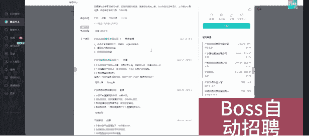
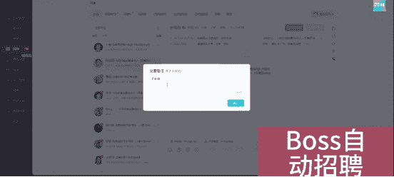
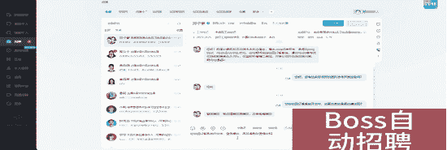
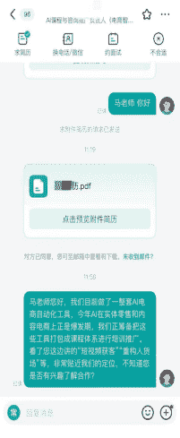
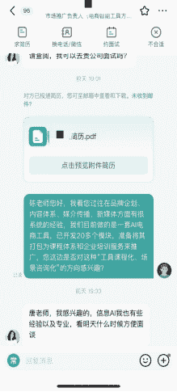
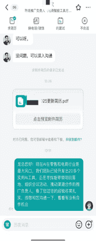

# 2025-07-03一文讲懂 ：我们是如何把 BOSS 直聘招聘流程自动化的 ？

> 来源：[https://xuqiwei1986.feishu.cn/docx/EYLbdJUQwouRNlxud9GceHEinkb](https://xuqiwei1986.feishu.cn/docx/EYLbdJUQwouRNlxud9GceHEinkb)

> 🔗 原文链接： h[ttps://articles.zs](https://articles.zsxq.com/id_pm7vwr80qiwo.html)xq.com/id_pm7vwr...

## **一、为啥我们要搞这套自动化？**

我们团队每天都在招人，岗位有主播、客服、运营、剪辑、助理……

**用的最多的就是 BOSS 直**聘，确实是目前市面上 人最多、效率最高的平台之一 。

但说句大实话： **用得多了之后，也越来越累了。**

### 01. 翻简历像扫地雷，一不小心就炸一天

我们要找的不是“有经验”，而是“能用、靠谱、匹配的”。

但 BOSS 推荐的简历里，80% 都是“差不多但不合适”的：

有的经验对口，但一看稳定性堪忧，半年换三份；

有的学历漂亮，一问想要远程，不来公司；

有的岗位写着“客服”，但干的是销售转过来的，完全不懂流程。

我们只能一张张点、一行行看， **几十页简历翻下来，人已经麻了 **，而且稍微一走神就容易错过好苗子。

### 02. 招呼语发到后面，自己都觉得像机器人

你知道 BOSS 的节奏有多快吗？

你一犹豫，对方就被别家加走了。

所以一开始我们是批量打招呼，系统模板点一点就发。

但结果是：

求职者觉得“像机器人”，没诚意，直接不理你；

或者你招主播，发了运营岗位的话术，对方回一句“你搞错了吧？

我们后来只能手动一个个写，但问题又来了——

有时候是凌晨，有时候是通勤路上，有时候刚聊完一个又弹出五个，

一天下来，光打招呼都能花两小时，还要担心说错话。

### 03. 聊天不能走心，但一走心就没时间

我们不是不想认真聊，但 BOSS 上的聊天是“低回报高投入”。

你一条条语音讲清楚，对方回你“好的”两个字。

你问完三轮，对方才说“其实我在老家不方便来上班”。

或者直接已读不回……

久而久之，HR的内耗太严重，甚至出现“反向选人”——

不想聊不爱回的直接跳过，但有时偏偏那些人又是最合适的。

### 04. 重复聊、重复筛、重复标注，感觉人变工具了

有几个特别烦人的场景你可能也遇到过：

你昨天聊过的求职者，今天系统又推荐给你；

你刚标记过“不合适”，结果又跳出来，还得点一次；

同样的话你今天说10遍，明天又说10遍，完全像在复读。

我们不是HR，是“招人客服”，每天在重复劳动中消耗意志。

### 05. 插件不靠谱，外包不划算，工具没一个真懂人的

我们试过各种办法：

Ø 第三方插件：有时候不兼容新版页面，有时候识别错按钮，几次之后直接弃用；

Ø 招聘外包：开价高，周期慢，很多只是代聊代发，并不真的懂你岗位要求；

Ø 低价工具：只能批量发消息，像客服系统一样机械，聊起来毫无情感温度。

你交给他们的，不是“智能招聘”，是“批量骚扰”。

### 所以我们决定：不靠别人了，自己搞！

我们发现，其实整个招聘流程里， 80% 的工作是重复的，只有 20% 需要判断和情感交流。

那这80%能不能全部自动？

还能不能聊得更像一个“真人HR”？

我们就干了这事儿，用的是：

**RPA：**

Ø **自动化操作，模拟人手流程**

Ø **智能体：流程逻辑判断器**

Ø 大模型：理解聊天语义、帮你判断人选、生成回复话术

## **结果是：**

我们现在做到：

自动翻简历、自动判断、自动打招呼、自动聊天；

有感情、有分寸、能多轮理解；

** 聊得比H**R还像HR，最关键—— 从不喊累！

如果你也在用BOSS招人，也遇到类似痛点，

接下来我给你拆解我们这套自动化流程是怎么做出来的

## **二、我们是怎么做的？（附图解）**

我们这套系统，讲白了就是一件事：

**把 HR 手上那些重复且耗时的活儿，全**部交给 AI 来做，而且做得比人还走心。

整套流程只有三句话：

会筛人、能判断、自动聊！

听起来简单，但背后是我们用三种技术拼起来的：

Ø **RPA **：像“机械手”一样去网页上自动点、自动翻页

Ø **智能体 **：像“助理”一样控制流程走向、判断状态

Ø **大模型 **：像“超能HR”一样看懂简历、理解对话、生成话术

下面我来拆每一步

### ✅ 步骤一：自动打开 BOSS + 设置筛选条件

**系统做的事情：**

自动打开 BOSS 登录页

自动输入岗位关键词、城市、学历、经验要求

自动点击搜索，不需要人手干预

### ✅ 步骤二：自动下滑 + 提取简历信息

**系统做的事情：**

自动向下滚动页面（模拟人眼扫页）

实时提取页面上的简历卡片内容（姓名、岗位、期望薪资、工作经验等）

结构化整理并上传到大模型判断模块

### ✅ 步骤三：大模型自动判断“是否合适”

**系统做的事情：**

把简历文本传给大模型

根据我们自己设定的岗位标准（可自定义）判断匹配度

匹配高 → 自动打招呼

匹配低 → 自动点击“不合适”，防止反复骚扰

### ✅ 步骤四：候选人回复 → 大模型接力聊天

**系统做的事情：**

候选人一回复，系统立刻抓取聊天内容

上传到大模型 → 判断当前状态

自动接话，继续聊岗位介绍、薪资待遇、工作地点等

多轮聊完后 → 自动发起“是否愿意面试”流程

### ✅ 步骤五：主播类岗位 → 转🛰️ / 发切片 / HR复审

**系统做的事情：**

判断岗位类型是否为“需人工复核”

如果是主播类岗位 → 自动通知HR加🛰️

引导候选人发直播切片、照片、简历附件等

HR再进行复审 + 面试预约

## 很多人一开始都以为，这种自动聊人的系统一定很机械。

确实，大部分人对“自动化招聘”的第一反应是：

“那不就是系统批量发消息吗？”

“聊得肯定很像机器人吧？”

“我还不如招个HR手动聊呢。”

但真相恰好相反：

我们这套系统的聊天质量， 甚至比你招的月薪一万的人还高，还稳定。

为什么？

### ✅ 1. 系统会“读懂人话”，不是机械发消息

它用的是大模型，能理解对方说的上下文、语气和真实意图，

不会出现那种“问一句答偏十里”的情况。

比如候选人说：“最近在犹豫，要不要转岗做客服。”

传统HR可能说：“我们客服岗位在招。”

但系统会自动回复：

“可以理解你这种转岗的顾虑，我们这边会安排老带新，流程也非常清晰，前期不需要你自己扛压力。”

是不是比人还贴心？

### ✅ 2. 每一句回复都不重复，像真人一样“有情绪、懂语境”

有人问薪资，它不会直接甩 JD，而是根据岗位预设语气温和地解释组成；

有人表示“有点担心不稳定”，系统会主动引导、安抚；

** 有人直接发了“忙、再**说”，系统会识别“冷场信号”，隔天自动回访， 不烦不硬聊，但始终在。

这种“带人味儿”的智能聊天，是我们长期打磨的话术库 + 大模型理解训练的成果。

### ✅ 3. 最关键：它 永远不会情绪化、不会掉链子、不会疲劳作战

不会因为连续被拒而摆烂；

不会在深夜发出“已读不回”；

不会聊天聊一半去摸鱼、请假、撂挑子；

你交给它一个岗位，它就能24小时稳定、高质量地聊下去，

就像你有一个情绪稳定、知识统一、极度耐心的超级HR在身边。

### **所以我们常说一句话：**

“不是AI太机械，而是人有时候太不稳定。”

**我们不是用AI省钱，而是用AI**做出 比月薪1万的HR还专业的体验 。

## **三、我们解决了什么难点？**

第一个难点：BOSS 平台限制太多

BOSS 页面加载是动态的，简历不是一打开就能看到，甚至有些按钮、弹窗，都是你点击之后才出现。而且 BOSS 对“非人类操作”识别特别敏感，普通爬虫几乎是秒封。

我们怎么搞定的？

我们换了个思路， **模拟人手点点点 **，用自动化点击+图像识别技术，系统“看得懂”屏幕上的字和按钮，像真人一样去操作。而且点击、停顿的节奏都是做过“人类化”优化的，平台完全看不出来是自动化操作。

**第二个难点：聊天内容太多样**

每个求职者说话方式都不一样，有人自来熟，有人惜字如金，有人直接上来问待遇……而且还有语病、错别字、半句回复。普通规则根本判断不了。

我们怎么搞定的？

我们接入了大模型，让系统能像人一样“读懂上下文”，实时判断这段聊天是积极的？模糊的？还是拒绝的？如果还不够明确，就让系统自动继续问——形成多轮对话，一步步确认对方意愿。

**第三个难点：岗位标准太复杂**

举个例子：“要1年以上经验+有独立带项目能力+沟通表达清晰”。这三条，光从一句话简历里根本没法全判断。

我们怎么搞定的？

我们把岗位要求拆成两类：

能靠系统判断的，比如是否本科、是否有某项技能

需要人工再确认的，比如“这个人沟通能力到底咋样”

系统先做第一轮筛选，把明显不符的直接剔除；剩下的，就自动标记交给 HR 再看，节省了80%的初筛时间。

第四个难点：防止重复打扰同一个人

BOSS 上很多候选人，可能你已经聊过一次，对方说“不合适”。过几天你不记得了，又重复打招呼，很尴尬也浪费时间。

我们怎么搞定的？

系统会记录每个候选人的聊天状态，**如果已经标记为**“不合适”，就自动跳过， 避免二次打扰 。而且还能打上标签，比如“之前聊过但反应不错”、“之前因时间冲突拒绝”等，未来可以再次筛查。

## 四、用了这套系统之后，我们到底节省了什么？

**这套系统上**线后，我们的招聘效率真的发生了 质的变化 ，不是“好像快了一点”，而是“从根本上变轻松了”。具体有几大块提升：

#### ✅ 1. 简历筛选时间少了 70% 以上，直接省下大把人工

以前我们一天翻 300 份简历是常态，几百页、手都要点断，脑子都麻了。

现在系统自动筛， 每天只需要人手筛选不到 100 份 ，节省时间超过 70%。

**而且不是简单粗暴地过**滤，而是按优先级、岗位匹配度排好序， 一眼看到最合适的人 。

#### ✅ 2. 回复率提升了 2～3 倍，聊一个顶以前三个

系统打招呼更精准之后， 回复率从原来的 10%-15%，提升到了 30%-40% 。

什么意思？就是原来你聊 10 个人，只有 1 个回你；现在聊 10 个，能回你 3～4 个。

特别像主播岗这种，以前冷启动很难，**现在招呼语智能变通，候选**人更愿意回话， 整个前期沟通顺畅了很多。

#### ✅ 3. 人工操作量减少一半以上，HR 不再瞎忙

我们以前每天招呼、筛人、记录意向，基本一个人能处理 30～50 人已经是极限了。

现在系统自动判断、自动打招呼、自动记录状态，HR 每天可以 轻松处理 100～150 个候选人 ，

**而且是高质量处理，不是瞎聊。**

人工节省比例粗算在 50%-60% 左右，很多重复劳动都被系统吃掉了。

####

#### ✅ 4. 重复打扰率接近 0，口碑提升不少

以前常被人骂：“昨天刚说不合适，今天你又来烦我？”

现在我们把候选人状态做了完整记录：

聊过的、不合适的自动屏蔽；

没回复的候选人，系统自动延迟打招呼；

主动拒绝的，系统永久跳过不再触达。

候选人体验变好了，品牌感也跟着提升。

#### ✅ 5. 面试预约自动化后，掉面率降低 40%

以前 HR 预约面试，要来回沟通时间、提醒、确认，候选人有时回一句“在外面，不方便说”，最后就没下文了。

现在系统自动帮你发预约信息、整理时间、提醒候选人，

**尤其是客服、运营这种岗位，面试出勤率**从原来的 50% 提升到了 80%以上。

#### ✅ 6. 主播类岗位专属流程，选人更准、成本更低

招主播最怕啥？ 看不到人、不了解风格、容易踩坑。

现在我们让系统引导候选人上传：

直播切片

形象照

口播自我介绍

HR 一看资料就知道这人靠不靠谱， 比以前一个个加🛰️再聊、再要视频的效率高了几倍，踩雷几率也大大降低。

#### ✅ 7. 从“被动等人来”变成“主动智能触达”

以前靠系统推荐，有人来聊了才算数；现在系统 主动找到匹配人选，打招呼、追进度、收反馈 ，

**我们每天新增的高质量沟通对**象增加了 2～3 倍， 招聘节奏被我们自己掌握了。

## **五、总结一句话：**

我们不是节省了一点人力，而是 把“重复、机械、低效”的那部分招聘工作彻底交给系统去做了 ，

人只需要盯住那些“值得花时间的人”。

现在 HR 更像猎头，像判断官，而不是聊天机器。

每天的时间都花在刀刃上，效率是真的翻倍。