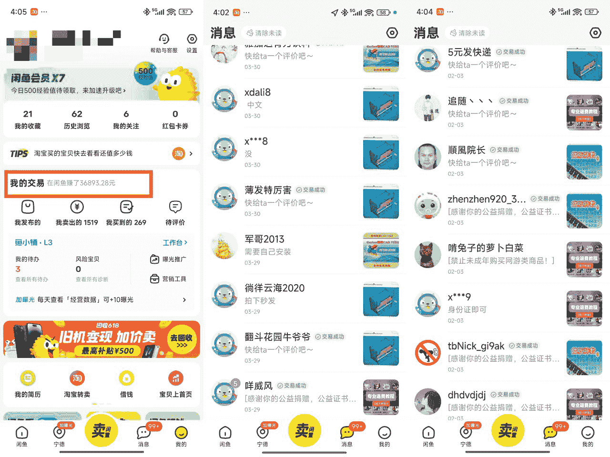
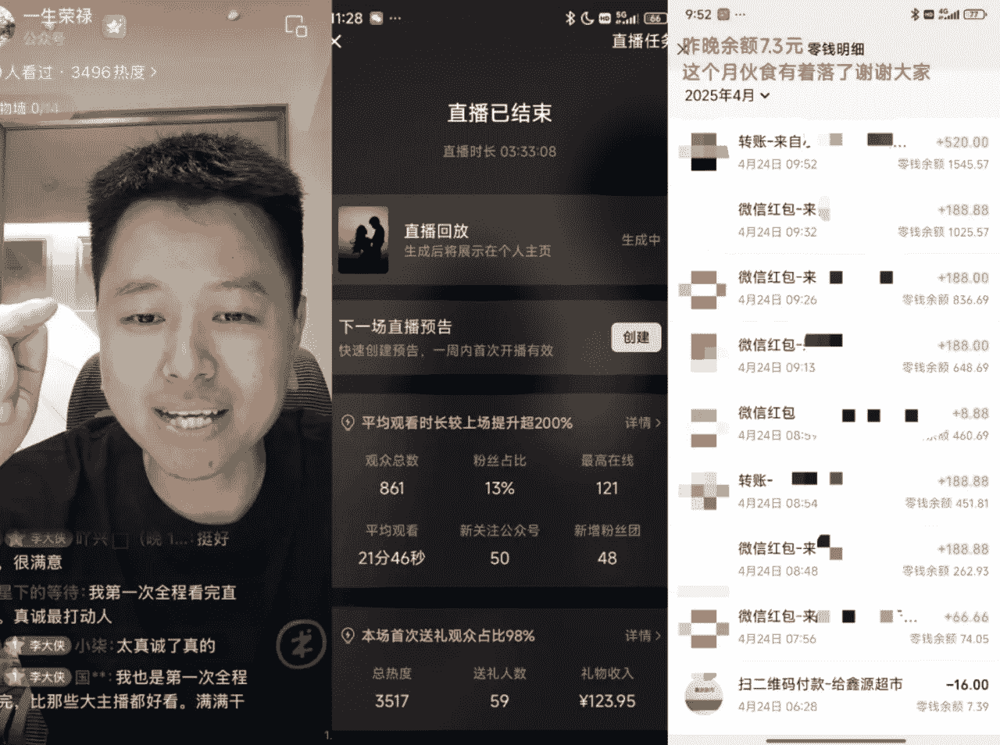
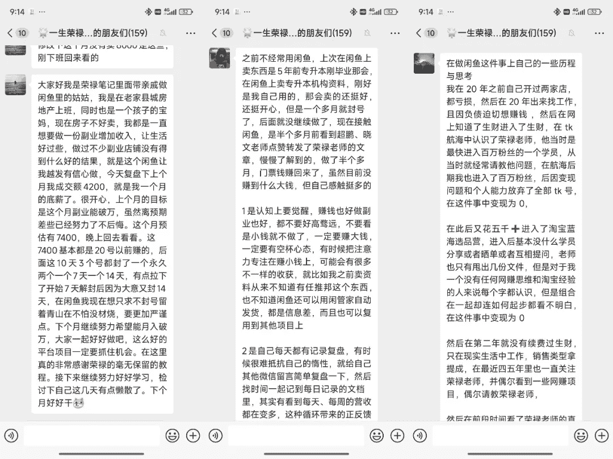
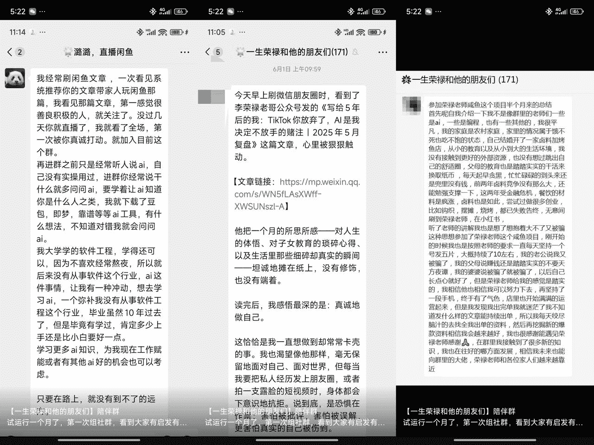
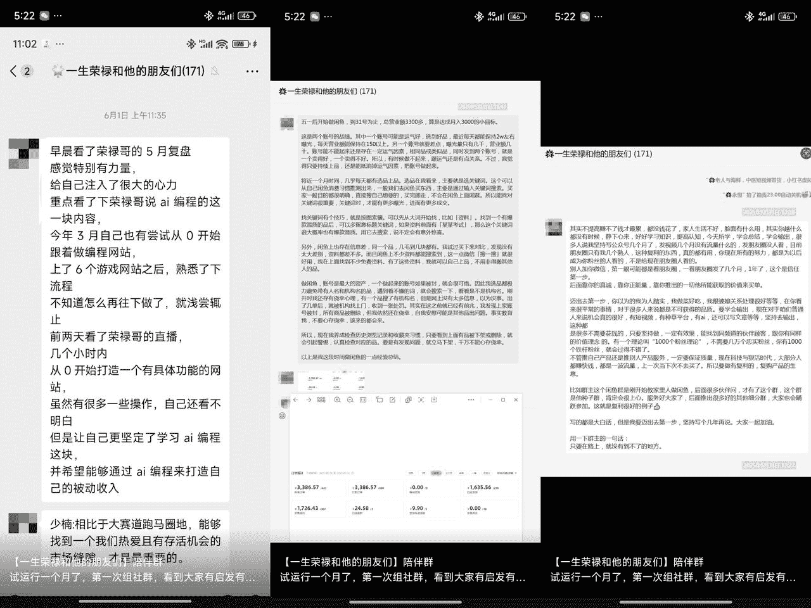
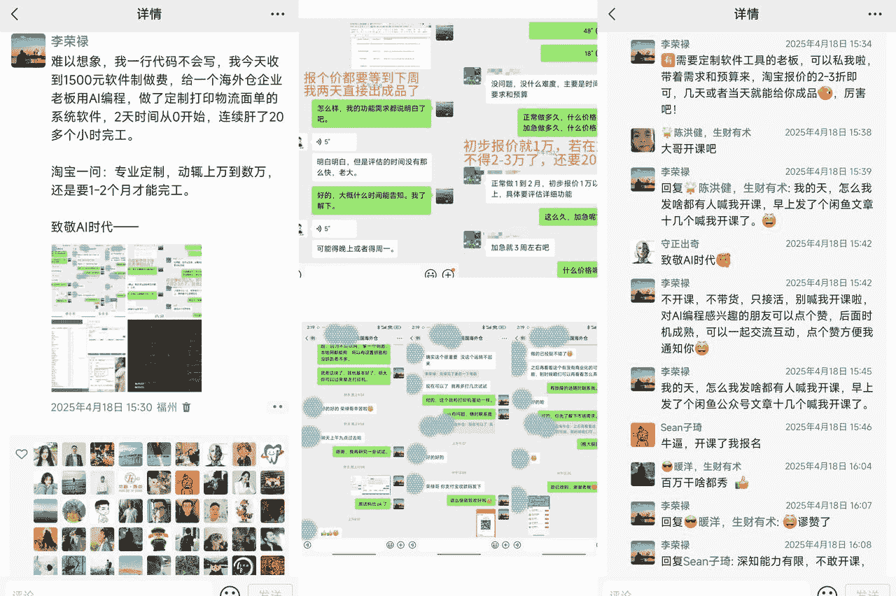
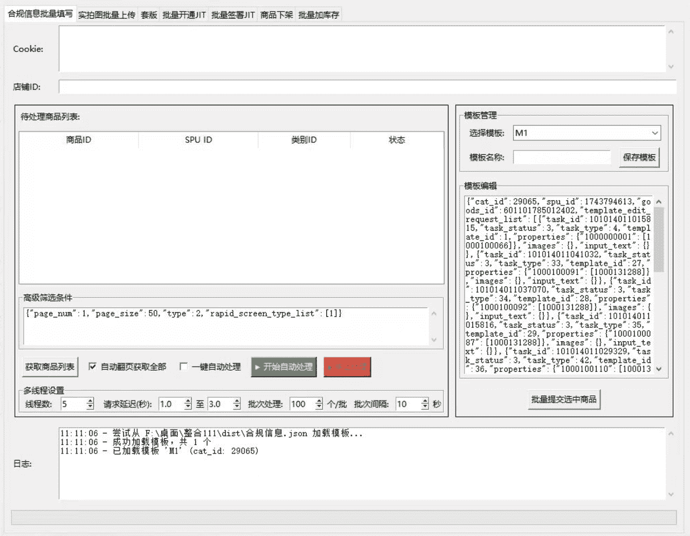
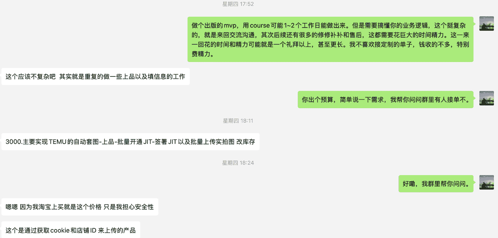
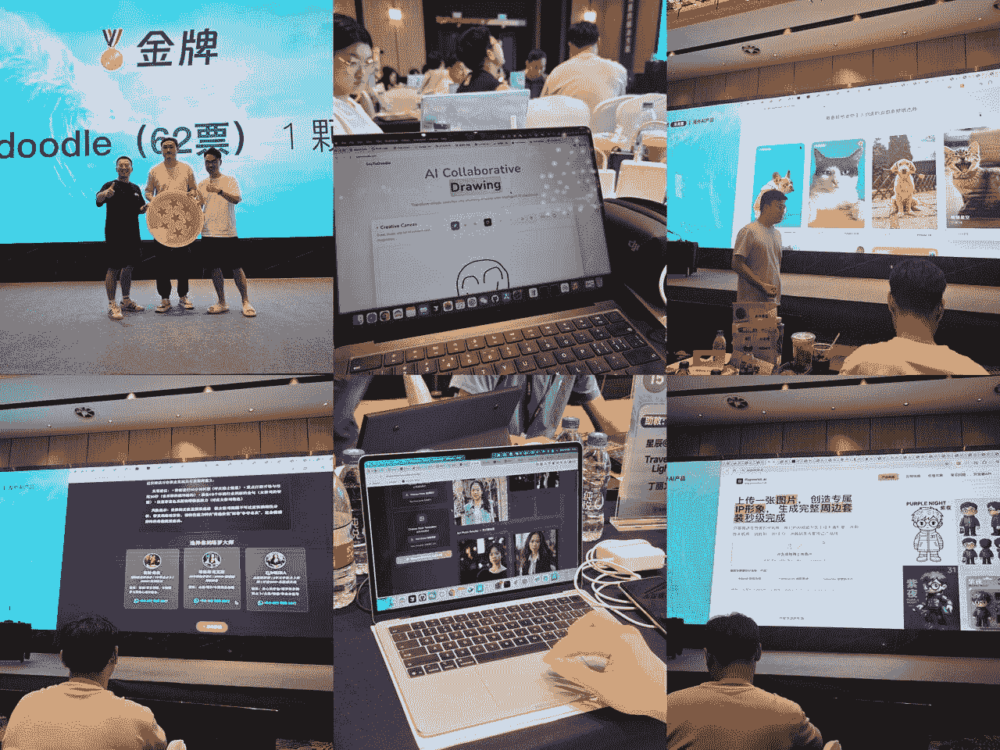
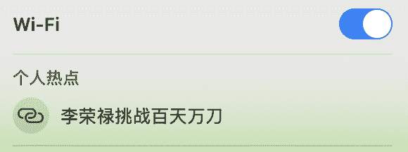

# 2025-06-25-0英语基础0编程基础，尝试挑战百天万刀，全程直播记录分享。

> 来源：[https://xuqiwei1986.feishu.cn/docx/QqH4dM73voORAHx8muLcjgIfnnh](https://xuqiwei1986.feishu.cn/docx/QqH4dM73voORAHx8muLcjgIfnnh)

> 🔗 原文链接： h[ttps://articles.zs](https://articles.zsxq.com/id_wl5z3wd42l63.html)xq.com/id_wl5z3w...

一生荣禄·从0开始赚美刀 | 第一篇

[5年前的这个时候，参加了第一](https://wx.zsxq.com/group/1824528822/topic/548488125182244)次TikTok大航海，或许是运气比较好， 13天做到了百万粉（旧文） ，荣获百万哥称号。

但随着账号限流和早期商业环境差，无法变现（其实是我能力差 + 没耐心），一个多月就草草收场，下了牌桌。

5年后的今天，同样的机会摆在我面前——AI网站工具出海。

虽然还是0英语基础，0代码基础，但这次，我决定全力以赴，不留遗憾。

中间这几年，餐饮主业在职，空闲时间探索各种航海项目，

虽然也取得了一些小结果，在18线城市贷款买了车买了房，小日子凑合过，但始终不甘心，就此平庸的度过一生。

最近这两年，公司开始走下坡路，很多动作变形，不再那么纯粹，我感觉每天都在被消耗着。

我也思考了很久，见了一些意向合伙人，但都没有找到我理想中的事业。

去年8月份，我毅然决然地裸辞了。虽然可以继续混日子，但我知道那样下去就废了。我不想这个年级就开始躺平。

我感谢龙哥盟，通过这么多年的浸泡，让我有勇气和底气对老板说不。把老板炒鱿鱼了（开个玩笑）感谢前老板的知遇之恩，有缘再会。

和大多数人一样，裸辞后我带着媳妇和3岁的女儿，自驾游了半个中国。起初是那种卸下担子的放松和愉悦感，但在旅行过程中渐渐消散了，取而代之的是麻木和无趣。

每个景点都像特种兵打卡似的走马观花。感到索然无味之后，就回程了。

在家躺平了三个月。每天就是看剧、打游戏。想做点事真的太难了，无法专注，无法执行，那种状态就像是灵魂下线，身体被某种懒惰和虚无感接管了。

我渐渐发现，人一旦陷入这种环境和氛围里，就像掉进了泥潭。哪怕只是想改变一点点，比如看一小时书，早点睡、早起去运动，都会变得极其困难。

我突然意识到，这状态比我在公司摸鱼还要糟糕。原来的底气和自信，早就不知所踪。我严重高估了自己。

我开始内耗，迷茫、挣扎、惶恐，整个人变得急躁不安。每天看着忙碌家务的媳妇，还有放学回来开心喊我“爸爸”的女儿，我的内心充满了自责、愧疚和不甘。

就我现在这个状态，我如何给她们一个更好的未来？

我找高人解答我的困惑，付费几千做了盖洛普测试，甚至打算找人算命。然而这些都没法解决真正的问题。

这个世界上，没有人能替你做决定，只有你自己。

痛定思痛，我决定从最小的事开始做起，放下不切实际的幻想，从赚到第一块钱开始赚起。

当时我的计划是：尽量少花时间，先做一个能带来持续复利、马上能上手、立刻获得反馈的事情。

先活下来，先赚到生活费，后面再慢慢确定自己的主线。

在赚钱航海项目里转了一圈，最终我决定尝试虚拟资料。它基本具备了我前面说的这些特点。

目标就是📕和闲鱼两个平台。确定好方向后，我把往期的航海手册和教练视频刷完，然后就开始动手干了。

上线链接的第三天，我在闲鱼平台赚到了裸辞之后的第一块钱（真的是一块）。

我太开心了，兴奋得不行，那种“我又可以了”的感觉，又回来了。

每天十多个小时，我都在研究选品、盯异常值，开始陆续出单。每天能赚几十到一两百。

一周后，我陆续收到了几个违规侵权的通知，心情瞬间跌到了谷底。

害怕被对方索赔，我写了几千字的道歉信，结果全部被驳回。

不过还好，系统只是下架了商品，并没有进一步处罚。

后来我才知道，是我运气好，没遇上职业维权团队来敲诈。

复盘后我第一时间就调整了策略，所有涉及人名、机构名称的课程类产品，以及有知识产权风险的商品，我一概不碰。

从那次之后，就再也没接到过投诉围观的情况了。

调整之后，我开始专注挖掘一些奇特的小众品：单价高，售后少，竞争也没那么激烈。

比如国外冷门的软件插件、工具类产品——“平射波段”、“钣金压弯”、“车床加工”、“取证工具”等。

还有国内 App 都还没上架的算命软件、古中医书籍等。

也包括一些攻略型产品，比如游戏退费教程、远程大学教育国开电大的题库，客单价一般在十几到几十块之间。

第一个月，我大概变现了差不多一万，最多的是学生考试题库出单。

后面其他小众软件也陆续开始自动成交，特别是春节正月那几天，游戏退费和算命软件每天都在出单。

晚上睡一觉，早上起来，账户多了几百块。但我一点也兴奋不起来。

虽然能赚点生活费，但我很清楚，这个项目的天花板太低，撑不起我想要的那种长期事业。

一开始我只是想给自己找点事做，不至于整天闲着，顺带赚点钱。但如果长期陷在这种“体力活+灰产边缘”模式里，不仅风险高，成长性也太差。

我已经不是互联网项目新手了，我想做点真正能积累的东西。

3月份的时候，我堂姐和弟媳问我有没有副业推荐，想在家带娃的同时赚点补贴家用。

我就推荐了闲鱼虚拟这个项目，还专门花了半天时间给她们培训。

[结果做得出](https://wx.zsxq.com/group/1824528822/topic/8852215518551182)乎我意料，很开心能够帮他们赚到生活费，我也把这个经历分享到 赚钱朋友圈

就是这段偶然的经历，让我开启了人生中的第一条口播短视频，还尝试了直播，还有第一个陪伴群。

在这个过程中我收获了非常多朋友真诚发自内心的感谢反馈。

> PS:附图只是为了说明我所经历的过程，不要找我学习闲鱼，赚钱的航海课程非常好了，我就是通过学习赚钱航海手册做的，我自己现在已经没有做这个项目了，无法提供任何服务和帮助，如果你对我这个人感兴趣，喜欢交朋友，欢迎链接。

多图预警!!!可以忽略过，继续看下面一段文章。

那一刻我才意识到，原来这些事我干得还不错，我的分享能给别人提供价值，我太喜欢干这事了，我隐约窥视到了我喜欢且擅长的事情了，我太开心了，每天都能量满满。

所以我更加的坚信，我走自媒体IP这条路是正确的。

我知道短视频是我们这一代普通人翻身最大的机会之一。农村阿姨大爷大妈都能通过短视频带货赚钱，我四肢健全，智力正常，凭啥我不行？

面子、自尊心，在生存面前一文不值，都是在阻碍我赚钱和成长的绊脚石，统统拿去喂狗！

既然决定要做自媒体IP，那就得明确方向。思来想去，我决定聚焦AI相关。

虽然大方向明确了，但具体做哪一块，我还不确定。

契机出现在4月份。有个做跨境仓的圈友，去年看了我👸号那篇《死磕两月，我学会了影刀RPA自动化机器人》，这次找到我，希望我帮他做一个海外快递单转换自动打印的自动化工具。

我听完需求的第一反应是，这东西应该做成一个打包的exe程序。影刀实现太不稳定，容易出问题。我说我不会写代码，但可以用AI编程工具试试看。

他问我怎么收费，我说我还在学习阶段，如果能做出来，你看着给就好了。

于是我打开Cursor AI编程工具，自然语言对话式编程，0英语基础，0代码基础的我，跟着航海手册，从零开始写，硬是花了2天将近30个小时把这个工具做出来了。

第三天我把软件发给他，测试了一下，没多久就转了1500元给我，感谢信任和支持，接着他又提出了一个新需求，还约我和他们合伙人吃饭，打算深入聊聊，他们企业还有很多提效类的需求。

我不知道我做的这个工具到底值多少钱。我问了几家淘宝店，他们报价基本在1-2万。我又问了赚钱的程序员圈友，他说这个需求如果用传统方式做，至少需要一个中级工程师花30-40天才能完成。

我觉得这事大有可为，我就打算往这条路走，帮企业老板们做定制化的提效工具。

我的优势是效率极高，几天就能交付，价格还可以打到骨折。与此同时，我每天拍短视频和做直播，素材和话题都有了。这样不仅能接单，还能聚集一波喜欢AI编程的人一起学习，拉个社群，单多了就丢给群里的伙伴做。

我就打算这么干了。

但在连续接了几单定制化工具之后，变现了3500元，我却决定放弃这条路。

原因很简单：效率太低了，我一份时间只能卖一次，除非对方给得够多，不然根本不划算。

我更愿意花时间打磨一个在细分领域的通用工具产品，然后在📕或者淘宝上去卖，哪怕就卖50元、100元，但可以无限次卖，或者做成订阅类型，按月按年付费，不需要我反复投入研发时间，可以持续复利，这样我的单位时间价值才能被拉高，毕竟我现在是一人单干。

想通这一点后，我把朋友圈里私信来找我做定制的全都推掉了。

前几天还有个3000元客单的需求，我估算两三天就能做出来，但我也拒了。

因为我知道，真正最耗费时间的不是写工具，而是前期的需求对齐和后期的售后。这才是最大时间黑洞。

> PS：这个预算有兴趣做的朋友，可以找鱼丸私我推荐你对接，都是赚钱圈友。

在重新梳理方向的时候，刚好小排老师的课程开始报名了。

5年前我错过了TikTok，这次我绝不再错过，我给自己足够的时间和耐心。

同时我也要大声喊出来，我要向整个宇宙发出信号，只要你足够想要，宇宙会给你回响的。

我决定挑战0英语基础、0代码基础的我，能否在100天赚到1万刀。

为此，在我的👸号上分享了一篇文章，《0基础学AI编程，100天做出海工具站，试着赚1万刀，全程公开记录》。我建了一个围观群，用来分享我的学习进度。

我知道，免费的群是没有意义的，也很难提供真正的价值，所以我设置一杯星巴克的门槛价。

感谢所有用钱投票支持我的朋友，你们都是我的贵人。群里目前有193人，谢谢你们的信任与支持，90度鞠躬。

> PS：不建议找我加入围观群，我会在赚钱星球里面持续分享我的复盘，围观群里不提供教学，甚至连答疑都没有，不是我高冷，而是我确实没时间和精力以及那个能力，如果你不是正在做这个事情，我分享的内容，可能对你毫无帮助，再次声明，不建议加入。

我选择公开在线直播学习，这既是费曼学习法，也是一种养成系IP的路径。更重要的是，它能倒逼我努力学习。如果还顺带能给大家带来一些启发和帮助，那就太棒了。

不论是否达成“百天万刀”的目标，我都会全力以赴。哪怕百天之后未达成，我也不会轻言放弃。

上周末，我去杭州参加了小排老师的线下课，有很多感触，想分享下。

一场一百多人的线下实战营，2天一夜时间，真的是太酷了！感谢所有助教老师和运营团队的辛苦付出。

虽然网络频繁出问题，但这些都不重要。哪怕断网、停电，我都不会觉得有啥大问题。因为我知道，小排老师是真有真知灼见的，超级懂得新手视角解读，他总是能把非常复杂的原理用最简单的几句话说清楚，给我一种少林寺扫里地僧的感觉。

学习本来就是自己的事，不是听了两天课程就能突然学会。听懂 ≠ 会，需要不断实操。我已经给自己足够的时间和耐心来做这件事，所以我不着急。

第一天的学习临近凌晨，还有一半人坚持在现场，有人熬到下半夜，我的床搭子牛伟哲@DieselNiu，他硬是肝到凌晨4:30。他的涂鸦作品拿了第一名，我觉得这奖就该他拿，实至名归，真心替他高兴。

还有个云南大叔圈友@钢铁的铁，57岁，也来线下课学习。这事我知道时是真的惊到了（我爸59）。向终身学习者致敬。

这两天，大家平均睡眠估计不到5小时，真的都太拼了，中午都不舍得午休，我是特地每天睡足了6小时。

我认为专注听课更重要，它能让我少走弯路，所以保持好状态，才是最高效的学习方式。

毕竟我已经不是那个能熬一整晚、第二天照样精神饱满的年纪了，每天保持最好的专注力，是我在践行的一件事。

除了学习，我还干了些别的事。

我利用空闲时间，去其他小组走访，几乎和80%的圈友打过招呼，了解过一半以上学员的产品构思，和他们探讨交流。

我觉得这是这次线下营里，除了学习以外我最大的收获。

未来年入百万刀的大佬，一定会从这群人之中诞生。

链接、交流、分享，这些事我本来并不擅长。以前我很内向，几乎不会主动跟陌生人说话。但在龙哥盟这个氛围里，我显得格外活跃，感觉就像回家一样。

线下一个个鲜活的面孔，真的很可爱。一群人一件事，一见面就有话题聊。

“兄弟，我是李荣禄，认识下，都做了什么MVP？”

“你是怎么发现这个需求的？，真厉害！”

“我做了这些MVP，我是怎么洞察的……”

真的，有聊不完的话题。如果不是时间关系，我真想跟每个朋友都深聊一遍。

我也特别期待下一次线下聚会。能再次相遇的，那时大家肯定都是有结果的了。

这也是我在践行“反脆弱思维模型”里的“弱关系”

看似只是一次聊天、一次打招呼，可能就是某一天命运拐点的伏笔。

感谢龙哥盟，把我们一群有理想有抱负的人连了起来，未来可期。

我还发现一个现象，绝大多数朋友都有代码经验或大厂产品经理背景。而我，除了没经验，英语还0基础，哈哈哈哈。上学时偷的懒，现在要用千百倍代价来偿还。

由于网络不好，大部分圈友都使用热点，我的热点名称是【李荣禄挑战百天万刀】

小排老师的网络也时不时卡顿，我的热点名出现在了大屏幕一不小心就“出戏”了。

也正是因此，龙哥哥注意到了我。课间他叫住我，聊了半个小时。

他说：“三个月确实难，但不要放弃。再给自己三个月，一定能成。”

他说得斩钉截铁：“这个方向没错，百分之百能出结果。”

不仅是对我说的，他还在台上，当着所有人说了一句；

“李荣禄一定能成！”

我相信只要大家能够在这个事情上坚持一年，就一定都能成。

那一刻，我被击中了。

眼眶湿润，我感受到有一股无形的信念，穿透了我所有的怀疑、胆怯与不安。

那一刻，我就确信了：

不管多难，我一定可以，也必须可以。

无论是100天，200天，还是365天，我一定能做到。

谢谢你，龙哥哥。

他还对我说：“来赚钱SCAI实验室吧，这里能让你少走很多弯路，加快进度。”

那一刻，我脑中闪过了很多念头。

我一直向往这样的一个组织——利他、真诚、互帮互助，一群人只为一件事而拼尽全力。

龙哥盟SCAI实验室，就是那种地方。

但我有家庭，有妻儿。家庭是我最重要、必须守护的东西，没有之一。

其实之前，我就动过很多次念头想报名。每次最后都因为家里的顾虑而打住。

但这一次，不一样了！

随着我不断向世界发声呐喊，世界也开始回应我，我遇到的贵人越来越多。

我开始相信，我有解法了。

我和媳妇认真沟通过后，我们做出了决定：下个月初，家里准备妥当，我就去SCAI实验室。

如果一切顺利，2026年春天，我们的宝贝就能在赚钱办公室附近的幼儿园上学。未来，我们会全家搬去杭州。

那天晚上，聊完之后媳妇整整哭了一夜。

第二天她回复我：“我相信你一定可以，我支持你去。”

我知道，她能说出这句话，需要多大的勇气。

我们在一起十多年，从来没分开过这么远。没有父母帮忙带娃，她要独自扛下家里的一切。

她害怕晚上一个人睡，害怕孩子半夜生病不知所措，现在我在福州，一个电话40分钟能到家，到了杭州，就需要大半天以上了。

更害怕两个人异地久了，感情是不是会慢慢变淡。

她有太多害怕。可她还是选择了支持。

我知道，有些选择注定不轻松，但我更怕的是，不选，会后悔一辈子。

我愿尽全力，换我们少一点遗憾。

我最近很多决策和想法，都来自龙哥哥推荐的——《王川的思维模型》。

龙哥哥说过人与人之间最大的差距就是认知差，认知不一样，做的选择就不一样。

就拿决定去杭州这件事来说：最坏的情况，就是我花3-6个月时间、几千块房租、可能失败。

但好的情况呢，上限是无限高，有无限可能。

瓦尔纳说过，人生最重要的三件事：你在哪里，和谁在一起，做什么事，这也是我一直在践行的。

从年初搬离家中和晓文搭伙办公，到现在决定去杭州SCAI实验室，我一步步在给人生换赛道。

我知道，以我的基础，这条路并不轻松。但不试试，怎么知道自己不行？

**现在的我，也许还不够强，但**我相信—— 未来的我，一定行，一定行！

选择永远大于努力。方向对了，努力才有意义。

我对未来充满信心，我有足够的时间和耐心，来认真做好这件事。我喜欢分享，也享受做产品的过程。

如果这个过程还能为别人带去一点价值，再顺带赚点钱，那就是我最大的幸运。

接下来，我会持续更新这一整个系列的文章，记录像我这样毫无基础的人，如何通过AI编程，一步步拿到结果。

我会阶段性地分享我的收获、踩坑、成长，以及技能和感悟，毫无保留地写出来。

希望这些内容，能帮到一些处在相似处境的朋友，给你们带去一点方向和信心。

感谢一路上遇到的所有贵人们，感谢龙哥盟，谢谢大家，同时也谢谢看到这儿的你。

分享我就来真的，越分享，越幸运！

我是一生荣禄，人称百万哥。

好几年没写帖子了，这次我回来了。

**如果我的分享对你有启发，感谢点赞**❤留言，给我一些反馈，谢谢你，我的贵人。