# 《真人出镜却不露脸！我靠“AI换头术”克隆100个口播IP的骚操作》

> 来源：[https://xuqiwei1986.feishu.cn/docx/FrTHdppfQoV532xVta5cfswkngd](https://xuqiwei1986.feishu.cn/docx/FrTHdppfQoV532xVta5cfswkngd)

# 我的口播辛酸史

> “上次真人出镜拍口播：

> 第1秒：假笑僵硬成面瘫😑

> 第3秒：忘词尬场成猪肝🐖

> 第5秒：网友神评通缉犯’🚨”

圈友们，估计你们跟我境况也差不太多😁我把实操中可能遇到的情况罗列出来，你们对号入座，让我心里也平衡一下，gagaga~

# 请对号入座：

## ①镜头恐惧与表现力不足

面对镜头时表情僵硬、语言卡顿，缺乏自然交流感

## ②肢体语言与表情管理失调

动作僵硬或过度夸张破坏内容可信度，表情与情绪脱节（如讲解严肃话题时微笑）

## ③文案同质化与获得感缺失

保险、情感、教育、知识类赛道大量抄袭文案，导致内容雷同；粉丝因缺乏“信息增量”或情感共鸣而流失

## ④垂直度与泛化矛盾

盲目追求热点导致内容分散（如今天讲保险明天拍育儿），粉丝无法对你形成认知标签

## ⑤人设真实性 vs 专业化

过度包装“专家”形象易被质疑，而过于随意又削弱信任感

## ⑥拍摄硬件短板

手机拍摄光线不足（脸部阴影）、背景嘈杂、镜头抖动

> 给你们扎心也扎够了，接下来我们一起研究新玩法，带着大家（白）嫖~ 咳咳~ AI ▶️

# 精准偷懒指南：

## **专治 “不想露脸又想装真人”**

## 找目标形象四要素

可劲儿刷抖音/小红书/快手/视频号，随便你怎么刷，只要找到你的对标账号就可以。至于怎么找，那就随意发挥吧！（老板，眼睛酸了算工伤吗？👀）

不过我可以给你几点筛选参考：

### ❶竖版9：16，更适合做口播IP（ 横屏党直接抬走 ）

### ❷画面比钱包还干净，视频无杂乱元素（ 无字幕/贴纸/画中画 ）

### ❸尽可能选择室内背景或可循环背景（比如水面等）

### ❹人物肢体动作幅度小，尤其不可遮挡脸部

## 获取目标主播的人脸

### STEP 1  扒视频

除视频号以外的平台都可以用常见的工具下载，这里我把自己用的分享出来（品牌商记得打米哈~）

皮皮：

> #小程序://去水印/YOlyjHnfTyEC5Ug

轻抖：

> #小程序://去水印/QjCrKiqwLjopajG

复制上面的小程序链接，发到微信里，然后直接点击就可以了。

### STEP 2  截人脸

截图主要是用于为后面换脸做视频准备的，截图质量越好，后面的视频效果越逼真。这个建议使用电脑来操作，找到视频中呈现效果最好的一帧暂停，用播放软件自带的截图功能完整截屏，效果嘎嘎棒~

啥？要我用的？😂 等我掏掏兜哈~

【potplayer】

https://potplayer.tv/?lang=zh_CN

【软件截屏方法】

这个涉及到快捷键冲突，没办法截图展示，所有给大家文字说明吧

> 打卡potplayer软件→播放视频→找到合适的画面暂停→鼠标右键→视频→视频截取→截取当前源画面为...

（这种截图方法效果最好，最精准，个人推荐）

## 生成场景和造型

看到这儿的估计都是不想露脸或者不方便露脸等各种原因，但是又想“真人出镜”的。那这一步就肯关键了，因为它的结果，代表着网络上你的美丑😁

这里我把自己用的方法给大家分享出来哈，因为我也不方便露脸🤣；

啥？因为丑？

🤬你￥%&@#￥&！……（此处鄙视你一万字）

**文生图邪术：**

### ❶文生图（基础版）

自己去搞一段提示词，性别看你需求，背景和服装都随意，主要看脸（这是个靠颜值的社会~）

对了，这里用即梦AI哈，效果和稳定性相对比其它国内工具好一些。国外的就不推荐了，不然总是绕不开科学上网的话题，而且你追求的又不是设计，不需要搞那么复杂。国内的工具完全能满足你。

哈？欲求不满？

哥屋恩~ （这是不收费能说的吗？🫢）

😭无限抽卡中......

### ❷文生图（高级版）

先去各种图片平台或者AI工具的创作灵感里面找到你喜欢的人物图片（一般在写实/摄影等类目里）。

重点：专挑生活照！拒绝网红假脸（用户又不瞎👀）

可以截图，可以下载，尽可能的找高清图片，尤其是脸部不能模糊。

然后把图片喂给元宝，让它反推图片提示词。这里不需要联网，只打开深度思考即可。

务必给出明确限定条件，因为AI会区分简单模仿/普通复刻/完全复刻。给出的提示词颗粒度是完全不一样的。

还有就是要求中文，因为英文提示词即梦AI写不下😎

【提示词】

> 给出能完全复刻这张图的提示词，全中文，适用于即梦AI

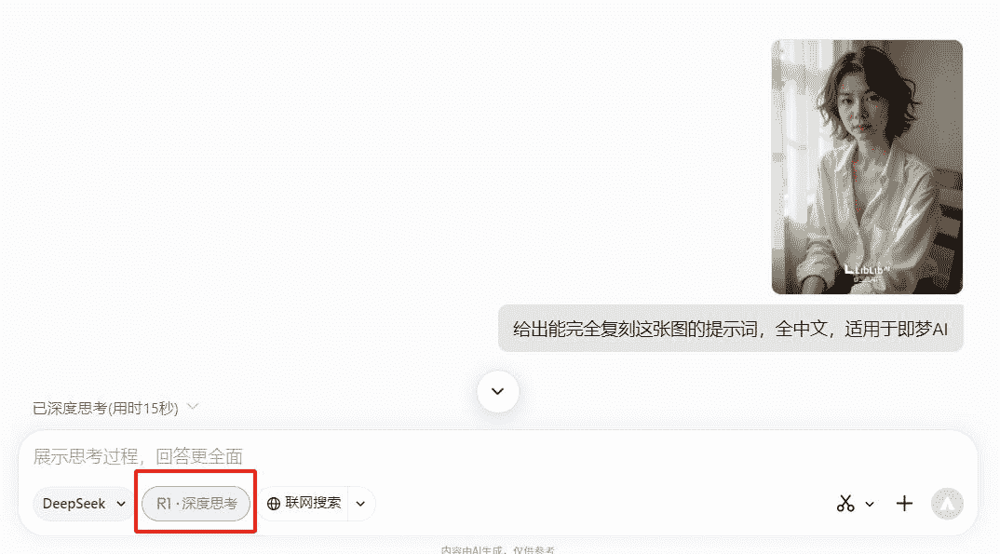

## 改头换面骚操作（免费积分买张新脸）

接下来好玩的来了，换脸！

这里我们用LibLib，因为效果好，稳定！（其实是可以薅羊毛🤡）

> https://www.liblib.art/modelinfo/1a810b7458db43159888b07393b2dc2a?from=personal_page&versionUuid=fafdf673f06949909fdacb70b018e88e

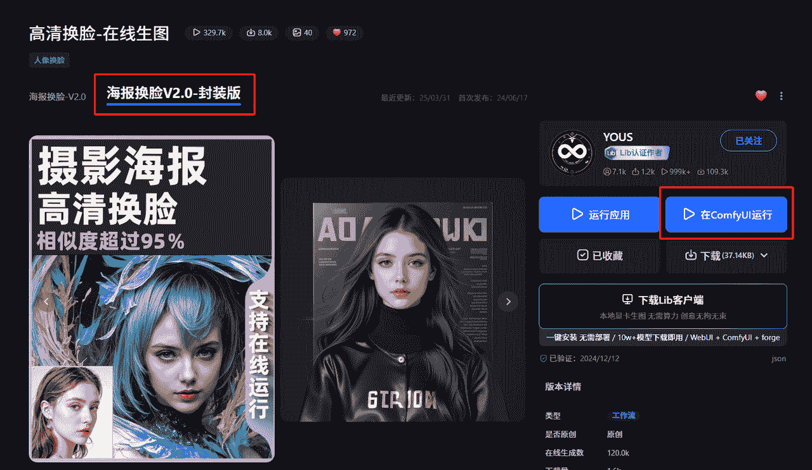

①看到这里没，换一张脸才10积分，系统赠送的都够用好多次了😎

②这是你想要的脸（听着怎么这么别扭呢...），就是你想替换成哪张脸。滑动鼠标滚轮放大就能看到上传按钮了。

③这里放之前在视频里截下来的那张图，就是要把这张图里的人脸换掉。

④这块儿是最终展示区，具体效果可以放大观看。（备着点你媳妇和同事哈🫢）

LibLib骚操作步骤：

### ❶ 上传想换的脸（你生成的帅哥/美女）

这个地方，也可以上传自己的高清照片

### ❷ 上传对标主播原图（截图的倒霉主播）

### ❸ 点击生成→右键保存（效果见图）

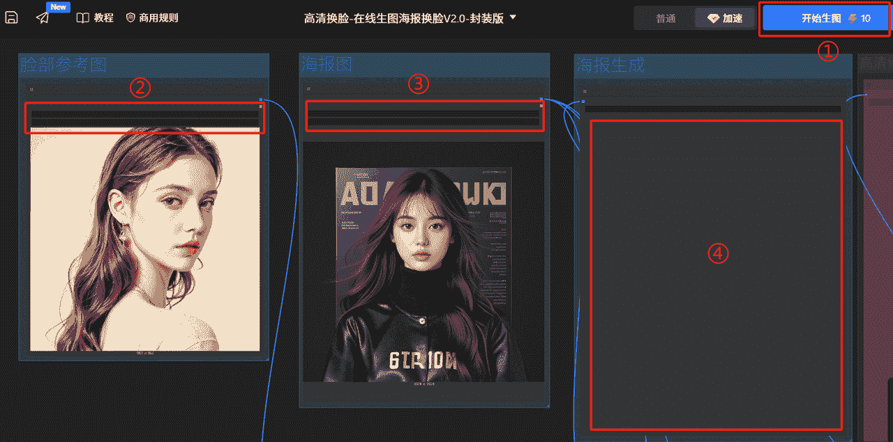

【来吧，展示】

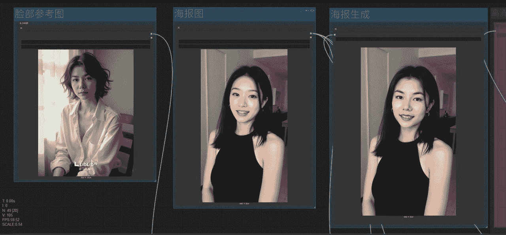

最后就是把鼠标移动到最终生成的图片上，点击右键，就会出现【保存图像】按钮。

## 生成合成主播的视频片段

即梦AI生成视频公式：

### ❶【视频生成】

### ❷【图片生视频】

### ❸【填写提示词】

### ❹选【视频3.0】模型

### ❺勾【5s】（如果钱多，冲过 vip 可以多勾10s）

提示词：这里你可以参考我的一句话模板，也可以自由发挥；

视频模型：一定要选【视频3.0】，这是经过我实际测试，效果最自然逼真的；

生成时长：🤗这里是一个薅羊毛的地方，生成5s的视频便宜一半的积分呢，可以多抽几次卡，一般情况下1次就搞定，偶尔会需要2次。这样省下来的积分就可以多搞几个不同背景的视频啦。

至于视频怎么用，这个简单，放到剪映里，同一个视频多放几次，每间隔一个视频就把播放顺序调整为倒放，这样就可以制作一个N多秒的视频啦😝（现在知道为啥前面要固定或者可循环的背景了吧）

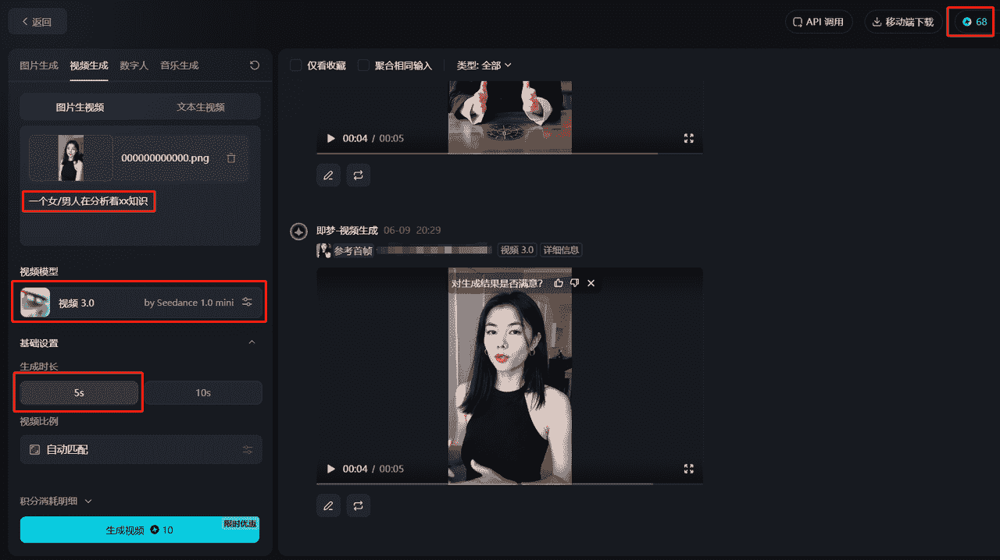

【来吧，展示】

[111111111.mp4](https://internal-api-drive-stream.feishu.cn/space/api/box/stream/download/all/SwbSbyzkEoUBvox9Pfic4Y7jnIb)

## 克隆声音指南

到这里整个视频模板算是搞完了，可是...

它没声音，哈哈哈~

咋滴？你想让它给你比划手语？

也不是不行，最近抖音已经有一部分人在用这种方式起号了，而且效果还不错，如果需要的人多，我在看点赞数量决定是否拆解出SOP😙

言归正传，提取声音当然是只要mp3格式的音频，去哪里找呢？找什么样子的呢？

是的，你想不出来😁

想不出来那就问AI嘛~

### ❶ 打开元宝输入换脸图→让它推荐匹配声音

还记得元宝反推图片提示词吗？

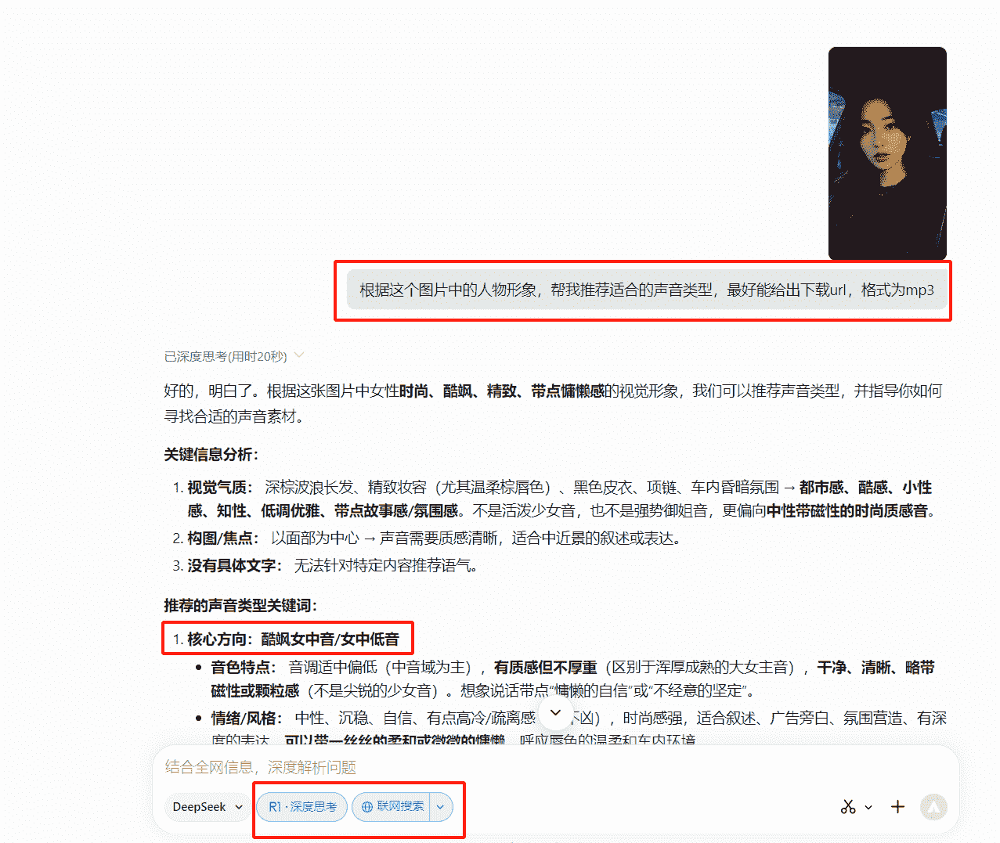

对，有问题找AI，免得浪费自己那为数不多的脑细胞，还有头发🙃

把图片给它，并带上提示词，它就会给你跟图片匹配的声音推荐，这里记得打开【联网搜索】，万一有可以免费使用的音频那就赚到了。

### ❷ 扒对标视频

给出的结果中，只看【核心方向】就可以了，按照它给出的结果去抖音或者小红书找符合的视频，然后下载（这里不需要去水印）

### ❸ 人声分离术：

视频下载完成以后，安装这个版本的剪映（又在教你们薅羊毛了🤤）这个版本用会员素材和功能不收费

切记：不要更新，也不需要登录（当然你非要登录也可以）

> 通过网盘分享的文件：剪映6.0.1版本免激活.zip

> 链接: https://pan.baidu.com/s/1w24klBdMvsdu_Vx9DmkYNA?pwd=dh9m 提取码: dh9m

（别问！问就是白嫖到底🤫）

#### ①打开剪映，把挑选好的声音视频放进去，选中当前视频轨道上的视频，鼠标右键点击，选择【分离音频】；

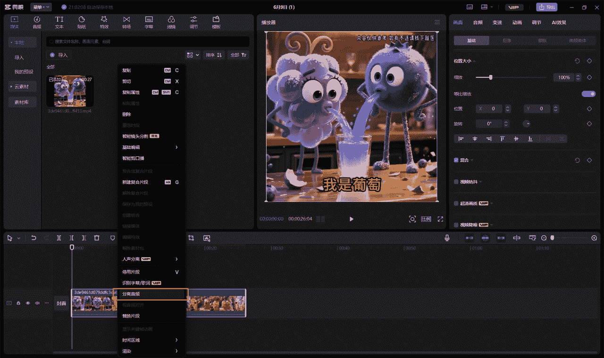

#### ②然后选中音频轨道中的音频，鼠标右键点击，选择【人声分离】→【仅保留人声】

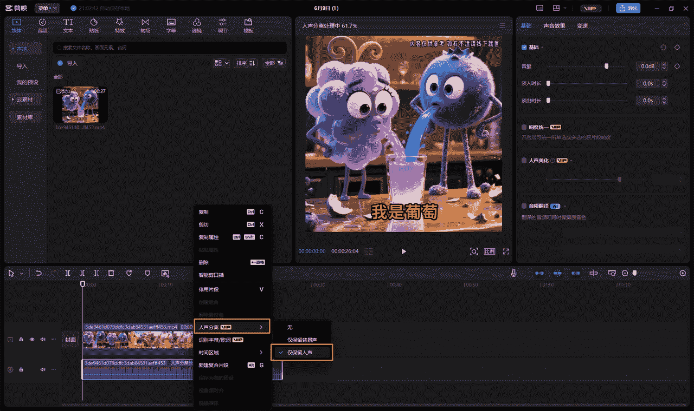

#### ③最后导出音频，按照图中选择即可，因为只需要音频mp3。

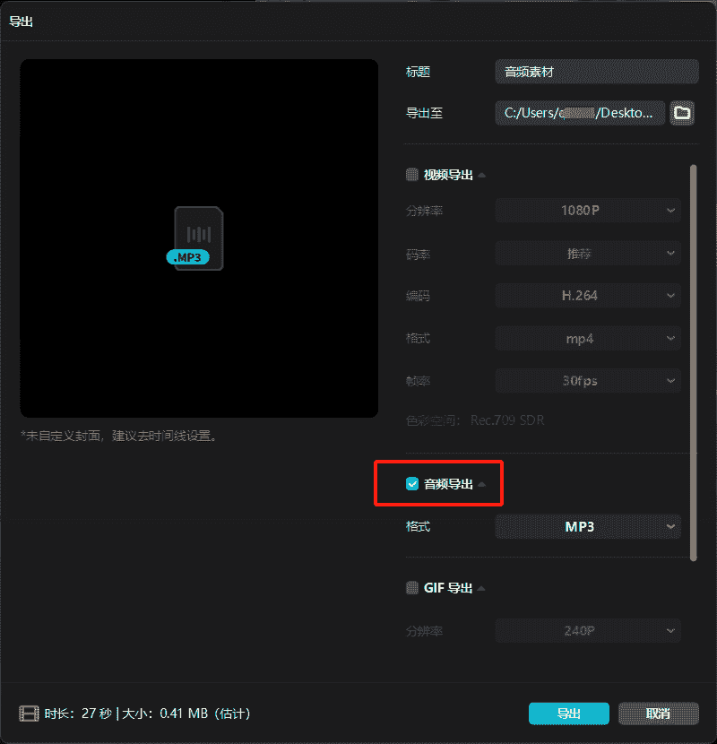

## 音视频模板克隆

到这里我们已经准备好了音视频模板素材，那么后面就要正式使用啦！

这里没什么可讲的，我就直接上传克隆（脱敏展示）

### 【音频模板】

上传克隆的音频，生成音频模板之后，点击确认

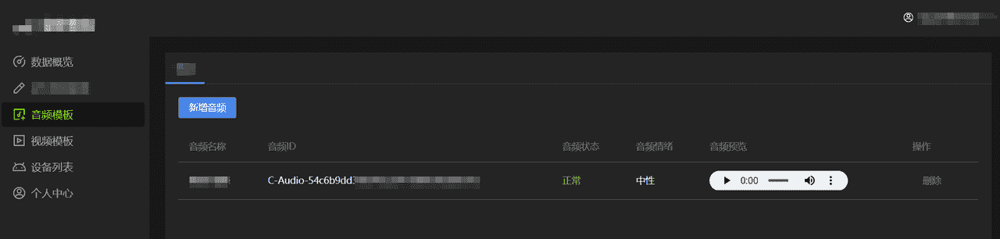

### 【视频模板】

上传生成的视频片段，生成视频模版之后，点击确认

为了防止最终生成的视频片段重复度过高（主页全长一个样），可以上传 2-3 个事先准备好的视频模板，不同场景不同妆造的

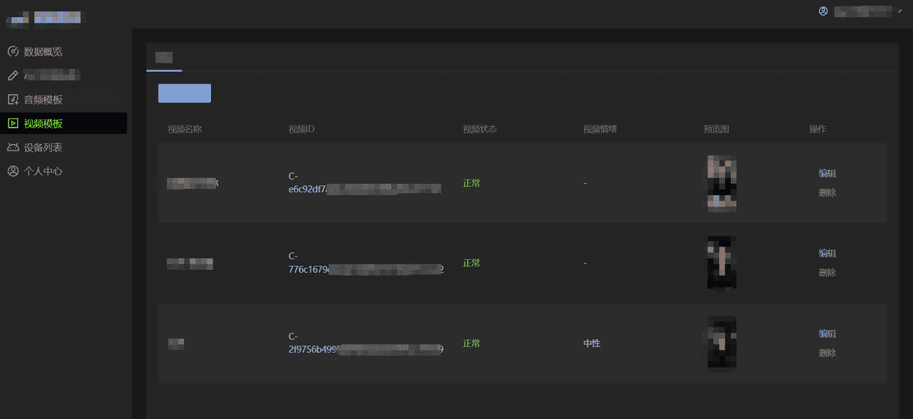

## 口播视频全自动流水线

### 流水线开机（开工喽~）

### ❶ 选择任务类型

① 关键词养猪：投喂细分赛道词→自动追热点

​② 自定义投食：Excel批量灌文案（老司机专属）

​③链接寄生：蹭热点视频变原创

​④对标克隆：监控竞品账号→自动同步发布（懒人首选！）

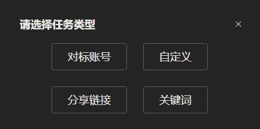

### ​❷填对标博主主页URL → 自动扒新视频

我以【对标账号】方式举例，填写好基础信息和对标账号的url以后点击【下一步】

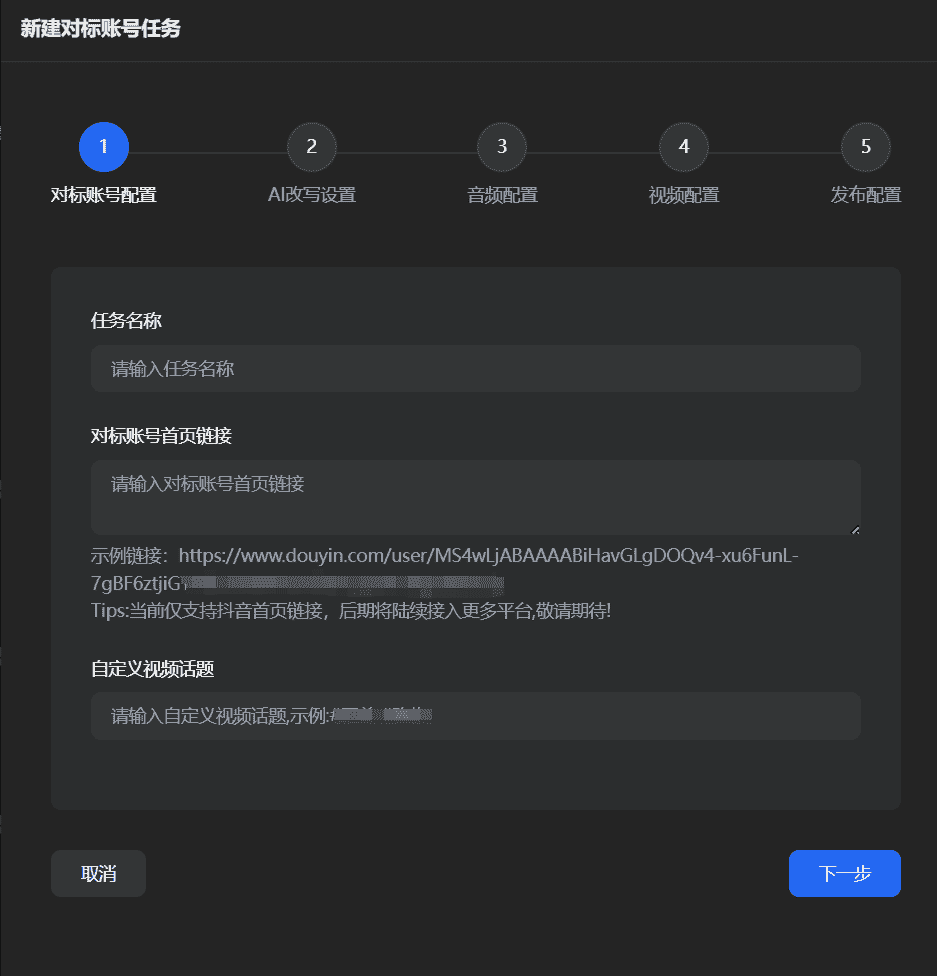

### ❸AI改写口播稿

这种类型的任务会根据博主主页URL定时自动监控每日更新的视频，然后解析视频口播稿，AI大模型会根据提示词进行原创改写。如果自己有更好的提示词都可以替换掉。一般口播语速为300字/分钟左右，这个也是控制最后视频时长的地方。

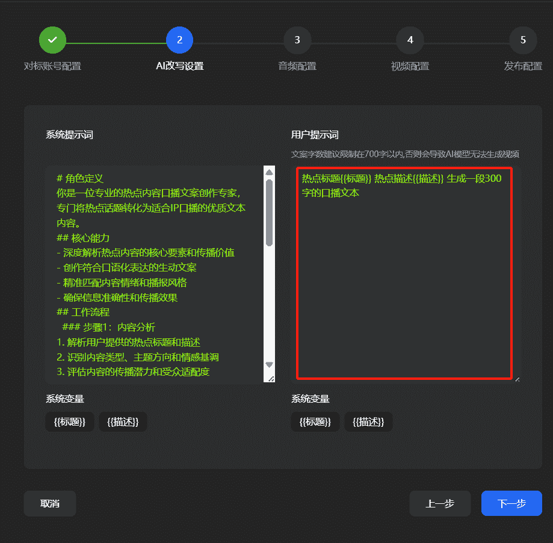

### ❹绑定克隆音频

选择你想使用的数字人音频素材

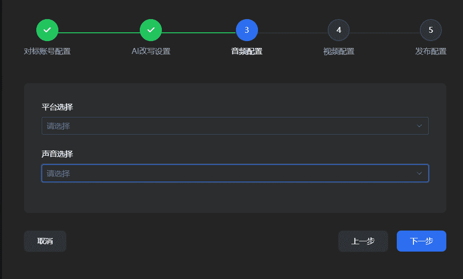

### ❺绑定克隆视频

选择你想使用的数字人视频素材

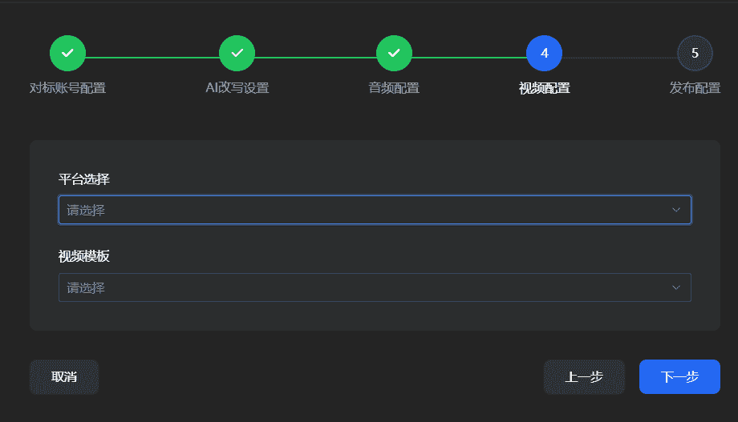

### ❻勾选【包装+自动发布】

发布配置里设定好是否需要【包装】和【自动发布】。需要哪个就勾选哪个，会自动弹出配置参数，按照自己的需求设定即可。

包装工具：开拍

发布工具：安卓手机

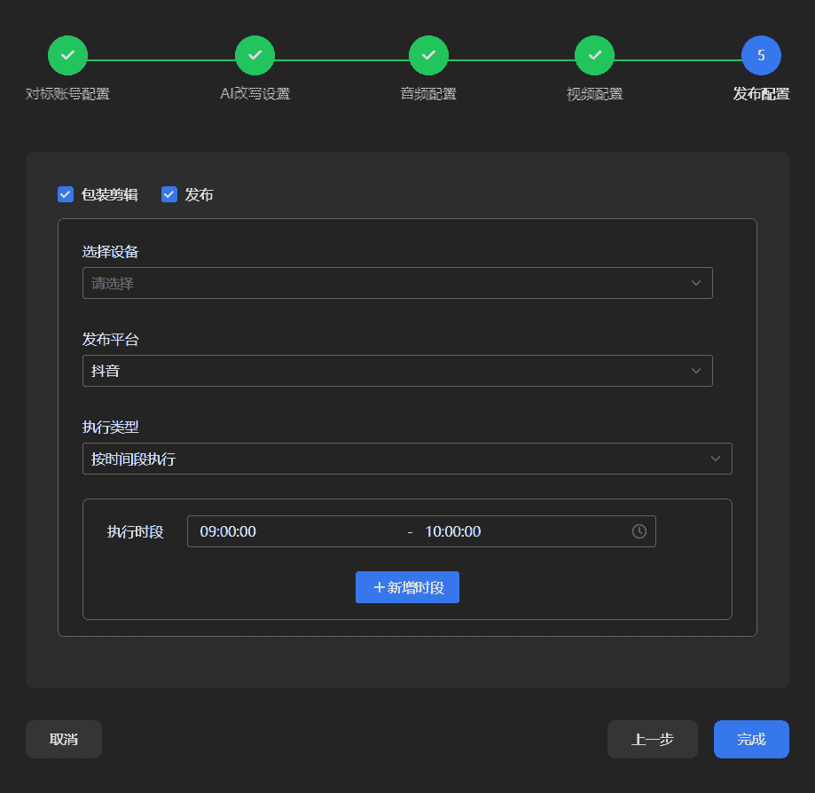

### ★★★★★终极奥义★★★★★

> 设置一次管半年，连手机充电都省了🔋

到这里所有干货就给大家和盘托出了，特别感谢@阿甜夫妇 的航海家内部直播给了灵感，能让我最快1小时起就能架设一个口播IP账号的全自动化运行流水线，自此彻底解放双手~

最后给大家简单看一下部分反馈数据。

## 部分数据展示

