# 婚嫁行业如何在抖音，做好一场大场直播 GMV几十万+————抖音大场直播模型

> 来源：[https://xuqiwei1986.feishu.cn/docx/DUWGdHWUMoGAnuxNi3tcQa59ntb](https://xuqiwei1986.feishu.cn/docx/DUWGdHWUMoGAnuxNi3tcQa59ntb)

大家好，我是雷雷，和大家分享一套抖音大场直播模型，我们婚嫁行业这套可以跑通，大部分同城类目会更简单，更容易跑通（婚嫁行业在同城类目当中对人货场整体的要求都是比较高的了），全文字数7000+，五个方面全面拆解带大家看一下，婚嫁行业如何在抖音，做好一场大场直播 GMV几十万。

一、婚嫁行业抖音直播的发现与切入

二、第一家店的0-1跑通

三、1-10的放大

四、婚嫁行业商务端、交付端系统拆解

五、衍生的相关模式与思考总结

# 一、婚嫁行业抖音直播的发现与切入

## 1、发现与切入点

[一天收入 20 万，婚纱抖音直播，实体赋能操盘手案例拆解](https://f6na8ww8kh.feishu.cn/docx/Tc0edR4BroIh40xaMmPczJUunJc?from=from_copylink)，我们是在去年年底拜访一家朋友公司发现的这个业务，当时是咨询抖音如何播艺培机构，然后无心插柳柳成荫，发现了这个类目在抖音直播，当时他们高峰期一天播7-8场，每场大概2-3w左右利润，每天利润20w左右，真实可复制。真正的机会，往往藏在你不经意看到的数据里，当时就觉得这个类目很有搞头，回来当天我们就去跑了婚纱摄影，婚纱礼服店，发现客户的接受度极高，有很强的付费意愿，当天敲定了2个意向客户，约了直播。这告诉我们：这是一个“稳赚不赔”的类目，更加坚定了这是一个很好的类目我们要切入，然后开始慢慢切入这个类目。年前还与另外做婚纱直播的朋友做了下资源置换，我们去看了一下他们的婚纱礼服直播现场，然后免费帮他们做了一场视频号直播，因为我们视频号直播还是非常专业和经验丰富的，我们视频号直播服务的客户要1000+了，下图是我们婚纱礼服视频号首播现场。

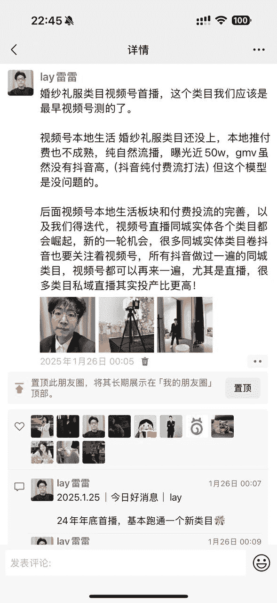

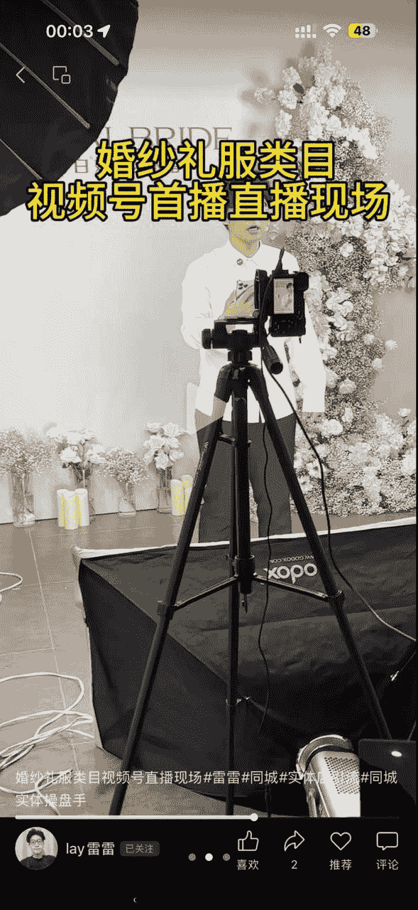

结合现在的认知补充一下为什么婚纱摄影，婚纱礼服店是一个很好的类目，这个行业具体比例不好讲，但是就我们接触过的100多家来说，10%甚至更少的店是不太盈利的，其余的90%要不然是盈利状态，要不然就是过去的盈利真的还足以支撑很久的亏损，这个行业比较特殊，利润率很高，过去风口好赚钱的时候赚的钱真的是足够多，当然我们说的是一些门面大一点的店铺，只针对的是我们的意向客户，那些几十平米的个人工作室除外，不做参考。大一点的店铺开的久一点店铺，真的都是后者这个情况，要不然还是在盈利， 要不然就是过去的盈利还可以支撑足够久的亏损。所以婚纱礼服，婚纱摄影店的老板有足够的预算，以及足够认可，付费买量，付费直播这件事情。我们来给这些老板做服务，市场空间足够大。

## 2、婚嫁行业 补充介绍

### 1）婚嫁行业（同城实体店）主要包括：婚纱礼服、婚纱摄影、婚礼堂

### 2）婚嫁产品：婚纱礼服租赁、婚纱摄影、婚礼堂租赁

### 3）婚嫁行业产品特点

整体产品高客单、高毛利：婚纱摄影、礼服单价数千到数万元，毛利非常可观；

婚嫁老板认可付费，高支付意愿：门店类型偏重中高端，90%以上盈利或持平，老板敢投入直播推广；

隶属于本地生活板块，不需要全国竞争，竞争小；

视觉驱动型产品：非常依赖画面展示效果；

消费人群为年轻女性，最具有消费能力的人群，感性消费产

**本地非标高毛利+强种草产品，是天然适配抖音直播**的赛道，是一个“低投入高回报”的金矿项目

## 3、我们提供的落地服务

### 1）服务内容

我们会有1个运营搭配2个主播到店进行直播，前期我们会先做账号搭建，包括私域🛰️ 和抖音进行预热宣传，我们运营来操盘整个活动，整个活动周期3-5天，前期准备1-3天+大场直播1-2天。 每天6-8h 。 直播大概时间段：上午11:00 -14:30、 晚上18:30-22:00。

### 2）报价

报价主要分为两种

#### （1）前置费用+直播业绩提点

#### 5000元前置费用+直播合作期间GMV80%部分的15%+差旅费实报实销

5000元 是我们 直播落地辅导的费用，直播期间GMV80%部分的15%，80%的意思是主动去掉可能退款GMV部分的20%，只收部分的15%，减轻了商家强调直播期间退款的问题。单纯提成上限20000。

#### （2）一口价

#### 15000播一场，赋能店家直播不保GMV；19800 保 10w GMV；29800 保 20w GMV

我们后面还是以一口价赋能为主，第一个交付压力小一点，商家的交付预期与我们永远会有差入。第二个，不是只是一场直播结果上的价值，从曝光，意向客资，精准粉丝关注，包括学会如何搭建直播间对商家都是一个很大的赋能。

### 3）商家可以获得的

（1）一场大场直播同城几十万到几百万的曝光

（2）直播期间的业绩几万到几十万gmv

（3）直播期间的意向客资及抖音粉丝几十到几百个

（4）完整的学习一场抖音如何进行大场直播及直播间的搭建及后续问题咨询解答，更重要的：直播不是一次生意，是一次商业能力的传递

# 二、第一家店的0-1跑通

我们当时跑通0-1以为是大概用了三场，是完全跑通，站在现在的结果来回看，第一场就基本完全跑通了。

年前我们是大概了解了下逻辑框架，大概怎么做的，年后回来我们直接开始自己准备，进行交付，交付我们年前谈好的两个客户，重新定了下我们的收费标准，前面我们以测试为主，第一场收费GMV的5%，没有任何前置费用，第二场GMV的10%，不加前置费用。第一场我们播的是婚纱摄影，当时第一场我们也没有太搞清楚，婚纱礼服和婚纱摄影的本质区别，我们前期是按照看过的礼服来准备的，然后临时做了调整，这家店是以摄影为主，礼服为辅助，加了婚纱摄影的内容，现在的角度以及第一场的结果来看，这两个类别是完全通用的，时间点，时间节奏可以算一模一样，婚纱摄影比礼服还要再复杂一点点这样。

接下来我们以第一场为例 从**五个点 人、货、场、投流、直播前私域预热来拆解一**下我们全流程的准备以及是怎么做的：现在来看第一场我们已经属于比较OK了，投流6000块，GMV7w+，泰安的一家摄影结构。

## 1、人

人分为主播和模特，主播是我们的，模特商家来准备

主播筹备，招聘过去有本地生活直播经验的主播，以及我们自己的老师，一比一扒下来同行直播间的话术，进行研究和改进，每个时间节点流程，什么时间上福袋，开场怎么来，什么时间点上模特，按照什么顺序来介绍套餐，套餐卖点，如何逼单，客户下单后如何恭喜，如何引导核销，半价锦鲤前一个小时话术，半个小时话术，不同时间点的节奏，等等，我们大概用了三天整理好了整个直播的话术，对完了直播间的全部流程，然后一天培训，当然我们的两位主播也有看过去的视频，现在的角度我们3天就可以培养出一个较为成熟的婚纱礼服、婚纱摄影行业的主播。为什么商家需要我们来做直播，因为不是所有商家适合做主播，但所有成交场，都能设计成交话术。

下面是我们的两位新主播，（第一场时间非常紧张，完全的0-1，录得素材比较少）第二场婚纱礼服的现场，非常给力，里面还有一位是我们的赚钱圈友。

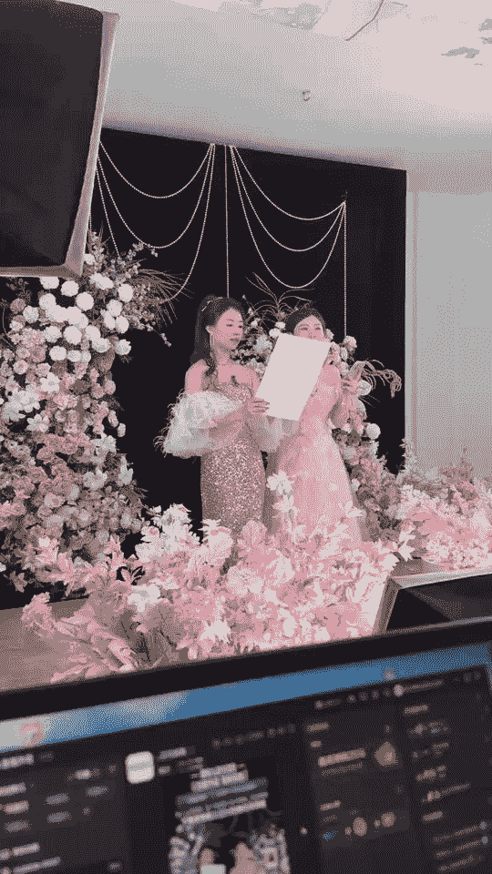

[11.mp4](https://internal-api-drive-stream.feishu.cn/space/api/box/stream/download/all/X7P7bScvVoGP5PxkqGIcWTkBnWh)

## 2、货

[喜匠婚纱摄影 产品价格](https://aso41gpxhm.feishu.cn/docx/Ps7xdnDbToEewRxQbQ2cdsswnSb?from=from_copylink)这是我们第一场婚纱摄影的全部产品明细，这个产品设计做到80分不复杂，首先我们需要商家在卖的所有产品明细，然后问到卖的最好的两款，然后在抖音首播做优惠，一是降价格，二是加产品。

婚纱摄影产品主要包括几套服装，对应妆造，几个景，景分 内景、外景、海景这些，然后是摄影师和化妆师的级别。以下图为例拆解一下品，主卖品婚纱摄影的放前几个链接，一场主推2-3个品就足够了，真正成交的不是产品多，而是价值感锚定住，1-3号链接是我们的主推品，摄影套餐，4-5随推，6-7摄影+礼服打包套餐，8-9单纯礼服套餐，10号是拍下前面链接送的订婚礼服，11号是我们的一个大礼包，19.9换购10项福利，12号直播间有人问临时加的一个情侣写真。

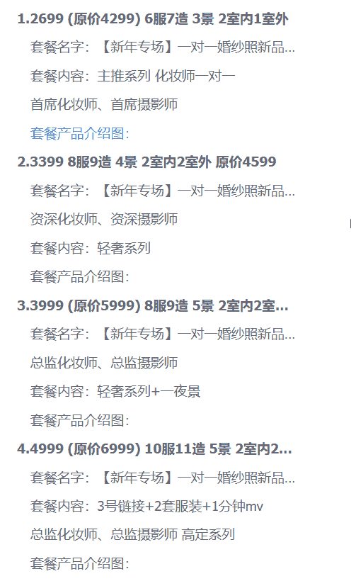

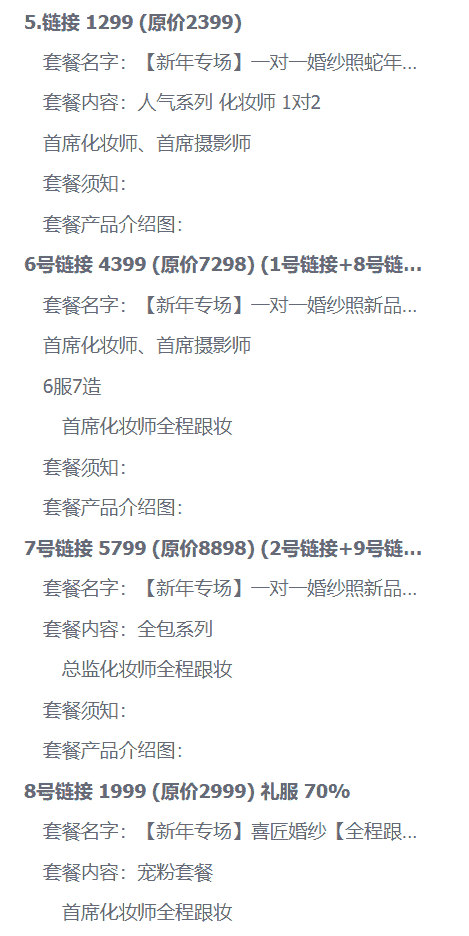

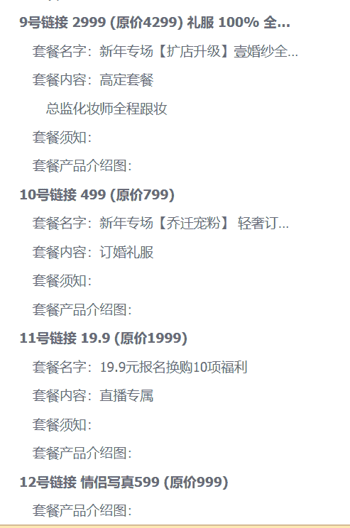

## 3、场

场景的呈现主要包括：背景墙，灯光，电脑，相机及相关设备采集卡，连接线等，场景很重要，在直播间卖视觉产品，画面就是产品的一部分

第一场我们的直播现场以及直播间展示出来的画面其实不太及格，整体会比较low一点，如下图：

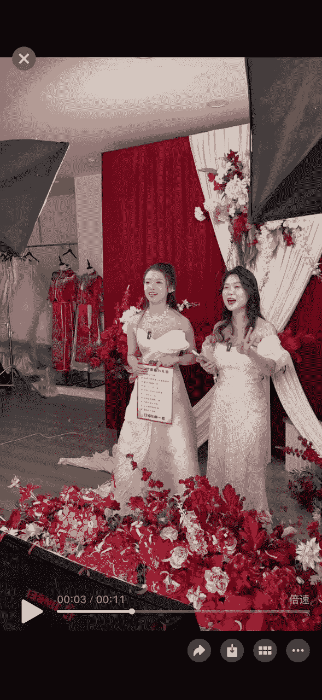

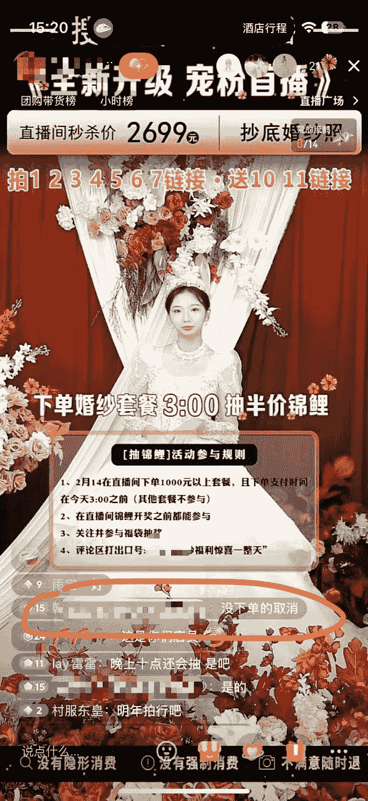

这个场地布置，是需要商家进行联系的，这种找婚礼布置的就可以，很简单，他们都很懂怎么弄，我们只要给到大概的效果图，就可以。然后给大家看一下我们最近的现场布置，对比还是很鲜明的，整体的效果图我们是引导和指导商家往哪个方向去布置。

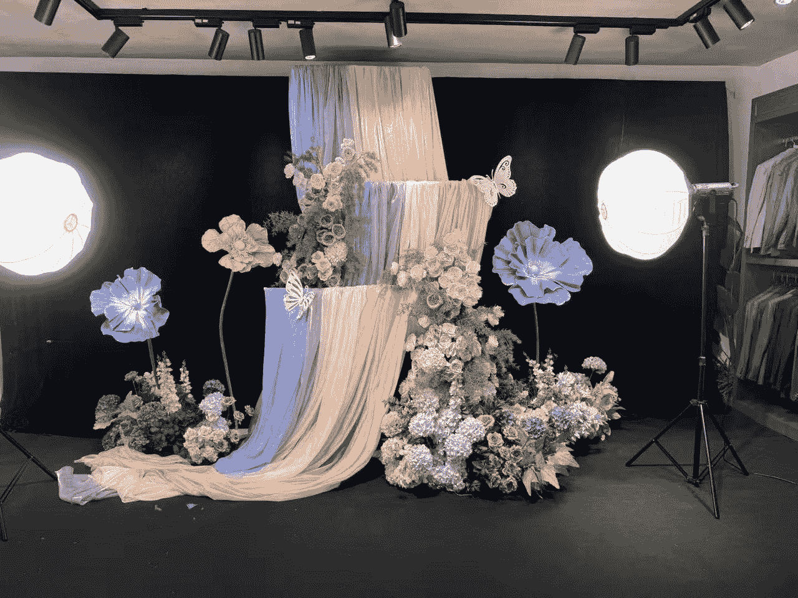

## 4、投流

投流是我们24年下半年花了很多钱，很多精力学的，之前是投巨量为主，本地推直播间投放，这一场也是第一次真正的实操。

我们是本地推 直播间投流，只投直播间，视频图文前期预热拍的还不错可以投一点，但是大部分商家拍出来的素材会一般一些，都投直播间就好了，投标准，对于大部分商家来讲，第一次播抖音大场，投全域是跑不出去的，前几场都要投标准。

投流主要就分两个（如下图左），深层 团购成交和 浅层 线上互动，白天场，90%深层，10%浅层，这个和大部分本地生活类目是类似的，晚上场可以只投深层的团购成交。投流的核心：不是烧钱能成交，而是结构+节奏能控住转化。

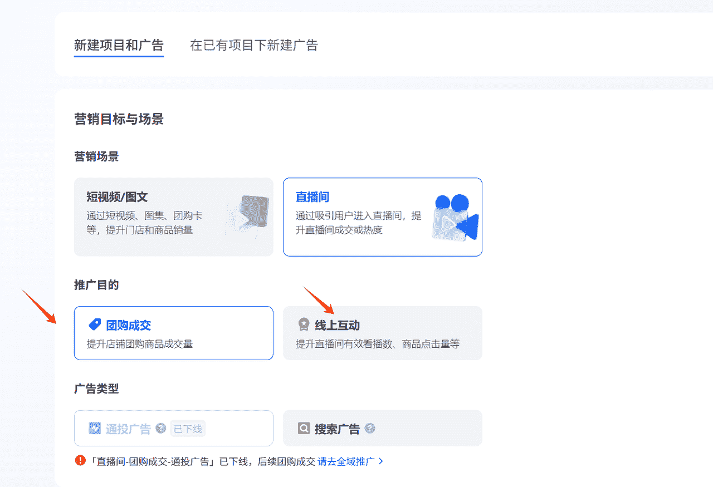

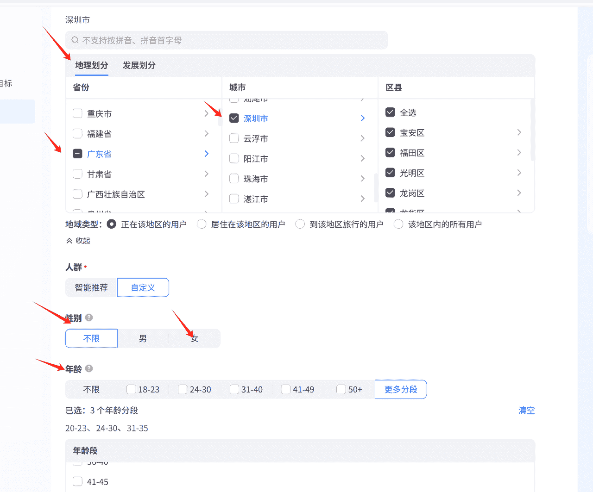

然后就是圈地区和人群性别、年龄段（上图右），我们婚纱礼服不太需要圈莱卡，范围太小了，这个标签相对也不是很精准，做地区和年龄段以及性别区分就可以。

投流计划搭建不难，比较简单，控量和跑量稍微需要看一下，因为不同时间点节奏还是不一样，我们播第一场是一个2.14情人节，当天晚上的流量根本买不到，很难消耗不出去，然后整体预算都加到了10w块，才消耗了，而且整体投流是先消耗 先花钱，后显示花了多少钱的，需要时刻刷新，还有整体是 先把钱花出去，然后直播间进人也是有滞后行的，大概15分钟左右，就是开播一场3h，前面15分钟才开始跑起来和后面15分钟，我们要提前控一下流量。

下图，当天2.14晚上，怎么都跑不出去，就疯狂加预算，因为本来预算也不多，6000跑了10h左右，当天晚上每条计划从几百块加到了几万块，才跑出去，加到10w块的时候大概几分钟跑了1000，当时的心情很是很忐忑的，因为毕竟是商家的钱，也是第一次做，突然几分钟跑了1000多，可能一个不留神钱全花完了，后面赶紧调控了计划，因为当时也不知道计划的滞后性具体是多久的,这个每个时间段也是不太一样的。

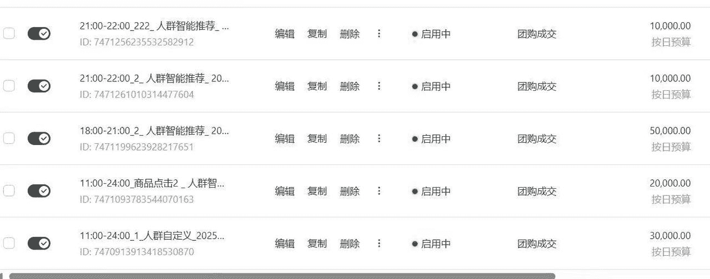

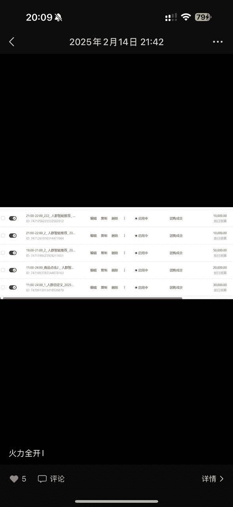

## 5、前期预热

播前预热做得好，直播就像有温度的战斗，我们的预热主要两个地方，抖音大场直播场和私域长期经营场。

### 1）私域预热

#### （1）定金卡预售

定金卡预售也是我们直播间的19.9大礼包，如下图，这个的作用，是开播前提前锁客，也能检验一下这个店本身的粘性，我们会在直播前1-3天开始做私域的预热，以定金卡为主，搭配推送直播的朋友圈和私信

#### （2）私信预热

##### 群发私信话术：

宝子们，我们xxx抖音宠粉直播来了，就在4月18日上午11：00，有史以来最大活动——历史最低价+福利放不停（香奈儿口红，YSL香水，小熊咖啡机等等）

29.9元抢定最高25大权益！不用随时退，近三年备婚的宝子们，一定不要错过，⏰4月18日抖音直播，29.9元提前占位！

### 2）抖音视频预热

抖音预热视频脚本，我们要准备好，发给商家，商家自己来拍。如下图，拍摄文案，发布文案以及参考视频都准备好。

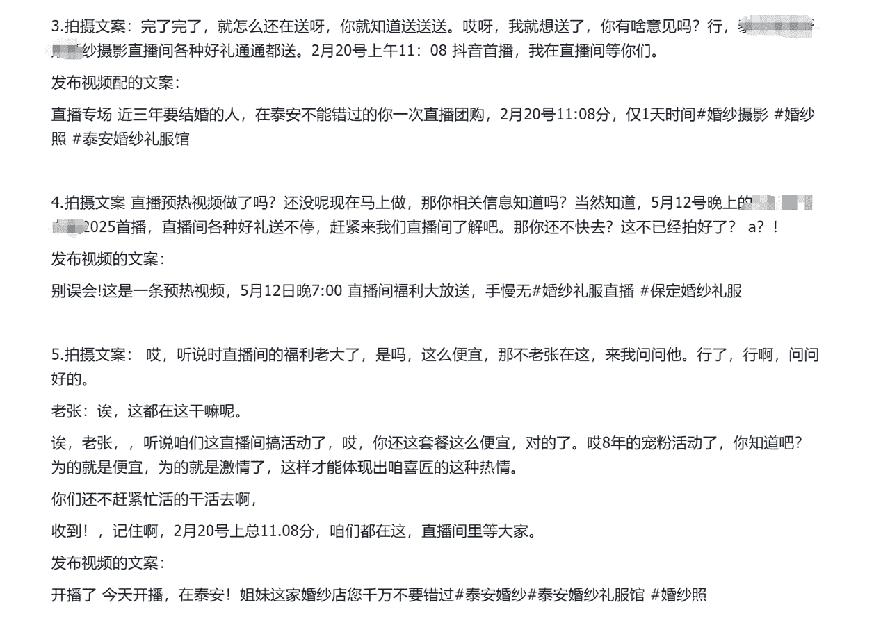

# 三、1-10的放大

**一个跑通的模型，比一个好项目更值钱！跑通0-1然后确**定性拿到结果以后就是放大了。放大几个点：

第一个我们自己扩充直营人员的BD，做复制；

**第二个视频端，是我们平常视频的输出，干货**、价值内容视频的输出吸引相关垂类的老板；

第三个是我们上一次的航海，借助圈友的力量做了一点放大；

第四个是我们的投放端，巨量投放客资；

然后现在整体交付有十几家，对婚纱礼服，婚纱摄影整体抖音端大场直播我们是很清晰的，且可以确定性拿到结果的，以下是我们拿到的一些结果：全国榜66名，单场gmv过50，本地榜前三名等等

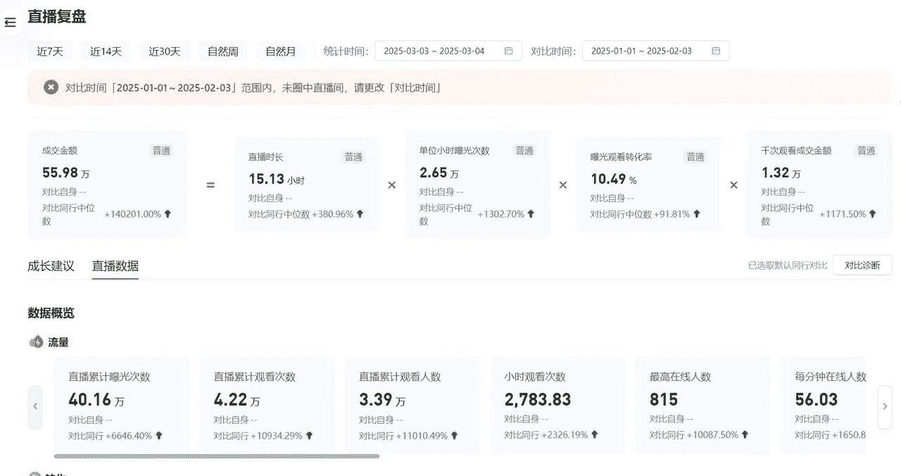

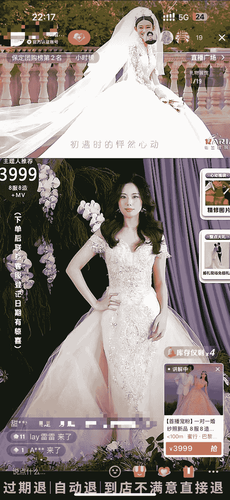

# 四、婚嫁行业商务端、交付端系统拆解

以下是我们完整交付十几场，确定性拿到结果之后的在商务端和交付端核心关键点系统拆解：

## 1、商务端

商务端并不复杂，我们以线下BD为例，商务端的核心是话术

用我们的话术结合我们的案例，非常好撬动商家来做这件事情，下面是我们的原本商务话术，用这一版话术，结合我们的案例，不夸张的讲念给十个婚嫁门店商家听，婚纱礼服，婚纱摄影店的老板听，99%能成交一单。（这个在上一期航海和我们自己做测试的时候都已经跑通验证过了）

### 1）当面面聊BD话术

**破冰**：您好，问一下咱们老板，（主理人）在店吗

我们是做抖音直播的，想问一下咱们这边要不要做一下抖音直播，合作一下，最近婚纱礼服店在抖音直播效果挺好的

**互动**：您有在抖音刷到婚纱礼服的直播吗

了解一下，商家老板对直播这件事的认知程度

**上案例**：给您看一下我们公司做的直播，这个四川的，当天全国团购榜66名，之前保定做的,本地团购榜团购第二名

**给价值**：我们一场直播可以带来同城几十万人次曝光，成交金额几万到几十万，精准粉丝几百个，后面还可以赋能我们直播，如何搭建直播间等等

**给压力**：现在咱们这种礼服店，在抖音直播是有红利的，各个礼服店都在抢流量，同一个城市，尤其小城市，结婚人群是有限的，我们要在前面播，整体流量会很便宜，咱们这个投入汇报比也会高。（咱们这边播的还比较少，咱们可以先抢占一下流量红利）

**讲流程**：是这样的，首先主播我们出，到店直播，我们会有2个主播到店搭配一个运营，前期我们会先做账号搭建，包括私域🛰️ 和抖音进行预热宣传，我们运营会操盘整个活动，带着咱们店老师来做，整个活动周期4-5天，前期准备+大场直播2天。 每天6-8h 。 上午11:00 -14:30、 晚上18:30-22:00。    不要过度承诺直播时间。

**报价格**：收费我们是这样的，5000的到店直播费用+整个合作直播期间成家GMV80%部分的15%，然后加差旅费。单纯提成上限20000。

（商家问还有没有别的费用：）还有直播间投流的费用咱们商家出，这个看咱们想做多少GMV，投流费用大概在10%左右，做得好的在几%，差一点十几%，这个和本地咱们同类型做的多少，和店的势能有关系，我们可以先准备3-5000试一下。可以多讲一下平台，抖音平台的人群精准，算法精准，等等，老板大部分会认可抖音。

**给信心逼单**：结合店的情况，面积大，年头久，价格低，找出店的某些优点，给店长信心，老板，咱们店这么久，在咱们本地品牌，口碑都挺好的，做一场直播效果会很好，肯定能做爆。而且咱们做直播，是不可能赔钱的，只有多赚和少赚。你看啊，老板，咱们做一场直播，给咱们带来几十万人次曝光，几十万成交，几百到几千个精准粉丝。只看这个曝光，这个广告效应都是超值的，你在任何平台都做不到的。而且我们还有成交，还有精准粉丝。除此之外，咱们关于直播的问题，后续也可以随时问我们。做一场直播，巨大的曝光，品牌效应，加上成交金额，再加上咱们就跑通了直播，学会如何抖音播，这三个点嘛，我们做过的任何一个店都是赚钱的，就是多赚和少赚的区别。

### 2）加完🛰️之后跟进话术

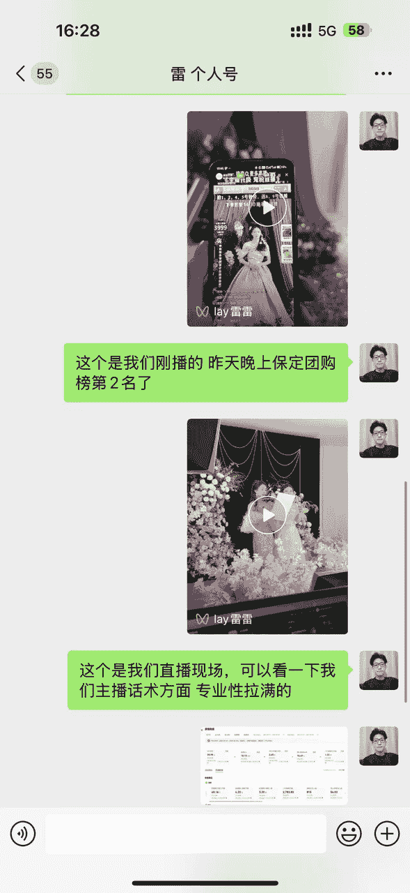

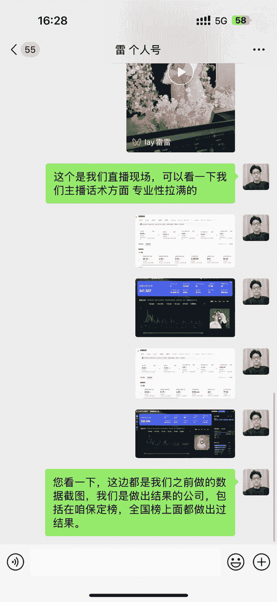

## 2、交付端

交付端要和商家对的几个点：

### 1）对账号  抖音号，抖音来客

抖音来客几个点，是否有抖音来客；是否交了保证金，婚纱摄影6000，婚纱礼服7000保证金；是否开通了客资中心，没开通的话无法留下下单客户的信息；是否绑定了官方企业号，一个营业执照绑定一个抖音来客，绑定一个企业蓝V，这里的企业抖音号和千川电商端的蓝v不一样， 本地生活端和电商端只能有一个。

抖音号是否有违规，是否可以正常直播

### 2）对设备，灯光，场景，模特

设备详细如下：

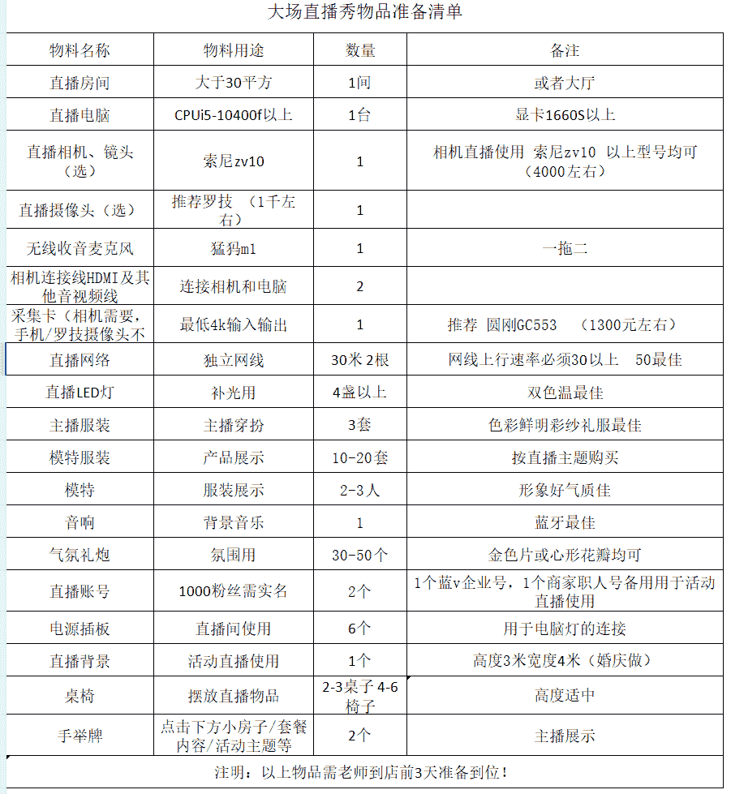

模特标准：要求动作大方得体，脸部微表情到位

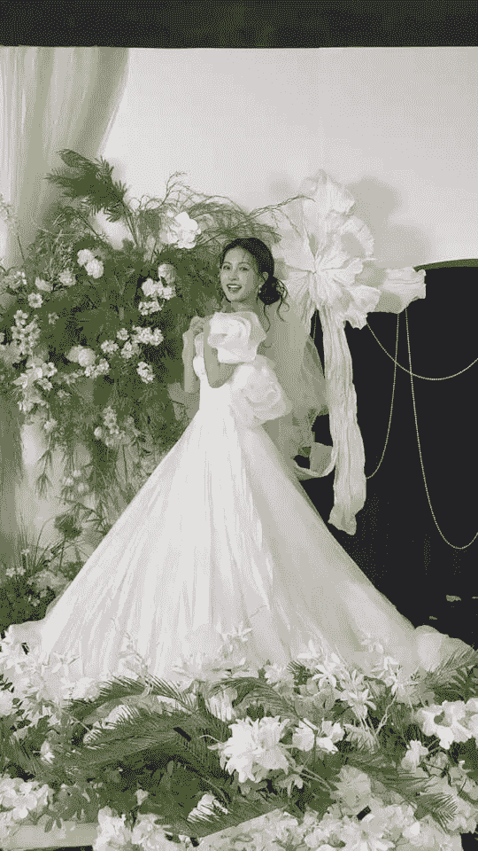

[c3c56d34775ec0edfa64484dc6e23c78.mp4](https://internal-api-drive-stream.feishu.cn/space/api/box/stream/download/all/HITlbzOrQoWE1LxmNmlc0msunhf)

### 3）对产品

### 收集商家产品详细信息，文案，图片，视频

对于一个没做过抖音直播的商家来说：我们先把产品整理好，然后和商家对价格，对权益，然后放到飞书文档里，把直播间的链接产品详细内容，然后再对照飞书文档，在抖音来客来上架产品

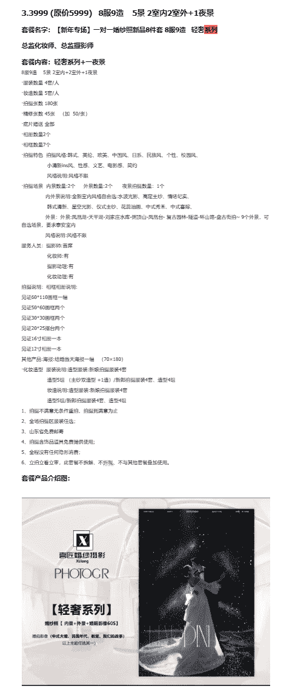

### 4）对前期准备，私域预热和抖音预热

把视频脚本发给他们，先拍视频，然后做私域发售，私域朋友圈私信的进行，详细看上文 二、5

### 5）抖音上品，做一些销量和好评

直播间用户进来看到产品销量为0，肯定是很受影响的，我们要提前做一下销量，主推的两个链接尽可能销量过30单。

### 6）现场彩排，灯光布置，相机设备

包括灯光布置，背景调控，直播间抖音直播伴侣调试：包括直播间界面、音频麦克风、视频清晰度、美颜美体设置、贴图等等，调试到完整开播界面，并且开播上品成功，可以弹商品链接。

彩排要彩排完整，音效，场景，可以正常上链接进行购买，相机，灯光是硬性设备要求，调试完基础清晰度，结合抖音直播伴侣进行微调。

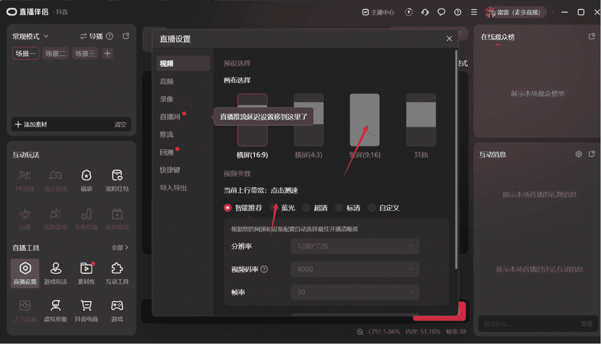

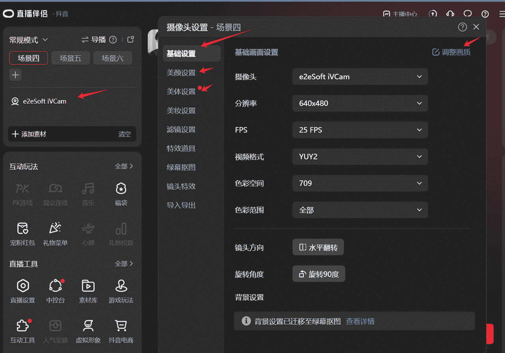

### 7）直播过程中，掌握全场节奏

包括主播模特上下场，场控上品，上福袋，调动主播情绪，观察直播间人员变化，带动主播点对点q人，现场突发情况处理，小黑板写字或🛰️群提醒主播，包括解决商家的问题，与商家老板对接。

### 8）告诉商家进行订单跟踪，核对，打电话加🛰️，促核销

下单电话话术： 促核销的

您好，我是xx店的xx，今天看到您在我们抖音直播间，购买了xxx，咱这边婚期排了嘛，大概什么时间， （沟通婚期时间） ，我看您买的是什么套餐，讲一下套餐。 讲这个套餐的化妆师，摄影师档期排的满。

然后（约定档，约到店） 我们可以先入一下我们的电子档，给您排上时间，到时候有变化也可以调整的，不满意也可以退款的。 （先促核销） 入电子档要他的二维码，订单号我们登记一下。

### 9）直播结束与老板进行复盘，如果有结算未清的进行核算收尾款

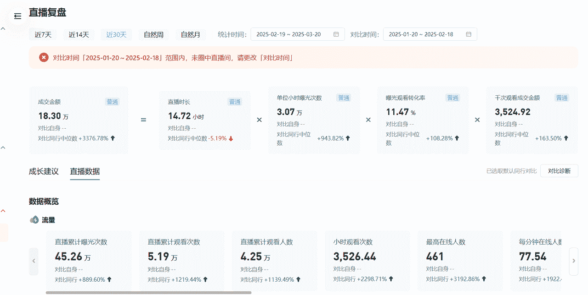

# 五、衍生的相关模式与思考总结

## 一、垂直发展 （婚嫁行业：婚纱礼服，婚纱摄影，婚礼堂）

## 云连锁门店+每天平播

除了大场直播外，持续性的直播平播养成及视频种草宣传也很重要，后续我们会进行云连锁的直播，全国门店上架我们的品牌，然后统一标品，每天进行平播，给商家来导流客资。给大家看一下相关类目云连锁做出来的成绩，基本上200-300家店左右。

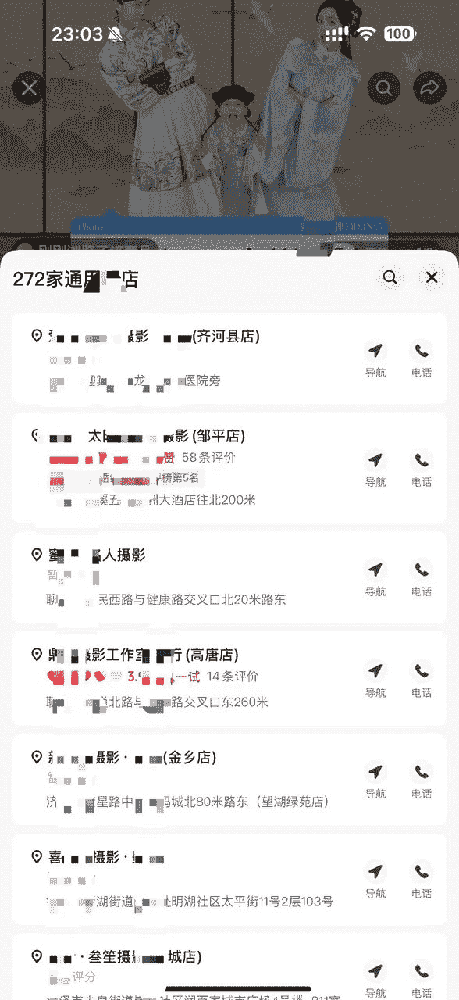

**收费3650+核销一部分提成**，这个市场空间还是很大的，商家有需求且有预算空间，我们现在正在进行中，今年做个几百家应该问题不大。

## 二、横向发展

**真正能打的模型，跨类目也能打。**婚纱摄影，婚纱礼服抖音大场直播的逻辑同样适用于很多同城实体机构，例如：艺术培训、餐饮、景区、健身房等等。

我们有测试了艺术培训的抖音大场直播，效果一样很可观，大场直播需要一定投流费用+人货场搭建，基本都是通用的。播艺培我们主要卖的39元的体验课包，目前已核销近20单，进店转化率20%是一个极低极低的转化率，大家可以简单计算一下，客单价4000块产品，进店20单，转化4-5单非常轻松，保守估计1.6-2w全年班收入，是商家投入成本的几倍（这个商家我们是收费3000元直播服务费）

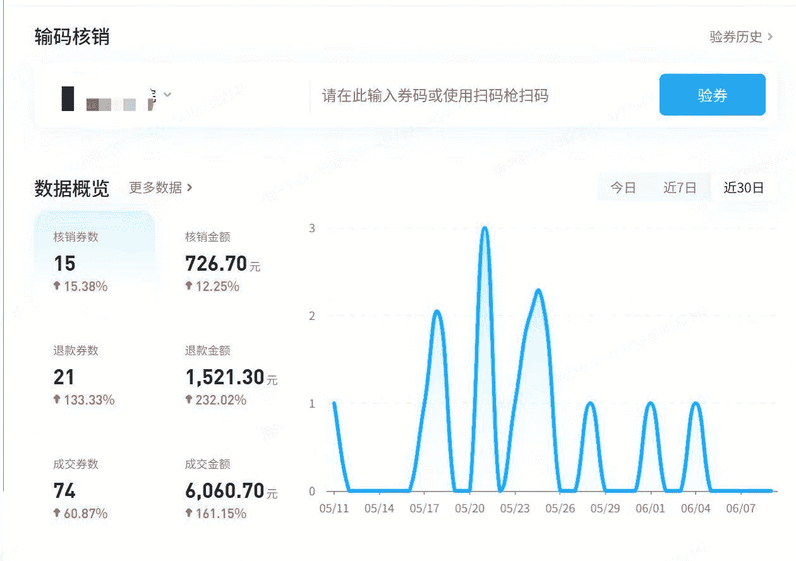

## 三、总结

我们用1个多月时间验证婚嫁类直播带货模型：

+   实战商家10+

+   单场GMV50万+

+   结构打法可落地、可复制、可交付

现在，我们正在往“区域团队承接交付+云连锁直播矩阵”方向进化，下一步会：

+   扩张更多同城商家

+   打造更多同城ip

+   做标准内容SOP包+直播模型进化

从实战里来，到系统里去，模型才具备长效生命力。