# 我用AI"偷"了400人微信群的智慧：一个让群聊变现的顶级玩法（保姆教程+提示词案例）

> 来源：[https://xuqiwei1986.feishu.cn/docx/IIumdkiqUoM6lLxksvac3sQ0n48](https://xuqiwei1986.feishu.cn/docx/IIumdkiqUoM6lLxksvac3sQ0n48)

**——手把手教你用Chatlog+A**I实现群聊知识库（附完整代码，按需取用）

> 本教程是生财有术6月航海5大主题的「集大成者」：

> 知识库搭建+可视化+AI写作+MCP+AI应用开发。

> 一套方案，全部拿下。

>

> 但是，你先别怕难，都很简单，

> 都是用到一点点，按照教程一步步来就行。

>

> **🔗原贴知识星球链接：h**ttps://t.zsxq.com/bOY0X

> **🔗原贴生财有术官网链接：h****t**tps://scys.com/articleDetail/xq_topic/5125454541845424

> 如果觉得文章有价值，记得点个赞，或投个锚点，谢谢！～

> **让更多人看到，加速文档更新。**

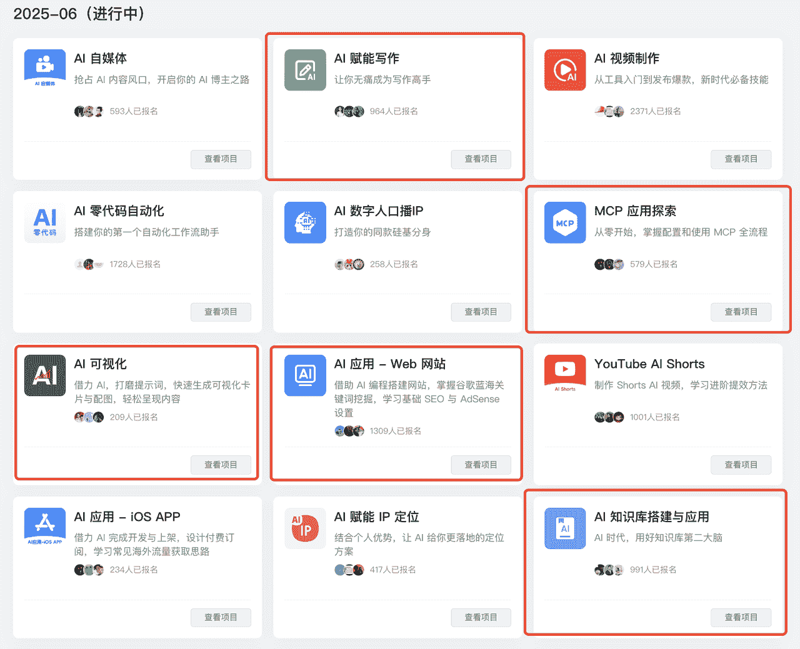

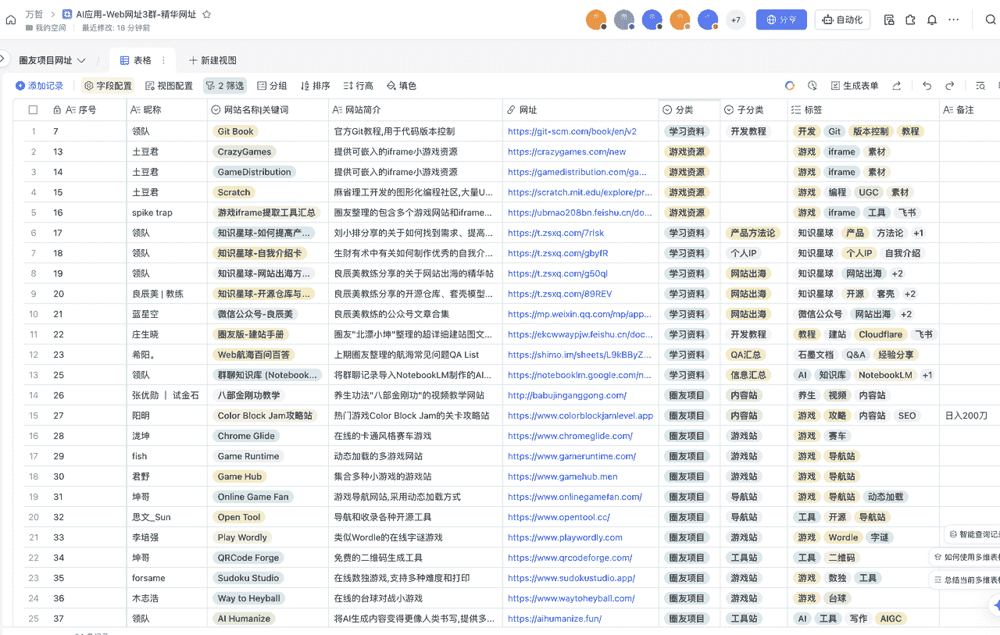

先说结论：

## “你加的每个微信群，都是一座待挖掘的金矿。”

我用一套方法，把400人航海群的聊天记录变成了：

+   自动生成的可视化日报——「MCP+可视化」

+   7×24小时在线的AI问答——「AI问答」

+   源源不断的优质文章素材库——「知识库」

最关键的是——整个过程几乎零成本，却能让付费社群身价翻倍。

---

## 这个需求有多刚？看看数据

我是6月航海Web3群的领队，群里有400多人。

每天群里1000+条消息。

但真正有价值的信息不到10%。

有金句，有干货，也有废话。

更扎心的是：

+   同一个问题，教练要回答20遍

+   昨天的精华回答，今天就被淹没

+   群员直接问问题，没看到前面的答案，永远在问重复问题

有次教练在直播时感慨："群里答疑，一个问题回答二十多遍太正常了。"

这不是教练的问题，是整个行业的痛点。

> 目前 大量有价值的群消息，就这样“死”在了聊天记录里。

亦仁大大前两天发的超级标的帖子里有一条："将知识精华转图谱可视化，适合内容兴趣增值服务。”


> 本来没看到，受群友“Dearest”的提醒，才发现的目前会的竟然已经可以解决这个需求了

> 于是，本文诞生了——“顺其自然”，响应超级标的号召。

> **“微信群的信息，是文本和图片等信息组**成的，那么就可以变成知识库，重复利用！”

---

需求就在眼前。

开干！

正文如下。

## 文章目录

---

## 💡为什么微信不做群知识库？

飞书有知识问答，钉钉能总结聊天。

唯独微信，10亿用户，却没有群知识库功能。

微信为什么不做？

**不是技术问题，是隐私红线。**

微信不敢碰用户数据，更不会主动分析。

这是它的底线，也是它的枷锁。

但需求不会因为微信不做就消失。

相反，这个空白造就了巨大的市场机会：

+   付费社群急需提升服务质量

+   个人用户渴望高效获取信息

+   知识付费市场持续增长

谁能填补这个空白，谁就能吃到红利。

**真的有这个需求吗？**

有！，大大滴有！

比如群里船员分享的截图，可以发现，这个需求早就存在了，甚至这个需求甚至会越来越多。

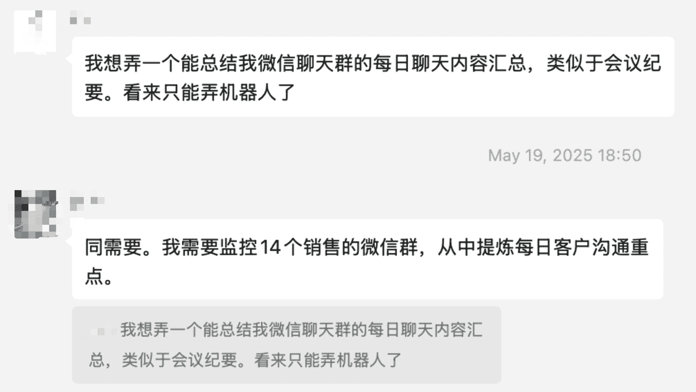

或者看完本文后问下你自己，你对看到这个这个方案后，有没有什么想法，想不想自己来一个。

目前已有少量社群用到了，比如生财有术会总结群聊日报，就算先驱者，

## ✅一个偶然发现，让我找到了全链路解决方案

当时我就想：卡片在这放着，时间长了还是没人去看之前的啊。

既然能做日报，为什么不能更进一步？

+   日报只是展示，知识库才能查询

+   日报需要人工整理，知识库可以AI自动化

+   日报是一次性的，知识库是持续积累的

于是，我开始了这场"技术考古"。

不算前期自己积累，花了整整三天，测试了十几种方案，

终于跑通了完整流程，只展现最优的方案给你。

不仅实现了自动日报，还做到了：

1.  群聊信息同步到知识库

1.  AI随时查询历史精华，随便问问题

1.  一个提示词，让微信群的消息，变成无数篇精华文章（文章质量取决于你微信群的质量）

1.  一个提示词，让AI自动生成日报卡片，并自动部署可分享网页。

> 最牛的是——这套方案可以应用到你加入的任何微信群。

### 先看看我的成果

1.  **自动生成的群聊日报**

有空的时候发个提示词给Cursor，AI自动总结当天群聊精华，生成可视化日报：

不是简单的信息堆砌，而是：

+   智能提取高价值对话

+   自动分类整理知识点

+   标注重要人物发言

+   生成可导出的图片

太长了，如果想看，可以点开看。

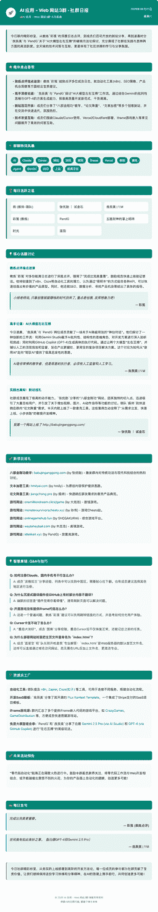


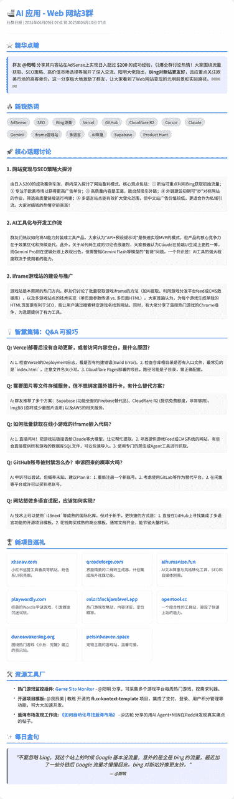

1.  **7×24小时AI问答**

新人问："应该先买域名还是先学编程？"

AI秒回："根据群内287次相关讨论，建议先用免费域名练手，具体步骤是..."

回答质量吊打通用AI，因为它学的是真实经验。

1.  **一键生成深度文章**

给AI一个指令："总结本周群聊中关于'独立开发者赚美金'的讨论"，写一篇文章。

10分钟后，一篇3000字的干货文章就出来了。

而且是基于真实案例和数据，不是AI胡编的。

「顶级大模型」+「优质上下文」+「优质提示词」=「优质文章」

> 关键在于：“顶级”和“优质”；而微信群聊信息，就属于优质信息；

> 我的流程跑通了。而且没找到人把这个流程说完整。所以分享出来～

## 🧠核心原理：把聊天记录变成"可查询的大脑"

整个方案的核心思路很简单：

**微信群聊 = 非结构化数据 → A**I处理 → 结构化知识库 → 多场景应用

但要实现并不容易，需要解决三个关键问题：

1.  **数据获取**：微信的聊天记录是加密的；

1.  **数据处理**：海量信息如何智能筛选；

1.  **价值输出**：如何让知识真正产生价值。

我的解决方案是：

+   用开源工具Chatlog解密本地数据；

+   通过MCP协议连接AI工具；

+   结合大模型实现智能分析和输出。

**技术门槛不高，但思路很重要。**

---

## 🚢完整实操教程（保姆级）

接下来是核心干货，建议先收藏再看。

> 以下方案过几个月可能过时，但现在肯定可用，

> 欢迎大家来交流，探寻更优的解决方案。

> 并本文档会持续更新，记得关注本文档或作者。

## 1️⃣ Step 1：获取微信群聊数据

> 这一步是准备工作，相当于准备好电脑设备，安装好 chatlog 工具，把环境搭配好。

微信聊天数据是加密的。图片能导出，文本不行。

文本才是关键啊！

我们需要用**Chatlog**这个开源工具。

> 本文用chatlog，目前可用，其他工具能用也都可以，最好选支持mcp的，方便一些。

> win端也有很多工具，选择适合自己的就好。

**为什么选Chatlog？**

+   完全开源，代码透明

+   支持Windows和Mac

+   可以导出文本和图片

+   支持MCP协议（这个很关键）

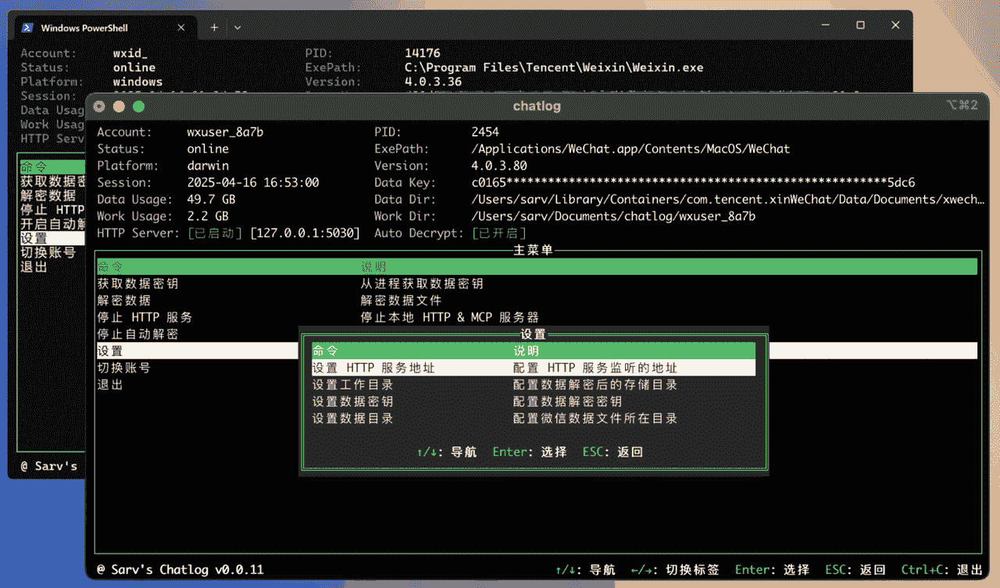

**chatlog 使用基本步骤：**

1.  安装 Chatlog：[下载预编译版本](https://github.com/sjzar/chatlog?tab=readme-ov-file#%E4%B8%8B%E8%BD%BD%E9%A2%84%E7%BC%96%E8%AF%91%E7%89%88%E6%9C%AC) 或 [使用 Go 安装](https://github.com/sjzar/chatlog?tab=readme-ov-file#%E4%BB%8E%E6%BA%90%E7%A0%81%E5%AE%89%E8%A3%85)——预编译版本适合普通用户，下载即用，我们用这个。

1.  运行程序：执行 chatlog 启动 Terminal UI 界面

1.  获取数据密钥：点击上方的图中的“获取数据密钥”

1.  解密数据：选择 解密数据 菜单项；

1.  开启 HTTP 服务：选择 开启 HTTP 服务 菜单项

1.  访问数据：通过 [HTTP API](https://github.com/sjzar/chatlog?tab=readme-ov-file#http-api) 或 [MCP 集成](https://github.com/sjzar/chatlog?tab=readme-ov-file#mcp-%E9%9B%86%E6%88%90) 访问聊天记录

**原理简单：解密本地聊天数据，通过** MCP 开端口传输。所有处理都在本地。

#### 下载链接（无需特殊网络）

+   飞书直接下载：


[chatlog.zip](https://internal-api-drive-stream.feishu.cn/space/api/box/stream/download/all/YepCbeVQxodTr5xMkgfcFrjrnfb)

+   其他下载方法（百度云+夸克）（我给你准备了国内镜像）

+   通过百度网盘分享的文件：chatlog_0.0.15_windows_amd64.zip 等 6 个文件

+   链接： https://pan.baidu.com/s/1JUuq6DTJpNbtQ3M0sRE3KQ?pwd=pded 提取码： pded

+   我用夸克网盘分享了「chatlog-0.0.15.zip」，点击链接即可保存。打开「夸克 APP」，

+   链接：https://pan.quark.cn/s/24e231e45247

+   下载安装可能的坑

另外，使用过程中，可能还会遇到一些问题，

一个是下载哪个版本？Mac 电脑 M 系列芯片是第二个，arm： intel 是第一个，amd的。

教程中可能不够详细，可以微信搜索关键词“chatlog”，

会有其他人的教程，但是总体上都没有官方的详细，或者看本文可以解决大多数问题了。

尤其是 mac 电脑遇到问题可能更多一点，如果遇到问题可以评论，或问我也可以。

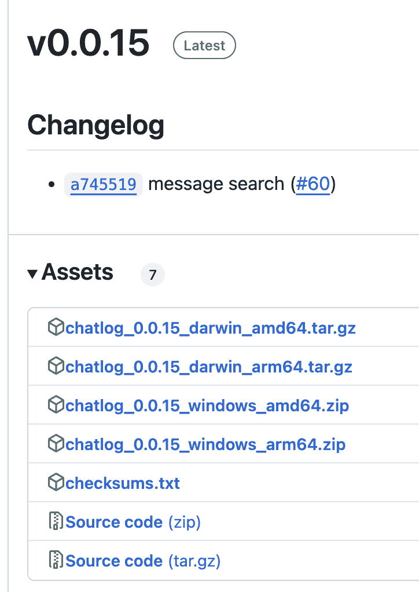

**注意事项：**

+   只能读取电脑端已有的聊天记录；

+   建议用小号专门收集目标群聊；

+   如果记录不全，可以从手机端迁移；

#### 最好的教程，见该项目 github 的教程。

https://github.com/sjzar/chatlog

强烈，建议先看完文章全貌，再实操。

---

## 2️⃣ Step 2：AI 工具调用聊天数据（Chatlog MCP）

> 工具打通：AI 编程工具调用 chatlog 的 MCP（本地知识库顺便实现）

有了通道，还要让 AI 能访问。

**推荐使用Cursor**（也可以用Claude Desktop、Cherry Studio等）：

功能更全一些，也更方便写代码，不仅限于问问题。

### 安装Cursor并配置MCP：

+   右上角设置——MCP——添加；

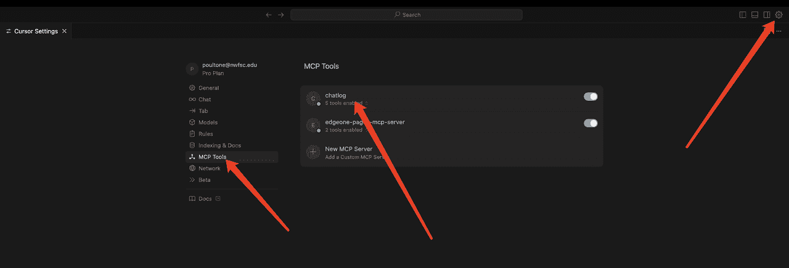

测试连接：

+   在Cursor中打开上面的界面

+   看到绿色图标表示连接成功

```
{
  &quot;mcpServers&quot;: {
    &quot;chatlog&quot;: {
      &quot;url&quot;: &quot;http://127.0.0.1:5030/sse&quot;
    },
    &quot;edgeone-pages-mcp-server&quot;: {
      &quot;command&quot;: &quot;npx&quot;,
      &quot;args&quot;: [&quot;edgeone-pages-mcp&quot;]
    }
  }
}
```

+   注：chatlog 负责数据获取，edgeone 负责网页部署（后面会提到）

到这配置好，本地知识库，其实就已经可以实现了，

Chatlog 解密，cursor 连上 mcp，发送指令，就实现了知识库问答功能。

因为微信群聊消息很多，上下文极大，

**用什么模型呢？**

实测下来，强烈推荐可用是 **gemini 2.5 pro**，上下文强。

并且最好 cursor 开 MAX 模式

很多时候 Claude 4.0 Opus 都会失败。

成功概率，和网络也会有关系。

即使不另存为数据，本地知识库也已经实现了，直接通过 MCP 调用就行。

但是，这个并不能给其他人——要分享给别人，

这样，数据就会流动起来，会更有价值。

---

## 3️⃣ Step 3：构建知识库

这一步是很多人忽略的，但却是价值最大的。

前面已经提到了 chatlog+cursor，

**本地知识库已经实现**： 通过MCP连接后，你已经可以直接查询了。

但是还不能给其他人用。分享给他人，需要上传到云端。

——本地，自己够用，但其他人用不了。

下面就分享怎么将文本上传到云端，目前建议的解决方案是手动复制，

重点是怎么获取到聊天聊天记录呢？

只需要在 cursor 写下你的需求就可以。

提示词需要包含（下方还有演示图片）：

```
使用chatlog的mcp服务，获取【在哪个群聊】、【哪个时间范围】的微信群聊信息。
要包含符合上述条件的所有微信消息，并以文本形式输出；
注意：不符合上述条件的微信聊天不可以调用，只有我允许你调用的信息你才可以调用。
```

+   注意群名要用你看到的备注名，不是群本身的名字。

+   导出后上传到某些知识库（知识库太多，不作推荐）。可以做权限控制，部分人可见，付费社群专享。

这样等 AI 返回结果，就可以了，拿到文本后，复制到使用的知识库即可。

### 3.1 实操演示：

话不多说，直接演示，图片中为 Cursor 页面，提示词，和返回的群聊信息。

前提是 chatlog 的 MCP 是正常的。

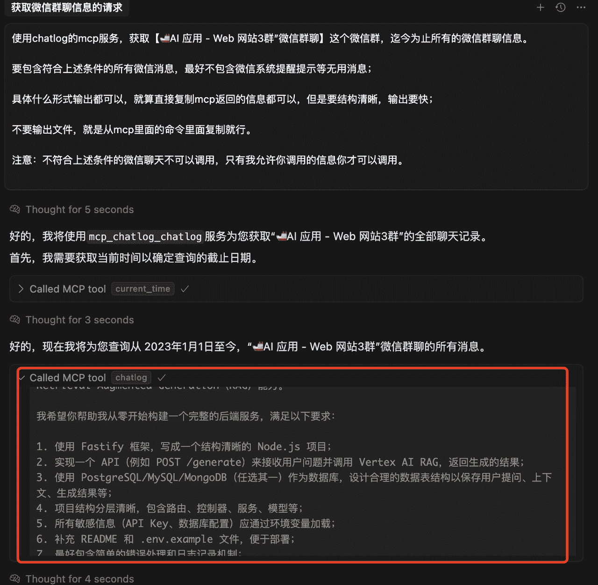

> 经验：建议在红框的地方，直接复制，输出成文件可太慢了！

> 直接复制 mcp 返回的这个窗口，贼丝滑❗️

> 还有其他方式可以实现导出聊天记录，比如文章最后教练的分享案例，可以将微信聊天数据导出成文件，也可以发给模型当上下文。

拿到文本后，复制到：

+   腾讯 IMA 知识库

+   飞书知识问答

+   Google NotebookLM

+   Dify 自建知识库

等等，都可以，喜欢哪个用哪个。

我测试了 NotebookLM：

### 3.2 知识库效果：

+   **N****otebooklm**

打开** N****otebooklm**，新建一个笔记本**，**将上一步复制的文本粘贴进去即可**。**

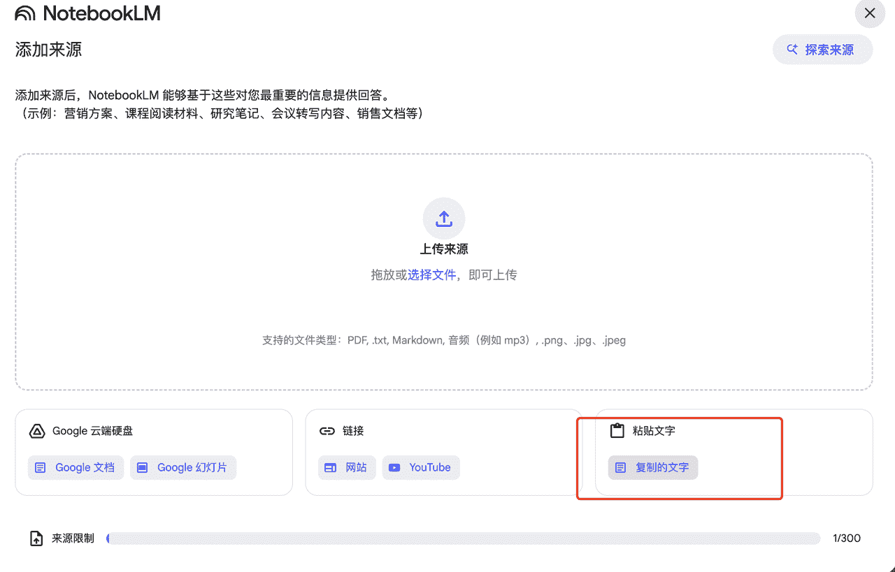

🔗AI 应用 - Web 网站 3 群【群聊知识库】

https://notebooklm.google.com/notebook/d546d66f-24f5-46c1-995c-b1d6049a7a01?pli=1

不会看到原信息，只能问答。

（几天后删除重建，后续仅群员可见）

### 3.3 问答测试：

+   问："应该买域名还是先编程？"

+   答："根据群聊讨论，建议先用免费域名练手，熟悉流程后再买付费域名..."

回答质量明显高于通用 AI，因为它学习了群里的真实讨论。

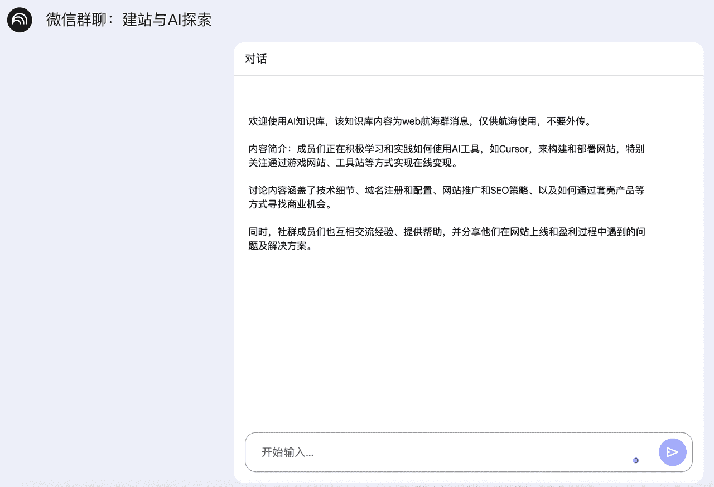

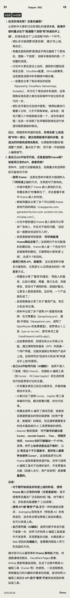

## 4️⃣ Step 4：聊天记录可视化：发送提示词给 AI 编程工具

> 最有意思的部分来了。

**核心技巧：用"垫图"思维做日报**

什么意思？

就像AI绘画需要参考图，做日报也需要优秀案例。

我的方法：

1.  找一张你认为最好看的日报图片

1.  让AI"照着样子"生成

1.  根据实际内容微调

### ❗️完整提示词（生成日报+部署）

给 Cursor 这样的类似提示词（可自行修改）：

```
# 日报生成提示词——简短版
总结【群名】【时间段】的所有消息。
通过chatlog获取信息，输出HTML文件（命名为summary_MMDD.html），
用edgeone-pages-mcp部署到云端。


## 日报生成提示词——详细版
## 任务
帮我总结一下【XX群聊昵称XX】微信群聊的信息，
具体为时间段为【2025年XX月XX号XX点至2025年XX月XX号XX点】的所有消息。
通过chatlog mcp获取群聊信息，然后输出html文件（命名为summary_MMDD.html），
最后通过edgeone-pages-mcp-server的mcp，将html自动部署到云端。

## 参考步骤（可自行优化）
1. 尽量获取全面的消息，包括文本、图片等；但如果图片等信息无法全部获取，则获取文本消息，但尽量获取全部消息。
2. 将获取到的群聊信息全部作为上下文，牢牢记住；
3. 参考附件中“日报图片”的风格与结构（可根据获取的适当调整），然后分析有哪些信息需要有，后面撰写可视化文件能用到的。
4. 思考如何输出最新的html文件，最后再撰写html文件。
5. 使用edgeone-pages-mcp-server mcp的deploy_html功能，将html文件（刚刚生成的日报网页卡片）部署上去，会返回一个可以访问的网址。

## 注意
1. 获取的信息必须完整，并分析信息的价值。如果信息不完整，则需要继续调用mcp获取全部信息。
2. 日报卡片需要有一个“导出图片”按钮，在右上角，方便直接在HTML文件上点击导出，方便分享给其他人。
3. 突出金句和重要观点；使用emoji增加趣味性；响应式布局，确保移动端适配
```

上面的提示词是及格水平，大多数场景可用。

但是如果你对日报要求比较高，可以自行修改提示词。

如：

+   “QA太少了，应当有更多有价值的信息。”

+   “日报卡片的XX中不要超链接，因为是要导出成图片的，就给出名称，网址即可，然后左右两列。”

+   “元素融入，因为这个群主要是交流web开发上站，赚美元，所以输出的html卡片中最好能适当有美元的表情，或符号。”

如果对内容有精确调整，直接最后修改 HTML 代码即可。

### 关键技巧

#### 给 AI 一张优质日报图片做参考

> 注意：这样的提示词的关键在于，没有给定什么输出的样式，风格啊，结构啊，就是参考优质的日报。

>

> 因为自己写风格、结构啊什么的很难的其实，参考他人优质的，就是走捷径。

>

> 类似生图中的垫图，极其方便，参考优质信息图，然后自己再微调一下就好了，极其丝滑！！！

参考的日报图片可以用右边的。

但是建议随着生成的日报数量越来越多，你一定要用自己认为效果最好的日报，当作参考案例。

部分关键技巧：

1.  给 AI 一张优质日报图片做参考。就像生图的垫图，效果立竿见影。

1.  建议每次只给一个参考案例。给多了容易画蛇添足。

1.  生成的日报添加"导出图片"按钮，方便分享。

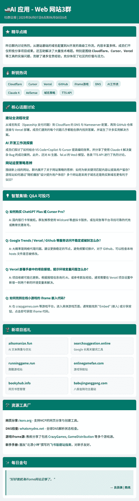

#### 如何让 AI 识别重要信息？

**人工加权重也很重要。**

如果教练说了句金句，你想让它出现在日报里，

就在后面回复"这句话很重要"。

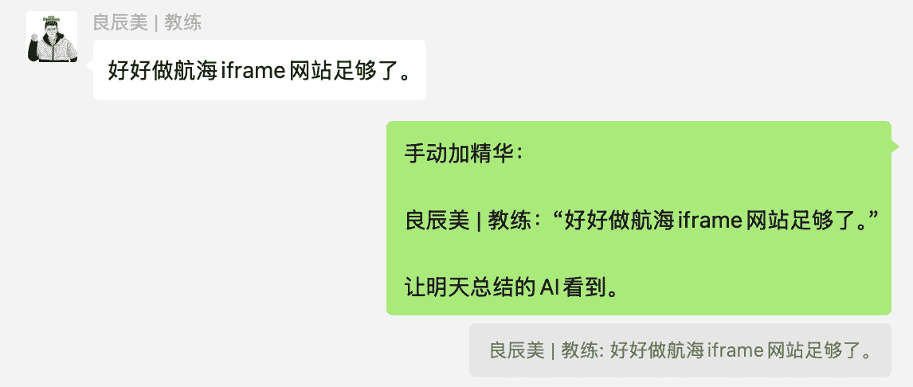

AI 会理解这个信号。

---

## 5️⃣ Step 5：一键部署（微信直接能打开）

生成的HTML文件如何分享？

只能图片吗？

这里有个巧妙的方案。

**使**用腾讯EdgeOne的MCP服务—— edgeone-pages-mcp：

1.  配置MCP（在cursor的配置中添加）：

```
&quot;edgeone-pages-mcp-server&quot;: {
  &quot;command&quot;: &quot;npx&quot;,
  &quot;args&quot;: [&quot;edgeone-pages-mcp&quot;]
}
```

1.  **自动部署： **

+   AI生成HTML后自动上传

+   获得可分享的链接

+   **重点：微信内直接打开，无需跳转**

这解决了一个大痛点——很多工具生成的链接，微信会警告"非官方网页"。

1.  **【部署效果：网页日报效果】**

AI 应用-Web 网站 -0607 群聊日报

网页：

<https://mcp.edgeone.site/share/y_lQHP0Xag7hve_WbZHKi>

【实操过程中遇到过一个问题】， 分享下

如果电脑没安装 npx，是用不了的，需要先安装 npx，然后重新打开。

Cursor 里面最后是这样的，一个是 chatlog 的 mcp，一个是 edgeone-pages-mcp。

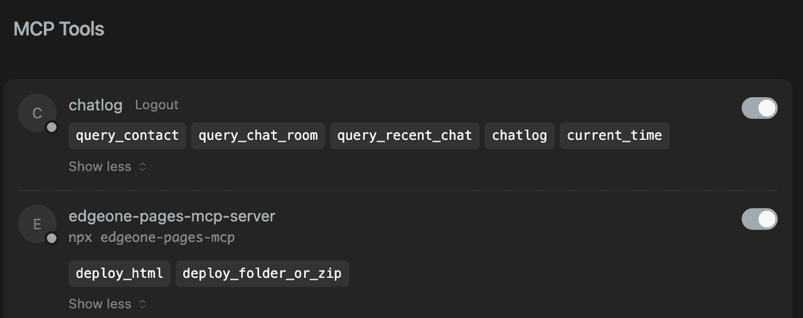

反正如果配置遇到问题，万事问 AI 就可以了。

## 6️⃣ Step 6：让AI帮你自动写文章（这个最猛）🔥

这是我最近才发现的玩法，效果炸裂。

**场景还原：**

某天早上，我像往常一样准备生成日报。

突然想到：既然AI能总结，为什么不能直接写文章？

于是我试了这个提示词：

> 前置配置：chatlog+cursor+提示词。

准备了一段提示词：

```
通过chatlog mcp获取【🚢AI 应用 - Web 网站3群】微信群聊的具体信息，时间段为至今的所有消息。

1. 明确【🚢AI 应用 - Web 网站3群】微信群聊中全部的聊天记录的内容，然后分析哪些信息有价值。
2. 自行选一个有价值的主题，围绕主题写一篇3000字深度文章。
2. 写作风格学习知识星球生财有术社群中的的精华帖文风，确保内容优质，更有价值，要让大家有所收获。
3. 写作风格：直接干脆，简洁有力；不拖泥带水、极少用四字成语；以具体事例开篇段落简短，逻辑紧凑；常用&quot;所以&quot;、&quot;因此&quot;推进论述；禁止写意义不明，只是烘托气氛的句子；结尾点明核心观点，不用“可能”“也许”“似乎”“微妙”等模糊表述；从小切口展开大主题；善于发现规律和深层逻辑；敢于表达独特观点。
```

1min，文章就出来了，简单调整了下排版。


[普通人的AI建站之路：从第一个网站到持续盈利的3个关键认知](https://llzpdb9grt.feishu.cn/docx/NCOZdp638oNAu4xS5JWcwWQ5n1d)

不是那种AI味很重的文章，而是基于真实讨论的干货。

因为素材都来自群聊，所以：

+   案例真实可信

+   数据详实准确

+   观点接地气

只是一个思路，其实要思维打开，大有可为。

> 更猛的是：你加的每个群，都能这样用。

+   投资群→投资心得文章

+   技术群→技术教程文章

+   创业群→创业经验文章

写作素材源源不断。

更重要的是你所在的所有微信群，都是你的知识库。

你所在的微信群群聊质量越好，文章输出质量越高！！！！

越是大佬，群越强，信息密度越高。

## 7️⃣ Step 7：批量提取群内精华信息🔥

除了日报和文章，还能做什么？

其实是可以汇总，快速找到你想要的任何信息，

只要它存在，

甚至你描述的比较模糊，AI也能猜到你真正想表达什么。

#### 案例：整理群内所有网址

比如，AI应用-Web3群的信息很多，而且有很多群友的网站上线，

有群友提出来，能不能汇总一下这些网站，找到它们，方便冷启动。

想了想，群聊不行，还得是在线文档。

那手动整理也太麻烦了，保底50多个网站，手动整理要几小时。

得找个自动流程，AI帮我整理。

然后想到了前面的AI总结日报，开干。

```
通过chatlog mcp获取【🚢AI 应用 - Web 网站3群】微信群聊的具体信息，具体为时间段为至今的所有消息。
获取到全部聊天数据后，总结群聊中出现所有网址。
第一列最好是序号数字，第二列是昵称，第三列是网址名称或关键词，第四列是网址，
第五列是分类，第六列是子分类，第七列是网站介绍。
```

> 最终生成的效果还是非常好的。


详见：[AI应用-Web网址3群-精华网址](https://llzpdb9grt.feishu.cn/base/PYskbwQFPaojHQsUpvGc1Tk5nUe)

AI不仅找出了所有网址，还自动分类和添加介绍。

导出Excel，上传飞书，一个群网址导航就做好了。

但是呢，其中也有坑，

#### 失败测试

比如AI返回的表格是csv格式的，如果直接导入飞书，会多了“”，看起来非常不美观，不能直接用。

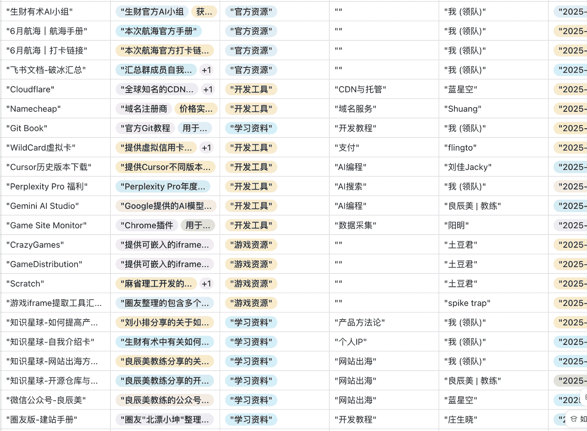

如果导出成excel，也很大概率会因为有“”出现乱码，像这样。也可能可以，你可以再试试

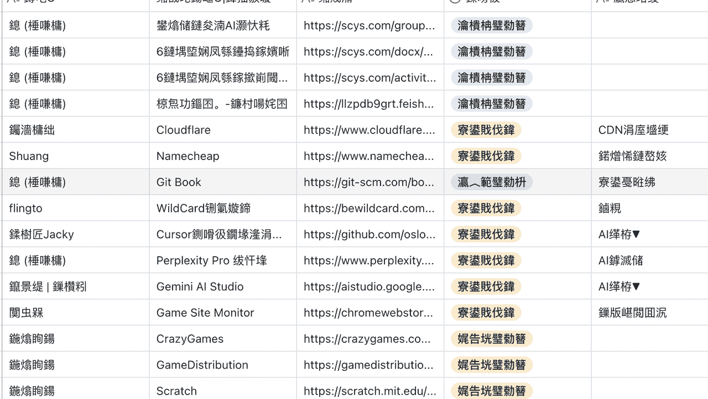

#### 成功方法

找到的最佳的解决方法是，通过在线网站，将csv转成excel，

bing搜索“CSV转Excel”随便找的一个网站：https://tableconvert.com/zh-cn/csv-to-excel

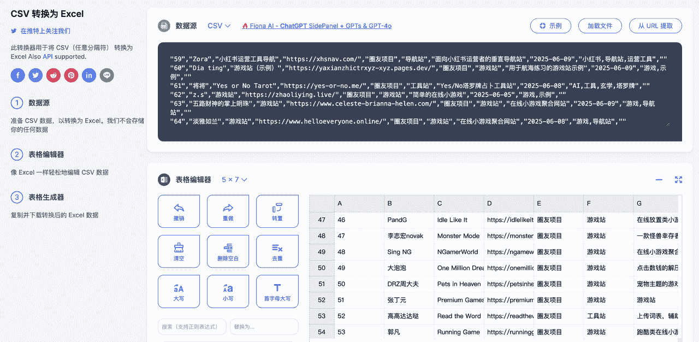

这样就正常了，然后再倒入到飞书多维表格，再上传，就是现在的样子。

详见：[AI应用-Web网址3群-精华网址](https://llzpdb9grt.feishu.cn/base/PYskbwQFPaojHQsUpvGc1Tk5nUe)

---

**这个思路可以延伸：**

+   提取所有书籍推荐

+   整理所有工具分享

+   汇总所有金句名言

+   统计热门话题排行

**想象空间巨大❗️**

---

**🔗原贴生财有术官网链接：h****t**tps://scys.com/articleDetail/xq_topic/5125454541845424

如果觉得文章有价值，记得点个赞，或投个锚点，谢谢！～

**让更多人看到，加速文档更新。**

---

开头说的：知识库搭建+可视化+AI写作+MCP+AI应用开发。

看看有没有达到，

+   知识库有Notebooklm，可视化有群聊日报，写作也写了一篇长文，

+   MCP也用到了，属于通道

+   AI应用开发呢，Cursor，AI这个编程工具。

到此，实操完成，下面是理念部分。

## 👨每个人都需要这个

微信只有你我能获取吗？

可不是，在群里的每一个都都可以。

意味着这不只是社群运营者的工具。

也是个体 AI 使用知识库的途径之一。

意味着，只要你使用微信，使用微信群聊，就是该解决方案的潜在客户。

1.  **对社群运营者（创造者）**

这是增值服务的机会。

原来卖 999 的社群，加上 AI 知识库和每日精华，或许可以卖 1999。

成本几乎为零，价值翻倍。

不用自己动手，让可靠的助理学会，或外包给会的人。数据权归你，什么都不用管。

如果服务商不在群里，可以远程登录你的微信同步数据，建议视频会议操作保障安全。

1.  **个人更需要。**

你加了多少个群？50 个？100 个？

每个群每天 100 条消息，你看得过来吗？

让 AI 帮你筛选。哪些值得看，哪些可以略过。相当于给每个群配了一个秘书。

更重要的是，优质群聊就是你的知识库。别人还在百度，你已经在问自己的专属 AI 了。

群聊质量越高，你的知识库越强大。

---

本方案涉及：知识库搭建+可视化+AI写作+MCP+AI应用开发。

熟悉流程的人 10 分钟搞定。零基础可能需要几天都完不成。

所以，一些人如果想要这样的效果，

依然需要有人来教，或者付费让其他人来实现，

所以卖解决方案也是商机。

花钱，省时间，买解决方案，不用自己折腾，肯定会有不少人付费的。

---

## 💰商业化路径：如何把这套方案变现

技术跑通了，怎么赚钱？我梳理了几条路径。

### 路径1：社群增值服务（最直接）

**目标客户：付费社群运营者**

痛点：

+   信息管理混乱

+   重复问题太多

+   价值传递低效

你的方案：

+   搭建专属知识库

+   每日自动生成日报

+   AI客服24小时答疑

### 路径2：个人效率工具（规模化）

**目标客户：知识工作者**

他们平均加入20-50个群，每天花2小时"爬楼"。

你的产品：

+   一键接入所有群聊

+   智能筛选重要信息

+   个人知识库管理

### 路径3：垂直领域解决方案（高客单价）

不做通用工具，专注垂直领域：

**金融投资领域：**

+   实时监控投资群动态

+   智能识别投资机会

+   生成投资研报

**教育培训领域：**

+   学员问题自动汇总

+   知识点智能整理

+   学习效果追踪

**企业服务领域：**

+   客户群需求挖掘

+   竞品信息监控

+   市场情报分析

每个领域都能做到1万+客单价。

### 路径4：数据服务（想象空间最大）

当你积累足够多的群聊数据后：

+   **行业研究报告**：基于真实讨论的行业洞察

+   **用户画像分析**：细分领域的用户特征

+   **趋势预测服务**：热点话题的早期发现

这是To B的大生意。

当然，仅靠微信聊天数据肯定不行，需要的是多渠道的信息。

## 🤔还能做什么

### 🚩存在不足和优化方向

目前方案满足 80%需求。剩下 20%是隐私顾虑和自动化程度。

1.  自动化，会越来越好。如：

+   定时自动执行

+   异常自动处理

+   多群批量管理

1.  隐私用小号解决，或者后续生成隐私保护：如

+   本地部署所有组件

+   敏感信息自动脱敏

+   分级权限管理

1.  智能化升级

+   多模态信息处理（语音、视频）

+   情绪分析和舆情监控

+   个性化推荐算法

+   。。。。

**将上**面的优化“方案”继续自动化的人，或许就在你我之中。

## 💡核心洞察：为什么说这是必然趋势

微信群聊是天然的多人共建知识库。每个优质群都是最新信息源。

大部分人忽略了这个金矿。

1.  **信息的本质变了**

+   以前：信息稀缺，获取是关键

+   现在：信息过载，筛选是关键

+   未来：信息智能，连接是关键

微信群就是中文领域最好的信息连接器。

1.  **知识的形态变了**

+   以前：书本、文档、网页

+   现在：对话、讨论、互动

+   未来：动态、实时、个性化

群聊天然就是动态实时更新知识库。

当然，和形态关系不大，和信息的价值关系大。

1.  **学习的方式变了**

以前：老师讲，学生听

现在：共同讨论，互相启发

未来：AI引导，按需学习

**每个优质群都是一所"大学"。**

> 要找到关键信息源，特别是垂直领域的信息源。

> AI 时代，让这些沉睡的知识觉醒，就是机会。

### ✅微信群聊只是开始。

微信可以，

那邮件呢？每天收几十封邮件，重要的不到 10%。

AI 能不能帮你整理？

Slack 呢？Telegram 呢？各种即时通讯工具都是知识的源头。

专注垂直领域更有价值。

比如专门做加密货币群的知识库，做股票群的知识库，做健身群的知识库。

再比如，完全的自动化有没有可能，有。

之前，输入-整理-输出，全靠人工

现在，AI和工具，这三步都能自动化。

就是需要提前预设好。

…

需求在那里，解决方案也有了。

所以问题只剩一个：你什么时候开始？

### 🤖微信群机器人

微信群可以接入一个大模型，用一个微信号当作 AI 对话就行

这个 AI 监控微信群，目前已有实现方案，具体教程可以微信或浏览器中搜索。

而且腾讯自己也搞了一个微信的 AI，元宝，可以直接对话。

那么个人行不行呢？

未来，

微信群机器人，可以接入群聊天知识库，

群员可以直接@它 ，然后就直接回答群员的问题了。

其实不是未来，现在就已有人实现了。

> 最后的提醒：

> 这是目前的解决方案，不代表永久，微信可能也会加强加密，

> 但总会有对策，更重要的是思路。

---

## ❤️感谢+其他解决方案链接：

### 感谢圈友与船员们

本来自己把这个流程跑通啦，作为领队，以为就完成啦，

看来还是自己还是想的不够远，

这里要特别感谢航海群友 @Dearest-成都-Lv.9 的提醒，

有两个建议，一个是这个解决方案呢可以卖钱，卖给老板；另一个是分享了一个航海教练的其他解决方案。

+   首先是第一个：这套解决方案可以卖钱，也肯定有人已经在做啦，可以卖钱，但是在自己做，没公开出来。

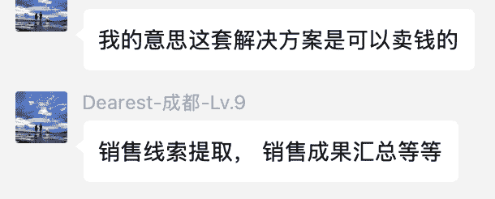

非常感谢群友说这个解决方案可以卖钱，但是既然是生财社群，秉持着利他的理念，

这个方案对于太多人都有价值，所以基本把解决方案的 80%细节都分享出来啦，希望对大家有所帮助。

+   第二个，一位航海教练的其他解决方案

### 一位航海教练的其他解决方案

看了下帖子，这个解决方案也很好，教练🐮🍺。

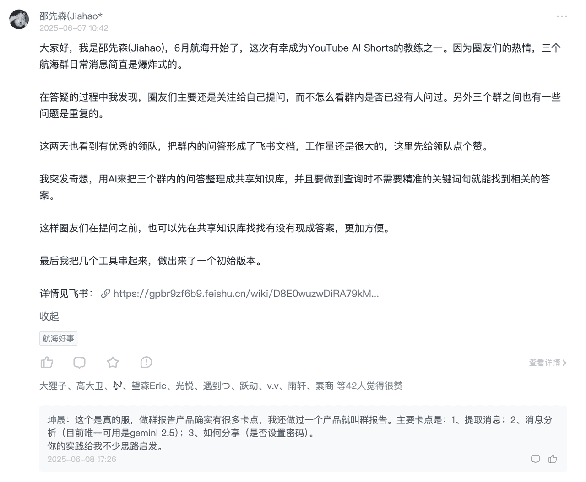

[航海期间，我用AI把N个天天999+的微信群聊做成了共享问答知识库](https://gpbr9zf6b9.feishu.cn/wiki/D8E0wuzwDiRA79kMw3nc9LeFnvd)

其实这个解决方案，将输出导出的数据作为附件，发给 AI 编程工具也能实现数据可视化。

就是相当于不用 MCP 了，实现方式不同，各有利弊。

说这个也是因为，目前我的解决方案肯定说不上最好，解决方案、用到的工具有很多。

只要能满足需求，管他什么工具，适合自己的才是最好的。

### 可视化航海手册推荐

另外，可视化航海手册也提到了微信聊天可视化，效果很好，感兴趣的记得看下，

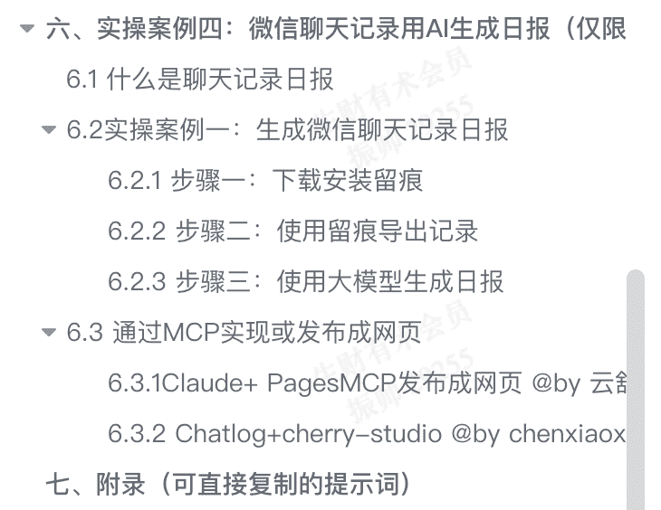

🔗手册链接见：

https://scys.com/view/docx/NbC6dsqb8oiDxHx74wWcIUtvnth

但是，不够完整，环节差了一点，

少了一个知识“汇聚”和“积累”的过程，也可能是因为当前航海未涉及知识库的原因。

各个航海稍微有点“割裂”。

---

## 📧写在最后

这套方案，是我在6月航海期间的意外收获。

从最初只想解决"信息太多看不过来"的个人痛点，到发现这是一个巨大的市场机会。

**技术不是门槛，思维才是。**

当所有人都在追逐最新的AI工具时， 真正的机会藏在最日常的场景里。

微信群，可能是最被低估的数据金矿。

而你，已经拿到了开采工具。

剩下的，就看执行了。

**记住这句话：**

### “你的每个微信群，都是一个待激活的知识库。 你的每条群消息，都可能是下一篇爆款的素材。”

> 别让知识继续沉睡❗️

代码和详细教程都在上面。

+   如果你是社群运营者，这可能是你的下一个增长点。

+   如果你是普通用户，这能让你的信息获取效率提升 10 倍。

> **关于作者**：生财有术AI传术师，

> 生财有术6月航海Web3群领队，

> 专注于AI+效率工具的实战应用。

如果觉得内容有价值，不要忘记在生财有术原贴，点赞，收藏，转发，

你的鼓励，是我持续分享的最大动力。

原贴知识星球链接：https://t.zsxq.com/bOY0X

**🔗原贴官网链接：h****t**tps://scys.com/articleDetail/xq_topic/5125454541845424

如果觉得文章有价值，记得点个赞，或投个锚点，谢谢！～

**让更多人看到，加速文档更新。**

也欢迎大家在原贴评论区交流，一起探讨更优的解决方案。

后续若发现新方案，预计会继续更新在当前文档。

**一起生财有术！**

**下一篇预告**：《我是如何用AI自动整理垂类知识，做成博客的》