# 航海七天，跑通了5个工作流 ——我的AI自动化之旅

> 来源：[https://xuqiwei1986.feishu.cn/docx/NANKdr3RdouJCwxcAdzcMsBQn9c](https://xuqiwei1986.feishu.cn/docx/NANKdr3RdouJCwxcAdzcMsBQn9c)

- **自我介绍**：luna，4.18后刚加入赚钱的新人。
- **参加目的**：6月航海报名了AI自动化动作流，主要是想把它用到我的👸号和视频号直播项目上，希望能提升效率。
- **我的基础**：文科生，0计算机知识基础，完全小白一枚。

大家好，我是4月底加入赚钱的新人luky。6月航海实战来报名了AI自动化的项目；第一次参加航海，心情还挺激动，选AI自动化动作流的原因其实非常功利。

我目前在做👸号流量主项目，还有视频号直播的内容创作。这些工作里有很多重复的、耗时的任务，比如剪视频、做图文、整理数据之类的。

当我听说AI可以自动化完成这些任务，就想着来学一学，看看能不能提升效率，让工作变得更轻松——

希望能直接应用到目前的👸号流量主项目上，以及赋能我的另一条视频号直播航海的内容上。

于是抱着只求赋能，不去深究的心态+文科生0计算机知识基础的背景下，6月4号当晚直播完，了解大概流程之后，我就迫不及待地开始我的航海之旅，直接开启了航海的第一个COZE工作流“火柴人心理视频”的制作。

## 一、7天实战全记录：5个工作流的坑与爽

### （一）第1天：火柴人心理视频工作流

#### 卡点实录：

- 群里疯狂举手提问7次，全是“选`ZIMU1`还是`ZIMU2`”“原图尺寸咋选”这种基础问题。
- 最后画面变黑，搞了半天才发现传错文本格式，应该选图片！

**解决方案**：死磕手册+疯狂@教练，截图甩群里求解答，换对符号秒成功。

**成果感悟**：人生第一个AI工作流跑通！虽然过程像打怪，但看到成品超有成就感。

#### 1.初始体验：一头雾水

我选的第一个工作流是“火柴人心理视频”。

说实话，我完全不知道从哪儿下手。我打开航海手册，航海手册很详细，开始的时候感觉以自己的学习能力完全1v1复刻，其实实操以后发现大部分情况下都无法一次性跑通

再次看着里面密密麻麻的操作步骤，我心里直犯嘀咕：“这玩意儿我能学会吗？”

想到只求赋能，不去深究的心态，我还是硬着头皮开始了。我按照手册里的步骤，一步一步操作。刚开始还挺顺利的，但很快我就遇到了第一个问题。

#### 2.遇到的问题

##### 报错：完全看不懂

我按照手册操作，但每次运行的时候都会报错。我看着那个红色的错误提示框，完全不知道它在说什么。我心想：“这AI也太不友好了吧，连个简单的错误提示都这么复杂。”

在做火柴人视频的时候，大概在群里提问了7个问题，有时候运行不成功报错，我试了好几次，每次都是同样的结果。自己也是完全看不明白，也不知道如何把这种详细复杂的工作流介入AI协助解决，我开始怀疑自己是不是太笨了，连这么简单的东西都搞不定。不过我还是不甘心，决定先自己琢磨琢磨。

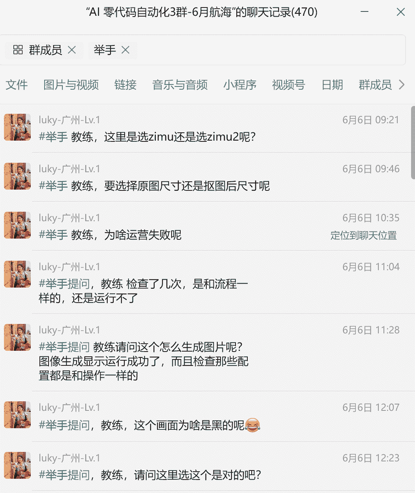

我试着去搜索这个错误提示，看看群里有没有其他的船员们遇到过类似的问题。结果搜了半天，也没找到什么有用的。我心想：“看来还是得请教教练。”

于是截图发群里提问。比如选择`ZIMU1`还是`ZIMU2`，是选择抠图后尺寸还是原图尺寸等等。

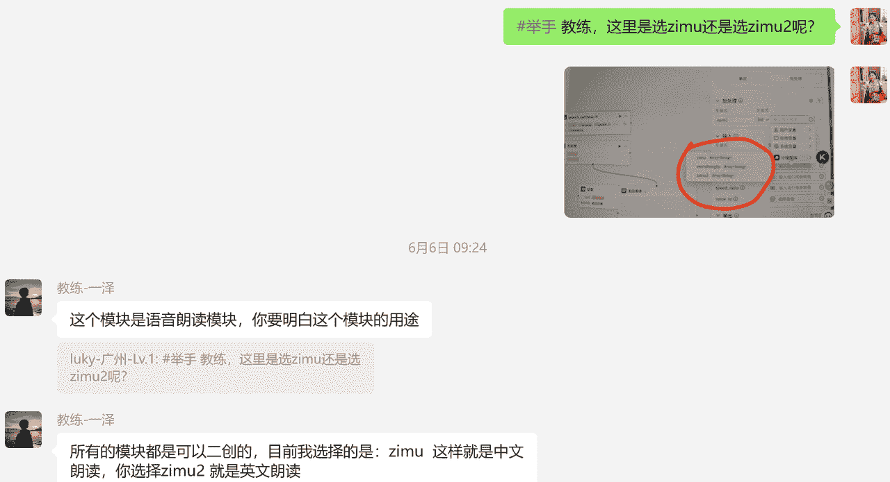

##### 画面问题：黑屏的尴尬

经过一番折腾，我终于让工作流运行成功了。我满心欢喜地打开生成的视频，结果一看，画面是黑色的！只有声音，没有画面。我当时就懵了，心想：“这是什么情况？难道是我操作错了？”

（其实问题出在了我相信系统的提示以为选择另一个符号才是对的，所以最后运行是成功了，但是画面完全是黑色的）。

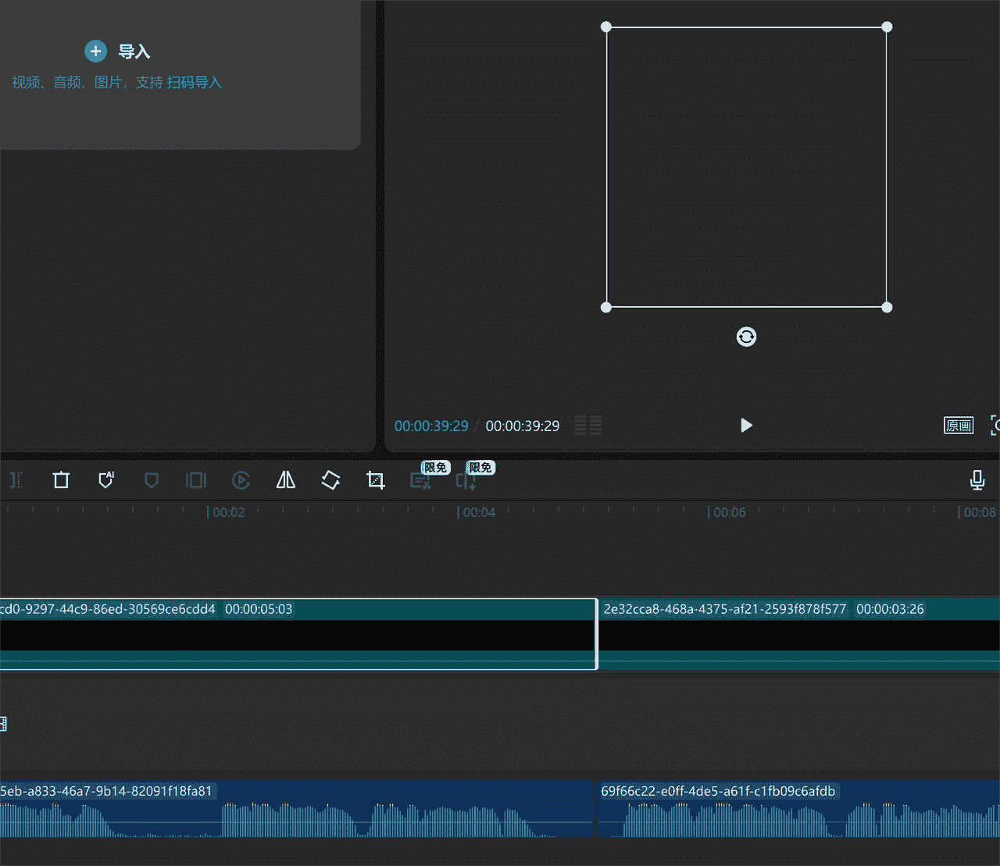

#### 3.解决方法：截图发群，教练帮忙

我又仔细检查了一遍手册，对比了一下自己的操作步骤，没有找到原因，

没办法只能截图发到群里，向教练和同学们求助。我心想：“这下可丢人了，这么简单的问题都不会。”

没想到教练特别耐心，他看了我的截图后，很快帮我找到了问题所在。他告诉我：“你传入的符号不对，应该传入图片，而不是文本。”我按照教练的提示改了一下，再运行，结果真的成功了！

我看着生成的火柴人心理视频，心里特别高兴。虽然过程有点曲折，但终于跑通了第一个工作流。这让我信心大增，觉得自己好像也能学会这玩意儿了。

**火柴人心理视频成品如下**

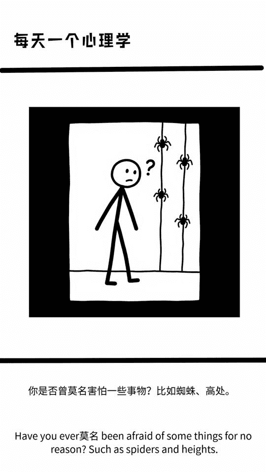

[f4bc18dd030378076e811866b8ab9fef_raw.mp4](https://internal-api-drive-stream.feishu.cn/space/api/box/stream/download/all/ZxQebz01jogGQ3xa2Z1cvTYIn9g)

### （二）第2天：📕图文工作流

#### 卡点实录：

- 运行成功但没图文，原来是画板代码错了，AI改了3次都不对，最后找教练要了正确代码。
- 封面出现3个白色色块，照着手册复刻时自建了白框，其实直接引用变量就行。

**解决方案**：教练给正确代码+志愿者私下指导，换浏览器解决节点连线问题。

**成果感悟**：生成的爆款笔记超像样，但深刻体会到“照抄≠懂逻辑”，底层逻辑得搞懂。

#### 1.挑战图文生成

第一天工作流的跑通——

给我建立了很好的正反馈信心和动力，成功的喜悦让我有点小兴奋，第二天我就迫不及待地开始了第二个工作流——📕图文工作流。我心想：“既然第一个都能搞定，第二个肯定也不在话下。”

我按照手册里的步骤，开始搭建工作流。这次我特别小心，每一步都仔细核对，生怕再出现什么问题。事情并没有我想的那么简单。

#### 2.遇到的问题

##### 无图文显示：数据格式化错误

我按照手册操作，运行工作流成功后，发现没有相应的图文显示。我看着那个空白的页面，心里直犯嘀咕：“这是怎么回事？难道我又操作错了？”

我仔细检查了每一个步骤，发现是画板格式化数据出了问题，让AI修改了几次居然还显示有误。

我心想：“这下可麻烦了，我又得去问教练了。”不过我还是决定先自己试试。我试着调整数据格式，但试了好几次，还是不行。我截图发到群里，向教练求助。

（我输入的数据格式和手册里的不一样，导致生成的图文没有显示出来）。

找到了原因问教练获取了正确代码，最后运行成功了。

（COZE运行不成功会自动显示节点的错误（所以要不就是显示错误的本节点问题，要不就是本节点的前面节点有误，如果显示错误节点显示`null`，那应该就是上个节点没输出内容给到它）

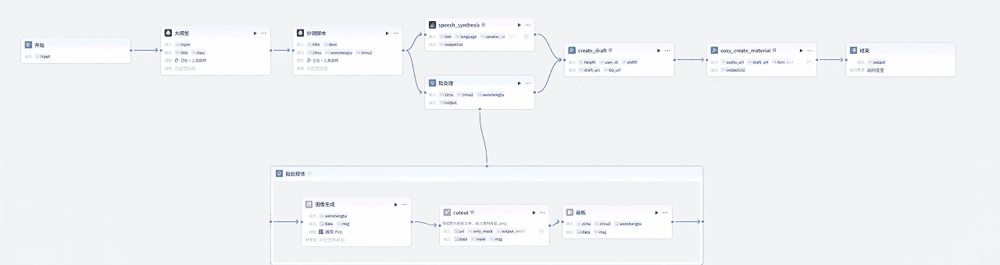

##### 多余色块：完全复刻的后果

But 运行是运行成功了，封面图和内容图片也有了，封面图却有三个多余的白色色块（如下图）。

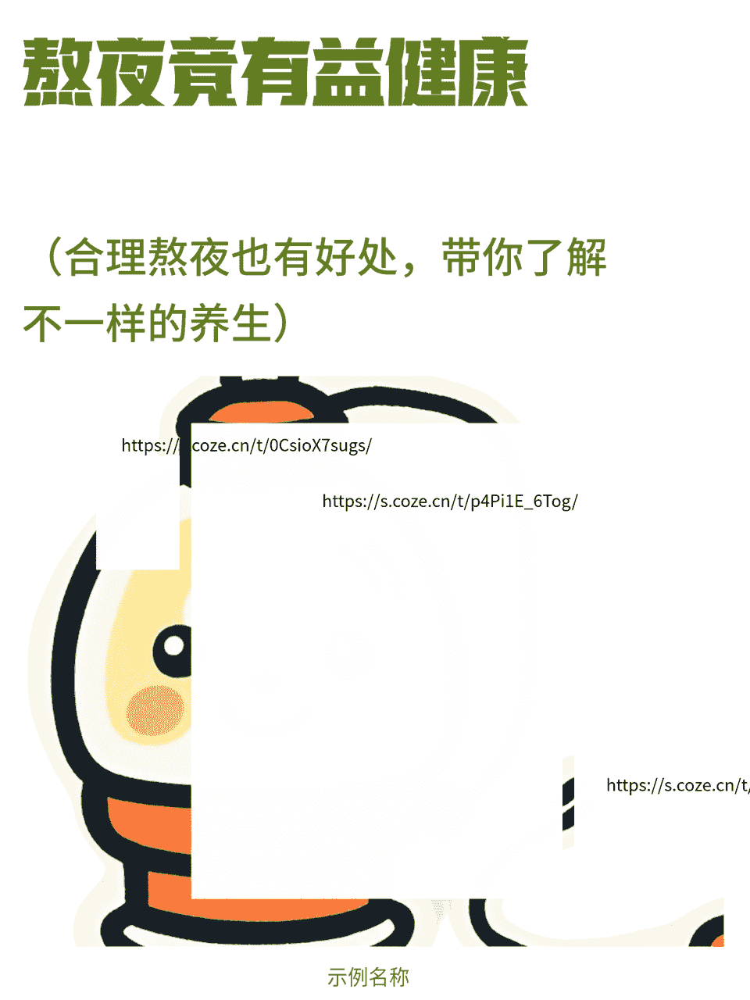

解决了无图文显示的问题后，我又发现了一个新问题——封面图有三个多余的白色色块。我看着那个封面图，心里特别纳闷：“这是怎么回事？我明明是按照手册里的步骤操作的啊。”

仔细对比了手册里的教程示例图和我自己生成的封面图，才发现问题出在哪儿了。手册里的教程示例图里有一个步骤是自建三个白色框再引用变量，我以为这是必须的步骤，所以也跟着做了。

结果我发现，其实直接引用变量就可以了，根本不需要自建白色框。我这才知道，原来完全复刻手册里的步骤也会出问题。

#### 3.解决方法：问教练，调整步骤

没办法，只能再次截图发到群里，向教练求助。骄阳教练看了我的截图后，很快帮我找到了问题所在。他告诉我：“你不需要自建白色框，直接引用变量就可以了。”我按照教练的提示改了一下，再运行，结果真的成功了！

我看着生成的📕图文笔记，心里特别高兴。虽然过程有点坎坷，但最终效果还不错。我心想：“看来我还是要多理解一下背后的逻辑，不能完全依赖手册。”

反思：在不清楚底层逻辑去完全复刻也会造成误会，我看手册的教程示例图如下，所以自己也是迷迷糊糊地以为要完全一模一样，自建了三个白色框再引用变量，导致白色色块多余残留。

正确做法是，直接引用变量，会自动显示三个透明色块——正确如右图

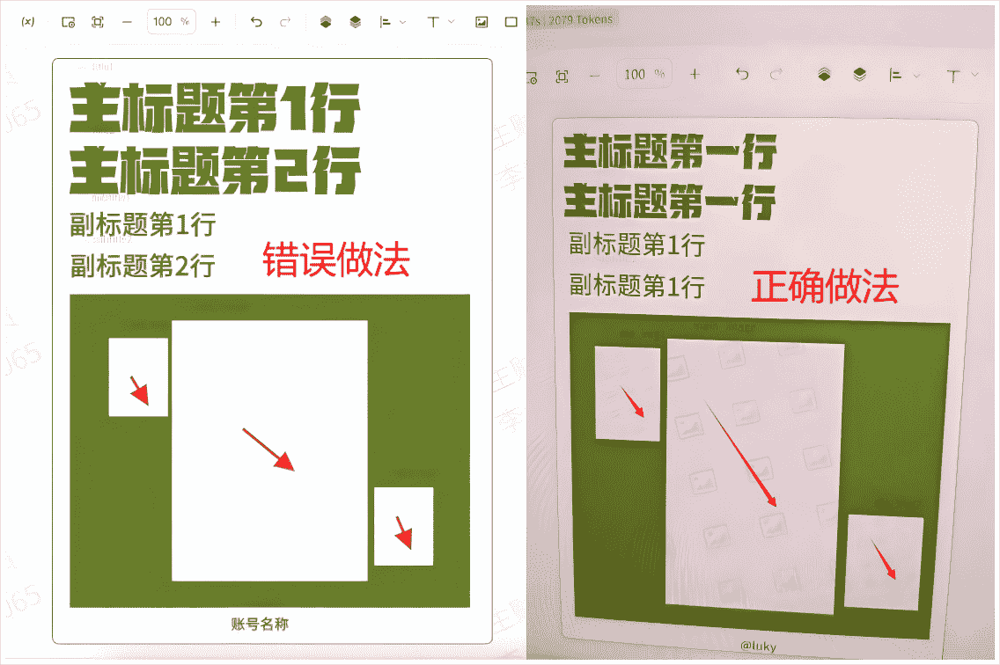

自动生成📕图文爆款笔记成品如下

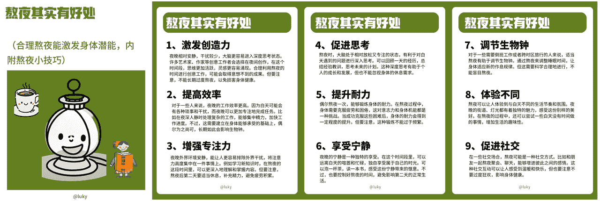

第二个自动化工作流真的来之不易，不过最好结果是好的，所以过程不重要，

**唯有一句话“一切都值得”**。

**贴上一张当天的打卡日记。**

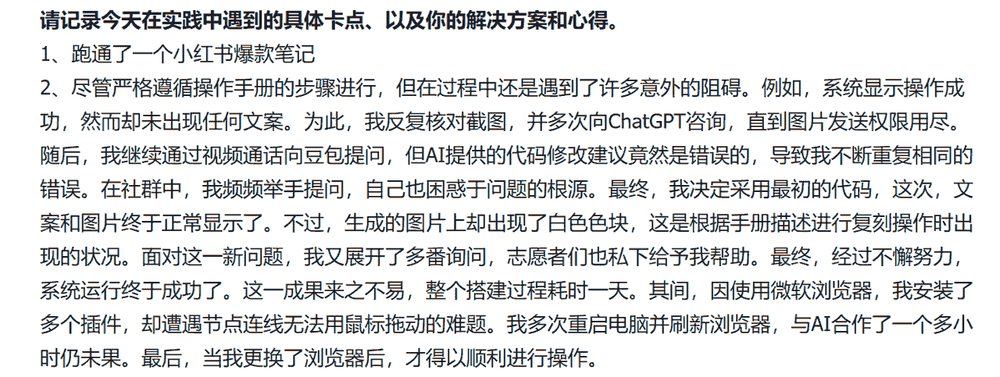

### （三）第3天：AI视频自动化工作流

#### 卡点实录：

- 变量值把人声设成`Bgm`，导致视频没解说，细节没检查到位。

**解决方案**：检查变量值，重新设置人声参数，跑通后视频质感惊艳到自己。

**成果感悟**：这视频质量自己剪得花半天，工作流10分钟搞定，提效神器实锤

经过前两天的折腾，我对AI工作流有了更多的了解。第三天，我开始挑战第三个工作流——AI视频自动化。

经过前两天的尝试和经验，这次我特别小心，每一步都仔细核对，遇到的卡点相对少了很多；不过我还是遇到了问题：

主要卡在一个变量值本应该设置为人声的，结果我设置成了`Bgm`，导致视频输出其他都齐全但缺乏人声讲解

我心想：“这下可麻烦了，我又得去问教练了。”不过我还是决定先自己试试。我仔细检查了每一个变量值，发现确实是自己设置错了。我改了一下，再运行，结果真的成功了！

（整个工作流细节很相对会有点繁杂，所以我们需要在输入每个变量值的时候认真检查好）

不得不说，这生成的视频质量真的有点惊艳到我了~~~

我自己可能都剪不出来这样有质感的视频，就算可以剪出来，也至少要花很长的时间找内容、找图文，剪辑过程的文字搭配，色彩搭配...耗时耗力，工作流真的狠狠提效了

[7eb2face-12f8-41e6-9d57-834a0d4a3506.mp4](https://internal-api-drive-stream.feishu.cn/space/api/box/stream/download/all/QKlVbToD4ou2LNxUqLecLLvwnBc)

### （四）第4天：口播短视频二创工作流

#### 卡点实录：

- 抖音解析接口只有20次免费次数，Claude API充值要开虚拟卡，花钱又麻烦。
- 国内大模型（Deepseek）接入飞书表格，效果和Claude差不多，早知道不花钱了。

**解决方案**：用圈友教的代码+免费插件，跳过付费接口，直接接国内大模型。

**成果感悟**：工作流提效但需优化，要是能自动抓热点就更绝了，手动输入链接太麻烦。

第四天我开始挑战第四个工作流——口播短视频二创改写。这次我特别认真，每一步都仔细记录下来，写成了打卡日记。

我在日记里记录了改写过程中的经验教训，还分享了一些心得体会。我觉得这些经验教训特别有用，以后遇到类似的问题就可以直接参考。

**以下是我个人的一些打卡日记心得**

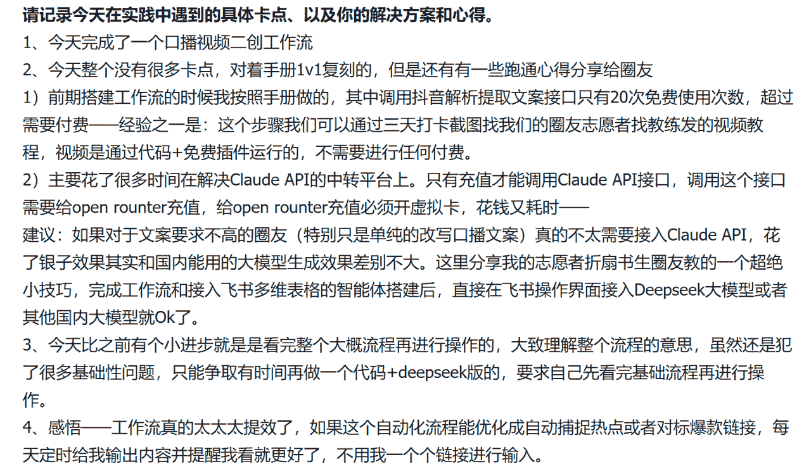

**成果展示如下**

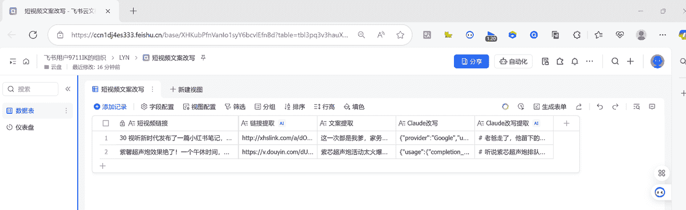

### （五）第7天：Make+飞书表格生成图文工作流

#### 卡点实录：

- 基本没卡点！复制教练模板+配置API，零代码操作超简单。

**解决方案**：直接抄作业，按步骤配置，修改提示词就能换风格。

**成果感悟**：生成的图文太震撼，金融、副业类爆款笔记随便改，零代码也能玩出花！

第七天，开始搭建 Make 搭建飞书表格自动化生产小绿书、📕爆款图文笔记一键批量生成工作流。

我开始挑战第五个工作流——飞书表格自动化生成📕图文笔记。这次我特别兴奋，因为这个工作流可以一键批量生成图文笔记，效率特别高。

我按照手册里的步骤，直接复制了教练的Make和Notion两个模板，然后进行各个环节的API配置。工作流运行成功后，看着生成的图文笔记，说实话这个图文效果真的直接震撼到我了，太牛逼了吧

（对不起，请原谅我完全是个小白）

一键批量生成，而且图文效果特别好。我心想：“这AI工作流真的太厉害了，以后我可以省下好多时间。”

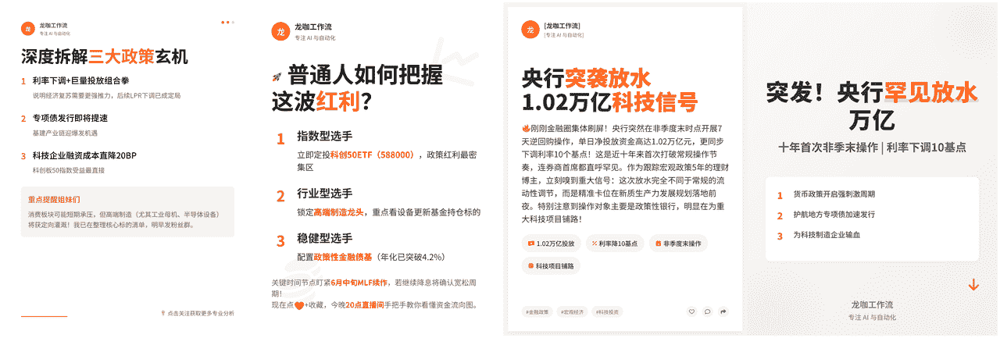

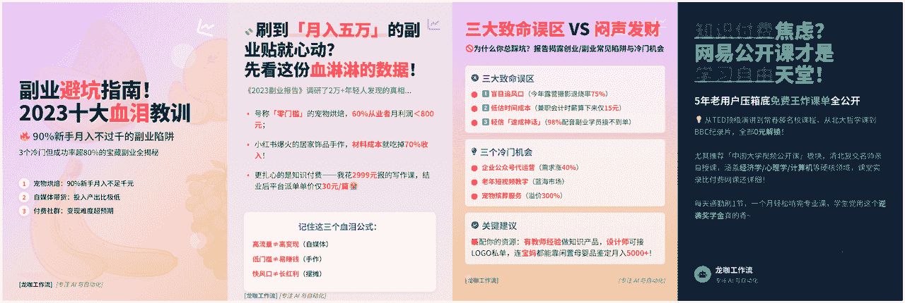

整个搭建过程也非常简单，直接复制教练的Make和Notion两个模板，自己进行各个环节的API配置🔗链接。

除了真正做到零代码、配置容易、图文效果牛之外，最最关键的是我们可以非常简单的操作就可以任意修改风格。

如下图演示：

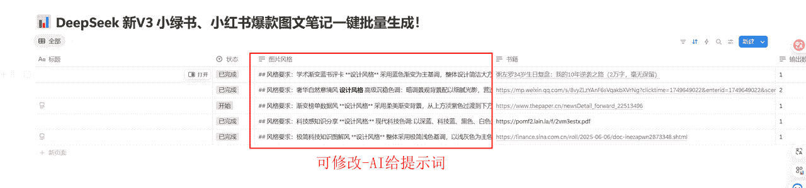

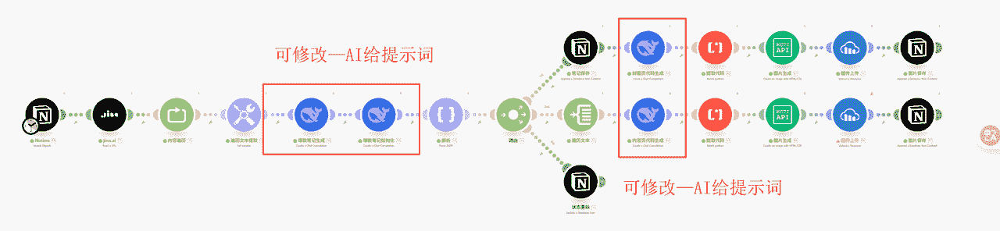

## 二、避坑指南：新手必看的3大血泪教训

### 工具坑

- 微软浏览器插件多到卡壳，换Chrome秒解决。
- Claude API别乱充钱！国内大模型平替很香，除非你追求极致文案。

### 操作坑

- 跑工作流前先通读手册+看视频教程，别一上来就瞎复刻，很多细节藏在视频里。
- 变量值一定要检查！人声/背景音乐、图片/文本格式，错一个就全崩。

### 心态坑

- 别自己死磕！AI额度用完就去群里搜关键词，再不行就举手@教练，他们凌晨2点都在答疑。
- 允许自己报错！我前两个工作流都想放弃，但熬过去就真香。

其实5个工作流有2个我做着做着都想放弃了，就是想不明白对着手册复刻的为啥一直报错运行失败，反复地检查也不知道是什么原因

GPT虽然很聪明但额度有限，每天免费上传截图的次数都会用完，

和不争气的豆包视频通话有时候被误导常常被气到，

Deepseek又需要你详细的描述问题

~~~

对着一个工作流我自己都搞不懂，有时候真的不知道怎么提问，不知道从何下手去问，因为内嵌细节实在太多了。

我平时的时间比较有空，所以属于进度比较快，每当有疑惑和卡点的时候群里搜索关键词也找不到答案，遇到不懂的解决不了，主动不断截图打包好自己的问题后，群里#举手向教练提问请求帮助指导

下面我把自己的遇到的问题和如何去解决的方法思路做了一份汇总：

### 困难

#### 手册复刻问题：完全照做也会出错

我在学习过程中发现，完全按照手册操作，有时候也会出错。手册里的步骤虽然很详细，但有些细节还是需要自己去理解。例如有些步骤可能需要根据自己的需求进行调整，而不是完全照搬。

#### 提问困难：不知道怎么问

有时候遇到问题，我不知道怎么提问。问题太复杂，我自己也搞不懂，不知道从哪儿下手。比如我遇到一个报错，完全看不懂错误提示，也不知道该怎么描述问题。

#### 工具限制：额度有限，容易被误导

我用的GPT虽然很聪明，但额度有限，每天免费上传截图的次数都会用完。而且有时候用其他的比如豆包的回答也会误导我。比如我问了一个问题，给了我一个答案，但我按照答案操作后，发现还是不行。

### 解决方法：先自己尝试，再提问

#### 先自己尝试：利用AI、搜索、手册

每次遇到问题，我都会先自己尝试解决。我会利用AI、搜索、手册等工具，看看能不能找到答案。很多时候，我都能自己解决问题。

例如遇到一个变量设置错误，我会先用AI问一问，或者在手册里找找类似的案例，看看别人是怎么解决的。如果还是不行，我就会去搜索引擎里搜一搜，看看有没有其他人的经验可以参考~~~

### 群里提问：教练和优秀的船员们的帮助

实在解决不了的问题，我就会按照要求截图发到群里，向教练和自己的圈友们求助。

每次提问，教练们都会特别耐心地解答，而且还会给我一些额外的建议。我们3群的队友们也很热心，有时候还会分享他们自己的经验。

有一次我遇到一个特别复杂的报错，自己折腾了好半天也没搞定。我截图发到群里后，教练很快就回复了我，还详细地解释了错误的原因和解决方法。其他有经验的队友们也纷纷留言，分享他们遇到类似问题时的解决办法。

那一刻我特别感动，也特别感谢3群温暖的团队。

## 三、夸夸环节：航海里的我的3群神仙队友

### 教练团

4个500人超大群，每天被小白问题淹没，但凌晨2点还在回消息，耐心到离谱。

### 志愿者折扇书生

教我用国内大模型平替，省了好几百，还分享了超多信息差，越聊越赚。

### 领队马可乐带着3群队友

每天互相打气，“手拉手别掉队”不是口号，真的有人陪你一起熬。

### 教练特别有耐心

这里必须得夸夸我们的教练，他们真的超级认真负责，我们群里绝大多数都是完全零基础的小白，每个人的基础都不一样，每个人的进度都不一样，有时候会问一些特别基础、特别琐碎的问题~~~反复问重复问

每个人的基础都不一样，进度也不一样，怎么没成生图片，怎么下载不了...."四个四五百人的群每时每刻都充斥着这样的提问，但是教练他们真的不厌其烦地耐心解答。经常凌晨还在解答船员问题，甚至凌晨两点多还在线答疑解惑。

> “这个节点那个节点是哪里出错”

> “这个节点为啥没生成图片”

> “这个怎么下载不了”……

这些问题看起来很简单，但教练们从不厌其烦，总是耐心地解答。

4个四五百人的群每时每刻都充斥着这样的提问，但是教练他们真的不厌其烦地耐心解答。

不仅白天在线及时答复，有时候凌晨两三点还在群里解答问题，这种敬业精神真的让我特别感动和有动力

## 领队的独特领航

虽然我是第一次参加航海，但航海的可乐领队带队方法真的让我有很深的体感，带队方式特别有意思——

没有死板的督促，取而代之的是“让船员理清自己的目标，每日打卡加油补给站、每天船员高频问题的记录、每日温馨花样文案提醒打卡”，用一些特别温暖、特别有趣的文案鼓励我们，这种氛围特别好，让我们感觉我们是一个团队，营造了一种“we are a team“，需要互帮互助，谁也不要掉队”的精神

让我们用清晰代替混沌、让具体代替模糊，所以实战期间整个3群的求知行动氛围都很浓烈。

这种精神特别鼓舞人心，让我在遇到困难的时候也不轻易放弃。

## 志愿者热心解答

志愿者们也特别给力。感谢我的志愿者折扇书生，能感受到他是一个睿智充满学识的前辈

每次和他沟通，我都能学到很多东西。他不仅帮我解决了技术上的问题，还给我分享了很多之前我不知道的信息差。一些小技巧，还有一些特别实用的资源。通过和他交流，我感觉自己收获特别多，真的是越沟通越有收获

## 四、终极总结：从0到1的3点真实感悟

> **别高估难度**：我一个文科生都能跑通，你肯定也行！别被“代码”“API”吓退，大部分是傻瓜式操作。

> **模板是死的，人是活的**：跑完5个工作流最大的收获，是知道怎么根据自己项目改模板，避免千篇一律。

> **执行力才是船票**：教程不值钱，值钱的是你动手干！哪怕每天只跑通一个节点，7天也能攒出大成果。

### 1. 收获：从0到1的突破

这次航海让我对AI工作流有了更多的认识。虽然我还没有完全掌握，但至少我已经从0到1迈出了第一步。

现在我大概懂得怎么配置工作流，怎么根据自己的需求调整模板。

比如我学会了怎么根据自己的项目修改模板，避免千篇一律的内容。这对我来说是一个很大的进步，也让我对未来的工作充满了信心。

### 2. 实战后的建议

#### 多看手册和视频

我建议大家在学习工作流的时候，一定要多看手册和教练录制的视频。手册里的步骤很详细，视频里的操作也很直观。两者结合起来看，卡点会少很多。

我在学习📕图文工作流的时候，刚开始只看手册，很多地方都不明白。后来我看了教练的视频，一下子就明白了，多看手册和视频真的特别重要。

#### 遇到问题别慌

遇到问题的时候，大家千万不要慌。先用AI和搜索工具尝试解决，实在找不到解决方案`#举手大群再提问教练`。

我遇到一个特别复杂的报错，刚开始特别着急，不知道该怎么办。后来我冷静下来，用AI问了问，又在搜索引擎里搜了搜，最后还真找到了解决办法。所以遇到问题不要慌，先自己尝试解决，这样不仅能掌握得更好，也能让自己成长得更快。

## 五、最后安利：赚钱航海真的香

### 这次航海让我收获满满

这次航海让我对AI工作流有了更深的理解。虽然过程很曲折，但收获真的特别多。我不仅学会了怎么搭建工作流，还学会了怎么解决问题。

更重要的是，我在这个过程中结识了很多热心的教练和同学，第一次来参加航海实战，在3群他们给了我很多帮助和支持。这种温暖的团队氛围特别珍贵，也让我特别难忘。

### 继续探索，挖掘更多宝藏

In the end，跑完这些工作流之后，我也知道并不会立刻变身成AI工作流大师，只是我从0-1对AI工作流有更多的认识和了解，起码在购买工作流模板的时候，我也大概懂得如何配置如何提需求

（把我内心真实想法说出来了，哈哈）

模板是千篇一律的，而我们做内容是要避免千篇一律的，所以我们得根据自己的项目来修改模板。

最后强烈建议大家在学习工作流的时候，手册+教练录制的视频一起看，这样卡点会少很多很多。

遇到问题不要慌，先AI—群里搜索关键词提问——`#举手提问教练`。

教练也说了，这些工作流就是一层窗户纸，只要我们跟着手册和视频把手弄脏，下场实操，就一定能跑通，所以大家千万不要被它的名称吓跑了，先干起来再说，干中学！！

这是我第一次知识付费，**很幸运选择了赚钱**，也希望自己在赚钱这座知识金矿中挖掘出属于自己的那块独特黄金。越分享越幸运，让我们一起加油💪，一起龙哥盟~
