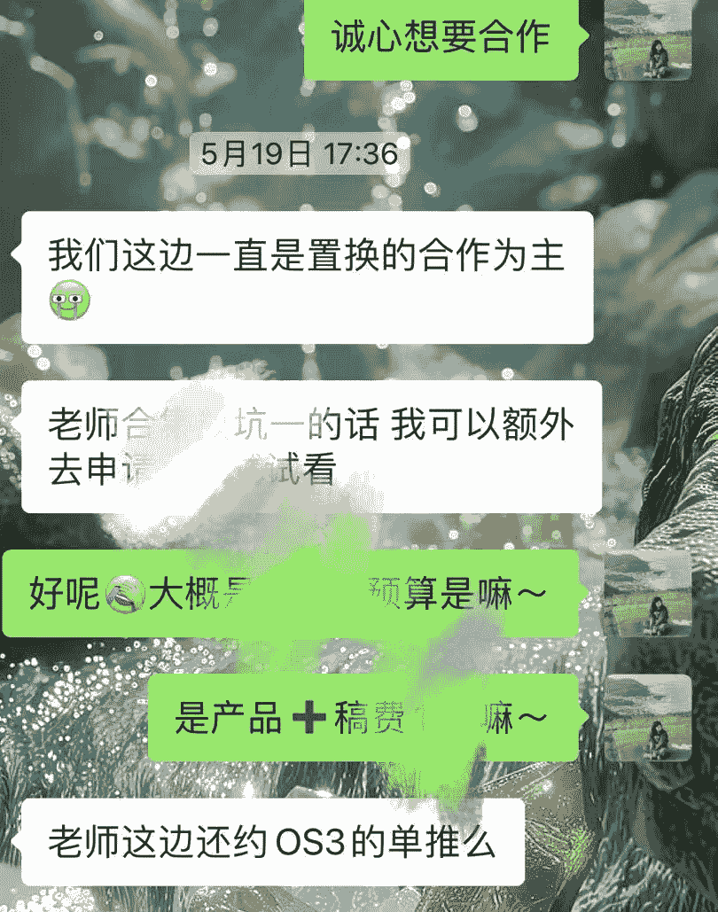
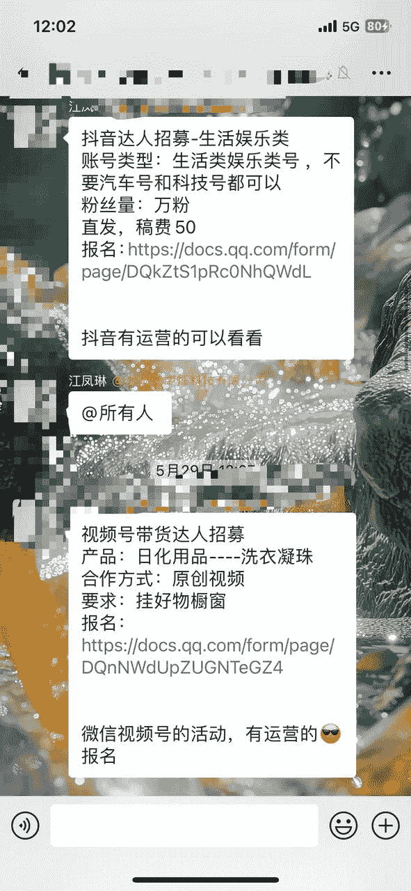
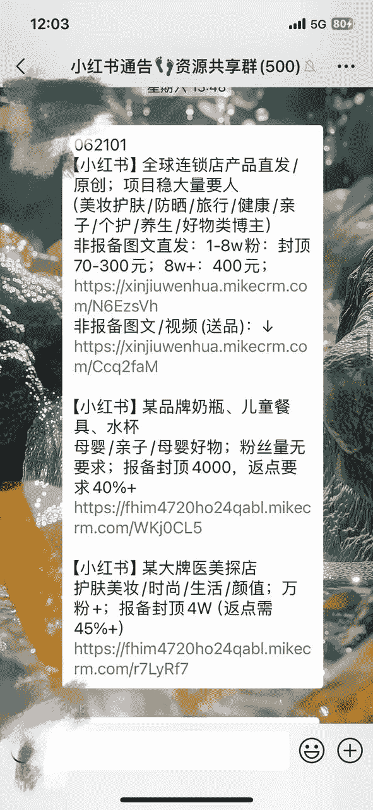
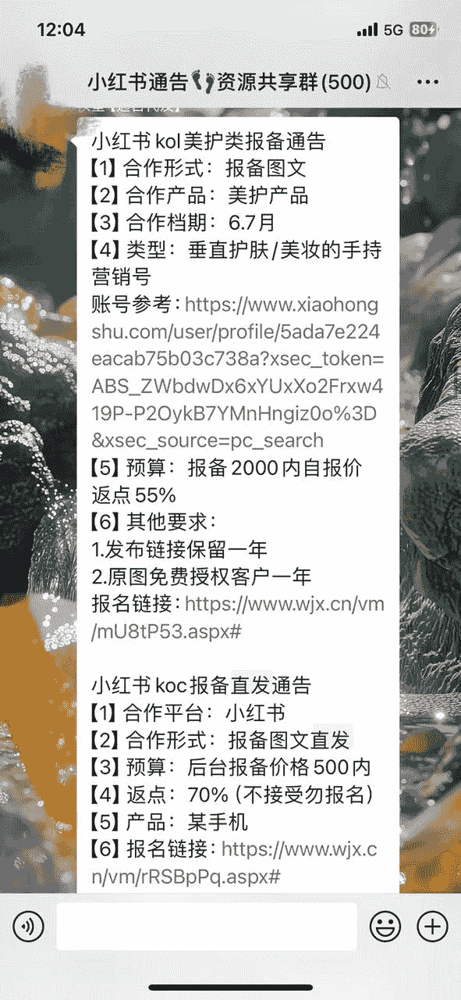
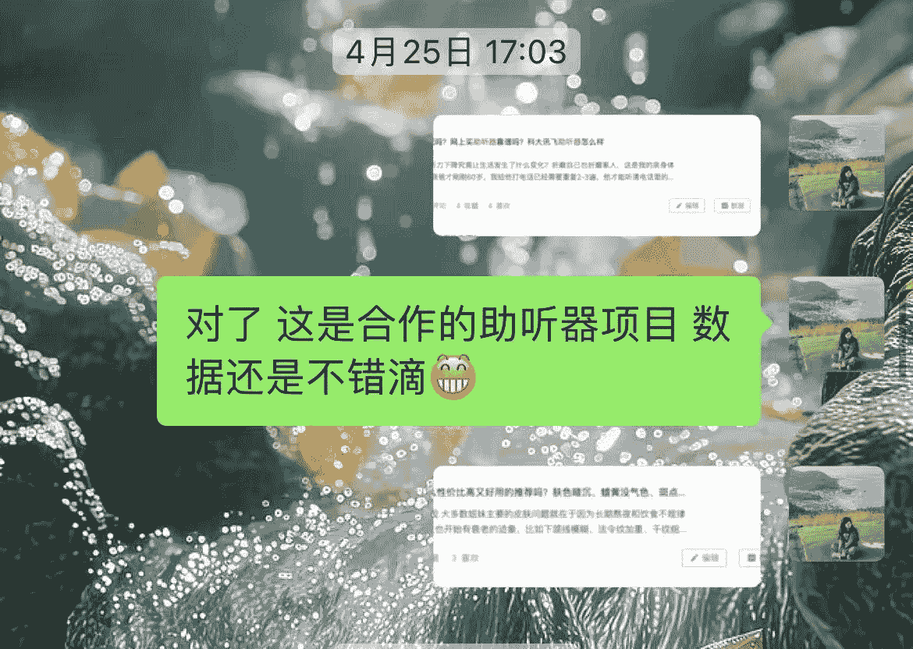
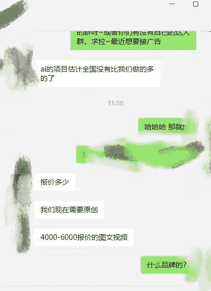
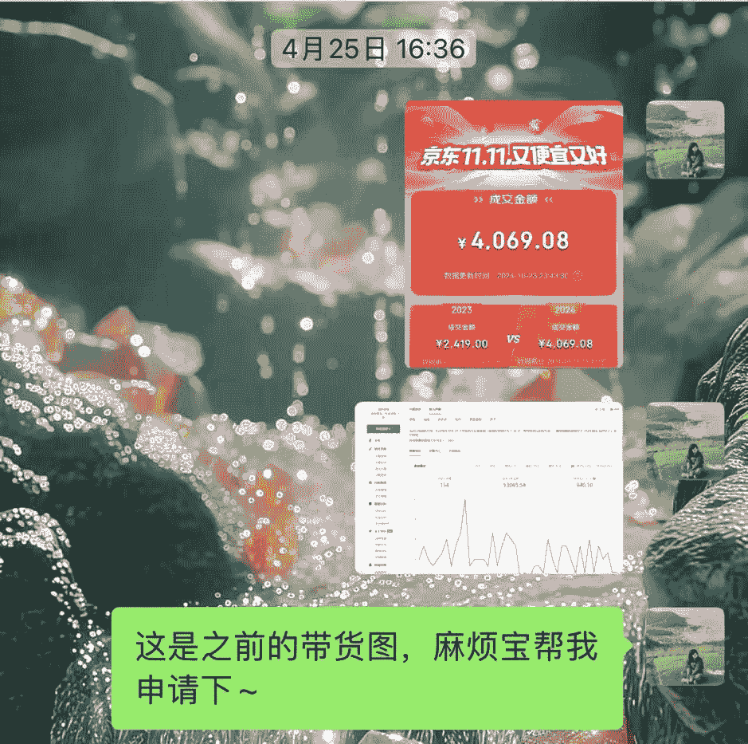
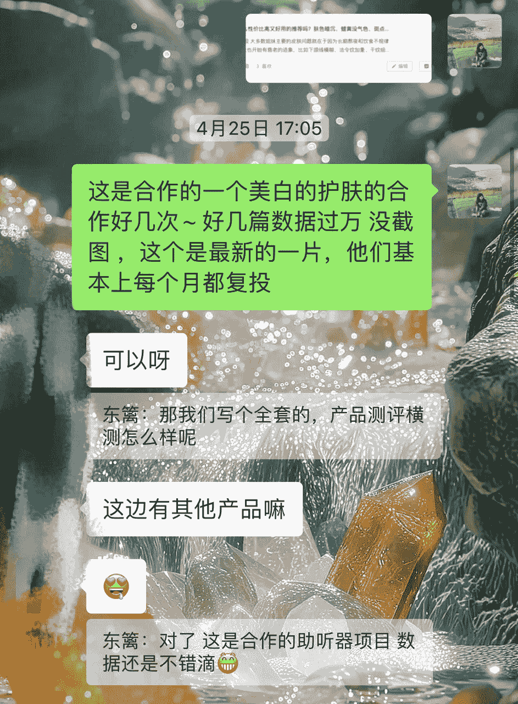
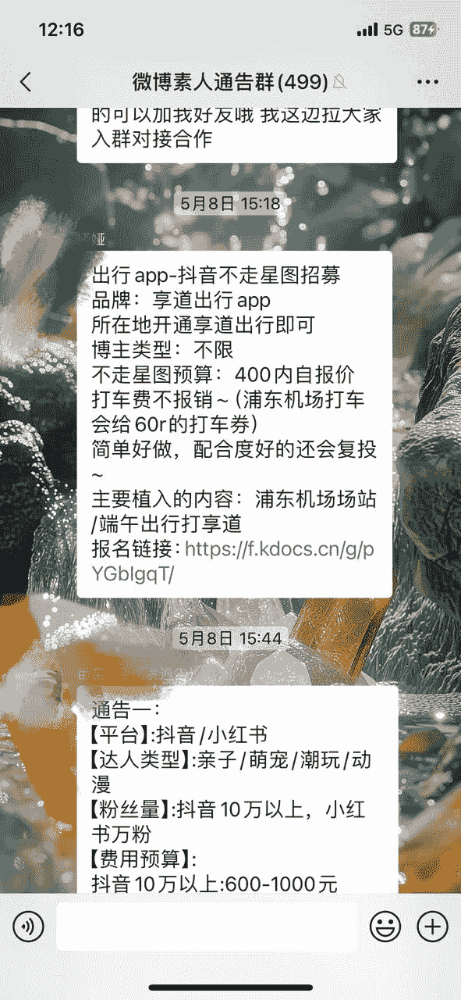

# 从PR到自媒体人：如何用品牌思维接“对”广告？

> 来源：[https://xuqiwei1986.feishu.cn/docx/Q76WdApUnorzAKxQJsBcYv0xnPc](https://xuqiwei1986.feishu.cn/docx/Q76WdApUnorzAKxQJsBcYv0xnPc)

大家好，我是东篱。曾作为实习品牌PR负责过六位数预算的广告投放，目前是Ai自媒体的航海教练，累计合作500+品牌。

这次分享的主题，是解决新人第一条广告怎么接的痛点。

接下来，我将从甲方的需求是什么，怎么谈判，怎么写一条广告内容，进行分享。

### 一、深入沟通：搞懂甲方真正要什么

甲方投放广告的核心目标无非几点：品牌曝光——增加知名度、产品转化——需要精准的用户、用户增长——更多用户了解并使用这个产品。

在品牌发展的不同阶段，或者是最近的营销节点不同。他们的需求可能不同，一般来说根据不同的公司，有这么几种。

+   **新品牌**：更看重曝光和种草，需要你的内容突出产品差异化；

+   **成熟品牌**：追求转化率，可能要求带货数据或精准引流客户；

+   **大厂预算**：往往需要品效合一，既要有调性，又要有效果。

# 二、怎么谈判

**沟通具体的案例**：

1.  **主动提问**：不要只问“您想怎么合作”，而是追问“老师这次推广我们主要是什么合作方式呢？置换嘛还是有稿费的预算呢？

1.  **明确交付标准**：客户提供素材直发，还是自己做内容写发？是需要单个广告植入还是横向测评多个品牌植入？

预期档期是什么时候发布，比较急需要最近发布，还是在确定下个月的档期？

1.  **展示你的优势**：比如近期的数据，（阅读量比较高就给甲方看最近的阅读。赞藏数据比较好，就给甲方看最近的赞藏数据。最近有爆款内容，就给看最近的爆款内容。最近的带货GMV比较高，就展示GMV）

过往案例数据，比如写在5月写某个APP的推广，目前数据是2W阅读。通过这个链接下载了2000个用户，目前还在增长。

上个双十一期间发布的笔记，阅读量是3万。GMV是XX万，一共有88个用户通过我的链接种草这个产品

用过往的实际案例，证明你能帮甲方解决什么样的问题。

### 1. 锚定价格：拉高甲方心理预期

+   **适用场景**：初次报价或甲方未明确预算时。

+   **具体操作**：

+   **基础公式**：单条报价 = （粉丝数 × 行业系数） + 内容附加值（AI领域系数较高，建议取3%-8%，1700粉丝可报50-150元，再根据内容形式加价）

+   **话术示例**：> “我们的粉丝以AI从业者和技术爱好者为主，过往推广的XX工具转化率超过15%。常规合作报价是200元/条（图文），视频+口播为300元。”

### 2. 打包方案：用“内容增量”替代“降价”

+   **适用场景**：甲方预算低于你的底线时。

+   **策略组合**：

| 甲方需求 | 你的对策 | 价值包装话术 |
| --- | --- | --- |
| 单条预算仅100元 | 改为“2条短图文+1条评论区置顶” | “建议用多次曝光覆盖用户决策周期” |
| 无法提高单价 | 捆绑“下月免费复投1次”（锁定长期） | “合作合作可以提前空出下月的档期” |
| 嫌视频成本高 | 改用“图文+社群推广”组合 | “我们的私域社群精准度更高，可补曝光” |

+   **关键点**：

+   将“降价”转化为“增加服务项”，避免自贬身价。

### **3. ****长期合作优惠：用复购率换稳定性**

+   **阶梯报价设计**：

+   单次合作：200元

+   3次打包：500元（约83折，均摊后单条167元）

+   年度框架：6次共900元（单条150元，但提前锁定收入）

+   **关键点**：

+   长期合作的实际价值是降低你的获客成本（不必反复找新甲方）。

### **4. 谈判中的“价值强化”技巧**

+   **3个必提数据**：

1.  **粉丝价值**：“我们的粉丝中，35%是AI产品强需求的决策者（附后台截图）。”

1.  **历史案例**：“上周推广的XX工具，评论区有17人晒付费截图（附截图）。”

1.  **内容长尾效应**：“AI类内容搜索权重高，这条视频未来3个月仍会带来转化。”

+   **规避压价的话术**：

+   甲方：“其他博主更便宜。”→ 回应：“他们的粉丝是否包含我们的精准技术人群？这是我们最近的用户调研数据（附图表）。”

### **建议：**

+   **准备谈判工具包**：

1.  粉丝画像报告（年龄、职业、消费能力）；

1.  过往案例数据（播放量、转化率截图）；

1.  标准化报价单（不同套餐明码标价）。

+   **心态建设**：小博主的核心优势是灵活性和精准度，不必因粉丝量自卑。

+   可直言：> “我们目前接单少，对甲方的内容会更用心打磨，这是大V做不到的。”

通过以上策略，即使粉丝量不高，也能逐步提高客单价，并筛选出优质合作伙伴。

### **三、第一条广告，我该怎么写？****接广告的流量密码：质量＞数量**

甲方最怕的不是贵，而是广告没效果。如何让广告既不掉粉又能打？

在接广告时，让广告不像广告”才是最高境界，尤其是对于AI垂直领域，用户普遍对硬广反感，但对深度价值内容接受度高。

而且，广告，如果写的太硬。蒲公英后台也会提示广告不能显示。

### 1. 内容融合技巧：让广告成为粉丝的“刚需信息”

#### **① 原生广告的3种高阶玩法**

| **类型** | **适用场景** | **AI领域案例** | **用户价值点** |
| --- | --- | --- | --- |
| **测评对比法** | 工具类产品（如ChatGPT插件） | “实测5款AI翻译工具：DeepL竟输给这个冷门神器！”（将甲方产品放在对比中自然胜出） | 帮助用户节省试错成本 |
| **教程植入法** | 付费课程/SaaS工具 | “用XX工具+AutoGPT，3步搞定周报！附我的工作流模板” | 提供可复用的方法论 |
| **行业报告法** | ToB类产品（如AI云服务） | “2024年AI创业避坑指南：这些服务器成本能省40%”（嵌入甲方产品参数对比） | 输出稀缺数据/洞察 |

**关键点**：

+   甲方产品必须与你常规定位强相关（如AI工具博主接编程课广告会违和）。

#### **② 故事化表达的黄金结构**

1. 痛点开场：

“作为AI博主，最头疼的就是素材整理——直到发现XX工具的【智能归类】功能...”

（用真实场景引发共鸣）

2. 使用过程：

展示你如何用该工具解决具体问题（如“3小时的工作现在10分钟搞定”），重点呈现“Before-After”对比。

3. 第三方背书：

“团队里的小白用这款工具后，产出效率居然超过了我这个老手...”

（增强可信度）

#### **③ 差异化创意模板**

+   **反套路反转**：“花了5000元买AI课，最后发现最有用的竟是这个免费功能...” → 引出甲方产品某个亮点。

+   **技术梗幽默**：用“程序员黑话”或AI圈梗（如“显卡燃烧”“炼丹失败”）设计剧情，吸引精准用户会心一笑。

+   **元宇宙式互动**：让粉丝在评论区输入指令，你用甲方工具实时生成结果（如“回复‘画一只赛博猫’，我用XX模型帮你跑图”）。

### **2. 提升广告数据的方法**

#### **① 如何提高前3秒停留？**

| **钩子类型** | **案例** | **适用产品** |
| --- | --- | --- |
| **数据冲击** | “这个工具让我的代码错误率从30%降到2%...” | 开发者工具 |
| **悬念提问** | “为什么99%的AI博主都不敢公开自己的素材库？”（答案：因用了XX管理工具） | 效率类SaaS |
| **身份认同** | “所有Prompt工程师都在偷偷收藏这个网站...” | AI资源平台 |

#### **② 中场留存技巧**

+   **“激发好奇心”**：> “接下来要演示的功能，可能会让某些同行失业...” → 激发好奇心看完。

+   **即时互动**：在视频中插入选择题（如“你觉得这个功能值多少钱？A. 99元 B. 199元 C. 免费才对”），大幅提升评论率。

#### **③ 转化闭环设计**

+   **低门槛行动**：不要直接让粉丝购买，而是引导：> “回复‘工具’获取独家优惠码” → 先沉淀到私域再转化。

+   **恐惧营销**：> “该工具企业版即将涨价50%，个人版优惠仅限本周...” （需真实有效）。

### 3. 长期合作维护：让甲方离不开你

#### **① 数据复盘沟通** 1. 发送数据的图片，与甲方沟通目前的情况。并提出希望能够再争取合作

#### **② 拒绝低质广告的3条红线**

1.  **技术造假**：如宣称“完全无需训练”的AI模型。

1.  **过度承诺**：如“学会这个工具立马年薪百万”。

1.  **伤害粉丝**：如要求粉丝下载注册后才给完整教程（可用“试看+付费”模式替代）。

#### ⓷建立品牌资源分级管理SOP**（从“感受”到“数据”）**

##### **一、 核心维度建议**

建议采用两个核心维度，进行组合分级：

1.  **合作紧密程度（历史+关系）**：代表过去的合作基础和信任度。

1.  **需求匹配度与频率（未来+业务）**：代表未来的合作潜力和商业价值。

（可以把对方欠我多少钱写在描述里）

##### 二、 具体标签体系（可直接照搬）

###### 第一维度：合作紧密程度 (Relationship Level)

+   S级-战略伙伴：合作5次以上，流程顺畅，付款爽快，且有长期合作意向。

+   A级-稳定伙伴：合作2-5次，体验良好，可持续开发。

+   B级-尝鲜伙伴：合作过1次，无不良体验，可继续试探。

+   C级-待开发伙伴：有过联系但未合作，或合作体验一般需观察。

+   D级-黑名单：合作体验极差（拖款、事多、效果差），永不合作。

###### 第二维度：需求匹配度与频率 (Business Potential)

+   需求高频：每月有固定推广预算，产品/服务多，需频繁投放。

+   需求中频：每季度有推广计划，或有新品上线时会投放。

+   需求低频：每年仅有1-2次大促或重大节点才投放。

+   需求不明：未明确透露过需求频率，需进一步沟通。

###### 第三维度（补充）：行业/品类 (Industry)

+   教育、金融、消费品、互联网、职场...

+   此标签用于快速筛选，针对特定内容寻找合适的PR。

##### **三、 如何操作与运用这套体系**

**第一步：信息普查与打标签**

1给你🛰️里的几百个PR发一条标准化、不惹人厌的“普查消息”：

2我的话是平时就有打标签的习惯，建议大家可以平时养成打标签的习惯。

**话术模板：**

“Hi [PR姓名]，我是东篱呀~ 为了方便后续给您推荐更匹配的知乎合作机会，想简单了解下咱们Q3/Q4的推广节奏大概是什么样的呀？[可爱表情]”

+   **高频回复**：“我们每月都要投”

+   **中频回复**：“我们9月有个新品要上”

+   **低频回复**：“暂时没计划呢，有需求找你”

根据回复，快速给所有PR打上新标签。

**第二步：建立分级维护策略**

| **等级** | **维护策略** | **沟通频率** | **目标** |
| --- | --- | --- | --- |
| **S级+高频** | 重点维护，优先报备平台流量红利、新品位，可给折扣 | 每周1次 | 成为你的“现金奶牛” |
| **A级+中高频** | 定期推送最新案例和数据，主动推送合作方案 | 每2周1次 | 培育成S级客户 |
| **B/C级+需求不明** | 放入朋友圈“**发布可见**”分组，定期推送优质案例 | 每月1次 | 激活需求，推动首次合作 |
| **低频/需求不明** | 节假日群发祝福即可，降低维护成本 | 季度1次 | 保持联系，以备不时之需 |

第三步：实现“高效运作”的具体动作

1.  **优先推送**：知乎有新政策、好流量时，第一时间**通知S级+高频的PR，让他们抢占先机。

1.  **定制方案**：针对A级+中频的客户，根据他们过往投放过效果好的内容，定制类似的合作方案，提高成交率。

1.  **批量激活**：当你有空闲档期时，可以针对需求中频的客户群发一条消息：“本周有3个知乎视频位优惠，有需求吗？”  often能激活临时需求。

1.  **反向筛选**：节省时间。对于低频和需求不明的客户，不必投入大量精力维护，专注于服务好高价值客户。定期触动，开启第一次合作

### 终极心法：广告内容的“不可能三角”

**解释**：

+   任何广告最多只能满足其中两项（如硬广满足甲方和效果但掉粉），而你的目标是无限逼近三角中心——通过持续优化内容质感实现三方共赢。

### **总结：甲方思维=共赢思维**

接广告不是一锤子买卖，而是用你的流量和内容能力，帮甲方解决问题。越是懂甲方的需求，越能拿到高单价和长期合约。记住：

1.  沟通阶段挖需求，明确KPI；

1.  谈判阶段换位思考，用方案说服；

1.  执行阶段追求质量，用数据说话。

学会这一套，你不仅能接更多广告，还能成为甲方争抢的优质合作伙伴。