# 这套rpa视频矩阵系统是你的另一个帮手，100个账号也能轻轻松松解决

> 来源：[https://xuqiwei1986.feishu.cn/docx/H2fldRrhqo3m9Kxwb4zcLmRcnFe](https://xuqiwei1986.feishu.cn/docx/H2fldRrhqo3m9Kxwb4zcLmRcnFe)

上个月我做了一套矩阵发布系统，经过不断的打磨，终于让这套工具更新了第三个版本，这次真正实现了一劳永逸。目前支持发布的平台有：👸号，抖音，📕，b站，小绿书，闲鱼。还有一款自动洗稿工具，目前我是用的kimi对话框，先以白嫖为主，有需求的我后期给大家对接一个我自用的一个ai。

现在的很多所谓的一键发布工具都不注重ip和环境的隔离，看起来能添加很多账号，但是实际情况是一个账号出现问题，一堆账号直接连坐。我这套主要是以比特浏览器为主，一个账号一个环境一个IP，实现了真正的隔离自动化发布。每个账号互不相关，自己干自己的。

大家只需要批量把自己的内容放入配置表，配置好之后每天你的发布任务交给它就完事了，你甚至可以一次性配置好一个月的内容，电脑保持开机，然后自己出去旅游一圈。

赚钱是全网最高质量的社群了，我把工具放出来，我的工具如果能得到大家的认可，是我莫大的荣幸，我相信还会有更多的大佬能提出更多建设性的意见。我工具中的暗号，大家直接输入：龙哥盟。

# 支持不同体量的自媒体人使用

我这套系统分别配置了edge浏览器，谷歌单账号浏览器，谷歌多账号，比特浏览器。

其中你如果有1-2个账号，edge浏览器和谷歌单账号就够用了。

如果你有3-5个账号，谷歌多账号也能凑合凑合。

如果你有5个以上的账号，就使用比特浏览器来隔离账号环境，理论上说账号上不封顶，我这边有一个电脑一次性能跑50个比特窗口。

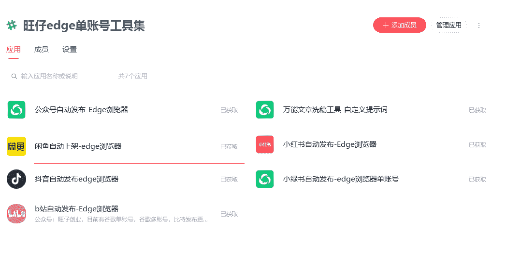

# 工具核心

影刀rpa模拟人工操作的，正常来说不会由于工具导致封号，封号只可能是因为你自己的内容不符合平台的规则。

配置表是整个流程的核心，一定一定要跟着配置表来。

# 影刀首次安装新手必看

今年我会分享很多影刀工具，并且持续更新，本篇文章给大家具体分享一下我给大家的影刀脚本链接如何使用。新手小白可以跟着教程一步一步来，老司机直接获取链接用就可以了

## 视频教程演示

[1影刀配置以及插件的安装.mp4](https://internal-api-drive-stream.feishu.cn/space/api/box/stream/download/all/Q4h4bRwMOo8chIxwTe9cYEFDnec)

## 图文教程

### 一：下载影刀（有影刀忽略）

`https://www.winrobot360.com/share/activity?inviteUserUuid=598859198794305538`

### 二：加入应用市场（有账号的直接登录，没账号注册一个）

`https://www.winrobot360.com/share/accede?inviteKey=e63955eb-3ba7-4bf4-bd67-2476508a3a39`

### 三：验证是否添加应用

进入影刀桌面版-点击市场（可以看到加入的市场）

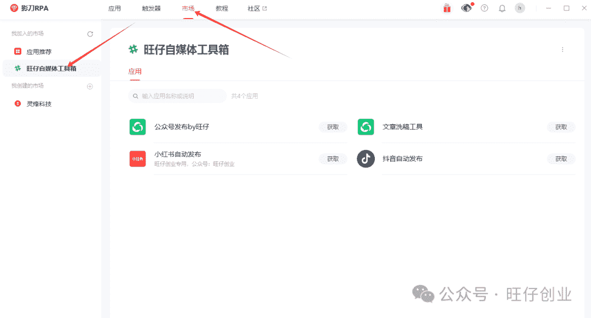

### 四：对应应用点击获取

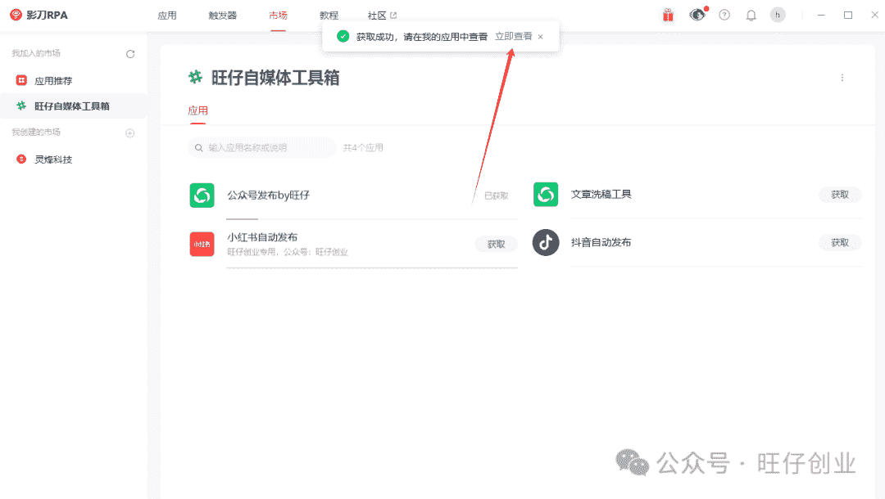

### 五：查找对应获取应用即可

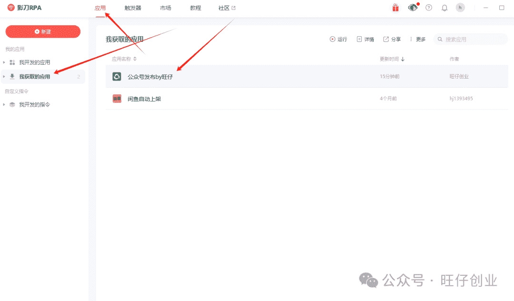

### 六：浏览器配置

我用的基本是系统自带的Microsoft Edge和比特浏览器，所有只做这俩个的教程，其他的相似。（此次就用官方教程借花献佛了）

#### Microsoft Edge

Microsoft Edge 安装插件说明 - 影刀帮助中心

#### 谷歌浏览器

浏览器插件安装说明 - 影刀帮助中心

#### 比特浏览器

##### 1.下载比特浏览器

下载比特浏览器：`https://www.bitbrowser.cn/?code=168f81`

在下载安装好比特浏览器之后，注册账号，免费账号可以开十个环境，一天一共打开50次，对于普通人来说绰绰有余了。

##### 2.在比特浏览器中安装影刀插件

###### 2.1 影刀插件安装

打开比特浏览器找到扩展中心，输入影刀，之后点击搜索，在设置中选择所有窗口

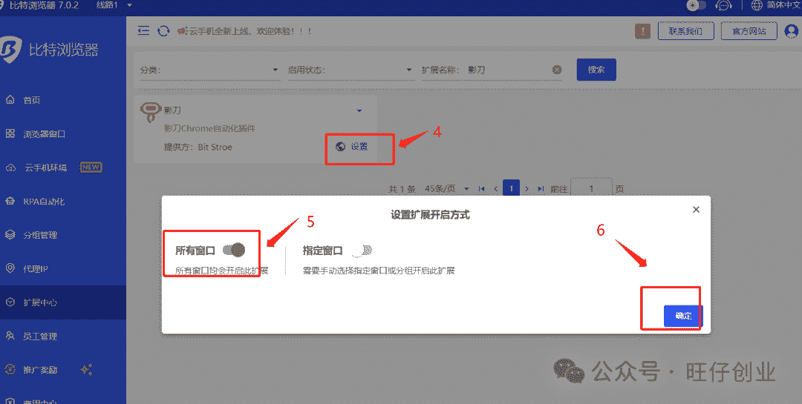

###### 2.2 验证影刀插件是否安装成功

1.随便创建一个窗口

打开窗口看看影刀浏览器是否安装成功

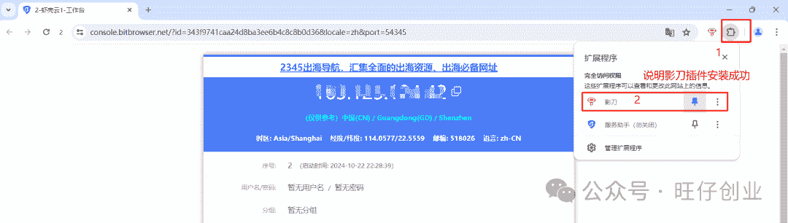

##### 3.在影刀中添加比特浏览器的路径

3.1 随便打开一个比特浏览器窗口

3.2 在电脑下方任务栏右键鼠标，找到任务管理器，点击

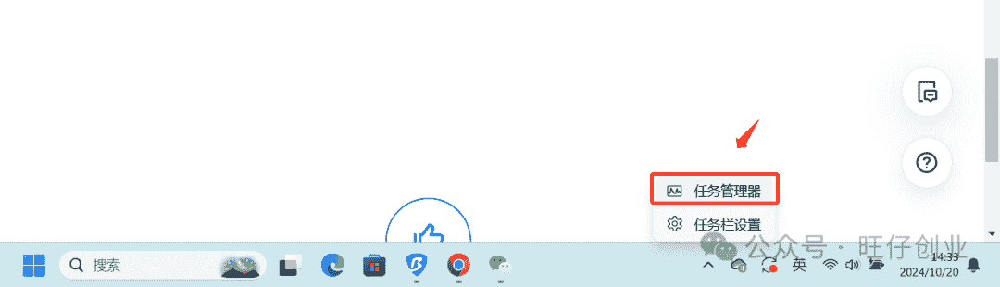

3.3 找到刚打开的比特浏览器进程后鼠标右键，（一定要注意打开和我图片显示一样演示的进程，里面有一个进程容易混淆，打开文件所在目录，然后复制这个目录地址，保存下来，待会会用上。

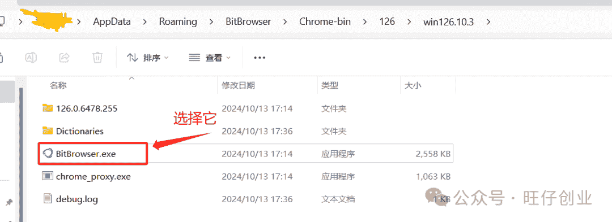

复制以上目录地址，为以下影刀中添加比特浏览器时，能快速找到比特浏览器。

##### 4.影刀中添加比特浏览器

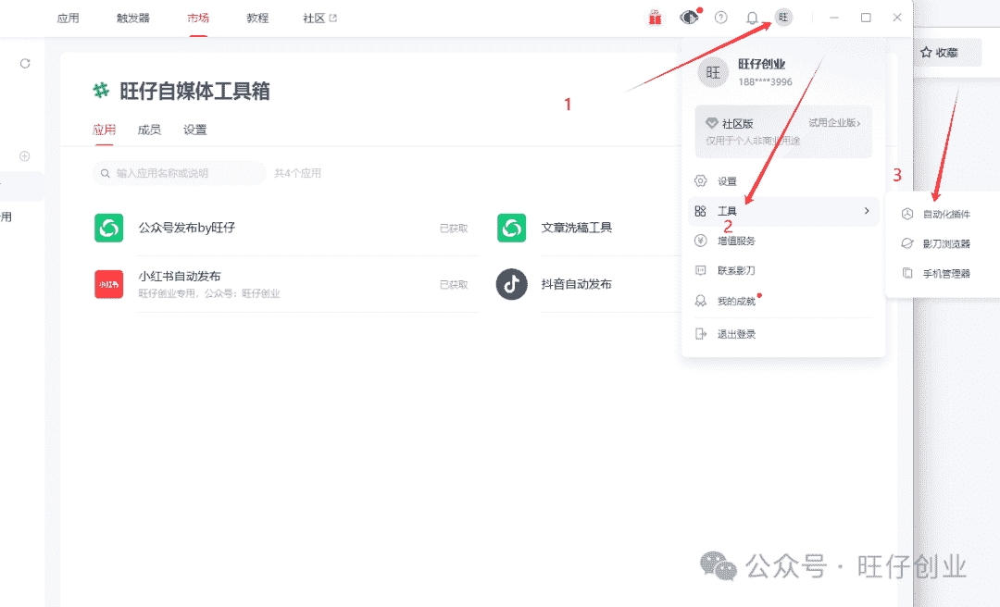

将`比特浏览器所在的目录地址`复制到文件地址栏，回车。就可以看到比特浏览器文件，选择它就行。成功之后就和我上面的图显示一样。

##### 比特浏览器，需要获取对应窗口的id

### 七：操作页面

每个工具都有对应的表格模板，大家自行下载即可

大家用我给大家的暗号就可以登陆了（暗号不定期更新）

可以勾选记住内容，方便第二次使用

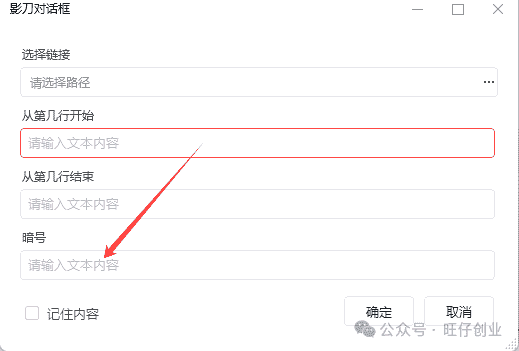

# 万能文章洗稿工具

> 文章链接可以公开访问的就可以洗稿，测试稳定的是👸号链接，今日头条，搜狐号。

> 所有应用不支持mac电脑，如果是mac电脑，请开启双系统win模式（自行百度）

## 一：注册下载影刀

`https://www.winrobot360.com/share/activity?inviteUserUuid=598859198794305538`

## 二：加入应用

`https://www.winrobot360.com/share/accede?inviteKey=e63955eb-3ba7-4bf4-bd67-2476508a3a39`

加入应用后，在桌面版找到应用

## 三：影刀首次内部插件配置

[影刀首次安装新手必看](https://y9j12wbinr.feishu.cn/wiki/HHpXwXhwFiNq8rkQUSccu1thn7b?from=from_copylink)（内部包含edge，谷歌，比特浏览器插件安装）

## 四：使用教程

### 一：配置表格

表格下载：

通过网盘分享的文件：表格配置

链接: `https://pan.baidu.com/s/18HYtR2zcjJHmFWWbl2FjRw` 提取码: tamj

--来自百度网盘超级会员v1的分享

[👸号模板.xlsx](https://internal-api-drive-stream.feishu.cn/space/api/box/stream/download/all/Z7DObRxMJoLDU8x8hcBcgbqknHg)

只需要在表格第一列放进去你要洗稿的文章链接就行，我这亲测的👸号，头条都可以，（理论上每一个链接访问的文章都可以洗）

后面的不需要在改写完文章后会自动填入

### 二：启动界面配置

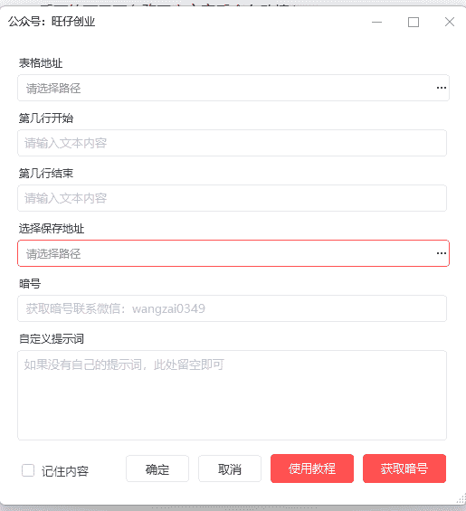

保存地址：选择洗稿后保存word的文件夹，就像我演示上面选择的文件夹，文件夹名称就是洗稿后的文章标题，文件夹里面就是对应的洗稿后的word。

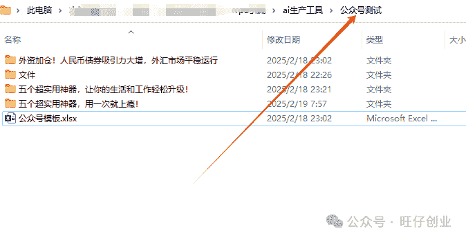

开始行：从第几行开始

结束行：洗稿到第几行结束

暗号社群内专用文档内，或者我给好大家的暗号，可以自行查看。（暗号会不定时更新）

自定义提示词：如果有自己的提示词就直接输入，如果没有提示词的话可以直接留空，我里面内置了。

（自己的提示词最好加这一段：只要以代码块模式输出的标题和正文，不要输出任何提示语以及上面的markdown）

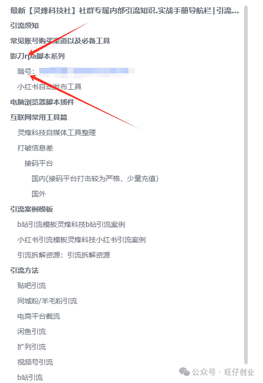

ps：一次可以多输入一些链接去洗稿，后续搭配我给大家的👸号自动发布工具就省事多了。

### 三：使用前注意

在edge浏览器登陆好kimi：`https://kimi.moonshot.cn/`

# 👸号发布

## edge/谷歌浏览器教程

> 所有应用不支持mac电脑，如果是mac电脑，请开启双系统win模式（自行百度）

### 视频教程

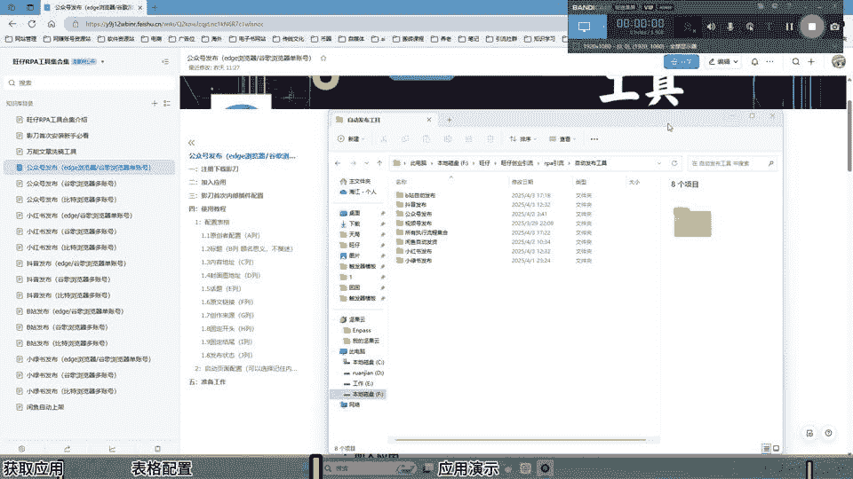

[2👸号edge配置.mp4](https://internal-api-drive-stream.feishu.cn/space/api/box/stream/download/all/UFZCbBYI2oWu7Vx2JQjc17ldnbc)

### 一：注册下载影刀

`https://www.winrobot360.com/share/activity?inviteUserUuid=598859198794305538`

### 二：加入应用

[edge浏览器应用市场](https://www.winrobot360.com/share/accede?inviteKey=e63955eb-3ba7-4bf4-bd67-2476508a3a39)

[谷歌应用市场](https://www.yingdao.com/share/accede/?inviteKey=76370f16-7965-41b1-95b9-69566d740bbb)

加入应用后，在桌面版找到应用

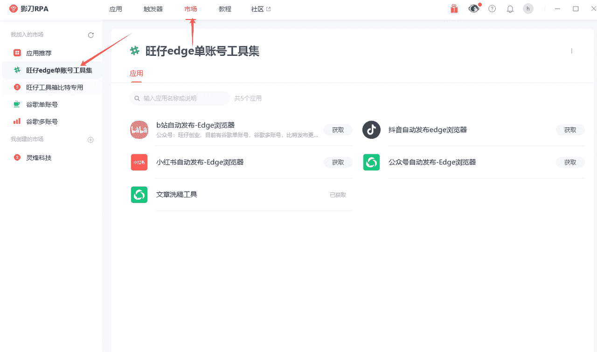

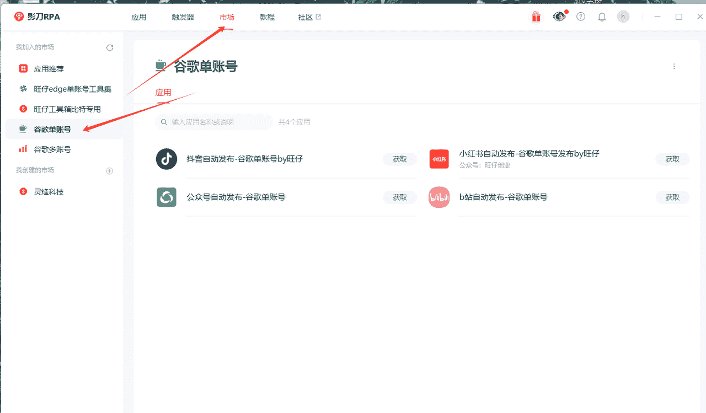

### 三：影刀首次内部插件配置

[影刀首次安装新手必看](https://y9j12wbinr.feishu.cn/wiki/HHpXwXhwFiNq8rkQUSccu1thn7b?from=from_copylink)（内部包含edge，谷歌，比特浏览器插件安装）

### 四：使用教程

#### 1：配置表格

表格下载地址：

通过网盘分享的文件：自动发布表格配置

链接: `https://pan.baidu.com/s/1VXkzvcbAuTCdyFbA3CeWLw` 提取码: azrr

[👸号模板.xlsx](https://internal-api-drive-stream.feishu.cn/space/api/box/stream/download/all/IB2obm8NGoUVEPxY3x4cJT6pnAD)

[万能文章洗稿工具](https://y9j12wbinr.feishu.cn/wiki/WiJlwinK6ihFT0kZ9o3cfdRWnKb?from=from_copylink)载好配置表格，结合上面给大家的洗稿工具

##### 1.1 原创者配置（`A列`）

如果要勾选原创选项，在`A列`输入名字，不勾选原创则留空。

##### 1.2 标题（`B列` 顾名思义，不赘述）

##### 1.3 内容地址（`C列`）

如果是用我的洗稿工具洗出来的，直接复制洗稿之后的表格即可

如果是自己的内容，填入文件夹地址（该文件夹下务必只有一个word文件）

##### 1.4 封面图地址（`D列`）

复制封面图的文件地址进去，右键图片，找到复制路径，复制出来的是这样的格式：`"F:\下载文件暂存\海报中转\蓝色科技扫码关注👸号二维码.png"`

在填入表格时去掉引号，即：`F:\下载文件暂存\海报中转\蓝色科技扫码关注👸号二维码.png`

如果不添加封面图，表格留空就行

##### 1.5 话题（`E列`）

如果要添加话题的话用上面的格式即可：`#话题`

如果不添加话题留空

##### 1.6 原文链接（`F列`）

要添加链接直接表格内放入链接

不添加留空即可

##### 1.7 创作来源（`G列`）

一共4种来源选择，按照我表格模板来就行（切记不要更改，比如你要选择ai生成，就直接在表格输入ai）

不选择来源则留空

##### 1.8 固定开头（`H列`）

如果文章要在开头插入固定开头，先创建一个word文档，把要固定的内容填入word。之后在`I列`输入开头文档的文件地址。

##### 1.9 固定结尾（`I列`）

如果文章要在结尾插入固定结尾，先创建一个word文档，把要固定的内容填入word。之后在`J列`输入结尾文档的文件地址。

##### 1.8 发布状态（`J列`）

在文章发布后会自动输入状态，方便更改

#### 2：启动页面配置（可以选择记住内容方便下次用）

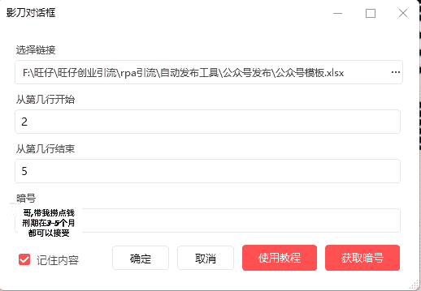

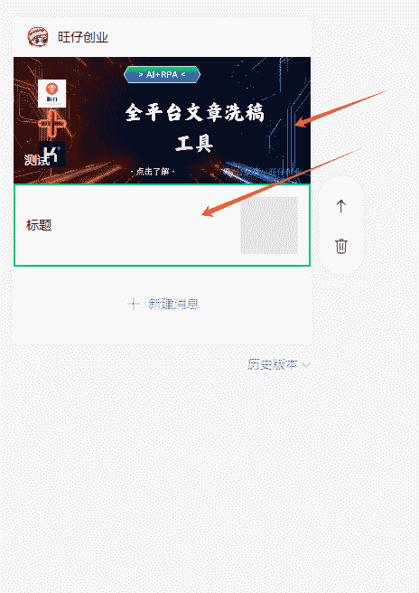

暗号社群内专用文档内，或者我给好大家的暗号，可以自行查看。（暗号会不定时更新）

### 五：准备工作

首先在edge或者谷歌浏览器内部登陆

👸号：`https://mp.weixin.qq.com/`

墨滴平台：`https://editor.mdnice.com/`

如果是第一次使用墨滴，务必先创建一个文件夹，在文件夹内创建一个文章标题

## 谷歌浏览器多账号

> 所有应用不支持mac电脑，如果是mac电脑，请开启双系统win模式（自行百度）

### 视频教程

[4👸号多账号教程.mp4](https://internal-api-drive-stream.feishu.cn/space/api/box/stream/download/all/J7l5b9Au5obUNCxVrOfcJFcVnxe)

### 一：注册下载影刀

`https://www.winrobot360.com/share/activity?inviteUserUuid=598859198794305538`

### 二：加入应用

谷歌浏览器多账号脚本市场:[邀请加入应用市场_影刀RPA](https://www.winrobot360.com/share/accede?inviteKey=187df371-02bc-46f9-9b45-3940f3a9061a)

加入应用后，在桌面版找到应用

### 三：影刀首次内部插件配置

[影刀首次安装新手必看](https://y9j12wbinr.feishu.cn/wiki/HHpXwXhwFiNq8rkQUSccu1thn7b?from=from_copylink)（内部包含edge，谷歌，比特浏览器插件安装）

### 四：使用教程

#### 1：配置表格（所有表格全部设置单元格格式为文本）教程

`https://jingyan.baidu.com/article/3c343ff787d97e4c37796383.html`

表格下载：

通过网盘分享的文件：表格配置

链接: `https://pan.baidu.com/s/18HYtR2zcjJHmFWWbl2FjRw` 提取码: tamj

[👸号模板谷歌多开.xlsx](https://internal-api-drive-stream.feishu.cn/space/api/box/stream/download/all/NeBGbm2TDoM706xiaMhc6XDfnud)

[万能文章洗稿工具](https://y9j12wbinr.feishu.cn/wiki/WiJlwinK6ihFT0kZ9o3cfdRWnKb?from=from_copylink)载好配置表格，结合上面给大家的洗稿工具

## 1 配置页

谷歌多账号最好控制在3-5个账号之内，再多了就需要比特浏览器了。

### A列 谷歌窗口号

（这里可以理解为一个窗口一个号）

找到对应谷歌用户id

目标中的路径是这样：`C:\Program Files\Google\Chrome\Application\chrome.exe" --profile-directory="Profile 1"`

把其中的`--profile-directory="Profile 1"`放入表格

### B列 sheet名称

名称不要起单数字，可以起汉字，或者数字加符号，例如：`18-0`

其中配置页这个sheet名称不要改

其他的像旺仔 创业 这俩个sheet页面只要能和表格名称对应上就行

### C列 一次性发布几篇文章

C列这里代表着你一次要写多少篇文章，因为👸号可以一次性添加`8`篇文章，这大家可以自定义控制发布篇数

ps：如果只发一篇文章，此处就只写`1`

如果一次发俩篇文章，此处就填`2`

一次最多可添加`8`篇文章，要注意

### D列 状态

在该窗口的谷歌浏览器结束后，会自动记录

### 2.1 原创者配置（A列）

如果要勾选原创选项，在`A列`输入名字，不勾选原创则留空。

### 2.2 标题（B列 顾名思义，不赘述）

### 2.3 内容地址（C列）

如果是用我的洗稿工具洗出来的，直接复制洗稿之后的表格即可

如果是自己的内容，填入文件夹地址（该文件夹下务必只有一个`word`文件）

### 2.4 封面图地址（D列）

复制封面图的文件地址进去，右键图片，找到复制路径，复制出来的是这样的格式：`"F:\下载文件暂存\海报中转\蓝色科技扫码关注👸号二维码.png"`

在填入表格时去掉引号，即：`F:\下载文件暂存\海报中转\蓝色科技扫码关注👸号二维码.png`

如果不添加封面图，表格留空就行

### 2.5 话题（E列）

如果要添加话题的话用上面的格式即可：`#话题`

如果不添加话题留空

### 2.6 原文链接（F列）

要添加链接直接表格内放入链接

不添加留空即可

### 2.7 创作来源（G列）

一共4种来源选择，按照我表格模板来就行（切记不要更改，比如你要选择`ai`生成，就直接在表格输入`ai`）

不选择来源则留空

### 2.8 固定开头（H列）

如果文章要在开头插入固定开头，先创建一个`word`文档，把要固定的内容填入`word`。之后在`I列`输入开头文档的文件地址。

### 2.11 固定结尾（I列）

如果文章要在结尾插入固定结尾，先创建一个`word`文档，把要固定的内容填入`word`。之后在`J列`输入结尾文档的文件地址。

### 2.8 发布状态（J列）

在文章发布后会自动输入状态，方便更改

## 2 启动页面

从第几行开始代表着从配置页的第几行开始，不是代表着文章发布页第几行，这里代表着从`5`号窗口开始运行，结束也是同样的道理

## 五：准备工作

首先在`edge`浏览器登入墨滴平台（https://editor.mdnice.com/）

在不同用户谷歌浏览器内部登陆对应👸号：https://mp.weixin.qq.com/

如果是第一次使用墨滴，务必先创建一个文件夹，在文件夹内创建一个文章标题

# 比特浏览器多账号

> 所有应用不支持mac电脑，如果是mac电脑，请开启双系统`win`模式（自行百度）

## 视频教程

[5👸号比特浏览器.mp4](https://internal-api-drive-stream.feishu.cn/space/api/box/stream/download/all/XmNbbLBXdooXUNxaEdyc2eJknDg)

## 一：注册下载影刀

https://www.winrobot360.com/share/activity?inviteUserUuid=598859198794305538

## 二：加入应用

比特浏览器脚本市场：[邀请加入应用市场_影刀RPA](https://www.winrobot360.com/share/accede?inviteKey=99b96e5c-faa4-4278-b6d0-8b991b8346f6)

加入应用后，在桌面版找到应用

## 三：影刀首次内部插件配置（切忌，这里新手务必看此教程的比特配置）

[影刀首次安装新手必看](https://y9j12wbinr.feishu.cn/wiki/HHpXwXhwFiNq8rkQUSccu1thn7b?from=from_copylink)（内部包含`edge`，谷歌，比特浏览器插件安装）

## 四：使用教程

### [1：](https://jingyan.baidu.com/article/3c343ff787d97e4c37796383.html)配置表格（所有表格全部设置单元格格式为文本）教程

表格下载：

通过网盘分享的文件：表格配置

链接: https://pan.baidu.com/s/18HYtR2zcjJHmFWWbl2FjRw 提取码: `tamj`

[👸号模板比特浏览器.xlsx](https://internal-api-drive-stream.feishu.cn/space/api/box/stream/download/all/KNq6bDOpZogSUxx7xrSc5NTAnSh)

[万能文章洗稿工具](https://y9j12wbinr.feishu.cn/wiki/WiJlwinK6ihFT0kZ9o3cfdRWnKb?from=from_copylink)载好配置表格，结合上面给大家的洗稿工具

#### 1 配置页

##### A列 比特窗口号

[影刀首次安装新手必看](https://y9j12wbinr.feishu.cn/wiki/HHpXwXhwFiNq8rkQUSccu1thn7b?from=from_copylink)会配置比特浏览器的看这里面的比特插件安装

##### B列 sheet名称

名称不要起单数字，可以起汉字，或者数字加符号，例如：`18-0`

其中配置页这个sheet名称不要改

其他的像旺仔 创业 这俩个sheet页面只要能和表格名称对应上就行

##### C列 一次性发布几篇文章

C列这里代表着你一次要写多少篇文章，因为👸号可以一次性添加`8`篇文章，这大家可以自定义控制发布篇数

ps：如果只发一篇文章，此处就只写`1`

如果一次发俩篇文章，此处就填`2`

一次最多可添加`8`篇文章，要注意

##### D列 状态

在该窗口的谷歌浏览器结束后，会自动记录

##### 2.1 原创者配置（A列）

如果要勾选原创选项，在`A列`输入名字，不勾选原创则留空。

##### 2.2 标题（B列 顾名思义，不赘述）

##### 2.3 内容地址（C列）

如果是用我的洗稿工具洗出来的，直接复制洗稿之后的表格即可

如果是自己的内容，填入文件夹地址（该文件夹下务必只有一个`word`文件）

##### 2.4 封面图地址（D列）

复制封面图的文件地址进去，右键图片，找到复制路径，复制出来的是这样的格式：`"F:\下载文件暂存\海报中转\蓝色科技扫码关注👸号二维码.png"`

在填入表格时去掉引号，即：`F:\下载文件暂存\海报中转\蓝色科技扫码关注👸号二维码.png`

如果不添加封面图，表格留空就行

##### 2.5 话题（E列）

如果要添加话题的话用上面的格式即可：`#话题`

如果不添加话题留空

##### 2.6 原文链接（F列）

要添加链接直接表格内放入链接

不添加留空即可

##### 2.7 创作来源（G列）

一共4种来源选择，按照我表格模板来就行（切记不要更改，比如你要选择`ai`生成，就直接在表格输入`ai`）

不选择来源则留空

##### 2.8 固定开头（H列）

如果文章要在开头插入固定开头，先创建一个`word`文档，把要固定的内容填入`word`。之后在`I列`输入开头文档的文件地址。

##### 2.9 固定结尾（I列）

如果文章要在结尾插入固定结尾，先创建一个`word`文档，把要固定的内容填入`word`。之后在`J列`输入结尾文档的文件地址。

##### 2.10 发布状态（J列）

在文章发布后会自动输入状态，方便更改

#### 2 启动页面

从第几行开始代表着从配置页的第几行开始，不是代表着文章发布页第几行，这里代表着从第几行的窗口开始运行，结束也是同样的道理

## 五：准备工作

首先在`edge`浏览器登入墨滴平台（https://editor.mdnice.com/）

在不同用户的比特浏览器内部登陆对应👸号：https://mp.weixin.qq.com/

如果是第一次使用墨滴，务必先创建一个文件夹，在文件夹内创建一个文章标题

# 📕发布

## edge/谷歌浏览器

> 所有应用不支持mac电脑，如果是mac电脑，请开启双系统`win`模式（自行百度）

### 视频教程

[6📕配置.mp4](https://internal-api-drive-stream.feishu.cn/space/api/box/stream/download/all/TQCqbOKnboTHTLxE8JGc6tNEn1d)

### 一：注册下载影刀

https://www.winrobot360.com/share/activity?inviteUserUuid=598859198794305538

### 二：加入应用

[edge浏览器应用市场](https://www.winrobot360.com/share/accede?inviteKey=e63955eb-3ba7-4bf4-bd67-2476508a3a39)

[谷歌应用市场](https://www.yingdao.com/share/accede/?inviteKey=76370f16-7965-41b1-95b9-69566d740bbb)

加入应用后，在桌面版找到应用

### 三：影刀首次内部插件配置

[影刀首次安装新手必看](https://y9j12wbinr.feishu.cn/wiki/HHpXwXhwFiNq8rkQUSccu1thn7b?from=from_copylink)（内部包含`edge`，谷歌，比特浏览器插件安装）

### 四：使用教程

#### 1：配置表格

表格下载：

通过网盘分享的文件：表格配置

链接: https://pan.baidu.com/s/18HYtR2zcjJHmFWWbl2FjRw 提取码: `tamj`

[📕模板.xlsx](https://internal-api-drive-stream.feishu.cn/space/api/box/stream/download/all/T3tNb1mK6oUWVPxvRTxcxQDLnRh)

##### 1.1 笔记类型（A列）

在`A列`选择图文或者视频。

##### 1.2 文件存放地址（B列）

此次为文件夹地址（确保此文件夹内部只有你要发布的图片或者视频）

图文：需要给文件排一下序号，默认第一个是封面图

视频：最好的搭配是一个视频搭配一个封面图（视频格式要`mp4`）

##### 1.3 视频封面图地址（C列）

此次放入视频的封面图地址：

案例：`F:\旺仔\旺仔创业引流\rpa引流\自动发布工具\📕发布\测试\视频存放\2.jpg`

如果没有封面图或者是图文类的，此处留空即可

##### 1.4 标题（D列）

##### 1.5正文（E列）

直接把文案复制到表格即可，表格里面什么格式，到发布页面就是什么格式

##### 1.6 话题（F列）

如果要添加话题的话用上面的格式即可：`#话题`

如果不添加话题留空

##### 1.7地址(G列）

如果要添加地点直接就填入框中，如果不添加则留空

##### 1.8 合集（H列）

从上往下数，第一个就填`1`，后面一次类推（不选择就留空）

##### 1.9 群聊（I列）

从上往下数，第一个就填`1`，后面一次类推（不选择就留空）

##### 1.10 商品id（J）列

这会自动挂商品，大家在表格输入商品id，如果一次添加多个商品，就以这种格式输入：

第一个/第二个（例如：`67ced07a9635/671ae3e3a`）

##### 1.11 状态（K）列

此次不需要填写内容，在表格运行后会自动输入

#### 2：启动页配置

开始行号：从表格第几行开始发布文章

结束行号：到表格第几行的文章结束

发布时间间隔：我这设置默认`60`（速度太快浏览器会出现验证）

### 五：准备工具

表格配置之后在`edge`或者谷歌浏览器登陆📕对应账号

## 谷歌浏览器多账号

> 所有应用不支持mac电脑，如果是mac电脑，请开启双系统`win`模式（自行百度）

### 一：注册下载影刀

https://www.winrobot360.com/share/activity?inviteUserUuid=598859198794305538

### 二：加入应用

谷歌浏览器多账号脚本市场:[邀请加入应用市场_影刀RPA](https://www.winrobot360.com/share/accede?inviteKey=187df371-02bc-46f9-9b45-3940f3a9061a)

加入应用后，在桌面版找到应用

### 三：影刀首次内部插件配置

# 影刀首次安装新手必看

[影刀首次安装新手必看](https://y9j12wbinr.feishu.cn/wiki/HHpXwXhwFiNq8rkQUSccu1thn7b?from=from_copylink)（内部包含edge，谷歌，比特浏览器插件安装）

## 四：使用教程

### [1：](https://jingyan.baidu.com/article/3c343ff787d97e4c37796383.html)配置表格（所有表格全部设置单元格格式为文本）教程

表格下载：

通过网盘分享的文件：表格配置

链接: https://pan.baidu.com/s/18HYtR2zcjJHmFWWbl2FjRw 提取码: tamj

[📕模板 - 谷歌多开.xlsx](https://internal-api-drive-stream.feishu.cn/space/api/box/stream/download/all/UYhlbhI0eoOxxfxXm4Tc3llYnQj)

#### 1配置页

谷歌多账号最好控制在3-5个账号之内，再多了就需要比特浏览器了。

##### `A列`谷歌窗口号

（这里可以理解为一个窗口一个号）

找到对应谷歌用户id

目标中的路径是这样：`"C:\Program Files\Google\Chrome\Application\chrome.exe" --profile-directory="Profile 1"`

把其中的`--profile-directory="Profile 1"`放入表格

##### `B列`sheet名称

名称不要起单数字，可以起汉字，或者数字加符号，例如：`18-0`

其中配置页这个sheet名称不要改

其他的像旺仔 创业 这俩个sheet页面只要能和表格名称对应上就行

##### `C列`

工具会自动输入

#### 2内容页配置

##### `2.1`笔记类型（`A列`）

在`A列`选择图文或者视频。

##### `2.2`文件存放地址（`B列`）

此次为文件夹地址（确保此文件夹内部只有你要发布的图片或者视频）

图文：需要给文件排一下序号，默认第一个是封面图

视频：最好的搭配是一个视频搭配一个封面图（视频格式要mp4）

##### `2.3`视频封面图地址（`C列`）

此次放入视频的封面图地址：

案例：`F:\旺仔\旺仔创业引流\rpa引流\自动发布工具\📕发布\测试\视频存放\2.jpg`

如果没有封面图或者是图文类的，此处留空即可

##### `2.4`标题（`D列`）

##### `2.5`正文（`E列`）

直接把文案复制到表格即可，表格里面什么格式，到发布页面就是什么格式

##### `2.6`话题（`F列`）

如果要添加话题的话用上面的格式即可：`` `#话题` ``

如果不添加话题留空

##### `2.7`地址（`G列`）

如果要添加地点直接就填入框中，如果不添加则留空

##### `2.8`合集（`H列`）

从上往下数，第一个就填1，后面一次类推（不选择就留空）

##### `2.9`群聊（`I列`）

从上往下数，第一个就填1，后面一次类推（不选择就留空）

##### `2.10`商品id（`J`）列

这会自动挂商品，大家在表格输入商品id，如果一次添加多个商品，就以这种格式输入：

第一个/第二个（例如：`67ced07a9635/671ae3e3a`）

##### `2.11`状态（`K`）列

此次不需要填写内容，在表格运行后会自动输入

#### 2：启动页配置

**开始行号**：从表格第几行开始发布文章

**结束行号**：到表格第几行的文章结束

**发布时间间隔：**我这设置默认60（速度太快浏览器会出现验证）

从第几行开始代表着从配置页的第几行开始，不是代表着文章发布页第几行，这里代表着从5号窗口开始运行，结束也是同样的道理

## 五：准备工具

表格配置之后在谷歌浏览器登陆📕对应账号

# 比特浏览器多账号

> 所有应用不支持mac电脑，如果是mac电脑，请开启双系统win模式（自行百度）

### 一：注册下载影刀

https://www.winrobot360.com/share/activity?inviteUserUuid=598859198794305538

### 二：加入应用

比特浏览器脚本市场：[邀请加入应用市场_影刀RPA](https://www.winrobot360.com/share/accede?inviteKey=99b96e5c-faa4-4278-b6d0-8b991b8346f6)

加入应用后，在桌面版找到应用

### 三：影刀首次内部插件配置

[影刀首次安装新手必看](https://y9j12wbinr.feishu.cn/wiki/HHpXwXhwFiNq8rkQUSccu1thn7b?from=from_copylink)（内部包含edge，谷歌，比特浏览器插件安装）

### 四：使用教程

#### [1：](https://jingyan.baidu.com/article/3c343ff787d97e4c37796383.html)配置表格（所有表格全部设置单元格格式为文本）教程

表格下载：

通过网盘分享的文件：表格配置

链接: https://pan.baidu.com/s/18HYtR2zcjJHmFWWbl2FjRw 提取码: tamj

[📕模板 - 比特模板.xlsx](https://internal-api-drive-stream.feishu.cn/space/api/box/stream/download/all/NzqHbaPD7oVxfxx5w0PcCftHndc)

#### 1配置页

###### `A列`比特窗口号

[影刀首次安装新手必看](https://y9j12wbinr.feishu.cn/wiki/HHpXwXhwFiNq8rkQUSccu1thn7b?from=from_copylink)会配置比特浏览器的看这里面的比特插件安装

###### `B列`sheet名称

名称不要起单数字，可以起汉字，或者数字加符号，例如：`18-0`

其中配置页这个sheet名称不要改

其他的像旺仔 创业 这俩个sheet页面只要能和表格名称对应上就行

###### `C列`

工具会自动输入

##### 2内容页配置

###### `2.1`笔记类型（`A列`）

在`A列`选择图文或者视频。

###### `2.2`文件存放地址（`B列`）

此次为文件夹地址（确保此文件夹内部只有你要发布的图片或者视频）

图文：需要给文件排一下序号，默认第一个是封面图

视频：最好的搭配是一个视频搭配一个封面图（视频格式要mp4）

###### `2.3`视频封面图地址（`C列`）

此次放入视频的封面图地址：

案例：`F:\旺仔\旺仔创业引流\rpa引流\自动发布工具\📕发布\测试\视频存放\2.jpg`

如果没有封面图或者是图文类的，此处留空即可

###### `2.4`标题（`D列`）

###### `2.5`正文（`E列`）

直接把文案复制到表格即可，表格里面什么格式，到发布页面就是什么格式

###### `2.6`话题（`F列`）

如果要添加话题的话用上面的格式即可：`` `#话题` ``

如果不添加话题留空

###### `2.7`地址（`G列`）

如果要添加地点直接就填入框中，如果不添加则留空

###### `2.8`合集（`H列`）

从上往下数，第一个就填1，后面一次类推（不选择就留空）

###### `2.9`群聊（`I列`）

从上往下数，第一个就填1，后面一次类推（不选择就留空）

###### `2.10`商品id（`J`）列

这会自动挂商品，大家在表格输入商品id，如果一次添加多个商品，就以这种格式输入：

第一个/第二个（例如：`67ced07a9635/671ae3e3a`）

###### `2.11`状态（`K`）列

此次不需要填写内容，在表格运行后会自动输入

#### 2：启动页配置

**开始行号**：从表格第几行开始发布文章

**结束行号**：到表格第几行的文章结束

**发布时间间隔：**我这设置默认60（速度太快浏览器会出现验证）

从第几行开始代表着从配置页的第几行开始，不是代表着文章发布页第几行

## 五：准备工具

表格配置之后在比特浏览器登陆📕对应账号

# 抖音发布

## edge/谷歌浏览器单账号

> 所有应用不支持mac电脑，如果是mac电脑，请开启双系统win模式（自行百度）

### 视频教程

[7抖音配置.mp4](https://internal-api-drive-stream.feishu.cn/space/api/box/stream/download/all/NmDkbxO9jo2VfCx8Rfucxl65nNd)

### 一：注册下载影刀

https://www.winrobot360.com/share/activity?inviteUserUuid=598859198794305538

### 二：加入应用

[edge浏览器应用市场](https://www.winrobot360.com/share/accede?inviteKey=e63955eb-3ba7-4bf4-bd67-2476508a3a39)

[谷歌应用市场](https://www.yingdao.com/share/accede/?inviteKey=76370f16-7965-41b1-95b9-69566d740bbb)

加入应用后，在桌面版找到应用

### 三：影刀首次内部插件配置

[影刀首次安装新手必看](https://y9j12wbinr.feishu.cn/wiki/HHpXwXhwFiNq8rkQUSccu1thn7b?from=from_copylink)（内部包含edge，谷歌，比特浏览器插件安装）

### 四：使用教程

#### 1：配置表格

表格下载：

通过网盘分享的文件：表格配置

链接: https://pan.baidu.com/s/18HYtR2zcjJHmFWWbl2FjRw 提取码: tamj

[抖音模板.xlsx](https://internal-api-drive-stream.feishu.cn/space/api/box/stream/download/all/ApiqbKVWYohnA9xXU9jc0aQpnxe)

##### `1.1`笔记类型（`A列`）

在`A列`选择图文或者视频。

##### `1.2`文件存放地址（`B列`）

此次为文件夹地址（确保此文件夹内部只有你要发布的图片或者视频）

图文：需要给文件排一下序号，默认第一个是封面图

视频：最好的搭配是一个视频搭配一个封面图（视频格式要mp4）

##### `1.3`视频封面图地址（`C列`）

此次放入视频的封面图地址：

案例：`F:\旺仔\旺仔创业引流\rpa引流\自动发布工具\📕发布\测试\视频存放\2.jpg`

如果没有封面图或者是图文类的，此处留空即可

##### `1.4`标题（`D列`）

##### `1.5`正文（`E列`）

直接把文案复制到表格即可，表格里面什么格式，到发布页面就是什么格式

##### `1.6`话题（`F列`）

如果要添加话题的话用上面的格式即可：`` `#话题` ``

如果不添加话题留空

##### `1.7`合集（`G列`）

从上往下数，第一个就填1，后面一次类推（不选择就留空）

##### `1.8`图文添加音乐（`H`）列

如果要给图文配音乐，在此列写入音乐名称，会自动运行第一行

##### `1.9`状态（`I`）列

此次不需要填写内容，在表格运行后会自动输入

#### 2：启动页配置

**开始行号**：从表格第几行开始发布文章

**结束行号**：到表格第几行的文章结束

**发布时间间隔：**我这设置默认60（速度太快浏览器会出现验证）

## 五：准备工具

表格配置之后在edge或者谷歌浏览器登陆抖音对应账号

## 谷歌浏览器多账号

> 所有应用不支持mac电脑，如果是mac电脑，请开启双系统win模式（自行百度）

### 一：注册下载影刀

https://www.winrobot360.com/share/activity?inviteUserUuid=598859198794305538

### 二：加入应用

https://www.winrobot360.com/share/accede?inviteKey=e63955eb-3ba7-4bf4-bd67-2476508a3a39

加入应用后，在桌面版找到应用

### 三：影刀首次内部插件配置

[影刀首次安装新手必看](https://y9j12wbinr.feishu.cn/wiki/HHpXwXhwFiNq8rkQUSccu1thn7b?from=from_copylink)（内部包含edge，谷歌，比特浏览器插件安装）

### 四：使用教程

#### [1：](https://jingyan.baidu.com/article/3c343ff787d97e4c37796383.html)配置表格（所有表格全部设置单元格格式为文本）教程

表格下载：

通过网盘分享的文件：表格配置

链接: https://pan.baidu.com/s/18HYtR2zcjJHmFWWbl2FjRw 提取码: tamj

[抖音模板-谷歌多开.xlsx](https://internal-api-drive-stream.feishu.cn/space/api/box/stream/download/all/QDg5bisVDozU90xpMADcc8DHnYf)

##### 1配置页

谷歌多账号最好控制在3-5个账号之内，再多了就需要比特浏览器了。

###### `A列`谷歌窗口号

（这里可以理解为一个窗口一个号）

找到对应谷歌用户id

# 抖音发布

## Edge/谷歌浏览器单账号

目标中的路径是这样：`C:\Program Files\Google\Chrome\Application\chrome.exe` `--profile-directory="Profile 1"`

把其中的`--profile-directory="Profile 1"`放入表格

##### B列sheet名称

名称不要起单数字，可以起汉字，或者数字加符号，例如：18-0

其中配置页这个sheet名称不要改

其他的像旺仔 创业 这俩个sheet页面只要能和表格名称对应上就行

##### C列状态：工具会自动输入

##### 2内容页配置

###### 2.1笔记类型（A列）

在A列选择图文或者视频。

###### 2.2文件存放地址（B列）

此次为文件夹地址（确保此文件夹内部只有你要发布的图片或者视频）

图文：需要给文件排一下序号，默认第一个是封面图

视频：最好的搭配是一个视频搭配一个封面图（视频格式要mp4）

###### 2.3视频封面图地址（C列）

此次放入视频的封面图地址：

案例：`F:\旺仔\旺仔创业引流\rpa引流\自动发布工具\📕发布\测试\视频存放\2.jpg`

如果没有封面图或者是图文类的，此处留空即可

###### 2.4标题（D列）

###### 2.5正文（E列)

直接把文案复制到表格即可，表格里面什么格式，到发布页面就是什么格式

###### 2.6话题（F列）

如果要添加话题的话用上面的格式即可：#话题

如果不添加话题留空

###### 2.7合集（G列）

从上往下数，第一个就填1，后面一次类推（不选择就留空）

###### 2.8图文添加音乐（H）列

如果要给图文配音乐，在此列写入音乐名称，会自动运行第一行

###### 2.9状态（J）列

此次不需要填写内容，在表格运行后会自动输入

#### 2：启动页配置

**开始行号**：从表格第几行开始发布文章

**结束行号**：到表格第几行的文章结束

### 五：准备工具

表格配置之后在edge或者谷歌浏览器登陆抖音对应账号

## 比特浏览器多账号

> 所有应用不支持mac电脑，如果是mac电脑，请开启双系统win模式（自行百度）

### 一：注册下载影刀

https://www.winrobot360.com/share/activity?inviteUserUuid=598859198794305538

### 二：加入应用

比特浏览器脚本市场：[邀请加入应用市场_影刀RPA](https://www.winrobot360.com/share/accede?inviteKey=99b96e5c-faa4-4278-b6d0-8b991b8346f6)

加入应用后，在桌面版找到应用

### 三：影刀首次内部插件配置

[影刀首次安装新手必看](https://y9j12wbinr.feishu.cn/wiki/HHpXwXhwFiNq8rkQUSccu1thn7b?from=from_copylink)（内部包含edge，谷歌，比特浏览器插件安装）

### 四：使用教程

#### [1：](https://jingyan.baidu.com/article/3c343ff787d97e4c37796383.html)配置表格（所有表格全部设置单元格格式为文本）教程

表格下载：

通过网盘分享的文件：表格配置

链接: https://pan.baidu.com/s/18HYtR2zcjJHmFWWbl2FjRw 提取码: tamj

[抖音模板-比特浏览器.xlsx](https://internal-api-drive-stream.feishu.cn/space/api/box/stream/download/all/XyagbkOhQoxdQ6xaURNcNGZontd)

##### A列比特窗口号

[影刀首次安装新手必看](https://y9j12wbinr.feishu.cn/wiki/HHpXwXhwFiNq8rkQUSccu1thn7b?from=from_copylink)会配置比特浏览器的看这里面的比特插件安装

##### B列sheet名称

名称不要起单数字，可以起汉字，或者数字加符号，例如：18-0

其中配置页这个sheet名称不要改

其他的像旺仔 创业 这俩个sheet页面只要能和表格名称对应上就行

##### C列状态：会自动输入

##### 2内容页配置

###### 2.1笔记类型（A列）

在A列选择图文或者视频。

###### 2.2文件存放地址（B列）

此次为文件夹地址（确保此文件夹内部只有你要发布的图片或者视频）

图文：需要给文件排一下序号，默认第一个是封面图

视频：最好的搭配是一个视频搭配一个封面图（视频格式要mp4）

###### 2.3视频封面图地址（C列）

此次放入视频的封面图地址：

案例：`F:\旺仔\旺仔创业引流\rpa引流\自动发布工具\📕发布\测试\视频存放\2.jpg`

如果没有封面图或者是图文类的，此处留空即可

###### 2.4标题（D列）

###### 2.5正文（E列)

直接把文案复制到表格即可，表格里面什么格式，到发布页面就是什么格式

###### 2.6话题（F列）

如果要添加话题的话用上面的格式即可：#话题

如果不添加话题留空

###### 2.7合集（G列）

从上往下数，第一个就填1，后面一次类推（不选择就留空）

###### 2.8图文添加音乐（H）列

如果要给图文配音乐，在此列写入音乐名称，会自动运行第一行

###### 2.9状态（I）列

此次不需要填写内容，在表格运行后会自动输入

#### 2：启动页配置

**开始行号**：从表格第几行开始发布文章

**结束行号**：到表格第几行的文章结束

**发布时间间隔：**我这设置默认60（速度太快浏览器会出现验证）

### 五：准备工具

表格配置之后在比特浏览器登陆抖音对应账号

# b站发布

## edge/谷歌浏览器单账号

> 所有应用不支持mac电脑，如果是mac电脑，请开启双系统win模式（自行百度）

### 视频教程

[8b站配置.mp4](https://internal-api-drive-stream.feishu.cn/space/api/box/stream/download/all/E2wdbQTjQofPXMxK3A1cR0rrnVf)

### 一：注册下载影刀

https://www.winrobot360.com/share/activity?inviteUserUuid=598859198794305538

### 二：加入应用

[edge浏览器应用市场](https://www.winrobot360.com/share/accede?inviteKey=e63955eb-3ba7-4bf4-bd67-2476508a3a39)

[谷歌应用市场](https://www.yingdao.com/share/accede/?inviteKey=76370f16-7965-41b1-95b9-69566d740bbb)

加入应用后，在桌面版找到应用

### 三：影刀首次内部插件配置

[影刀首次安装新手必看](https://y9j12wbinr.feishu.cn/wiki/HHpXwXhwFiNq8rkQUSccu1thn7b?from=from_copylink)（内部包含edge，谷歌，比特浏览器插件安装）

### 四：使用教程

#### 1：配置表格

表格下载：

通过网盘分享的文件：表格配置

链接: https://pan.baidu.com/s/18HYtR2zcjJHmFWWbl2FjRw 提取码: tamj

[b站模板.xlsx](https://internal-api-drive-stream.feishu.cn/space/api/box/stream/download/all/LTPSbG0BCopGPHxuAf4cV7zynXs)

##### 1.1视频标题（A列）

##### 1.2文件存放地址（B列）

此次为文件夹地址（确保此文件夹内部只有你要发布的视频）

视频：最好的搭配是一个视频搭配一个封面图（视频格式要mp4）

##### 1.3视频封面图地址（C列）

此次放入视频的封面图地址：

案例：`F:\旺仔\旺仔创业引流\rpa引流\自动发布工具\📕发布\测试\视频存放\2.jpg`

如果没有封面图或者是图文类的，此处留空即可

##### 1.4标签（D列）

如果要添加话题的话用上面的格式即可：#话题

如果不添加话题留空

##### 1.5简介（E列)

如果不写留空即可

##### 1.6合集（F列）

默认添加第一个

##### 1.7发布状态（G列）

此次不需要填写内容，在表格运行后会自动输入

#### 2：启动页配置

**开始行号**：从表格第几行开始发布文章

**结束行号**：到表格第几行的文章结束

**发布时间间隔：**我这设置默认60（速度太快浏览器会出现验证）

### 五：准备工具

表格配置之后在edge或者谷歌浏览器登陆b站对应账号

## 谷歌浏览器多账号

> 所有应用不支持mac电脑，如果是mac电脑，请开启双系统win模式（自行百度）

### 一：注册下载影刀

https://www.winrobot360.com/share/activity?inviteUserUuid=598859198794305538

### 二：加入应用

谷歌浏览器多账号脚本市场：[邀请加入应用市场_影刀RPA](https://www.winrobot360.com/share/accede?inviteKey=187df371-02bc-46f9-9b45-3940f3a9061a)

加入应用后，在桌面版找到应用

### 三：影刀首次内部插件配置

[影刀首次安装新手必看](https://y9j12wbinr.feishu.cn/wiki/HHpXwXhwFiNq8rkQUSccu1thn7b?from=from_copylink)（内部包含edge，谷歌，比特浏览器插件安装）

### 四：使用教程

#### [1：](https://jingyan.baidu.com/article/3c343ff787d97e4c37796383.html)配置表格（所有表格全部设置单元格格式为文本）教程

表格下载：

通过网盘分享的文件：表格配置

链接: https://pan.baidu.com/s/18HYtR2zcjJHmFWWbl2FjRw 提取码: tamj

[b站模板 -谷歌多开.xlsx](https://internal-api-drive-stream.feishu.cn/space/api/box/stream/download/all/MWB8b64Z9oiIXlxWokwcrlVfndh)

##### 1配置页

谷歌多账号最好控制在3-5个账号之内，再多了就需要比特浏览器了。

##### A列谷歌窗口号

（这里可以理解为一个窗口一个号）

找到对应谷歌用户id

目标中的路径是这样：`C:\Program Files\Google\Chrome\Application\chrome.exe` `--profile-directory="Profile 1"`

把其中的`--profile-directory="Profile 1"`放入表格

##### B列sheet名称

名称不要起单数字，可以起汉字，或者数字加符号，例如：18-0

其中配置页这个sheet名称不要改

其他的像旺仔 创业 这俩个sheet页面只要能和表格名称对应上就行

##### C列不用管

##### 2：内容页

###### 2.1视频标题（A列）

###### 2.2文件存放地址（B列）

此次为文件夹地址（确保此文件夹内部只有你要发布的视频）

视频：最好的搭配是一个视频搭配一个封面图（视频格式要mp4）

###### 2.3视频封面图地址（C列）

此次放入视频的封面图地址：

案例：`F:\旺仔\旺仔创业引流\rpa引流\自动发布工具\📕发布\测试\视频存放\2.jpg`

如果没有封面图或者是图文类的，此处留空即可

###### 2.4标签（D列）

如果要添加话题的话用上面的格式即可：#话题

如果不添加话题留空

###### 2.5简介（E列)

如果不写留空即可

###### 2.6合集（F列）

默认添加第一个

###### 2.7发布状态（G列）

此次不需要填写内容，在表格运行后会自动输入

#### 2：启动页配置

**开始行号**：从表格第几行开始发布文章

**结束行号**：到表格第几行的文章结束

**发布时间间隔：**我这设置默认60（速度太快浏览器会出现验证）

### 五：准备工具

表格配置之后在谷歌浏览器登陆b站对应账号

## 比特浏览器多账号

> 所有应用不支持mac电脑，如果是mac电脑，请开启双系统win模式（自行百度）

### 一：注册下载影刀

https://www.winrobot360.com/share/activity?inviteUserUuid=598859198794305538

### 二：加入应用

比特浏览器脚本市场：[邀请加入应用市场_影刀RPA](https://www.winrobot360.com/share/accede?inviteKey=99b96e5c-faa4-4278-b6d0-8b991b8346f6)

加入应用后，在桌面版找到应用

### 三：影刀首次内部插件配置

[影刀首次安装新手必看](https://y9j12wbinr.feishu.cn/wiki/HHpXwXhwFiNq8rkQUSccu1thn7b?from=from_copylink)（内部包含edge，谷歌，比特浏览器插件安装）

### 四：使用教程

#### [1：](https://jingyan.baidu.com/article/3c343ff787d97e4c37796383.html)配置表格（所有表格全部设置单元格格式为文本）教程

表格下载：

通过网盘分享的文件：表格配置

链接: https://pan.baidu.com/s/18HYtR2zcjJHmFWWbl2FjRw 提取码: tamj

# b站模板 - 比特浏览器触发器

[`b站模板 -比特浏览器触发器.xlsx`](https://internal-api-drive-stream.feishu.cn/space/api/box/stream/download/all/XpGZbNm1GozQgkxfDjuc8Ju0nld)

## 配置页

### `A列`比特窗口号

[影刀首次安装新手必看](https://y9j12wbinr.feishu.cn/wiki/HHpXwXhwFiNq8rkQUSccu1thn7b?from=from_copylink)会配置比特浏览器的看这里面的比特插件安装

### `B列`sheet名称

名称不要起单数字，可以起汉字，或者数字加符号，例如：`18-0`

其中配置页这个sheet名称不要改

其他的像旺仔 创业 这俩个sheet页面只要能和表格名称对应上就行

### `C列`状态

在该窗口的谷歌浏览器结束后，会自动记录

## 启动页配置

**开始行号**：从表格第几行开始发布文章

**结束行号**：到表格第几行的文章结束

**发布时间间隔：**我这设置默认`60`（速度太快浏览器会出现验证）

# 小绿书发布

## edge浏览器/谷歌浏览器单账号

> 所有应用不支持mac电脑，如果是mac电脑，请开启双系统win模式（自行百度）

### 视频教程

[`9小绿书配置教程.mp4`](https://internal-api-drive-stream.feishu.cn/space/api/box/stream/download/all/JoBgb0EhLoflm1xrCKWcX8tEn1E)

### 一：注册下载影刀

https://www.winrobot360.com/share/activity?inviteUserUuid=598859198794305538

### 二：加入应用

[edge浏览器应用市场](https://www.winrobot360.com/share/accede?inviteKey=e63955eb-3ba7-4bf4-bd67-2476508a3a39)

[谷歌应用市场](https://www.yingdao.com/share/accede/?inviteKey=76370f16-7965-41b1-95b9-69566d740bbb)

加入应用后，在桌面版找到应用

### 三：影刀首次内部插件配置

[影刀首次安装新手必看](https://y9j12wbinr.feishu.cn/wiki/HHpXwXhwFiNq8rkQUSccu1thn7b?from=from_copylink)（内部包含edge，谷歌，比特浏览器插件安装）

### 四：使用教程

#### 1.配置表格

表格下载地址：

通过网盘分享的文件：表格配置

链接: https://pan.baidu.com/s/18HYtR2zcjJHmFWWbl2FjRw 提取码: tamj

[`模板.xlsx`](https://internal-api-drive-stream.feishu.cn/space/api/box/stream/download/all/DSLQbQyKkodL89xy5MZclwbCnAf)

##### 1.1图片地址（`A列`）

此次为文件夹地址（确保此文件夹内部只有你要发布的图片）

图文：需要给文件排一下序号，默认第一个是封面图

##### 1.2文章标题（`B列`）

顾名思义

##### 1.3文章内容（`C列`）

顾名思义

##### 1.4创作来源（`D列`）

一共4种来源选择，按照我表格模板来就行（切记不要更改，比如你要选择ai生成，就直接在表格输入`ai`）

不选择来源则留空

##### 1.5发布状态（`E列`）

在文章发布后会自动输入状态，方便更改

#### 2启动配置

**开始行号**：从表格第几行开始发布文章

**结束行号**：到表格第几行的文章结束

**时间延迟**：防止操作太快浏览器跳验证

**暗号社群内专用文档内，或者我给好大家的**暗号，可以自行查看。（暗号会不定时更新）

### 五：准备工作

首先在edge或者谷歌浏览器内部登陆

👸号：https://mp.weixin.qq.com/

## 谷歌浏览器多账号

> 所有应用不支持mac电脑，如果是mac电脑，请开启双系统win模式（自行百度）

### 一：注册下载影刀

https://www.winrobot360.com/share/activity?inviteUserUuid=598859198794305538

### 二：加入应用

谷歌浏览器多账号脚本市场:[邀请加入应用市场_影刀RPA](https://www.winrobot360.com/share/accede?inviteKey=187df371-02bc-46f9-9b45-3940f3a9061a)

加入应用后，在桌面版找到应用

### 三：影刀首次内部插件配置

[影刀首次安装新手必看](https://y9j12wbinr.feishu.cn/wiki/HHpXwXhwFiNq8rkQUSccu1thn7b?from=from_copylink)（内部包含edge，谷歌，比特浏览器插件安装）

### 四：使用教程

#### 1.配置表格

通过网盘分享的文件：表格配置

链接: https://pan.baidu.com/s/18HYtR2zcjJHmFWWbl2FjRw 提取码: tamj

[`b站模板 -谷歌多开.xlsx`](https://internal-api-drive-stream.feishu.cn/space/api/box/stream/download/all/LFpSbVpYCo0CZGxxouKcN4TAneg)

##### 1配置页

谷歌多账号最好控制在3-5个账号之内，再多了就需要比特浏览器了。

###### `A列`谷歌窗口号

（这里可以理解为一个窗口一个号）

找到对应谷歌用户id

目标中的路径是这样：`"C:\Program Files\Google\Chrome\Application\chrome.exe" --profile-directory="Profile 1"`

把其中的`--profile-directory="Profile 1"`放入表格

###### `B列`sheet名称

名称不要起单数字，可以起汉字，或者数字加符号，例如：`18-0`

其中配置页这个sheet名称不要改

其他的像旺仔 创业 这俩个sheet页面只要能和表格名称对应上就行

###### `C列`发布状态，会自动输入

##### 2内容页配置

###### 2.1图片地址（`A列`）

此次为文件夹地址（确保此文件夹内部只有你要发布的图片）

图文：需要给文件排一下序号，默认第一个是封面图

###### 2.2文章标题（`B列`）

顾名思义

###### 2.3文章内容（`C列`）

顾名思义

###### 2.4创作来源（`D列`）

一共4种来源选择，按照我表格模板来就行（切记不要更改，比如你要选择ai生成，就直接在表格输入`ai`）

不选择来源则留空

###### 2.5发布状态（`E列`）

在文章发布后会自动输入状态，方便更改

#### 2启动配置

**开始行号**：从表格第几行开始发布文章

**结束行号**：到表格第几行的文章结束

**时间延迟**：防止操作太快浏览器跳验证

**暗号社群内专用文档内，或者我给好大家的**暗号，可以自行查看。（暗号会不定时更新）

### 五：准备工作

首先在谷歌浏览器内部登陆

👸号：https://mp.weixin.qq.com/

## 比特浏览器多账号

> 所有应用不支持mac电脑，如果是mac电脑，请开启双系统win模式（自行百度）

### 一：注册下载影刀

https://www.winrobot360.com/share/activity?inviteUserUuid=598859198794305538

### 二：加入应用

比特浏览器脚本市场：[邀请加入应用市场_影刀RPA](https://www.winrobot360.com/share/accede?inviteKey=99b96e5c-faa4-4278-b6d0-8b991b8346f6)

加入应用后，在桌面版找到应用

### 三：影刀首次内部插件配置

[影刀首次安装新手必看](https://y9j12wbinr.feishu.cn/wiki/HHpXwXhwFiNq8rkQUSccu1thn7b?from=from_copylink)（内部包含edge，谷歌，比特浏览器插件安装）

### 四：使用教程

#### 1.配置表格

通过网盘分享的文件：表格配置

链接: https://pan.baidu.com/s/18HYtR2zcjJHmFWWbl2FjRw 提取码: tamj

[`b站模板 -比特浏览器触发器.xlsx`](https://internal-api-drive-stream.feishu.cn/space/api/box/stream/download/all/WuCSbhhM4oD5vnx8eSYcOy0InFc)

##### 1配置页

###### `A列`比特窗口号

[影刀首次安装新手必看](https://y9j12wbinr.feishu.cn/wiki/HHpXwXhwFiNq8rkQUSccu1thn7b?from=from_copylink)会配置比特浏览器的看这里面的比特插件安装

###### `B列`sheet名称

名称不要起单数字，可以起汉字，或者数字加符号，例如：`18-0`

其中配置页这个sheet名称不要改

其他的像旺仔 创业 这俩个sheet页面只要能和表格名称对应上就行

###### `CD列`状态

在该窗口的谷歌浏览器结束后，会自动记录

##### 2内容页配置

###### 2.1图片地址（`A列`）

此次为文件夹地址（确保此文件夹内部只有你要发布的图片）

图文：需要给文件排一下序号，默认第一个是封面图

###### 2.2文章标题（`B列`）

顾名思义

###### 2.3文章内容（`C列`）

顾名思义

###### 2.4创作来源（`D列`）

一共4种来源选择，按照我表格模板来就行（切记不要更改，比如你要选择ai生成，就直接在表格输入`ai`）

不选择来源则留空

###### 2.5发布状态（`E列`）

在文章发布后会自动输入状态，方便更改

#### 2启动配置

**开始行号**：从表格第几行开始发布文章

**结束行号**：到表格第几行的文章结束

**时间延迟**：防止操作太快浏览器跳验证

**暗号社群内专用文档内，或者我给好大家的**暗号，可以自行查看。（暗号会不定时更新）

### 五：准备工作

首先在edge或者谷歌浏览器内部登陆

👸号：https://mp.weixin.qq.com/

# 闲鱼自动上架

> 所有应用不支持mac电脑，如果是mac电脑，请开启双系统win模式（自行百度）

## 视频教程

[`10闲鱼发布.mp4`](https://internal-api-drive-stream.feishu.cn/space/api/box/stream/download/all/QIc7bD8YCoxdfMx876JcRxSvnUe)

## 一：注册下载影刀

https://www.winrobot360.com/share/activity?inviteUserUuid=598859198794305538

## 二：加入应用

https://www.winrobot360.com/share/accede?inviteKey=e63955eb-3ba7-4bf4-bd67-2476508a3a39

加入应用后，在桌面版找到应用

## 三：影刀首次内部插件配置

[影刀首次安装新手必看](https://y9j12wbinr.feishu.cn/wiki/HHpXwXhwFiNq8rkQUSccu1thn7b?from=from_copylink)（内部包含edge，谷歌，比特浏览器插件安装）

## 四：使用教程

### 1.配置表格

通过网盘分享的文件：表格配置

链接: https://pan.baidu.com/s/18HYtR2zcjJHmFWWbl2FjRw 提取码: tamj

[`配置表.xlsx`](https://internal-api-drive-stream.feishu.cn/space/api/box/stream/download/all/LXZ4bZJsXo3TSMxGDyWctW2Gn3a)

#### 1.1账号序号（`A列`）

如图，如果下面有更多的账号就一次3，4，5（看自己账号）

# 商品信息配置说明

## 商品列说明

### 1.2 商品标题（B列）

### 1.3 商品内容（C列）

### 1.4 商品分类（D列）

在这可以输入自己的商品分类，虚拟游戏 / 游戏 / 游戏服务 / 其他游戏服务，图省事也可以直接输入三级四级类目，例如：游戏服务 / 其他游戏服务。会默认选择第一个分类

### 1.5 商品图片地址（E列）

在此文件夹下面不要放除了商品图外任何东西。

### 1.6 发货地（F列）

例如：广东省/潮州市/潮安区

按照闲鱼给的地址填写，例如这个就输入：北京/北京市/西城区

### 1.7 售价（G列）

### 1.8 原价（H列）

### 1.9 库存（I列）

### 1.10 状态（J列）

## 启动配置

**开始行号**：从表格第几行开始发布商品

**结束行号**：到表格第几行的商品结束

**时间延迟**：防止操作太快浏览器跳验证

**暗号社群内专用文档内，或者我给好大家的**暗号，可以自行查看。（暗号会不定时更新）

## 五：准备工作

首先在edge或者谷歌浏览器内部登陆

闲管家：https://goofish.pro/sale/statistics

# 让你的影刀更丝滑（触发器/虚拟桌面）

[让你的影刀更丝滑1.mp4](https://internal-api-drive-stream.feishu.cn/space/api/box/stream/download/all/U5fgbiyfUob9xzxGoyoc8OfnnXg)

## 触发器执行

我的脚本都是自己会识别未发布的内容。启动页面会在60秒后点击确定

每隔5个小时发一个视频

想要时间不是那么准确

没使用过的，必须手动去使用一次

要勾选记住内容

## 虚拟桌面

不占用你本机电脑

细节：你要使用比特浏览器在虚拟桌面

如何在虚拟桌面运行触发器

把本机电脑的影刀退出

# 影刀自媒体工具辅助箱

影刀地址：https://api.winrobot360.com/redirect/robot/share?inviteKey=318ad99329935f85

[4月5日.mp4](https://internal-api-drive-stream.feishu.cn/space/api/box/stream/download/all/RdOFbWerqo6xwexUqGnc1TtbnJg)

# 谷歌多开序号窗口id如何获取

## 视频教程

[3谷歌id获取.mp4](https://internal-api-drive-stream.feishu.cn/space/api/box/stream/download/all/TKIwbengaoinZxxiskac8eOmneh)

## 图文教程

（这里可以理解为一个窗口一个号）

找到对应谷歌用户id

目标中的路径是这样：`"C:\Program Files\Google\Chrome\Application\chrome.exe" --profile-directory="Profile 1"`

把其中的`--profile-directory="Profile 1"`放入表格

