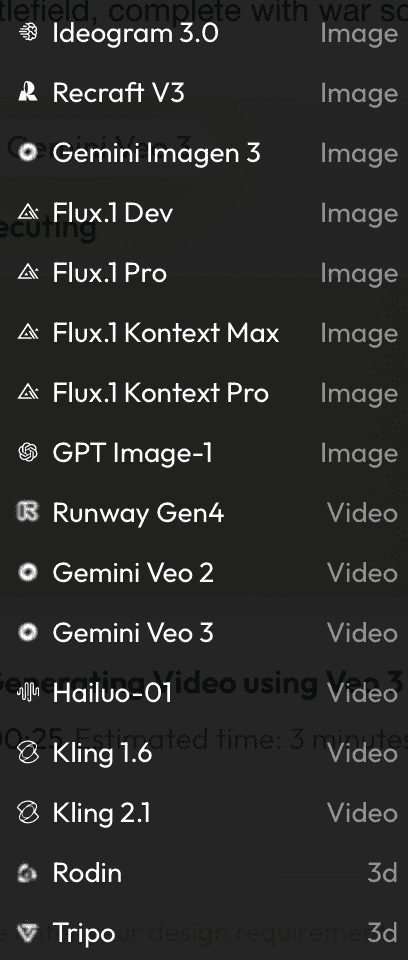

# 两周内 65 万播放！YouTube Shorts 爆量的200+资源：实操贴 + 免费工具链

> 来源：[https://xuqiwei1986.feishu.cn/docx/EWPRdQ4fjoHyELxz31scPnr5nuc](https://xuqiwei1986.feishu.cn/docx/EWPRdQ4fjoHyELxz31scPnr5nuc)

# 总指导

### 超级标

龙哥

2024-10-30 第二期龙珠悬赏：AI生成视频在YouTube的盈利潜力

[h](https://scys.com/articleDetail/xq_topic/4848525818522418)ttps://scys.com/articleDetail/xq_topic/4848525818522418

2024-10-24 超级标 02：通过 AI 生成的各种视频，上传到YouTube和 shorts，获取广告分成

[h](https://wx.zsxq.com/topic/5121542448454444)ttps://scys.com/articleDetail/xq_topic/5121542448454444

2025-06-18 超级标 08：Youtube AI 中长视频

[h](https://scys.com/articleDetail/xq_topic/4845228512482248)ttps://scys.com/articleDetail/xq_topic/4845228512482248

### 航海手册

2025年9月航海｜YouTube AI 视频航海手册

https://scys.com/activity/landing/7711?tabIndex=0

2025年6月航海｜YouTube Al Shorts航海手册

[https://scys.com/activity/lan](https://scys.com/activity/landing/5529?tabIndex=0)ding/5529?tabIndex=0

2025年3月航海｜YouTube 视频航海手册

[https://scys.com/activity/lan](https://scys.com/activity/landing/5122?tabIndex=0)ding/5122?tabIndex=0

2024年12月航海｜YouTube Shorts航海手册

[https://scys.com/activity/lan](https://scys.com/activity/landing/4660?tabIndex=0)ding/4660?tabIndex=0

### 经验文章

Gary（YouTube深海圈总教练）

2025-7-1 YouTube 深海圈数月数据分享（展示了深海圈Youtube收益现状）

https://scys.com/articleDetail/xq_topic/1524181515581122

2025-4-6 带圈友跑出来150+YPP，关于如何抓住YouTube+AI+出海红利的一些思考（AI赛道头部流量关键词：cat、dog、dance、squid game、story、agt）

https://scys.com/articleDetail/xq_topic/1524445555858112

2025-03-05 浪潮已至——YouTube AI shorts私教陪跑复盘&YouTube深海圈启动

[h](https://scys.com/articleDetail/xq_topic/8858141522228512)ttps://scys.com/articleDetail/xq_topic/8858141522228512

2025-02-17 无限进步——YouTube AI shorts私教陪跑中期复盘

[h](https://scys.com/articleDetail/xq_topic/2858125182841241)ttps://scys.com/articleDetail/xq_topic/2858125182841241

2024-12-02 24天7w粉开通YPP收益108刀，我的AI达人秀变身千万播放视频制作流分享

https://scys.com/articleDetail/xq_topic/1525128211555482

2025-3-22 3月航海YouTube高手领航第一场：YouTube认知纠偏、赛道推荐与运营指导

（2025年3月Youtube航海-高手领航-3月20日直播回放）https://shengcaiyoushu01.feishu.cn/minutes/obcnesw1pxb7734768z5416n?from=from_copylink

2025-4-4 全网比较快！30组提示词对比即梦3.0和Midjourney v7图片生成性能

https://scys.com/articleDetail/xq_topic/2852228585251121

2025-5-30 AI内容创作之器：AI图片视频工具测评与常用创作技巧讲解

https://scys.com/articleDetail/xq_topic/5125414222521284

2025-7-11 如何看待YouTube715新政策(打击重复/批量/非真实内容)

[h](https://scys.com/articleDetail/xq_topic/2852151221514551)ttps://scys.com/articleDetail/xq_topic/2852151221514551

老馬🐎内容出海

2024-10-30 【项目实操】从TikTok到YouTube：创作者平台的商业模型与选择

[h](https://wx.zsxq.com/topic/2858242528811221)ttps://scys.com/articleDetail/xq_topic/2858242528811221

2024-11-6 详细拆解两个适合新人的AI Shorts 赛道 （包含赚钱圈友专属视频场景关键帧提取工具.rar ）

[h](https://scys.com/articleDetail/xq_topic/4848521448112458)ttps://scys.com/articleDetail/xq_topic/4848521448112458

2024-12-2 如何选择自己合适的匿名Shorts赛道

https://scys.com/articleDetail/xq_topic/5121545551845854

2024-12-3 详细拆解YouTubeshorts 故事号类型

https://scys.com/articleDetail/xq_topic/5121428151148424

2024-12-3 详细拆解以及实操：科普解说，爆款视频解说

https://scys.com/articleDetail/xq_topic/8858451828841442

一页书

2024-11-6 YouTube Shorts 频道定位调研与视频制作实操

https://scys.com/articleDetail/xq_topic/5121548284811114

As

2025-3-8 千万爆款开通YouTube高级YPP：动物示警赛道实战复盘

https://scys.com/articleDetail/xq_topic/4848122182881228

冠卓

2025-2-25 YT shorts 复盘——动物赛道的爆点因子分析及提示词模板

https://scys.com/articleDetail/xq_topic/4848122584415458

硬核花生

2025-03-03 2个月拿到YouTube的YPP和银奖牌

https://scys.com/articleDetail/xq_topic/2858144288585251

+   达到YPP，可以尝试长视频，长视频收益是短视频的10倍

+   实战陪跑感受：坚持与挫折

+   复刻爆款的过程中，有时候抽卡抽不到自己满意的图片或者视频，上百次的抽卡我也试过，会觉得特别烦，这时候保持平常心就好了，想着一个90分的视频做好了，可是顶得上10个60分视频，一个爆款视频相当于一个ypp。YouTube的推流是比较慢的，只要视频好，后面都会有推流，1月份的时候整个频道只有100多万的播放，等到快过年的时候才给我大量推流，其中一个视频推了4000多万的流量，一举开通ypp。

+   所以大家要对自己有信心，把视频的质量做好，剩下的就交给YouTube推流。

二两

2021-09-25 程序化自动生成视频实现Youtube掘金-音乐频道自动制作

[h](https://www.yuque.com/erliang-vtlak/nynb90/dw1b3q?)ttps://scys.com/articleDetail/xq_topic/818855418454182

ISLAND

2025-4-11 Youtube项目爆款元素重组打法，版权警示应对策略

https://scys.com/articleDetail/xq_topic/1524445218244182

书情小跟班

2024-12-2 YouTube上搜索次数最多的关键字的完整列表

[h](https://scys.com/articleDetail/xq_topic/2858451858844251)ttps://scys.com/articleDetail/xq_topic/2858451858844251

2025-07-09 YouTube与网站结合玩法及SEO布局分享

[h](https://scys.com/articleDetail/xq_topic/4845144815145858)ttps://scys.com/articleDetail/xq_topic/4845144815145858

方波妮

2024-12-18 YouTube 申请YPP被拒，成功申述攻略分享

[h](https://scys.com/articleDetail/xq_topic/1525145154284412)ttps://scys.com/articleDetail/xq_topic/1525145154284412

大臣

2025-06-3 AI动物故事赛道中怎么选赛道（爆款是试出来的，且有运气成分(5个号才爆1个)，没有爆款应该做的是用多个号去试，直到试出爆款，更新爆款相同题材）

[https://articles.zsxq.com/](https://articles.zsxq.com/id_xqla9rfqz5k8.html)id_xqla9rfqz5k8.html

2025-07-10 Youtube小白如何从0到1做到月入3W（筛选赛道+把视频做爆的方法论，白嫖即梦方法，附Gemini分镜提示词助手）

[h](https://scys.com/articleDetail/xq_topic/4845141452124588)ttps://scys.com/articleDetail/xq_topic/4845141452124588

aton _ ꪝu

2025-07-17 21天开通YPP，一个月涨粉15w，月入2.5k刀，真实起号经验分享（80%抄袭+20%原创）

[h](https://scys.com/articleDetail/xq_topic/1524855284411222)ttps://scys.com/articleDetail/xq_topic/1524855284411222

一泽

2025-08-19 入局油管2个月创作一个亿播AI视频的过程案例讲解和思考（终于有人讲Youtube带货了)

[h](https://scys.com/articleDetail/xq_topic/4845115848248218)ttps://scys.com/articleDetail/xq_topic/4845115848248218

风笑天

2025-08-15 通过修改 YouTube 频道的“所在国家/地区”，让一个原本播放不到百次的视频 一夜涨了几千观看

https://scys.com/articleDetail/xq_topic/1524885214428452

制作ASMR切水果视频

浅笑 2025-06-16 风向标

[h](https://scys.com/articleDetail/xq_topic/1524115254288242)ttps://scys.com/articleDetail/xq_topic/1524115254288242

橙子爱柚子 2025-06-20 制作过程

[h](https://scys.com/articleDetail/xq_topic/2852415818151841)ttps://scys.com/articleDetail/xq_topic/2852415818151841

[https://mp.weixin.qq.com/s/f_](https://mp.weixin.qq.com/s/f_CW6RVeFOzd7L8xa1IJzA)CW6RVeFOzd7L8xa1IJzA

九姨小课堂 2025-6-22 制作过程

[https://youtube.com](https://youtube.com/watch?v=lSssas9-ZJg)/watch?v=lSssas9-ZJg

提示词：

Realistic 4K footage close-up of a [INSTRUMENT] [ACTION] a [COLOR] [MATERIAL] [OBJECT] on a [SURFACE]. It [SECONDARY LOOP ACTION]. The inside of the [OBJECT] is also [MATERIAL]. The sound is ASMR style.

逼真的4K近距离视频画面，展示一个[乐器]在[表演动作]一个[颜色]的[材质][物体]，置于[表面]上。它在进行[次级循环动作]。这个[物体]的内部同样由[材质]制成。声音为ASMR风格。

氪学家（只有油管和Tiwitter平台，其他平台均为搬运，人在西班牙）

2025年5月26日 继续观看率要超过70%，youtube才会继续推流

[https://www.youtube.com](https://www.youtube.com/watch?v=H0dgN0nZIQc)/watch?v=H0dgN0nZIQc

2025年5月30日 1.8亿播放的Shorts频道，凭什么爆？（1.更换细分赛道并不一定会带来流量爆发，但流量爆发一定来源于做了对的细分赛道。2.找到对的细分赛道之后，去做更多相关的视频，将一致性延续下去）

[https://www.youtube.com](https://www.youtube.com/watch?v=LAn78RHRLYI)/watch?v=LAn78RHRLYI

[Greyson Zhang](https://www.youtube.com/@greysonzhang)

2023年7月18日 YouTube前员工解密YouTube shorts推荐算法、提高YPP的收益

[https://www.youtube.com](https://www.youtube.com/watch?v=o7wGHHzjL9k)/watch?v=o7wGHHzjL9k

+   推荐算法

+   优秀shorts的继续观看率超过80%

+   视频时长越短，则平均观看百分比越高

+   观众愿意看2遍30秒的视频，而不愿意看1遍60秒的视频

+   第一帧法则：shorts从0秒就要抓住观众注意力，2、3之内划走就算非继续观看

+   第0秒就要建立紧张感和期望值，比如画面中包含名人

+   在活跃且冷门时间发布shorts将提高观看数据

+   观众活跃时间：创作者中心-数据分析-观众-你的观看者何时使用 YouTube-深色时间段

+   如果是新创作者，后台还没有生成准确的观众活跃时间，可以先推测观众活跃时间(如20～21点)

+   选择冷门不常见的分钟发布视频（如20:07、21:22、21:43），可以避开同时和头部创作者抢消息推送

+   在每天/每周固定时间发布shorts，可以让观众形成习惯，且便于固定变量以观察观看量、选择观看率

+   提高YPP的收益

+   仅靠shorts广告收益来钱并不容易，长视频和短视频相互推荐才会利益最大化

+   短视频做为简介(包括TikTok、Instagram Reels)，长视频作为主力军

2023年2月23日 YouTube Shorts的优化技巧

[https://www.youtube.com](https://www.youtube.com/watch?v=MIW3Hfdfrg0)/watch?v=MIW3Hfdfrg0

[老胡油管研究院](https://www.youtube.com/@SeattleLaohu)

2023年8月1日 油管技术解释YouTube Shorts流量为什么断崖式下跌（多发，不停地发获得更多推流）

[https://www.youtube.com](https://www.youtube.com/watch?v=HdNeB1YCCi0)/watch?v=HdNeB1YCCi0

### 长视频

科学羊

2025-3-3 音乐配带节奏的动画-一个好玩又能赚钱的音乐游戏赛道分享（使用RipX DAW抽离/提取背景音效）

[h](https://scys.com/articleDetail/xq_topic/4848122548148248)ttps://scys.com/articleDetail/xq_topic/4848122548148248

土豆君

2024-10-17 Cute Animals Story，AI 动物故事，先做的 shorts 然后转长视频开通 YPP 变现。shorts 更容易涨粉，长视频积累视频时长开通 YPP 会更简单些

[h](https://scys.com/articleDetail/xq_topic/1525442481188482)ttps://scys.com/articleDetail/xq_topic/1525442481188482

老彭

2024-11-22 小白入局youtube长视频，0基础也能上手的AI音乐玩法

[h](https://scys.com/articleDetail/xq_topic/1525125144458812)ttps://scys.com/articleDetail/xq_topic/1525125144458812

SunDay

2024年11月6日 YouTube长视频的频道调研，实操，工具分享

[h](https://scys.com/articleDetail/xq_topic/8858241521184182)ttps://scys.com/articleDetail/xq_topic/8858241521184182

AI来事

2024-06-22 Ai讲故事

[https://www.bilibili.co](https://www.bilibili.com/video/BV1Hx4y1t7YN)m/video/BV1Hx4y1t7YN

[大米Jojo](https://www.youtube.com/@GrowWithDami)

2024年7月12日 制作圣经故事长视频，解决人物一致性问题

[https://www.youtube.com](https://www.youtube.com/watch?v=InUhESC5HyE)/watch?v=InUhESC5HyE

轻舟

2025-06-13 YouTube猫咪疗愈长视频拆解 & 频道运营技巧

[h](https://scys.com/articleDetail/xq_topic/8852445548148582)ttps://scys.com/articleDetail/xq_topic/8852445548148582

### 直播

阿雷

2025-03-09 开通YYP后24小时直播，Youtube低成本24小时直播间脚本

https://scys.com/articleDetail/xq_topic/5121882258255884

[电丸科技AK](https://www.youtube.com/@AkilaZhang)

2022年12月13日 7×24小时直播原理和实现讲解

[https://www.youtube.com](https://www.youtube.com/watch?v=Ko20sPb93fo)/watch?v=Ko20sPb93fo

### 其他总指导

龙哥

2022-8-3 看赚钱的项目帖子总重要的是看这个项目是怎么跑通的，只有跑的通的项目才值得“抄作业”

[h](https://scys.com/articleDetail/xq_topic/585521221241844)ttps://scys.com/articleDetail/xq_topic/585521221241844

刘小排

2023-3-2 程序员可以在龙哥盟干什么？

+   低端劳动自动化

+   做IP卖课

+   卖工具软件

+   关注新技术，改造各行业（如Hacker News、Github）

[h](https://scys.com/articleDetail/xq_topic/812525455841112)ttps://scys.com/articleDetail/xq_topic/812525455841112

2022-1-4 为什么有人愿意真心地教人赚钱？

[h](https://scys.com/articleDetail/xq_topic/581512428214254)ttps://scys.com/articleDetail/xq_topic/581512428214254

洪智 (旧号:突围一只鹰)

2023-4-30 程序员做录播课-细分定位录播课完整攻略

[h](https://scys.com/articleDetail/xq_topic/184225184488122)ttps://scys.com/articleDetail/xq_topic/184225184488122

杨涛

2025-05-03 想找个适合自己可以深耕的项目

[h](https://scys.com/articleDetail/xq_topic/5125582152414884)ttps://scys.com/articleDetail/xq_topic/5125582152414884

2024-4-18 采访了50位新圈友后，我知道大家想要什么了（怎么选项目，怎么请教大佬）

[h](https://scys.com/articleDetail/xq_topic/585255112851154)ttps://scys.com/articleDetail/xq_topic/585255112851154

511

2022-9-27 制作口播视频需要注意哪些问题

https://scys.com/articleDetail/xq_topic/415522852551418

# 自动化

2024年12月航海｜Cursor-零基础做软件应用（打磨自动化工具使用技巧）

https://scys.com/activity/landing/4668?tabIndex=0

钱塘江鲤

2024-10-28 采集1 万个YouTubeAI Shorts 对标账号《利用 RPA 自动化流程分析YouTube Shorts 上的热门 AI 视频》

（包含1万个对标账号、1.3万个AI话题关键字、1.8万条视频）

[h](https://wx.zsxq.com/topic/5121541548888524)ttps://scys.com/articleDetail/xq_topic/5121541548888524

2024-11-15 借助Cursor与AI实现YouTube Shorts高效自动化运营流程🎈（一个视频成本在几分～几毛）

[h](https://scys.com/articleDetail/xq_topic/4848511125128248)ttps://scys.com/articleDetail/xq_topic/4848511125128248

大臣

2025-05-06 Youtube自动化AI动物故事素材制作

[h](https://scys.com/articleDetail/xq_topic/2852212145155241)ttps://scys.com/articleDetail/xq_topic/2852212145155241

2025-05-29 Sora多线程出图脚本(附带详细配置教程)

[h](https://scys.com/articleDetail/xq_topic/5125415884825484)ttps://scys.com/articleDetail/xq_topic/5125415884825484

一卒

2025-08-24 告别手搓：提示词让AI视频制作提效3倍全流程！（爆款素材库+提取生图/视频提示词+自动生图生视频）

[h](https://scys.com/articleDetail/xq_topic/8852114242558112)ttps://scys.com/articleDetail/xq_topic/8852114242558112

邵先森Jiahao

2025-03-05 解放双手，任何人都可以复刻的高效AI视频制作工作流

[h](https://scys.com/articleDetail/xq_topic/5121848225154524)ttps://scys.com/articleDetail/xq_topic/5121848225154524

李澹归

2025-05-09 YouTube短视频自动化最简单教程

[h](https://scys.com/articleDetail/xq_topic/1524488222818842)ttps://scys.com/articleDetail/xq_topic/1524488222818842

老馬🐎内容出海

2024-10-29 YouTube官方api调用以及selenium方式采集

[h](https://wx.zsxq.com/topic/4848528158581518)ttps://scys.com/articleDetail/xq_topic/4848528158581518

zhwcoding

2024-11-21 利用cursor辅助，爆肝10天做了款shorts自动化制作工具 (含自动化产出视频工具)

[h](https://wqm8iq5gs4a.feishu.cn/docx/YzrFdUfypoGEHLx8i2lc7jZvnvb)ttps://scys.com/articleDetail/xq_topic/5121422842114284

骥哥

2025-1-8 【cursor初尝】使用cursor生成youtube-short短视频频道分析对标程序

[h](https://scys.com/articleDetail/xq_topic/2858441144414821)ttps://scys.com/articleDetail/xq_topic/2858441144414821

2025-1-20 cursor-youtube-short工具网站制作(含自动化产出视频网站)

[h](https://scys.com/articleDetail/xq_topic/1525825554181512)ttps://scys.com/articleDetail/xq_topic/1525825554181512

Zero

2025-4-4 13天开通YouTube YPP，从0到1月入过万的自动化实操记录

[h](https://avbdmra8fx.feishu.cn/docx/GTFQdNOFLosP3VxCuDqc6UOTnVg)ttps://scys.com/articleDetail/xq_topic/1524252811128482

龙

2024-11-27日 Youtube自动化工具分享 & 开发复盘（Windows程序，调用Youtube API有配额限制，数据整体也没有网页全，如果通过RPA更强一些） (含Youtube数据采集器 2.0.zip)

[h](https://e6tnf5bko1.feishu.cn/docx/CIvld16Ydoc0Atxe72vcnvG3nre)ttps://scys.com/articleDetail/xq_topic/1525121241455142

木辞｜ 高一博

2025-2-14 YouTube Shorts自动养号工具及航海历程分享（推荐比特浏览器）

[h](https://ocn3v0tggugm.feishu.cn/wiki/Rtn2wiYmAiPHKJknHLccOA4hn7f)ttps://scys.com/articleDetail/xq_topic/8858425825285452

土豆君

2024-11-13 海螺AI图生视频如何用RPA提升10倍速高效产出视频？

[h](https://wx.zsxq.com/topic/2858211254588441)ttps://scys.com/articleDetail/xq_topic/2858211254588441

2024-11-08 【赚钱技能】AI动物故事视频复刻与批量生产

[h](https://wx.zsxq.com/topic/2858241444858581)ttps://scys.com/articleDetail/xq_topic/8858451518812452

抛弃显卡！ComfyUI+Flux纯网页跑图喂饭级教程

[h](https://ktnwm6ohjn.feishu.cn/docx/NXfsdsEx9oVQ5HxotDQcpbFInnd)ttps://scys.com/articleDetail/xq_topic/4848244528852218

李香君

2025-05-06 从0开始手把手教你用n8n打造自动化生图动作流（生成鱿鱼游戏图片为例）

[h](https://scys.com/articleDetail/xq_topic/5125585851588524)ttps://scys.com/articleDetail/xq_topic/5125585851588524

来来

2025-4-9 使用ComfyUI免费批量高仿AI视频工作流（附带教程+工作流+模型下载）

[h](https://scys.com/articleDetail/xq_topic/5125542211148844)ttps://scys.com/articleDetail/xq_topic/5125542211148844

SunDay

2025-5-22 YouTube长视频批量生成工作流

[h](https://kcnha77wofo0.feishu.cn/docx/H18tdo6IIooXzDxsQC2cty5Znhe)ttps://scys.com/articleDetail/xq_topic/8852485242828852

书情小跟班

2025-06-04 如何训练YouTube推荐算法

[h](https://scys.com/articleDetail/xq_topic/4845255588181488)ttps://scys.com/articleDetail/xq_topic/4845255588181488

2025-04-28 自动抓取对标视频插件

[h](https://scys.com/articleDetail/xq_topic/8852218828845282)ttps://scys.com/articleDetail/xq_topic/8852218828845282

+   最强一致性出图：付费Midjourney > ChatGPT ≈ runway > 其他

[h](https://scys.com/articleDetail/xq_topic/5125442228188414)ttps://scys.com/articleDetail/xq_topic/5125442228188414

逸尘

2025-06-12 擅用Google ai studio，你的任何AI类的YouTube视频从0-1之路易如反掌

[h](https://scys.com/articleDetail/xq_topic/5125442228188414)ttps://scys.com/articleDetail/xq_topic/5125442228188414

2025-05-31 AI提效小技巧（豆包插件总结页面、秘塔生成导图/PPT、视频号直播逐字稿、Gem高精度对话、Gemini深度搜索、影刀自动生成命令）

https://scys.com/articleDetail/xq_topic/8852484828841522

雨文

财务主管零基础，我用AI编程打造Youtube视频矩阵，1个月通过4个YPP

https://scys.com/articleDetail/xq_topic/14588524581415582

# 矩阵化/IP隔离

钱塘江鲤

2024年10月14日  RPA**+指纹浏览器**自动化，借助AI实现海外社媒矩阵运营工具的开发

https://scys.com/articleDetail/xq_topic/2858281125122421

keep

2025-4-14 解决不良ip带来的YouTube 0播放问题（推荐Miya静态IP）

[h](https://scys.com/articleDetail/xq_topic/1524444181515242)ttps://scys.com/articleDetail/xq_topic/1524444181515242

施仁

2025-5-11 新手如何低成本从0注册并搭建多账号矩阵？手机号/邮箱/IP/工具

[h](https://udxxg5rx5m.feishu.cn/docx/Z1G2drp1Ro1hWTx2Hd9cWeBwnBP?PdWaR8=1)ttps://scys.com/articleDetail/xq_topic/8852214148411152

2025-05-27 多账号矩阵管理工具：通过Trae辅助，帮我接入多平台自动发布插件MultiPost

[h](https://scys.com/articleDetail/xq_topic/8852482541558842)ttps://scys.com/articleDetail/xq_topic/8852482541558842

### Google账号注册

完美解决“此电话号码无法用于验证”问题（另外网络代理尝试切换到美国节点，就不用接收短信）

[https://www.xnbeast.com/cr](https://www.xnbeast.com/create-google-account)eate-google-account/

+   批量注册的后面很容易出问题，包括短时间内一次性注册太多，也容易出问题。建议一天注册两三个，分几天慢慢注册。积累注册，注册之后也不要丢着不管，一定要时不时登录，多注册一些网站，活跃你的谷歌账号。刚开始做两三个一般足够你造了

+   还可以尝试用新手机号码接收验证码后，在进入账户设置绑定老手机号

### IP地址检测

检查IP风险

https://ipjiance.com/

https://scamalytics.com

查看自己的IP是否代理成功

https://en.ipip.net

https://ipinfo.io/what-is-my-ip

https://whoer.net/zh

### 搭建VPS

愿景成

2025年07月11日 一次性解决出海网络问题

[https://articles.zsxq.com/](https://articles.zsxq.com/id_gb6sbbbl616f.html)id_gb6sbbbl616f.html

### 配置静态/动态IP

[不良林](https://www.youtube.com/@bulianglin)

2023年4月9日 手机端(Android / iOS)配置静态IP（推荐AnXray）

[https://www.youtube.com](https://www.youtube.com/watch?v=W-fDjn0MxeI)/watch?v=W-fDjn0MxeI

[https://bulianglin.com/a](https://bulianglin.com/archives/homeip2.html)rchives/homeip2.html

2025年4月16日 3种方案实现住宅IP（手机/电脑，手机端推荐NekoBox）

[https://www.youtube.com](https://www.youtube.com/watch?v=hOAxUy7dy-o&t=1559s)/watch?v=hOAxUy7dy-o

[https://bulianglin.c](https://bulianglin.com/archives/rip.html)om/archives/rip.html

设备设置住宅IP （粗暴在系统设置中配置，不适用于国内）

[https://doc.lunaproxy.com/zh/dai-li/ji-cheng](https://doc.lunaproxy.com/zh/dai-li/ji-cheng-zhi-nan/zhu-zhai-dai-li-zhi-nan/android)-zhi-nan/zhu-zhai-dai-li-zhi-nan/android

### 静态IP代理服务商

+   WebShare：[https://www.webshare.io/?referr](https://www.webshare.io/?referral_code=q1hh2vmrtydn)al_code=q1hh2vmrtydn，共享(1刀)7.1元/月，注册后送10个免费静态IP

+   IPRoyal：https://dashboard.iproyal.com/ ，独享3.2刀(22元/月)，31个国家，买2个月95折，买3个月9折

+   CheapProxy： https://cheapproxy.net/ 26元/月

+   Miya：https://www.miyaip.com 美国独享(6刀)43.72元/月，共享(3刀)21.86元/月 ，55折优惠码：allp55，6折优惠码：bitbrowser6，新上1天套餐0.18刀

+   IP2World： [https://www.ip2world](https://www.ip2world.com/?ref=UJ3WBNHUWZ).com/?ref=UJ3WBNHUWZ 美国独享5刀/月，无共享

+   kookeey：https://www.kookeey.com 美国独享50元/月，无共享

+   IPFoxy：https://app.ipfoxy.com/ 美国独享iPV4/5.99刀/月，独享iPV6/3.99刀/月(仅支持Google、Facebook、YouTube、Linkedin)，无共享

+   LunaProxy(繁体中文)：https://www.lunaproxy.com/hk/ 美国独享11.5刀/5GB/月，无共享

+   711Proxy(繁体中文)：https://www.711proxy.com/zh-TW 美国独享8刀/5GB/月，无共享

+   911Proxy：https://www.911proxy.com 美国独享6.9刀/月，无共享

+   LumiProxy：https://www.lumiproxy.com/zh-hans 美国独享6刀/月，无共享

+   BestProxy：https://bestproxy.com/zh 美国独享10刀/月，无共享

+   Tank-IP：https://tankip.com 美国独享93元/月，无共享

### 指纹浏览器

主流

+   比特浏览器：https://www.bitbrowser.cn 减5%优惠码：kexuejia

+   AdsPower：https://app.adspower.net/

+   VMlogin浏览器：https://vmlogin.com.cn

+   紫鸟浏览器：https://www.superbrowser.com

+   MuLogin防关联浏览器官网：https://www.mulogin.com

+   Hubstudio：https://www.hubstudio.cn

二线

+   VMMask浏览器：https://vmmask.net/

+   Yunlark指纹浏览器：https://www.yunlark.com/

+   花漾指纹浏览器： https://www.szdamai.com/

+   ClonBrowser反侦测指纹浏览器：https://www.clonbrowser.com/

+   Genlogin指纹浏览器：https://genlogin.com/

+   候鸟浏览器：https://www.mbbrowser.com/

+   MoreLogin：https://www.morelogin.com/

+   拉力猫指纹浏览器：https://www.lalimao.cc/

### 云手机

主流

+   DuoPlus云手机：https://www.duoplus.cn/

二线

+   GeeLark云手机

+   Hubstudio云手机

+   VMOS Cloud云手机

# 频道数据分析

查收益（比 socialblade 和 ytlarge更准），查top100频道和视频

https://www.viewstats.com/

Youtubewise，分析频道数据和收益，免费、无需登录，计算准确

https://youtubewise.com/

自动抓对标视频数据Chrome插件（书情小跟班制作）

[ht](https://chromewebstore.google.com/detail/youtube-shorts-crawler/ijmdekoohjomoonpfdplgdonlhahfpag)tps://chromewebstore.google.com/detail/youtube-shorts-crawler/ijmdekoohjomoonpfdplgdonlhahfpag

[h](https://scys.com/articleDetail/xq_topic/8852218828845282)ttps://scys.com/articleDetail/xq_topic/8852218828845282

查看频道数据（付费）

https://vidiq.com/kexue/

货币化查询

[https://ytlarge.com/youtube/mon](https://ytlarge.com/youtube/monetization-checker/cn)etization-checker/cn

货币化查询

[hamphy.com](http://hamphy.com)

货币化查询Chrome插件

[ht](https://chromewebstore.google.com/detail/check-monetization/hcpbkgmihdmgecabghhddmppipjnkdje)tps://chromewebstore.google.com/detail/check-monetization/hcpbkgmihdmgecabghhddmppipjnkdje

YouTube shorts 工具集（圈友骥哥制作，没有可用的功能）

http://www.lworld.top/

播放量/订阅量查询（需要干净的IP才能打开）

https://socialblade.com/

【刷新不出来】趋势分析，"Trending"页面可以查看当前 YouTube 上的热门趋势视频，紧跟最新的玩法

https://piped.kavin.rocks/trending

老胡油管研究院 - 货币化检查工具检查YPP是不准确的，且创作者可以隐藏开通YPP的状态，且开通YPP不是永久的

+   [https://www.youtube.com](https://www.youtube.com/watch?v=IY1GEGsyGb8)/watch?v=IY1GEGsyGb8

+   隐藏YPP状态（防止别人眼红你赚钱，而举报你）

+   创收-超级系列-关闭超级留言、超级贴纸、超级感谢

+   创收-会员-关闭

+   手动检查YPP

+   横屏播放页（非全屏）-看是否有感谢、加入会员

+   如：https://www.youtube.com/watch?v=bWW-U_t21BM

批量导出YouTube博主全部视频信息（有矢制作，标题/博主/发布日期/观看次数/点赞数/评论数/视频链接）

https://youshi.lol/

批量打开网页

http://www.openurls.com.cn

# 工具

汤姆CC

2024-12-06 30个强大好用的YouTube工具推荐

https://scys.com/articleDetail/xq_topic/8858484244148422

## 白嫖

老鹰

2025-4-14 YouTube 第一次航海总结复盘： 从“素人”到“航海者”的心路历程

[h](https://scys.com/articleDetail/xq_topic/5125554818545414)ttps://scys.com/articleDetail/xq_topic/5125554818545414

+   可灵 -- 最优推荐（白嫖，已失效）。

+   Runway -- 第二优先推荐（白嫖）。

+   海螺 -- 第三推荐（我自己购买的会员）。

+   即梦 -- 大家可以尝试，有时候不同的场景画面不同的软件的效果不一样的（白嫖）。

+   Vidu -- 如果是没有会员的话视频分辨率不高（白嫖）。

阿超

2025-04-25 注册EDU邮箱白嫖Google AI Pro 15个月：Voe3、Veo2、Gemini 2.5 Pro、NotebookLM、2TB云空间 （活动6月30日截止）

https://scys.com/articleDetail/xq_topic/1524482152444522

+   Google AI Pro 的权限概览

+   [https://one.google.com/ab](https://one.google.com/about/google-ai-plans)out/google-ai-plans/

+   Google AI Pro学生优惠地址

+   [h](https://one.google.com/explore-plan/ai-premium-student)ttps://one.google.com/explore-plan/ai-premium-student

+   veo2、veo3视频生成模型共享1000积分/月，1个Fast视频10积分，1个quality视频100积分

+   Veo3/flow(可调用veo2)：https://labs.google/fx/zh/tools/flow

+   Veo2/whisk：https://labs.google/fx/zh/tools/whisk

+   生成图好像是免费的，需要先生成图才能生成视频

+   积分使用规则：https://support.google.com/googleone/answer/16287445

+   Google AI Studio每天有3次Veo3免费文生视频的次数

+   https://aistudio.google.com/

+   NotebookLM，可以生成对某个文章/视频的总结笔记，音频概览可以生成5分钟的语音博客

EDU Mail Shop | EDU教育邮箱官方资讯平台

2025-04-21 美国教育邮箱免费领取15个月Google AI Pro

[https://www.edumail](https://www.edumails.cn/gemini-new.html)s.cn/gemini-new.html

2025-04-19 申请Gemini学生认证避坑

[https://www.edumails.c](https://www.edumails.cn/google-gemini.html)n/google-gemini.html

购买美国EDU邮箱（联系网页客服发货）

镇店之宝4号(推荐，¥140)：https://edumark.net/632.html

镇店之宝1号(¥130)：https://edumark.net/511.html

教育邮箱B型(¥95)：https://edumark.net/45.html

教育邮箱A型(¥65)：https://edumark.net/52.html

4个套餐对比：https://www.edumails.cn/ftt.html

1美元领ChatGPT Team会员（生图60张/天，生视频不支持）

[https://mp.weixin.qq.com/s/br](https://mp.weixin.qq.com/s/br-kDLNnQMKjHCeMMfXsZg)-kDLNnQMKjHCeMMfXsZg

1美元开通5个Chatgpt pro账号（Team会员）

https://scys.com/articleDetail/xq_topic/4845112814828148

改区4折充值ChatGPT，Claude也适用

[h](https://scys.com/articleDetail/xq_topic/5125488155824824)ttps://scys.com/articleDetail/xq_topic/5125488155824824

每个月1美元，稳定解决Claude环境防止被封号

https://scys.com/articleDetail/xq_topic/4845288424854228

无限使用即梦国际版(dreamina)

+   方法1：使用谷歌邮箱，邮箱可以起多个别名 （gmail不识别"."，因此t.om@gmail、to.m@gmail，都会发送到tom@gmail邮箱）

+   方法2：使用无限邮注册

+   即梦0积分无限使用：使用香港VPN注册(说是德国也行?)，大概率开启零积分无限使用，再把VPN切换到英国/美国，就开启影片生成功能，生19个视频后被限制 （每天产出20次视频是上限，可以多换账号换着用）

+   [https://www.youtube.com](https://www.youtube.com/watch?v=jZxHk8_u-zQ)/watch?v=jZxHk8_u-zQ

无限使用可灵2.1/海螺/Veo/Runway/GPTImage/Flux.1.Kontext（基础1600积分，每天送500积分，用邮箱注册，配合临时邮箱无限用）

+   目前在内测，申请内测通过需要等1天。或者可以找我要邀请码，立即使用

https://www.lovart.ai

免费用即梦生图

+   www.doubao.com - 图像生成（底层调用即梦）

+   [coze.cn](https://link.zhihu.com/?target=https%3A//www.coze.cn/home) - 商店搜索即梦3.0

可灵国际版（(klingai）

+   之前可以无限邮注册白嫖的，5月份开始邮箱注册会限制IP地址，6月份开始免费版会提示繁忙无法使用 (测试了白天、晚上、凌晨都会提示：Busy Now，要求充值)

可灵优惠码

+   7折链接，填写邀请码6B6🐧59ZZX33注册+买会员送50% 灵感值：

+   [h](https://klingai.kuaishou.com/h5-app/invitation?code=6B6🐧59ZZX33)ttps://klingai.kuaishou.com/h5-app/invitation?code=6B6🐧59ZZX33

+   周年庆5折链接（仅限6月6日）：https://app.klingai.com/cn/membership/membership-plan

Cursor

+   方式1：使用无限邮箱 [https://www.bilibili.co](https://www.bilibili.com/video/BV14fo7Y1E3W)m/video/BV14fo7Y1E3W

+   [方式2：cursor-free-vip， 同账](https://github.com/yeongpin/cursor-free-vip)号重置机器ID https://github.com/yeongpin/cursor-free-vip

+   方式3：YCursor，自动注册账号+绑定虚拟信用卡续杯 https://github.com/YanCchen/YCursor

OpenRouter，提供国内外，免费和付费的生图/生视频API

https://openrouter.ai/

硅基流动，提供国内，免费和付费的生图/生视频API，(DeepSeek、Qwen，新账号送2000万的 token额度)

https://cloud.siliconflow.cn/

Pollinations.AI 各种免费生图/音频/文本的开源API

https://pollinations.ai/

[https://github.com/polli](https://github.com/pollinations/pollinations)nations/pollinations

vheer

免费AI生成图、视频和虚拟人物。无需注册/登录、无限次使用(试了生成视频效果不咋地，不听指挥)

https://vheer.com/

### 制作AI故事

Dzine.Ai（付费，图片生成，角色训练，视频生成，全流程）

https://www.dzine.ai/pricing/

MoneyPrinterTurbo，一键生成高清短片（免费开源，各种博主推荐，Harry作者还有很多工具 https://harryai.cc ）

[https://github.com/harry07](https://github.com/harry0703/MoneyPrinterTurbo)03/MoneyPrinterTurbo

## 下载视频/音频/字幕

下载网络视频/音频（简单，无广告，优先下载最高分辨率1080*1920，链接最好完整(包含channel)，否则可能下载失败，如：https://www.youtube.com/watch?v=-oRiGV_7IYA&ab_channel=Mr.Majesty2）

https://cobalt.tools/

YouTube 视频下载（页面需要跳转多次，免费下载最高分辨率1080*1920，高清下载需要付费）

https://yt1d.com/en306/

下载所有网络视频/提取图像（页面需要跳转多次，下载在按钮没有写是什么分辨率，需要盲选）

https://tiqu.cc/

GreenVideo

https://greenvideo.cc/youtube

Youtube Shorts下载器

https://shortsnoob.com/zh

Youtube视频在线解析下载

https://vtool.pro/youtube.html

下载YouTube视频(检测速度慢，可选分辨率，但是下载不到最高分辨率)

https://yt.savetube.me/1kejjj1

YouTube 视频下载(可选分辨率，但是下载不到最高分辨率)

[h](https://yt.savetube.me/zh/29-youtube-video-downloader-5djdh6)ttps://yt.savetube.me/zh/29-youtube-video-downloader-5djdh6

YouTube 视频下载

https://www.y2mate.com/en949

Our Downloader，各种平台视频下载（每次下载都要人机验证，Youtube视频下载基本都是失败）

https://www.ourdownloader.com/zh/

DownloadBunny YouTube 视频下载（需要排队，下载很慢，跳转到视频资源页进行下载）

[https://www.dlbun](https://www.dlbunny.com/zh-CN/youtube)ny.com/zh-CN/youtube

下载Youtube视频（720p要付费，只需要删除地址栏中“YouTube”中的“ube”，回车，即可跳转到下载页面）

https://yout.com

其他

https://save4k.su/

https://en.loader.to/4/

[https://notube.n](https://notube.net/en/youtube-app-46)et/en/youtube-app-46

YouTube字幕下载

https://downsub.com/

## 提示词

Gary-AI内容创作之器：AI图片视频工具测评与常用创作技巧讲解

[h](https://scys.com/articleDetail/xq_topic/5125414222521284)ttps://scys.com/articleDetail/xq_topic/5125414222521284

2025年6月航海｜AI可视化（如何一步步微调得到满意的提示词）

[https://scys.com/activity/lan](https://scys.com/activity/landing/5527?tabIndex=0)ding/5527?tabIndex=0

精选GPT-4o 与 gpt-image-1 生成图像的100个提示词1案例

https://scys.com/articleDetail/xq_topic/4845551584458848

[h](https://github.com/jamez-bondos/awesome-gpt4o-images)ttps://github.com/jamez-bondos/awesome-gpt4o-images

## 角色一致性

+   Gary-AI内容创作之器：AI图片视频工具测评与常用创作技巧讲解-图片一致性控制方案

+   [h](https://scys.com/articleDetail/xq_topic/5125414222521284)ttps://scys.com/articleDetail/xq_topic/5125414222521284

+   Flux.1 AI，最强人物一致性迁移的平台，据说一致性比ChatGPT4o更猛（11.9刀/月）

+   vivago.ai，可固定角色五官风格特征生成一致性人物，生图只要10几秒，每天赠送100积分，每张图消耗1积分

+   https://vivago.ai/home

+   Dzine.Ai（付费，图片生成，角色一致性训练，视频生成，全流程）

+   https://www.dzine.ai/pricing/

+   Midjourney，把图发过去，告诉ChatGPT或其他AI，你想生成一模一样的图片，让他生成Midjourney的生成英文和中文提示词，效果不好让ChatGPT分析原因，再生成一次

+   付费Midjourney > ChatGPT ≈ runway > 其他

+   上传参考图，告诉它们，使用图片中的角色作为以下图生视频提示词中的主体，再给出相应的图生视频提示词。就能比较顺利地生成了

+   [h](https://scys.com/articleDetail/xq_topic/5125442228188414)ttps://scys.com/articleDetail/xq_topic/5125442228188414

+   豆包，整体生成图片效果和人物一致性比gpt差不少

+   生图平台选择图像参考-人像

+   即梦AI多角色一致性的图生图技巧

[https://www.bilibili.co](https://www.bilibili.com/video/BV1b1QGYHEez)m/video/BV1b1QGYHEez

+   技巧一：提示词加上角色特征和风格描述

+   技巧二：生成多角色垫图

+   技巧三：提示词调整技巧

+   调整提示词顺序，提示词越靠前，权重更高

+   技巧四：用单角色垫图平衡合影效果

+   技巧五：用好ai重绘和部分消除功能

+   技巧六：多场景多角色一致性

+   生成动作时减少主体参数，生成表情时减少脸部参数

+   小白直接上手， AI 生图生视频手册（提示词怎么写保证角色一致性）

+   [h](https://scys.com/articleDetail/xq_topic/1524148285181512)ttps://scys.com/articleDetail/xq_topic/1524148285181512

## 图像

最新Midjourney订阅教程：如何注册Midjourney帐号？如何使用支付宝订阅Midjourney会员？Midjourney怎么用？

[https://github.co](https://github.com/anyofai/midjourney)m/anyofai/midjourney

刘小排，2025-06-28 ChatGPT-o3才是画图之王

[h](https://scys.com/articleDetail/xq_topic/2852412221254241)ttps://scys.com/articleDetail/xq_topic/2852412221254241

### 去水印

canva 图片编辑（AI涂抹去水印效果不错，AI抠图很好用，AI功能可以在闲鱼买高级版）

https://www.canva.cn/

牛学长在线图片去水印（免费）

[h](https://online.niuxuezhang.cn/online-photo-watermark-remover/detail)ttps://online.niuxuezhang.cn/online-photo-watermark-remover/detail/

ArkThinker（免费）

[https://www.arkthinker.com/z](https://www.arkthinker.com/zh/watermark-remover/)h/watermark-remover/

图片去水印

HitPaw Watermark Remover图片视频智能去除水印

[h](https://pan.baidu.com/s/1TkSjvgb_cLfS7EztXiuOZw?pwd=wsz6)ttps://pan.baidu.com/s/1TkSjvgb_cLfS7EztXiuOZw?pwd=wsz6

提取码: wsz6

视频去水印，AIX Downloader，Chrome插件，生成结果页打开插件，会发现不带水印的视频

[https://chromewebstore.google.com/detail/aix%E6%99%BA%E8%83%BD%E4%B8%8B%E8%BD%BD%E5%99%A8%E5%9](https://chromewebstore.google.com/detail/aix%E6%99%BA%E8%83%BD%E4%B8%8B%E8%BD%BD%E5%99%A8%E5%9B%BE%E7%89%87%E8%A7%86%E9%A2%91%E9%9F%B3%E4%B9%90%E6%96%87%E6%A1%A3/ibdfeimkglcmdejppabkaidpippniiob)B%BE%E7%89%87%E8%A7%86%E9%A2%91%E9%9F%B3%E4%B9%90%E6%96%87%E6%A1%A3/ibdfeimkglcmdejppabkaidpippniiob

腾讯智影，免费视频去水印（6月30日前暂停注册）

https://zenvideo.qq.com/

### 批量裁剪图片

https://www.birme.net/

### 批量下载图片

AIX Downloader，Chrome插件，自动检测网页可下载的图片

[https://chromewebstore.google.com/detail/aix%E6%99%BA%E8%83%BD%E4%B8%8B%E8%BD%BD%E5%99%A8%E5%9](https://chromewebstore.google.com/detail/aix%E6%99%BA%E8%83%BD%E4%B8%8B%E8%BD%BD%E5%99%A8%E5%9B%BE%E7%89%87%E8%A7%86%E9%A2%91%E9%9F%B3%E4%B9%90%E6%96%87%E6%A1%A3/ibdfeimkglcmdejppabkaidpippniiob)B%BE%E7%89%87%E8%A7%86%E9%A2%91%E9%9F%B3%E4%B9%90%E6%96%87%E6%A1%A3/ibdfeimkglcmdejppabkaidpippniiob

### 批量出图

Cursor写个脚本挂着，让ChatGPT一次性出30张图

### 视频帧提取

https://frame-extractor.com/

### 免版权图片 &免版权视频

01 Pexels

https://www.pexels.com/zh-cn/

Pixabay

https://pixabay.com/

其他

https://free-stock.video/

https://stockcake.com/

## 音效/音乐

### **音效**

剪映App-音频-音乐库/音效库（很多高质量音效）

https://www.capcut.cn

爱给网音效/音效（配合chrome插件AIX智能下载器，免费下载）

https://www.aigei.com/

mixkit

https://mixkit.co/

### **免版权音乐**

TuneTank

https://tunetank.com/

NCS (NoCopyrightSounds)

[https://ncs.io/](https://ncs.io)

Chosic（音乐/音效）

[https://www.chosic](https://www.chosic.com/free-music/all).com/free-music/all/

stocktune（音乐）

https://stocktune.com/

音乐版权讲解（Youtube short 航海手册-版权规避注意事项）

+   AI 音乐版权问题，如何正确发布到音乐平台

+   [翻唱歌曲或演奏音乐不能赚钱？](https://www.youtube.com/watch?v=ElyHZHZtmUI)

+   [官方解释-使用YouTube音频库中的音乐，不会有](https://youtu.be/bF7c6PaaVQo)版权纠纷，不会受到版权主张，不会影响创收，但需要部分音乐需要注明出处

+   音乐版权解释：https://support.google.com/youtube/answer/6364458?hl=zh-Hans&sjid=13841557144221288777-NA

+   YouTube音频库入口：YouTube工作室-左侧菜单栏-音频库（音乐1722，音效364，数量极少）

## 配音

TTS-Maker（好一点的音色 转一次有500文本的限制 转一次需要几分钟）

https://ttsmaker.cn/

IIElevenlabs（新账号送1万积分）

https://elevenlabs.io/

## 扒带/提取人声/背景音效

RipX DAW

https://sales.hitnmix.com/downloads （免费试用21天 ）

+   Windows激活版 https://www.rjgcz.com/13968.html

+   Mac 破解版 [https://www.digit77.com/ap](https://www.digit77.com/apps/ripx-daw-pro.html)ps/ripx-daw-pro.html

+   下载说明（跳过广告）：[h](https://www.digit77.com/solutions/how-to-download.html)ttps://www.digit77.com/solutions/how-to-download.html

Adobe Audition，音频编辑软件

+   2025 v25.2 Win/Mac 中文/英文官方破解版（百度网盘） https://www.cgzy.net/46444.html

+   2025 v25.2.0 Mac破解版下载（城际网盘） https://www.v8gb.com/217.html

Boris FX CrumplePop，音频降噪

+   功能

+   PopRemover  删除爆破音的插件

+   RustleRemover  消除领夹麦克风的沙沙噪音

+   EchoRemover   消除回声

+   Audio Denoise  消除嘶嘶声、背景噪音和嗡嗡声

+   TrafficRemover  消除汽车交通噪音

+   WindRemover 自动消除风噪

+   ClipRemover 恢复剪辑音频

+   LevelMatic  自动调平音频

+   Boris FX CrumplePop 2025.0.17 CE Win/Mac破解版下载 https://www.cgzy.net/31085.html

+   其中，SundApp为独立App，其他为插件

Ultimate Vocal Remover | UVR5

[https://github.com/Anjok07/ulti](https://github.com/Anjok07/ultimatevocalremovergui/)matevocalremovergui/

# 工作流

## 付费工作流云平台

端脑云-运行ComfyUI的云电脑（通过邀请链接免费获取4000脑力值）

[h](https://cephalon.cloud/share/register-landing?invite_id=aHHkqg)ttps://cephalon.cloud/share/register-landing?invite_id=aHHkqg

端脑云-新手必读

[h](https://cephalon.feishu.cn/wiki/DLf6wEV1HiNUQgkpvRycBpkLnIe)ttps://cephalon.feishu.cn/wiki/DLf6wEV1HiNUQgkpvRycBpkLnIe

## 免费工作流云平台

免费运行ComfyUI-腾讯云原生构建CNB-H20显卡，95G显存

[https://www.bilibili.co](https://www.bilibili.com/video/BV1Q6dtYyEQg)m/video/BV1Q6dtYyEQg

+   CNB-克隆仓库+构建镜像+同步代码(有uer和models不显示的问题，执行git reset --hard bd32944)

+   [https://www.bilibili.com/vid](https://www.bilibili.com/video/BV1VPdaYdEWY/?p=2)eo/BV1VPdaYdEWY/?p=2

+   CNB-使用镜像和定制自己的工作流镜像

+   [https://www.bilibili.co](https://www.bilibili.com/video/BV1VPdaYdEWY)m/video/BV1VPdaYdEWY

+   CNB-运行WAN vace(vace 基于wan2.1 整合了更多的功能)

+   [https://www.bilibili.co](https://www.bilibili.com/video/BV1jPJ4zPEAH)m/video/BV1jPJ4zPEAH

免费运行ComfyUI-腾讯Cloud Studio-nvidia T4显卡&30G显存

[h](https://jcnmf580xik9.feishu.cn/wiki/EklIw1Sn6iJATuk0x63cfvG3nne)ttps://jcnmf580xik9.feishu.cn/wiki/EklIw1Sn6iJATuk0x63cfvG3nne

[https://www.bilibili.co](https://www.bilibili.com/video/BV12UP3eCEt3)m/video/BV12UP3eCEt3

[https://www.bilibili.co](https://www.bilibili.com/video/BV1x6LhznEKx)m/video/BV1x6LhznEKx

免费运行ComfyUI-百度飞桨AI Studio-V100显卡 32G显存，每天免费2小时

[https://www.bilibili.co](https://www.bilibili.com/video/BV1o29WYTEDQ)m/video/BV1o29WYTEDQ

阿里开源插件ComfyUI-Copilot: ComfyUI 智能助手（根据自然语言创建目标ComfyUI工作流）

[h](https://github.com/AIDC-AI/ComfyUI-Copilot/blob/main/README_CN.md)ttps://github.com/AIDC-AI/ComfyUI-Copilot/blob/main/README_CN.md

## **工作流资源下载**

端脑云-专业版里面的全部工作流

[https://tudoujunh.lanz](https://tudoujunh.lanzoub.com/iP0oM2fl7v2j)oub.com/iP0oM2fl7v2j

@红烧电饭煲个人闲鱼购入工作流资源(108GB)

[h](https://pan.baidu.com/s/1lKpYMmOzgwMxf3rzFqZf9g?pwd=djnb)ttps://pan.baidu.com/s/1lKpYMmOzgwMxf3rzFqZf9g?pwd=djnb

哩布AI

https://www.liblib.art/workflows

Yolain的工作流合集

[https://github.com/yolain/Comf](https://github.com/yolain/ComfyUI-Yolain-Workflows)yUI-Yolain-Workflows

ComfyUI Examples

[https://comfyanonymous.github.](https://comfyanonymous.github.io/ComfyUI_examples)io/ComfyUI_examples/

Open Art Workflows

https://openart.ai/workflows/all

Comfy Workflows

https://comfyworkflows.com/

Civit AI

https://civitai.com/models

Comfy.ICU

https://comfy.icu/

## **ComfyUI教程**

2024年12月航海｜ComfyUI工作流-一键批量做图、图生视频

https://scys.com/activity/landing/4669?tabIndex=0

2025年3月航海｜AI 赋能电商（ComfyUI换脸、视频换脸、换背景、换装）

https://scys.com/activity/landing/5118?tabIndex=0

官方教程

[h](https://comfyui-wiki.com/zh/install/install-custom-nodes)ttps://comfyui-wiki.com/zh/install/install-custom-nodes

Nenly同学

[h](https://space.bilibili.com/1814756990/lists?sid=2187799)ttps://space.bilibili.com/1814756990/lists?sid=2187799

CG迷李辰

[h](https://space.bilibili.com/37181032/lists?sid=2224463)ttps://space.bilibili.com/37181032/lists?sid=2224463

LiblibAI

[h](https://space.bilibili.com/482619845/lists?sid=4782889)ttps://space.bilibili.com/482619845/lists?sid=4782889

ComfyUI教程

[ht](https://wuyangfeng.notion.site/ComfyUI-0ef3926bd6e842dc90faf5ca042d51fb#5c97fcee819e4744ac4873d79a338f41)tps://wuyangfeng.notion.site/ComfyUI-0ef3926bd6e842dc90faf5ca042d51fb#5c97fcee819e4744ac4873d79a338f41

300+各节点功能讲解

[h](https://www.liblib.art/modelinfo/9c298d00c4eb4c7c92b6d8c582352e58)ttps://www.liblib.art/modelinfo/9c298d00c4eb4c7c92b6d8c582352e58

## AI模型下载

阿里魔塔ModelScope（可以免费训练LoRA）

https://modelscope.cn/my/overview

炼丹阁（模型多搬运自CivitAI站）

https://www.liandange.com

Hugging Face

https://huggingface.co/

CivitAI

https://civitai.com/

## LoRA

LoRA训练数据集打标签编辑器

[https://github.com/starik222/BooruDatas](https://github.com/starik222/BooruDatasetTagManager/blob/master/README_zh_CN.md)etTagManager/blob/master/README_zh_CN.md

吴东子 2023-9-30 LoRA训练步骤和调优（青椒云）

[h](https://ry5hwpuf7b.feishu.cn/docx/LUmKdLd0AofzbcxFRkQcg56Rnnf)ttps://scys.com/articleDetail/xq_topic/584415841142214

ACE++本质是一个LoRA，有阿里团队创建（该团队之前还创建了In-Context-LoRA，ACE++相当于是他的升级版），用于解决各种场景的一致性问题，但是生成效果不够稳定，可以用于生成自己LoRA的数据集图片

[https://www.youtube.com](https://www.youtube.com/watch?v=1cbOkN0mTw0)/watch?v=1cbOkN0mTw0

[啦啦啦的小黄瓜](https://space.bilibili.com/219572544)

[2024-12-01 Lora训练答疑 htt](https://www.bilibili.com/video/BV1JzzHYPEtk)ps://www.bilibili.com/video/BV1JzzHYPEtk

[2024-11-12 完整的LoRA训练过程（](https://www.bilibili.com/video/BV1Zkm8YkEzC)1个半小时）： https://www.bilibili.com/video/BV1Zkm8YkEzC

[2025-03-12 多角色一致性LoRA的训](https://www.bilibili.com/video/BV1R7QLYMEsh)练（28分钟）： https://www.bilibili.com/video/BV1R7QLYMEsh

2025-03-12 借鉴In-Context_L[oRA打标签的方式解决多角色一致性问题 htt](https://www.bilibili.com/video/BV1R7QLYMEsh)ps://www.bilibili.com/video/BV1R7QLYMEsh

2024-11-14 In-Contex[t-LoRA介绍和ComfyUI的使用 htt](https://www.bilibili.com/video/BV1T8UKYtE5m)ps://www.bilibili.com/video/BV1T8UKYtE5m