# 2025-04-08微信群聊天记录99+在也不怕了，一键把微信聊天记录变成可视化

> 来源：[https://xuqiwei1986.feishu.cn/docx/Qhf6d0mAjoTQmhxHUcTcOQVInmf](https://xuqiwei1986.feishu.cn/docx/Qhf6d0mAjoTQmhxHUcTcOQVInmf)

今天看到AI博主大咖卡兹克的一篇文章，立刻学习了，特别简单，分享给大家。

相信大家肯定都有加入的群太多，经常一不注意就群消息99+了，看吧爬楼累，不看又好像感觉错过了几个亿。现在一键把微信聊天记录变成可视化报告，在也不怕错过聊天记录里面的精华内容了。

言归正传

第一步：打款网址： [留痕 | MemoTrace ](https://memotrace.cn/)下载 留痕。

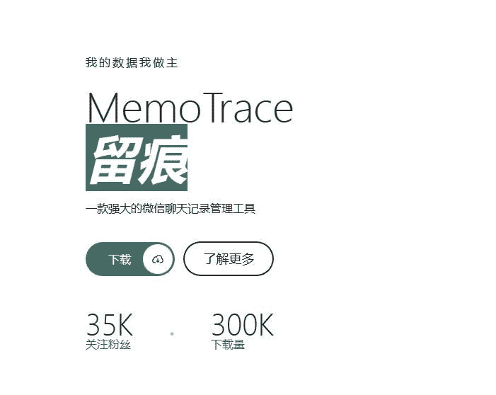

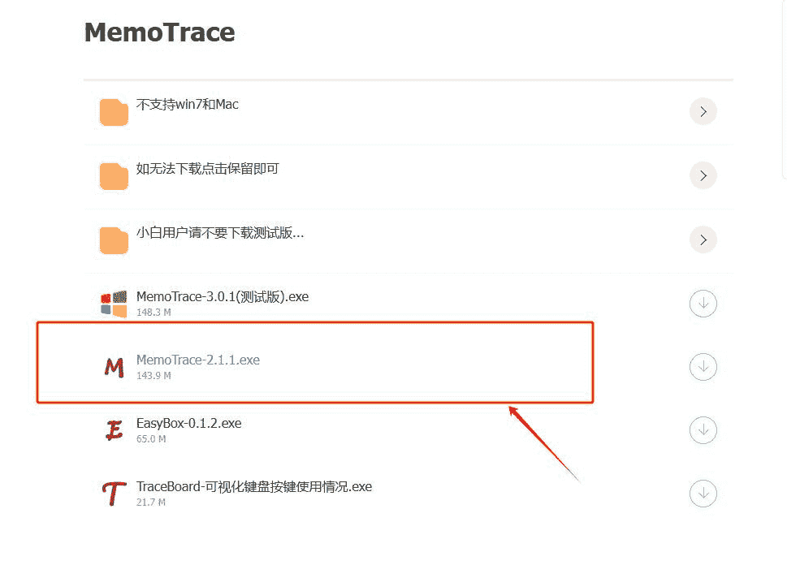

下载后：点击获取信息，要保持微信在线

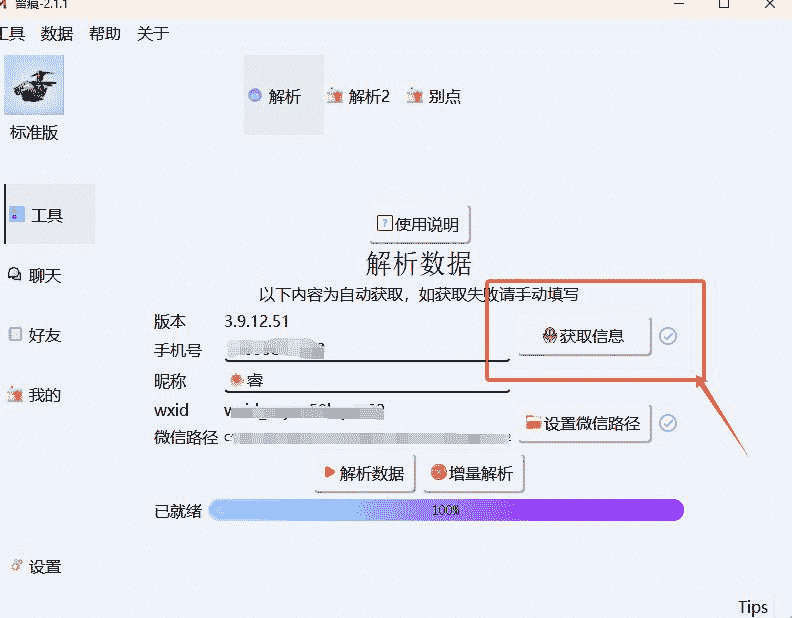

获取信息后会立刻获取到你微信的相关信息。

第二步：点击解析数据，获取你微信的聊天记录

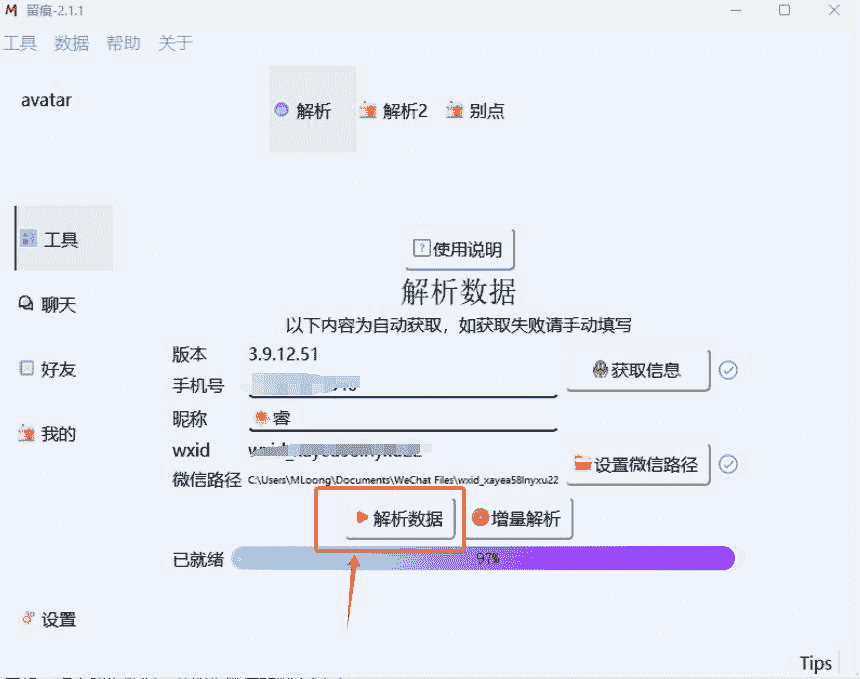

第三步：获取微信群聊天记录

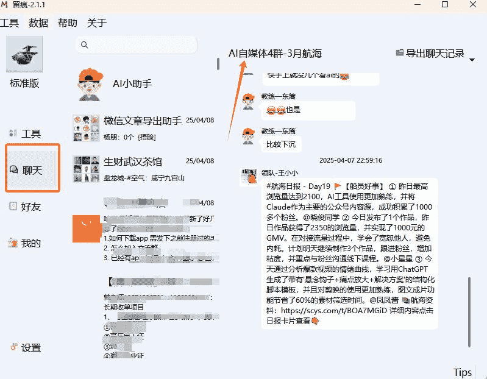

点击左上角的导出聊天记录，选择AI对话专用TXT

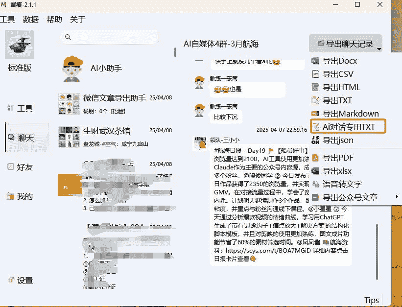

勾选文本、分享卡片、文件 ，选择自定义，时间间隔不要太长，太长对导致文档字数太多。

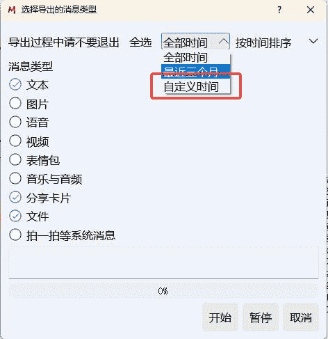

然后点击开始，完成点击打开，会跳转到文件夹。

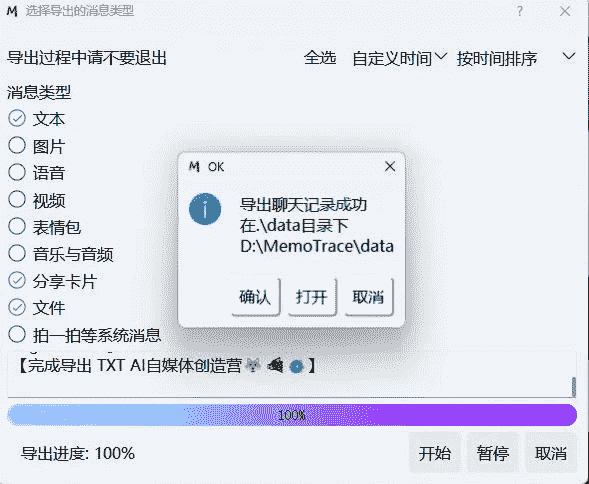

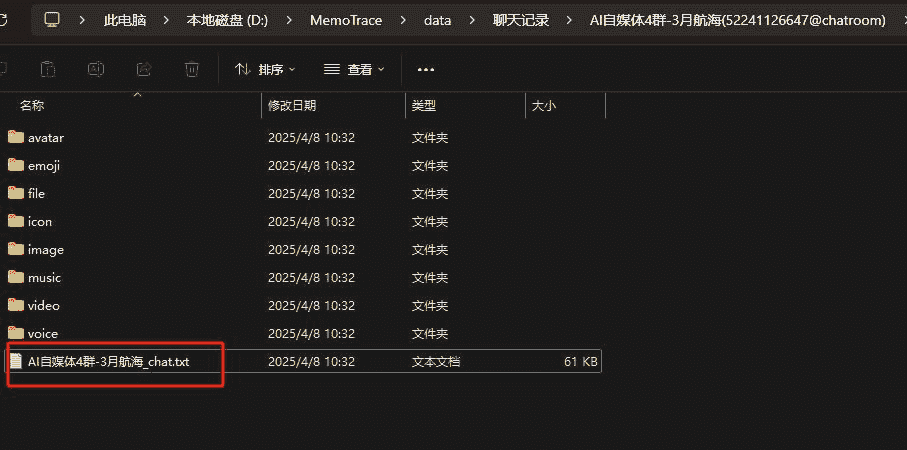

第四步：打开网址： https://aistudio.google.com/

将[2](https://pan.baidu.com/s/14dOL5Y8tYEQwfgwL2MA4iQ?pwd=d48g)个文档直接导入给Gemini 2.5 pro 一个文档是上面下载的群聊天记录文件，一个是提示词文档。提示词太长了自己网盘下载， https://pan.baidu.com/s/14dOL5Y8tYEQwfgwL2MA4iQ?pwd=d48g 提取码: d48g

将2个文档直接给Gemini 2.5 pro等几分钟，下载html文件。下图2个文档，一个是聊天记录一个是提示词。

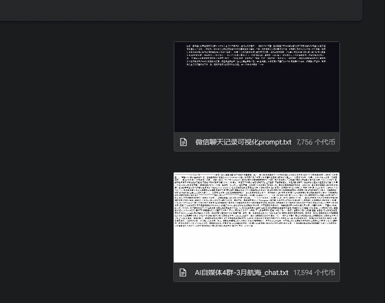

完成后下载这个文件。

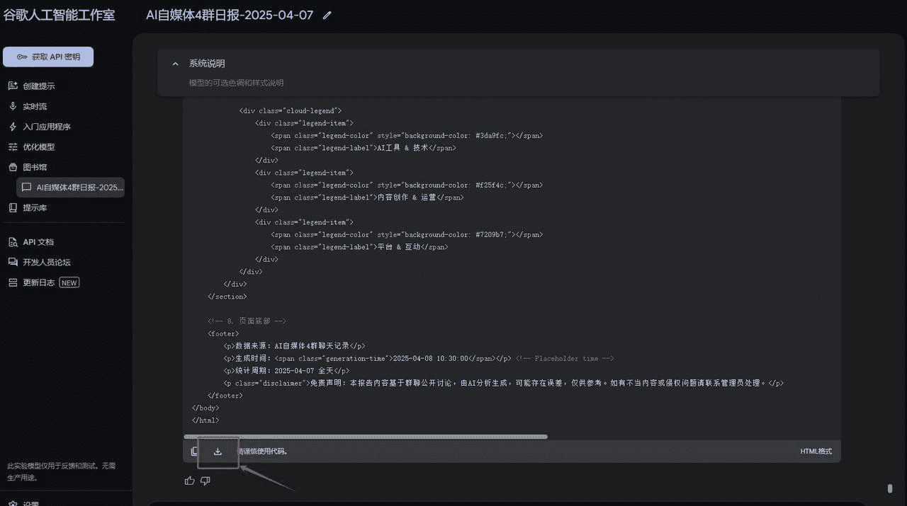

第五步：打开网址： HTML 转 PNG |云转换 (cloudconvert.com) ，将下载的文件导入，点击开始转换

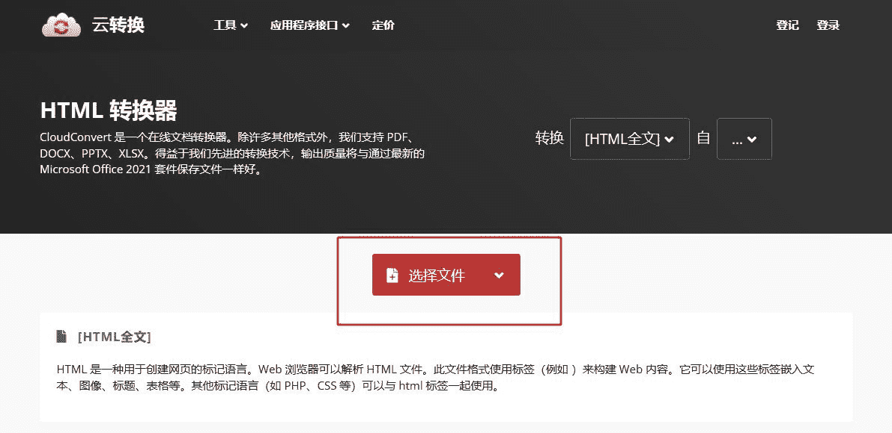

一个聊天记录可视化报告就出来了。

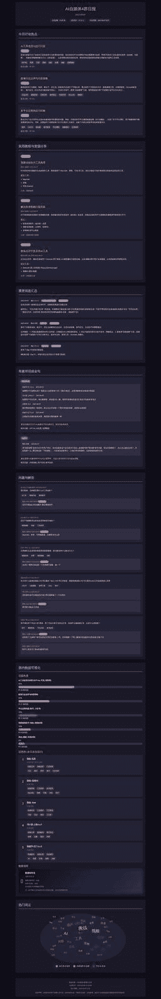