# 从浮躁到沉稳：一个医生的AI赋能之路

> 来源：[https://xuqiwei1986.feishu.cn/docx/Wkg4dt6DeoVim6x4nzqcB1Brnv3](https://xuqiwei1986.feishu.cn/docx/Wkg4dt6DeoVim6x4nzqcB1Brnv3)

# 从浮躁到沉稳：一个医生的AI赋能之路

> "走的每一步路，都算数。"

## 1. 从"刚会走就想跑"到主治医师

从小，我就被说"浮躁"。

我妈到现在还说我，小时候刚会走就想跑，结果摔了个嘴啃泥，那种"刚会走就想跑"的性格，伴随了我很长一段时间。初中时为了快速解题跳过公式推导，结果考试时遇到变形题一片空白；大学期间为了"效率"熬夜赶工，反而多次返工；刚入医院工作，总想着速成，结果医保罚钱出错被科室主任点名批评。

总想着捷径，总想着快速达成目标，却常常因为急于求成而摔跤。

直到研究生期间遇到了师父，磨砺的三年里，我才逐渐沉淀下来。我的师父现在每天仍然下班后看文献，每次手术前都要反复推敲手术方案，每次查房都要仔细询问每个病人的症状变化。他常说："医学没有捷径，只有日积月累的经验和不断精进的技术。"这样的熏陶，把我从一个毛躁的年轻医生，变成了如今能够沉下心来的主治医师。而这种沉稳的心态，也为我后来探索AI赋能医疗自媒体的旅程打下了基础。

## 2. 漫长的学习之路：没有捷径，只有坚持

大学毕业那年，考研调剂失败，我只能去了乡镇卫生院。五线小镇，医疗条件简陋，最基本的CT都要去县医院做，遇到急诊常常束手无策。

当时的我，心有不甘却又无可奈何。每天接诊的不是感冒发热就是慢性病复诊，医学院学的那些专业知识几乎用不上，我甚至开始怀疑自己的选择。

就在这时，疫情暴发，我被派往村里设立的隔离点。每天穿着闷热的防护服，顶着酷暑给隔离人员量体温、发放药物，晚上还要整理各种表格和数据。那段日子，是我人生中最艰难却也最锻炼人的时期。

回**到隔离宿舍已是****深**夜十一点，洗完澡，我还要打开电脑复习考研资料。白天工作，晚上复习，边上班、边抗疫、边考研。考研时间不够，我用工资买了科大讯飞录音笔，晚上睡觉时录下每一堂网课录音然后转写，白天骑电动车时戴着耳机听，吃饭时听，甚至上厕所也不放过这点时间。利用所有碎片时间去听、去记、去背。

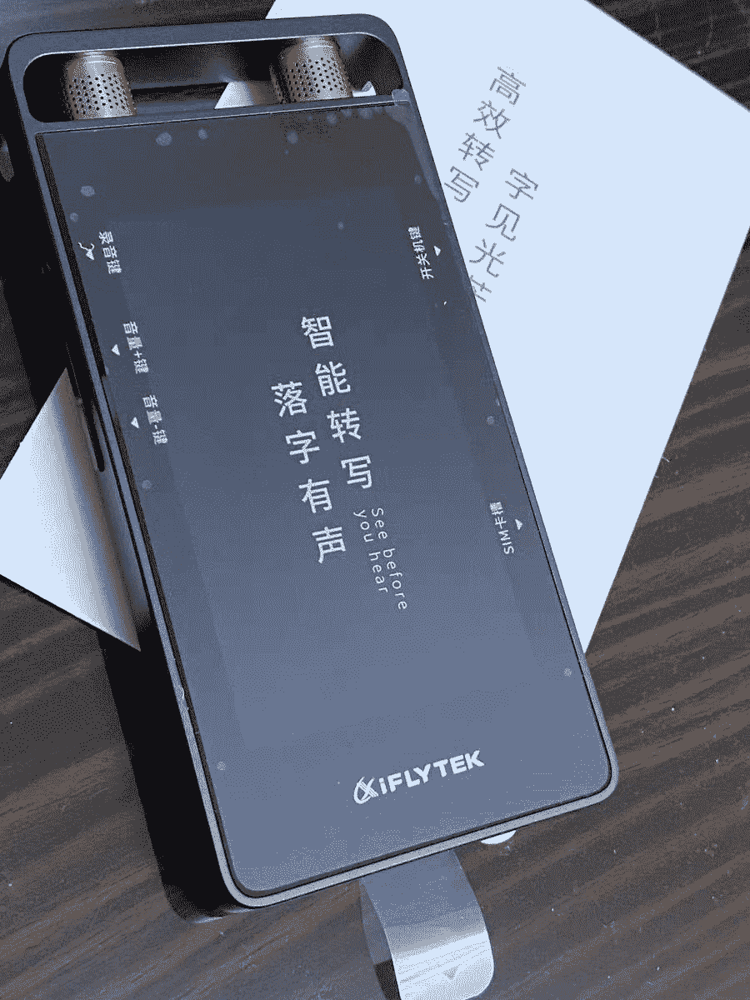

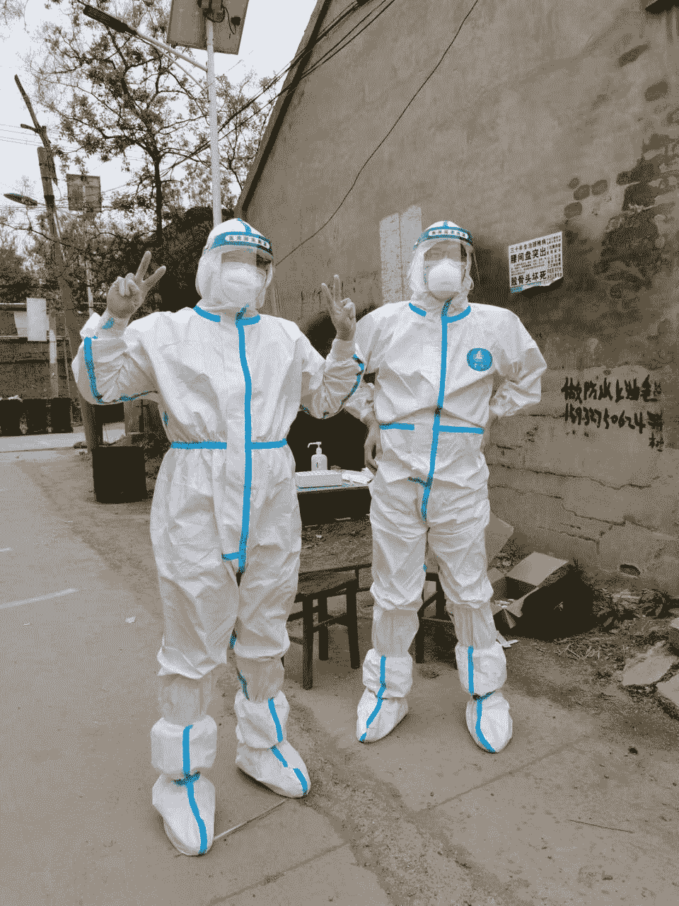

**传统的学习方法**（刷了无数考研经验贴）：听课、记知识点、刷题、刷错题、刷考前模拟题、考试。不断重复，直到知识刻进骨子里。费曼学习法的精髓——重复。（后面会讲AI辅助学习，整合学习效率）

功夫不负有心人，我考入了县里最好的医院，后来用同样的方法又考上省最好的研究生，两年三跨：乡—县—市，最终通过市人才引进来到市里最好的医院。

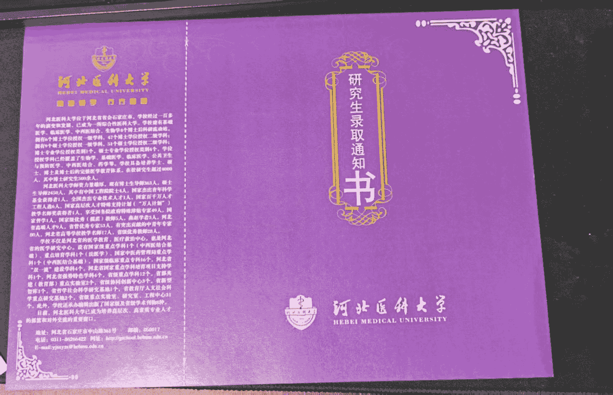

## 3. 临床之路：被"砖"砸过，才知道如何搬好"砖"

刚上临床，我就像个莽撞的孩子，踩了无数坑。

记得第一次独立值夜班，接诊了一个腹痛患者。我开了一些为病人省钱的药物，结果第二天被医保科点名：超适应症用药，违反医保政策。

还有一次，我给一个术后患者写病历，因为病历错误又被罚了200元。

被病历书写罚钱、被医保政策罚钱、被师父批评...一次次拉我起来，教我如何避开那些"坑"。他不厌其烦地修改我的病历，手把手教我如何理解医保政策的边界，甚至帮我垫付罚款。"学费交够了，以后就不会犯了。"师父总是这样安慰我。

那时候，我经常在知乎上搜索"如何成为一名好医生"，"如何提高工作效率"，"医生如何避免医疗纠纷"。熬夜看《病历书写规范》和《医保手册》，希望能够速成，却不断被现实打脸。我想找到一条捷径，却发现医学这条路上，根本没有捷径可走。

## 4. 与AI的第一次邂逅：从问问题到解决问题

记得第一次接触AI，是听说柯洁与阿尔法狗下围棋，那时觉得与自己遥遥无期，2021年底使用搜狗智能问答，就像在问百度一样，简单的问答："胃癌术后饮食注意什么"、"肝功能异常的诊断标准"。效果并不理想，基本上就是复制粘贴网上的资料，我很快就放弃了。

**直到我参加了一档医学直播，详细介**绍了AI历程，并介绍了很多的医学场景痛点

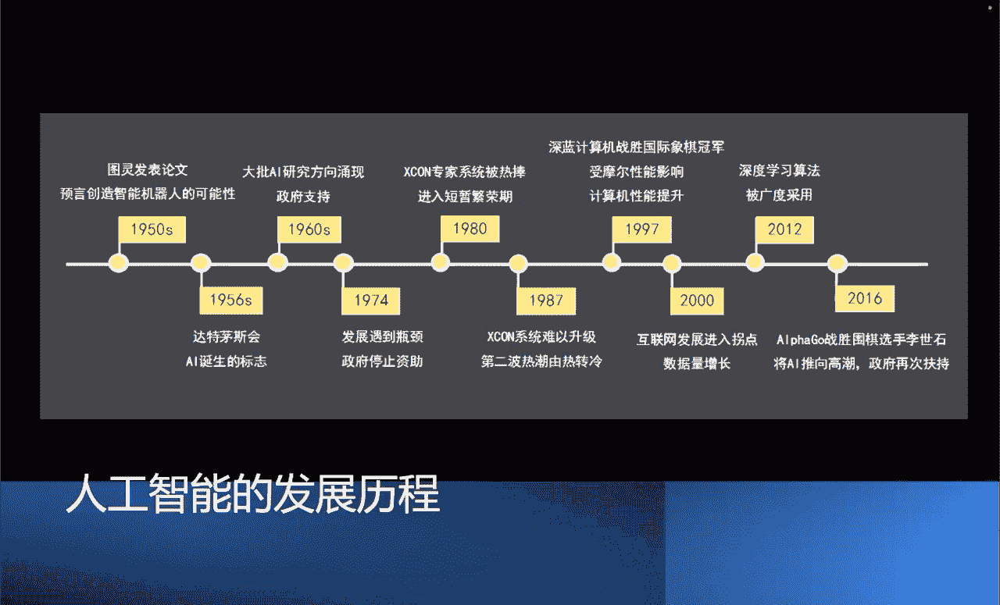

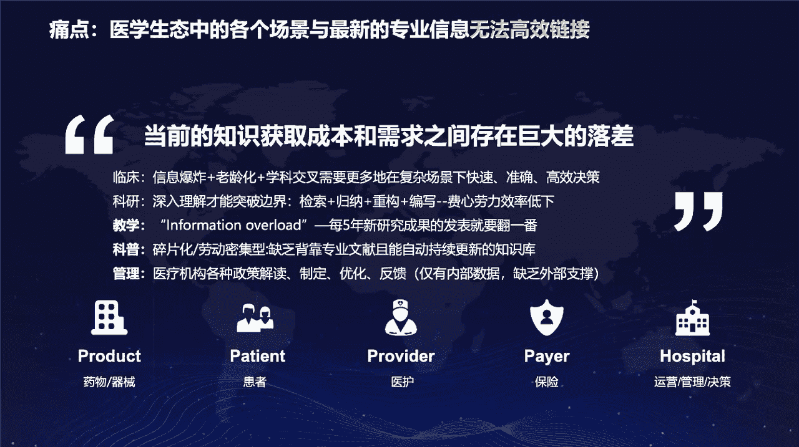

**介绍了YouTube如何将经验丰富医生**的手术动作与新手医生的动作进行对比分析。

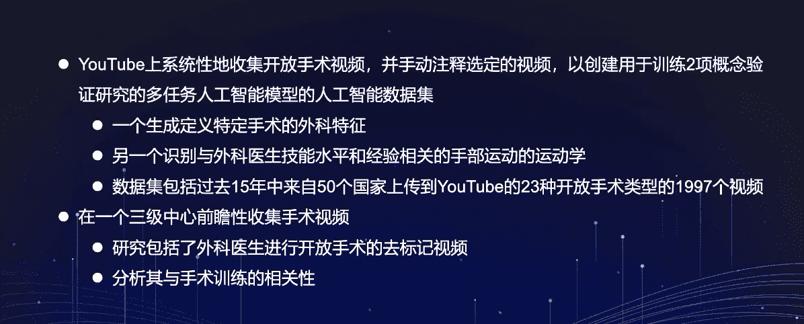

系统通过分析数千例手术视频，提取专家级医生的操作路径

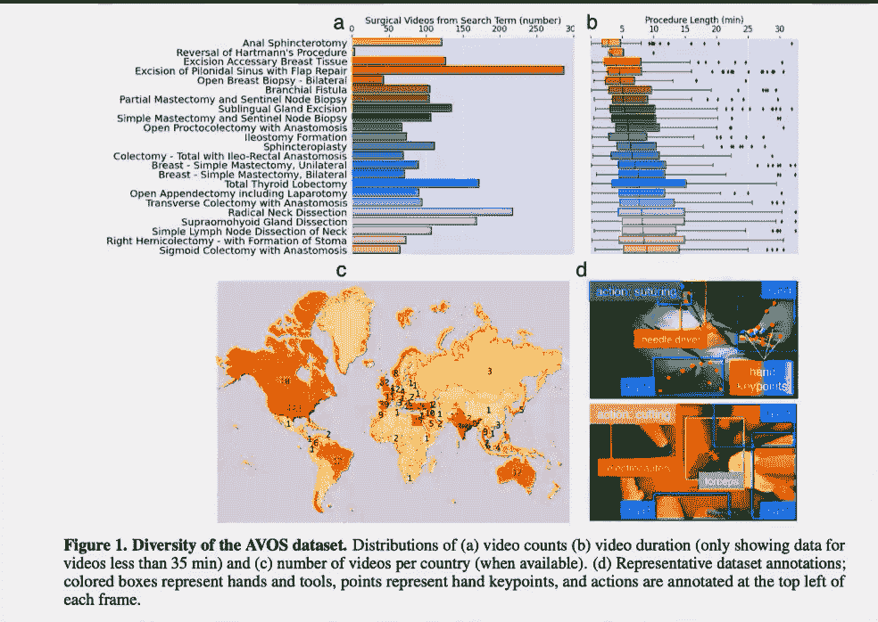

并实时指导新手医生进行标准化操作，大幅降低了新手医生的并发症发生率。

**那一刻，我仿佛看到了一扇新的大门。**"如果AI能够这样辅助医生，那无异于给每个医生配了一个永远不疲倦的导师！"

我如饥似渴地查找相关资料，并查到了某手术团队在用APPLE VISION如何形成手术导航路径——医生戴上这种增强现实眼镜，

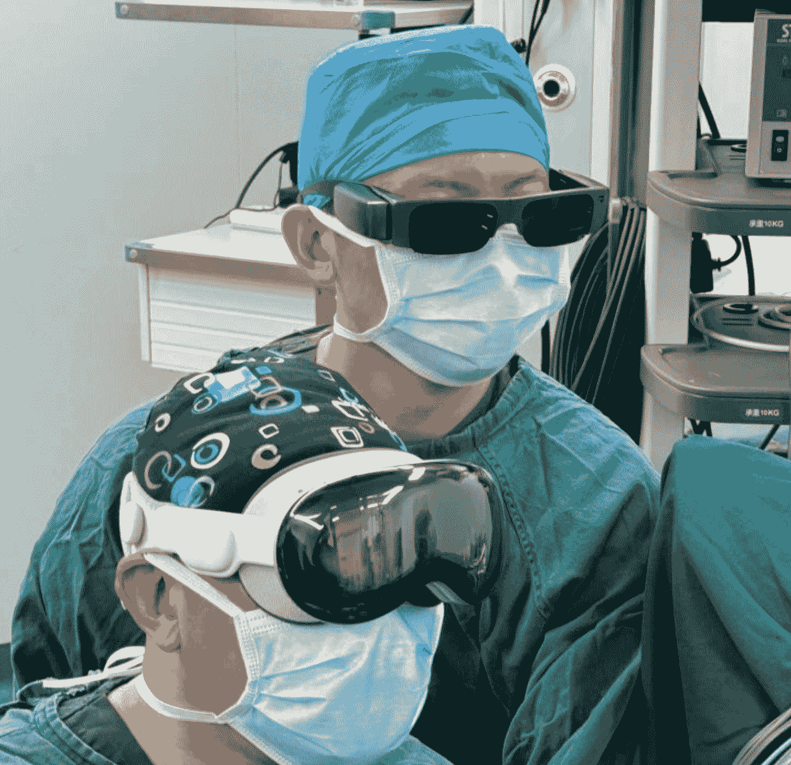

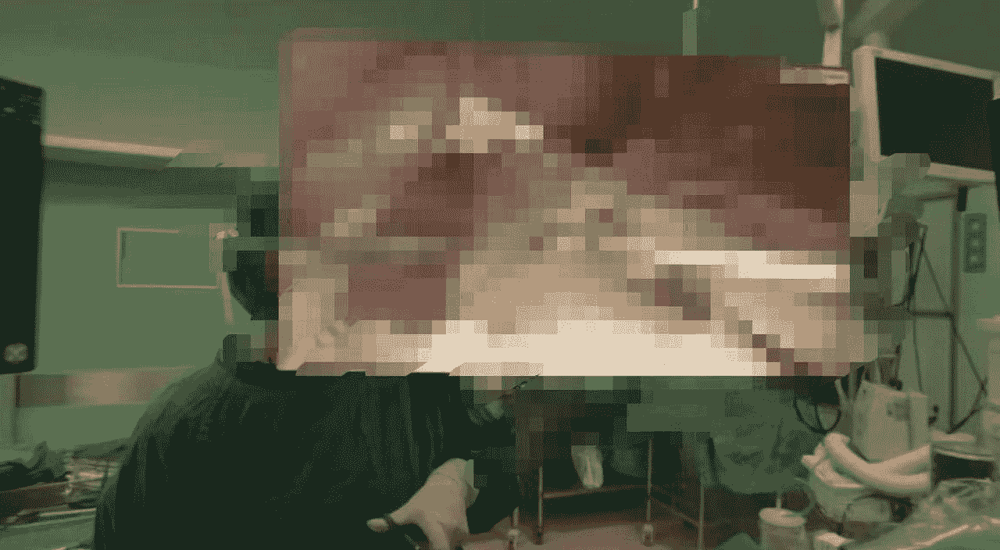

系统会将患者的CT、MRI等影像资料与实际手术野进行叠加，精准定位病变位置及周围重要结构，大大降低手术风险。

我甚至幻想着有一天，AI能够实时复盘手术视频并形成标准化路径，新手医生只需按照系统提示一步步操作，就能达到接近专家的水平。这对基层医院尤其重要，因为那里往往缺乏足够的专家指导。

## 5. 从零开始的医学IP之路

我的好朋友一直在做自媒体，他得知我在癌症诊疗方面有些心得后，鼓励我也来做内容创作："你的经验很宝贵，应该分享出来帮助更多人。"于是，我开启了百家号医学IP的创作之旅。

那段时间，每天干完医院的活回来已经晚上9点、10点，匆匆吃完饭，我就开始整理视频素材。为了做好第一个视频《胃癌早期症状有哪些》，我翻阅了十几篇最新文献，找了20多个病例做素材，录了5遍才满意。用绘声绘影剪到晚上12点，眼睛酸痛得几乎睁不开，第二天还要早起查房。

后来接连用剪映，**度加AI剪辑（现在用****开拍****）**，我**只需要导入视频，AI就能自动匹配素材，一键包**装。原本需要3-4小时的剪辑工作缩短到30分钟，我终于能够保证每周稳定更新内容，也做到了几个小爆款，也涨到了5K多粉丝，步骤如下：1.快速剪辑；2.一键包装；3.选一个自己喜欢背景音乐即可，一晚上可以出3-5个视频。 等我跑通这条路之后，后续媳妇也用同样的方法做账号做到了2.3W粉丝，最多时一天涨粉2000。

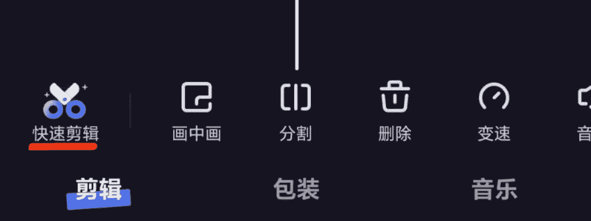

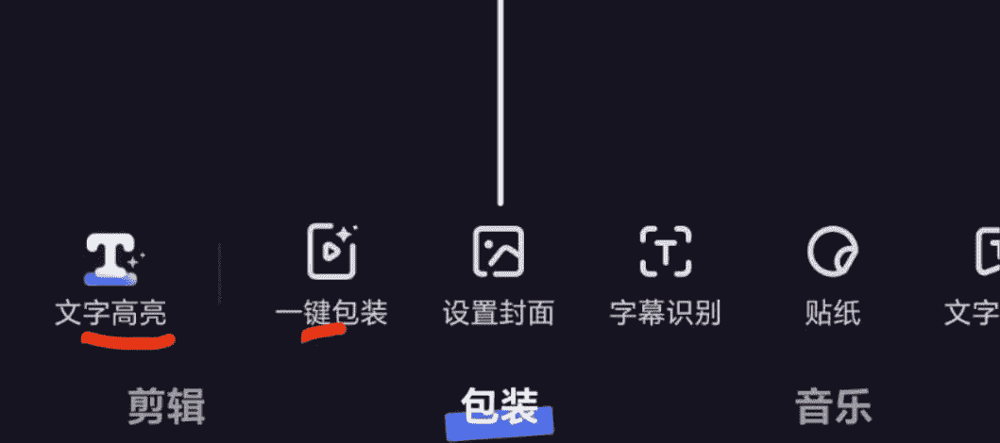

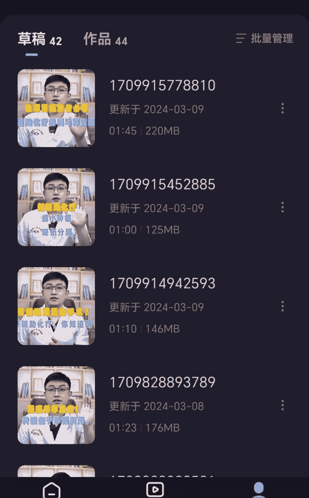

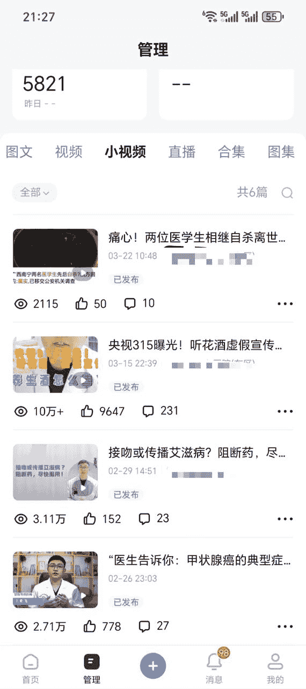

记**得有一次，**受邀去基层医院做癌症筛查的培训。基层医院说能不能教他们一些急救知识的内容，按往常，准备PPT本来要花一整天，但在当时刚接触AIPPT，我尝试用它生成PPT框架和内容。只用了10几分钟，一份包含简单急救知识的精美PPT就呈现在眼前。培训结束后，基层医院的同行们围上来问："这什么软件这么厉害？"我笑着分享，心里却暗自惊叹AI的力量。

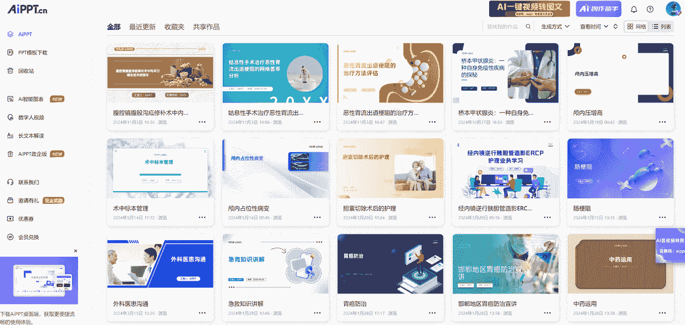

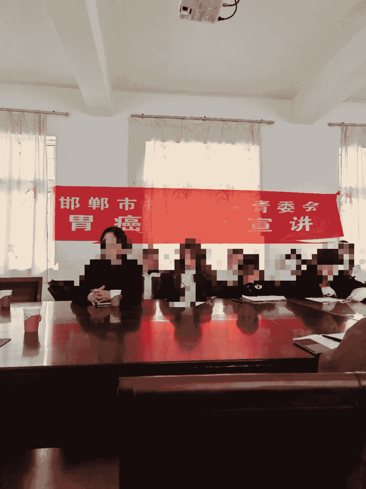

AI润色的朋友圈文案也让我的医学科普更加专业有趣。以前我写的科普总是太过专业，充斥着医学术语，普通人看了直摇头。用AI调整后，专业性不变，可读性却大大提高，同事也都说高大上。

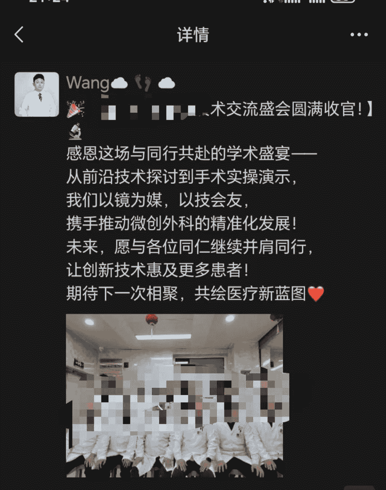

### 医学考试直播案例：AI将GMV提升5倍

我媳妇（同样是医生）在上班中偶然被同事刷到我的科普视频，发现我们家里有专业的直播设备。当时有家医考培训机构正好在寻找临床经验丰富的医生做执业医师资格证考试的培训讲师，就把我们推荐给负责人。开始学习直播。

**目标受众**: 直播主要面向三类人群：

+   刚毕业的医学生，理论知识充足但缺乏实践理解

+   在乡村医院工作多年却反复未能通过执业医考的基层医生

+   工作繁忙没时间系统复习的医生

**产品结构**:

+   考前冲刺班: 1980元/期（包含7天直播+题库+模拟卷）

+   全程精讲班: 2480元/期（覆盖所有考点，3个月系统课程）

+   易错题精讲: 39.8元/套（针对高频考点的专项训练）

**初期挑战**: 起初几场直播，虽然媳妇讲解的内容非常专业准确，但总觉得缺乏吸引力。医学考点本身就枯燥，直播间人气平平，观看人数整场也就四、五百人，转化率不到5%，一场3小时直播只能卖出3-5个课程。

**AI优化流程**: 我发现问题后，尝试用AI为她优化直播话术，具体步骤如下：

1.  找其他机构老师（**对标同行**），分析特点，收集学员常见困惑和反馈，理解他们的真实痛点

1.  将原始考题和标准答案输入AI，附加学员真实反馈

1.  添加指令："请将这个医学考点解释得像讲故事一样生动，使用生活化比喻，面向的是医学基础较弱的考生"

1.  审核AI生成的内容，确保专业性

1.  提供给主播作为直播话术参考

**实际案例：** 某次关于心肌梗死的考点讲解，原本的表述是："心肌梗死的典型症状为胸骨后压榨性疼痛，可放射至左肩及左上肢内侧..."

AI优化后："想象一下，如果有人在你的胸口放了一个大石头，还不断地压，这就像心肌梗死的感觉。这种疼痛不只在胸口，还会滚到到左边肩膀和手臂内侧，就像电流一样..."

**效果对比：**

+   优化前直播GMV：约4000元

+   优化后直播GMV：超过20000元

+   **提升比例：5倍**

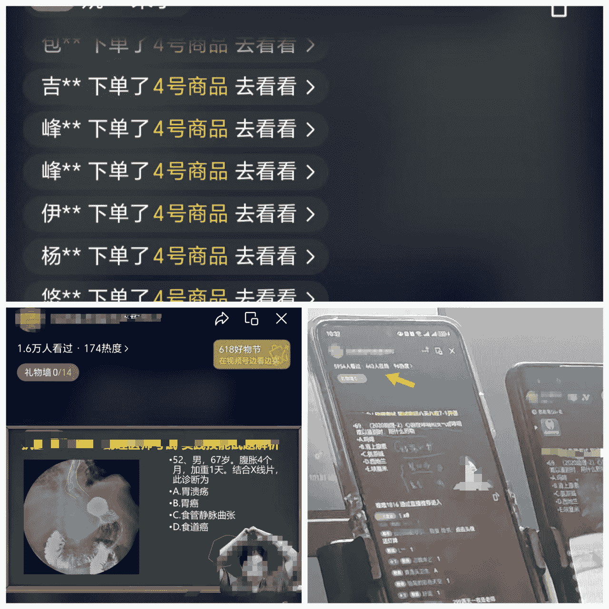

最令我惊讶的是，本来卖不动的39.8元易错题集，在AI优化话术后变成了直播间的"爆款"，单场卖出200多份。

这次经历让我们深刻认识到：再专业的内容，如果不能与受众产生情感共鸣，不能解决他们的实际问题，再好的产品也难以传递价值。AI不仅帮我们提升了GMV，更帮助我们触达并真正帮助了那些在基层医疗一线奋斗的同行们。

## 6. 生财有术：尝试与挫折

去年，我哥跟我说，要不要来生财玩一年试试？我当时搜集资料就了解过生财的各种副业模式、创业思路、变现方法，知道这个平台特别棒！在这要感谢我哥！

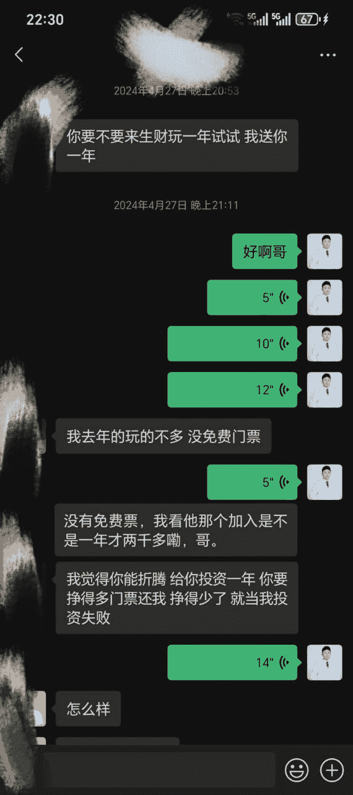

在这里，我第一次接触到**ChatGPT****，了解到它不仅仅是个聊天工具**，还能帮助创作内容、分析数据、解决问题。

生财有术里的各种创业法子让我跃跃欲试。去年我参加了"视频号航海"，但随着深入发现越来越不适合我的主业，放弃了这个项目。

接着我又尝试了社群运营，但同样因为时间和精力有限，无法持续**投入，最终无奈退出。这些经历让我意识到：**不是所有的副业都适合全职医生。我需要找到一个真正能与主业相辅相成、互相成就的方向。

在生财圈里，我也曾接触过靠谱姐和理白，他们同为医生却做着不错的副业。当时的我还是个小白，看不懂大佬们的商业模式，只觉得高深莫测，只能默默学习。

这次遇见AI赋能IP和养成系IP航海，看了介绍我就觉得机会来了，找到了属于我的方向——利用AI打造养成系IP。它与我的经历相关，可以再深度学习AI应用到医学上；最重要的是，它能大幅提高我的工作效率，一举两得。

现在回想起来，当初我哥送的一年知识星球， 它不仅让我接触到了全新的知识和圈子，更重要的是打开了我的思路——原来医生的价值，不仅仅局限于诊室内的一方天地。

## 7. AI赋能医学研究与临床

2024年底，我接到一个棘手的任务——3周内完成一篇胃癌免疫治疗的综述论文，用于科室年终学术会议。按照我以往的速度，至少需要1-2个月的时间：查阅最新文献、分析研究数据、梳理治疗进展、撰写初稿、多次修改...

但我之前接触过**Claude**，利用让他学习已发表的论文，**倒推**的形式，我开始尝试使用它协助论文写作。我先用关键词搜索了近5年的相关文献，整理出50多篇核心参考文献的要点，然后让Claude帮我组织框架、扩充内容、形成初稿。以下是论文写作方法：

**步骤1：文献收集与整理**

+   使用PubMed、知网等平台搜索近5年胃癌免疫治疗相关文献

+   筛选出50篇核心参考文献

+   阅读并整理每篇文献的关键发现和结论

步骤2：让Claude学习参考文献

我让Claude学习已发表的论文格式和内容，使用以下提示词：

我正在写一篇关于胃癌免疫治疗的综述论文。以下是几篇代表性论文的摘要和关键发现：

[粘贴3-5篇核心论文的摘要]

请根据这些内容，帮我分析：

1. 这个领域的研究脉络和主要分支

2. 常用的研究方法和参数

3. 目前的研究热点和争议

4. 可能的未来研究方向

**步骤3：生成论文框架**

基于以上分析，请为我的综述论文生成一个详细的框架，包括：

1. 引言部分要点

2. 主体部分的各个章节和子章节

3. 每个章节应包含的关键内容和引用的代表性文献

4. 适合放置表格或图表的位置和内容建议

5. 结论和展望部分要点

**步骤4：分节撰写内容** 对每个章节分别提供详细指导：

请帮我撰写"胃癌免疫治疗的机制"这一节内容，需要：

1. 包含PD-1/PD-L1通路、CTLA-4通路等主要机制

2. 引用以下关键文献的发现：[列出文献]

3. 保持学术风格，使用准确的医学术语

4. 确保逻辑流畅，从基础机制到临床应用

5. 字数控制在800-1000字

**步骤5：人工审核与完善**

+   审核AI生成的内容，确保医学准确性

+   补充最新的研究数据和临床试验结果

+   调整格式，符合目标期刊要求

+   完善参考文献

**效果：**惊**讶的**发现，它不仅能理解复杂的医学概念，还能将零散的研究发现组织成逻辑清晰的论述。我只需要审核内容准确性、补充最新数据、调整格式，3天就搞定了这篇综述！

当我在会议上展示这篇论文时，主任说："这篇综述的框架很清晰，论证很有深度。"

同时，我和复旦大学实验室的同学共享了一个ChatGPT Plus账号，一起探索AI在医学研究中的应用。我们用它来分析实验数据、查找研究漏洞、生成研究假设，效率提高了至少30%。

就在我以为我的AI工具链已经趋于完善时，Deepseek横空出世。当时身边大部分人都在说怎么这么厉害，却只限于新闻表面，它虽然没有完全打破我的AI工具使用流程，但在某些专业领域的理解上确实更胜一筹。

在使用这些AI工具的过程中，我深刻体会到：AI出现的意义不是取代人类，而是让我们"能更快的刚会走就能跑"！就像一个刚入行的医生，有了AI，能够避开许多常见错误，更快地成长为一名合格的医生。

## 8. AI改变了我的工作方式

现在的我，学习方式已经完全改变。

以前备考资格考试，是抱着厚重的教材一页页翻看，做笔记到深夜，眼睛酸痛手腕发麻。现在，资料搜集交给通义听悟，它能自动提取关键信息，形成知识脉络。我只需要整理提示词写，几分钟内就能得到结构化的资料。

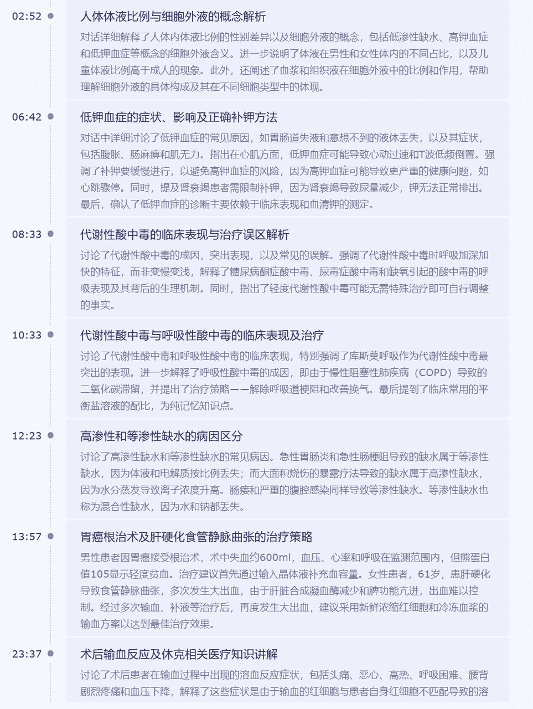

快速学习刷题后下载错题题库后整理成PDF，再交给kim**i合并知****识**点，自动生成错题集和考点汇总。原本需要一周时间的复习资料整理，现在几天就能完成，学习效率提高了300%。

**提示词如下**：

我正在准备[具体医学考试]。

请帮我将以下医学考点整合成结构化知识体系： [粘贴考点内容]

请按照以下格式整理：

1. 核心概念与定义

2. 临床表现与症状

3. 诊断标准与方法

4. 治疗原则与药物

5. 常见考点与易错点

6. 记忆方法与助记口诀

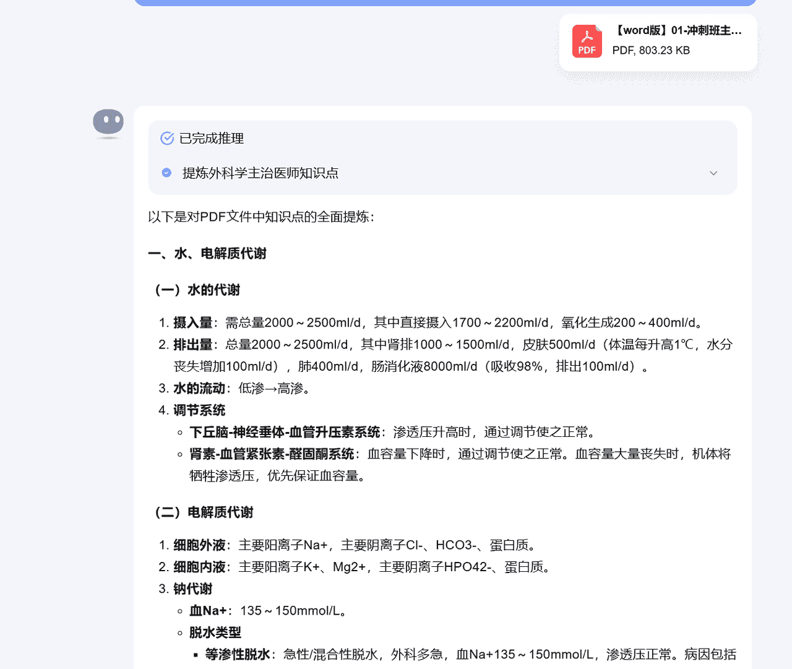

记得上个月科里新来一位规培医生，看我几分钟就能写好一份规范的病历，惊讶地问："师兄，你怎么写病历又快又好？"我笑着告诉他我的秘密——我已将病历书写规范教给AI，

###  AI辅助病历书写

**痛点：** 病历书写耗时且容易出错。

**AI解决方案：**

1.  创建病历模板库，针对不同疾病类型

1.  将病历书写规范教给AI

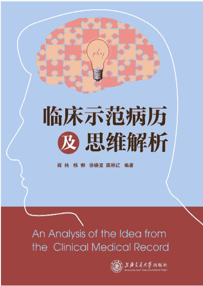

1.  输入关键病史和检查结果

1.  AI生成符合规范的病历初稿

1.  医生审核确认

**提示词如下**：

请根据以下信息生成一份标准住院病历首次病程记录：

**患者基本信息**：

**姓名**：[姓名]，性别：[性别]，

**年龄**：[年龄]岁 -

**入院日期**：[日期]，

**入院诊断**：[诊断]

**主诉**：[主诉]

**现病史**： [现病史要点]

**既往史**： [既往史要点]

**体格检查**： [体格检查要点]

**辅助检查**： [辅助检查结果]

**要求： **

**1. 符合上述最新病历书写规范                       **

**2. 使用医学专业术语**

**3. 逻辑清晰，结构完整 **

**4. 包含初步诊断和治疗计划**

只需输入关键病史和检查结果，**（这一点我又可以通过通义听悟）**，AI就能自动生成符合要求的病历初稿，我再修改确认即可。

###  AI辅助医保政策审核

**痛点：** 医保政策复杂多变，违规开药常被罚款。

**解决方法：**

1.  将本地医保政策详细要点输入AI

1.  在开具处方前让AI审核

1.  AI提示潜在的医保违规风险

我已将医保政策教给AI，让它提示我哪些药物有报销限制，哪些检查需要特殊申请，避免了因违反政策而被罚款的风险。

**提示词：**

请根据以下医保政策审核我的处方：

医保政策要点： [粘贴医保政策摘要]

我的处方： 诊断：[诊断]

药品： 1. [药品1] [用法用量] 2. [药品2] [用法用量] ...

检查项目： 1. [检查1] 2. [检查2] ...

请分析：

1. 是否有超适应症用药

2. 是否有不符合医保报销规定的药品或检查

3. 是否有更经济的替代选择

4. 处方是否符合合理用药原则

在医院的各种学术讲座上，我开始尝试用AI辅助制作PPT和讲稿。许多同事慕名而来，想了解我是如何将AI融入医疗工作的。

不知不觉中，我成为了医院里小有名气的"自媒体+AI专家"。年轻医生遇到AI相关问题都会来咨询我。

这种转变让我感到欣慰——**从曾经被批评浮躁的年轻医生，到如今能够帮助他人提**高效率的"AI传道者"，这条路走得值得。

## 9. AI带来的变现

今年，我用AI代写10天内变现2000多元，远超我的预期。并学会了用飞书做多维表格记录，后面因工作原因停了。

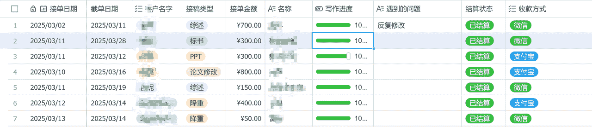

最令我感动的是之前交流过的一位乡镇卫生院的医生留言："我们这里资源匮乏，很多疑难病例没人讨论。现在我可以用AI模拟一个'专家团队'，帮我分析病例，提供诊疗思路。虽然不能完全依赖，但比起以前孤军奋战，已经好太多了。"

### 直播机会：意外收获的中医AI商单

在**SKY盖哥的直播中**分享医疗AI经验后，一家中医机构的运营私信我，邀请我为20万中医同道开设AI应用直播，在线观看人数达1万。

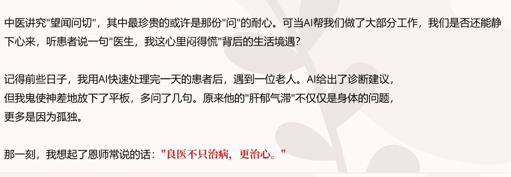

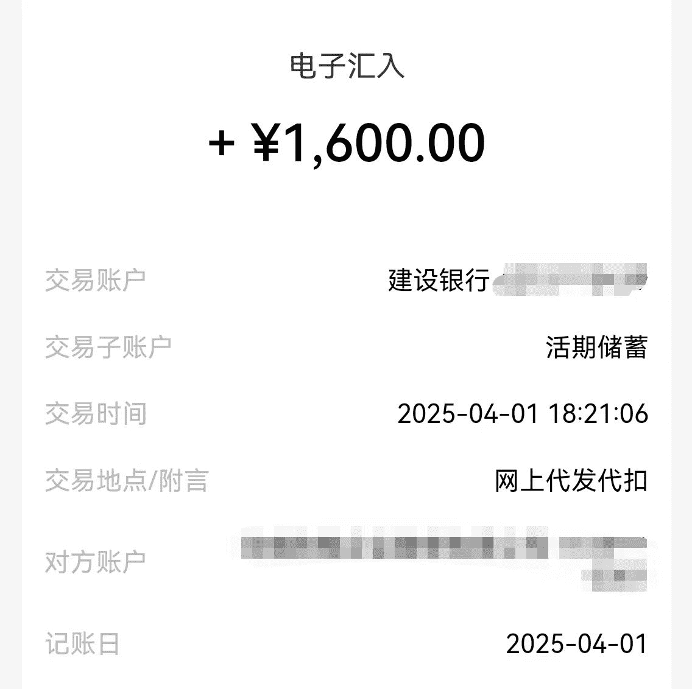

这不仅带来了直接收益，更重要的是拓展了人脉和影响力。我发现：

将AI知识与医学场景专业知识结合，形成了我独特的差异化优势。

## 10.  AI使用心得：多问一个"为什么"

使用AI的过程中，我学会了多问几个问题：

"**别人做到的事情我为什么不能？**"

"**我怎么才能做到？**"

"**我想要达到什么样的效果？**"

找到对标，让AI**倒推**怎么做到的，让AI按照**BROKE框架**写提示词。这种思维方式，让我在使用AI的过程中事半功倍。

## 11. 每一步，都算数

**回顾过去，我曾尝试过很多路**，很多法子，似乎都没有坚持走成功过。但这一切也都有附带的好处。

那些直播设备，当初是我冲动消费购买，却帮助师父以最好的姿态与全球癌症第二、胃癌世界第一癌研有明医院胃部长步部创也医生在中日论坛线上交流；并且，那些直播设备的便利让我们通过做直播讲师赚回了本钱。

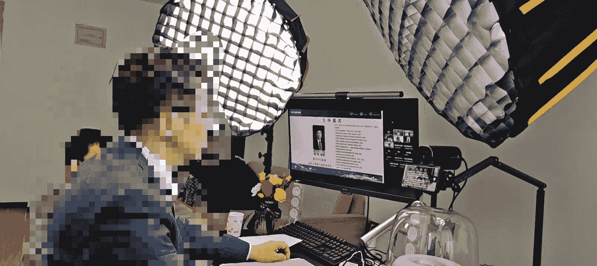

回顾过去，我曾尝试过很多路，很多法子，似乎都没有坚持走成功过。

但唯有医学，从医10年，到了市里最好的医院，我做到了。

唯有爱情，与媳妇15年爱情长跑，我做到了。

对AI的探索，我相信我一定可以做到。

## 结语：从浮躁到沉稳，找到属于自己的道路

从一个"刚会走就想跑"的浮躁少年，到如今能够沉下心来研究AI赋能医疗的主治医师，这条路我走得并不容易。

但正是因为经历了这么多挫折和尝试，我才找到了真正适合自己的方向——想成为一名医生AI传术士，致力于提高医生效率，更好地服务人民。

在这个AI迅猛发展的时代，我想告诉所有像我一样的医生：拥抱变化，学会利用AI工具，你会发现自己的工作和生活将变得更加高效和美好。

走的每一步路，都算数。成功不是偶然，而是一个又一个选择累积的结果。

**在**此感谢生财有术，涛哥（涛哥好帅！）、SKY盖哥、梁靠谱、小鹅、黄阿兜、理白、一六.....一切在生财遇到的人，感谢！

**我是王多宝，一个不断探索AI赋能**医疗的医生，也是一个永远在学习的追梦人。