# 2025-04-07AI+IP，一人公司，如何狂奔到垂类赛道TOP10

> 来源：[https://xuqiwei1986.feishu.cn/docx/WNzIdIODAoA9bExx0uxcFrp5nsf](https://xuqiwei1986.feishu.cn/docx/WNzIdIODAoA9bExx0uxcFrp5nsf)

> 🔗 原文链接： h[ttps://mp.weixin.q](https://mp.weixin.qq.com/s/C2DJG9WobnlPwM2eeTsncA)q.com/s/C2DJG9Wo...

原创 包子 龙哥盟2025年04月07日 20:02  浙江

👆点击 龙哥盟 >点击右上角“···”>设为星标🌟

当下内容赛道愈发内卷，团队拼资源、拼人力，个体还能不能跑出来？

航海大会分享嘉宾 @包子 用行动，交出一份令人惊艳的答卷：从国企工程师裸辞转行，一个人在家打造个人IP， 从0做起切入教育赛道，用AI + RPA 实现高效内容生产 ，硬生生把直播，做到高考志愿领域TOP10。

今天他将分享—— 如何用AI打通内容、直播、运营全链路 ，实现从零到头部的个人IP成长路径。

---

如果看完本文还不过瘾，不妨关注本周四 晚20:00的赚钱直播。

点击“预约”，蹲住直播间~

# Part 1

# 背景介绍

我从两年前开始进入教育赛道，调研、文案、拍摄、剪辑、直播、产品交付， 都是一个人自己在家里完成的 ，在这个过程中，需要使用很多工具。

所以我对 AI 的使用，有具体场景和规则，我做的专业讲解视频，成了高报行业的新手教材， 直播也做到了抖音直播教育赛道第一梯队。

1、加入赚钱

在这之前，我是一名工程师，而且还不是搞IT，在一家大型国企工作。 如果我愿意，其实可以一直躺平下去 ——在自己的赛道上按部就班，走到终点。

按照常规的发展路径，我无非就是成为一个总工、一个院长，最后体面退休。

但我不甘心。 那种“人生可以一眼望到头”的感觉，实在太无聊。 我不想按照这个剧本走下去，所以，干脆就裸辞了。

裸辞之后，一个大男人整天待在家里无所事事，经常被嫌弃。直到 @刘小排 老师强烈安利我加入赚钱。

印象特别深，那时候还是穿羽绒服的季节，我加入了社群。这时候， 我才真正开始走上另一条路。

2、尝试做IP

进入赚钱之后，我看到一个完全不一样的世界。原来，世界是如此丰盛、多元。但也因为机会太多，反而挑花了眼—— 最终，我选择了做IP。

说实话，这个选择， 其实带着一点无奈。

我一个人待在重庆，信息差实在太大了，根本没法跟在杭州的朋友相比。我很清楚，抓风口是抓不住的。既然如此， 我就必须找一条能够在中年之后、靠着持续努力，积累确定性的赛道。

IP，刚好就是这样一条路。

我不需要担心每一件事都要火，因为只要方向对了， 做完，就自带爆款属性。

# Part 2

# 做IP成功起步

我开始做IP，运气比较好，第一次起号就成功了。 选题在我自己的本专业——一次关于工程设计的思考，写的是专业向的内容。这篇文章让我第一次真正体会到IP的力量。

文章发布后， 我在赚钱陆续接到，来自全国各地的项目邀约。 有些地标建筑的设计团队，甚至愿意把项目中最难的部分，交给我来分析。

这个反差让我非常惊讶。要知道，设计院能接到一个项目本身就不容易，更别说把精华部分，交给一个连头像都没设置的人。

IP确实具有很强的信任穿透力。

但随着认知的提升，我也逐渐发现，这条赛道太小了。 IP真正的价值，应该是钉在大流量的枢纽里 ，只有这样才能发挥作用。

1、 换赛道

一般来说，一个大的IP，往往就是所在行业的地标。比如 @Damo 老师，他就是出海实战领域的地标人物。你平时几乎不可能碰到他；同样的， 赚钱本身，也是创业赛道的地标。

受这个启发，我开始认真选赛道，最终选择了高考志愿填报。

选这个赛道， 其实我是有一套自己的逻辑的 ，也借这个机会跟大家分享一下。

1.挑选赛道的要点

第一，这个赛道不能有垄断。

高考志愿这个赛道，其实是字节近几年才推出来的新赛道。 体量很小，全国每年不过十亿左右 ，而且它的业务期一年只有十天。

在这样一个结构下，几乎不可能形成一个全国垄断性的公司， 意味着赛道是相对开放的。

第二，这个赛道起点公平。

这个领域没有科班出身的人，起点是公平的。这正是我最不虚的地方—— 学习能力和知识迭代，是我能掌控的。

第三，流量稳定。

做IP非常耗时， 短则几个月，长则一两年 ，才能做成。如果赛道本身，在你打磨的过程中就没了，那等于白做。

高考志愿这个赛道，本质上是通过知识来获取家长的信任， 这种“人信任人”的结构 ，反而更容易出现头部个人IP。

第四，就是高考资源填报业务本身。

很多做教育的IP，其实不做志愿填报。但这个节点非常关键—— 向下可以连接所有中学阶段的提升类产品 ，是中学教育的终点； 向上可以连接大学的保研、规划、职业路径 ，是大学教育的起点。

如果我能在这个节点上钉住，就能掌握整个教育赛道的关键流量入口。 下限可以是做志愿填报，上限则有更多想象空间。

2.现实挑战

梦想已经想好了，也决定要做这条赛道的IP。但现实其实很敏感。

那时候，我已经超过35岁，一个中年男人，没收入、没资源，独自在家。 我放弃自己积累了18年的本专业知识 ， 转向一个完全陌生的领域，去做出一个IP——这是我的第一个局。

我的第二个局，来自我的环境。我在重庆，身边所有的亲人和朋友，全都在体制内， 完全没有创业氛围。 我跟他们讲IP，他们根本听不懂这是什么。

还有第三个bug： 我根本没有多少时间。

你可能会问，一个人在家，怎么会没时间？但事实是，只要你在家，说好听点叫自由职业者，不好听点，就是无业游民。这种情况下， 家里所有的事情，都会自动归到你头上。

早上送孩子，下午接孩子，晚上辅导作业，周末上辅导班、亲子游、取快递、买菜。最后发现，根本没有完整的工作时间。 所以我必须用AI——时间实在太少。

听上去挺惨的对吧？但其实我当时的情绪，并不绝望，反而很兴奋。因为我觉得—— 自己的人生，突然有了新的挑战。

原本我走的那条人生路，是一条看得到尽头的直路。而现在，路边忽然出现了一个岔路口。虽然看不清前面是什么，但我觉得， 只要穿过去，说不定就是桃花源 ——于是我就出发了。

在这个过程中，困难当然非常多。就像打游戏一样，你上去打Boss，结果一下就被干掉了。不断地重来，也不断地产生情绪。

后来我意识到——情绪，其实改变不了任何现实， 只有实干才能改变一切。 所以我告诉自己，不用太在意情绪。

我老婆经常笑我像个机器人，从早上起床一直干到晚上睡觉。但说实话，如果真的被情绪影响，根本干不了这么多事。

所以我也常常跟伙伴们说，别太纠结自己的情绪， 把自己当成电线杆就行 ——电线杆会有情绪吗？不会，它就只是默默输电而已。

2、如何做IP

我做IP其实很简单，就两点： 第一，你得先成为专家；第二，让别人知道你是专家。 做到这两点，这个IP就算站住了。

但问题在于，这两件事都很花时间。于是我给自己定了一个两年的计划—— 通过两个高考周期，把自己打造成全国高报头部IP。

从那一刻开始，我几乎是全力投入做调研。我从高考志愿填报的技术打起， 延伸到700多个专业的知识 ，再到考研阶段可以继续深造的方向。甚至包括：不同课题对应的研究方向、可以进入的单位、大概的收入区间。

我把整条路径打通后，在高考赛道上，几乎没有对手。

因为我一直坚信： 当你在帮一个孩子做出未来选择的时候，你必须知道这些内容。

1.先成为专家

在这个过程中，有一点想提示大家。很多人喜欢先对标一个中腰部的IP。这样做可行，但效率很低。 IP是市场选择的结果， 与其对标中腰部 IP，不如直接学习头部IP。

你觉得谁的内容最好，就去看他的内容；谁的剪辑最好，就去学他的剪辑，这是最快的路径。 我在每个领域，都是去找大IP的长处。

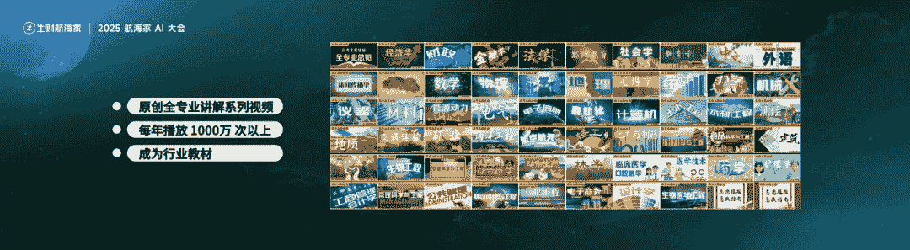

这是我做的全专业讲解系列视频，是过去两年， 全国唯一一个由个人完成的、成体系讲解全部专业的视频。

后来这套体系，在同行中评价很高，很多机构老师告诉我，新人入职的第一件事，就是学我的视频、做笔记，已经成为行业的教程。

这个系列在抖音的播放量虽然不算多，但我们这个赛道本身流量就小， 1000万次已经是顶流了。

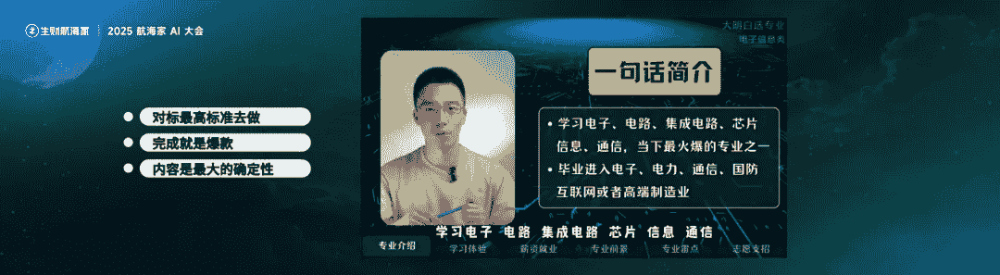

2.让别人知道

第二点， 所有对标对象，都按最高标准去做。

在我所有的视频里，无论是调研、内容还是剪辑，全都按全网最高的标准执行——现在发现， 我想要超越自己都很难。

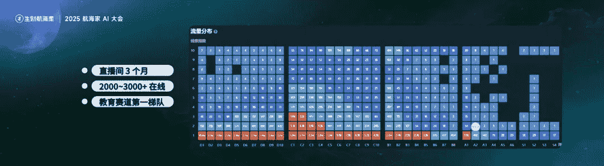

我做直播大概三个月，现在是高考淡季，在线人数能做到两三千。虽然比张雪峰老师还有差距， 但在抖音60万个直播间里，大概能排到前1%甚至0.5%的位置。

而且我是全自然流量，在这个阶段已经有大量纯付费流量和机构打法进入。

通过这两个动作， 我把自己做成了教育赛道的IP。 到现在，我也一直只在做这两件事。

# Part 3

# AI加持——

# 每个人都能成为六边形战士

大家可能会好奇：一个人怎么能干这么多活？

第一个原则—— 所有的重复劳动交给工具，整个迭代任务交给自己 ，这样我才能把这个事业做成。

首先要找工具。 去哪里找？在赚钱就有很多，直接找小排老师就更容易了，他就是哆啦A梦。

我用的最多的工具： 第一个是RPA，第二个是AI ， 这两个工具各有千秋。

RPA胜任精确的工作，是可以完全控制结果的；但是AI更适合模糊的工作，实际上是不可控的。 所以RPA就像一个篱笆，把AI围起来—— 用RPA去控制AI，得到自己想要的结果。

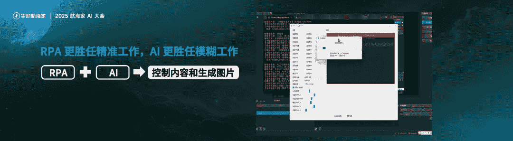

比如专业排序系统，是我的应用场景之一——杭州的小孩，要去江苏学计算机，志愿该怎么排序？ 我用RPA进行排序，再用AI出图片 ，每当家长有疑问的时候，我们直接给一张图，沟通成本就很低。

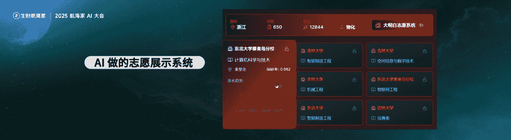

这是我做的志愿系统 ，这个其实是上了小排老师的内测课后，觉得很好玩，就在直播间做出来的。它可以很方便地让你看到志愿，以及大概率能上哪些学校。

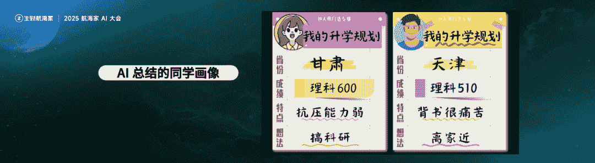

第三点是我在直播间，当有家长说到自己孩子的特点时， 我会现场生成用户画像 ，让新进直播间的家长，也能了解这个同学的分数、特点和想法。这样其他人也能看得很清晰。

我用AI的频率很高。去年我用某个国产大模型， 大概用了1万次就被封号了 ，当时非常苦恼。

后来发现， 只要给它发几句话，比如“请你喝咖啡” ，就会弹出二维码，充点值就能继续用了。我就不断“请他喝咖啡”，坚持把任务完成了，但这个方式并不可持续。

后来我决定接入大模型API，但看了很多资料都搞不定。结果在小排老师的课上，学了一分钟就解决了。 我马上接了API，生产力也就开始起飞了。

现在我家里四台电脑的AI，都在疯狂工作，这种感觉非常爽。 因为所有参数，都是自己调的 ，出问题调一遍就好。

而且AI没有情绪、没有管理成本 ，所以我只要掌握自己的情绪就行了，这是AI最大的优势。

第二点是：当你用AI打通全流程， 你的协作效率，会变得非常高。

人和人之间协作会有信息丢失 ，比如一个员工表达一个想法，到另一个员工手里可能就变了。所以传统团队需要不断开会、沟通、协调。而AI让你自己和自己协作——效率极高。

比如我晚上直播间想实现一个效果， 早上想到，晚上就能做出来。 如果效果不好，下播后我就知道怎么改，第二天就出第二版。这个循环特别快。

我写好一份文案，在视频里能对应什么效果？特效、音效、画面布局、站位、文字位置、观众能不能看见——这些在我脑子里几乎是一瞬间完成的。

当你在做项目的时候，如果有一个环节没打通，就学会用AI ， 这样就能成为真正的六边形战士。

# Part 4

# 如何用 RPA 管理 AI，

# 为个人 IP 打造超级知识库

接下来讲讲我具体在做什么，AI在我的日常工作中怎么用。

第一个例子是升学规划。我要了解各个学校的升学率，比如我有1000份PDF，是各个学校的就业报告。 如果让我人工整理，可能要两个星期。

这种情况下直接喂给大模型，它可能会答错，比如问升学率，它先说50%，再问一遍又变了，这样的数据无法使用。

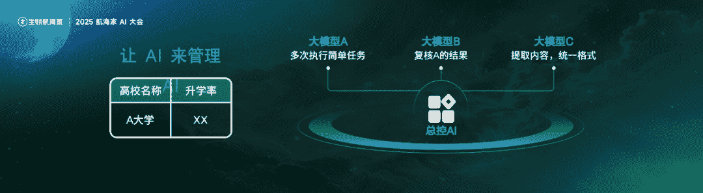

后来我问AI怎么办，它告诉我—— 可以用一个AI，管理其他AI。 我就把任务拆分：第一次提取本科升学率；第二次提取本科人数；第三次提取研究生人数，然后让另一个模型，交叉核验这几个数据。

如果一次出错概率是5%，两个模型交叉后就只剩0.25%。 这样做，比人工效率高得多。

当你遇到问题时，不妨先问AI ，它可能会给你意想不到的解决方案。

刚刚只是提到升学率，其实我还要了解很多内容，比如单位的工作体验、能不能交到对象。有个家长问：男生去了核电站能不能找老婆？

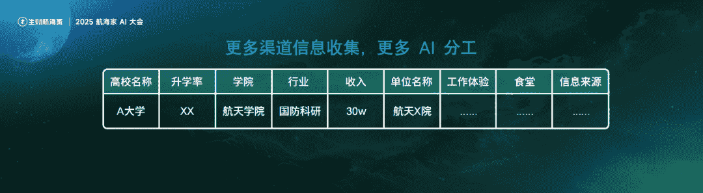

这些信息分布在知乎、📕、👸号、B站、抖音等平台，需要用多个AI分工协作， 通过AI或RPA管理AI，构建自己的知识库。

当你作为一个IP建立起完整的分类知识库，就可以起飞了。

第一，它可以帮你进行文案创作。 比如你从辅导员、学生、高考规划师三个角度，写同一个主题，再结合真实的数据和细节，家长自然会觉得你专业。

第二，你可以自己写好文案，让知识库模仿。

第三，让AI写，加入知识库的数据，再生成文案。

大家可能会关心——文案的情绪从哪里来， 因为情绪点是短视频的灵魂。

很简单： 在收集资料时，尽量保留原文 ，比如他是怎么吐槽单位、行业、专业的，这些都可以提炼出关键词，用作短视频里的情绪点。

短视频创作的三大痛点： 一是文案创作频繁 ，现在我们用知识库来解决；

二是情绪表达真实 ，这些来自用户原文；

三是关键词特效多 ，这也简单，关键词做成透明文字图，替换剪映里的文字即可。

不过我并不在短视频赛道，而是做中长视频。 中长视频的痛点是文案更长、资料更多、剪辑难度更高 ，要把自己剪到各种角落里。

举个例子，我在B站看到一个百大UP主的视频片段，只有5秒，但涉及特效、文字排布、图片查找和资料调整，制作成本很高。

后来我想：既然它看起来像网页， 为什么不能用网页来做视频？

于是我把截图发给bolt.new ，请它做成网页。结果发现效果更好：

❖

1）  所有图片自动查找 ，无需找图；

❖

2） 美工不用我做 ，它可以出10种方案；

❖

3）  文字排版自动完成；

❖

4） 想换话题，只 需改关键词 ，网页内容自动调整，无需重新剪辑。

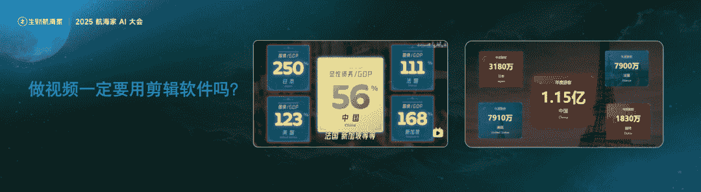

原本教我做网站，结果我拿来做视频了。这让我意识到， AI会从意想不到的角度，改变你的行业。

我可以把自己剪到任何位置，甚至抠出数字做成绿幕。 在网页里只是几行代码，在剪辑软件里却是高成本操作 ——真正做过剪辑的人，都知道其中差距。

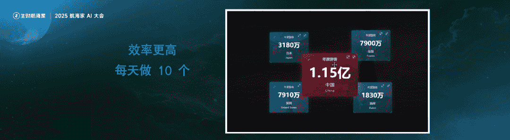

参加内测课之前，我从没想过。视频还能这样做！

我复盘过B站百大UP主的视频特效，大概有三五十种组合。现在用网页方式，我每天能做10个页面， 三天就能拥有同等级别的制作能力。

这就是AI的意想不到之处。

# Part 5

# 一个人 +Al，

# 将直播间做到赛道 TOP10

接下来说到直播间，直播间是我主力的战场。

直播间最在乎什么？最在乎三点， 第一点是封面点击率，第二点是人均停留时长，第三点是我们的评论互动率。

1、封面点击率

直播间里，最不重要的，就是话术。 从开始直播到现在，我从没整理过任何话术，这个背后其实有生理学基础。

举个例子：当你刷到一场直播，第一反应是看画面精美程度、主播的视觉呈现，这决定了你是点进去还是划走。 这个判断是靠第二层大脑——情绪大脑来完成的。

而话术能传递到观众的大脑，已经是第三层大脑，语言系统的处理速度很慢，这个时候已经晚了。

所以第一步要做的，是把人“捞”进直播间。 但抖音大多数直播间的画面，说实话都比较丑。

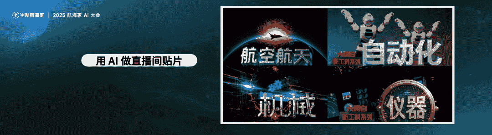

其实直播间的贴片，完全可以做到，像电影开场LOGO那样精美。

我现在用AI来做这些画面，视觉质量就很高。 当观众第一时间被画面吸引，他们才愿意点进来看 ，这一步非常关键。

刚开始直播，在线人数只有20人。当时我走的是大多数同行的老路—— 直播间打几个字，给大家输出信息 ，像一个AI问答系统，家长也把我当成AI。

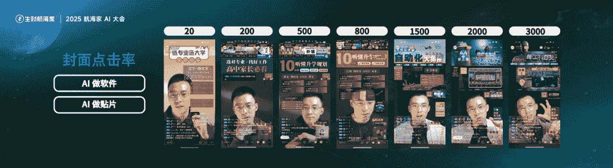

后来我第一步优化的，是直播间的整体画面， 换成黑色背景，把我作品挂上去 ，在线人数升到200人（淡季数据）。高考旺季，这有可能会变成一个万人直播间。

我用RPA和AI做了一个系统， 能即时显示我为同学挑选的学校和专业 ，并让直播间观众参与投票，选出最合适的方案。

这样在线人数就从200人，变成了800人，因为我引入了一条分数线曲线，展示专业历年的录取分数和预测结果。观众看到这种内容，就愿意停留。

人数涨到800人到1500人， 我加入了自己制作的行业和专业类视频内容 ，内容力提升以后，基本上在同行中，已经很难被超越。

到3000人， 是因为我又优化了切片画面和整体布置。 这个阶段的直播间，和20人、200人时相比，观感上的惊艳程度是完全不同的。

结果就是，分类点击率、人均停留时长、转粉率、互动率等核心数据， 基本是同行的5~10倍 ，所以直播间能跑起来。这些，就是最直接的数据参考。

2、 人均停留时长

我们刚刚解决的，是封面点击率的问题，现在来聊聊第二个重点—— 人均停留时长和评论区互动。

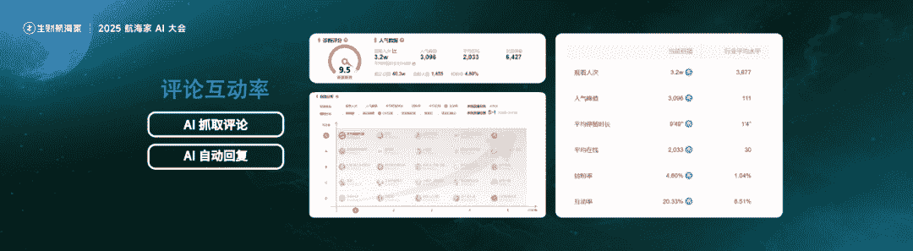

现在大多数直播间的做法，是发福袋，强制让观众停留三分钟，领几分钱。

我到现在一次福袋都没发过，因为我觉得，其实家长不在乎这些—— 他们来直播间，是想听点内容，是想得到回答。

其实很多问题，不需要我亲自答，评论区能回答就可以了。所以我做了一个评论区自动回复系统，这也是复习了小排老师的课后做出来的—— 用AI实现评论区的抓取与自动回复。

从那以后，我的互动数据就不用再担心，基本上是同行的十倍左右。 当直播间接入AI后， 封面点击率、在线时长、各项指标都能跑起来 ，直播自然就能做起来。

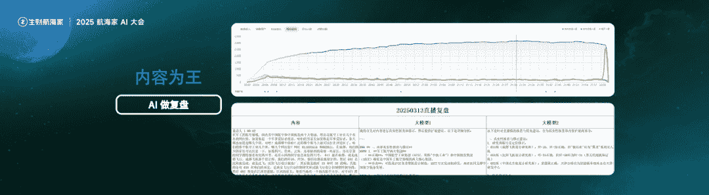

直播间，始终是内容为王 ——只要内容做好，观众不会走。那条停留曲线就说明了，只要我不下播，观众就不走。每次我一说“要下播了”，评论区立刻刷屏，粉丝就会疯狂提100个问题，想让我留下来。

做一场直播其实很累， 如果这场直播对我本身没有提升，只是赚了点流量，其实很亏。

所以我又做了一个直播复盘系统。每次下播后，我就让AI调用大模型， 把我直播中说的每一句话都跑一遍，通宵复盘。 它会验证我讲的内容是否真实、有没有扩招的新资料。第二天早饭时，我就能看到这份复盘报告。

哪怕第二天讲的是同一个话题，我的内容也一定会有提升。到了第七天，我讲同一个问题， 深度已经比第一天丰富了很多。

直播其实是循环内容，没有人每天都能换新花样，那样会把自己累死。 只有AI能支撑这个系统 ，因为我不可能请到几百位老师为我点评每一场内容，只有AI有这个能力，替我做这件事。

# Part 6

# 总结

赚钱对我非常照顾，给了我很多温暖的建议， 也让我这个“一个人作战”的IP选手，不再孤单。

我也经常帮同行优化直播间，从10个人优化到30、40人。有些地方一个省的头部直播机构，也不过三四百人。

对于个人来说，三四十人的直播间，已经足够养活一个小团队。所以我从来没觉得，自己有竞争对手—— 因为我喜欢，我就会一直做。

AI让我的生活变得更简单，也更幸福。自从AI真正介入我的工作之后， 我的生活真的变得轻松了。

以前工作应酬多，酒比菜还多，一喝就到凌晨，第二天还得硬撑。现在，我可以中午和老婆出去吃个饭，再慢慢散步回来；下午运动一会儿，晚上准备直播。 AI帮我解放了生产力，也让我保留了生活的温度。

最后想说的是，在赚钱，有一群高手在不断地分享，手把手教各种AI工具和用法，甚至有朋友把做好的工具，打包发出来让大家直接用。 能在这样的环境下成长，我觉得真的很幸运。

如果你还没让AI深度参与进你的工作，不如现在就打开赚钱， 一起探索，一起起飞！

作者 | 包子 | 排版 | 鲈鱼

主编 | 七天 | 编辑 | 贝拉 杰克逊

感谢你读到这里，赚钱团队为你准备了一份小福利。我们把所有 《龙哥小灯塔合集》 整理了出来，涵盖了如何判断项目是否值得做等重要认知，以及如何保持心力，降低焦虑等心法。

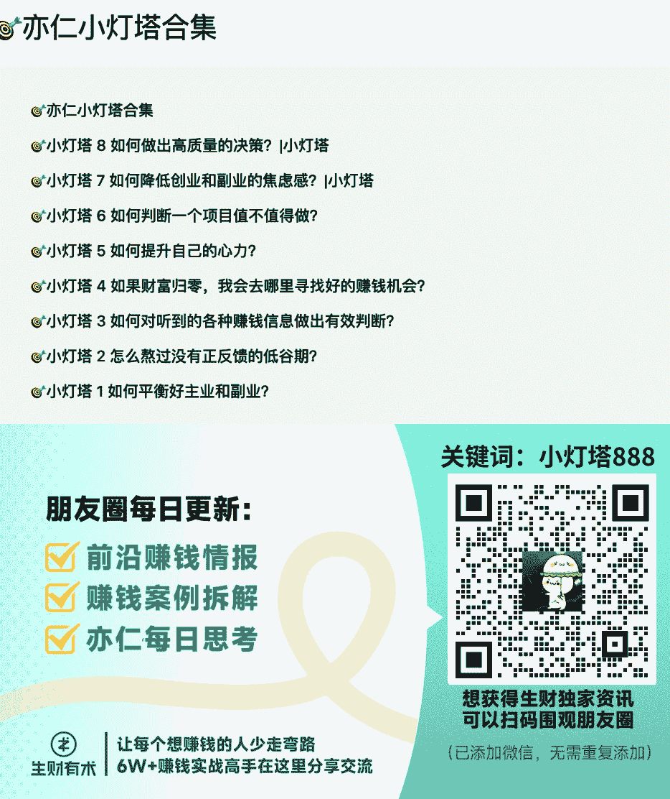

获取合集，赚钱圈友，私信鱼丸关键词 【小灯塔888】 。

如果您暂时还没有加入赚钱，可以扫描下方二维码，添加鱼丸🛰️，回复 【小灯塔888】 ，领取赚钱免费体验卡，查看航海手册和龙哥盟近180天内容。

注：每人仅领一张，无法重复领取。

龙哥盟是一个 务实、接地气的赚钱机会分享与创业交流社群 。目前已运营至 第8年 ，累计付费会员 超6.6万人 。

龙哥盟第8期已正式开启，扫码加入即可享受全年完整服务：

