# 我的两年：普通人，从航海船员成长到教练，有什么可以做的？

> 来源：[https://xuqiwei1986.feishu.cn/docx/Pq1OdDEaqotwKOxkoQOciRXvnQd](https://xuqiwei1986.feishu.cn/docx/Pq1OdDEaqotwKOxkoQOciRXvnQd)

大家好，我是大钟。今天想和大家分享的，不是一夜暴富的神话，而是一个普通人如何用3年时间，在赚钱航海里从焦虑失眠到月入过万的真实经历。

## 一、起源：**被生活逼到墙角的打工人**

2020年，疫情风控，在家做副业，3月北上南昌找工作，目标明确：快递员。半年时间，从0-1，完成月入过万，最多的时候2w+。这个时间基本没时间看赚钱，忙的经常只有10分钟吃个沙县大排饭！所以2021年，选择了赚钱断开。

2021年下半年，快递工作做到了网点TOP1，意料之中的事发生了，因为内部原因，被迫出局。2022年换了一份朝八晚五的工作，重新链接赚钱。这个期间月入3.5k，经常看赚钱帖子，导致焦虑整夜失眠，凌晨四五点才能睡着！

最痛苦的是明明知道那么多赚钱项目，却一个都抓不住...

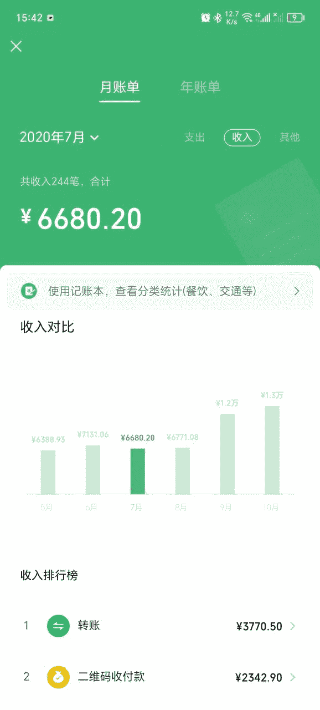

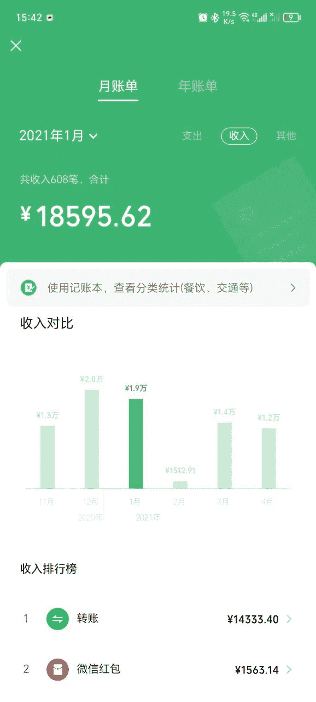

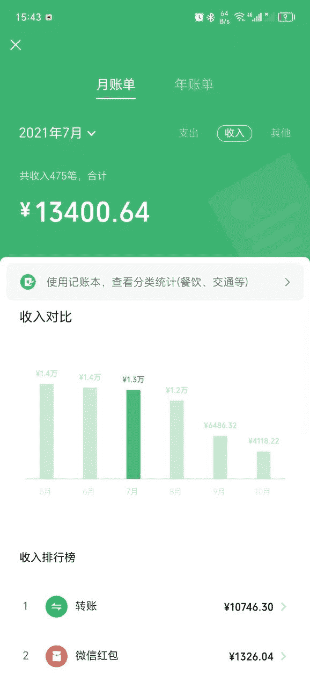

## **二、弯路：掉进认知陷阱的两年**

**第一次掉坑：视频号搬运**

2022年12月，在鱼丸840的多次询问下，参加当时的视频号带货航海以后，开始了和赚钱、和航海真正的连接。。 第一次参加视频号航海之后，因为当时的玩法是搬运混剪，所以当时跟着航海手册操作的话，很快就有两个号爆单了，播放量都达到了十万+。但是没有变现。做过视频号或者了解视频号的圈友应该知道，22年12月之后，搬运混剪玩法就非常容易违规了，很容易被 限流、封号。很多人也是说，搬运混混剪不能再玩了，所以我也放弃了视频号带货。

但是在23年，我接触了更多圈友之后，包括我自己也付费了视频号带货搬运混剪玩法。我也在做视频号航海志愿者的时候，跟拿到结果的圈友聊天，发现也是搬运混剪的玩法。我才发现，并不是搬运混剪不能玩，而是我接触不到深耕视频号搬运混剪玩法的人和圈子。

这个时候我才明白了一个道理：好项目一直都在！关键不在项目本身，而在于你对项目的理解深度和执行力。

**第二次掉坑：闲鱼二手书**

23年我在星球上看到了闲鱼二手书的帖子，项目很容易上手，于是把赚钱关于二手书的帖子都翻了个遍，冲动的“付了费”。注册2个营业执照+出版物+设备，整个前前后后花了6k！但是，真正上手实操之后，完了，6k打水漂了。

这个项目非常的不适合我，除了项目本身的问题--没有技术含量之外：

①需要我一直盯着电脑客服

②售前售后很重。

但是当时我的工作是用不到电脑和手机的，我没办法整天呆在手机上、电脑前处理售前售后。所以，实操不到一个月，我果断放弃了闲鱼二手书这个项目。

闲鱼二手书这次失败的经验，让我开始沉下心来去思考自己需要什么、欠缺什么！但是，在赚钱或者说在这个圈子里，作为一个普通人没有特长又没有人脉！！！我该怎么去破这个局呢？？？

这时候我才真正明白：**项目不死，死的是认知！**

## **三、破浪：在航海中找到钥匙**

在某次偶然的机会，听到了辛亥的分享之后-----作为00后的他是怎么破局，让大佬记住他的！

这个00后小伙教会我：普通人破局，要从创造被链接的价值开始。

听完之后，我就把辛亥作为我的对标，抄他——在航海里深耕，去做领队！！！

作为领队，我可以有很正当的理由链接到更多优秀的圈友，并且跟他们交流。我也尝试做不同项目的领队，去了解不同的项目的玩法。通过输出倒逼输入的方式，去年我也发现了适合自己的项目，完成了从月入3.5K到6个月收入8万+的转变，靠的就是在赚钱航海获得的认知升级    。

也是因为这个决定，让我明白了一个道理： 真正的社群红利不是简单的项目机会，而是认知升级和圈层链接。

** **

于是我开始：

1.  ** 角色进化之路**

当船员时，我会主动链接积极表达和拿到结果的圈友。

当志愿者时，我还会在志愿者大群链接有趣、有想法的优秀志愿者

当领队时，我还会给我的志愿者小伙伴们分享自己做志愿者的经验和处理问题的思路；对航海有新的想法我会先跟运营沟通再做决定

当教练时，我会鼓励拿到结果的圈友写帖子分享到星球

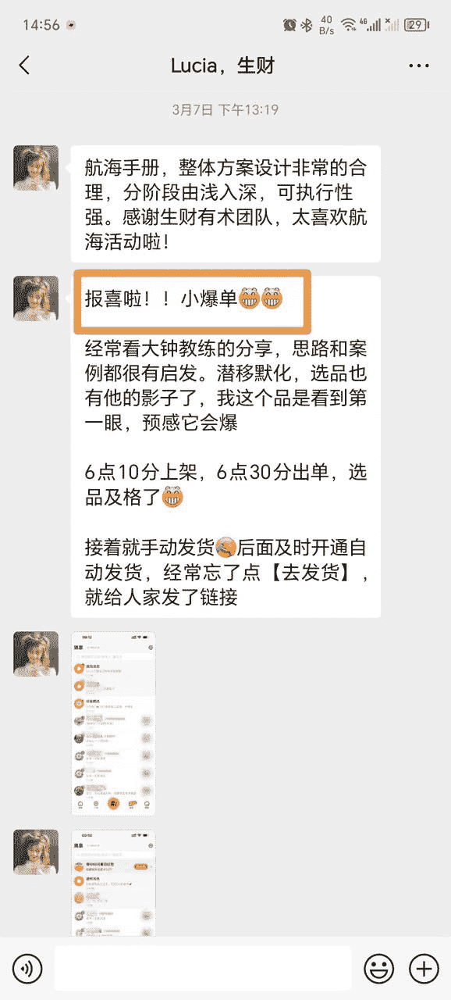

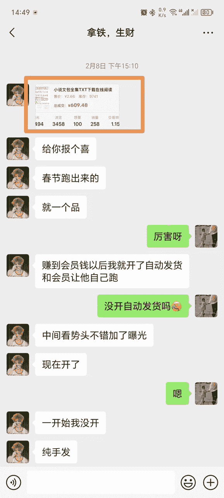

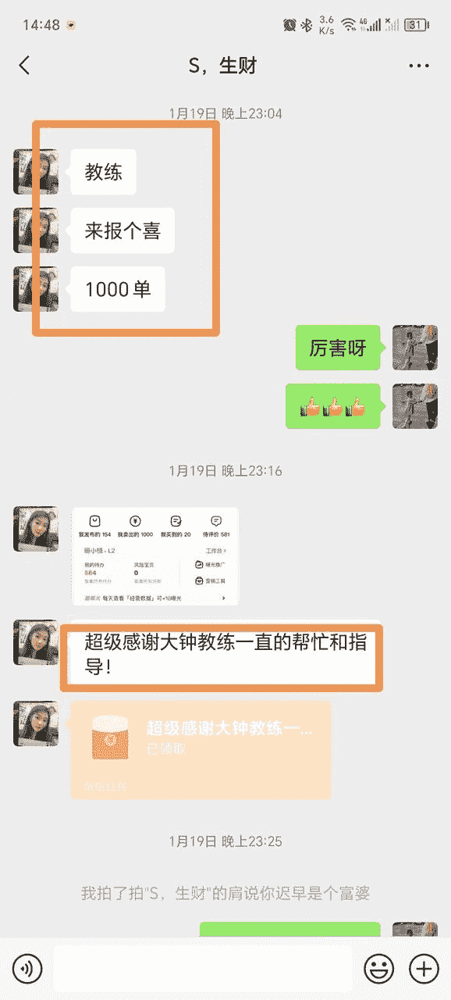

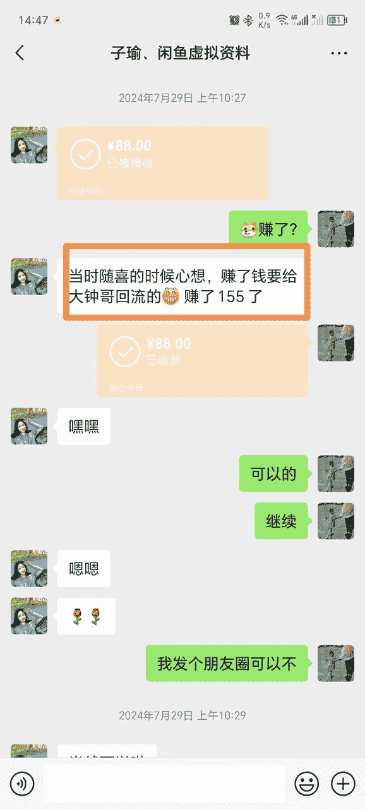

1.  **搭建信息网**

也是因为主动，我得到了非常多圈友的帮助。比如辛亥，辛亥把我介绍给胖大魔，大魔鼓励我要敢秀肌肉，不要怕别人不认同。通过大魔认识四川圈友灵均、相柳，灵均给我推了很多赚钱活儿也带我赚钱，相柳鼓励和促成我把赣州圈友组织起来并在去年组织、发起了3场线下聚会，他们也告诉我听老婆话，会发财。认识了给我推荐业务的老彭，他说我懂感恩打动了他，所以他相信我对任何事都会全力以赴。认识了在傍晚开车2小时来找我吃饭、聊天的赖欢赖老板，他还跟我分享非常多项目玩法，今年春节还把我介绍给“赚钱女孩”宋大刀（他们都是宁都人），虽然我没时间去。还有最近认识的新朋友老陈还有思维导图教练罗卜、本地生活大佬刘同学、AI讲师佳文、“陪一组”钱男友，等等等，认识你们真好！

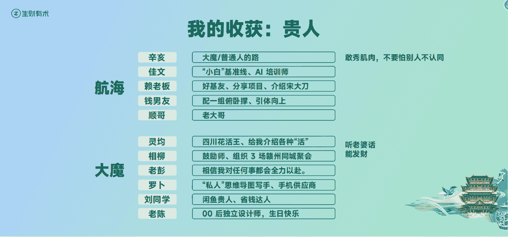

1.  **过去的两年，我总结了适合我自己**的，筛选项目/信息的方法

+   **了**解平台 ，我们需要对平台有基础的了解，比如📕的用户画像、视频号的用户画像、闲鱼的用户画像，这些信息航海手册和星球都会有

+   **了**解同类型的项目。大家应该能发现，很多项目变来变去玩法都差不多的，比如视频号带货一开始就是搬运，📕也是，拼多多也是，闲鱼也是

+   ** 看**朋友圈。因为我一直都是航海的志愿者、领队，所以，我被动和主动了链接了很多圈友和优秀的志愿者们，经常刷他们的朋友圈，可以知道最近有什么项目可以做，根据一些项目海报，可以大致的推测一下他们的玩法

+   ** 线上+线下沟通。线上主要是跟做的好的圈友聊天，如果你觉得不好意思，那就红包打头**阵，没人会不愿意跟你聊。线下多参加同城聚会，线上聊千遍，不如线下见一面。

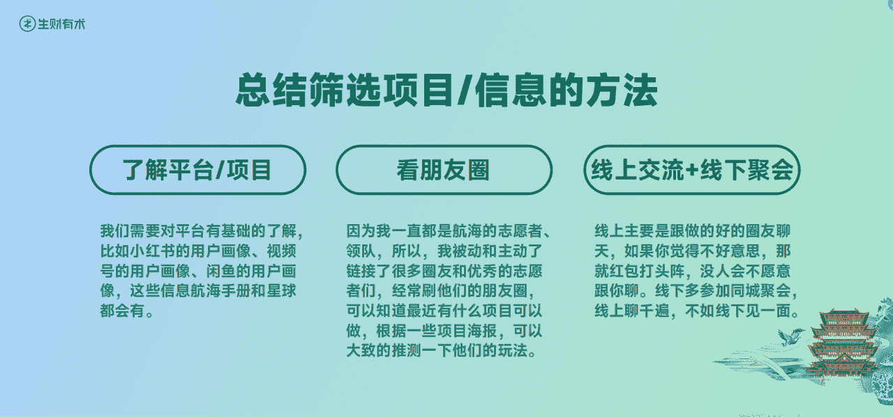

##  四、深耕：不断探索找到适合自己的业务

23年2月航海开始，我就一直以志愿者的身份，参与过视频号带货、📕店铺、抖音图文电商、闲鱼等多个实操航海，也参加过运动锻炼、盖洛普、赚钱思维课等技能航海。在航海之外，我也做过拼多多视频带货、拼多多商家（装饰画）    这些参与航海实战项目的经验，一直督促拖延症很严重的我保持输入

在航海之外，我也积极的尝试和寻找项目，但是一直都没有拿到结果。终于在去年5.6月份，在朋友圈看到23年多多视频带货的圈友发的闲鱼虚拟资料收益截图，本着保持怀疑的态度（为什么保持怀疑，对截图吃过亏），观察了半个多月发现这个朋友圈保真，于是旁敲侧击的找她了解了一些情况，然后找了一些闲鱼虚拟资料的课程和看闲鱼航海手册，开始了实操。

结果是：每天坚持花2小时找品，6个月项目收入超8万

为什么我会选择闲鱼虚拟资料？

第一，我对自己的定位很清楚，我需要一个能快速变现拿结果的项目作为日常的保障；

第二，稳定之后再去操作一个门槛高收益高的项目来赚钱。

为什么是闲鱼虚拟资料：

1.自然流量+门槛低：上架第一天就出单

2. 零库存压力：先出单再"生产"

3.多管道收入：闲鱼店铺+网盘拉新+私域转化

*网盘拉新收益＝（10%~40%）一个闲鱼店铺的收益

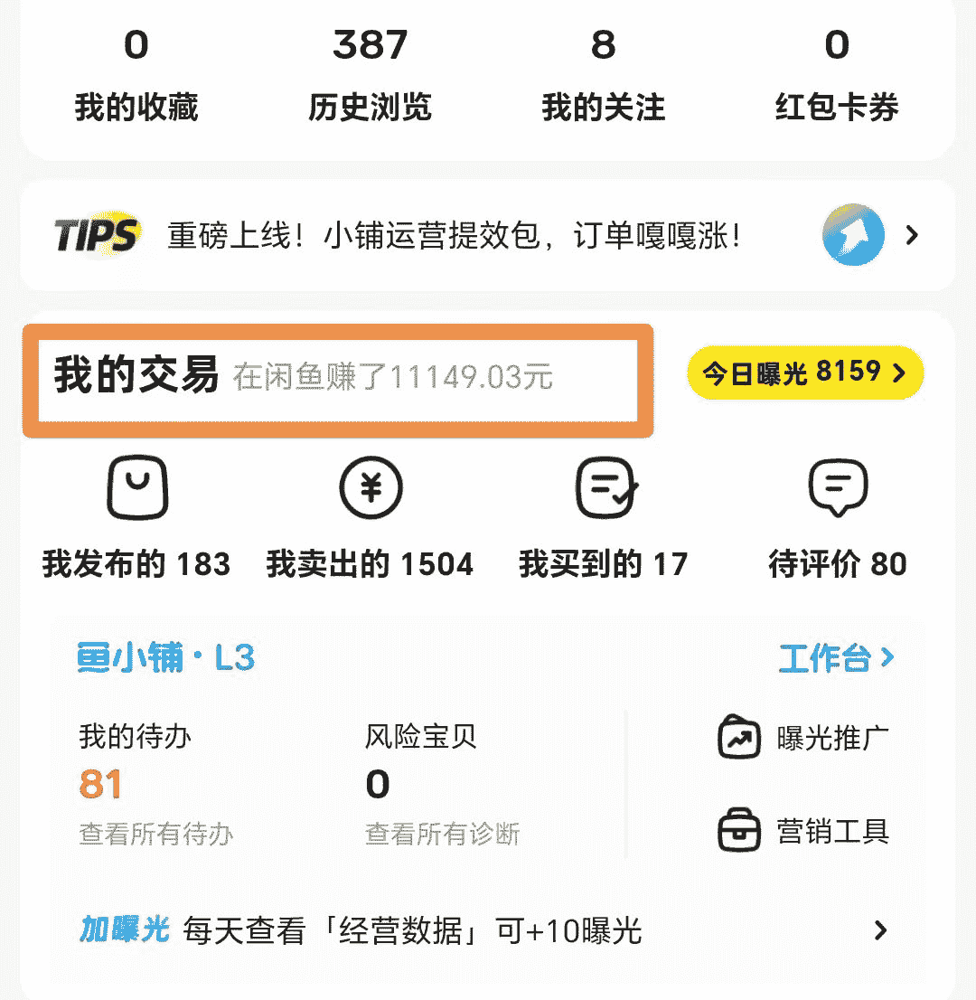

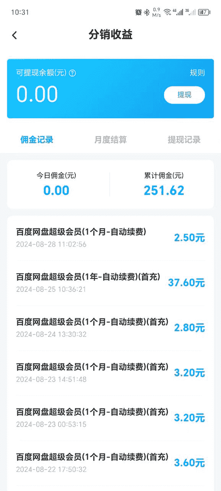

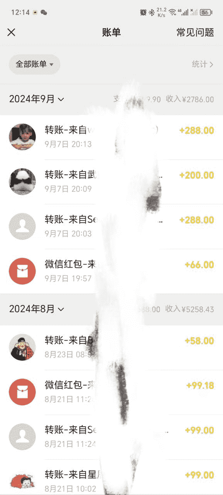

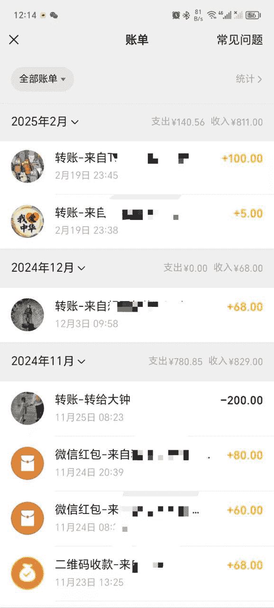

闲鱼虚拟项目就非常适合第一点，而且从23年开始我一直认为闲鱼是最适合新手快速拿到结果的平台，以为闲鱼主打自然流量，而且闲鱼二手书、闲鱼高客单、闲鱼无货源都是低成本、快速拿结果的项目 所以我果断入局，并且在上架产品第一天就出单，第二天投入第二个号。

于是我就把这个项目推荐给我的朋友们，带他们入局。我自己也放在慢慢放大，每天花2小时选品上品，同时还能兼顾陪家人和 保持每天撸铁、篮球。自己摸索新的选品方法、打磨选品细节，引流私域做高客单二次成交，加上网盘拉新的蚊子肉，6个月收益8w+

## **五、进阶：从赚钱到带人赚钱**

因为我看见了闲鱼虚拟资料，并且迅速的拿到了不错的结果，我觉得其他圈友也可以快速的跑通并且拿到结果， 所以，我把这个项目的玩法免费分享给去年一起做多多视频号的伙伴、在赣州发起了线下组局，并且免费分享了玩法！

当然，我毫不犹豫的把这个项目推给了航海小组，12月份成为了闲鱼虚拟航海教练。非常感谢赚钱阿兜和澄歌同学陪伴一个多月打磨出了航海手册和航海直播。带领了1800+圈友入局闲鱼虚拟资料。

成为闲鱼航海教练后，新挑战来了：

+   每天处理1800+学员的重复问题："教练，为什么我的号又被封了？"

> 闲鱼虚拟项目最大的卡点和问题，其实是版权问题，但是5个航海群几乎每隔几天就有人说因为盗版被永久封号。但是，如何规避版权风险这个问题，航海手册、直播、群内答疑一直都在强调。

+   版权风险像定时炸弹：5个航海群隔三差五就有人被永久封号

**... ...**

除了我投入更多精力支持大家外，我还如何应对呢？

+   对于新上手的船员，提问的内容基础且重复：

+   我需要TA配合： 遇到问题先搜群聊记录

+   对于已经开启项目的船员，遇到难以解决的问题：

+   我需要TA配合：提问必须带三要素，什么问题+已做什么+需要什么帮助

+   对于已经完成0-1项目闭环的船员：

+   我会鼓励他：星球发帖分享自己的#航海好事；

+

**在航**海期间和航海结束之后，收到了非常多的船员来报喜。所以，在航海之外，我又发起了免费的选品分享群，帮助更多的圈友。把更多圈友聚在一起，互相鼓励和交流分享！

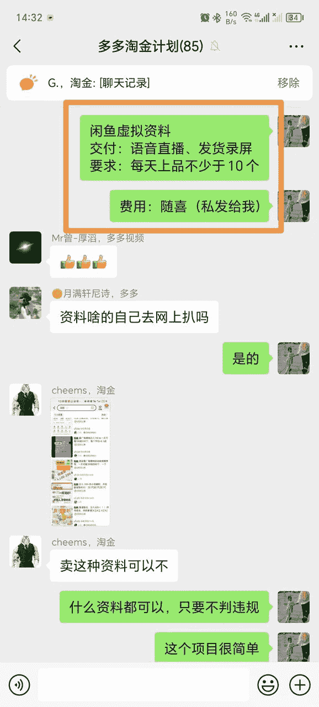

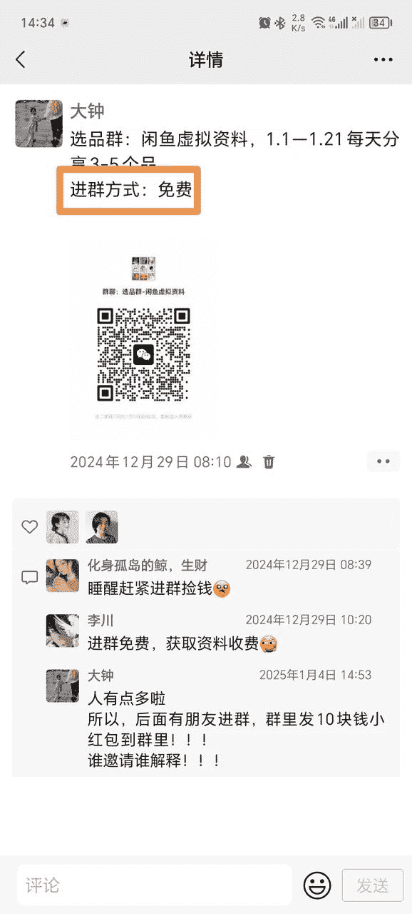

---

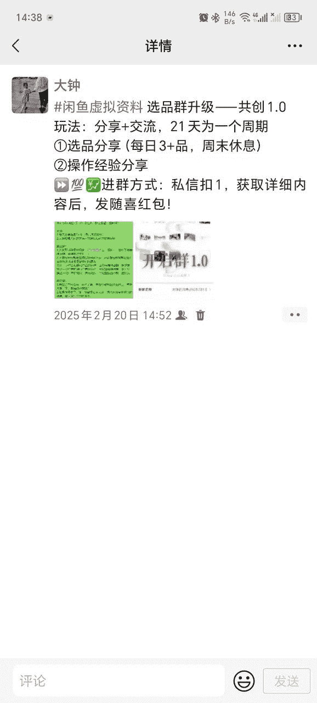

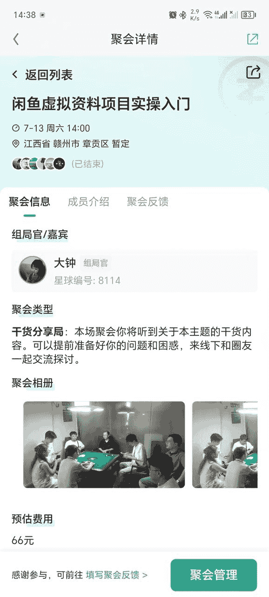

从船员到志愿者到领队再到教练，我体验了航海的所**有角色。回头**看这两年，我发现自己经历了三次关键蜕变：

第一次蜕变：从「盲目狂奔」到「清醒扎根」

+   2022年的我：像无头苍蝇追风口，视频号搬运失败觉得是项目死了

+   2024年的我：在闲鱼虚拟项目上「用1天验证可行性，用180天构建护城河」

终于想通：大结果不是追出来的，而是在对的土壤里长出来的"

第二次蜕变：从「索取者」到「连接者」

+   过去的我：躲在屏幕后焦虑，觉得"没人脉没资源"

+   现在的我：带着200元红包主动敲门，主动发起线下聚会，累计链接几百位圈友

老彭那句'你懂感恩，所以我相信你'——是真正的社交货币"

第三次蜕变：从「执行者」到「播种者」

+   曾经的困境：自己赚钱却陷入"选品-封号-选品"的死循环

+   现在的解法：把SOP教给2000多人，反而倒逼出更系统的风险防控模型

"当航海教练后才发现：带人赚钱比独自赚钱更难，但收获的认知迭代是指数级的

**最后我想说**：

三年前那个在深夜刷帖子失眠的快递小哥不会想到，人生转折就藏在两个选择里——

1.  **选择相信**：在视频号航海失败时，选择相信"不是玩法失效，而是我认知不足"

1.  **选择照亮**：在闲鱼项目跑通后，选择成为那批最早举起火把的人

这就是赚钱航海给我的终极启示：

###  普通人逆袭的本质，是把曾经照亮你的光，变成自己能发出的光。

#