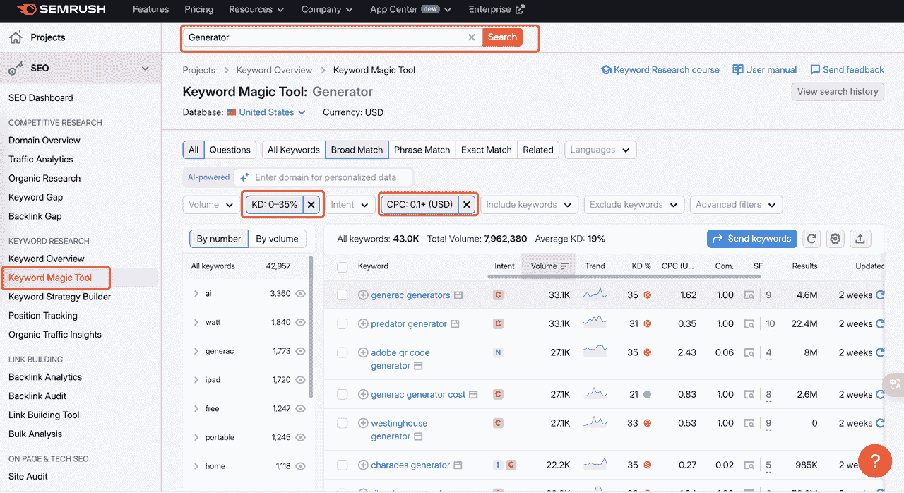
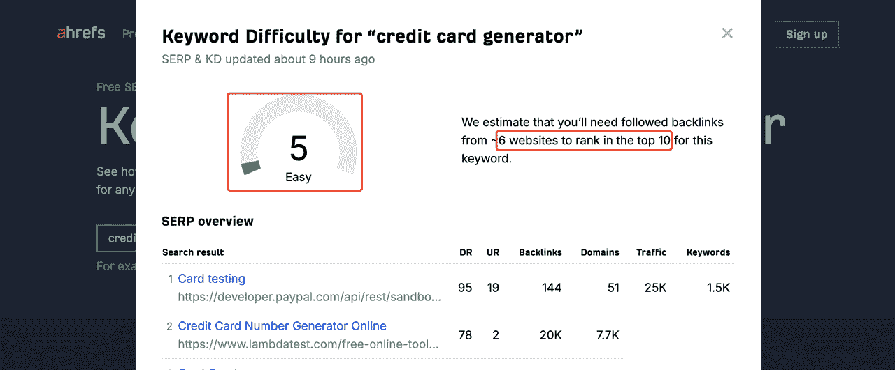
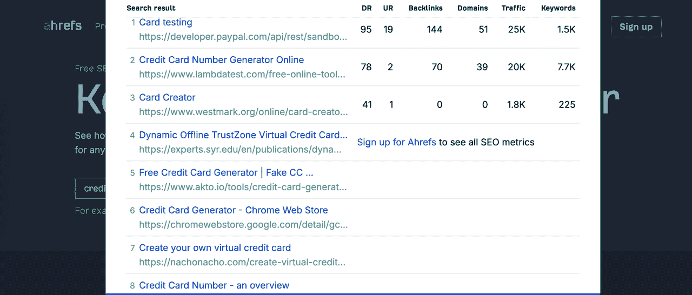
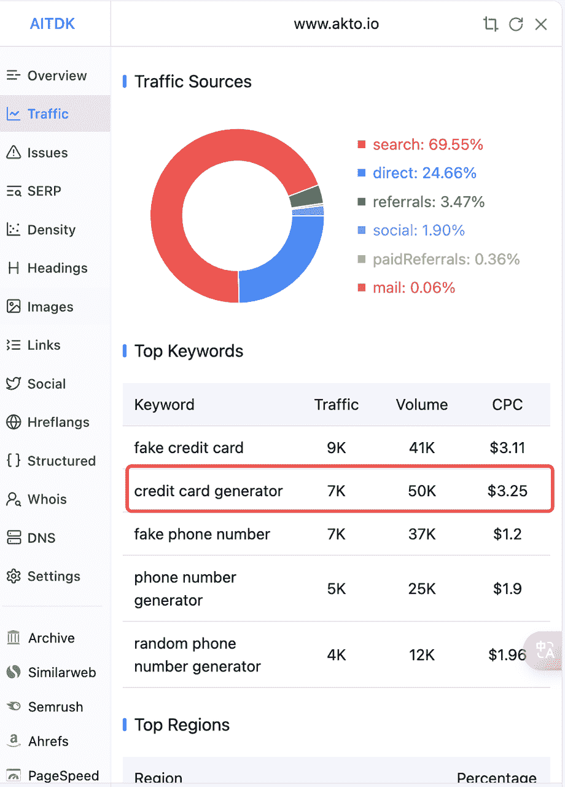
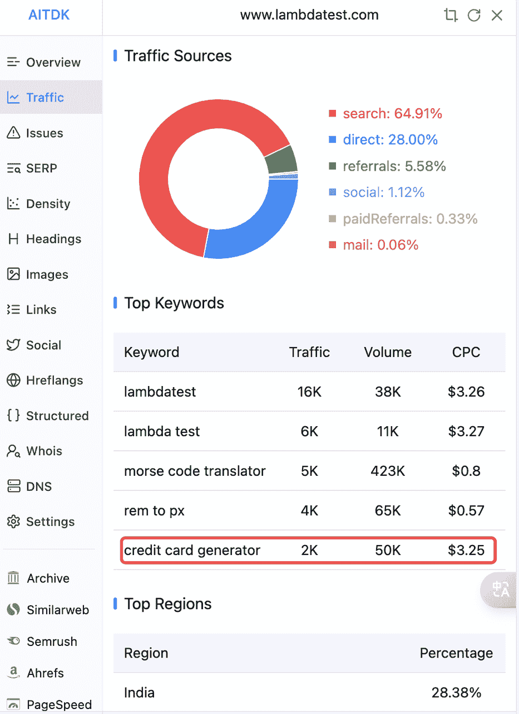
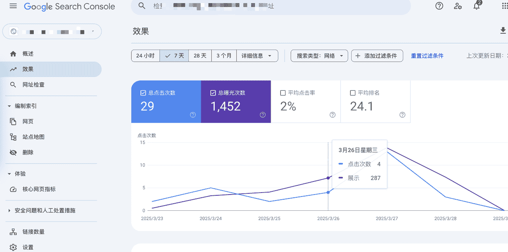
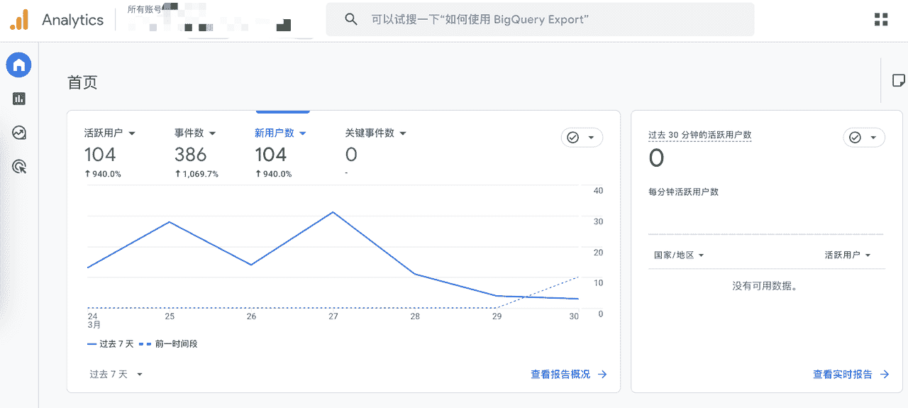
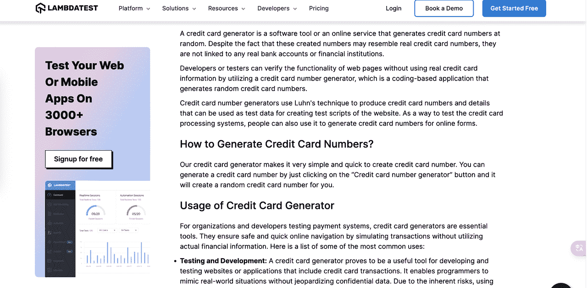
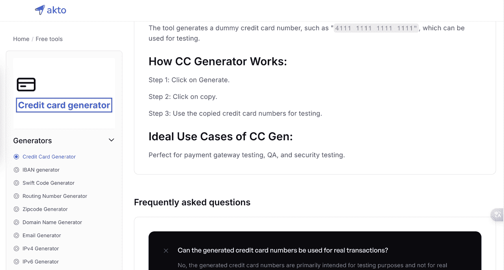

# Web网站航海复盘-从选词到上站、从谷歌收录到Adsense被拒的过程

> 来源：[https://xuqiwei1986.feishu.cn/docx/O3Htdqp36oNmoJxxzeAcU3Ornbb](https://xuqiwei1986.feishu.cn/docx/O3Htdqp36oNmoJxxzeAcU3Ornbb)

参加了Web网站的航海，到目前为止上了三个站，记录一下其中一个站从选词到Adsense被拒的过程。海外战新手，可能会有错漏的地方，欢迎各位圈友一起探讨～

## 1、选词

+   为什么要选词

+   互联网是由无数个节点相互连接组成的一张蜘蛛网

+   新上线的网站就是其中一个节点

+   如果这个节点和其它所有节点都没有连接，别人也就没有办法找到这个节点（我们的网站）

+   一个网站总是要解决一些人某些场景下的需求

+   人们的需求总是能在搜索里发现

+   搜索时总会有某些关键词体现需求

+   所以通过一些方法，选到竞争小、搜索量相对来说比较高的词，网站就更容易起量

+   选词就是选需求，新站上线之后，被搜索引擎收录，在人们搜索对应关键词时，我们的网站就会在搜索结果里展示

+   我的选词过程

+   分享一篇哥飞老师的公众号

+   51个挖掘需求时能用得上的财富密码关键词：https://mp.weixin.qq.com/s/pFi683ZoT_WJXO_t770vSQ

+   列举几个，更多词看哥飞老师公众号链接：

+   **Translator**

+   Translator是用来将一种语言翻译成另一种语言的工具。

+   用户通常搜索Translator来寻找在线翻译工具，以便翻译文本、句子或文件。

+   **Generator**

+   Generator是用来创建或生成各种内容，如文本、图像、密码等的工具。

+   用户搜索Generator通常是为了生成随机密码、文章内容、图像等。

+   **Example**

+   Example通常用来表示某种示例或范例，以帮助用户了解特定概念或问题。

+   用户搜索Example常常是为了找到示例代码、示例文本或示例问题的解答。

+   我使用的**Generator**这个基础词，用SEMRush来做的挖掘，SEMRush正版很贵，我在淘宝买的共享账号，很便宜，一个月十几块

+   打开SEMRush网站之后，主要使用Keyword Magic Tool这个工具，如下图：

+

+   过滤条件筛选：KD值小于35，CPC大于0.1

+   KD值代表关键词的优化难度，通俗点讲就是如果自己做的网站解决的是这个关键词的话，网站做起来的难易程度，值越低代表越容易做起来。当然这个值是一个估算值，也是一个相对值。

+   CPC是Cost Per Click的缩写，单次点击的价格，意思是点击一次这个关键词的广告链接的费用，值越高，说明这个关键词广告越值钱

+   我选的KD小于35，CPC大于0.1，难度不是特别高，广告价格也不至于0

+   接下来就是一个一个关键词去看，我最终选到的词是"credit card generator"，KD值33，CPC 3.16

+   还可以用另一个工具来交叉验证KD值

+   https://ahrefs.com/keyword-difficulty

+   ahrefs也是很有名的SEO工具，它给的"credit card generator"难度是5，而且注意下图里的右边那句话，大致意思是如果自己的网站是围绕这个关键词做的，自己的网站只要有6个外链就是在搜索引擎里排到前10，也就是能进第一页的搜索结果，这样可以大大提高用户点击进入咱们网站的概率。当然这所谓6个外链也只是估算。

+   外链的意思是，别人网站上有咱们自己网站的链接，比如一个导航站把咱们的网站网址加到了它的网站上，就算一个外链。有很多资源站、导航站等等是可以免费提交自己的网站的，如果审核通过，就会在他们的网站上展示咱们自己的网站。

+   推荐一个可以提交自己网站的资源列表：https://freelancer-tools.shop/zh-CN/backlinks/1

+   这个网站来自于圈友的一篇精华帖，是圈友平时自己收集的，精华帖链接：https://wx.zsxq.com/group/1824528822/topic/1525824811545212

+   自己的网站上线后，可以尝试着去提交一下，收录成功的话，可能会给自己的网站带来一波流量，也更利于搜索引擎快速收录。

+   我为什么选择这个词credit card generator

+   看下图，这个关键词在搜索引擎搜索出来的结果里，都是“内页“，也就是二级、三级页面，如果我们新建一个网站，举全站之力来和这些二级、三级页面来竞争，是不是赢面更大一些？

+   这些搜索结果都是咱们的竞争对手，拿到这些网站后，都点进去看看，方便咱们后续开发自己的网站

+   也可以使用AITDK或者直接用similarweb来查看一些网站的流量，主要关注这些网站的关键词还有搜索量等等

+

+

## 2、开发&上站

有了关键词，有了竞对网站，就可以开始模仿竞对网站来开发自己的网站了，因为我选的这个关键词是一个小工具，可以用纯前端实现，所以直接使用bolt或者cursor很快就能搞定。

我是用的Cursor，关键词：

> 使用html+tailwind css来模仿https://www.akto.io/tools/credit-card-generator这个页面来实现一个纯前端网站，网站需要使用响应式来适配不同的设备，网站后续我会托管在cloudflare pages，生成的网站需要SEO友好，主要从title、description、keywords处优化，需要包含最主要的关键词"credit card generator"，页面需要有很好的结构，使用H1、H2、H3标签来结构化页面内容。

对于功能很简单的需求来说，关键词并不那么重要，口语化表达清楚就行，基本上一遍就能过，如果有bug的话，多对话几轮也能解决。这个过程就不贴Cursor对话截图了。

最终Cursor生成了一个index.html和一个script.js，按照航海手册的步骤，上传到github并部署到cloudflare就可以了。手册里有详细的截图，这里也不赘述了。

## 3、网站收录以及谷歌追踪代码

网站部署好之后，就需要考虑冷启动的问题，最简单的方法就是提交给搜索引擎让其收录，只有收录之后才有可能在用户搜索对应关键词时展示咱们的网站，这个手册里也有很详细的步骤也不赘述了。有一个细节，在航海群里看到很多人问过很多次了，网站流量不要看cloudflare的，看GSC和GA的更准确：

+   Google Search Console，也不知道这个点击率是高是低：

+   Analytics，最近两天没啥新流量进来了:

## 4、给网站增加内页丰富内容

网站上线被GSC收录之后，我就模仿竞对网站，给自己的网站增加了3个内页来丰富自己的网站内容，希望可以被谷歌多收录几个页面，有更丰富的内容对SEO更友好（丰富关键词分布、引入更多长尾关键词），这个也是直接交给Cursor来做的：

+   首先是分析竞对的页面内容，由于这个关键词只是一个很小的工具，所以本身一个页面就全部搞定了，我为了多添加几个内页，所以拆分了一些内容到内容里，页面内容都是Cursor帮着写的：

+   What is Credit Card Generator?

+   How CC Generator Works

+   Is it Legal to Use Credit Card Generator?

+   为什么添加这三个内页，主要还是源自竞对，大家看一下竞对页面就知道了，他们的页面中也是有这些内容，通常也是为了页面内容丰富度，主要考虑就是关键词的排布，好让搜索引擎抓取到：

+

+

## 5、申请Adsense

申请谷歌的Adsense我是抱着熟悉流程的心态去做的，因为确实网站流量很小，通过的概率基本为0，但提前熟悉一下流程也不错，最起码可以看看不给通过的具体原因，主要还是航海手册里也提到不是特别严重的问题，谷歌都会给改进的机会，申请过程手册里有，大家可以看一下我被拒的截图，被拒的原因可能还是网站流量太低了吧：

+

+

## 6、后续

目前遇到一个问题，就是这个小工具站很小，所以从内容丰富度的角度已经不知道如何优化了，竞对网站也只是一个页面就没有更多内容，所以抄也无从抄起。

所以决定从增加外链的角度来入手，多去几个站提交自己的网址，如果被成功收录的话，可能会带来流量，也能提高自己网站在搜索结果中的排名，这一块目前没有太多经验，打算按照圈友的精华帖来实践一下：https://wx.zsxq.com/group/1824528822/topic/1525824811545212