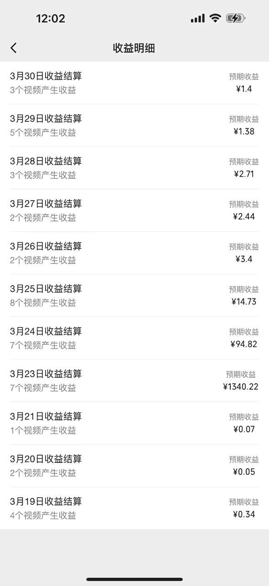
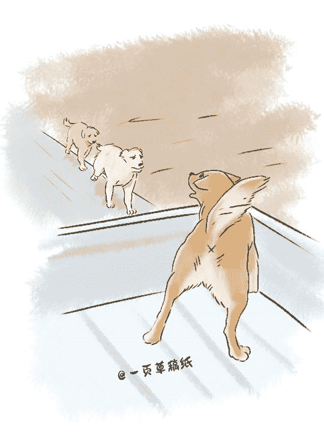
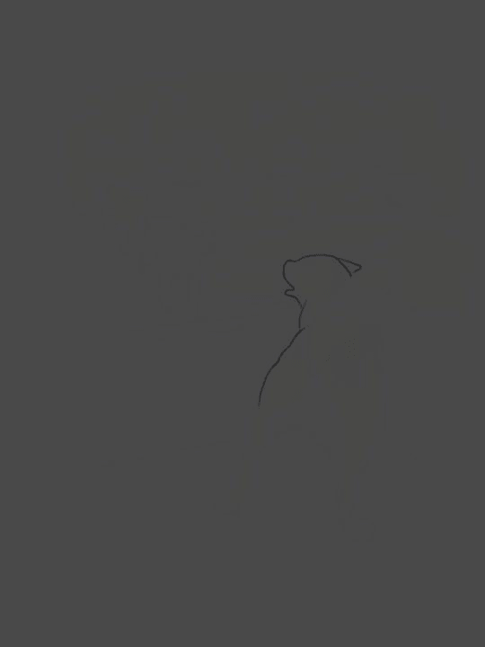
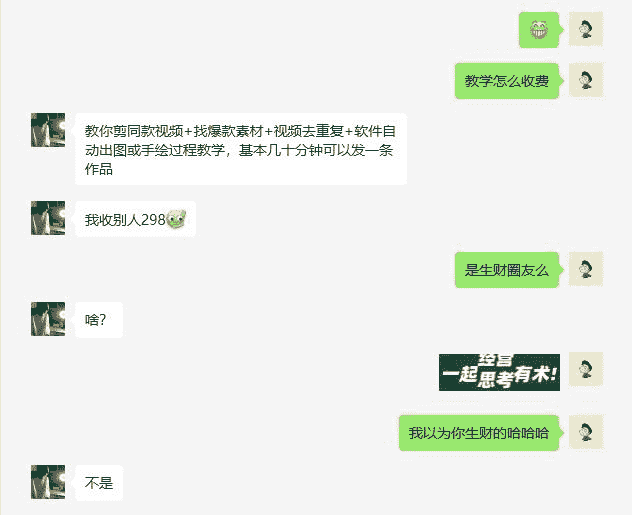
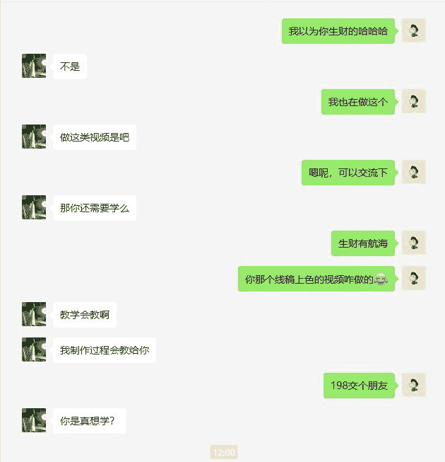
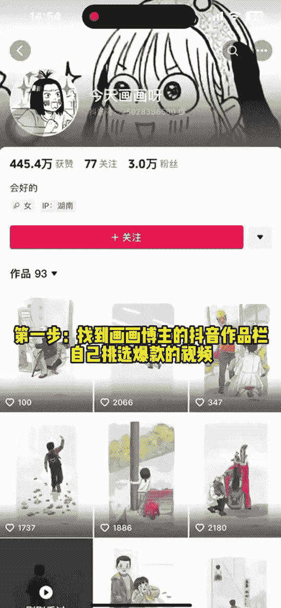
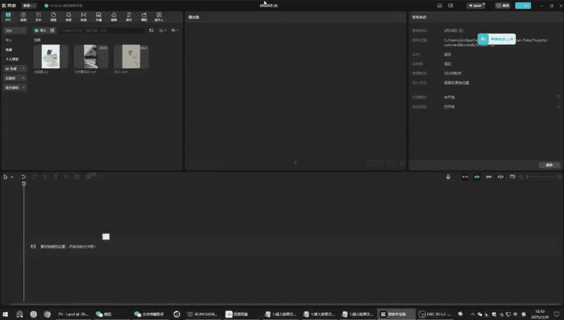
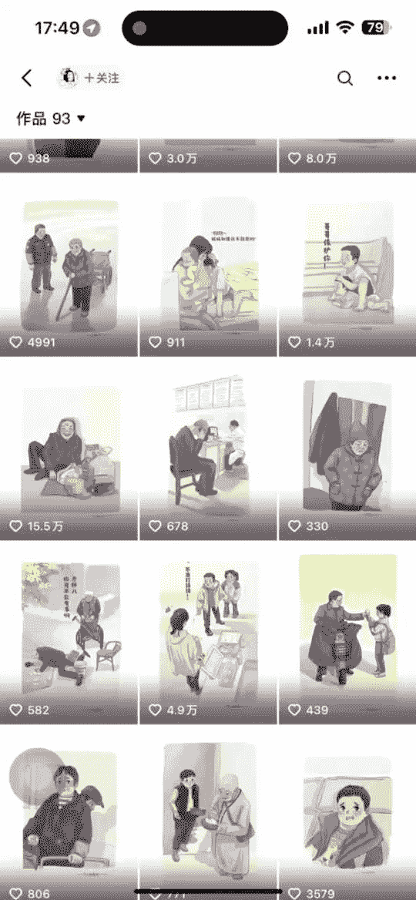
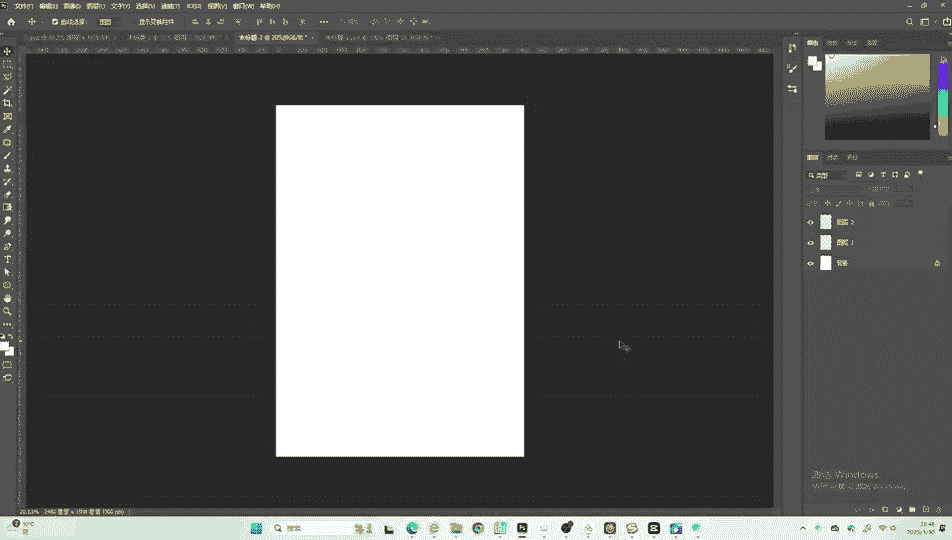

# 【喂饭教程-pro进阶版】热门视频二剪+ai生成动漫画+视频号广告分成项目

> 来源：[https://xuqiwei1986.feishu.cn/docx/R3Y4d1le3ogJPnxoa9BchFJYnrG](https://xuqiwei1986.feishu.cn/docx/R3Y4d1le3ogJPnxoa9BchFJYnrG)

# 一、项目背景与测试成果

## 1.入局契机

之前看到亦仁老大发的这个风向标：#风向标 热门视频二剪+a...-知识星球

[后来又看到圈友@Rand0mWalk的精华](https://scys.com/articleDetail/xq_topic/5125221225215144)帖【喂饭教程-可能没那么喂饭版😂】热门视频二剪+ai生成动漫画+视频号广告分成项目 实在没忍住所以决定开始下场试水。

## 2.真实数据展示

3月18号开始单账号测试截至目前真实收益如下：

测试账号之前发过文案有200多粉丝，现在粉丝6200+，涨了6000+粉

截至目前净收益：1461-198=1263支出的198后续会说明。

【本人现在主要方向在小红书，视频号只是测试，所以纯分享不藏私。以上数据绝对真实可靠！】

# 二、AI绘画进阶版实操教程是怎么来的

## 1.学习进阶版教程前需要了解的

关于【热门视频二剪+ai生成动漫画+视频号广告分成项目】视频素材的收集，素材去重，ai图片的转绘出图，开通视频号分成这些基础知识。前面的圈友已经分享过了，这里不再赘述。下面放出传送门供新手查阅：

1.亦仁老大风向标：#风向标 热门视频二剪+a...-知识星球

[2.圈友@Rand0mWalk的精华帖：【](https://scys.com/articleDetail/xq_topic/5125221225215144)喂饭教程-可能没那么喂饭版😂】热门视频二剪+ai生成动漫画+视频号广告分成项目

3.生财视频号分成计划航海手册：3 月航海|视频号分成计划|实战手册

## 2.AI绘画进阶版介绍

我这里要分享的是，在实操中遇到的这种做的比较精致的ai绘画案例：

[23c4e8240da05a7e00990841c02157c5.mp4](https://internal-api-drive-stream.feishu.cn/space/api/box/stream/download/all/RsdVbfSu1oxHGdxZf7tcB6Ocnfc)

[0a626a4cd0ddaa132eb2b03339843ad6.mp4](https://internal-api-drive-stream.feishu.cn/space/api/box/stream/download/all/B7AsbiCrooPb03xnYe9cOmK6nBd)

大家注意看视频最后的漫画部分：

[3月31日 (1).mov](https://internal-api-drive-stream.feishu.cn/space/api/box/stream/download/all/XEebbmKlooI1w1xbj6BclT1mnkc)

已经下场实操的小伙伴应该已经注意到这样的账号了。相比简单的对漫画图片加放大缩小的关键帧，我感觉这样的表达效果更好，更有观赏效果，图片生成绘画过程的视频长度普遍在5-6s,整个视频在12s左右的普遍情况下，原创占比50%，即使前面的素材不做去重处理也够了，同时兼顾了“最好的去重手法就是不去重”的朴素真理。相比直接加图的方式，直接加图的不管你对漫画图片怎么处理，超过3s就会显得突兀。3s的话原创占比25%，这样对比的话高下立见。

## 3.我是如何解决问题的

我在确定了想进阶做这种展示ai绘画过程的动漫视频后，开始反复在生财检索资料。看相关的ai绘画的帖子，ai视频的帖子，ai绘画的手册，ai视频的手册...看了两天也没有找到想要的部分。万事开头难嘛！最后终于找到解决办法了...

我一直认为付费是解决问题最快的路径。哈 哈 哈 哈 哈

ps:本来想着拿生财的名头套近乎，没成功就反向帮生财打个广告吧~

## 4.**后续反思感悟：**

“我一直认为付费是解决问题最快的路径”我收回这句话🤣🤣🤣🤣🤣🤣

遇事不决先问生财！不要轻易被割韭菜！好奇害死猫，你轻易买来的可能跟你想要的不是一个东西，哈哈哈哈~

# 三、AI绘画进阶版实操教程放送

前言结束，下面进入正题，开始教学部分

# **1，找素材部分**

手机端长按素材搜图可以快速找到高清原素材：

[3月31日 (2).mov](https://internal-api-drive-stream.feishu.cn/space/api/box/stream/download/all/Ke3wbxzeHotRAqxt188cxHVJng6)

## **2.剪辑去重部分**

[30ffb1a7633ea56aad999f87adc5f87b.mp4](https://internal-api-drive-stream.feishu.cn/space/api/box/stream/download/all/Irlyb80MgogJFLxF3YVcXckDn2d)

## **3.ai出图部分**

[2aeac215ad95b29cac4104ce61d2e787.mp4](https://internal-api-drive-stream.feishu.cn/space/api/box/stream/download/all/SgcibtjXIohL6sxdFTzcuC0cnFF)

## **4.手绘过程视频制作部分**

录制手绘过程后导入剪映100倍速

[389ded360e974261249157990786fc67.mp4](https://internal-api-drive-stream.feishu.cn/space/api/box/stream/download/all/WO0ybmHRsoBnmjxFZ6Qc9ZzznNc)

最后的这个部分，手绘效果是最好的但是效率低些。后续研究方向通过首尾帧视频生成功能，自动输出绘画过程。

欢迎有这方面经验的圈友小伙伴交流经验。

# 四、实操复盘总结

## 1.**实操中遇到的两个重要问题：**

### 1.跳实名难以放大项目

账号收益最高的那条视频在大爆的时候中间跳过1次实名，因为账号之前实名过所以没有受到影响。感谢之前的圈友经验分享躲过一劫。但是同时有新的问题，后面批量放大，这个实名问题怎么解决。

### 2.视频大爆过后限流

从前面的账号收益图大家可以看到，23号账号一条视频大爆后，账号下发的新视频虽然播放都过千，但是没有再出现爆的视频。爆的视频一直在持续推流，收益却越来越少。感觉之前的爆款视频持续推流期间不给新视频机会。按照圈友分享的这种情况会持续6-7天的话，那么单个账号的月产出是有天花板的。按照一个月爆2条400w+播放的视频来算。项目想要有稳定的持续收益，至少要5个以上的账号同时做。如何提高效率，如何解决实名。

## 2.实操总结

【热门视频二剪+ai生成动漫画+视频号广告分成项目】是比较容易上手， 比较容易在短时间拿到正反馈的。没有什么试错成本。对新手很友好，是一个很棒的尝试！有感兴趣的小伙伴抓紧入场。同时欢迎已经拿到反馈的小伙伴相互分享交流经验，越分享越幸运，大家一起生财有术~