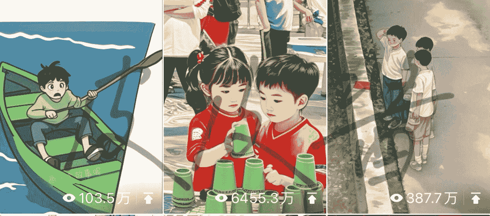
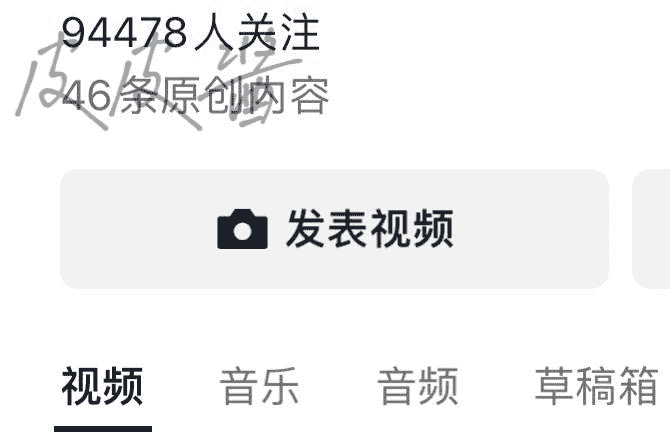
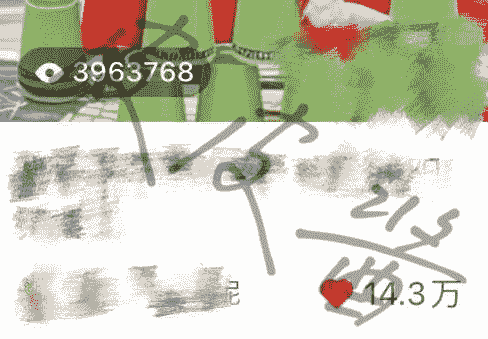
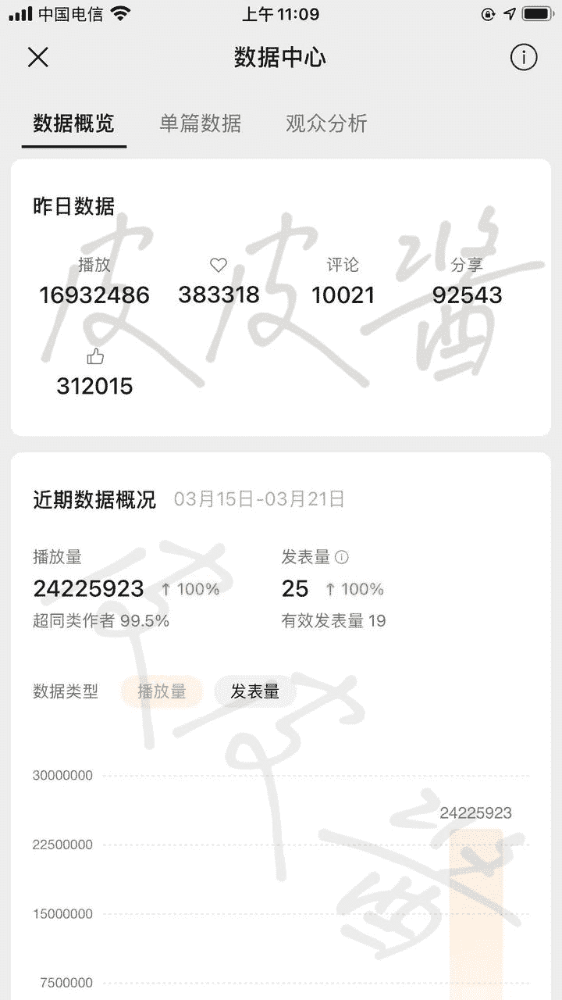
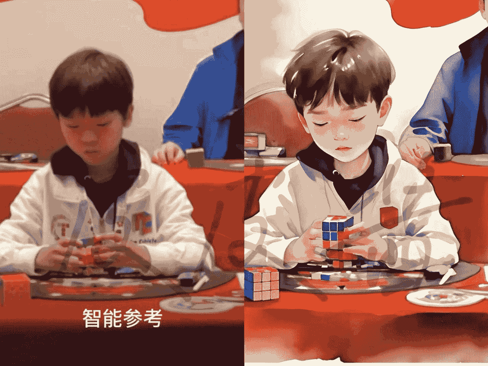
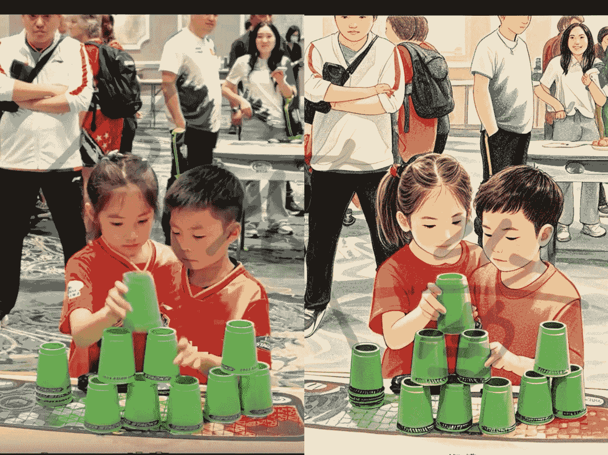

# 《AI绘画变现实操分享》0成本副业！小白也能每月多赚2000+💰

> 来源：[https://xuqiwei1986.feishu.cn/docx/SKYpdcrJvoo474xaMaEcxxBinLf](https://xuqiwei1986.feishu.cn/docx/SKYpdcrJvoo474xaMaEcxxBinLf)

# 写在前面

> halo，我是8.6w粉小红书博主外加全职妈妈～在看到亦仁老大的风向标之后，开始尝试的ai绘画+二创项目，到目前为止一共做了10天，主账号发布了56条作品，每条大概耗时20分钟吧，涨粉95000，最高播放量6500w，除了广告分成，还尝试了接稿，目前总共收入700💰，除此之外，成功把一个异常了的小红书号给养“活了”还成功有了个十几万赞的爆款，是我除了用ai写脚本大纲外，第一次完整的利用ai来赚到钱，简单✅有复利✅确实非常适合小白来入门！赚到AI时代的第一块钱～

# 🔥前期准备篇：10分钟搞定工具，今天就能开干

## 1.1绘画工具推荐

现在比较火的三个ai绘画工具是即梦，可灵，豆包

我都试过，根据绘画的精细程度，上手难度，修改难度综合对比下来。个人用的比较多的还是即梦，文字生图1积分，以图生图2积分，每天登陆送60-88积分不等，所以一天至少可以免费生成3，40次 （如果觉得还不够就换号！）

这是我用它生成的部分图片，笔风细腻程度还不错吧～

## 1.2    2个万能提示词模板（直接套用）

### 方法1:即梦做同款

直接在即梦app里-发现-找到自己喜欢，不算特别惊喜，更符合“手绘”这个特点的成品图。比如下面2个图，左边的虽然也好看，但太精细，就不像手绘，所以右边的当作模版更合适，

找到喜欢的模版后。点击“做同款”把它文案的提示词直接复制下来，删去特殊描述词（比如这张图里的划线部分）

再喂给即梦自己需要的描述词（或者加一张参考图）就搞定啦。

### 方法2.豆包生成提示词

这种方法适用于，找到了合适的对标账号，想模仿对标账号的画风，不知道用什么指令次，就把它的绘画图片，截图下来，发给豆包，问豆包：我想用即梦生成这种图片，请帮我写一个提示词，后方法就跟方法一后面的步骤一样

## 1.3关于修改

我个人认为ai对手部的绘画尤其不擅长，经常会出现6.7个手指头这种错位图，所以，参考图尽量截图清晰。如果原视频本身很模糊，就不要截它里面的图片了，修改的意义不大，不如直接去找同款已经做好的图片，用同行的图片作为参考图，来生成自己的图，或者直接喂指令，不用以图生图

# 💰 爆款内容篇：搬运热门视频的“合法姿势”

## 2.1如何获取源源不断的爆款内容

做ai漫画+二创，本身呢靠的不是ai生成的画有多好看，因为画画都是插入到视频的最后一帧的，能吸引人看下去的，主要还是原视频，所以，找到爆款内容就很重要，说几个我自己常用的“找爆款”技巧

### 1.抖音热点视频找爆款

抖音热榜里找到跟社会相关的，比如说前几天的从赤岭飘到三亚的10岁小孩，亮哥，这条视频，我发了2次（不同的剪辑手法，浏览量分别是100w。15w）

但注意⚠️不要找敏感内容的视频，比如国家.政治等

### 2.搜索关键词找爆款

直接搜索以前的爆款老视频，内容要感人的，爱国的，孝顺父母的，社会大好人那种。毕竟是视频号，得中老人感兴趣的，或者有争议性，能让别人在评论区争吵起来那种。。。这里不限制时效，10w赞以上就行，

关键词参考：感人瞬间/真实的人间疾苦/泪崩瞬间/传递爱国正能量/血脉觉醒.....

### 3.同行找爆款

关键词参考：感人瞬间/真实的人间疾苦/泪崩瞬间/传递爱国正能量/血脉觉醒.....

在已经发布了的内容里里面找个数据很好，画风你也很喜欢的对标账号。再从他的爆款内容中筛选10w赞以上的视频，自己保存下来，

###  4.怎么找到爆款视频的原视频

因为二创剪辑这个项目，最难的点在于，把“别人的爆款”变为自己的“原创”所以剪辑上要加上自己的风格。至少让平台觉得“你是原创”“你没有直接搬运”

所以找到爆款视频的不加修饰的原视频，给我们留的剪辑空间就比较大，也就不会 触发“疑似搬运”这种不过平台审核的问题了。我发了56视频，没有一条触发审核，就是因为把视频做的很像原创，（让平台认为）

方法也很简单。

点进爆款视频上面的搜索框。注意观察下“猜你想搜”那一栏，会有相关的内容词，点进去就能找到没有剪辑过的原视频了。

## 2.2爆款视频去水印

之前看圈友发的要么要下载的电脑app要么要给钱，我习惯用手机，所以发现了这个小程序就很方便，目前是72小时看一次广告就可以无限量的去水印下载视频了，小红书，抖音的视频都可以（视频号我还没试过）下载速度也蛮快的，

## 2.3去水印工具的使用方法

按照2.1的方法找到爆款视频后，右上角点击分享-复制链接-到小程序里粘贴，选「立即解析」然后保存视频就可以了。

## 2.4伪原创视频剪辑

### 视频尺寸

下载好的视频导入到剪辑app。放大到合适的尺寸，我一般是9:16，如果是横版的原视频，放大的画质就模糊了的话，加上背景-画布模糊就可以

### 转场

多加几个转场不仅可以增加视频精致感，也能过原创这关，在视频过度的地方，以及插入ai漫画的地方，我一般选择的是“亮点模糊”但要会员，别的也可以，找自己喜欢的

### 字幕

观察视频号爆款视频就会发现，这里的用户很喜欢“黑体，黄底，加粗，能一目了然让别人一眼看到的”

字幕内容呢，可以照着别人的爆款视频直接抄，也可以在评论区找到高赞评论复制上去

###  《爆款BGM歌单》

根据视频内容配上感人或者慷慨激昂的音乐，推荐这些，直接去搜了用同款吧

### 封面

在剪映关闭原声的旁边有个“设置封面”这里的封面拉到自己画好的漫画那一帧就ok

### 发布文案

和字幕同，可以照着别人的爆款视频直接抄，也可以在评论区找到高赞评论复制上去，另外再加上几个话题比如#画一个故事#感人瞬间#高燃瞬间

# 🤑 变现实战篇：从0到赚到第一笔500块

## 视频号暴力涨粉（亲测有用）

视频号创作者分成的开通门槛是1.100个粉丝。2.10条原创内容

这两条同时满足才能开通，我的一条大爆款就是在10条内发的，所以很可惜，没有收入（要不然那条就有6.7k）

不过没关系，涨了将近10w粉呢！以后做带货也不亏

我的建议是，先发10条，如果没有涨到100粉，可[以](https://shengcaiyoushu01.feishu.cn/docx/DH9UdaAihowxSrxf3B4czHoSnpc?from=from_copylink&QJ2KWz=1)用之前圈友@Joy（阿兜）发过的这个方法来暴力涨粉，亲测哦，5块钱能涨80个具体操作步骤可以看这里：https://shengcaiyoushu01.feishu.cn/docx/DH9UdaAiho...

## 如何让你的流量更值钱

我同发了小红书大概20条，没有全部发，流量还不错，有一条十几万赞，最让我惊喜的是，

那个小号之前被判了异常，现在也被拯救过来了！！

还同发了抖音，不过抖音的创作者分成开通要1w粉丝，可以慢慢涨。

除了视频同发，还可以接稿，我收的是20块钱一张。不贵，所以别人只要问了，几乎都会下单。

> 好啦 先到这吧，去接娃了，有什么想到的，再来写！