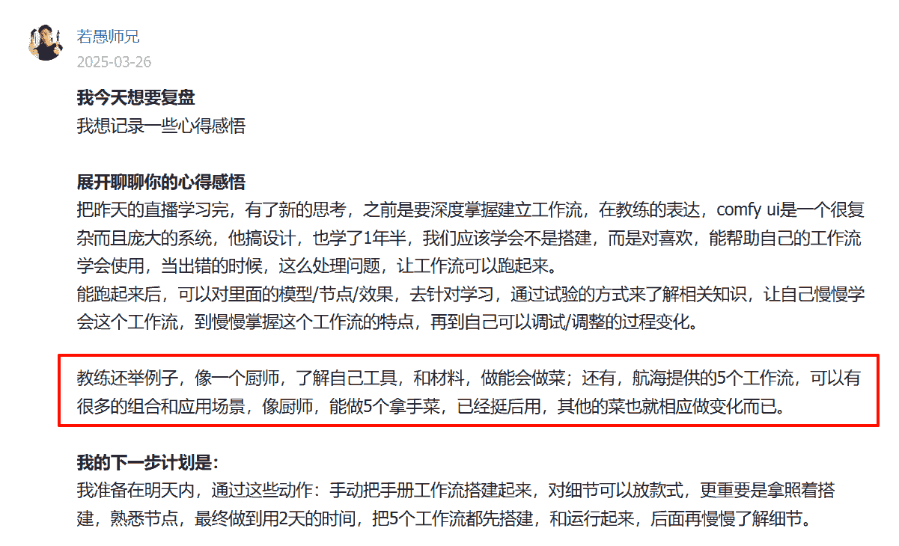
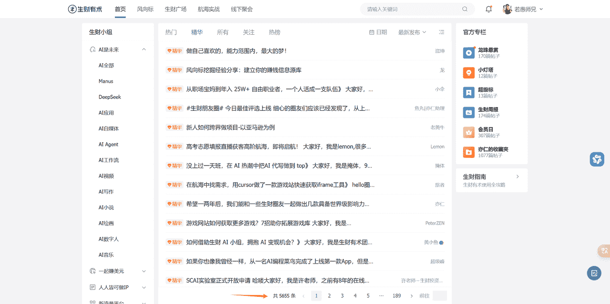
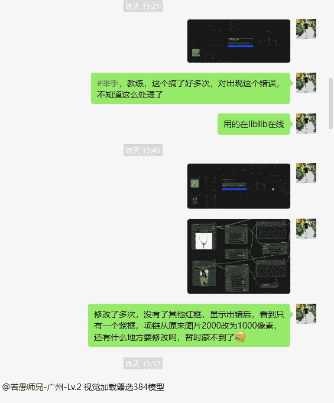
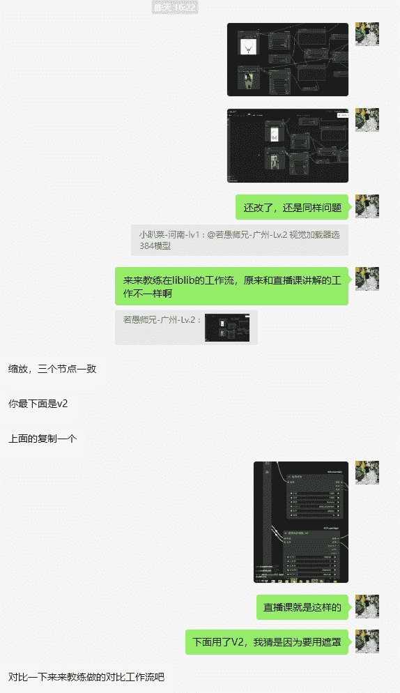
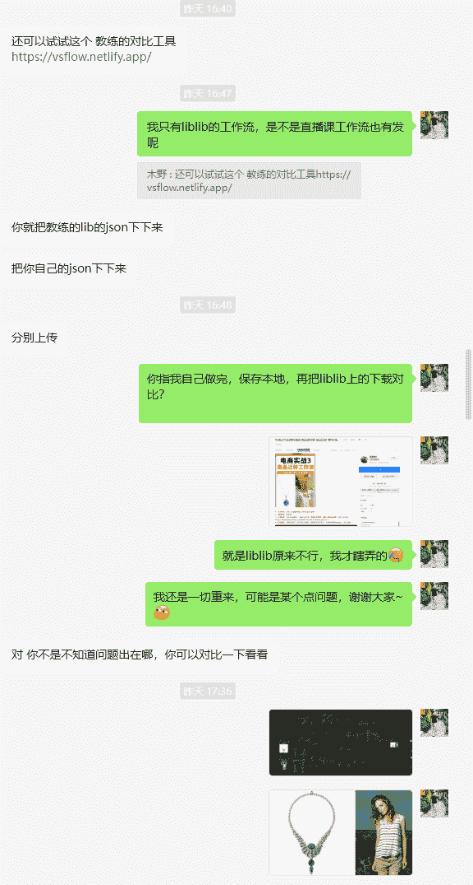
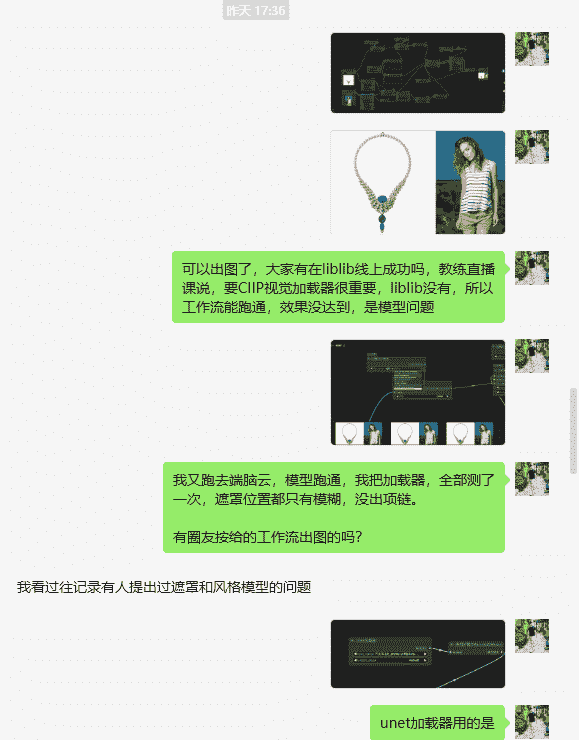

# AI赋能电商航海 2小时45分 从掉坑卡死到生财圈觉悟

> 来源：[https://xuqiwei1986.feishu.cn/docx/Lb9jdEF3coJ0klxjD76cqHyknWk](https://xuqiwei1986.feishu.cn/docx/Lb9jdEF3coJ0klxjD76cqHyknWk)

真不是标题党，的的确确就是今天下午，发生在我自己身上的事情。刚在复盘，感觉会有不少生财的圈友，非常大可能有同样的遭遇，所以就放下其他，先写出这个历程，让遇到类似困惑的圈友，多一条解题思路。

# 缘起由来

3月份参加了2个航海，YouTube short和comfy UI，因为我感觉这2个应该是配套一起，学会了，那不得，关羽得到了赤兔马，想到哪就到哪，还跑的超快。相信同时参加双航海的圈友想的也一样，但是，结果总是意外的，我也不例外，多一个航海，多一份焦虑和郁闷。

在航海的第7天，YouTube我还在撞得满头包，comfy UI 就开始有了不错感悟：

这个感悟，对急于求成的自己，是一种很大的能量，可以让我对这个航海（或项目），不会只给自己21天的时间，行就行，不行就算了；因为太难了，不是一般人能学的，再找其他工具或技能，可能更容易。

往往就是这种思想，让每个航海都经历一次，兴高采烈开船，垂头丧气的靠岸~~（会不会有很多圈友，有同感！🤭🤭）

那天直播课，@来来教练还**带着病给我们讲课，很感谢教练们的付出。有了这个思想的改变，好像一切都在向好的方向发展，**也感觉没这么困惑了。让我想起毛主席的《论持久战》，在整个中国全面失去斗志，可以说失去战胜的希望，准备接受亡国奴时，就是这篇文章，把全国人民都激发起来，感受到了中国以及每个人的美好的未来。

# 第一个转折

在对着手册实操时，其实会有非常多的困惑。困惑的原因是，这个手册和直播课讲解，是不可能全面的，教练已经把手册写得丰富和细化，毕竟，生财的航海项目，不可能是不学半懂，一学就会。所以我们要有正确的认知，暂时没看到生财有给会员发钱的想法，更多的是提供和挖掘“信息差”，尽量让“信息差”丰富和接近源头。

如果当我们面对手册的内容，还有实操的过程产生了问题；教练和航海圈友们的答案没能让我们快速解决问题，我们应该做的不是等，他们还需要靠自己工作为生，同时，也不是同一个项目不断教人的老师，一定会缺乏教学经验，更多是分享自己的操作心得。

参加第二次航海（LV2），我更觉得，B站/YouTube/抖音/Deepseek/google/闲鱼/github等，这些工具的灵活使用，才是我们的的吃饭家伙，能不能吃饱吃好就靠他们了。

我按着手册搭建的第一个工作流“模特换装”，前面文生图/图生图，都挺好的，一到完整工作流就离不开手册，就像练字，离开了描红字，就不会写了。

我的解决方案，放下搭建操作，先对手册的“点”,去学习和搞明白，还有通过上面的工具找资料，慢慢把这些“点”连起来，那就是“线”，就算断断续续，那也“线段”。这样会让我们这些小白，对项目有一些认知，而不是自我填鸭式学习，很容易就“水过鸭背，一滴不留”；或者说，像竹篮打水，一场空，啥收获都没有。

## 航海建议No.1

我发现这些问题的原因是，对于我们新手小白，内容太多了。如果我们看到手册的内容，没法自己看懂，或请教圈友和教练也没全懂（能给别人说明白的才算懂），那一定是我们基础知识和这个行业认知太欠缺了，补基础才是当下的首要目标；不过，又很容易进入另个陷阱，基础知识补太多，航海进度落下太多（我就是）。

我觉得一个好的尺度，就是根据航海手册进度，越前越基础，所以在前面的，我们更多是认真看手册和上次航海的直播课，如果没有，我相信教练和圈友也能很快解决我们的需求（这个阶段的学习，最好是确认名单后就开始，开船前积累问题清单，拉群就开始问懂行的圈友和教练，这样做效率非常高）；

如果你能在航海前做一个航海自学，而且有了明确问题清单，我相信，这个航海你一定会拿到满意的结果；因为航海群有小白，也有不少的高手，航海就变成你的“专属解答专栏”。要明白一个现实，大家都有自己工作，教练和高手在航海以外时间，是没有空回答我们太多问题的；另外，也不可能见到这么多教练和高手让我们去提问的机会。

## 航海建议No.2

生财的航海，我相信他们的初衷也不是想着让我们参加一次就能赚钱，或变成行业专家，那是“割韭菜”的才会给你画的“饼”。我觉得生财更希望是我们通过参加的航海，能了解一个行业，或说了解一个“正在赚钱的机会”，同时也让有结果的/有技能的圈友，带着不了解/没基础/没信心的圈友来亲身体验，不是在道听途说。

当我们没在开船前做过航海自习，我们又在前面的基础就开始遇到困难，那我们应该补补基础，用我指的工具，或你平时使用的工具，去找到相关的/浅显易懂的/完整的教程或资料，不用觉得我说的不可能，网上真的好多，只是我们没接触这个项目或行业，所以没关注而已。

[**我猜想生财给**](https://www.scrum.cn/37024.html)航海的定义，应该是让我们体验一次MVP（最小可行产品Minimum Viable Product），但是我们作为小白，不要被那个《航线图》唬住了，能在21天进入到一个行业，或深入的了解一个项目，与里面最真实的从业者和有结果的人给我们真诚沟通，已经比那些老板交了9万9千8，没两天就游学要幸福多了；“信息差”是最贵的资源。

我建议是在《航线图》的MVP标准，降低适合我们的MVP。生财的航海，不会过了21天就没价值/没趋势的，我们能在21天了解行业/项目，普及了认知，打实了基础，有了基本实操能力，确定了方向，再用多1个21天，甚至3个21天去达到项目行业的新手平均水平，那已经比天天想着改变/想着赚钱的人，1年/2年/3年都不行动的人要好太多了。这些人，只能在当下抱怨，老了埋怨，除此，别无他法。

降低的标准是什么，以能理解手册在说什么，关键词和一些概念是什么意思，找到比手册更简单和完善的资料或教程，【能把手册看明白】，就像读完一个寓言故事，能明白他给我们的寓言哲理一样；还有，就是不再像一个“门外汉”，能了解门道，不再是只能看热闹的样子，能跟从业者聊几句，和普通人说道说道。

我觉得看明白航海手册是最低的要求，**再高一点的是**，在航海结束前，能给自己定下“非结果性”的目标，就是把航海路线上的结果去掉，把所有“过程”都能上手实操明白，这样你一定得到一个不错的结果，未必这个项目能成功出成绩，但这些技能一定在其他地方，或其在更适合你的航海起/项目，到非常关键的作用。

更高的目标，就是航海的结束，不是自己的结束，而是制定好自己的航线图（时间/内容）继续前行，同时也不断续的吸收项目/行业的教程，生财每个航海的关键词都有非常多圈友的真诚分享，特别是精华，足够让我们读完再读，或许还能按他指出的路线来实操；可能这样做我们未必能到达，生财那些有结果的圈友同样的成绩，但已经比自己身边的人，和原来的自己，多了一个更多发展的机会。

# 第二转折

航海的第10天，另一个YouTube也有了自己的领悟（如何打造适合自己的“数字员工”，这个应该会专门写一篇文章，太解决小白的痛点了🤭，我的志愿者都说“妙”），想着comfy UI可以加快，用1天的时间把5个工作流都先做出来，没有什么操作的问题，就给自己安排“提前毕业”，把下半段的航海时间，全部用在YouTube的航海上，这样不至于像第一次航海那样，也是参加2个，2个都半桶水，没有更好的领悟，只能作为错误经验，以后避免。

教练提到的云端平台，已经上手操作了，5个工作流有2个也在第10天达到跑通工作流出效果图；但是，第3个，就是4.3这个工作流，怎么搞都搞不好，第11天就全程操作，还是不行，那就停一下，把4/5工作流操作一下，看看有没有这么复杂，一点的小磕碰后，也跑通工作流和出效果图。回来搞3号工作流，还是不行。

## 转折启动

实在搞不会，去群里找帮忙，先找有空的圈友给建议，时间是15：21

圈友孜孜不倦给予帮助

圈友给出了，之前教练教我们检测工作流的一个方法，肉眼分开看，很难找到细微的错误，那就用程序帮我们看

> 如果大家在comfy UI 遇到类型问题，试试用@来来教练做的，AI工作流对比工具来辅助检测

> https://vsflow.netlify.app/

## 很高兴，我跑通了工作流~~~

我真正的苦恼才开始：

当我开心的等待liblib出图，没想到，效果图没效果，那不就搞了个“寂寞”！

我就各种找错误，和各种找答案，记得教练的直播课时，有对5个工作流做了演示，我就逐帧研究。

## 万万没想到啊~~

> “教练直播课说，要CIIP视觉加载器很重要，liblib没有，所以工作流能跑通，效果没达到，是模型问题。”

原来我一直找的是，一个原来就是错的方向 。再怎么找都是，水中捞月。

但是这个错误，给了我很好的启发，因为逐帧看教练直播课，同时又逐帧做工作流对比，我开始了解，大模型/节点/参数，各自在这个工作流的作用，有了这些关键点的了解，不是再按图索骥了，把原来的简单的文生图，和图生图的工作流，和这个项目工作流，在大脑里面，让他们连起来了。

## 不要害怕挫折，因为还有下一个

我在这2个平台把工作流都部署好，也调整不会出错，没有红框，都能跑通了工作流，有了liblib的操作经验，都是几分钟的事；

但是~~~

我怎么搞，怎么查，还是没有做出那个“对”的图，只有和liblib一样的效果图。

圈友给我建议，经过上一个“坑”，我学聪明了，听话就不要听一半，要听全。如果我先听教练给大家在线实操后说出的结论，我就不在liblib傻做了，直接到教练说的平台“端脑云”去实操。前一天我已经上手这些平台，只是对比之下觉得liblib有教程，用的人也多，可能以后出现问题或者找资料，这个平台应该会有更多的网友分享，我就充值了liblib会员，其他只有新人体验金，所以就没在端脑云/仙宫云这些平台操作。

圈友没直接给答案，只是建议，那我就学会了直接问结果如何；还真是“亏”吃的有价值，圈友也出不了图。

## 人教人，教不会，事教人，一次就会

我还是直接问教练吧，说不定@来来教练或其他教练的回答，就给大家更直观的解题操作；也有可能有结果的圈友给出标准答案，我再自己对着“找找茬”，也能直接了当的出结果，而不是不断的盲猜，增加试错成本。

## 师傅领进门，修行在个人

向@来来教练提问后我继续找答案，突然间，航海第七天的日志，闪现我的眼前：

> 教练还举例子，比如一个厨师，首先要了解自己的工具和材料，才能会做菜；还有，航海提供的5个工作流，可以有很多的组合和应用场景，如果一个厨师，能做5个拿手菜，已经挺够用了，其他的菜式也只是相应做变化而已。

航海的日志，就是让我们平凡人在每天的糟粕后，还要在航海手册学习，可能那一霎，面对希望的时候，有一些感悟，或学习心得就记录下来；如果只靠脑子记，可能第二天，进入日常糟粕事后就遗忘了一些，断更几次航海，就忘记得差不多；经过自己总结再写出来的日志，真能让自己的印象更深刻，起码在21天内的航海期，天天都在经历，相当于进入了一个特训营，给我们增加更多的”肌肉记忆“；大脑记忆太容易忘了，就像前几天，一个人让我生气，如果后面有一些愉快的事情，我就会忘记不开心的事，学习和训练也是一样的；但是肌肉记忆就很难忘干净，最多就是不熟练，像我们很难忘记怎么骑车、怎么游泳，对吧？

为什么今天的故事要从第七天开始说，因为我找到的答案，应该是从第七天，或者更早，但第七天的日志，教练用厨师来比喻，让我有了认知，让我有了怎么对comfy UI 的了解，不再陌生。

## 我找到了”答案“

这个工作流的答案，不需要用双引号，因为我找到了，”如何使用comfy UI“的答案。

这也是当初，我为什么没有按航海手册选择端脑云，和忍住没选择@来来教练说的，仙宫云他自己部署了，一个818G的镜像，基本涵盖了日常模型和节点。

这就是我找到的答案，我在liblib用搜索，看看别人分享的工作流，用别人的成果就好了。因为我的目标是了解和会用这个comfy UI ，让它帮助我做比PS好看的图，还有其他人经常发出来的美图。

https://www.liblib.art/modelinfo/1ee4ead55faa4c7cb4fba7611ce05196?from=search&versionUuid=54a71fcd02f044208226a889b6335631

# 给想了解【AI赋能电商】航海的建议

当我找到这个答案的时候，很开心，也做了自己的复盘，同时也发到航海群里，希望能帮助其他有需要的圈友。

> 从我在群里#举手/15：21 ，到我找到了自己需要的答案/18：06，记录用时2个小45

## 感觉AI赋能航海，我提早毕业了，我的领悟：

1.  只需要用来做图，liblib是归属；

1.  要用来为生，下苦工理解节点和模型，拆解最新工作流，掌握复杂又出效果的优秀工作流；

1.  有成熟业务，只要固定好用的优秀复杂工作流，还要定期更新，把钱给别人赚是最优解，

1来增加国家GDP

2来有更多时间开发自己擅长业务，做高自己体量，时间是企业的生命，很多团队是被研发拖死的~~~

## 无论你是正在参与航海，还是后面想了解航海，我有一份心得体会，和大家分享：

# **懂技术是为了找到专业的人，一起合作，让自**己主营业务做更大，不是学懂所有技术！！！

## 重新感受到，参加航海的目的。

# 找到自己需要的，或者，帮助自己解除不确定的，

# **找到合适的线索/人脉/技术，**

# **让自己主线业务更好的发展，而不是，“**吃着嘴里，看着锅里，还要想着别人碗里！”

# 献给自己的一句话

## 技术应用，永远比学习技术有价值！！！

我经常犯这个错误了。😂😂😂

# 题外话

## 大家觉得我封面怎么样

开始想写的时候，是长这个样的。

图片是这样的

我觉得，没有原图那种感觉海底孤勇者的感觉，只有在海底的感觉，发现原来少了那条大鲸鱼带来的压迫感。

那应该怎么做呢？我调整上下位置，也没达到。

如何才能让封面这窄幅尺寸，让我的图片合我心意？

增加他的图片宽度，就可以了。

应该怎么做？

## 已经充会员啦~~~

用起来。

用了新图，我又感觉人太小，境太大了。

阔图后，又太宽

简单裁一下两边

## 这就是大家看到的这一版

## 我想表达啥？

把学到的技能，尽快用到实际中，让自己多点实操机会，从大脑记忆转成肌肉记忆，让技能产生熟悉感，慢慢发展到【人技合一】！🌻🌻

## 👍有句老话

”技多不压身“，不过我提醒一下，自己能使出来的，才叫技术喔，别人身上的不算，除非你们是合作关系，那也算你拥有的。

# 有一个概念更正

我指的毕业，不是不再参与航海打卡，而是达到我的目标，后面打卡，将会记录怎么使用的心得，就像这个封面操作。

希望【AI赋能电商海航】剩下的10天，每天都写着【YouTube short航海】的作图实操日志，让自己更快的跟进YouTube 的项目，也让自己产生更多Comfy UI 的”肌肉记忆“。

我在广州，希望和更多圈友交往/学习~~

# 如果看到文章，也想加入这个优秀的圈子，可以点击下面的链接，领取3天试用权限喔~https://t.zsxq.com/eQYFZ

