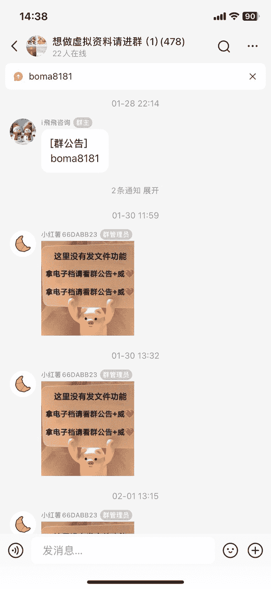
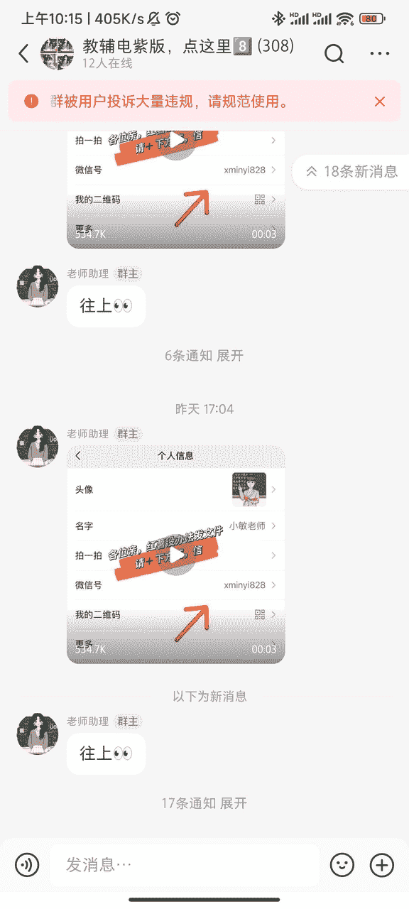
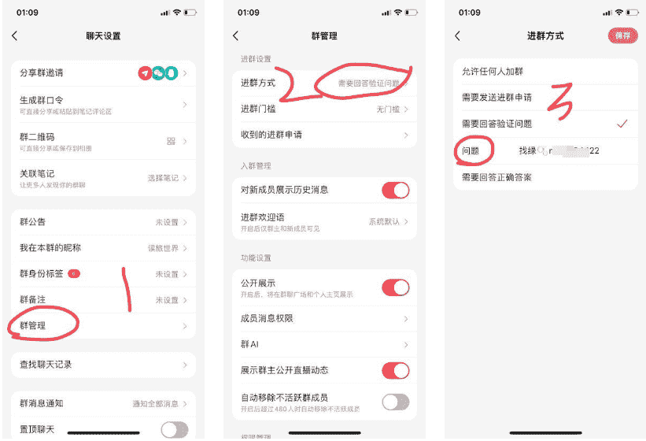
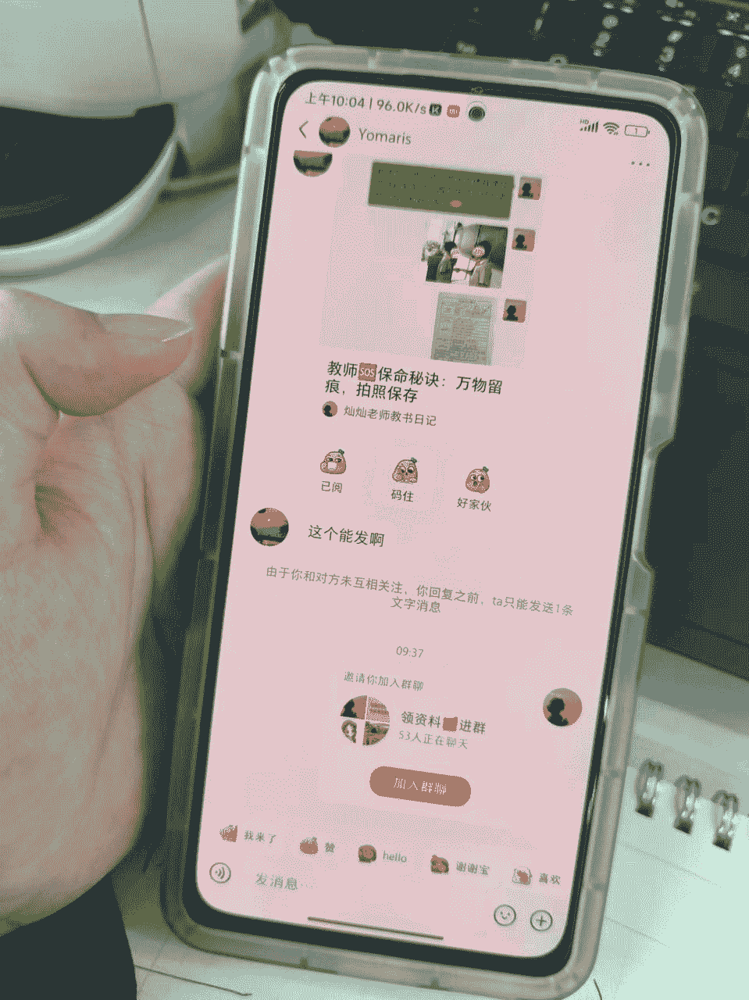
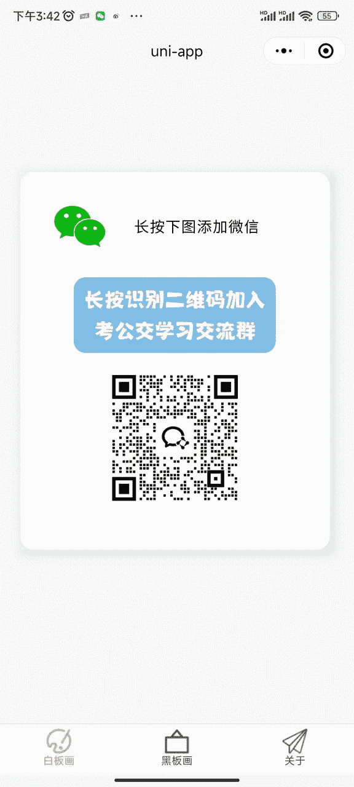
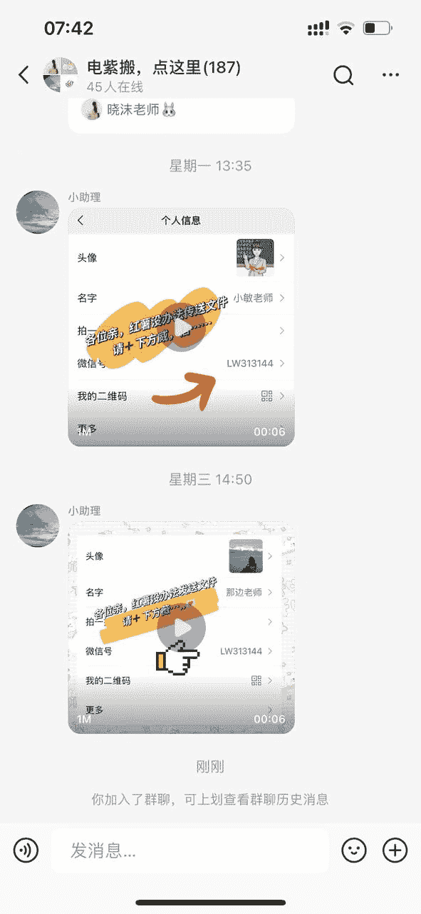
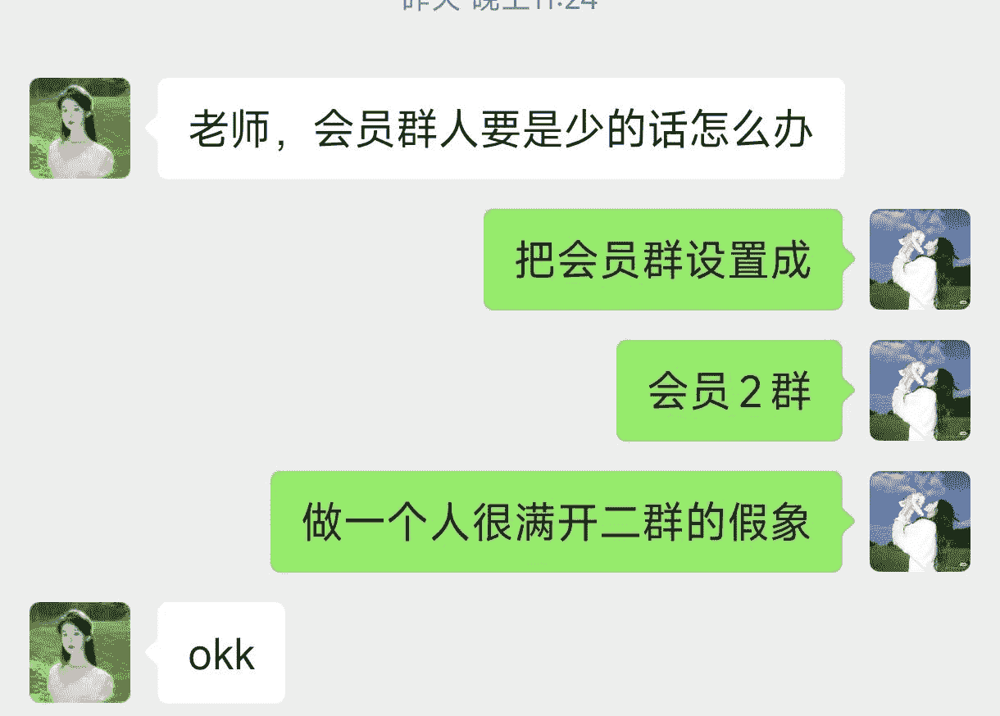
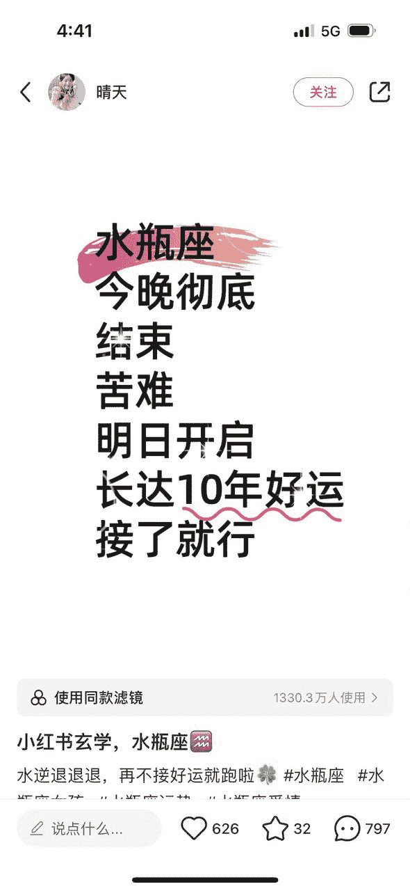
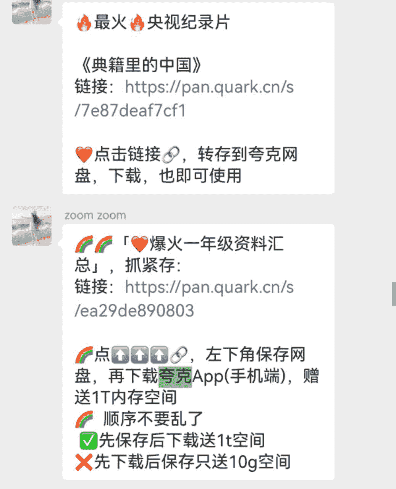

# 【问答库】mini航海——📕虚拟资料

> 来源：[`https://xuqiwei1986.feishu.cn/docx/SnipdpOclokxgSxBYrJcxAQPnAh`](`https://xuqiwei1986.feishu.cn/docx/SnipdpOclokxgSxBYrJcxAQPnAh`)

温馨提示：

我会把大家大部分问题收集在这里面，大家有什么问题可以直接看，我也做了分类收纳，如果没有的话群里可以提出来，解答完，我也会添加进问答库里。

> 电脑端快速查找方式：`ctrl+f`，可以搜索关键词

**🎯手机端目录导航：**

# 笔记相关问题

## 💎主要问题：

### 同样都是抄的爆款，为什么有的爆了，有的没爆？

答：

概率事件，大部分你们看的重复的爆款封面都是概率事件，矩阵发图

学会不用矩阵概率说话可以学习一下做爆款的思路，看下面“怎么打造爆款笔记”的内容

### 为什么小眼睛的数量越来越少了？账号流量自测方式

答：

想让别人点你的2大要素，封面+标题

你的封面，你的标题对比其他爆款，你看看是啥原因

经过一位同学的同意，咱们用他的例子举例一下：

左边的同学大部分是走思维导图的形式，右边都是**有数据的爆**款封面，对比下来，我们可以复盘封面和标题

1. **要有一定的营销感**，特别是标题

1. **3:4图片**（刷📕画面占比最大的都是3:4）

1. **封面一眼看不到主题**，在信息这么多的互联网，用户更希望第一眼能看到笔记里，能看到我想要的东西

1. **爆款封面测的少，**左边红框划的，是同学听了我直播后，修改了标题发的笔记，这个点赞数量明显就有提升嘛，那我们再优化一下我们的封面，把做爆款封面的能力提升上来，那是不是就把握了用户点击的密码。多试爆款封面，实拍图、拼接、对比图等等......

1. **封面图，**最好是能让用户第一眼看到自己需要的信息，才会点进来看内容，字的大小也很重要

1. **封面好看，**你要知道📕的群体大部分是女性以及年轻用户，如果你掌握了这一点，其实打败了90%的人，比如粉色背景，干净整洁的封面等等......

上面提的直播回放在下面这个问题里哈

### 如何打造爆款笔记？

答：

直播回放，有详细讲到怎么打造爆款笔记，讲下面这个思维导图的

[`https://shengcaiyoushu01.feishu.cn/minutes/obcnfpfd71aeg8on8rjm82jp`](`https://shengcaiyoushu01.feishu.cn/minutes/obcnfpfd71aeg8on8rjm82jp`)

强烈推荐看【加餐分享】，用质量打败数量

[`https://shengcaiyoushu01.feishu.cn/minutes/obcnfp9jfblg9i7347585swj`](`https://shengcaiyoushu01.feishu.cn/minutes/obcnfp9jfblg9i7347585swj`)

调研表模板：[`同行调研表【模版】`](`https://shengcaiyoushu01.feishu.cn/sheets/VES2sLSSjhT14jtigMyceg4NnPf`)

### 怎么找对标？怎么快速采集笔记数据？

答：

1. 对标账号用户群体和你一样

1. 时间越近的越好

1. 有一直在更新，有数据的（点赞+收藏起码得超过500）

1. 利用采集器找爆款笔记，看到他们的粉丝量然后加私域去调研

1. 【做📕如何用后羿采集器进行数据分析】[`https://t.zsxq.com/ajBKE`](`https://t.zsxq.com/ajBKE`)

1. 平时下班路上或者只有手机的时候，搜索关键词同事多用📕自带的【筛选】功能

调研表模板：[`同行调研表【模版】`](`https://shengcaiyoushu01.feishu.cn/sheets/VES2sLSSjhT14jtigMyceg4NnPf`)

### 干货笔记占多少？产品笔记占多少合适？

答：

干货，产品占比，一般是2:8

按照自己的账号来，你要知道逻辑是什么，干货笔记是为了增加账号权重，产品占比是为了转化

如果你的账号刚起，多发干货是可以的，这个占比你可以自己调整

如果后续粉丝和点赞还有小眼睛上来了，你可以多发点产品

### 到底是用wifi，还是用移动流量？

答：

不连wifi的底层逻辑是，怕你wifi底下有很多人注册📕账号，系统会判断你是工作室

你用家里的，根本无所谓，wifi想用就用

### 怎么找资料，怎么搭建资料库？

答：

没有资料库推荐哈，都是同行那里8的，比如我，后端懒得弄，我就是直接买别人的会员，有问题就问同行，咱们先用别人的资料，后面你要做大做强再考虑自己搭建资料库的事。树是死的，人是活的。

举个例子：你去a那里开了会员，你是作为客户的身份，然后你的客户找你要的资料你没有，那你作为a的客户，你找a要，让a给你解决这个问题。

### 有没有赛道推荐？

答：

如果你没有赛道想法话，我推荐是看下k12赛道，如果要详细赛道，就直接做我的，班主任赛道

找到焦虑的人群，你就知道怎么找赛道了

### 怎么选赛道？

答：

1. 看发的人多不多，如果做这个赛道都没什么人发，就不用去做了,这个市场可能还没开发完成，现在上的都是实验品，其实竞争力强多的人发证明这个有搞头，就像k12，这么多人发，赚十几二十万的人多了去了，但是到你这里你一个月做赚个几千块钱、万把块完全足够，不要看别人发的多你就畏畏缩缩

1. 看引流朋友圈，一般他们会在朋友圈展示自己的成交，会员制还是啥，有价格展示，成交频率，运营频率（如果朋友圈都发得少说明没啥搞头）

1. 看赚钱，搜关键词看看别人有没有在做，有没有相关的情报，如果有可以参考下，如果没有你也沉思一下，是不好做，还是暂时没人做

调研表模板：[`同行调研表【模版】`](`https://shengcaiyoushu01.feishu.cn/sheets/VES2sLSSjhT14jtigMyceg4NnPf`)

### 提示违规怎么处理？

答：

+   无非就是别人举报了你这个笔记抄袭，，要么就替换成原创的，要么就要删掉，我之前就是直接用了别人的图，然后就提示我违规版权问题，然后我就把那个笔记就删掉了，那就没有了呀。

+   如果举报的内容不对（就是恶意举报，根本不是这回事），反馈的时候尽量收集好证据（截图之类的），语气柔软一点申诉，申诉成功可以加账号权重，加油。以下是我申诉成功的案例，可以参考一下。

### 什么时间发笔记合适？

答：

一般中午1-3点，下午下班时间6-9点，数据会可观一些，看准你人群玩手机的时间就对了，因人而异

### 大号、小号可以发的内容一样吗？

答：

可以，但是要错开时间，不能前脚大号发了，后脚小号再发，不然系统会判定抄袭，过个几天，缓一下，加个贴纸降重一下再发。

### 有快速矩阵发笔记的工具不？

答：

有，容易被封号，建议还是手动发，2-3个号没必要用矩阵

### 单个账号，一天最多发多少条笔记，比较好

答：时间不足，2条，如果时间多的话，一般是3条比较合适

### 前期先发干货篇还是产品笔记篇呢

答：

前期多发干货笔记涨权重，你可以一天发2条干货1条产品，产品笔记很讲究技巧，所以，在还没有熟练前，先把干货笔记发号

### 对标细分类目很多，是不是我现在就应该定好要做的类目呢

答：建议选1-2个即可

### 一天发多条作品的话 作品间隔多久呀

答：半小时，让数据跑一跑（让子弹飞一会）

### 怎么看是引流笔记还是干货笔记？

答：

产品笔记他可能笔记带了商品 或者直接图片展示商品 干货笔记就是纯给有用的信息或者给方法解决啥问题

## 💎次要问题：

### 好几个账号，怎么方便存图片和文案发笔记？

答：

自己拉个📕群，不用给每个号发，就直接群里发一遍就行

### 同行发的题目的图片可以去水印以后直接用吗？

答：

去水印然后自己加贴纸，是最快的，不过有没有效果就要你自己看了，现在📕抓伪原创抓的紧

有很多伪原创和作图的方法，可以看下面“做题问题”那一栏

### 我做这个内容，需要有相关证书嘛？

答：

不用哈，我滴亲，你发📕就和发朋友圈一样，没有人会去核实你的身份的。

举个简单的例子，不会有人找你买资料，还问你一句，你把你证书拿出来给我看看。

除非你后面要做大做强，必须有这个身份支持你的变现。

### 📕做到后面一定要出镜嘛？

答：

有些同学赛道不一样，看到同类大部分都在做视频，我一个解答

你看自己哈，你图文笔记能转化，就不用做视频，不是什么都得必须弄视频，视频其实投入比图文更高，我们先从简单的图文入手。

### 怎样将自己同类的笔记放在一个专辑里？

答：

86 【制作合集|如何制作合集❓让你的笔记来集合 - 添添爱跳舞(二胎孕中期) | 📕 - 你的生活指南】 😆 64a6G0LjWzzo8OE 😆 [`https://www.xiaohongshu.com/discovery/item/664de1e400000000160100d6?source=webshare&xhsshare=pc_web&xsec_token=CB1gxGzMwDLwXvK1JtKd0jcqls0GmWiY7Z-5ud2KM85ik=&xsec_source=pc_share`](`https://www.xiaohongshu.com/discovery/item/664de1e400000000160100d6?source=webshare&xhsshare=pc_web&xsec_token=CB1gxGzMwDLwXvK1JtKd0jcqls0GmWiY7Z-5ud2KM85ik=&xsec_source=pc_share`)

### 现在📕注销还要等5个工作日吗？

答：

以前有些键盘侠骂人之后会尽快注销账号，然后重新注册继续骂，也有的骗子会在骗人之后很快注销，能在被举报封号之前注销重来。是📕为了避免这种情况，于是后来改了。现在要等5天

### 账号提示被永久限制账号流量与商业权益怎么办，申诉了没过

答：

这个惩罚很难申诉成功，直接换一个新号，别干等，等永远是最不明智的选择

### 老号重启遇到个位数播放的情况呢？大概多久能够恢复过来？

答：

这个得看你内容好不好，因为老号他跟新号不一样，新号它是有分配流量的，你老号重启的话，如果你之前老号有发过其他笔记，然后你以前的内容和现在发的内容不一样，它标签可能就是错误的，推的用户就不精准。

### 幼儿启蒙/幼小衔接 现在还能做吗？查看资料说暑假寒假这类型的资料比较好卖

答：

能做的，只是有些时间节点会更好卖资料而已

### 做小学赛道是不是也要细分到哪个年级 这样比较好

答：

可以的，如果要细分的话，小学赛道优先推荐3-4年级，因为1-2年级妈宝多都是送免费资料、卖学习用品之类的，而5-6年级学生都冲刺上辅导班了，在售卖虚拟资料上可能不太适合新手

### 想做大学生赛道，📕搜什么关键词比较好（找对标）

答：

📕搜索框直接搜索“大学生”，出来的下拉词条就是可以用的

### AI教育这个赛道，可以吗？

答：

Ai的制作成本偏高，相对于教辅赛道，肯定是门槛高很多的，如果是新手，比较推荐先从简单的入手，先掌握基础技能，完成闭环再说

### 怎么看别人笔记的小眼睛数量

答：

看不了，这个只能自己看得到，除非你把别人号盗了

### 很久没更新的号和今天刚起的号发的笔记都卡在个位数或者十几，也没有违规，这种情况要注销重新来吗？还是继续观察？

答：

不用，还是内容问题，不要多想，笔记复盘记得做起来

### 我做的是小学英语的家长端的内容，发现同质化的内容有很多，自己现在也没啥可发的了，这咋办

答：

同质化内容多为啥没东西发，你同行发的多，说明这个赛道有搞头，你对标他们说明他们的资料卖的好，你咋不能卖了，就模仿他们

### 产品笔记他们好像只有试卷的形式。 产品形式除了发试卷还可以发什么呀

答：

发试卷，发课堂总结，发频繁考点资料，很多类型啊，你看的还是太少了

### 我有刷到有的数据还好，但没有发现她的引流和店铺，这种账号能对标吗

答：

建议不对标，但是你觉得他的内容好可以做素材库 有那些真诚分享的，我觉得他们数据好，能拿来做自己的号也挺好的

### 我想问下发试卷的作品，算产品还是干货？

答：

试卷打印下来才能用，所以是产品，你是为了卖试卷，所以发试卷笔记，一切以卖东西为目的的笔记，叫产品笔记

### 如果刷到很好的视频内容，可以把视频内容制作成图文内容发布吗？会违规吗

答：

你内容稍微改动一些，基本不会，因为图文你肯定是自己作图，内容稍微改下，你只要不是直接拿别人的图用，大概率不太会直接提示你违规

## 💎作图问题：

### 快捷方式直接换背景哈？

答：

工具：美图秀秀，教程看视频

[`WeChat_20241023200132.mp4`](`https://internal-api-drive-stream.feishu.cn/space/api/box/stream/download/all/RQKcbyeyfoo7nnxc91ocnR7Mn9d`)

### 朋友圈图怎么做的？

答：

手机下载软件：[`https://www.zuotusq.com/index.html#/`](`https://www.zuotusq.com/index.html#/`)

### 如何快速将图片去重，用什么？

🛰️小程序搜 去水印

`#小程序://去水印免费工具/GV15ndHmBLLXhiu`

去水印然后自己加贴纸，是最快的，不过有没有效果就要你自己看了，现在📕抓伪原创抓的紧

### 如何快速做一个好看的笔记封面？

工具：📕，看视频操作

[`WeChat_20241022210456.mp4`](`https://internal-api-drive-stream.feishu.cn/space/api/box/stream/download/all/GpBMbH1n3oapgLxk7Pgc6Mz3nMc`)

ios可能是这个界面，但是功能都是一样的

### 这种有插画+文字的爆款封面图片怎么做？

答：

工具：美图秀秀，看视频操作，

自己设计就好，功能都在里面，文字啊，贴纸啊，都可以加

[`WeChat_20241022202130.mp4`](`https://internal-api-drive-stream.feishu.cn/space/api/box/stream/download/all/FzVHb7pWbo1sApxFEOEcMtZHnjJ`)

### 练字帖的图怎么做？

答：

里面还有很多的在线工具，做📕运营用处很大，有需要的自行保存（感谢群内船员分享）

工具箱原链接：[`https://tool.lu/`](`https://tool.lu/`)

练字帖工具：[`https://tool.lu/copybook/character.html`](`https://tool.lu/copybook/character.html`)

格子纸打印：[`https://tool.lu/gridpaper/`](`https://tool.lu/gridpaper/`)

控笔字帖：[`https://tool.lu/copybook/control.html`](`https://tool.lu/copybook/control.html`)

### 怎么批量给图片加水印呢？

答：

工具：美图秀秀，看视频操作

[`WeChat_20241023200537.mp4`](`https://internal-api-drive-stream.feishu.cn/space/api/box/stream/download/all/Cv84bMzHMou0DExf7DUcGggynld`)

### 如何批量换背景图？

答：

工具：剪映（感谢群内船员分享）

把文案输入剪映中，把不同的背景图放在里面，借助视频提取图片的情况下也能秒出N张图

### 这种渐变光圈一样的感觉是咋做出来的

答：

美图里 在贴纸里面搜光圈，其实图只要能看，都不是很重要，只要能抓住卖点

### ppt怎么批量去水印？

答：没办法批量

## 💎好用工具分享：

### pdf 去水印工具

答：

感谢木木的分享：[`航海项目执行路径的100条提效指南1.0`](`https://q8smv4c9nu.feishu.cn/docx/RO9pdl9f5ojVO5xhBYOcDppqnrh`)

### 有什么工具可以批量提取标题文案，视频文案，以及抓取评论

答：

你可以看下这个 [`航海项目执行路径的100条提效指南1.0`](`https://q8smv4c9nu.feishu.cn/docx/RO9pdl9f5ojVO5xhBYOcDppqnrh?from=from_copylink`)

###

---

# 引流相关问题

## 💎主要问题：

### 引流私域最安全的方式？

答：

没有最安全，一举报一个准，如果是避免大号受损，就用小号做，例举部分方法：

**笔记引流：**引导推小号名片，让他们看小号的笔记，小号笔记放🛰️号

**群聊引流：**自己建群，小号发引流图

# 引流相关问题

## 新引流方式：（感谢群内船员分享）

### 主号账号提示疑似站在引流，没封号，只口头警告，后面笔记发什么类型的啊，会不会成为平台重点对象

答：

这只是提醒你之后大号最好别再有引流操作，只是警告，但以后注意，尽量用小号做引流动作，降低风险

## 💎次要问题：

### 建群有什么注意事项嘛？

答：没有，想建就建

### 有人私信我，我大号可以发群聊引流吧？

答：

可以发群聊，别直接发引流图就行

### 这个群聊里面跳转是怎么做的？

答：这个是团队小程序，其实也容易毙掉的

### 那种一进群就蹦出艾特新进群的成员，看之前发布的消息的，怎么设置？

答：

那个是进群欢迎语，你群管理找一下找一下

### 笔记小眼睛不多的情况下可以发引流笔记吗？例如10条笔记里有4条引流的

答：

可以啊，你可以多发点干货试试能不能数据好点

### 在红薯群里用视频方式引流是用剪映加贴纸做吗？有啥需要注意的吗？我的小号在群聊里发不出去这种，显示违规？

答：

是的，可以用剪映加贴纸，我之前用过，一般3s 左右，没有成功发出去的话，就代表还是被系统识别了引流信息，视频里的关键信息，比如“🛰️号”没有做好隐藏，可以拆解一下对标的这个引流视频是怎么做的，一般我的做法是录屏🛰️“我”的界面，3s，然后加滤镜，贴纸，遮挡住一些敏感字眼，然后再用文字引导

---

# 私域相关问题

## 💎主要问题：

### 怎么定价，怎么设计成交话术？

答：

推荐小玲老师的分享，看完你会清楚整体定价的逻辑、成交话术、以及【如何打造自带付费属性的朋友圈】

【虚拟资料如何精准引流、高效变现？】小玲老师，推荐2倍速看

`https://shengcaiyoushu01.feishu.cn/minutes/obcnxlx84p5foiv9627tkpix?from=from_copylink`

直播里提到的话术参考：

[小学教师资料销售变现话术SOP流程](https://wsk6hfxov5.feishu.cn/docx/OxyHdxJfqoIKqvxGAM4c5Yn5n2c)

### 怎么提高成交率？

答：

看一下上面那个问题回答

### 我啥也没有，是不是要先把朋友圈发一下呀？

答：

其实大部分人都是从第一步，卡在流量，流量有了你就自然就变现了

从发笔记先开始，你没有流量怎么引流私域，在你精力足够的情况下，丰富朋友圈是可以的

### 怎么链接后端？

答：

可以星球资源对接发帖，或者搜索看有没有相关的资源可以对上

### 用户问我要资料，但我没有这个资料怎么办？

答：

找个粉丝多，体量大的账号，这样说明他们库至少更全面，如果没有，他也会想办法给你找

举个例子：你去a那里开了会员，你是作为客户的身份，然后你的客户找你要的资料你没有，那你作为a的客户，你找a要，让a给你解决这个问题。

## 💎次要问题：

### 如果需要顾客等待一段时间，话术怎么说比较好？

答：

你是老师或者是专业人的人设，你要么就说，"稍等下在忙，晚点我找一下发给你"

要么就打造一个专业人设，就是你找到资料再圆一下，"我刚在忙，刚忙完，我刚给你找到这个资料，你看一下"

出门在外，身份是自己给的

想问下教练的产品也是靠群交付的嘛？加了个同行 她让我进qq群

### 想问下教练的产品也是靠群交付的嘛？加了个同行 她让我进qq群，然后我很好奇的是，现在还有人用qq嘛 会不会影响交付

答：

影响也不大，看你自己比较喜欢什么方式，🛰️肯定更方便，后续你持续运营朋友圈，还有机会复购啥的

### 老师，有人要进会员群，但是并没有几个人怎么办

答：

### 是不是客户第一句就问多少钱？我就不要分享免费资料给她了？分享了免费的直接没后文了。

答：

都可以，如果他购买目的性很强，哪样都会买

### 对于家长会产品怎么组合比较好呢

答：

其实就是你所有产品是怎么组合的同一个逻辑，也不用单独给家长会的产品搞个逻辑，你要么就把家长会的PPT和话术稿单独搞成2个产品，要么就打包一起卖

### 这种玄学的很容易赞藏评，后期怎么变现呢

答：

卖产品手串啥的，或者八字看相啥的，都可以变现的，你直接搜下星座，去商品里看下，都是变现的方向

---

# 店铺相关问题

## 💎主要问题：

### 怎么开📕店铺？怎么上传虚拟资料？

答：

一个身份证只能开一个店铺

【📕虚拟店铺完整版复盘：单天单号变现500+|可矩阵放大，一条龙副业玩法分享给你】

黄岛主的帖子分享给你，讲的很细：`https://t.zsxq.com/aPQiY`

### 店铺卖好资料好，还是🛰️私域卖资料好

答：

大家也不用纠结做什么形式，店铺是因为交易方便，而且售后简单，但是只有低客单收入

而私域是高客单成交的主要阵地，包括后续升单，招代理，做大做强都是可以在私域实现的，

但是这两点都是在有流量的基础上，你们一定要记住，发笔记，有流量比什么都重要。

### 📕店铺版权怎么看？

答：

开店最好不要传有版权的资料，如果有版权方找过来容易被举报，店铺可是实名过的

怎么看有没有版权：

1. 有无水印

2. 看同行有没有在卖，卖的人有个3个以上，说明能卖

### 店铺和私域可以同时在一个账号进行嘛？

答：

因为你店铺的号是实名过的，你的店铺也是在这个号里的。不建议一个账号打两种打法，因为私域是违规行为，你这个号被封了，可是给你店也关了哈。

店铺是用来做低客单售卖，可以前期赚钱可以用这个过度，自己可以弄别的号搞私域。

### 店铺听说都是打价格战

答：

包是打价格战啊，你玩电商你肯定要在同平台，至少要比别人价格低吧。

玩电商你不比别人价格低，怎么从零销量开始干？

聪明的人他们是会在站内里面找资料，就是货比三家的，就不说他去淘宝拼多多上面找，他们找至少都会在站内找，所以你站内你肯定从零销量干起来要比别人低，但是后面你销量上来了之后，你可以自己涨价都行。

## 💎次要问题：

### 店铺的虚拟资料订单，去发货的时候仍然需要寄件，这种怎么解决呢？

答：

你可以选无物流发货，发货的地方有个选项，你看看

---

# 网盘拉新相关问题

## 💎主要问题：

### 网盘拉新怎么弄？什么最赚钱？

答：

移步星球贴：`https://t.zsxq.com/I1RVI`

看任推邦，有价位显示，现在夸克拉新最赚7.5一个

## 💎次要问题：

### 夸克链接，点进去就算是拉新成功吗？

答：

下载夸克，然后转存才算，转存就会匹配到

### 百度网盘内容结转不下来，提示要开会员，需要开会员吗

答：

你点进去少选几个文件夹，别一次性存这么多，实在不行就只能开会员了

### 请问给客户发的网盘链接，是直接用原链接和提取码就行，还是转成自己的网盘所保存的内容的链接和提取码？

答：

都行，随便你
