# 【航海好事】同城夜校：从0到第一名，线下航海高效运营攻略与实战思路复盘

> 来源：[https://xuqiwei1986.feishu.cn/docx/FonadSwVjoFqx5xRw4kcJWtCns2](https://xuqiwei1986.feishu.cn/docx/FonadSwVjoFqx5xRw4kcJWtCns2)

#  准备篇

圈友们好呀，我是叶落影，加入赚钱3个月，之前参加过两次航海，9月👸号自动化原创和Web3，Web3里程数并列第一，线上也在不断深耕。

在这次线下航海前我是没有做过私域的，也没有了解过夜校，所以花了点时间采集了下赚钱里的夜校相关的帖子，把前面一些帖子翻了一下，大概的了解一下。

只有标题没有具体链接啦（**下次不敢了~**） 只是为了看看点赞量高的帖子，了解一下这个项目。

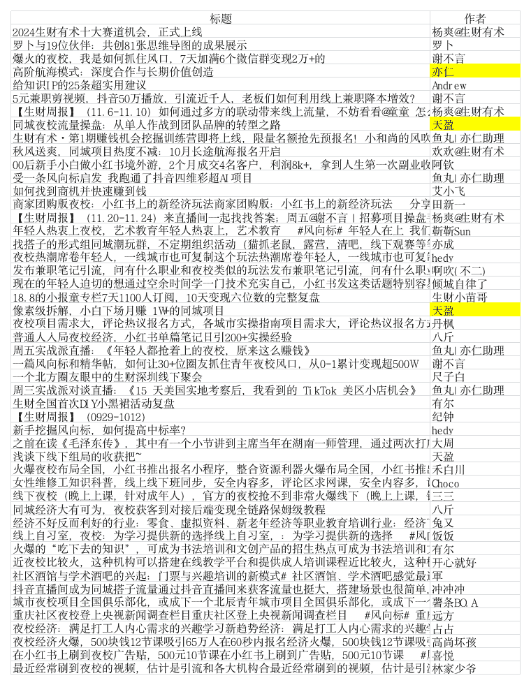

[赚钱夜校相关-10.17.xlsx](https://internal-api-drive-stream.feishu.cn/space/api/box/stream/download/all/QB8Mb9pnxotbaoxBWTRc4NBTn8e)

**刚刚觉得还是有比较重要的文**章，所以一些复盘帖也加进去了 ，这里只有标题，可以搜来看看

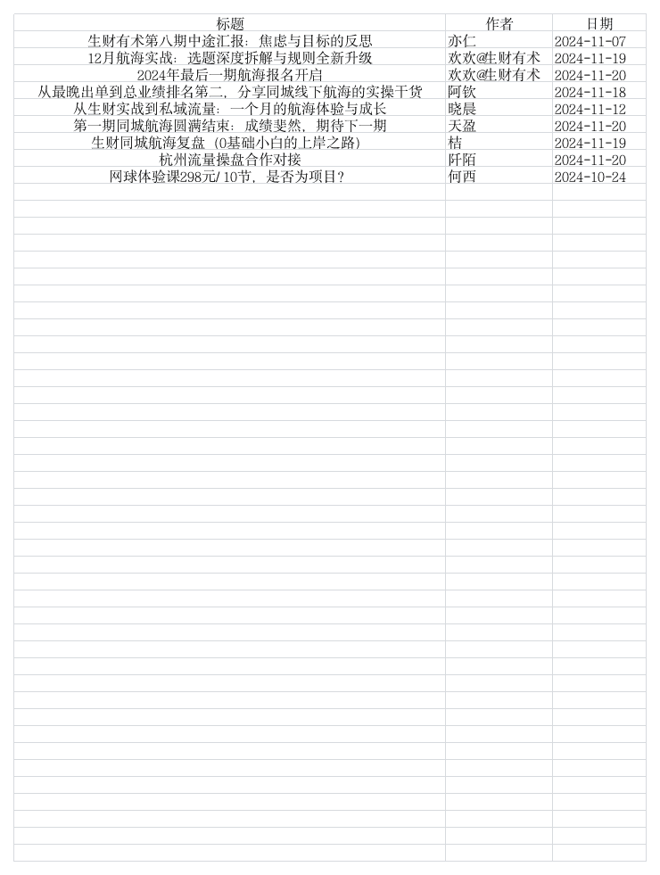

[夜校相关帖10.17之后.xlsx](https://internal-api-drive-stream.feishu.cn/space/api/box/stream/download/all/CyGibaNYmozFScxwKjmcidCcnJf)

看完几篇帖子之后，就大概有了一个比较清楚的认识，也根据帖子总结了一些关键点。

> **定位精准**：

> 夜校的目标用户群体相对明确，是年轻人、上班族，希望充实业余时间或者拓展社交圈的人群，这个群体的需求清晰且多样。

> **需求强烈**：

+   工作之余的学习和社交需求是长期存在的。

+   兴趣班过于昂贵，而夜校提供了性价比更高的替代方案。

+   单身经济盛行，让夜校不仅是学习的平台，更是新的社交场景。

> **同城属性**：

> 同城夜校的优势在于用户黏性高，同时能够快速实现裂变，形成以社区为核心的生态闭环。

> **在**对夜校项目有了初步了解之后，我意识到，这个项目的关键不仅在于清晰的定位和强烈的用户需求，更在于我们如何高效地将这些需求转化为实际的行动。

> **尤其是在夜校项目涉及的多个环节中，日常的内容管理、素材处理、以及高频次的复盘和调整，都需要依赖高效的工具支持，所以上船后就**不断地在研究一些提效的工具，除了之前用的，还有就是适应项目的，线下大家都在跟时间赛跑，跑得快一点就多一点时间停下来学习。

# 工具篇

分享一些日常在用的小工具，实际提效很多，让我有时间做更重要的事！

## 2.1 日常文件搜索

### 2.1.1  Listary  免费文件搜索工具 & 应用启动器

https://www.listary.com/ 来这里

**GPT介绍**：Listary 是一款专为 Windows 系统设计的高效文件搜索工具和应用启动器。它以轻量级的设计和强大的功能，帮助用户快速查找文件、启动应用程序，并提升整体工作效率。

使用下来非常丝滑，对于每天切换各种文件夹的我，再也不用自己打开去搜了，提效很多，比Everything好用！

> **即时搜索：** 在资源管理器中直接输入关键词，即可实时显示匹配的文件和文件夹，支持模糊匹配和拼音缩写。

> **快速启动：** 双击 Ctrl 键，调出 Listary 搜索框，输入应用名称即可快速启动，无需在开始菜单或桌面上查找。

> **快速切换：** 在“打开/保存”对话框中，按 Ctrl + G 快速切换到当前资源管理器所在的文件夹，节省时间

### 2.1.2  Anytxt Searcher 桌面全文搜索工具

https://anytxt.net/download/ 来这里

**GPT介绍**：Anytxt Searcher 是一款功能强大的桌面全文搜索工具，专为 Windows 系统设计，旨在帮助用户快速检索本地文件内容。

> **支持多种文件格式：** Anytxt Searcher 支持超过 100 种常见文档格式的全文搜索，包括 Word、WPS、Excel、PDF、OFD、电子书、网页、代码等。

>

> **快速搜索：** 通过高效的索引机制，Anytxt Searcher 能在 1 秒内返回搜索结果，提升工作效率。

>

> **关键词高亮：** 在搜索结果中，自动高亮显示关键词，方便用户快速定位相关内容。

>

> **实时索引更新：** 支持实时更新索引，确保新添加或修改的文件能被及时搜索到。

找登记的客户信息、订单号码信息很方便，就是需要定期建立索引，文件越多空间占越多。

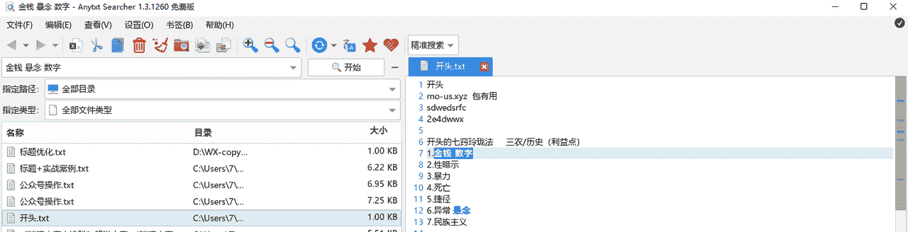

## 2.2 素材分类管理、桌面管理

### 2.2.1 Billfish 海量素材分类管理工具

https://www.billfish.cn/ 来这里

**GPT介绍**：Billfish是一款专为设计师打造的免费素材管理工具，旨在帮助用户高效整理和管理各类设计素材。

之前管理blender材质、贴图素材用的，用到这里管理素材文件特别方便，可视化视频，挑选素材不费劲，做设计、玩摄影也可以用，这么看来只是分类素材有点大材小用了。

> **多格式支持：** Billfish支持超过61种文件格式，包括PNG、JPG、PSD、AI、GIF、SVG、EPS、CDR等，满足不同设计需求。

>

> **高效素材管理：** 提供标签、评分、备注等多种标记方式，支持多层级文件夹分类，方便用户对素材进行精细化管理。

>

> **快速搜索与筛选：** 支持按关键词、颜色、尺寸、格式等多条件搜索，帮助用户迅速定位所需素材。

>

### 2.2.2 Fences 5 桌面美化、整理工具

https://www.stardock.com/products/fences/   来这里

GPT介绍：**Fences 5** 是 Stardock 公司开发的一款桌面整理工具，专为 Windows 用户设计，旨在帮助用户更好地管理和组织桌面图标，提高生产效率和桌面美观性。

> **智能分区：**

+   将桌面图标整理到分类“围栏”（Fences）中，方便快速查找和管理。

+   支持创建多个分区，如工作、娱乐、文档、快捷方式等。

> 文件门（Folder Portals）：

+   在桌面上直接创建文件夹的访问窗口，无需进入资源管理器即可查看文件夹内容。

> **自动整理：**

+   根据文件类型、名称等规则自动将新下载或保存的文件归类到对应的围栏中。

> **隐私模式：**

+   双击桌面空白处隐藏所有图标，保持桌面简洁，并通过再次双击恢复。

> **动态调整：**

+   Fences 的大小和位置可以根据需求自由调整，支持多显示器和高分辨率屏幕。

> **个性化设置：**

+   提供多种主题和颜色方案，用户可根据喜好自定义围栏的外观。

> **快捷访问：**

+   在桌面上拖动窗口或分区边界，即可快速切换到常用内容。

如图2.22-1 可以按自己的方式做好桌面分类，还有很多功能可以玩

图2.22-1 归类后的效果

没有这个我的电脑桌面应该是下图2.22-2这样

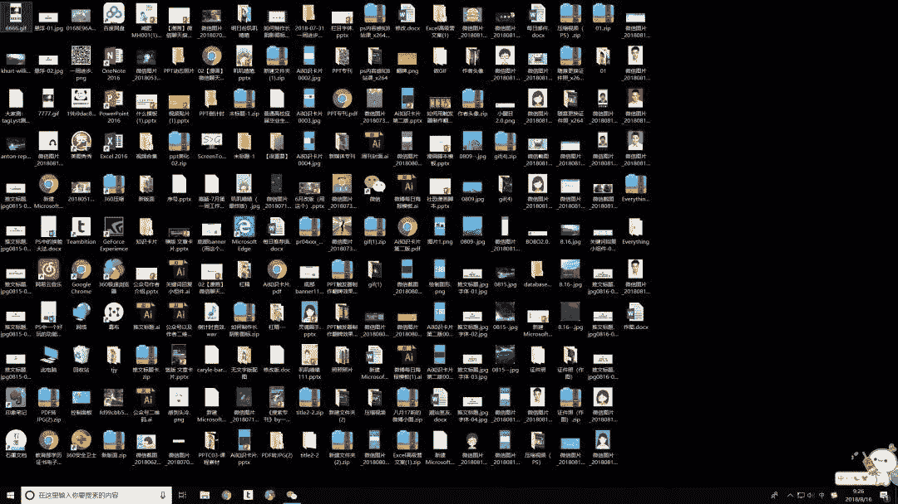

图2.22-2 网上找了一张图

## 2.3 几个不那么依赖项目的小工具

写了很多提效的小工具，大多是把代码写死，纯粹为了做事提效来写的，也有几个不那么依赖项目的小工具

### 2.3.1 多格式文件提取与分类

GPT介绍：在日常使用中，文件夹中常常会混杂多种格式的文件，手动整理这些文件可能耗费大量时间。同时，视频管理中横屏与竖屏视频的筛选也是一个常见需求。为了解决这些痛点，开发了这款多功能文件管理工具，旨在通过智能分类与筛选功能，大幅提升用户的文件整理效率。

有些视频分割软件不那么友好，会把每个视频的分割文件放一个文件夹，非常不礼貌，而且没有选项选择是否放置，所以就写了一个多格式归类的小工具，可以测试测试，我就不贴图了。

[文件提取并处理横屏视频.exe](https://internal-api-drive-stream.feishu.cn/space/api/box/stream/download/all/M7tPbyduMofBygxl3kqcz8SpnCg)

[文件提取并处理横屏视频.py](https://internal-api-drive-stream.feishu.cn/space/api/box/stream/download/all/PmYobXvEjo8Q63xpvPrcNqeCn9c)

### 2.3.2 便携的复制工具（自用）

**介绍：用来放一些常用话术的**

[粘贴板主程序.exe](https://internal-api-drive-stream.feishu.cn/space/api/box/stream/download/all/Ci0cbbI8goxhIjxLYJKcgpxGnGb)

**下面是源码+工具**

[自动化粘贴板.rar](https://internal-api-drive-stream.feishu.cn/space/api/box/stream/download/all/TL2ibZ9MxoTvjWxiyDfcGxDmn0I)

### 2.3.3 📕自用去重和批量出图软件

类似第三视角来宣传夜校的，这种帖子也非常符合📕的审美，我的第一篇100+小眼睛的📕夜校作品！！！

可能更，暂时废了，环境让我弄乱了，大概是批量做出这种类型的图

在做📕的时候发现，并不会对图片进行过多查重，通过截图或者直接去水印下载图片后通过修改图片md5值的形式，也不会有涉及原创问题。

所以，在做课表的时候就想到了稍微在ppt模板上调一调字体和一部分文字，通过给一张图片添加各种各样不同颜色的边框的形式也是可以去发布，并且也会有流量，就有了这个简单的去重加框工具。

优点是自己的模板，可以去随意改动文字部分，又能快速出图，挺适合这个项目的！

注：Mac 版本不支持 PPT 转图片功能（因为依赖 Windows COM 组件） 所以只有Windows才能用 ，需Office的ppt不是WPS的。

> 使用方法：

> 1.把需要换的背景图（xhs去水印下载后的图）放在背景文件夹里

> 2.边框ps或者稿定涉及换颜色设计固定尺寸，也可以自定义，测试下就可以

> 3.模板可以自行调整，加字，加元素，加表情，但是图片需要替换下去不是删掉，若出错，可以删除模板重新下载一个。

[xhs简单过图.rar](https://internal-api-drive-stream.feishu.cn/space/api/box/stream/download/all/C3c1bAV7IoS6fRxZrXrclJlLnve)

图 2.3.3- 📕风格夜校宣传图

# 流量篇

## 3.1 视频号初步探索

还算是比较幸运，在航海3、4天就跑出来很好的效果了，视频号两个10W+播放。

也是前几天没怎么去发视频，还在养号，每天只更了一两条，去研究提效了，还是应该先跑模型，再谈提效与放大。前期差点没坚持下去。

只有视频号流量跑出来了，所以这里就讲一讲视频号相关，刷对标，最重要的点就是找行业爆款，教练团队都帮忙准备好了。

从这次航海，也总结了一套应该可行爆款的方法论，大多数可以看到的不论是新闻号、产品号、内容号都是类似的，很受用，跟着教练团队走没错的 !

> 1.采集爆款

> 2.拆解爆款

> 3.复制爆款

> 4.重复爆款

> 5.裂变爆款

也跑出了一些成绩，截止11月17日，实际3个号在跑，平均每个号50W+播放

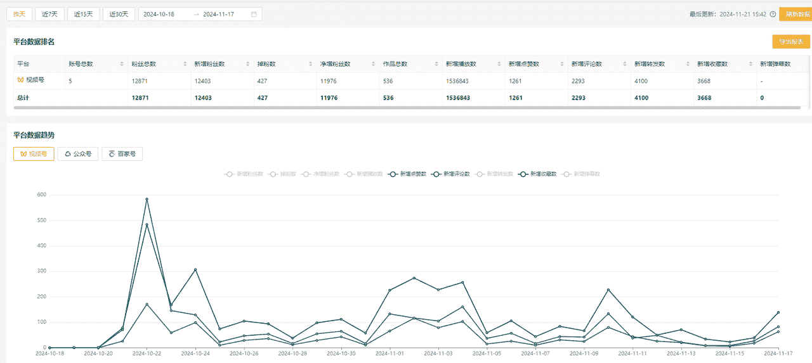

3-1-1 矩阵软件播放数据曲线图

也跑出了一晚3000垂直粉的账号，但是因为🛰️都是小号，所以并没有进几个粉到🛰️（损失惨重），没找到图，放一个视频感受下。

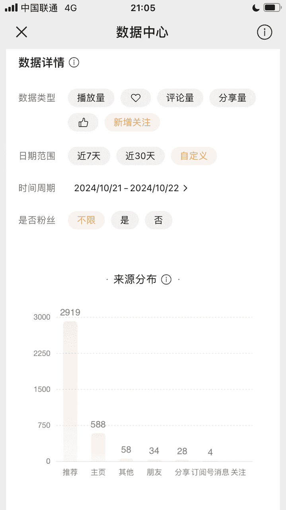

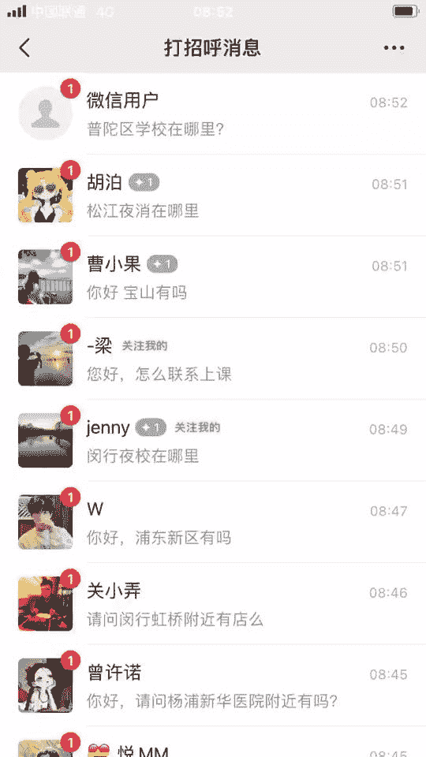

[3f6ab21bfa5df7cae0a4a064a4c099a7.mp4](https://internal-api-drive-stream.feishu.cn/space/api/box/stream/download/all/Y1DSbuTXxocvjVxeMRTcndOlntc)

**3-1-2 视频号作品数据**

## 3.2 视频号跑量与放大

我有拿一个不做的号去测试新的爆款，发现效果并不是很好，只筛选出一个还不错的案例，也跑出了不错的效果，但是不是很稳定，所以换了种方式。

视频号采取堆量拿稳定流量的策略，不追求少有的爆款。

于是每个账号每天发布的视频从3个增加到8个，流量慢慢稳下来，每天持续进粉 。接管组员的视频账号素材剪辑分发，帮组员减负让他们在其他方面有更多的学习时间，做好分工，我自己的工作也分出去一部分给猫姐姐，真的很感谢猫姐姐和阳哥！！！

这样我们组就有10+账号，组进粉最终来到了3000+！

> 这里讲下📕，没能坚持发，一部分原因是没有正反馈，另一部分是确实懒。。研究的去重工具和批量出图毫无用武之地，好多截流玩法没精力去做，有点遗憾，本来阶段性放弃的📕，变成丢进回收站了。。。

# 销转篇

### 4.1 快速单聊-小步快跑，快速迭代

你聊够1000个客户了吗？  答：航海下来是有的。

当我一天引来200多个粉在几个号上时我就在想，

如果我一天引流了1000个客户，我还是靠原来一问一答的形式，

即使已经预设了很多的话术，但这些话术并没有形成系统化的SOP ，客户问了才会总结，这样的方式在转化上显然是不够的。

因为我们组进粉也算比较多的，转化测试放在了我们幼儿园小朋友-猫姐姐身上，在这一**点上进行了很多**测试，最终发现一个好的单聊策略，不仅仅是回答客户的问题，更重要的是主动引导客户，主动引导客户，而不是被客户牵着走。

**本身夜校也是一个兴趣消费，基本上都是视频号来的粉丝，看到了想学**的课程才会加好友，快速地匹配课程是关键，所以一开始我们就主动进行引导，除了本身有强烈兴趣想学习课程的，一般都会选几个比较满意的课程

---

#### 4.11 单聊破冰图 折叠

**思路就是选一些热门地铁站附近的课程，主推这些课，以及手上客户太久没成团的课也**可以放进来，差一人成团的也可以放进去，会比较好推课程，很多客户是不愿意等组团的。

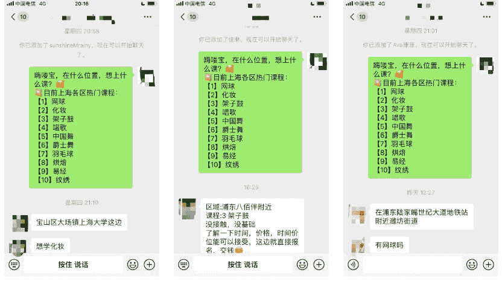

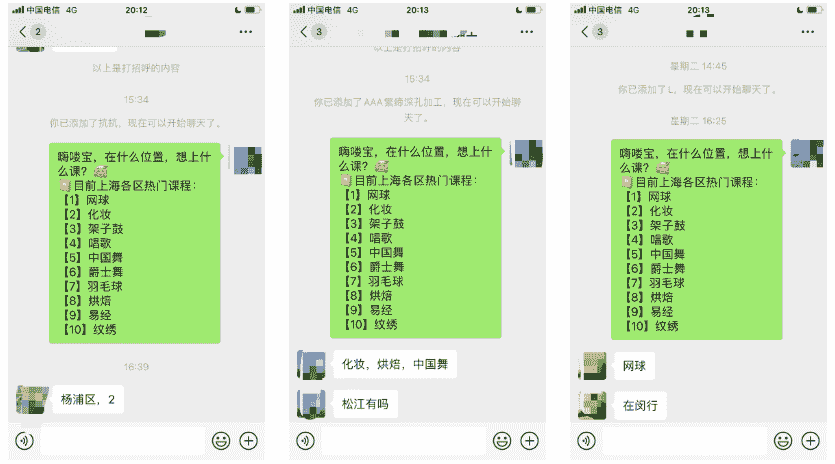

#### 4.12 快速匹配课程-精力有限，不拖泥带水

客户所在的校区有这个课是最好，大概讲一下课程注意事项、发一个课程介绍、问一问位置是否合适、时间能不能接受，基本就能成单。

但是大多数情况是这个地区没课的，这里我也会因为我做的是上海，我会记一些中心区的课程，大多数课程都是靠近地铁的。

**一直不成单的情况（这几种情况都拉到群**里慢慢转化就可以，不要浪费很多时间私聊）

> 首先就是推一些中心区的、客户想要的课程，其次是引导客户下热门课程（讲下课程如何如何火爆等等）

> 跟客户讲可以拉群帮忙组课，先进群会有课程上新通知。

> 意愿很强我才会让客户下预定单，帮忙在所在地区找课，我都会提前限制好时间，可以接受两周以上拼团时间。

### 4.2 朋友圈转化 折叠

这里用到了之前做截流的玩法，留痕，不时在客户朋友圈冒泡，点赞，评论，也是激活老客户的一种方法，更自然，谁不喜欢朋友圈被夸呢？ 贴几张后来成功转化了的，有主动留的，也有去客户朋友圈耍的。

### 4.3 群聊引爆

群转化我并不是很擅长，只是掐着双十一的小尾巴，集中拉了两个群，配合着双十一的优惠活动，3天转化30+单，这两个群本身也比较活跃，所以也只是用小号稍微活跃了下气氛，新群刚创建不久，又有活动，所以很自然就爆单了。

就是不停的轰炸群聊，更像是把群当成"商场促销叫卖"了，大家能进群都是意向比较高的了，只是缺一个时机 ，所以退群率也只有1%，因为你是在为客户谋福利。

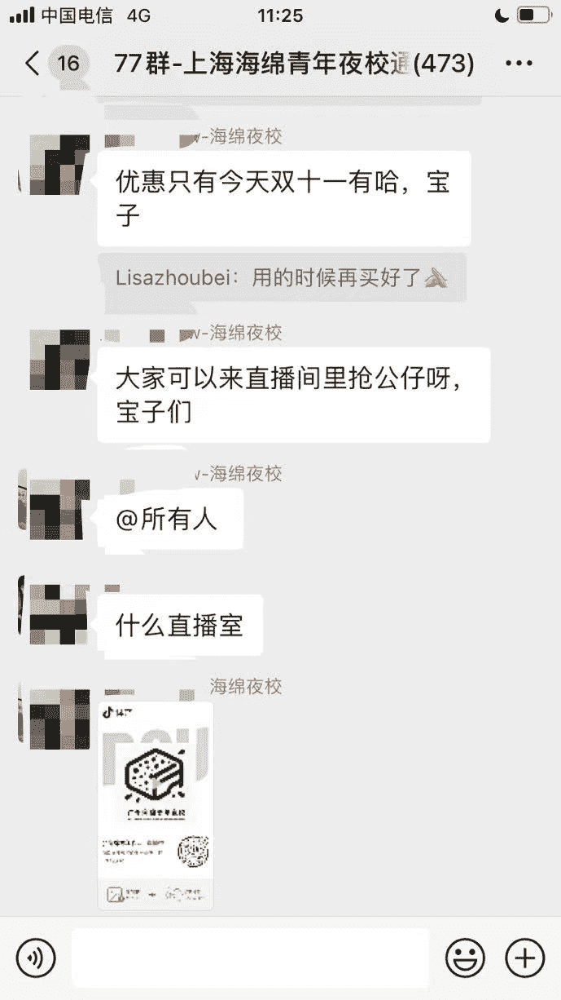

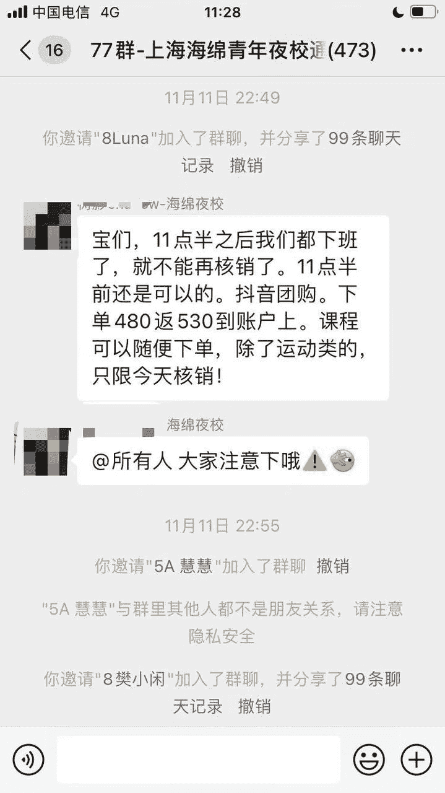

所以其实是可以定期做一个小活动在群聊里，会有不错的效果，一般我会隔几天拉30-40人，这样新进群的又能带动一波大家的情绪，购买欲望↑↑↑

也贴一下双十一后3天的当日订单，当了3天的销冠，喜提天盈老师、教练团队连续3天的大红包 。

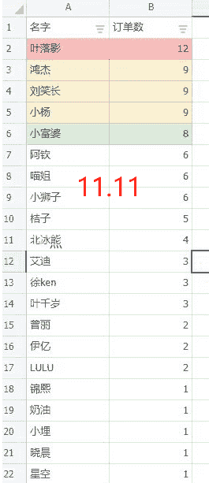

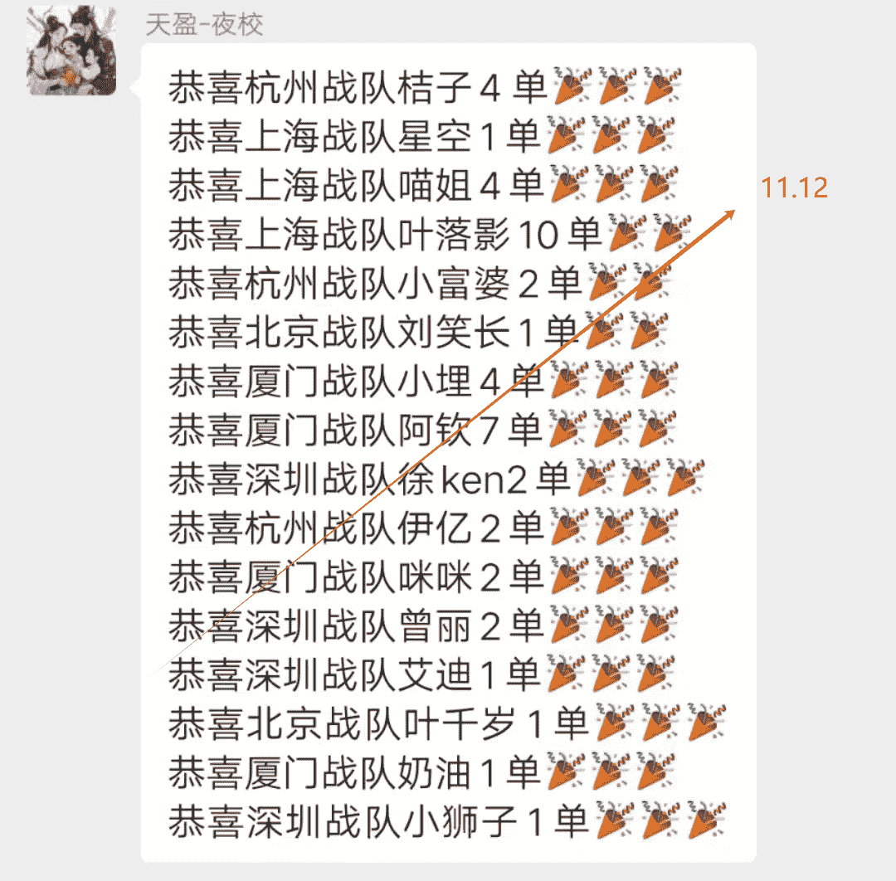

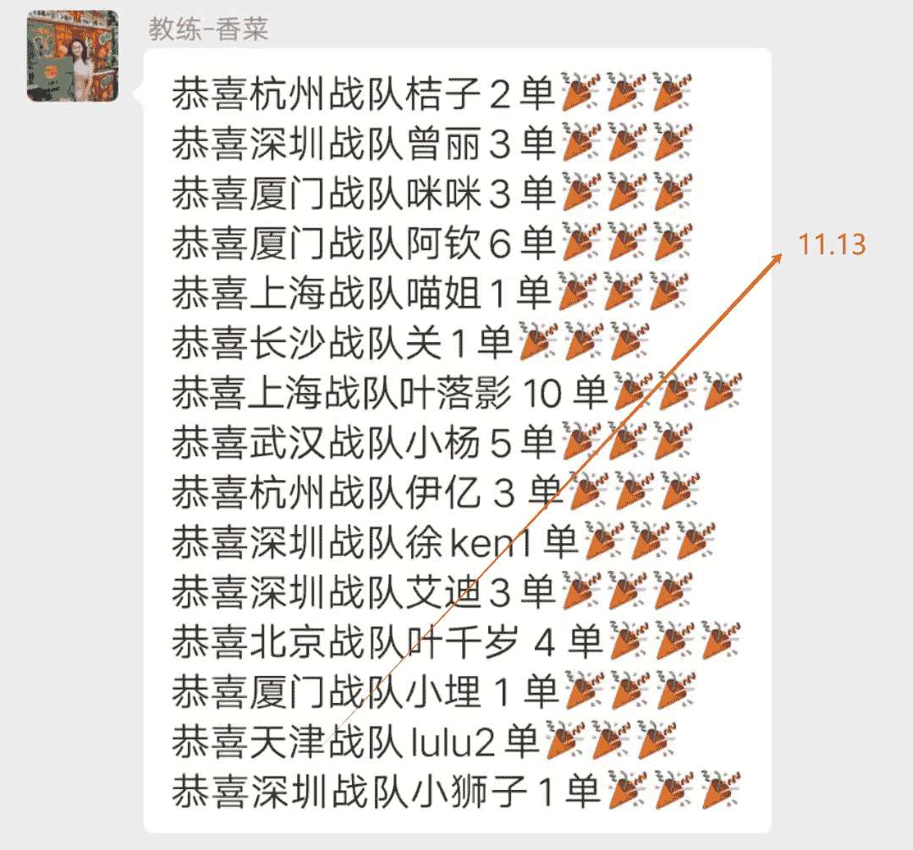

#  一点点小经验

不论是做私域还是公域，如果做产品都少不了与人打交道，虽然之前有做过自媒体账号，但是是娱乐型的靠平台收益，总结了一些经常出现的违规得出的经验，让大家减少一些违规。

##  5.1 视频号违规申诉

做同城夜校出现最多的违规是编造新闻、其次是视频非原创或者原创度不够，下面这个文档里具体哪类可以选择一下作为申诉文案

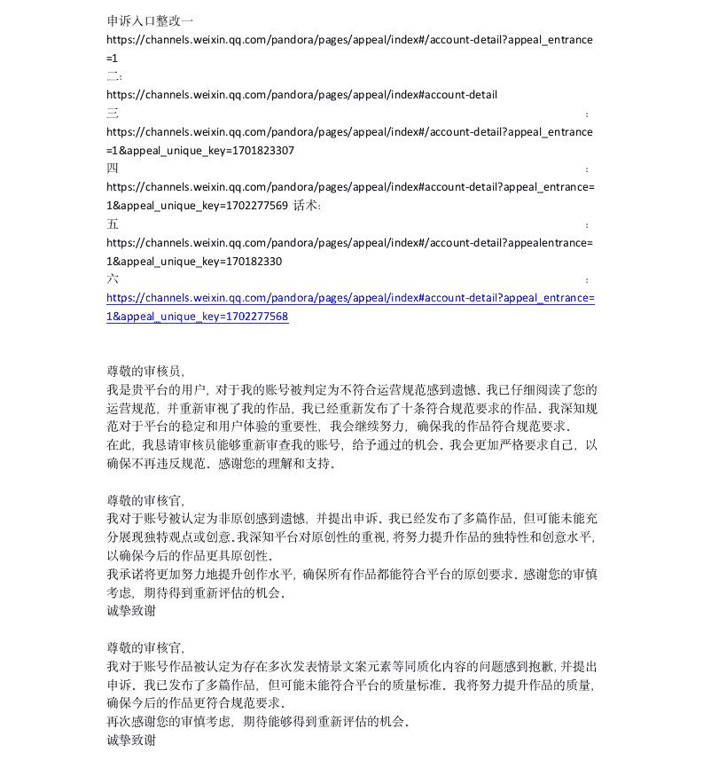

[申诉文案库.doc](https://internal-api-drive-stream.feishu.cn/space/api/box/stream/download/all/GEdyb70lRoQWogxfeCvcyZMtnfg)

下面这个是前几天创建的新视频号，素材用久了出现查重了  (长期发布内容相似度高的作品，可以考虑换下模板)

> **违规申诉流程：**

>

> 1.视频号后台查看是几号的视频违规，例如我是21号视频被查出违规，我会把20号之后的都隐藏或者删除

>

> **2.然后**用自拍特效拍10个小视频，截图一张清晰的人脸自拍，当做申诉图片

>

> 3.**申诉** 挑选**申诉文档具体的文案**+**一张人脸自拍** 就可以等待申诉通过了，一般几分钟就可以申诉通过

>

##### 申诉图片折叠** **                                                                   如下图，是我22号刚申诉的，99%成功率

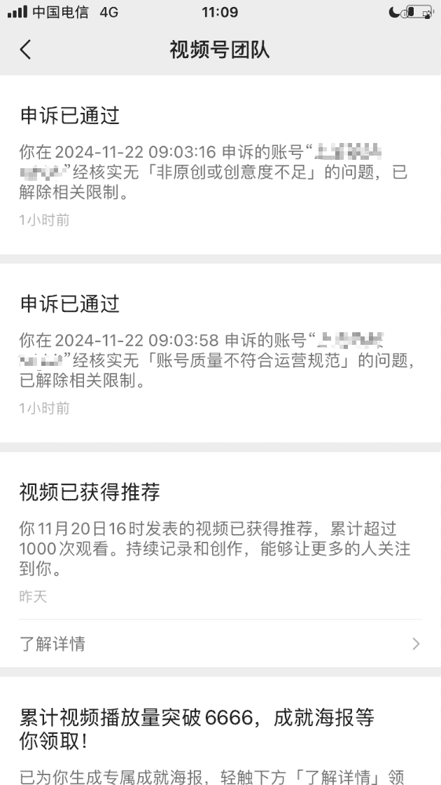

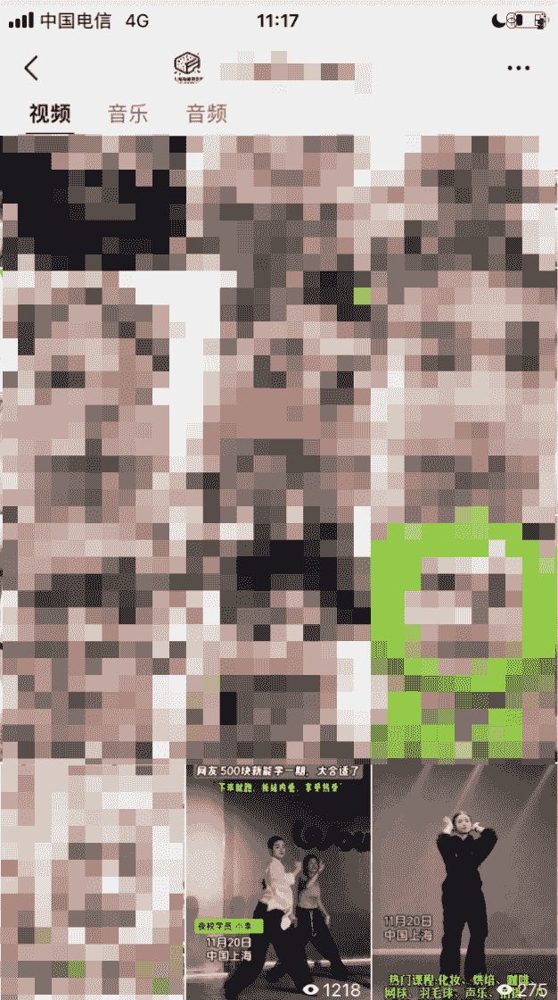

## 5.2 新🛰️收粉

1.完善头像、名称

2.随便添加 2~ 3 个好友，每天发几条消息

3.每天在视频号上刷视频、看直播

4.每天发一条朋友圈

5.🛰️实名认证

6.给其他🛰️发一个红包

7.参加小公益，付付款，都能有效的养号

8.少量多次进粉，大号一天进200粉被封qaq...

9.其实多封几次就好了，所以前期要多拉几个朋友进新🛰️！！！

10.尽量电脑不多开🛰️，多开不要频繁切换ip环境，会被限制扫码

#  亿点点小感动

这次航海听到最多的就是恭喜、庆祝、把手弄脏，持续爆单❗❗

图 6-1 经常庆功，就能成功 ！

“庆功”不是停滞，而是以更饱满的状态迎接下一个挑战！

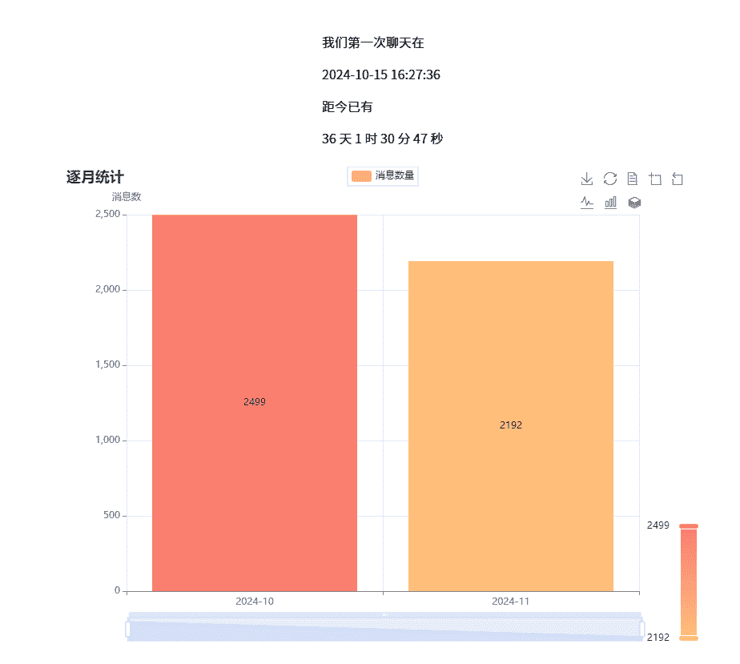

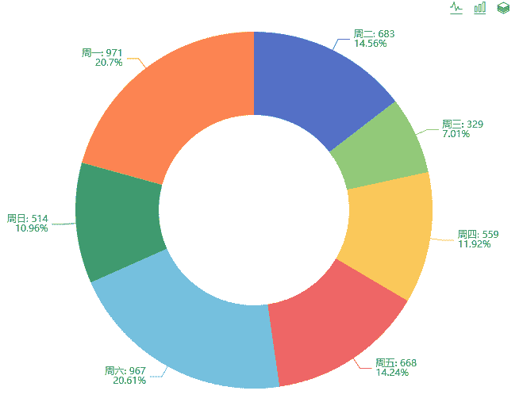

**图 6-2 一个开源**小软件的统计 群聊消息数、聊天频次

> 很享受线下的氛围，闲时闲聊放空，忙时协作鼓励，周末约茶、聚餐，聊聊过去，畅谈未来，猫姐姐和阳哥太棒啦！这次的战果属于我们这个3人的小团队！

> 感谢棒棒的小富婆的投喂，酷姐姐老陈的多次问诊，感谢我的线下家人们一次次的美食分享，真的超赞！！！

> 感谢天盈教练、香菜教练、Kane教练的鼓励，还有许老师的负责，让这艘船稳稳靠岸，感谢赚钱的这次机会。

# 线上聊千遍，不如线下见一面

祝大家每天开心，期待下一次相遇！

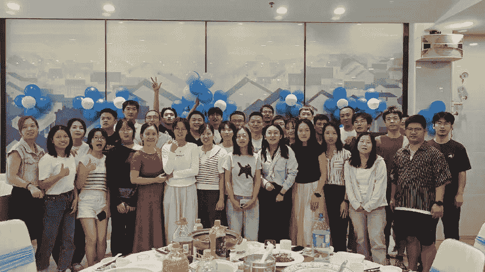

[e855aab05f7f9ad2503681297a4f9fc8.mp4](https://internal-api-drive-stream.feishu.cn/space/api/box/stream/download/all/YpQibvDUSoHgDkx7GCUcYAFxnDf)

# 实用工具汇总

> 省流工具介绍部分 免费哦【付费的工具我就不贴了】

> 1.Listary  用于快速查找素材，一些散落在不知名角落的文件

> https://www.listary.com/

> 2.贴贴     简洁、好用的剪切板管理软件 繁杂的话术、截图的图片、复制的文件都可以保存复用

> https://tietieapp.com/

> 3.云鸽 团队视频素材传输 可以多设备同时传输

> https://yunge.in/

> 4. Anytxt Searcher 桌面全文搜索工具

> https://anytxt.net/download/

> 5.Billfish 海量素材分类管理工具

> https://www.billfish.cn/

> 6.Fences 5 桌面美化、整理工具

> https://www.stardock.com/products/fences/

> 7.还有就是一些自己写的适用项目的一些小工具脚本了，视频分割、视频分类、文件标题重命名、素材批处理、自动化导出、自动化发布...... 都是一些Python做的小工具、也有Rpa写的提效工具，但是对夜校项目是比较大的提效，有更多时间处理转化 （高效的处理转化是能否长期坚持做下去的重要条件之一）。