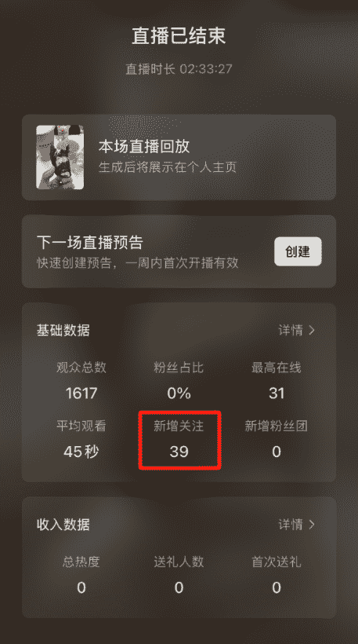
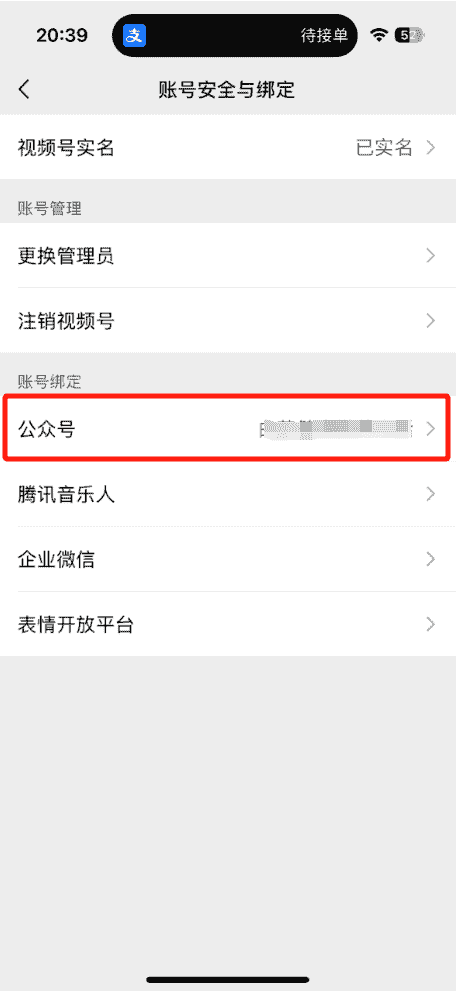
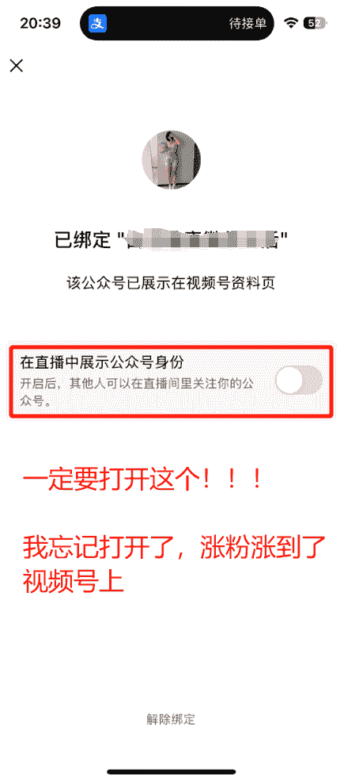
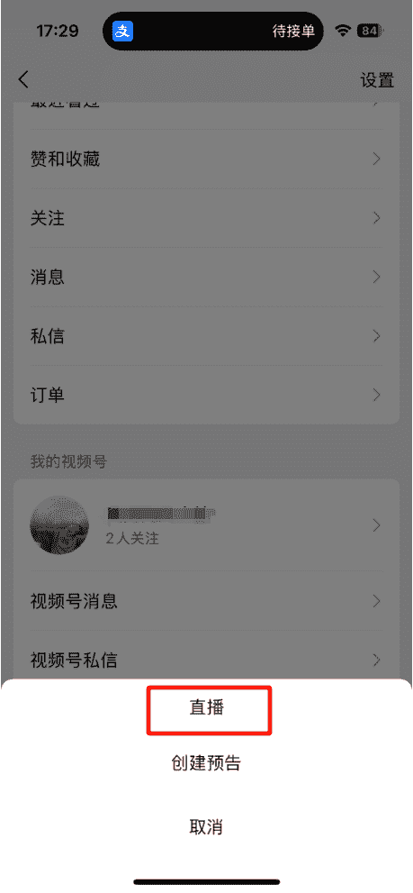
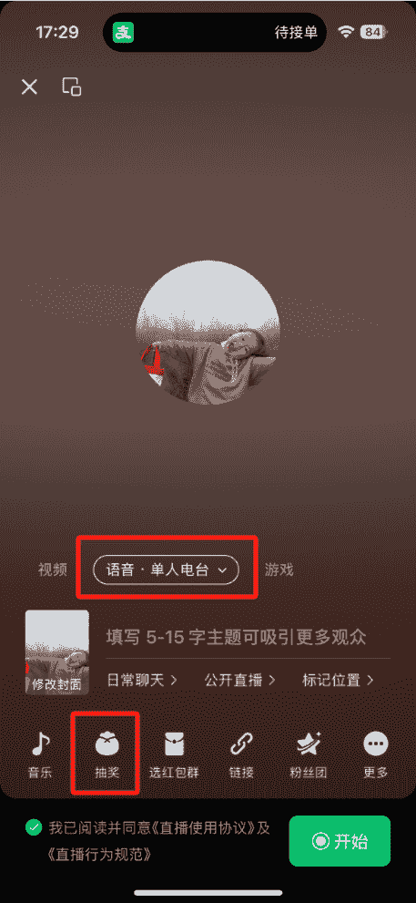
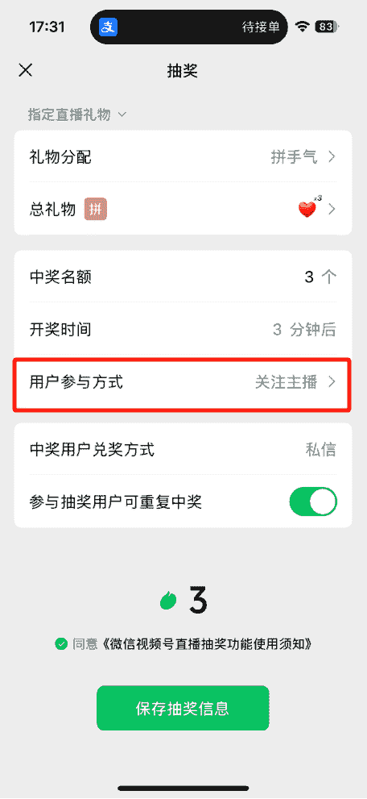
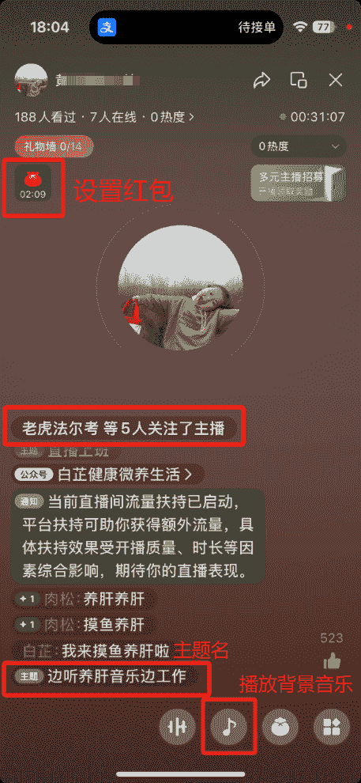

# 上班挂着直播2小时，新增关注39，试了下新的【公众号】涨粉方法，百试百灵！

> 来源：[https://xuqiwei1986.feishu.cn/docx/DH9UdaAihowxSrxf3B4czHoSnpc](https://xuqiwei1986.feishu.cn/docx/DH9UdaAihowxSrxf3B4czHoSnpc)

## 一、背景

起因是看到一个公众号大佬说：

今年微信官方放水，给了一波公众号起号的机会，目前还在红利期。

具体就是：通过视频号开【语音直播】，给关联的公众号涨粉。

相比去年很火的视频号直播涨粉，今年有一些变动，但操作都很简单，适合新手。

步骤概括如下：

1.  视频号关联公众号

1.  视频号开语音直播

1.  直播只需要放背景音乐＋发红包（几乎没有成本）

（注意：红包设置条件为“关注主播”）

**我试着操作了下，开了直播放着，偶**尔发下红包（花了3块钱），涨粉39！！！

（无粉丝基础，第一次开播）

## 第一步：视频号关联公众号

进入我的视频号 - 账号安全与绑定 - 公众号 - 打开按钮，这样涨粉才能涨到公众号上。（这一步很关键）

## 第二步：视频号开语音直播

1.  发起视频号直播

1.  选择语音直播（不露脸）

1.  标题可以写“边听音乐边工作”

1.  开播前可以先把抽奖设置好，最关键的是设置用户参与方式为“关注主播”

1.  设置背景音乐，我选的是养肝音乐，关键词搜索，加入歌单即可，把音量拉到最高

## 第三步：直播放背景音乐＋发红包（成本3元）

时不时发下红包，1元=7个微信豆，我每次发 2-3 个微信豆，开奖时间 3 分钟。

你们可以根据在线人数在设置，人少的话就 5 个左右，人多可以增加红包数量。

🤩这**个涨粉方法，不比特殊渠道涨粉香啊**，单日涨粉100＋就是轻轻松松的事儿。