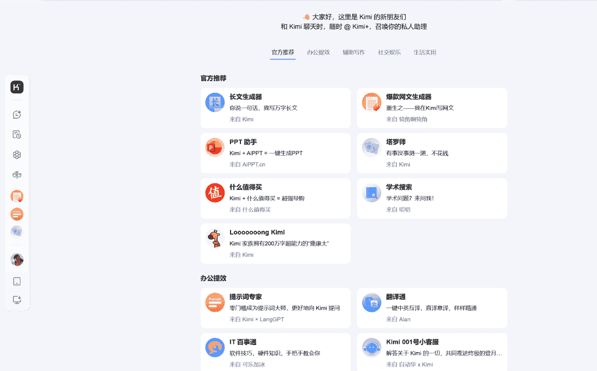
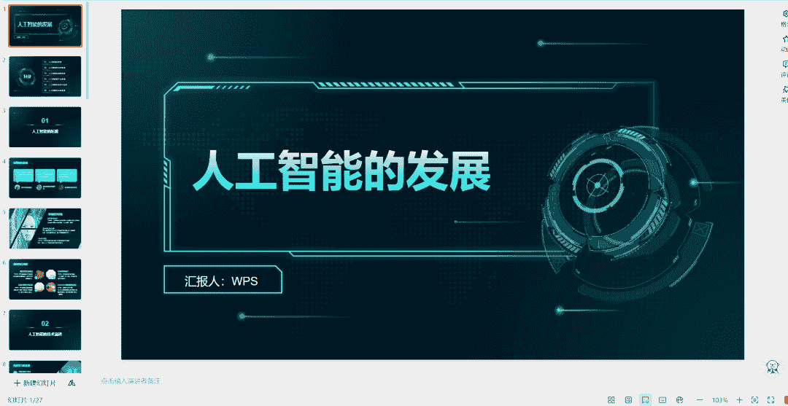
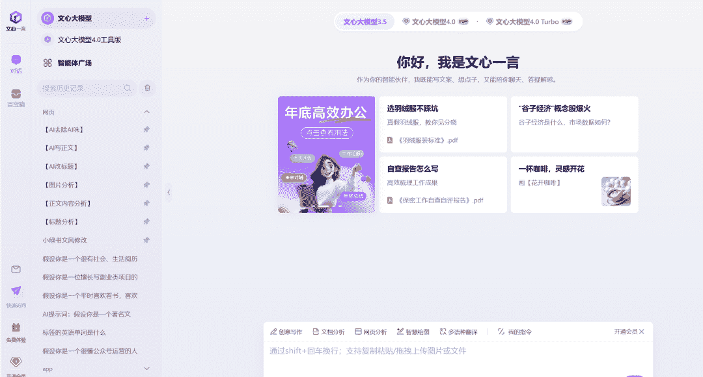
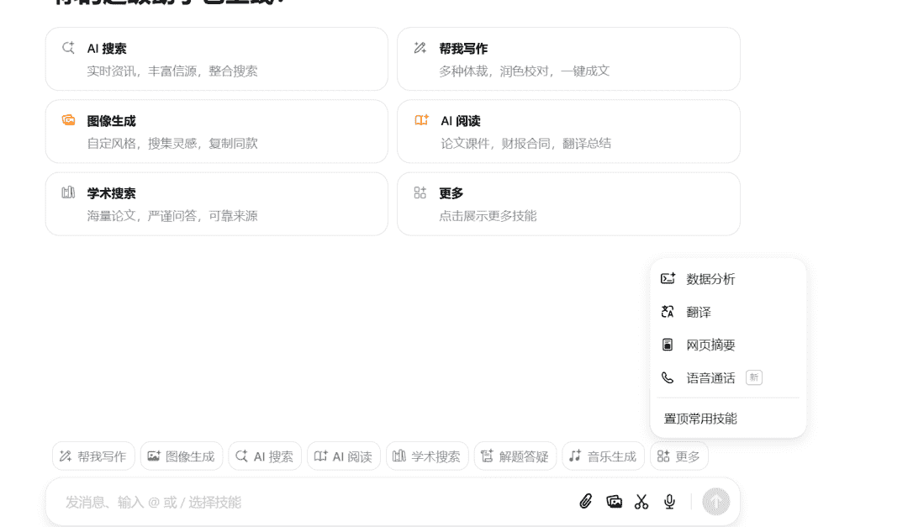
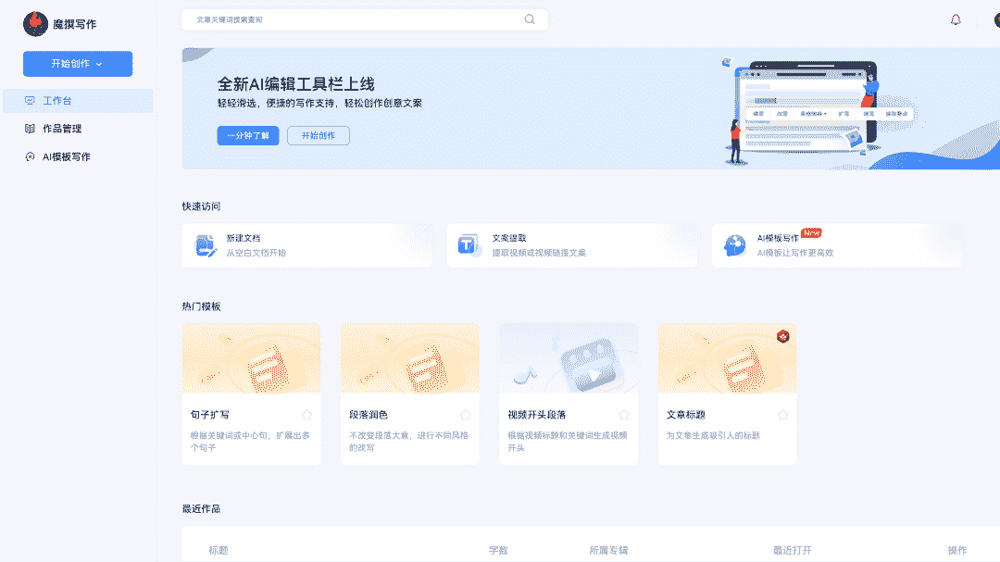
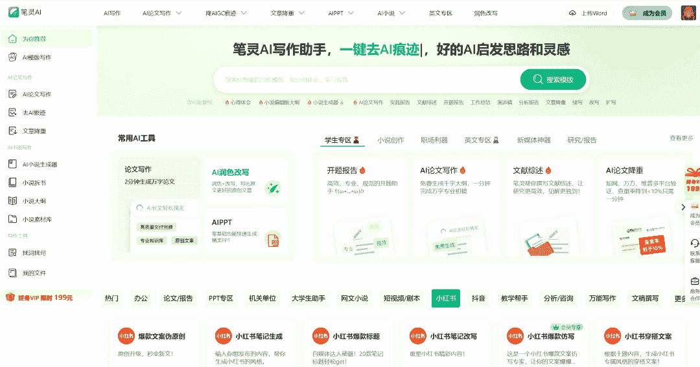
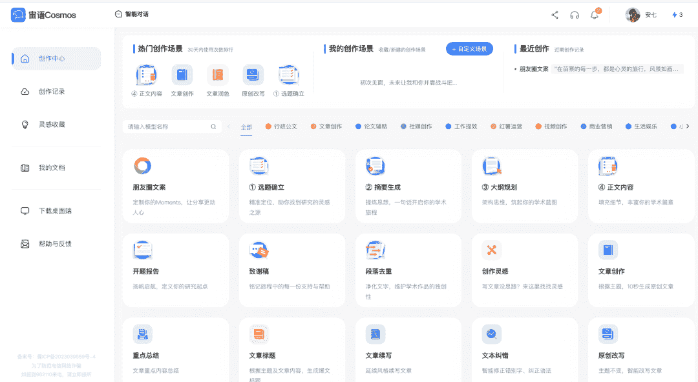
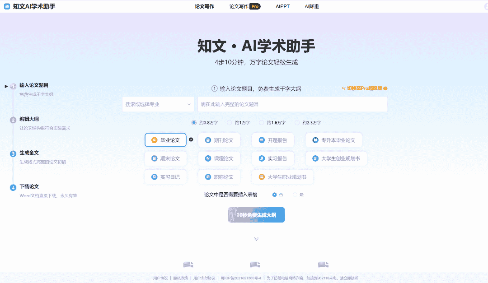
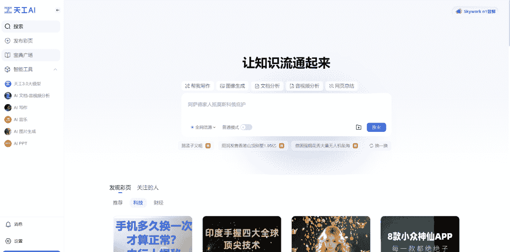
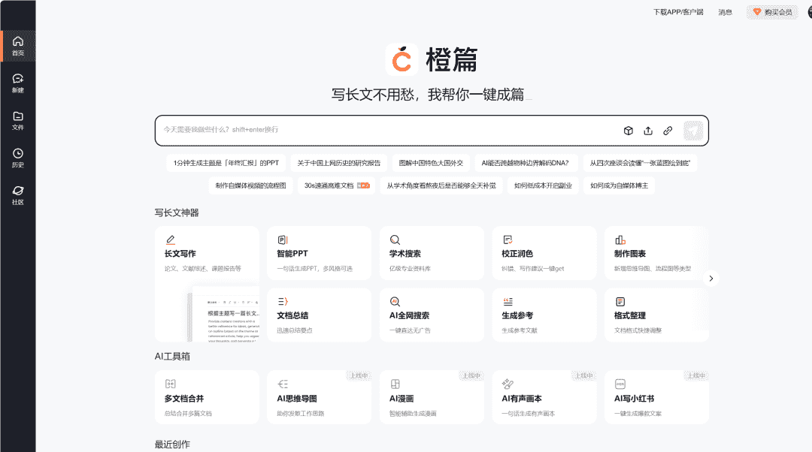

# 2024-12-09---2024年最好用的10个AI写作工具！

> 来源：[https://xuqiwei1986.feishu.cn/docx/RVWFdg6gmosgsaxZCq0c88tSnWg](https://xuqiwei1986.feishu.cn/docx/RVWFdg6gmosgsaxZCq0c88tSnWg)

> 🔗 原文链接： h[ttps://articles.zs](https://articles.zsxq.com/id_gdhs4smi8e1g.html)xq.com/id_gdhs4s...

>

嗨，你好，我是安七，主攻AI+写作。

**今天这篇盘点一下，2**024年我用过的很哇塞的 10个AI写作工具 ，关键是：国产、免费！

# **01****-Kimi-**

Kimi是由月之暗面科技有限公司开发的智能助手，擅长 中英文对话，

能够处理复杂的搜索问题，个人觉得 它的对话体验感是很不错的（能听懂人话） ，

而且它还能 **识别链接、提取文档要点 **，总结归纳能力不错。

比较适合需要进行中英文写作、内容创作和信息整理的用户。

官网链接： https://kimi.moonshot.cn/

# **02****-WPS AI-**

一个我平时容易忽略，但是用了觉得“真香”的工具。

WPS AI是金山办公推出的智能写作助手，支持文本润色、智能推荐、语法检查等功能。

它让我觉得眼前一亮的是 **AI PPT **功能。

就是你跟它说一句关键词/一句话，然后它根据你的这个做个大纲，哪里有问题直接改哪里，

没问题就点击“挑选模板”，可以在线转化为PPT，30秒，非常快！

##### （如图，这是它做的，很精美）

使用建议：适合需要在不同设备上进行文档创作和编辑的用户。

官网链接： https://ai.wps.cn/

# **03****-文小言-**

一个我一直在用的 **写作AI工具 **。

虽然它的对话感没有Kimi好，但是写作方面是我用了这么多个AI工具下来，还是觉得不错的一款工具。

只要你的 **提示词 **写得好，它能 **满足80%甚至更高的写作要求。**

官网链接： https://yiyan.baidu.com/

# **04****-豆包-**

豆包我也挺喜欢，页面简洁，舒服。

它里面的 **“智能体” **很适合当朋友一样聊天，而且还能给点建议。

如果说，你平时有什么不太好找别人聊的话，或者你想找人出谋划策但没有遇到，那它可以当你的军师。

“语音通话功能”很强大，挺好的。

官网链接： https://www.doubao.com/chat/

# **05****-魔撰写作-**

魔撰写作这个我个人用的相对来说少，但是里面的功能我也挺喜欢。

它提供 AI智写、AI润色、A**I改写、智能纠错 **等功能，而且还能自动 提取音视频文案。 还是比较适合需要全能AI写作助手的用户。

官网链接： [https://x.moyin.com/a](https://x.moyin.com/article?to=aiTemplate)rticle?to=aiTemplate

# **06****-笔灵AI写作-**

笔灵AI也是一款国产的中文AI写作工具。

里面页面就更多、选项功能也很齐全。

可以通过深度学习和自然语言处理技术，帮助进行高质量、高效率的文本生成、文章优化、AI问答等操作。

它会更适合需要进行 学术论文、营销广告创作、社媒文案创作 的用户。

官网链接： https://ibiling.cn/template

# **07**-宙语Cosmos AI写作工具-

这个写作神器可以提升中文写作的效率和质量。

里面有超多丰富的模板，有200多种不同类型的格式可供选择。

其中它的 **“朋友圈文案功能 **”我个人比较喜欢，有时候没灵感了会来这里找找。

如果你需要快速准确地完成写作任务，而且希望作品展现你个人风格，那这个不错。

官网链接： [h](https://ailjyk.com/pc/creation/model?channel=DVCXBQVT)ttps://ailjyk.com/pc/creation/model?channel=DVCXBQVT

# **08****-知文AI学术助手-**

这个AI操作起来比较简单、高效。本科生、硕士生和博士生写论文一定不要错过。

**它支持快速生成**清晰的大纲和全文，而且定位就是 “学术助手” ，还是很了解你有什么需求的。

官网链接： https://ykoai.com/?user_sn=14440103

# **09****-天工AI-**

天工AI还是比较全能：支持搜索、写作、对话、文档分析、画画、做PPT的全能型AI助手。

可以借助它来检索信息、多语言翻译、写论文、写代码、写方案、写汇报、做PPT、归纳总结。

适合需要全能型AI助手的用户。

官网链接： https://www.tiangong.cn/

# **10****-橙篇AI-**

如果你经常刷AI工具之类的，应该会发现橙篇出现的频率还挺高的。

我也用了一下它的 **AI PPT **功能，体验感也很不错~如果说你用WPS AI不习惯的话，可以试试它。

里面的选项和功能也很丰富，根据自己需要的去玩。

官网链接： https://cp.baidu.com/

上面就是初步筛选后，觉得还不错的10个国内免费、靠谱好用的AI写作工具，希望对你的写作有帮助~

扫码加入星球

查看更多优质内容

https://wx.zsxq.com/mweb/views/joingroup/join_group.html?group_id=1824528822