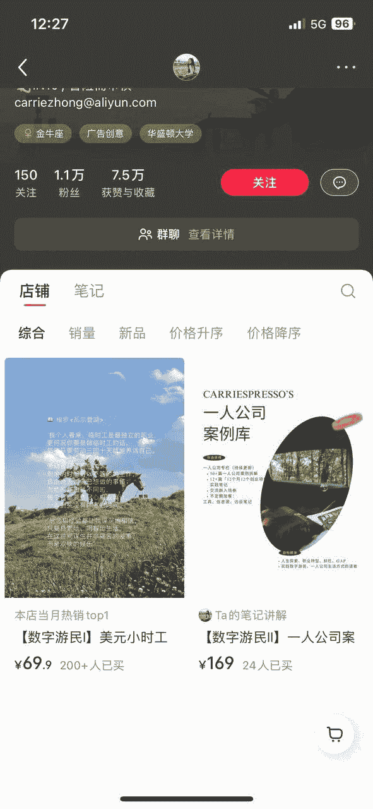

# 2024-11-11数字游民与一人公司的案例库变现分析数字游民

> 来源：[https://xuqiwei1986.feishu.cn/docx/MqASdQEOhoUVd9xson8cfefinsc](https://xuqiwei1986.feishu.cn/docx/MqASdQEOhoUVd9xson8cfefinsc)

> 🔗 原文链接： h[ttps://scys.com/ar](https://scys.com/articleDetail/xq_topic/4848514828482588)ticleDetail/xq_t...

>

#风向标

知行

关注

发布于 2024-11-11

数字游民与一人公司的案例库变现分析数字游民+一人公司 - 粉丝数：1.1万 - 账号运营时间：621天 - 变现方式：数字游民和一人公司的案例库 - 变现预估：根据小红书店铺数据，近2万 #风向标#

4人点赞

评论 0

0 / 150

评论

暂无评论