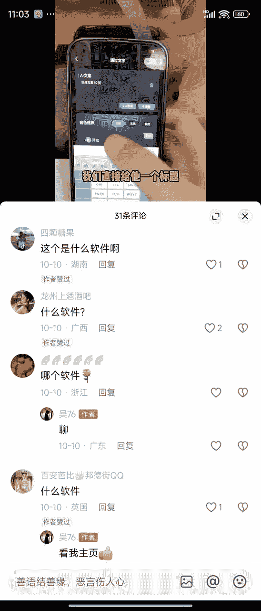
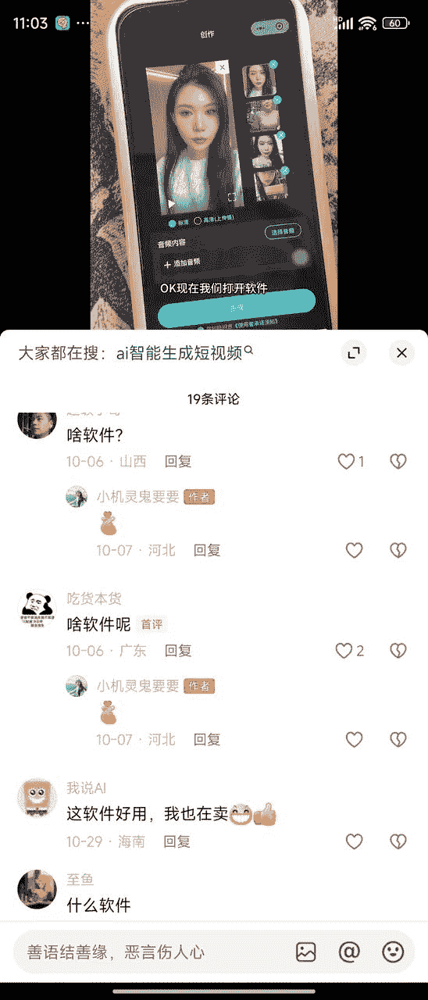
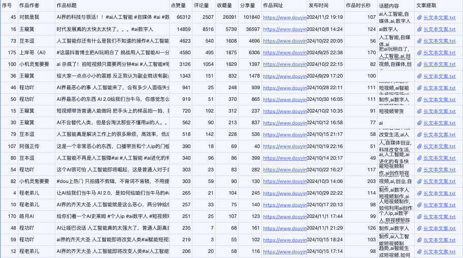

# 数字人+短视频，工具类细分赛道可行性研究

> 来源：[https://xuqiwei1986.feishu.cn/docx/ZkP1dVNdpom0LRxMEtgc93Hjnfw](https://xuqiwei1986.feishu.cn/docx/ZkP1dVNdpom0LRxMEtgc93Hjnfw)

如果问当下对于普通人来讲还有哪些风口项目，我觉得AI+细分场景可能是普通人能接触到的机会最大的选择了。

这篇文章绝不是一个发现风口项目并月入xx万的爽文，而是一个互联网从业者，从发现可能的风向标，调研，模仿，到走通一个小闭环赚到第一块钱的过程。

其中既有实操的干货，也有一些思考和总结，相信应该能对你有启发。

# 一、洞察

10月底突然刷到一类AI数字人工具的视频，核心就是这个工具你只需要对着镜头说“1234567”或者干脆不说话，然后输入你想要的文案（提前克隆好你的音色），即可生成一段相同场景、动作、神态的你并且是你自己的声音的口播视频。

可能有点拗口，来个视频演示。

[232_1730644119.mp4](https://internal-api-drive-stream.feishu.cn/space/api/box/stream/download/all/N6KUb9wj4ozGaTxNajAceN2AnUf)

作为一个常年在互联网摸爬滚打的创业者，不谦虚的说我对自媒体和AI的认知应该比大部分人更深入。

但即使是这样，我初看到这种视频还是被这个工具吸引了。

每一个类型的视频/工具的背后，都是一个完整的项目。

于是我找到关键词去搜索了同类视频，用小号去添加了十来个作者。

通过对话交流（套话），观察朋友圈，潜伏了一定时间后终于摸清了整个项目的逻辑。

1.  工具：AI数字人

1.  应用场景：帮助口播博主提升录制口播视频的效率，可应用于视频带货、真人IP等等需要出镜的视频类型

1.  变现方式：

1.  售卖工具给终端用户

1.  工具的续费、充值

1.  吸引终端用户成为代理，收取代理费用（且可引流更多终端用户）

这其中有三个关键点：

1.  **需求是否是伪需求（应用场景）**

首先我个人角度，我觉得口播是一件效率很低、且痛苦的事，但我又迫切想把口播视频做好。

那这个应用场景还是挺吸引我的，我愿意为这个工具买单。

**其次，我观察**了非常多的视频评论区，评论不多但惊人的精准（不打码了，侵删）

|  |  |  |  |
| --- | --- | --- | --- |

从这一点上来讲，这个AI数字人工具可以帮助口播提效，应该不是一个伪需求。

1.  **代理是否是割人头、割韭菜？**

他们这套流量打法/获客方法，应该来说还是比较有效的。

起码我刷到的大部分此工具代理视频，观察下来流量都还不错，有那么三五个甚至这一波赚的还不少，大部分人应该起码不至于连代理费都赚不上。

至于他们的交付服务的质量如何，因为我没舍得交钱，所以不予评价哈哈。

当然，这个问题就和问知识付费是否割韭菜是一样的。

需知项目本身只占了一部分的因素，操作者自己还是起到决定性的作用。

这里也不展开评价，不然没个三五千字也讲不完。

1.  **是否有跑出来的同行**

很显然是有的

比如东北的那家好 xxx，9 月份推出，现在应该已经破 2000 万了

这应该是头部了

当然其他中腰部也都不少

综合看来

1.  应用非伪需求

1.  流量打法有效

1.  有跑通的同行

两个字，可行！

# 二、策划

我这个人有个坏毛病 - 打工是不可能打工的

你让我去交钱当那个工具的代理，我从心里是不愿意的，所以一开始我就是奔着自己搭建平台去的。

当然，这过程中，包括我现在写到这里的时候，我再反思当初的决定。

其实真的不是最好的方法，因为自己做后端是一个十分困难且不一定正确的选择。

而且这中间白白浪费了半个多月时间

当初如果直接加入代理，可能在这个项目上已经月入xx万了，哈哈。

实际上选择做后端，光前期系统投入就将近六位数了，这其实也和我一贯选择做低成本项目的原则不符

但世上没有后悔药，自己选择的路还是要硬着头皮走下去。

## 平台选择

既然决定了自己搭建后端，那首先要解决的就是系统问题。

新开发肯定是不现实了，且不说我又没有那个能力，光资金实力也不允许。

那唯一的选择就是买源码或者OEM。

这里需要动用到“搜索”能力，最终我测试了不下10多个平台

以效果为第一因子，价格为第二因子，并综合后端的服务，且经过公司的参观考察，最终我选择了一家平台。

这里本想把各平台对比效果写上，但考虑到可能会得罪一些同行朋友，就不细表了。

选定后就是签合同、交钱、搭建系统，历时2周。

## 体系策划

搭建系统的同时，我还需要解决的是关于项目体系的策划，包括价格和代理方案。

方法也非常简单粗暴，对标最优秀的同行，且比他更有竞争力。

> **竞品对比暨定价策略**

> 绿色栏位代表对比下来我方优势的项目

| 类型 | 项目 | 竞品 | **我方产品** |
| --- | --- | --- | --- |
| 终端用户 | 售价 | 980元/年 |  |
|  | 时长 | 60分钟 |  |
|  | 声音克隆 | 1个 |  |
| 视频生成 | 售价 | 1分钟=4.44元 |  |
| 声音克隆 | 售价 | 99元/个音色 |  |
| 代理1 | 售价 | 3980/年 |  |
|  | 卡密数 | 4套卡密 |  |
|  | 购卡 | 380/套 |  |
|  | 收代理 | 1500 |  |
|  | 分佣 | 10% |  |
| 代理2 | 售价 | 9980/年 |  |
|  | 卡密数 | 15套卡密 |  |
|  | 购卡成本 | 成本290/套 |  |
|  | 收代理 | 40% |  |
|  | 分佣 | 一级佣金：20% |  |

### **优势**

1.  代理体系让利额度更大，且支持团队长

1.  克隆效果质量更高

1.  性价比更高

1.  提供 **"数字人+"** 解决方案（计划）

### **劣势**

1.  起步较慢 - 需抢占市场

1.  代理人数较少 - 需加强培养代理流量能力

# 三、流量

**流量的打法**依旧简单粗暴，既然同行的方法有效，我们就先对标同行。

借助工具爬取了200+的同行作品案例，并分析了他们的文案

我发现他们的打法惊人的相似，且是有套路的。

这里我举两个分析案例，希望这其中的分析思路可以对你有帮助

### 案例一

标题：AI届的科技与狠活

#### 一、原视频

[7432639865960877327Ai界的科技与狠活！！#ai人工智能 #自媒体 #ai #数字人.mp4](https://internal-api-drive-stream.feishu.cn/space/api/box/stream/download/all/K7XtbBKgQoJRu2xazUncmQ8Bn8c)

#### 二、视频数据

#### 三、文案分析

| 场景 | 文案 | 分析 |
| --- | --- | --- |
| 开头三秒 | 给大家看个贼恶心的东西 | 关键词：贼恶心/贼牛逼 |
| 演示 | 我现在呢全程什么都不说，随便拍个视频 | 演示不讲话拍视频 |
| 数字人克隆操作演示 | 接下来我让你们看一下这个东西到底有多恶心。 | 1.再次提示拍摄的视频是不说话的 |
| 克隆视频展示 | 视频做好了再给你看一下。 | 展示克隆后视频，强调与原视频动作一致 |
| 更多的克隆案例展示 | +   再给你们看一下这个苹果是怎么卖向国外的，做外贸的。 | 多应用场景展示 |
| 结尾 | 有一些藏在水下的事情，本不该普通人知道。 | 对比原来和现在，突出效率、人效、成本优势 |

### 案例二

标题：时代发展真的太太太快了

#### 一、原始视频

[7423286873402969344时代发展真的太快太太快了。。。#ai数字人.mp4](https://internal-api-drive-stream.feishu.cn/space/api/box/stream/download/all/DoD4bCPyXon51qxjlpMcqywkn4V)

#### 二、视频数据

#### 三、文案分析

| 场景 | 文案 | 分析 |
| --- | --- | --- |
| 开头三秒 | 给你们看一个非常恶心的东西 | 关键词：非常恶心 |
| 演示 | 来打开相机，对着镜头一段段输出哈。 | 演示拍视频只说123 |
| 数字人克隆操作演示 | 然后打开这个系统，添加刚刚上传的那一段12345六七个乱笑的视频。 |  |
| 克隆视频展示 | 视频做好了，给大伙看一下。 | 展示克隆后视频 |
| 更多的克隆案例展示 | 是不是很难？ | 多应用场景展示 |
| 结尾 | 看到了吗？ | 点出痛点，对比有工具和没工具的差异 |

案例分析完了，该怎么做就一目了然了。

于是火速起了两个抖音号，一周时间发了12**个视频，虽然没有爆，但**确实客资非常精准，且居然成交了首个客户。

由此看来对标同行真是做自媒体甚至是创业的真理。

# 四、后续计划

实际上写到这里我已经没有更多东西可写，毕竟才只是跑通其中一个小环节

后续依旧任重道远，包括还没收到第一个代理

甚至连代理的课程培训我也还没有完善的方案

以及代理素材库的搭建

等等...

起步已经不算早，虽然段永平讲“敢为人后”，但战术上我们还是要重视

那怎么抢时间呢，我的计划是：先不盲目收代理，而是拉一个内测团队去跑。

好处是可以积累更多经验和案例，也能同步积累素材库，同时也给交付质量留了缓冲时间。

当然内测团队的搭建也是一个很考验人的工程，第一次，摸索着来。

但不积跬步无以至千里，良好的开始总好过空想，并且已经成交了一单不是吗，哈哈

也欢迎同行前辈、感兴趣的朋友交流分享，多提建议。