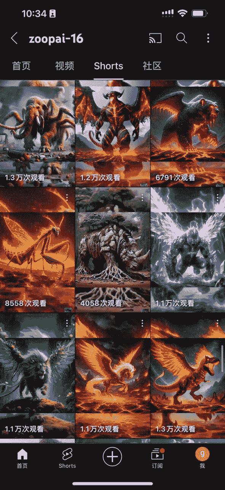
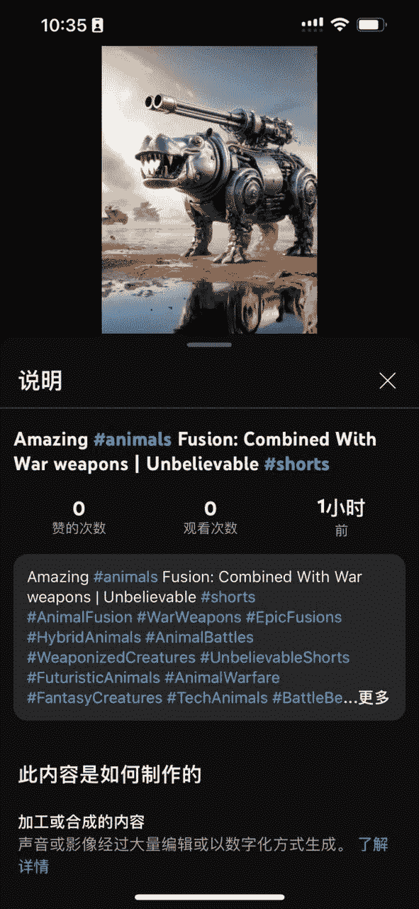
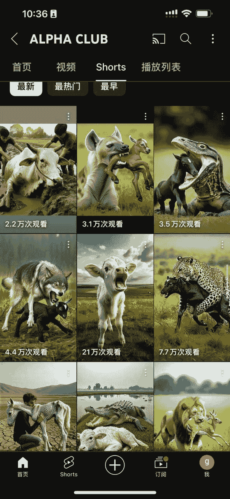
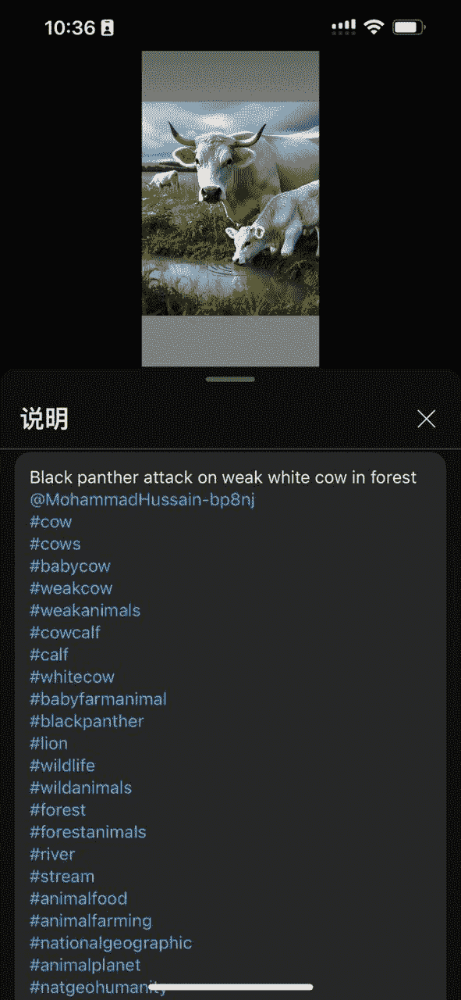
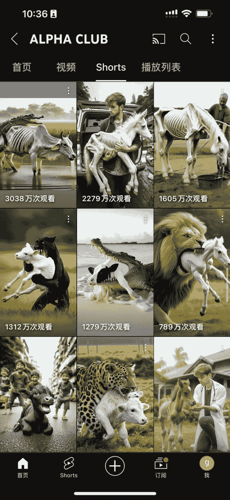
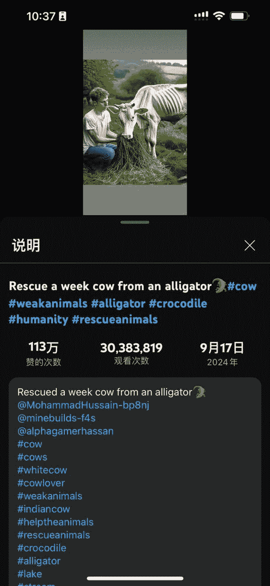

# 2024-10-24【超级标02】AI生成视频，上传到Youtube和Short

> 来源：[https://xuqiwei1986.feishu.cn/docx/Velhdt2xdoPAGbxD7S0cB02jn9g](https://xuqiwei1986.feishu.cn/docx/Velhdt2xdoPAGbxD7S0cB02jn9g)

> 🔗 原文链接： h[ttps://scys.com/ar](https://scys.com/articleDetail/xq_topic/5121542448454444)ticleDetail/xq_t...

这篇文章介绍了通过AI生成视频上传到Youtube和shorts获取广告分成的赚钱模式，适合想在网络视频领域创业赚钱的人。

+   Youtube广告分成市场大，同样播放量，国外收益远高于国内。

+   Google广告平台商家多，会将部分收益分给内容制作者。

+   AI工具可助力快速制作视频，降低制作门槛。

+   Shorts有广告分成计划，已有中国人成功赚钱导流。

+   可通过分析爆款视频的标签等找到有流量的细分类目。

总之，文中介绍的模式利用AI和平台优势，为网络创业者提供了新的盈利思路和方法。

【超级标02】AI生成视频，上传到Youtube和Short

02 来了，今天发布第二条超级标，请坐稳扶牢，发车！ 本次超级标是：通过 AI 生成的各种视频，上传到Youtube和shorts，获取广告分成，空间无限大，以下我来说明理由： 1/ 这是一个超级巨大的市场和空间。12年我作为第一批在Youtube上开始赚钱的人，那个时候就已经感受到巨大的流量价值不对等，同样的播放，在国内视频平台可能一文不值，在YouTube上可能有几千美金的收益。 2/ 背后是Google广告平台的巨大商家量，以及Google为了自己的内容生态，把广告收益的一部分分给了内容制作者。 3/ 各种AI 工具的出现，让咱们生财有术的圈友可以实现快速制作视频的能力，以前的大多数视频需要露脸，或者需要有比较强的口播表达能力，现在，都可以通过AI工具来解决。 4/ 为了和tiktok竞争，youtube 推出了 shorts，shorts 又开通了广告分成计划，且已经看到一些中国人在 shorts 上赚钱和导流的案例。 5/ 在 shorts 上已经出现了非常多的大流量的ai生成的爆款视频，且你可以顺藤摸瓜找到非常多的细分类目，也欢迎大家去研究挖掘写帖子来分享。 6/ 劲爆消息是，做YouTube最难的是侵权风险和收款等问题，我正在和一个大佬谈合作，他拿下了中国仅有的几个youtube content id 牌照，懂的人知道价值含量，授权给我们来运营MCN，未来大家做起来的号可以签到MCN旗下，避免封号风险。 7/ 这是一个非常长周期的事情，从我那个时期开始做，已经十年过去了，仍然可以在YouTube赚钱，而且越来越强，值得你当作事业认真去做，当然，肯定不简单，请永远记住：赚钱的多少和你克服的困难大小成正比。 8/ 宝宝巴士靠把自己的视频上传到YouTube，一年获得的广告分成是多少你知道吗？ 5000 万美金。 9/ 如何挖掘到已经在shorts和YouTube上火爆的ai视频？通过找到一个视频，进入对方的描述区，通过他的tag，描述，以及评论，找到更多关键词，通过这些关键词进一步向外扩展，最后你就能找到成千上万个别人已经验证好有流量的类目词。

书情小跟班 、 塔米 、 晓茵 、 米桃桃 、 大鹏 、 Dreamboat 、 不老天神 、 魏隆华 、 Henry 、 清风 等1077人点赞