# 2024-10-20直播资料-UBMAX线索优必投操作手册（原线索自动投放UBL）副本

> 来源：[https://xuqiwei1986.feishu.cn/docx/YsPwd2rkroyS2LxeBCIczGTcnWe](https://xuqiwei1986.feishu.cn/docx/YsPwd2rkroyS2LxeBCIczGTcnWe)

（已过PR，编号：SYCP20230310010279）

> 功能更新记录：

+ 5月23日，新增支持添加一键起量[，当前在](https://bytedance.feishu.cn/docx/CqLud8s5ioSpILxGcLqcAHICnih)部分灰度中，预计6月初全量上线，点击查看使用手册
+ 5月23日，转化目标新增支持优选表单、接通直投，权限范围及操作流程皆与手动广告保持一致
+ 5月23日，对金融行业支持差异化价值出价，权限范围及操作流程皆与手动广告保持一致
+ 5月30日，上线拉取抖音号主页视频，和自动生成/选择原生锚点的能力
+ 6月21日，UBMAX线索优必投2.0原生投放支持选择外跳锚点
+ 7月5日，UBMAX线索优必投2.0新增支持优化目标“私信消息”“私信留资”
+ 12月28日，对手动上搜索开启了搜索流量扩定向的客户，在UBL上也默认开启（不含地域定向，且仅针对搜索）
+ 5月30日，自动化素材优选已支持UBL的复制项目

## 一、产品介绍

🎉 巨量广告原版的 “线索智投”，在巨量广告升级版也上线啦，并更名为 “UBMAX线索优必投”（原自动投放UBL）

👉 “UBMAX线索优必投”（原自动投放UBL） 是致力于提升线索广告投放效率、效果和线索质量的智能化投放方式，能够帮助广告主以更稳定的成本更快地拿到更多质量更好的线索。

## 二、功能亮点

### 2.1 策略详情

| 「极简创编」投放效率提升 | 「多重起量」跑量能力提升 | 「模型学习」跑量能力提升 | 「稳定成本」投放成本稳定 |
| --- | --- | --- | --- |
|  | 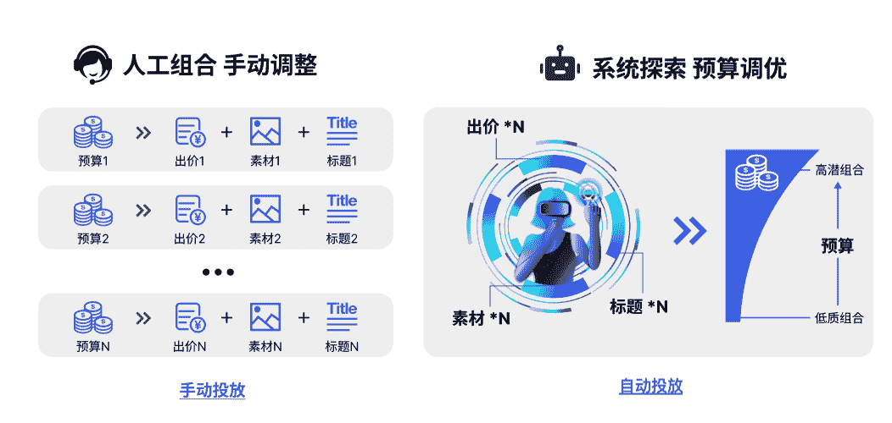 | 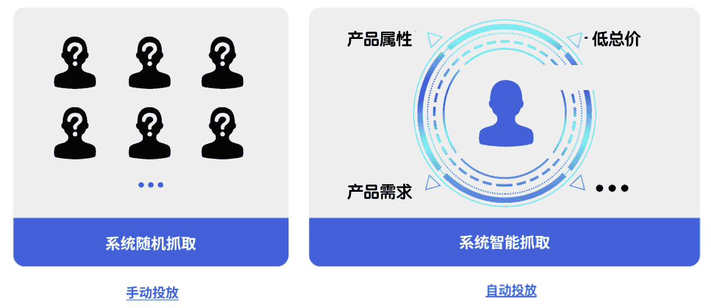 | 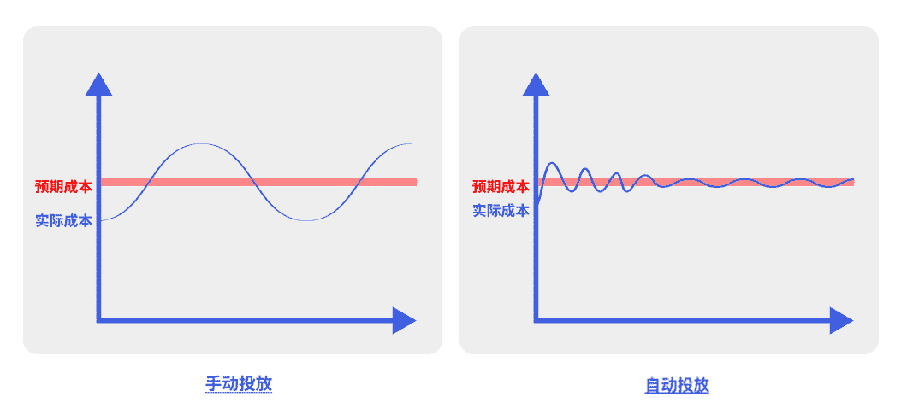 |
| + 极简创编：绑定产品后，只需要设置对应项目的`目标出价`、`目标预算`、`投放时间`，再完成单条广告创建即可(预计搭建一条广告时间缩短3/4） | + 系统智能托管策略：实时调整预算出价及素材匹配，自动诊断掉量、超成本、起量困难、空耗等投放问题并进行智能调优，释放人力； | + 系统智能化选择人群：通过增加同产品样本信息，帮助更快地找到更多目标人群，促进广告快速通过冷启动 | + 成本稳定策略：通过广告组粒度的出价策略、对冷启动和成熟期差异化出价等，控制整体成本 |

### 2.2 优势说明和注意事项

> 虽然UBMAX线索优必投整合了多重起量策略，通过系统智能投放的形式帮助投手释放人力；但是UBMAX线索优必投不是万能的，投放UBMAX线索优必投广告依然会受到：素材好坏、竞争环境是否激烈、出价高低等因素的影响；

> 我们希望借助UBMAX线索优必投帮助商家释放人力，大家将更多的精力投入到素材优化等更重要的事情上

| 分类 | 解释 |
| --- | --- |
| 优势 | 投放效率提升 | + 创建广告时间：UBMAX线索优必投创建时间与普通广告计划相比，预计缩短3/4（来自线上对照实验数据） |
|  | 跑量能力提升 | + 实验数据显示，UBMAX线索优必投的跑量相较普通广告计划更优，arpu（消耗/商品数）显著提升 |
|  | 投放成本稳定 | + 通过计费比（转化成本/出价）来看，UBMAX线索优必投更稳定，会使转化成本趋近于广告主出价 |
| 🔥敲黑板 | 产品库录入正确且完整的信息 | + UBMAX线索优必投策略会基于产品信息生效继承等起量策略，信息的正确和完整性会协助提升整体投放效果； |
|  | 更需要广告主给真实成本预期 | + 需要广告主给真实合理的成本预期，避免出价太低影响跑量； |
|  | 广告主不能提供劣质素材 | + UBMAX线索优必投会充分探索素材，但如果整体素材数较少、质量过差，UBMAX线索优必投也很难让投放“起死回生” |
|  | 素材类型尽量多样 | + 素材上传可支持上传除组图外任意类型素材，系统会根据上传的素材类型，智能化的探索素材适配的广告位 |

+ 提升跑量：为尽可能提升跑量，建议上传更多类型的素材，并且前期可以使用历史优质素材进行投放，助力UBMAX线索优必投快速度过冷启动；
+ 素材测试：如果希望通过UBMAX线索优必投用最低成本测试素材质量，可以使用全新制作的素材进行小预算测试；

## 三、场景适配

+ 快速放量：推广高峰期？产品活动？想要快速放量，UBMAX线索优必投可以针对放量诉求匹配定制化投放策略，在满足成本预期的前提下通过智能托管、优选起量工具底层结合、项目粒度计费比控制等多重策略，轻松实现提效抢量。
+ 稳定成本：客户有严格的成本考核要求？UBMAX线索优必投通过控制冷启动探索占比、加产品粒度的计费比控制等手段，降低空耗比例，助力稳定成本，为投放保驾护航。
+ 素材选择困难：打破传统账户数量限制，单个项目组支持30个视频+50组图片+10个标题，能够快速实现多素材优选，从新物料中花最少的钱、用更短的时间找到最优质素材，提升投放效果。
+ 非工作日托管：优化师周末不上班？春节元旦放假了？只要服务器不爆炸，自动投放不放假！UBMAX线索优必投7x24小时全天候监控账户，实时调整预算出价及素材匹配，让您在节假日也能安心投放。
+ 投放人力/经验不足：覆盖投放全链路的自动化能力，可以帮助新人快速上手，弥补人力不足等问题，让优化师将精力集中在优质素材探索等核心优化动作上，提升人效。

## 四、操作方法

### 巨量广告平台

> 仅支持「销售线索」场景！

#### 4.1 投放入口

| 入口 | 示意图 |
| --- | --- |
| 1. `【巨量广告升级版】-【项目】-【新建项目】-【营销目标与场景】-【销售线索】-【自动投放】` | 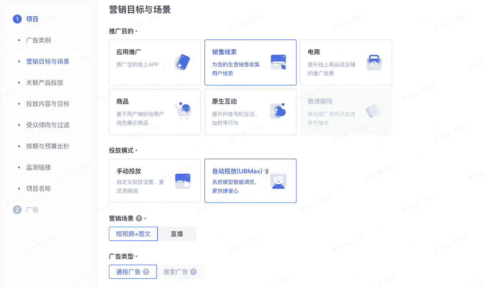 |
| 1. 有商品库的行业，在创编时必须绑定产品，入口为：`【自动投放】-【关联产品投放】`，可以添加多个产品（上限 10 个） | 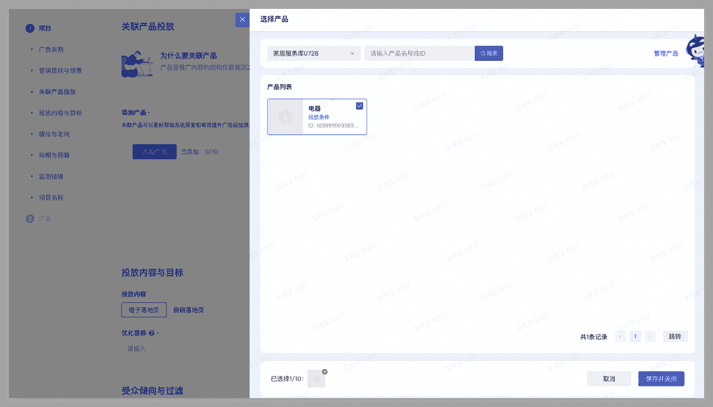 |

#### 4.2 创编流程

##### 4.2.1 新建项目

| 操作任务 | 操作步骤 | 示意图 |
| --- | --- | --- |
| 一、新建项目 | `【新建项目】-【营销目标与场景】-【销售线索】-【自动投放】` | 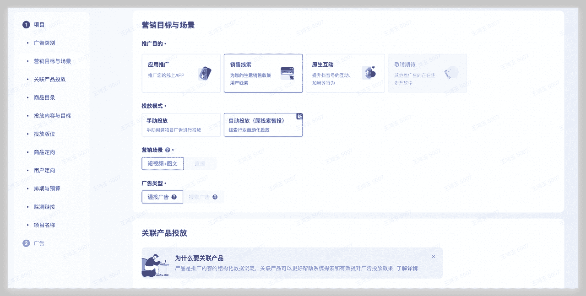 |
| 二、添加关联产品 | `【关联产品投放】-【添加产品】`可以选择产品库并添加多个产品，最多添加 10 个产品 | |
| 三、投放内容与目标 | + 投放内容：支持橙子落地页和自研落地页 | 优化目标及深度优化目标 |
| 四、受众倾向与过滤 | 支持`新建定向`和`选择已有定向包`： | |
| 五、排期与预算 | + 投放时间：支持选择`从今天起长期投放`，也支持自定义设置投放时间 | 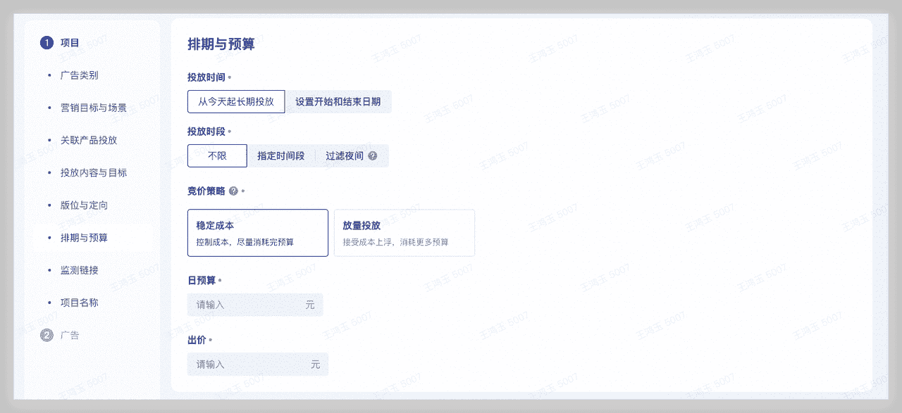 |
| 六、第三方监测链接 | + 无需单独设置事件管理，通过监测链接设置功能即可一步实现展示/有效触点/视频播放/视频播完/视频有效播放等核心监测动作； | 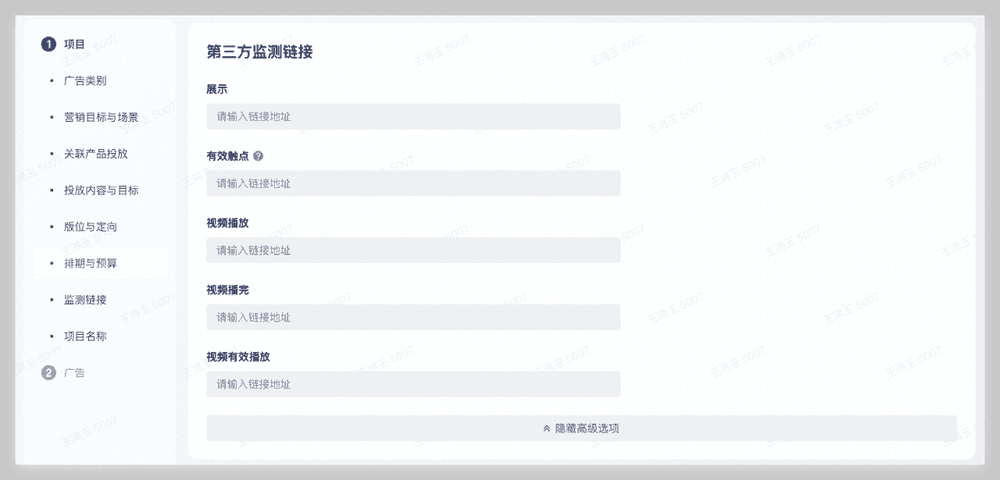 |

> 首次进入或需要新增产品时步骤如下：

1. `【关联产品投放】-【添加产品】-【上传产品】`/`【管理产品】`-`【行业产品中心】`-`【新建产品库】`
1. `【选择广告账户】`-`【选择产品类目】`-`【下一步】`
1. 信息填写-`【完成创建】`
1. 产品初次创建完成后，平台将对产品进行审核，`审核状态`栏内可见产品的审核状态：

+ `审核中`：该产品正在被审核，不可进行广告投放
+ `审核拒绝`：该产品部分内容不符合平台要求，不可进行广告投放，针对`审核拒绝`的产品，可以点击`查看详情`按钮，了解产品审核拒绝的原因。通过点击`操作`栏下的`编辑`按钮，再次进入到信息填写页面进行修改。修改完成后，产品将被再次送审，审核通过后即可正常应用。
+ `审核通过`：产品审核通过，可正常用于广告投放，也可共享给组织已绑定的企业号使用

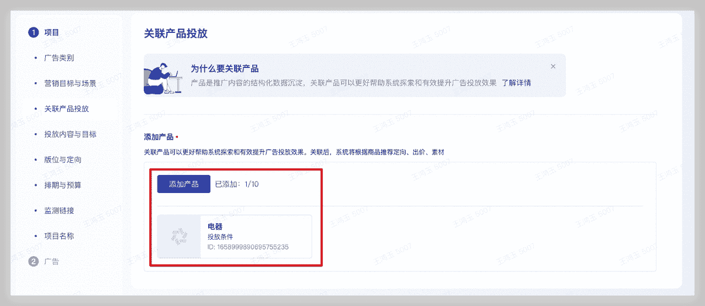

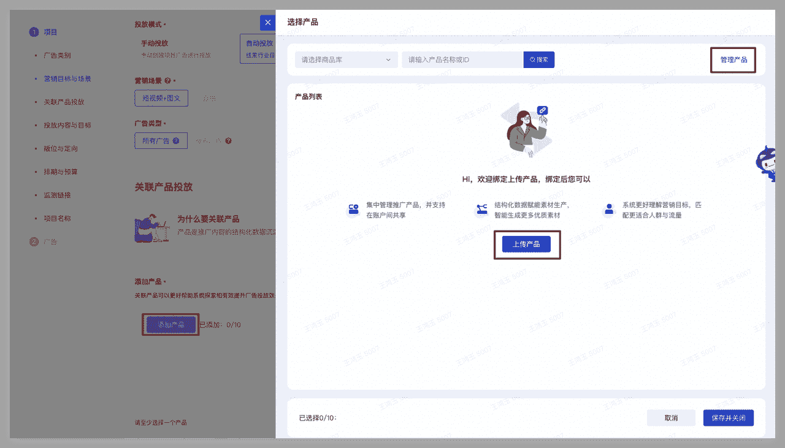

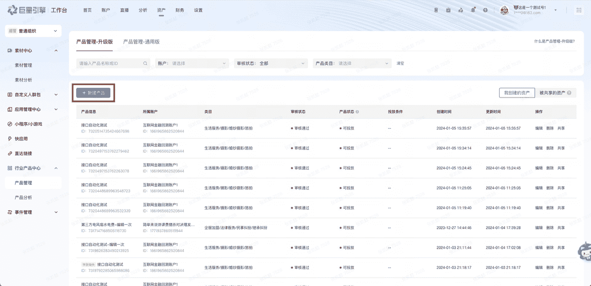

添加产品

新建产品

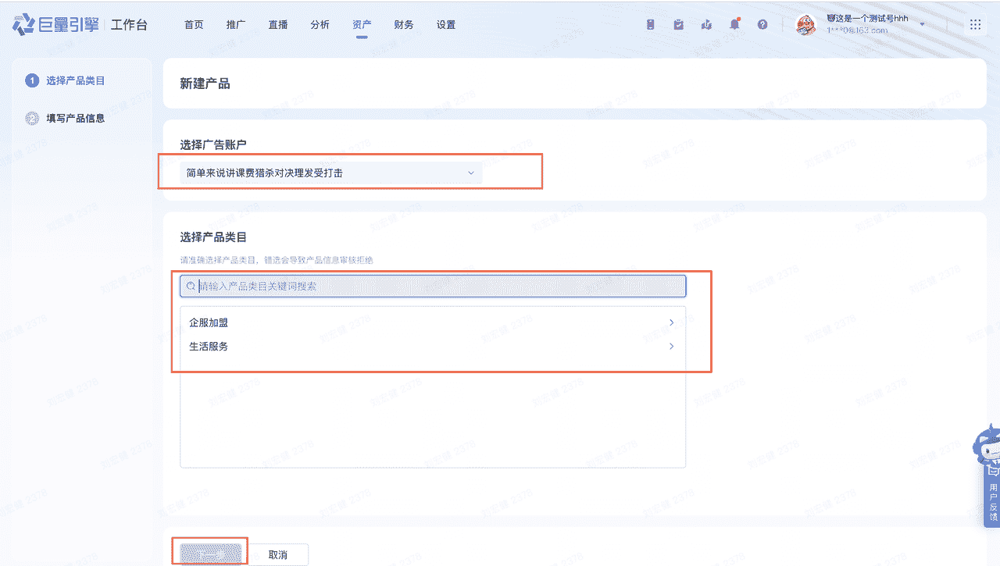

选择产品类目

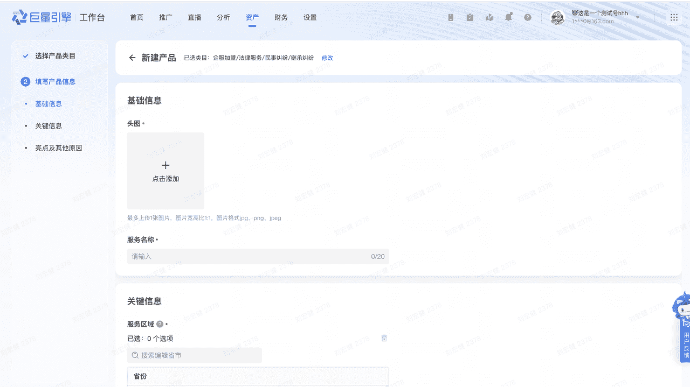

填写产品信息

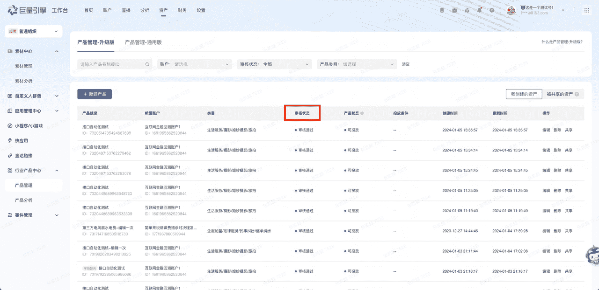

产品审核状态

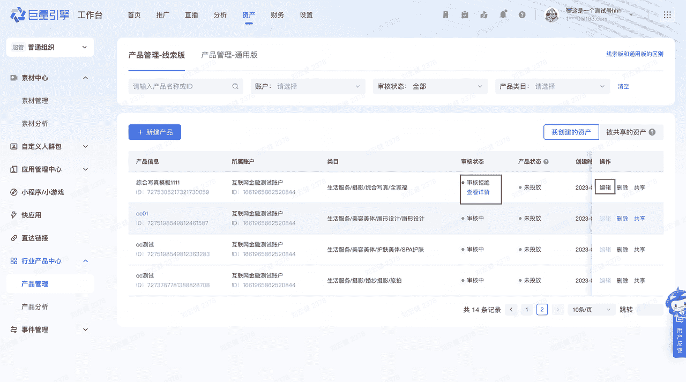

审核拒绝查看原因&编辑

> 选择橙子落地页后，会在广告层级创编时进行对应落地页设置即可。

> 实际投放中的可选优化目标，参考绑定的落地页情况；

> 7月5日新增支持选择`私信消息`&`私信留资`

> 当客户的优化目标选择`表单提交`时，深度优化目标方可选择`电话接通`，此能力为5月23日新增；

> 此能力于5月23日新增，对手动使用优选表单的客户生效，若客户无此入口，可以咨询销售对手动优选表单能力加白

> 此能力于5月23日新增，仅对金融行业生效

+ 地域：可根据需要，调整地域，避免用户遗漏
+ 注意：房产行业客户在创编时，关联产品后，在选择了地域定向后，可以启用`地域智能放量`，系统会帮您自动优选对该产品感兴趣的目标地域人群，提升跑量
+ 性别（仅限本地和投资消费）：可设置性别定向
+ 年龄：可选择定向用户的年龄区间
+ 自定义人群：支持定向优质人群包和排除低质人群包
+ 过滤已转化用户：可选`项目`、`广告账户`、`公司账户`粒度过滤，选择`公司账户`时，过滤时间可以设置为`当天`、`7天`、`1个月`、`3个月`、`6个月`、`12个月`

> 7月5日新增在选择`私信消息`、`私信留资`的情况下，可以过滤抖音粉丝

+ 过滤夜间投放：投放时间剔除`00：00-06：00`
+ 稳定成本：控制成本，在预算范围内多跑量
+ 放量投放：为获得更多的跑量，愿意接受一定程度的成本上浮

##### 4.2.2 新建广告&创意设置

+ 支持投中增加素材，做更多的素材探索；默认程序化创意；

| 操作任务 | 操作步骤 | 示意图 |
| --- | --- | --- |
| ①推广身份设置 | + `推广身份`（`原生广告`）启用： | |
| ②广告素材 | 基础素材： | |
| ③文案素材+落地页 | + `素材文案`： | |
| ④产品信息+创意组件 | + 对标原版“基础创意组件”，您可以自行进行自定义信息补充！完成产品名称、产品主图、产品卖点的设置。 |  |
| ⑤创意设置 | + 创意设置： |  |

+ 开启后，您的计划将升级为原生计划，我们将在广告审核通过后进行内容审核。广告审核通过后，您的计划可投放；内容审核通过后，您的计划达到自动投放状态，可获得更多流量；
+ 默认抖音号授权，可以通过`抖音号授权`工具进行绑定的自有抖音号
+ 支持勾选主页作品列表隐藏广告视频

> 5月30日上线拉取抖音号主页视频的能力

不启用

启用

+ 视频创意个数最多支持30个；
+ 图片创意个数最多支持50个；

`素材优选推荐`功能：帮助客户在“同商品&同客户&同代理商名称”范围内智能优选成本更优、跑量更好的素材，增加模型探索成功率，从而助力跑量提升。被推荐的素材带有“推荐”标签。

添加视频

添加图片

生成锚点

+ 支持手动添加和选择已有标题（最多支持添加10个标题）：
+ 手动添加：点击`批量添加`可新增一条或多条标题
+ 选择已有标题（仅限房产行业）：可输入行业或关键词，系统会基于楼盘信息自动推荐标题，以供参考
+ 插入`动态词包`：
+ 支持选择：地点、日期、星期、年龄等词包，也可以点击`更多`选择更多词包
+ 支持批量添加（最多添加 10个）和直接选择落地页
+ 创意组件：可选互动组件、展示组件；
+ 系统会基于同账户同商品下近一个月消耗`top1`的历史来源做推荐，并直接填充，支持客户修改
+ 若拉取不到，则不做推荐；

#### 4.3 数据查询

##### 4.3.1 在广告列表查看数据

| 数据类型 | 操作步骤 | 示意图 |
| --- | --- | --- |
| ①广告投放设置 | 点击`【推广】-【广告】`，选择相应的“自动投放项目”，点击`【详情】`查看 |  |
| ②广告投放数据 | 点击`【推广】-【广告】`，选择相应的“自动投放项目”，点击详情，可查看关注指标，或点击`【数据】`查看更多数据 |  |
| ③广告预览 | 过审的素材和广告支持预览： | |

##### 4.3.2 在项目报表中查看数据

| 操作步骤 | 示意图 |
| --- | --- |
| 点击`【报表】-【广告报表】`，可以查看相应自动投放的广告相关数据；若想对比UBL和手动的效果，可以在`【自定义报表】-【广告报表】`中增加 `投放模式`字段 | |

#### 4.4 审核查询

##### 4.4.1 查询广告审核状态

+ 查看广告状态：显示 `审核已通过` 或 `投放中`，代表审核已通过、正常投放中
+ 点击广告详情，在日志中查看审核状态

> 若广告超过 6h 没有过审，可以联系巨量销售或咨询巨量广告平台

##### 4.4.2 查询素材审核状态

+ 当有素材未过审时，广告上会提示 `审核建议`，点击后可查看原因和优化建议

> 若广告超过 6h 没有过审，可以联系巨量销售或咨询巨量广告平台

#### 4.5 MAPI 创编

升级版广告平台MAPI：[https://open.oceanengine.com/labels/7/docs/1740868017220608](https://open.oceanengine.com/labels/7/docs/1740868017220608)

飞鱼开平线索API：[https://open.oceanengine.com/labels/7/docs/1696710631271436](https://open.oceanengine.com/labels/7/docs/1696710631271436)

监测：[监测链接发送服务](https://bytedance.feishu.cn/docs/doccnoYSvc9h6ZVIF634GAZPtSc)

# 巨量本地推平台

## 4.1 投放入口

+ 巨量本地推地址：`https://localads.chengzijianzhan.cn/`

+ 【推广】-【线索推广】

## 4.2 创编流程

| 页面板块 | 操作步骤 | 示意图 |

| --- | --- | --- |

| 新建项目 | 【推广】-【线索推广】-【项目】-【新建项目】 |  |

| 推广目标 | + 营销场景：短视频/图文 |  |

| 项目设置 | 1. 投放内容与目标 |  |

| | 1. 受众倾向与过滤 |  |

| | 1. 排期与预算出价 |  |

| 广告设置 | 1. 推广身份 |  |

| | 1. 广告素材 |  |

+ 推商品：可选商品详情页、抖音私信页

+ 推门店：可选门店详情页、抖音私信页

> 支持【新建定向】和【选择已有定向包】：

> 周期稳投类型，支持自定义7日总预算

> 当项目投放内容选择私信页时，默认选择对应的抖音来客账户绑定的官方抖音号

+ 选择范围：可选素材库视频或上传视频，支持1-30个

+ 广告素材预览：右侧查看预览，展示对应面板样式、锚点样式

+ 可选批量添加或系统推荐

+ 当所选线索组件组含3个线索组件时，落地页底部最多展示2个（展示默认优先级预约表单>私信>电话）

+ 当所选线索组件组含私信组件时，前置要求本地推对应的来客商户，至少完成普p以上企业号的开通

## 4.3 推广管理

| 项目列表 | | |

| --- | --- | --- |

| 页面板块 | 功能详解 | 示意图 |

| 项目列表 | 展示该账户下所有未删除的项目，可通过筛选项目状态快速定位👇 |  |

| 项目详情 | 点击项目详情，可展示以下内容👇 |  |

| 广告列表 | | |

| 页面板块 | 功能详解 | 示意图 |

| 广告列表 | 展示该账户下所有未删除的广告，可通过筛选广告状态快速定位👇 |  |

| 广告详情 | 点击广告详情，可展示以下内容👇 |  |

1. 指标范围：默认展现消耗、展示数、平均千次展现费用、点击数，支持自定义

1. 指标趋势图：若所选时间范围为1天则显示分时数据，否则显示分天数据

1. 如审核不通过会显示审核建议，点击“编辑”修改相应素材

1. 如审核通过会显示具体标签（学习期/学习期结束/学习期失败）和成本保障状态

1. 指标范围：默认展现消耗、展示数、平均千次展现费用、点击数，支持自定义

1. 指标趋势图：若所选时间范围为1天则显示分时数据，否则显示分天数据

## 4.4 数据查询

+ [MarketingAPI 巨量引擎开放平台 本地推线索推广报表](https://bytedance.larkoffice.com/docx/P4P2dWafOo77FJxpQyDc6u8Fnwb) API 获取「项目数据」「广告数据」「素材数据」：

+ 本地推平台「数据」页面获取：示例线索推广报表、商品门店分析、受众分析，更多可登陆账户详查

| 页面板块 | 功能详解 | 示意图 |

| --- | --- | --- |

| 线索推广报表 | 查数入口：「数据管理页」-「线索推广」-「线索推广报表」 |  |

| 商品门店分析 | 查数入口：「数据管理页」-「营销评估」-「商品门店分析」 |  |

| 受众分析 | 查数入口：「数据管理页」-「人群受众」-「受众分析」 |  |

1. 数据维度：可选项目、广告、素材

1. 数据筛选：项目名称、时间、营销场景、广告类型、优化目标，点选不同维度可查推广数据及趋势

1. 数据概览：默认指标消耗、展示次数、点击次数、转化数、转化率，支持自定义、支持下拉展开

1. 数据对比：任选2个指标，支持分日、分时趋势曲线对比

1. 数据明细：点击「自定义列」选择希望展示的数据指标（基础指标/线索收集/互动指标）

1. 数据范围：仅包括线索推广且营销场景为「短视频+图文」的商品推广数据

1. 数据筛选：商品名称、门店名称、时间，点选分日或分时可不同维度查看

1. 数据概览：默认指标消耗、展示次数、短视频成交订单数、短视频成交金额（元）、短视频支付ROI，支持自定义、支持下拉展开

1. 数据对比：任选2个指标，支持分日、分时趋势曲线对比

1. 数据明细：点击「自定义列」选择希望展示的数据指标（基础指标/线索收集/成交转化/门店数据）

1. 数据维度：可选线索推广、灵活投、持续投

1. 数据筛选：时间、广告类型、广告`id`，点选可查

数据概览：人群分布、地域分布、性别分布、平台分布、网络分布、分城市明细等，支持自定义字段、支持导出

# 五、赔付规则

## 5.1 赔付计算时间

+ 从项目组开始投放起，及其之后的3个自然日（eg.广告主在1日10点创建项目，11点有第一个广告展示，赔付时间包括1日11点-4日24点）

## 5.2 赔付条件

+ 投放场景要求：稳定成本场景支持赔付，放量投放场景不支持赔付；

+ 超成本比例要求：在赔付时间范围内，转化成本超目标成本20%及以上；

+ 修改要求：每天修改UBMAX线索优必投项目出价或者定向任意一个的次数不能超过2次；

+ 转化数要求：`转化数≥6`；

+ 其他要求：广告主无异常作弊等违规操作行为；

## 5.3 赔付逻辑

+ `预期消耗 = （目标成本1 * 对应转化数）+（目标成本2 * 对应转化数）+.....（）`

+ `赔付金额 = 实际消耗-预期消耗`

> 备注：以上赔付规则数据统一以平台系统数据为准

## 5.4 赔付流程

+ 主动赔付（系统实时计算赔付金额，进行打款），详见oCPM/oCPC自动赔付规则介绍 - 巨量广告帮助中心

# 六、行业优秀案例

优秀案例大全 👉：[巨量升级版线索自动投放（线索智投UBL）-案例大全](https://bytedance.feishu.cn/docx/Rottds5Aqovln3xhOKwclgkxnjb)

# 七、常见问题Q&A

常见问题 👉：[线索智投（UBL）投放指南（对客）](https://bytedance.feishu.cn/docx/DolMdhmhJodR38xTgWAcdfS0nXg#doxcnNSZ3Wt03QYVt72uIXyxgeh)

# 八、投放设置建议

投放指南 👉：[线索智投（UBL）投放指南（对客）](https://bytedance.feishu.cn/docx/DolMdhmhJodR38xTgWAcdfS0nXg#doxcnpJZ9kCno3bNpEr4XoEbTPg)
