# 「便宜电影票老司机」电影票代下项目 | 执行交付手册（SC）

> 来源：[https://xuqiwei1986.feishu.cn/docx/FS1Ld8aHio6gVcxqSNoc7stynfe](https://xuqiwei1986.feishu.cn/docx/FS1Ld8aHio6gVcxqSNoc7stynfe)

---

**作者：**便宜电影票老司机

**🛰️：**Max000619

**关注👸号：**便宜电影票老司机

**📕：**易票提

更多电影票干货输出，敬请关注👸号和📕

用电脑阅读本手册，体验更佳。

---

# 前言

> 已准备就绪，坐好啦，准备开车了。

> 开车前，我们先来解决几个被问最多的问题。

>

> **● 什么是电影票代下项目？**

> 简单的理解，通过对接获取优惠渠道，来实现低于官方价格买票下单，从差价中赚取利润，一张票利润5-70元不等。

>

> **● 这个项目有什么优势？**

> 1）难度低：

> 简单易上手，操作简单，只需一台智能手机就可以操作。

> 利用的是碎片化的时间接单，因为除节假日外，顾客找你的时间不会集中。

> 不管您是学生、宝妈、现做微商、个人创业工作室均适合操作

>

> 2）见效快：

> 见效快，针对互联网项目，很多项目第一个月甚至前三个月都不赚钱很正常。

> 但电影票这个项目，只有认真去做，快则当天第一条朋友圈或者发布第一条闲鱼，就可以马上出单。

> 很快就能提高您做项目的信心。

>

> 3）复购率极高：

> 我们跑通的模式，得出的数据68%的顾客找你买过一次票，以后都是找你买票。

> 如果你关联销售其它商品，如影视会员、其它代下等等，复购率则更高，可以带动你在售商品的二次转化，三次转化等赚更多的钱。

>

> ● 这个项目合法吗？优惠渠道来源正规吗？

> 电影票代下项目合法、正规、长期可持续，只要电影院存在，这一行都不会消失。

> 您可以试想一下，如果不合法，各大电商平台电影票代下早被取缔了，对吧。

> 渠道来源于正规途径，来自于各大线上APP及信用卡与票务公司之间的相互合作，推出的各种优惠补贴，券类、会员卡券、积分权益等等。

>

> ● 我在上班/我是学生/我是宝妈，我适合操作吗？

> 电影票项目适合所有人，因为接单利用的是碎片化时间，非节假日顾客找你的时间不会集中，如果是无客源玩法，你有时间就去平台接单即可，所以时间非常自由。

>

> 好了，疑虑解决完，我们正式开车。

# 第一篇章——基础准备

## 1.1 心态建设

+   电影票代下属于信息差项目，信息差项目注定是赚一部分人的生意；哪怕是淘宝抖音这么大的平台，日活8亿，还有近5亿用户无法触达对吧，你只要成交小部分人，维护好他们，做复利生意就很滋润了。

+   做电影票是量变到质变的一个过程，就是需要积累沉淀，你看的同行黄牛，一天几百收益或者节假日几万收入都是做了一定的时间积累来的，这行本来就是沉淀的行业，积累对接得越多，你的羽翼越丰富就飞得越高，赚得越多，所以逐步渐进，自己设定好目标，调整好心态，不要眼高手低，心浮气躁，三天打渔两天晒网。

## 1.2 前期准备什么

+   **建议您准备**

1台智能手机：一切的载体

1个闲鱼号：闲鱼是最适合新手入门的平台，3个更好批量操作

1个🛰️小号：沉淀电影票老客户

过1遍交付手册：熟悉了整体逻辑框架做起来才顺手，后续仍要边做边学

常用APP：灯塔专业版/猫眼专业版、万达影院、建行生活、闲鱼

备注：电影APP也可以不用下载，直接用APP的🛰️小程序端也可以

## 1.3 营销图文和文案素材

> 素材图

> 文案

## 1.4 渠道资源的整理对接

+   卡券类渠道（可以自己出票）

+   黄牛出票群（可以让黄牛出票）

+   辅助👸号（可以借助竞价出票）

这个后面会详细说方法，这里就留个悬念吧哈哈

# 第二篇章——新手入门必备行业知识

## 2.1 行业术语

+   券码： 各种券码的简称

+   实单： 已确认或已付款的订单

+   超补： 超出金额可以补差价

+   自查： 自己查价

+   代查： 同行给你查价

+   代下： 同行给你下单

+   接码： 接收短信验证码

+   中爆： 中号爆米花

+   批次： 券都有批次(一般以到期时间来定批次)

+   1号4：一个账户可以绑定4张

+   区域码：只能兑换指定的城市区域

+   单片通兑：只能兑换单部指定的影片

+   会员-2代：会员价的基础上再减2元

+   会员85折：会员价的基础上再打85折

+   异地： 限制地域下单（少数券会有限制条件,比如限制城市,基本都有方法）

+   通兑券：举例猫眼40元通兑券，意思为猫眼票价40元内（含40元）的电影，用这张券可以直接抵用，无需补差价，所以经常看到别人晒电影票最后支付为0元的，就是用通兑的原因，真正成本并不是0。

+   定额券：举例万达19.9定额券，意思为无论票价是多少，如50、60、70、100，你都只需要支付定额券标注的19.9元，就可以抵掉票价，最终支付的都是19.9元。

+   代金券：也可以理解为满减券，举例淘票票20元代金券，举例票价为30元，你用了淘票票20元代金券，相当于30元减了20元，只需要再支付10元，相当于我们生活经常使用的优惠券。

+   发行价：根据具体影片的发行通知，有规定固定的发行价格，简单通俗可以理解成是电影院的最低售卖价。下载”灯塔APP” 可查看，如下图参考《速度与激情10》发行价：

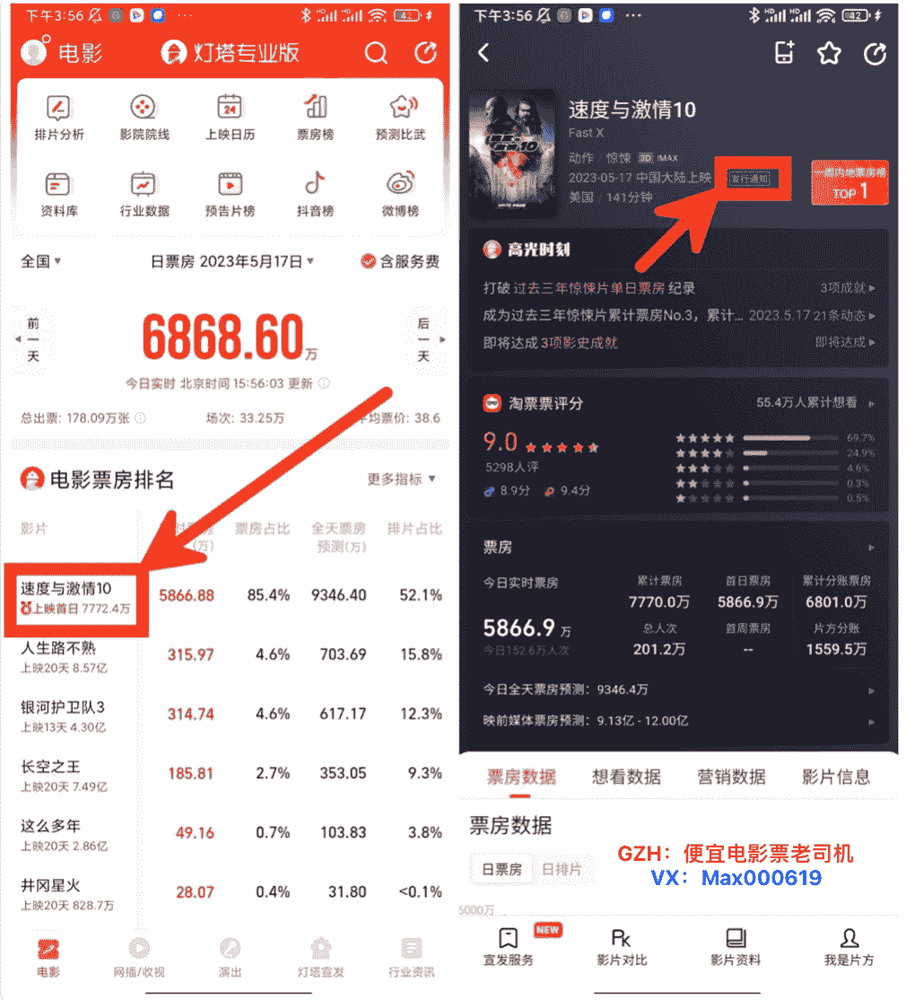

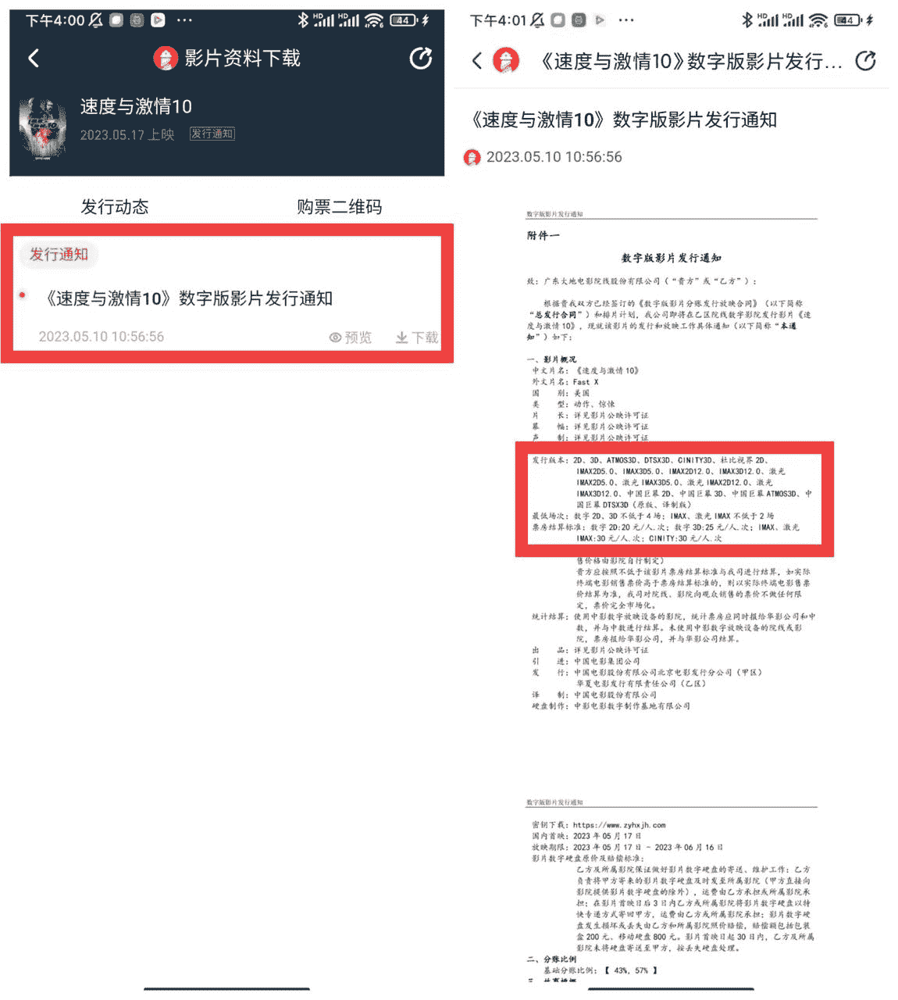

## 2.2 全国影城分类

+   **杂牌影城：**全国仅有一家的影城

+   **连锁影城：**全国有多家影城，诸如万达、金逸、横店等

## 2.3 电影票影厅分类

+   **普通厅：**激光厅、普通2D/3D厅，一般默认标位1-9号厅。

+   **特殊厅：**杜比巨幕厅、IMAX厅、4D厅，VIP厅，情侣厅等。

## 2.4 低价出票的所有方式

1.  **券类：**通兑券、定额券、代金券

1.  **会员：**连锁影城会员、杂牌影城会员

1.  **羊毛：**平台活动、信用卡权益、积分兑换、回收权益等

1.  **砍价：**猫眼砍价、淘票票团助力等

1.  **代下：**同行代下、出票群代下、闲鱼代下、👸号代下等

# 第三篇章——电影票出票逻辑

## 电影票出票的优惠购票逻辑

看这张图就一目了然了的知道了票圈的出票逻辑了

在下个篇章会有实操演示。

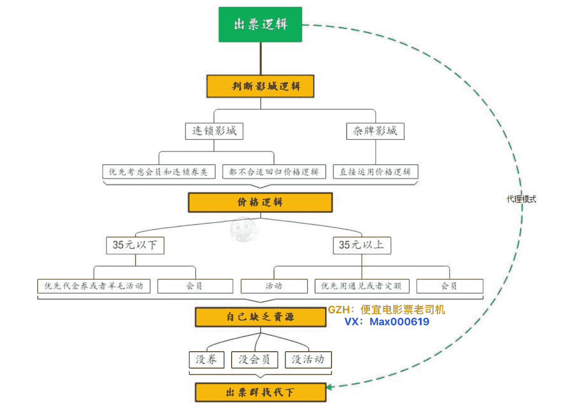

# 第四篇章——票圈出票图文实操演示

我们通过图文的形式，结合上面写到的出票逻辑和出票方式做一个实操讲解。

## 4.1 利用**会员出票**

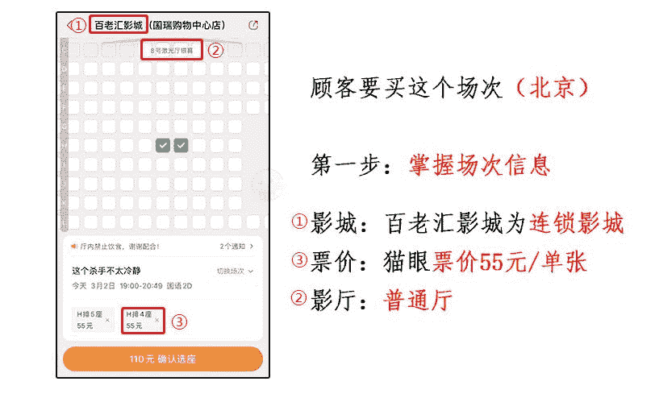

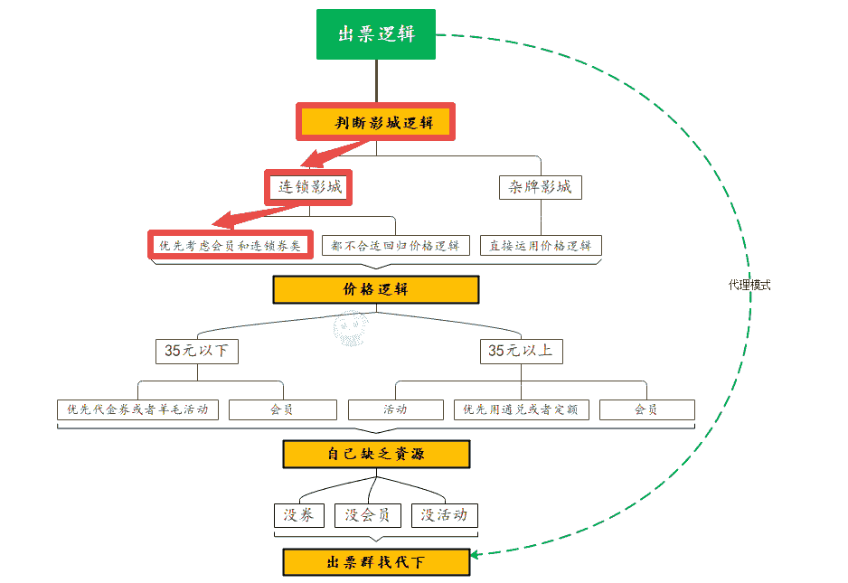

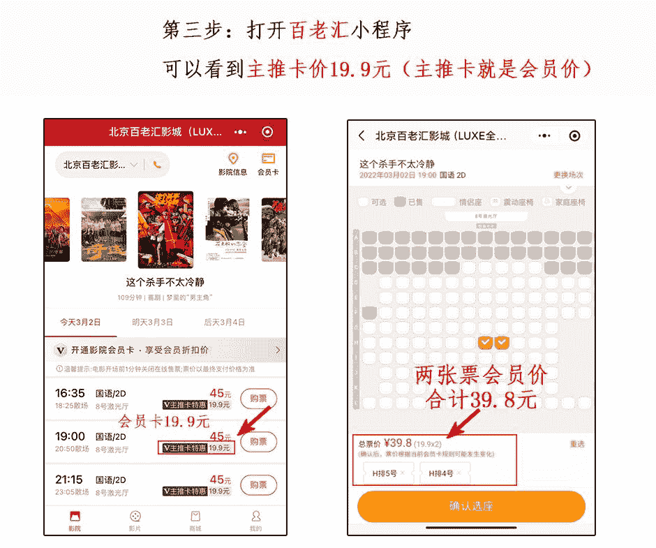

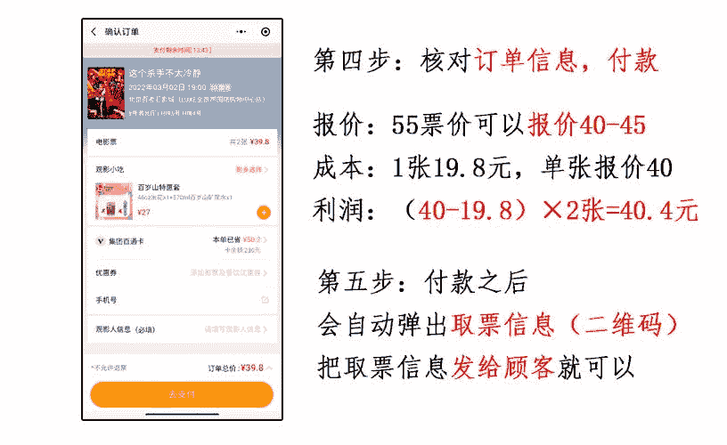

## 4.2 利用券类出票

### 连锁影城

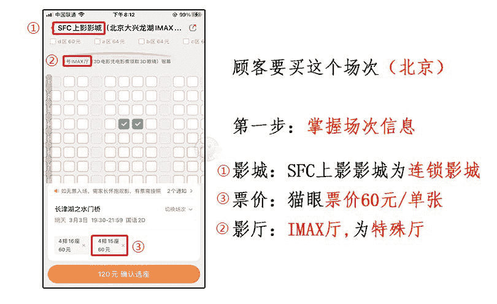

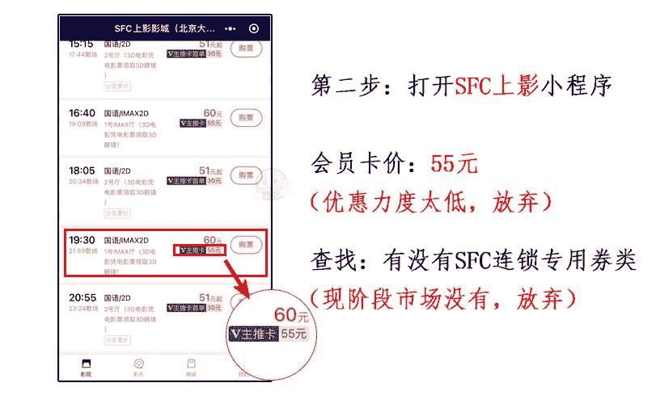

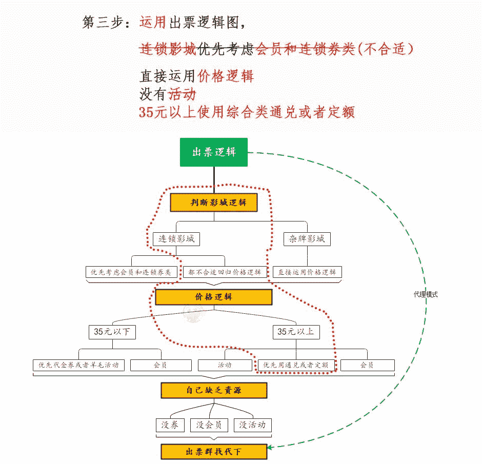

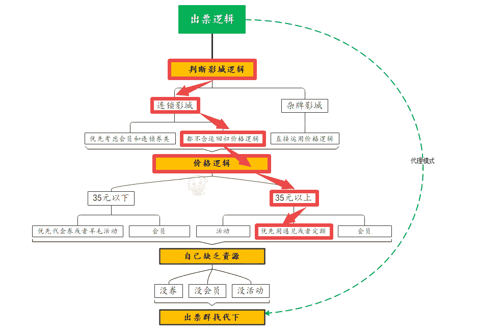

### **杂牌影城**

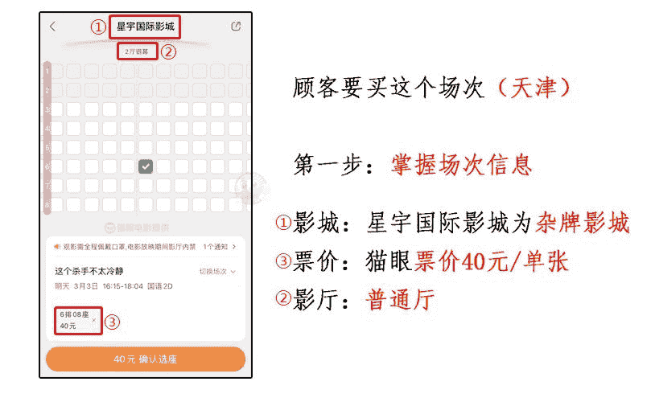

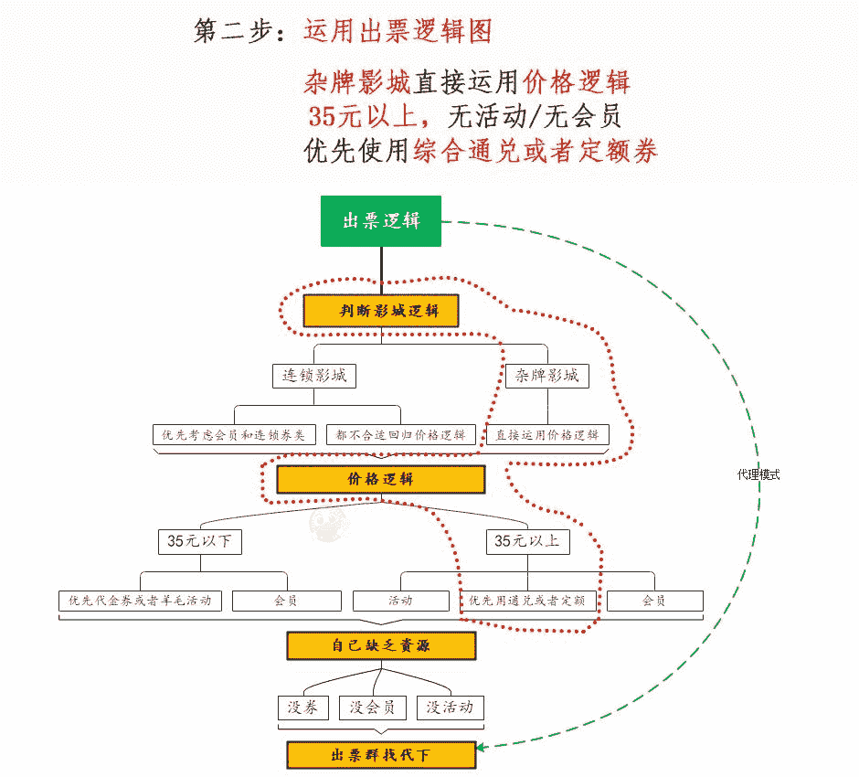

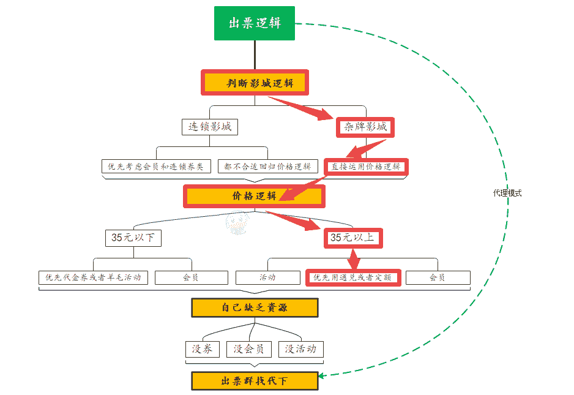

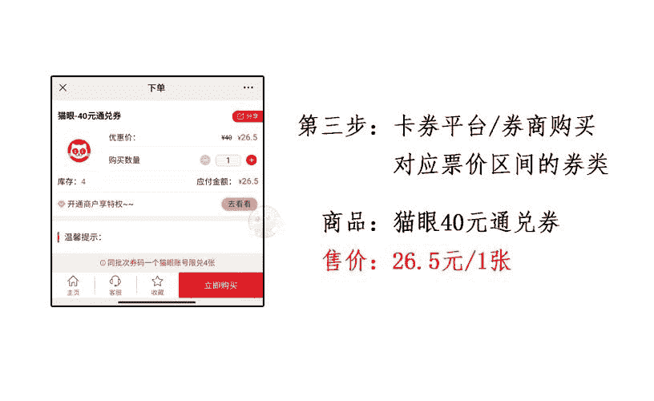

## 4.3 利用活动出票（有活动可优先考虑）

## 4.4 利用羊毛出票（各APP的消费券、银行权益等，统称为羊毛券）

注意：羊毛一般一个账户是有限制领取的，但你如果领完还想要享受这个权益需要怎么办？

在下面的问题【答疑篇章】会详细讲到。

## 4.5 利用黄牛出票（代理模式）

以上就是票圈出票的所有方式，也就是会员/券类/活动/羊毛/同行这5种，每一种我都进行实操示例，并标配了文字说明，运用出票逻辑，基本上都可以上手了。

如果文字版还看不懂可以找我领视频版，有更全面的演示。

看到这里，电影票这一行就**掌握了60%的知识**了。想要进入这一行，只需要懂得行业知识+掌握出票逻辑+获得电影票资源渠道+出票群，这4点其实就足够了，就可以持续的赚取差价了，行业门槛并不高。

不难发现，我们买一张票，上面的5种出票方式，哪一种都可以进行出票，只是成本不一样，所以出票要筛选最低成本的出票方式进行出票就可以。

有些人说“那不是非常麻烦吗”，我自己之前也看了一些教程搞得很复杂而且说得天花乱坠。

其实不麻烦，因为不管是连锁影院还是杂牌影院，都有基本固定的出票规律，入圈后只要分别了解几种出票方式的成本和入口，定位自己的出票方式，你就能运用自如。

# 第五篇章——电影票的定位

## 5.1 简述行业的出票现状

相信会看到这的都是想去尝试自己出票的小伙伴，或者是学习出票的小伙伴，所以我需要把行业的现状给大家说清楚：

电影票代下这一行鱼龙混杂，很多人他自己都跑不通赚钱的模式，就出来割韭菜了，也是搞笑。市场上普遍的付费场景，付费之后，跟你讲解基本的行业知识+发你卡券渠道+拉你几个出票群，其他你就要靠自己操作了。

自己去操作后，其实很多人是赚不到什么钱，停留在🛰️卖票，发发朋友圈，闲鱼发一发，在看似完全懂的电影票知识里，遇到单子对于出票依旧无从下手，毫无头绪，发出票群又没人代，后面做着做着就放弃了，然后就会进入键盘侠的诋毁和谩骂模式了。

为**什么会出现这样呢？**除了没有被正确的引导之外，其实就是方法不对，付费白费。归根原因就是不会定位自己的出票方式和变现方式，这部分也是剩下最重要的40%。

## 5.2 定位

### 5.2.1首先就是定位自己的出票方式：

> 哪些影院我要自己出，哪些影院我要同行出；

> 或者什么价格内你自己出，什么价格外同行出；

> 专注地区影院，其他同行出；

> 专注连锁影院，其他同行出；

> 专注羊毛领域，其他同行出；

> 全部对接一手同行（代理模式）；

> 等等

> 为什么？我学的就是全国都能出票？

> 很多人会有这个疑问，原因就是他不懂电影票的原理，首先我们明确的逻辑：

> 第一，做电影票为什么，肯定是为赚钱，为了利润最大化的赚钱。

> 第二，电影票圈子是一个互相借力，互相合作的圈子，因为每个人对接的渠道不同，一个人是无法做全国1万+ 影院的最低价的，你有A影院资源，我有B影院资源，我需要A跟你拿，你需要B跟我拿，就是这样子的。

### **5.2.2加深理解-举例1**

**可能这么说有些人还不是特别理解，**我们就以上面实操图文的百老汇影院来举例：

> 百老汇猫眼价是55元

> 百老汇官网会员价是19.9元

> 55元通兑券成本39元左右

> 同行22元代百老汇

如果你有55元通兑券，没有会员，而且一定要自己出，直接用券就可以出了，但是利润就小很多了。

同行有开这个会员卡，我们是不是就可以找他出，也就是借助他的会员资源出票，同行一般就赚两三块，如果是折扣充值的卡，甚至可以原价代下或者是减1减2代下。

有人说，我也可以自己开卡。对的，可以自己开卡，就可以形成这部分自己的核心竞争力，但全国1万＋影院，不可能做到全都开卡，所以这就是我们做出票定位的原因。

---

### 5.2.3加深理解-举例2

目前市面上所有的特价电影票，除了平台/活动/团购券之外，都是来自于每一位个体票商散户、中小型票商团队利用自身优势去深耕某一出票渠道，可能他们在地区上有资源优势、又或者是有固定收券渠道、对接院线的囤券渠道等等。

你会发现，这些人他们只深耕这部分渠道，其他的完全靠对接；也就是只做自己最有优势的部分。看下面这张图片群里同行发的广告，他们就是只出这部分有优势的。

原因就是深耕这部分可以做到利润最大化，只深耕只部分就够了，其他没优势的靠对接同行有优势的就行了。

那怎么去深耕下面的有个专属的篇章会讲到的。

---

**再来实际举个例子**

我定位的是：连锁影院我自己出+杂牌影院同行出，对应需要怎么做？

我们可以做一个表格，类似于这样，连锁影院的出票方法，券类和对接人都写上去，把对应🛰️先加在🛰️上。

比方说我专注做万达，其他就同行出，这样我们就知道了买什么券或囤什么券了，要去加哪些群，对应需要先加哪些同行了，来了订单你就按照预定轨迹出票，或者找对应的人发在对应的群，根本不会无从下手。

定位之后，这部分影院，我们就有了核心价格竞争力的可以，不仅可以赚顾客的钱，也可以赚同行的钱，其他影院就直接对接出票群，顾客来找其他影院，我们出票群同行出票赚差价，这样就面面俱到。

然后有新增的合作同行资源，或者新增有价格优势的影院，就可以补充在表格，这样做下去，一不会乱，二资源越来越丰富，电影票做的就是“加法”。

只要解决了出票定位，就已经解决了大部分人的学习之后无从下手的问题。

# 第六篇章——电影票变现

接下来就是定位自己的变现方式，首先知道电影票这个项目的变现方式有哪些。

## 6.1 电影票项目变现方式：

>

> ① 卖票（🛰️、电商平台）

> ② 卖渠道（电影票群、券类资源、工具类）

> ③ 收代理收徒弟（知识付费、电影票社群）

> ④ 电影票小程序（接单、推广返佣、自建小程序、提供搭建服务及维护服务）

> ⑤ 衍生的一系列代下服务（京东代下、视频会员、各官网代下等）

## 6.2 我们就可以根据自身的情况来做一个选择

### **大学生：**

> 比方说我是大学生，刚入行的小白，🛰️没多少人，那么你首先要做的，就是我上面说的，做好自己的出票定位，看自己所在城市的电影院有没有会员价格优势，或者是合作优势的，可以记录下来，形成自己的独家优势。

> 从闲鱼这个电商平台开始做起，来单了根据自己的定位，选择哪些自己出，哪些发给同行出，然后通过话术引导到🛰️上（导流），做顾客沉淀，做其他商品二次变现，多次变现（如对接一些代下商品）。

> 电影票+闲鱼的变现形式。外面在包装推闲鱼电影票项目也是如此。

> 这种方式非常适合小白，既能引流又能赚钱。只要你坚持做，肯定可以赚到钱。闲鱼的操作技巧可以在文末领取。

### **副业社群：**

> 比方说你就是在做副业社群的，那你是不是可以把电影票作为一个副业项目引进社群，做课程变现，给社群成员多一个项目选择，或者是知识付费做网课的其实也是同理。

## 上班族：

> 比方说你是上班族，你时间不定的，你可以通过小程序接单的形式，有时间就接接单。

**定位自己的出票方式，有核心优势的可**以开启影院筛选，就会固定推送筛选的影院。

我筛选了万达，就只推送万达的单子了。

> **自媒体：**

> 比方说你是在做自媒体的，有👸号，或者其他平台的私域流量，你可以接入电影票小程序，可以自己部署，或者对接平台，赚佣金，做粉丝的日常变现，即不影响你做自媒体又能赚钱。

> **技术开发员：**

> 如果你从事或者技术开发编程类的，你可以对接电影票API接口，为从事电影票代下的同行，提供电影票小程序的二次开发，全套搭建自主运营服务，售后服务。目前的市场大部程序是对接别人接口，完全没有自主运营操控小程序的权限，上边的出问题，你这里也会受波及。原因就是因为不懂只能对接。可以赚搭建费、服务年费等。

上面给大家举例了不同人群属性，可以通过电影票项目变现的方式。

不少人操作电影票代下这个项目，是混乱状态的，没有正确的指引后面不赚钱则不了了之。不懂得根据自身的优势进行定位，选择合适自己的变现方式，你定位出票方式和变现方式之后，其实引流方向和执行方向就非常明确。如果按照这样的操作方式去做电影票项目，你一定是赚钱的，能赚多少钱当然还取决于你的执行力和方式。

---

# 第七篇章——更适合新手入门的出票方式

前面我们讲到了定位，我们付费的教程有详细讲，具体的定位如何去操作，新手可以更好的上手。

**对于这篇文章的读者，可**能就不懂应该怎么做，这里也列举了一些方式（这也是定位里 代理的操作方式）

## 7.1 同行/黄牛🛰️群出票

同行/黄牛🛰️群中一般都是全职专业做票务的同行/黄牛，他们不仅做自己客户市场，同时也以相对合理的价格做 同行市场，赚取微利。不同影院资源的同行之间相互代出，实现全国影院均可出票。

**群中有三种问价方式：**

+   **第一种，**客户问你价格，你把客户的场次截图+城市发到群里，等待报价后加自己的利润报价回客户，客户确定 购票直接联系报价的进行交易

---

+   **第二种，**如果**你的客户确定需要购票，如果你**大概知道行情，你可以按行情加自己的利润报价回客户（同行们 报价快的秘诀），如果你的客户不买就不需要理会了，如果你的客户确定购票，再去群里直接发你所需要的影 院，比如万达普厅2张则发"万达普厅实单要2，带价来”，意思是你需要别人帮你代出2张万达普厅

---

+   **第三种，**当你的客户向你问价时，如果是连锁电影**院直接🛰️搜索框搜索关键**词，比如万达就搜"万达”、“万达 普”等，搜索同行/黄牛在各个群里发的广告，找到你客户问价对应的价格，直接加自己的利润报价回客户，如果 你的客户不买就不需要理会了，如果客户确定购票，就去找到刚刚发广告的进行交易。

---

以上三种方式的使用和区别直接看文字+图片应该可以基本看懂，当然如果还是不理解也是正常的，后续多观察群 里的内容就会懂了。

我们总结一下优点和劣势

优点：简单方便，利润适中，快捷上手

**缺点：**

+   **报价时间久，有时没人报价（特别是节假日或**者有大片，大家都爆单没人会在群里报价的）

+   **报的价不是一手价，利润空间狭小**

+   **报价群偶尔会混进骗子，难以避免**

+   搜素群信息出现非常多的重复，无法及时筛选最低价

---

为了解决以上的问题，我们通过软件自动采集300+个电影票群的数据，过滤重复，过滤骗子，每天更新成这样的渠道表，非常适合新手快速入门，不管是新手老手，有这个表都非常方便。可以每天知道行情价、活动、券在哪买。

不需要再通过繁琐的旧方式一个个的去点击群里慢慢比对。

---

## 7.2 第三方分佣👸号平台

闲鱼上有很多卖教程的/收徒的其实就是单一地给你一个这种👸号，让你自己去出，而且他们提供的平台价格没 有优势，只能以平台显示的价作为成本价，后台的大部分利润归他们自己或者👸号运营方拿了，利润空间小，出 票成本高；

**原理：**第三方分佣👸号平台指的就是利用这些电影票👸号，你通过👸号代你的客户优惠下单付款，等待平台出票成

功后把取票码发给客户，赚取差价和佣金（注意不是所有平台都会把佣金给你的）。

### 7.2.1我们会为你部署一套属于你自己专用的电影票小程序，下面有图片演示

### 7.2.2使用场景介绍

顾客来你的小程序下单，你可以选择自己出顾客的这张单；

如果你不会出，可以选择按钮，转给平台的出票手出票，而你躺赚利润的50%分佣；

如果你自己会出，利润都是你自己的，平台收取2%手续费；

你同时也可以接平台的单子，更多细节可以联系我了解。

---

前期可以少量下单测试合不合适，一般用来出杂牌比较方便，也适合新手小白代购

### 7.2.3 利弊分析

**利：**能出95%以上的电影院，退单率极低，杂牌神器；卖票优惠同时有高级佣金差价；也可以推广 给客户分销赚佣金；

**弊：**出票速度一般在45分钟内，大部分在20分钟左右，快的有时候一两分钟，久的也有40多分钟，超过了30分钟 可以发订单号给客服催单；下单前一定要告诉客户出票时间为1～50分钟，一般20分钟左右，以免客户等待过程中 催单。

我们建议👸号作为辅助，因为👸号出票速度比较慢，一般平均都需要15-30分钟。但不能没有，因为有的杂牌 电影院或者是连锁的高价票确实是很难出票，这时候就需要借助👸号平台，因为后台对接了很多出票大佬自 动接单，覆盖面广。

---

## **7.3 杂牌回收建行生活电影券**

有详细教程教你每一步怎么做，做的好的学员一天可以跑500利润。

+   **📕回收券（各类羊毛券）**

到📕平台发回收广告，📕里很多女生会在里面卖券，发📕笔记的时候记得要引导大家评论点赞（更容

易上热门）

+   **闲鱼回收**

闲鱼里价格普遍偏高，注意找那些价低的或者砍价一下

---

# 第八篇章——专业深耕的出票方式

备**注：下面展示的有些券**已经下架，但是我们还是列举出来，目的在于明白这个出票方式的券类用法逻辑，下次这个券重新上架就能运用了（来来回回就这些券）

注意：以下提供的链接会用在买，不会可以问我，乱买不会用卖家是不退的。

---

## 8.1 万达影院的出票解析

万达的玩法比较多，单独领出来讲，也属于大连锁

以下方法只支持万达的直营店，**特许店（加盟店）**均不支持，只能当作杂牌；

如果我们得知有新的类似以下的券购买方法、活动优惠渠道，我们会第一时间同步这篇文章！

### 8.1.1 苏宁Super 19.9定额券

【成本：19.9元+3.5元，代下：25元左右】

购买任意万达普通厅的场次，用19.9定额券购票只需19.9元；IMAX厅需要加10元，即成本29.9元

**如何获取：**苏宁Super+万达观影卡活动，开通Super会员送14个月每月2张。这**种是只购买**券，购票的时候再支付 票价的，相对来说单张成本低，有机会的话可以考虑囤（已下架）

### 8.1.2万达影城APP 22.9定额券

### 8.1.3万达清凉一夏通兑券

### 8.1.4万达区域通兑券

**【成本：不等】**

限制区域的万达通兑券，如果正好有对应区域的单子，算了其他的出票方法，成本比这个高，就可以买来用，一般 很少用！

**如何获取：**一般是地区的活动，不建议自己囤票，兑换券渠道里面有几个链接可以直接购买，有适合的单需要用即

买即用：**（可购买）**

> www.XXX.

> 91卡密

### 8.1.5猫眼万达60元通兑券

### 8.1.6万达至尊卡

### 8.1.7定额券+回收至尊卡

### 8.1.8抖音影托邦

---

## 8.2 大地（自由人、橙天嘉禾、中瑞国际等均属大地）（加密）

### 8.2.1回收会员卡

### **8.2.2大地通兑券**

### 8.2.3大地官方抖音直播间券（不定期）

### 8.2.4大地官方天猫店

## 8.3 卢米埃（加密）

### 8.3.1通兑券

### 8.3.2抖音影托邦

---

## 8.4 横店（加密）

### 8.4.1横店官方抖音通兑券

### 8.4.2回收会员卡

### 8.4.3抖音影托邦

---

## 8.5 CGV影院（加密）

### 8.5.1 CGV官方抖音通兑券

### 8.5.2购买区域券

---

## 8.6 UME（加密）

### 8.6.1会员卡

### 8.6.2开2000储值卡

### 8.6.3抖音影托邦

---

## 8.7 金逸影城（加密）

### 8.7.1回收会员卡

### 8.7.2抖音影托邦

---

## 8.8 幸福蓝海（加密）

### 8.8.1回收会员卡

### 8.8.2抖音影托邦

---

## 8.9 博纳影城（加密）

### 8.9.1官方APP充值会员卡

### 8.9.2抖音影托邦

---

## 8.10 红星太平洋、红星电影世界、德纳国际（加密）

### 8.10.1通兑券

### 8.10.2天津红星太平洋任意厅兑换券

### 8.10.3福州红星太平洋任意厅通兑

### 8.10.4抖音影托邦

---

## 8.11 抖音影托邦（加密）

### 8.11.2 买40元兑换券

### 8.11.3 买60元兑换券

### 8.11.4 用10元满减券

### 8.11.5 其他套餐通兑券

#### 附：大部分连锁影院目录参考（影托邦支持大部分连锁）

---

# 第九篇章——业内热门玩法案例库

## 9.1 玩法A 无客源7天回本玩法

---

## 9.2 玩法B 抖音影托邦返利玩法

---

## **9.3 玩法C 闲鱼电影票玩法**

---

## 9.4 玩法D 📕电影票玩法

---

# 第十篇章——百问百答

目前问到比较多的问题就这些，大家遇到什么问题也可以问我，我会持续补充......

## **1.一张电影票能赚多少钱？**

> 答：每张票3-70以上不等（具体看票价来决定），一般顾客看电影都是2人及以上一起去看，所以单价×2利润更多。

## **2.电影票出票麻烦吗？**

> 答：不麻烦，跟你平时买票流程一样，多了一步买券绑券的流程，如果券多，有自动绑券的软件。

> （如果提前绑好了券，出票就跟你买票一样简单）

## **3.需要下载一堆软件吗？**

> 答：不需要，可以用🛰️里的小程序替代，比如猫眼，就去🛰️小程序搜猫眼就可以了。

## 4.电影票优惠的渠道从哪来？合法吗？

> 答：优惠渠道正规合法、长期可持续，只要电影院存在，这一行都不会消失。

> 您可以试想一下，如果不合法，各大电商平台电影票代下早被取缔了，对吧。

> 渠道来源于正规途径，来自于各大线上APP及信用卡与票务公司之间的相互合作，推出的各种优惠补贴，券类、会员卡券、积分权益等等。

## 5.我在上班/我是学生/我是宝妈，我适合操作吗？

> 答：电影票项目适合所有人，因为接单利用的是碎片化时间，非节假日顾客找你的时间不会集中，如果是无客源玩法，你有时间就去平台接单即可，所以时间非常自由。

## **6.一个月能赚多少钱？**

> 答：根据自己的定位和执行力来决定，也取决于自己的客户群体，少则几百，平时大部分在2千-5千的区间，过万的都有，任何事物都是量变到质变的过程，平时在于坚持和积累保持利润。到节假日和大片的时候，就是你爆发的时候了，收益就是翻几番。

## **7.我从0到破百需要多久？**

> 答：最快当天，有的人当天发朋友圈，卖给朋友就破百利润了，因为很多电影院利润很好。有的执行力和领悟能力非常好，跑📕的模式，一天跑500也有。

## **8.什么时间点做电影票合适？**

> 答：电影也分淡旺季，抓住核心的时间点，提前引流和布局，一个节假日就可以赚一整年里大部分的利润，其他时间可以拓展顾客，积累渠道，保持稳定利润就可以。

>

> 按节假日区分：春节、国庆节为旺季大高峰；情人节、劳动节、中秋节、元旦节、平时周五六日为小高 峰;

>

> 按影片区分：热门大IP大制作电影上映时为旺季大高峰

## 9.闲鱼电影票是现在的主流玩法吗？

> 答：算是吧，因为大部分人会先从闲鱼电影票开始做起，闲鱼是很好的起点平台，但其实电影票的变现方式很多，看你的定位，你的定位决定了你的玩法。

## **10.有小程序能接单吗？**

> 有的，市面上有好一些成熟的平台，单子也很多。我可以推荐入驻，但接单需要具备一定优势。

## 11.电影票代下不就那样，有必要学吗？

> 答：不是有没有要必要，是你做不做，做肯定有学的必要，付不付费取决于个人的意识，我个人认为隔行如隔山，付费有人带肯定比自己摸索要快得多，当然要遇上靠谱的人。有些小白，闲鱼买几个电影群，什么都不懂就去卖票，然后被人骗了，觉得打不过就加入，换个号去骗别人，才会造成恶性循环，有些群骗子很多。其实你如果懂行情，基本上不会被骗。

>

> 我之前学的时候，并没有像现在这样信息很透明，可以先看相关文章了解清楚，付费建议先对行业有个整体认知，明确你要学什么需求是什么，学的人懂不懂，再去决定付不付费，可以有效防止被割，当然看完这篇文章能让你有个总体的认知。

---

因内容被同行盗版严重 部分资源已经加密，但是整个玩法攻略已做详细展示！

深入了解可以加个🛰️：**Max000619**

**👸号：@便宜电影票老司机**

**📕：易票提**

内容制作不易，学习使用，请勿商用哦～

---

出品  —  @**便宜电影票老司机**

---