# 新人如何高效玩转生财有术？我在生财历练一年的深刻感受

> 来源：[https://xuqiwei1986.feishu.cn/docx/FpHNdeweroQxJFxiYlfcLZQonYf](https://xuqiwei1986.feishu.cn/docx/FpHNdeweroQxJFxiYlfcLZQonYf)

大家好，我是龙珠圈友飞掌柜，见帖欢喜～

去年刚加入生财时，是一个啥都不懂的小白，短短一年，无论是焦虑时的方向、心态、动力，还是做项目的产品、流量、运营，都有了翻天覆地的变化。我很感激生财，让我从小白一路升级打怪，本文是我历练成长的切身感受，我对生财的评价都是：如果让我退掉全部社群，只留下三个，那第一个留下的一定是生财有术！

通过本次梳理，我也明确了使用生财的心法，以及接下来一年要努力的方向。五一期间，我组织了2场生财新人局，帮助50位伙伴极细颗粒度拆解生财使用方法，并对大家提出的疑问一一解答，生财确实是个宝藏，值得好好挖掘，但我发现很多人不会使用。

| 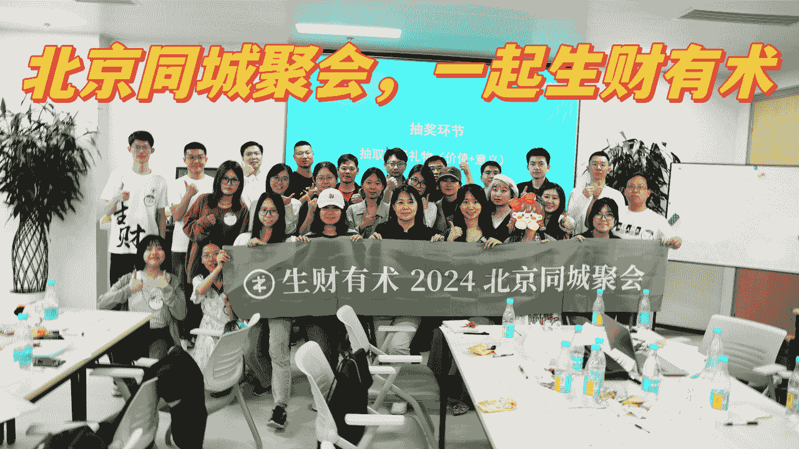 | 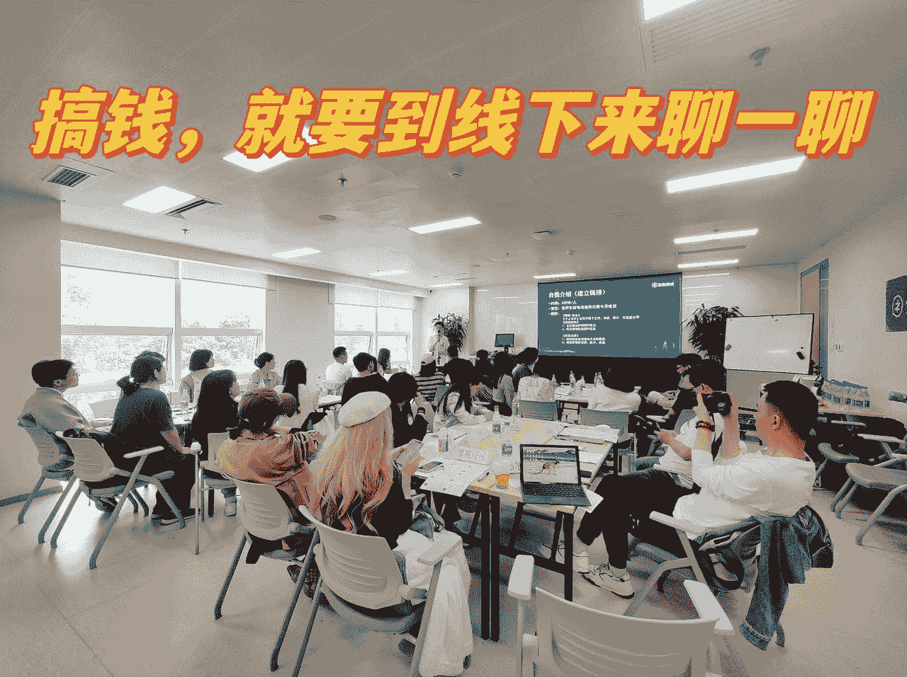 | 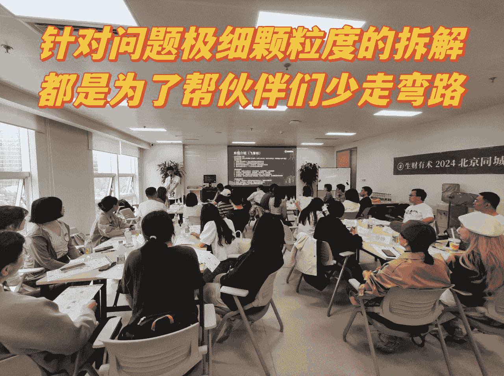 |
| --- | --- | --- |
| 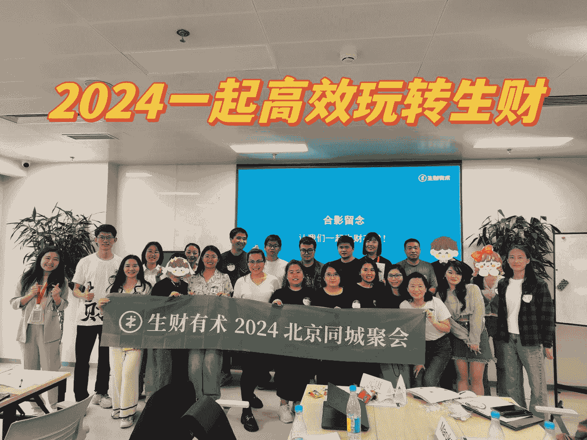 | 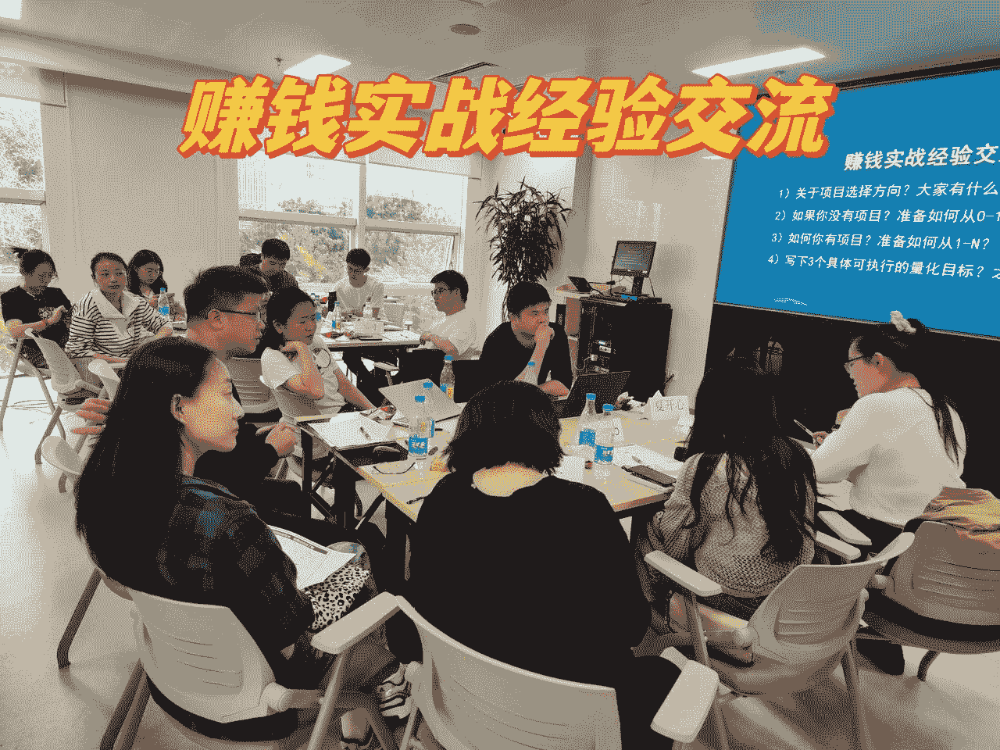 | 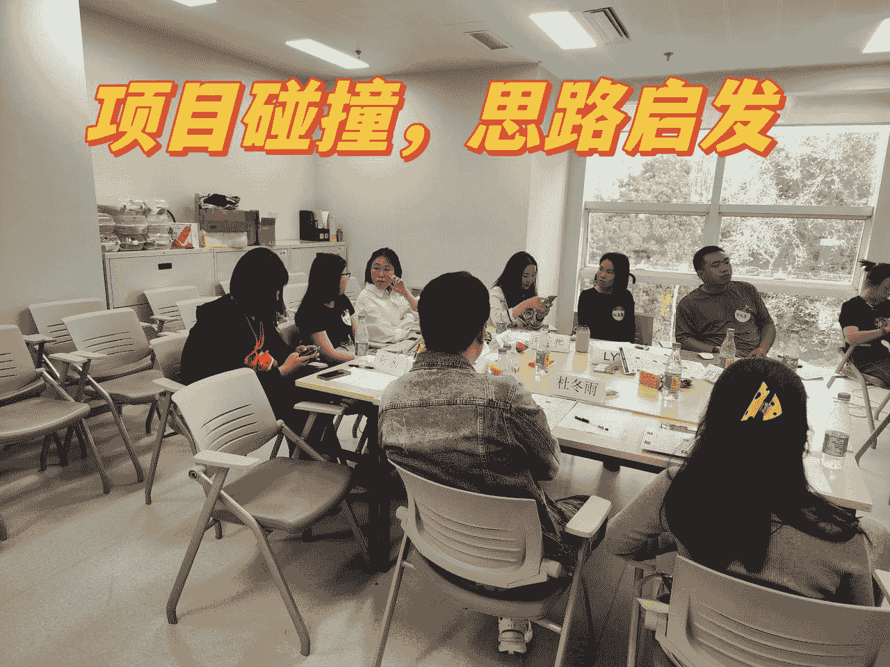 |

在新人局大家相互交流，很多新人和我反馈说比较懵，生财精华帖太多，到底该看哪个？什么是风向标，有啥用？航海实战怎么深度参与并拿到结果？自己有某些细分领域的资源，如何与他人对接？还有很多针对星球APP和生财搜索引擎的功能问题，甚至见到了部分老圈友，付费多年却没有深度参与，实在有点可惜。

因此打算写下来，期望能够帮助新人少走弯路、避免踩坑，帮助组局官节省聚会准备的时间，帮助其他圈友提供未能留意到的信息。关于本文的作用，主要有以下3点：

1、写给新人：如果你刚刚加入生财有术，还不知道搜索引擎，对精华帖、风向标、航海实战、同城聚会等也是一头雾水，那么我建议你多看，可以帮助你迅速了解生财社群核心功能，高效使用搜索引擎，深度了解龙珠体系、航海家、微天使，明白应该加入哪些社群，生财未来会有哪些变化等，其实很多内容历史发文都有，但我是从自身使用心得出发，总结出这样一套快速上手的方法。特别是十一章节，围绕我使用生财的实战经验，帮大家梳理了10条心得，期望给你一些启发。

2、写给组局官：如果想线下组局帮助新圈友快速了解生财，可结合本文内容，加上自身理解，做成PPT或者其他物料，我把自己线下组局的PPT放在下面，供大家参考，备注：首页开场白是用chatGPT写的，本文大纲也是，可见在生财学到的技能对我帮助有多大。

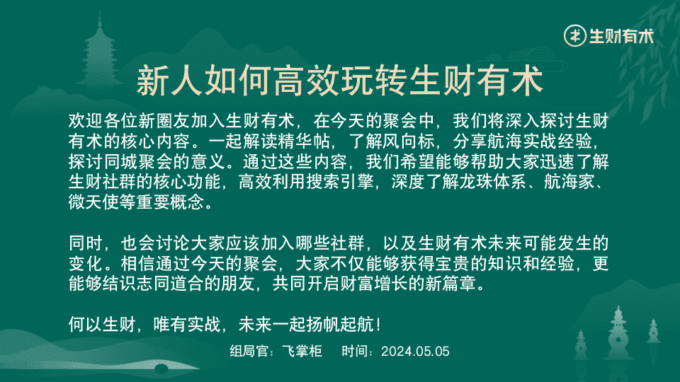

[新人如何高效玩转生财有术.pptx](https://internal-api-drive-stream.feishu.cn/space/api/box/stream/download/all/Iyzqb6PPVoHxZOxUFj4cHGzonsc)

3、写给其他圈友：如果你忙于工作，没有系统性了解生财，希望本文也给你一些启发。如果你已经非常熟悉，是咱们老圈友，直接找项目赚钱，或者按照自己需求使用生财即可。

本文所有内容可复制、可下载，如果有不对的地方，还请大家提醒，感谢伙伴们。文章大纲如下，全文阅读大概需要8分钟：

# 一、生财简介

生财有术社群创建于 2017 年初，属于赚钱赛道TOP1社群，这里高手云集，各个行业的CEO、创业者、老板等，以及细分领域的自媒体创作者。通过精华帖、风向标、航海实战等板块，帮助众多圈友找到方向，快速成长！

（关于生财的介绍，星球帖子很多，我这里就不过多赘述，主要是在开场前，给还不熟悉的新人介绍下）。

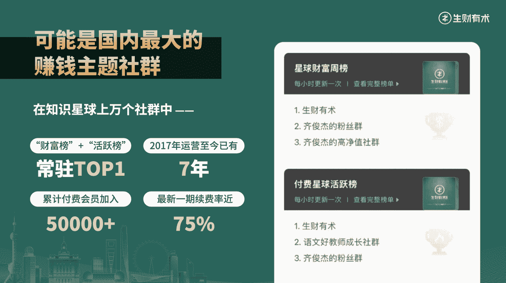

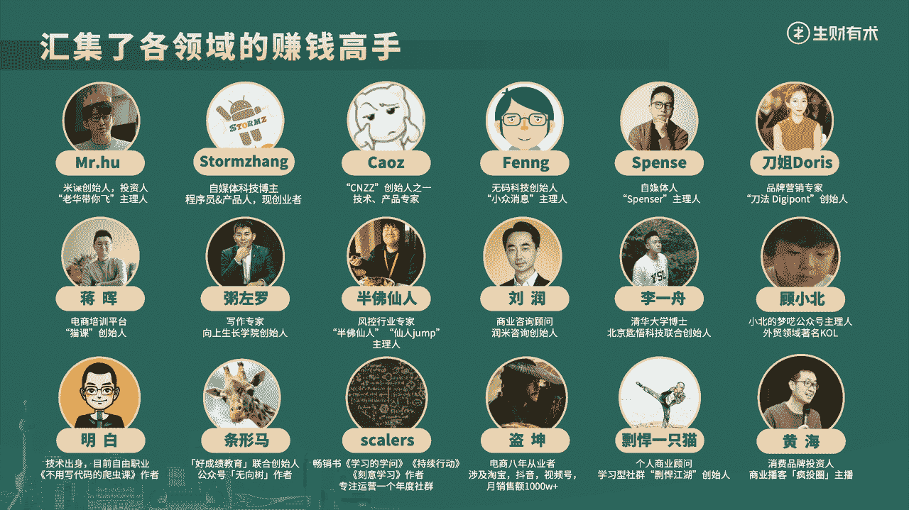

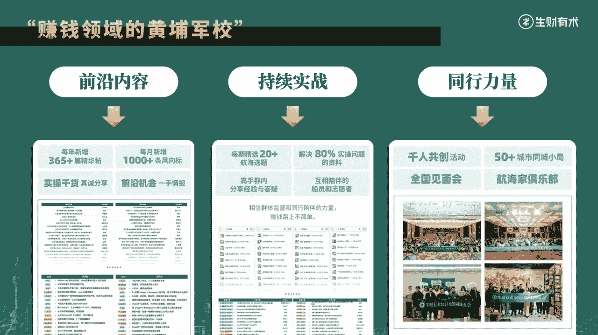

| 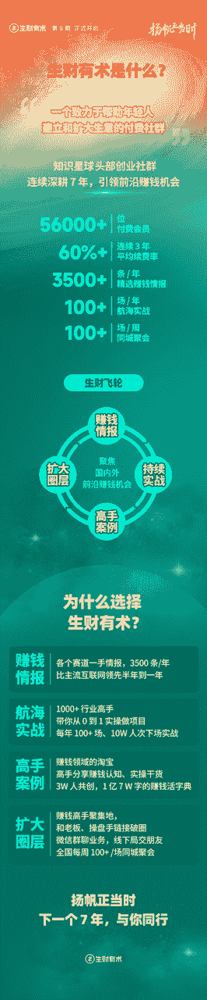 | 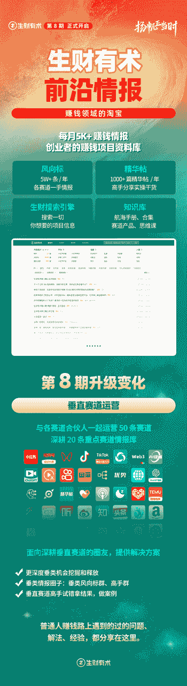 | 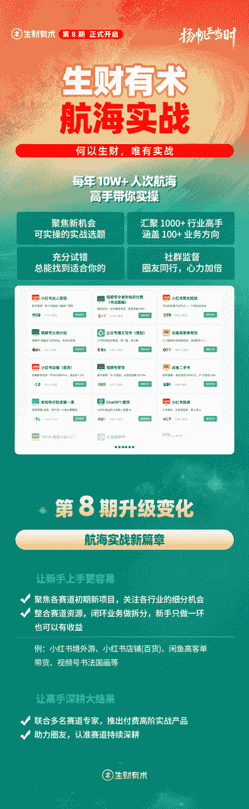 | 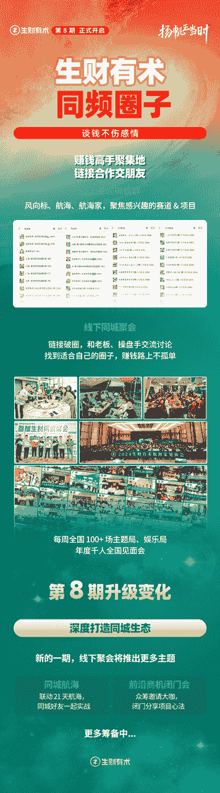 |
| --- | --- | --- | --- |

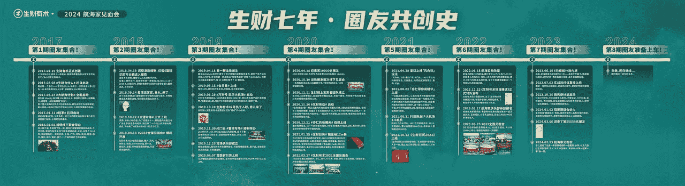

# 二、核心功能

## 一）星球菜单

### 1、精华

无论是新手，还是老人，精华帖都是必看内容，它是拿到结果的大佬们分享的实战心得。

### 2、最新

按照时间倒序，展示星球发布的最新帖子，我建议直接忽略，因为亦仁会挑选出精华帖和中标的风向标，帮助大家过滤出优质项目、最新赚钱风向，亦仁看过的项目至少几十万个，有足够积累能够快速判断一个帖子值不值得加精。

这里我要提醒的是，每个圈友也要锻炼自己筛选项目的能力，也就是从精华帖和风向标中找到适合自己的项目。

### 3、中标

中标的风向标术值+1，如果还被加精华，那么获得1颗龙珠碎片～2颗龙珠不等。中标意味着这个项目已经跑通闭环，或者拿到结果，直接参考借鉴，如果你没有赚钱思路，多来这里看看，锻炼自己的商业嗅觉。

### 4、风向标

每天有大量最新的赚钱机会，如果你想锻炼自己的商业嗅觉和项目筛选能力，一定要来这里看看，也可以尝试下，比如你的判断是否和亦仁一样，能够选出中标风向。

而且，每个月发布4条，即可被邀请加入风向标共创群，在这个群，你能见到每个月中标近100个的高手，更近距离接触到最新的赚钱风向，同时群有考核机制，每个月不够4条，会被踢出，下个月达标后再被邀请加入，因此有动力让自己去观察市场，筛选赚钱潜在机会。

### 5、亦仁

亦仁和大家分享的内容，也包含很多重要信息，作为生财有术的创始人，也作为众多项目的微天使投资人，亦仁会和大家分享对于生财平台的最新玩法，也积极听取大家的反馈建议。

### 6、航海实战

每一次大航海，生财官方会邀请表现优异的圈友，将航海体验、航海感悟、航海收获等总结成文，发在此处，因此只要你在航海中努力拿到结果，就有机会在此处进一步曝光。

### 7、视频分享

一条视频讲解一个实战项目，生财官方出品，会约已经拿到大结果的圈友进行项目拆解，通过视频方式生动呈现赚钱的来龙去脉，文字看累了，结合视频看，劳逸结合，但都是在聊赚钱，哈哈哈。

### 8、线下聚会

作为组局官可发布线下组局，发在此处号召圈友参加；作为参与者，可在此处获取线下组局最新信息。同时有大量优秀的组局官分享线下组局经验，让你少走弯路，早日自己组局。

### 9、项目拆解

生财官方不定期发布一些新的项目机会，需要圈友自行报名，且有名额限制，是为了探索是否值得纳入航海，是否有必要带领众多船员参加，圈友需报名参加项目拆解，官方会培训和协助实战，这就相当于有赚钱机会，但个人尝试需消耗很多时间、精力、金钱成本，官方发起，让大家共同实战，得出的结论也更加靠谱。

### 10、合集

官方会把赛道相关信息汇总，方便查看，一般都是按照细分领域进行分类，比如小红书带货赛道、本地生活赛道、中老年市场赛道、抖音图文赛道、养老金赛道、短视频带货赛道等，可以结合精华帖学习，适合于专注于细分领域的圈友。

### 11、问题求助

如果你没有项目，缺少方向， 可以在此提问；如果你有项目，但是存在卡点，可以在此提问；如果你不存在问题，但是愿意帮助其他圈友解决，也可贡献资源。在这里，圈友互帮互助，项目问题被一个个解决。

### 12、资源对接

相信很多圈友，特别是老板/CEO/销售/供应链等领域的伙伴，都有对接需求，官方提供平台，让大家有发布需求的场所。

### 13、生财周报

官方会汇总每周优秀的精华帖和风向标，并发在各城市群，让你时刻关注市场最新动态，不错过任何一次能赚钱的机会。说不定部分内容看完后，能够帮你打通卡点，或者对正在做的项目有所启发。

### 14、只看星主

可以只看亦仁和亦仁助理发的重要信息。

### 15、亦仁的收藏夹

亦仁推荐的文章+推荐语，思考，很多优质资料来自此处，比如《亦仁益语》，收录大佬对于市场、项目、赚钱的深度思考。

### 16、生财朋友圈

圈友们的日常分享。赚钱道路上，也可分享各种心路历程，让你知道不再是孤军奋战！

| 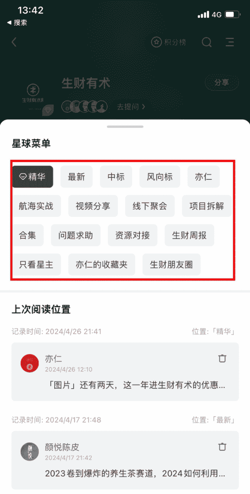 | 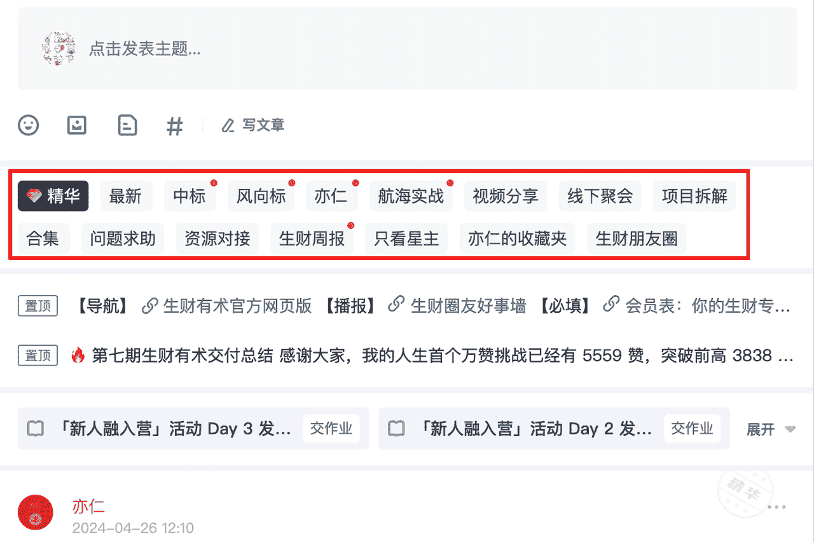 |
| --- | --- |

## 二）重要提醒

### 1、去提问

可以向亦仁和嘉宾提问，生财一共有合伙人4位，嘉宾70位，每个人都是细分领域的高手，一定要抓住免费提问的机会，大佬们都会耐心解答。

好问题才会激发好答案，提问前建议先搜索往期问答，因为你的问题可能是其他圈友之前就问过的。查看往期回答过的问题，可通过点击星主、嘉宾页签进行查看。

### 2、新手指南

每个新人必看，帮助你快速了解生财有术，以及如何更好地使用生财有术。目前里面放的是2023、2024两年的新手成长任务，完成作业后还能获得术值奖励，顺便说一句，今年的新人融入营奖励特别大，新圈友们别错过。

| 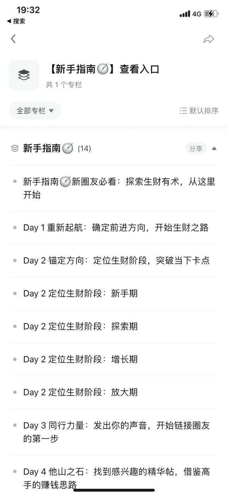 | 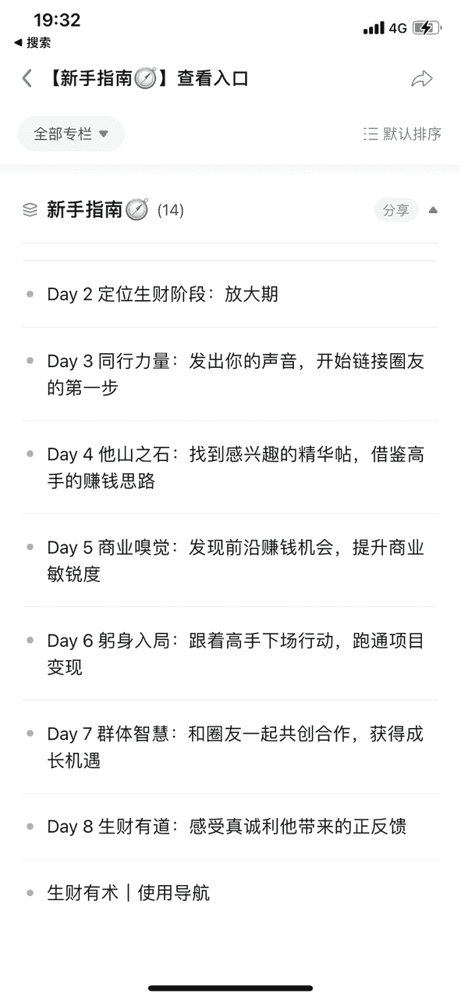 | 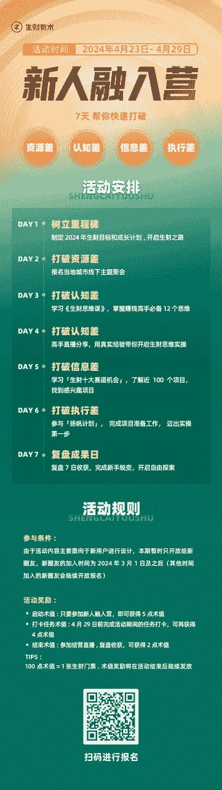 |
| --- | --- | --- |

### 3、作业题目

每个月18日是生财的会员日，鱼丸会在这里发布会员日活动，按照要求写完作业后可以抽奖，持有龙珠且成功发作业参与，可以获得1次加权（这里持有多少颗都是加权一次，不是龙珠越多加权越多哈，不然就对其他圈友不公平了）。

奖品可能是亦仁、航海家，或者星球圈友提供，包括不限于生财门票、生财盲盒等周边，各种电子设备比如手机、手表，还可能有螃蟹礼品卡等，每次都不同。我自己就中奖过3次，中奖的时候真的超级开心。

## 三）置顶内容

【导航：生财强大搜索引擎】https://scys.com/t/BOA7MVBt

【播报：生财好事墙，都是圈友们拿到结果的精彩时刻】https://scys.com/t/BOA7IKeH

【必填：加入星球需填写的会员信息，在发起聚会的时候也会返显】https://scys.com/t/BOA7PKzt

【必看：生财的官方介绍，4分钟教会你玩转生财】https://scys.com/t/BOA7T8ot

【必读：新手指南，话说应该更新到2024年的了，哈哈哈】https://scys.com/t/BOA7T7Bt

【发帖：亦仁大大贴心的发帖注意事项】https://scys.com/t/BOA7DVBt

【聚会：线下聚会直达链接】https://scys.com/t/BOA747Bt

【实战：航海实战直达链接】https://scys.com/t/BOA7kSFt

所谓万事不决问鱼丸，任何问题均可在微信联系助理鱼丸，鱼丸不仅是亦仁的助理，更是生财圈友每个人的助理，鱼丸有好多个，反馈非常及时，可见运营方面生财做的也是不错的，同时2024年还增加了机器人服务，给圈友提供最及时的资讯、直播提醒、生财周报等服务。

如果圈友想投诉/建议/表扬等，可通过邮件绿色通道，给星主亦仁反馈：yiren@shengcaiyoushu.com（由此可见，亦仁希望圈友们体验生财后能够及时提出各类建议，或者意见，广纳言路才能越做越好！）

【我的启发】

1、目前知识付费很火，不少自媒体博主也把知识星球作为产品和内容的承载平台，那么如何设计板块，分别输出什么内容，其实就可以把生财当作对标，同时要用好飞书，因为飞书链接比较友好，且功能强大。在多数平台都能打开，便于链接更多用户，或者团队之间做好协同工作。

2、相信大家都已经知道星球APP、星球网页版如何使用，但我见过太多圈友不太会用飞书，甚至都没有下载飞书，建议把飞书网页版、飞书电脑版、飞书手机版都装上。毕竟有很多内容的帖子较长，圈友一般放在飞书中。

# 三、高效搜索

## 1、生财搜索引擎

生财自研的强大索引站：https://scys.com/home，可针对星球内容、航海内容、用户、评论进行搜索，筛选时候注意先输入关键词，再定位标签，123步骤如下，至于为啥，点一遍就知道了。针对生财引擎，第三章有详细介绍如何使用每个功能，让自己的搜索效率提升10倍！

| 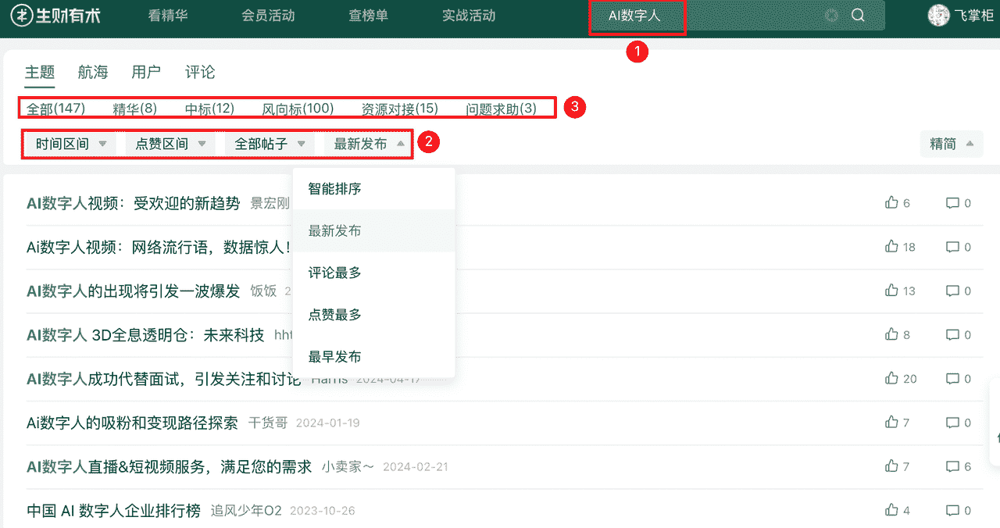 |
| --- |

## 2、星球电脑搜索

搜索生财的内容可使用知识星球网页版，输入关键词后点击“当前星球”，搜文件建议用电脑版，方便下载，按照以下123步骤，可快速找到包含关键词的资料。

| 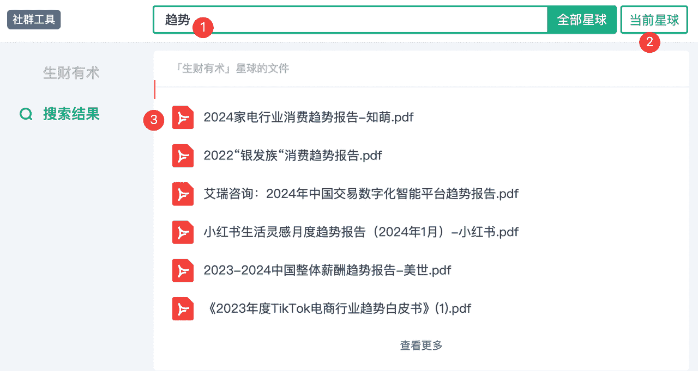 |
| --- |

## 3、星球手机搜索

通过全部、主题、文件、标签、用户5项标签进行搜索，文件、主题这两个模块和电脑版类似，但是标签和用户只有手机版有。

| 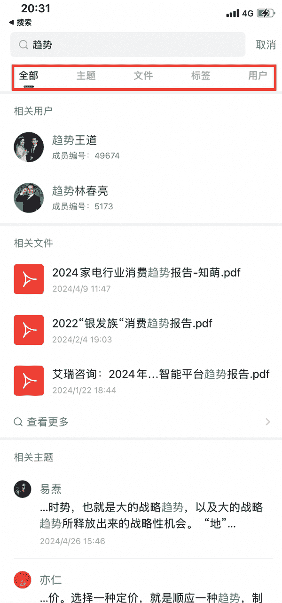 |
| --- |

【我的启发】

1、无论是生财还是其他社群，要用好生财搜索引擎，以及星球工具本身。我见过不少圈友提问，想找某个东西不知道“点哪里”，还是用得少。

2、我们的重点应该放在如何快速实操拿到结果，不断修正并长期深耕，而不是浪费在系统功能本身。看星球内容尽量用电脑版，方便复制粘贴，做好信息整理，也方便自己快速做笔记，以免错过重要内容。

# 四、生财引擎

## 1、看帖：精华帖、风向标相关

和星球菜单类似，多了如下几个分类：

**1）热门：**即浏览、点赞、评论、较多的帖子。

**2）航海手册：**往期所有航海手册精华，按照项目划分（时间紧的话，优先看自己所在项目领域的）

**3）时间区间：**可选最近一周、最近一月、自定义（时间紧的话，优先看最近一周的）

**4）点赞数量：**0-10、10-50、50-100、100+（时间紧的话，优先看点赞最多的）

**5）智能排序：**最新发布、评论最多、点赞最多、最早发布（时间紧的话，优先看最新发布的）

## 2、实战：航海实战相关

**1）往期活动：**查看所有往期航海活动

**2）使用指南：**如何更好参与航海

**3）航海公约：**了解航海行动及注意事项

**4）生财好事：**航海好事（包括账号／产品流量新高、实现涨粉引流、开单变现、接到商单合作、其他好事等）、成长收获、生财表白。

| 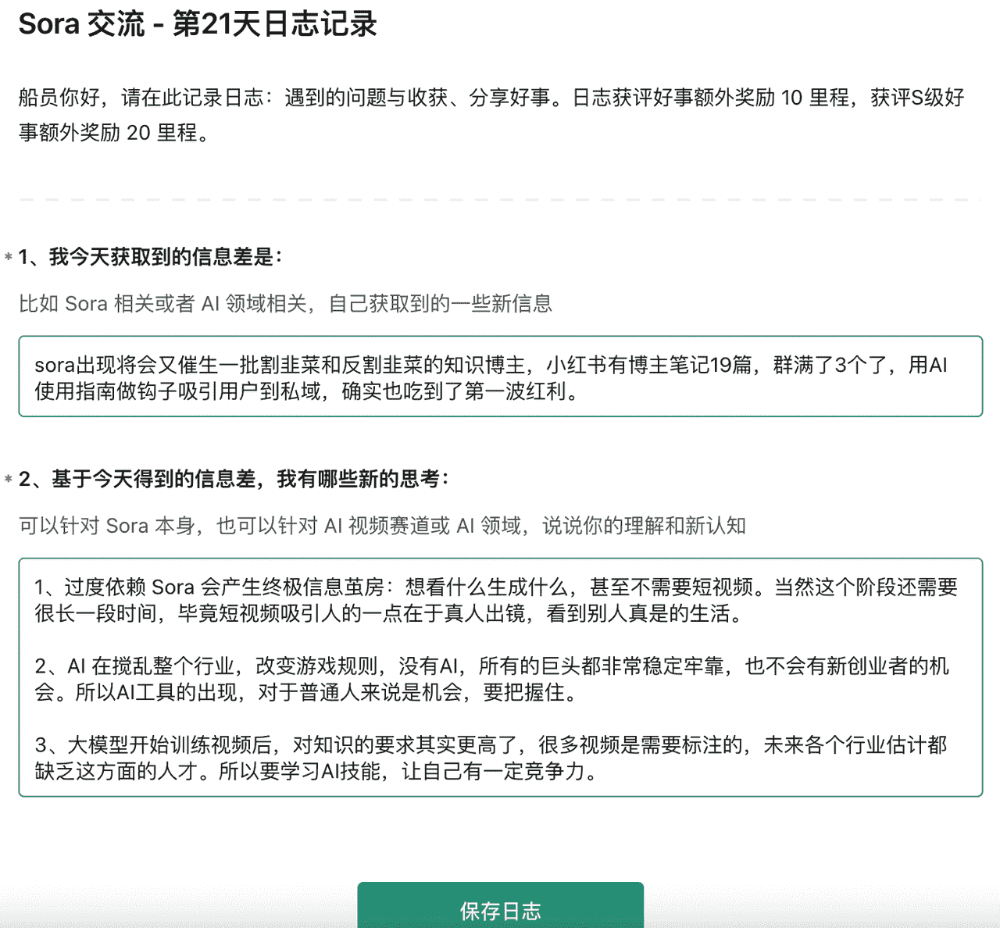 | 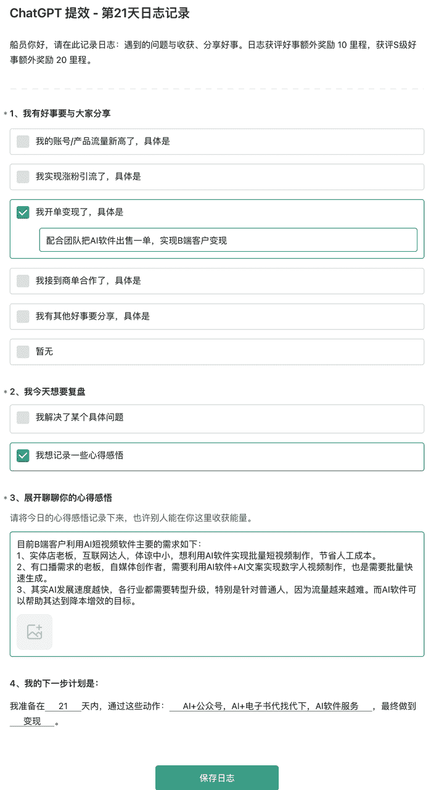 |
| --- | --- |

**5）经验分享：**如何多拿里程？每天完成打卡10里程，日志获评好事额外奖励 10 里程，获评S级好事额外奖励20里程。里程和术值等积分体系无关，但却是自己实战的见证。

## 3、活动：线下聚会相关

**1）参与：**你可以选择所在城市、选择感兴趣主题参与聚会，聚会押金一般99，现场签到+填写反馈即可退还。

**2）精选聚会：**优秀活动是可以展示给圈友，按照评分由高到低。

**3）排行榜：**可以看到活跃的组局官和地区。

**4）我的日程：**可以看到我参与的聚会，发起过的聚会，待反馈的聚会。对于自己组局，一定要认真看反馈，这样你能知道圈友对本次聚会的评价，帮助自己改进。

## 4、我的：个人信息相关

**1）星球编号：**这是你生财圈友的认证，以及入同城群的凭证，有时候为了防止被非生财、想爆粉的人混入，当地群主可能会问你编号，在此处或星球可查看。

**2）编辑资料：**编写你个人资料，认真填写个人介绍，会展示在发起组局或者参与聚会的页面。

**3）龙珠榜单：**通过龙珠榜、精华榜、获赞榜、龙珠碎片榜、术值榜看生财优秀的圈友，头部前几名基本是大佬。

**4）体验卡分销：**对于感兴趣的伙伴，你可以分享给他3天免费体验卡，适合于群发或者参加活动邀请，也可结合公众号、小红书等进行推广。后台支持查看邀请总数、体验卡总数、转化总数、排行榜。帮助你了解邀请进度。

**5）项目库：**项目分类+精华帖

**6）我的航海：**查看历史曾经参加过的所有航海

**7）积分明细：**能看到自己获得龙珠、碎片、术值的时间和原因，不得不说，生财的龙珠体系运营地相当不错，给到圈友很大激励机制，其他很多社群都在模仿，但从未超越。

**8）专属鱼丸：**如果你找不到你的鱼丸是哪个，可以来这里查询微信号，事实上，你可能同时加了好几个鱼丸，任何一个都能快速咨询。

**9）清除缓存：**网页如果卡顿打不开，可能是官方升级网站，可以清除缓存后登陆，一般情况不用点。

【我的启发】生财每年的运营成本上千万，搜索引擎极大地帮助圈友减少搜索时间，快速找到所在领域的信息，这个产品本身就很有价值。所以，作为新圈友：

第一要熟练，用得多自然熟能生巧。

第二要聚焦，因为生财内容非常多，就精华帖和中标的风向标，估计都不一定能看到，所以每看一篇就要思考，自己获得什么启发，所谓“好记性不如烂笔头”，建议大家文字记录，同时也是对自己消化+输出的训练。

第三要实操，也就看过足够的内容后，要找到方向，尽快实操，只有把手弄脏，才知道细节可能出现什么问题，尽快跑通0-1，赚到第1块钱。

# 五、龙珠体系

## 一）龙珠体系介绍

### 1、龙珠体系官方介绍：

[龙珠体系介绍](https://shengcaiyoushu01.feishu.cn/docx/Dtuyd2u4hoad0IxpbZocMzBNnIe?_=1713886903)

### 2、龙珠权益官方介绍：

| 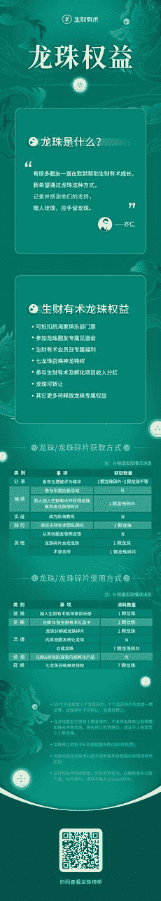 |
| --- |

## 二）我对龙珠体系的理解

### 1、本质

龙珠相当于生财内部的货币体系，是生财圈内的一般等价物。

### 2、目的

为了增加生财圈友的凝聚力，贡献者应当得到相应的回报。

### 3、价值

龙珠本身没有价值，是几万圈友相信其有价值，因此被赋予价值。

### 4、换算公式

1术值≈25¥，50术值＝1碎片≈1252¥，7碎片＝1龙珠＝5张门票≈8765¥，100术值＝1张门票≈2265-2765¥（1颗龙珠可兑换航海家门票，目前航海家8765¥/年，因此可大致按照这个换算术值和碎片的价值）。

## 三）龙珠具有哪些价值？

### 1、龙珠圈友称号

拥有龙珠之后，可以称自己为龙珠圈友，然后你发的每一篇帖子可以带自己的微信号，方便更多人链接到你。

### 2、进航海家俱乐部

生财的很多活动是不能花钱买的，必须有龙珠才能参与，比如航海家俱乐部，一颗龙珠可以兑换一张航海家俱乐部的门票，进入后也可参与航海家俱乐部孵化的产品或项目。

### 3、和亦仁深度交流

集齐7颗龙珠就可以和亦仁吃一顿饭，重点在于向大佬咨询，有很多伙伴和亦仁交流后后获得了微天使投资。

### 4、兑每年生财门票

一颗龙珠可以兑换5张生财的门票，可以自己用，也可赠送朋友。

### 5、龙珠圈友荣誉墙

集满三颗龙珠就可以被挂在龙珠圈友的墙上，这面墙在杭州生财总部。

### 6、兑换生财礼品卡

生财有很多周边及礼品，比如之前25术值可兑换生财T恤，以及伯虎螃蟹礼品卡，不定时开放兑换。

## 四）如何获得龙珠？

### 1、发帖

在生财有术发帖，被加精华，有机会获得1颗龙珠碎片～2颗龙珠不等。一般会在第2个月被公布。

### 2、买卖

手里只有一颗龙珠，不能卖，但当拥有两颗以上龙珠，可以卖，其他人可以买，买来的龙珠所拥有的权益是一样的。

### 3、贡献

担任生财有术团队顾问，可能获得碎片或龙珠；参加活动或重大贡献，比如担任生财实战访谈官，或者实战领航员，组织实战访谈直播，参与生财拉新，开辟新航海，可能获得碎片或龙珠。

### 4、合成

7颗龙珠碎片可以合成为一颗龙珠，龙珠也可拆成碎片。

### 5、教练

生财每次大航海的教练可以获得不等额的碎片或龙珠。

## 五）如何获得龙珠碎片？

碎片不接受买卖和交易，也就是说收集碎片的主要目标就是去合成龙珠。

### 1、发帖

被加精华之后，一些创意性很强，但没有达到龙珠标准的帖子，有机会拿到精华碎片。

### 2、教练

参加大航海当教练，会获得不等额碎片。

### 3、贡献

担任生财有术团队顾问，可能获得碎片奖励；参加活动或重大贡献，比如担任生财实战访谈官，或者实战领航员，组织实战访谈直播，参与生财拉新，开辟新航海，可能获得碎片奖励。

### 4、合成

50术值＝1碎片，7碎片＝1龙珠。

### 5、贵人

贵人碎片是为了答谢那些对新圈友有帮助的老圈友而设置的福利。规则是，靠自己的实力拿到1颗龙珠的人，在他获得第1颗龙珠的时候，拥有选择3个贵人的权利。注意：买来的龙珠不可以。

## 六）如何获得术值？

### 1、发贴

中标的风向标，可以获得一个术值，如果被加精，可能还会更多。

### 2、线上志愿者

当大航海的志愿者，每次大航海结束之后，领队会给所有的志愿者评级，评级标准包括上岸率、船员互动、是否有投诉等。一般来说可以拿到几十个术值。也可以当线上聚会的志愿者，协助组局官完成聚会，可奖励几个术值。

### 3、线下志愿者

参与线下活动组织的志愿者，根据参与次数和活动表现，可能奖励几个术值。也可当线下聚会的志愿者，协助组局官完成聚会，可奖励几个术值。

### 4、航海领队

担任生财大航海领队，和志愿者一起服务船员，根据表现也可获得碎片或术值。

### 5、新人融入营

生财为了帮助新圈友尽快融入，设立新人融入营，通过参加、打卡、复盘等可获得不等额术值，这给到新人足够的信心，在生财长期深耕发展。

|  |
| --- |

## 七）贵人计划

从2021年1月1号开始，所有在生财有术第一次获得龙珠（非转让非赞助）的圈友，除了自己获得的龙珠外，还可以获得三枚龙珠碎片的分配权，称之为“贵人龙珠碎片”。贵人计划官方介绍：https://wx.zsxq.com/dweb2/index/topic_detail/582512412151254

【我的启发】生财讲利他精神，这也是我喜欢生财的原因，众多高手将自己项目的完整心路历程进行分享，帮助其他圈友少走弯路，同时想法经过碰撞之后才能进一步被验证，在商业模式、产品体系、客户营销、售后服务等环境中是否能形成闭环。所以，我们在生财社群要多贡献自身价值，只有你“赠人玫瑰，才可能手留龙珠或碎片”。

## 八）术值、碎片、龙珠导图合集

一图告知如何在生财获得术值/碎片/龙珠及获取方式：

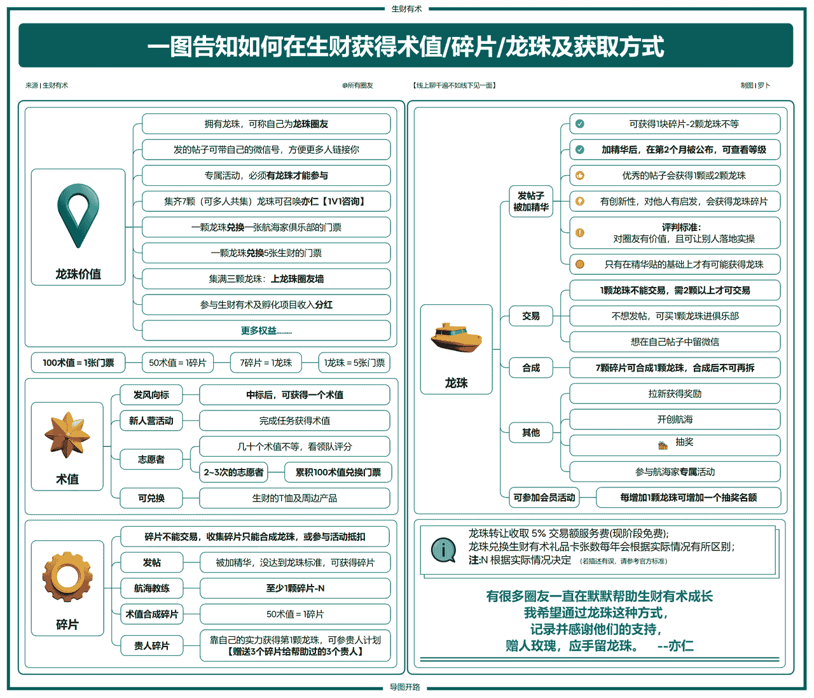

# 六、航海家介绍

## 1、是什么？

航海家俱乐部是生财有术的高阶社群，项目孵化器。汇聚了一波拿到实战结果的创业者，以更深度的合作为运营目标，让更多的项目从0-1，甚至从1-N发生。官方介绍如下：https://wx.zsxq.com/dweb2/index/topic_detail/584158512881824

| 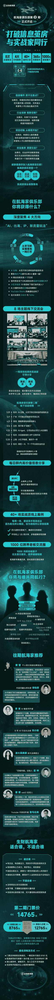 |
| --- |

## 2、如何使用？

生财将帮助优质项目复制放大，提供人脉、产品、流量等资源的深度连接与合作，项目孵化以及社群基金等支持。目前有孵化想法的项目包括：生财风向标，生财朋友圈（抖音账号），抖音SEO，10w＋级ChatGPT应用中国社区，海外SaaS 孵化器，深耕版航海计划、各行业垂直交流群，快团团供应链，AI绘画训练营等。

## 3、怎么加入？

航海家俱乐部目前为审核制，需要已经有结果的圈友先加入进来，运营稳定后，将开放邀请推荐制。如有兴趣，可询问生财有术服务官鱼丸。

# 七、微天使投资

## 1、微天使介绍：

航海家俱乐部成立的初衷，是和大家一起合作孵化新项目。为了更快启动优质项目的投资和孵化，亦仁面向航海家俱乐部成员推出「哥伦布计划」。本计划第一期将由亦仁个人拿出 100 万元，微天使投资 100 位航海家，希望聚集和长期陪伴优秀的年轻人，一起成长，微天使官方介绍如下：

https://wx.zsxq.com/dweb2/index/topic_detail/211225251118481

## 2、微天使报名

生财的愿景是：通过孵化和投资，成为 1000 家圈友初创企业的股东，带动 10 万新增就业。这件事具有巨大价值，帮助优秀的圈友从0到1并从1到10，值得花七年以及更久的时间去做。正如亦仁所说，硅谷有个YC孵化器，估计过几年，中国也有个很牛逼的孵化器，它的名字叫 SC孵化器。

所以，感兴趣的圈友可以报名：https://scys.com/view/form/Fe2VFe6x

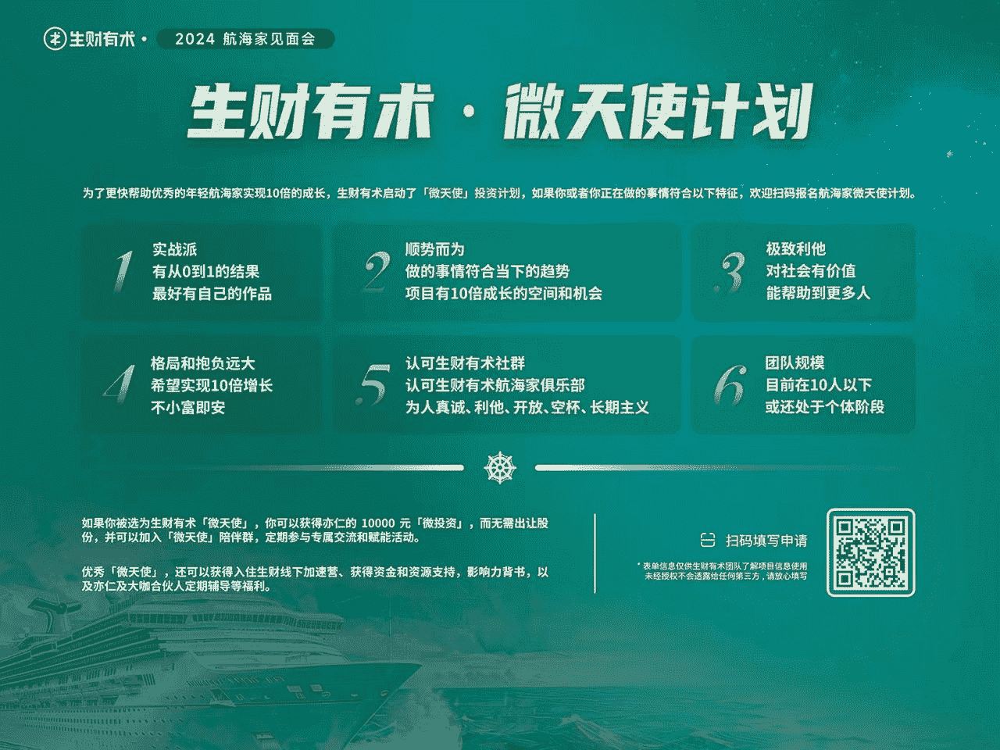

【我的启发】

1、之前我做过一级市场股权投资业务，对于普通人来说，想要参与私募基金这样的项目，无论是种子轮、天使轮，还是A轮、B轮～PreIPO轮，需要的资金量太大，基本不现实。

2、微天使就是很好的一个计划，如果你是资金方，可以去和亦仁聊聊，一起参与投资，如果你是项目方，可以打磨下自己的产品，合适的时候被投资，借助亦仁和航海家俱乐部的资源放大。

# 八、社群总结

哪些社群必须参与？作为新圈友，我的建议顺序是：

## 一）同城社群

### 1、线上社群

加入生财后，可以联系鱼丸，或者生财其他官方人员，申请拉入当地同城群，线上聊千遍，不如线下见一面，群内会及时发布各类重要通知，以及每周的线下聚会。

### 2、线下聚会

多参加，学习其他组局官经验，以及圈友的赚钱认知和实战经验。也可自己多组局，锻炼组织协调、沟通表达、总结复盘能力。聚会包括主题交流局（以参与成员之间的交流互动为主）、干货分享局（以听大咖分享为主，交流为辅）、休闲娱乐局（聚餐、徒步、沙盘）、生财入门局（以学习如何使用生财有术为主）。让自己不仅能学习项目，还能交友娱乐，和大家打成一片。

## 二）风向标群

每个月发够4条风向标，可以被鱼丸邀请加入风向标共创群，在这个群内可以减少信息差，更快速关注到市场上的赚钱信息，交流风向标认知，针对一些机会讨论判断是否真的可以落地。

同时，这个社群非常卷，进入社群后，每月需在星球发布4条以上风向标，未达要求的将在次月被请下船，间隔1月后发标可获得再次进群机会，但名额有限可能需要排队，这种淘汰机制也会让大家重视风向标创作。

## 三）组局官群

如果大家想做组局官，进群后可以和各位组局高手交流学习。群内基本是各个城市组局高手，在组局排行榜中位列前几，群内会公布组局最新消息，比如聚会系统升级、组局经验相关，组局官也可向官方提出建议，协助线下聚会组织地更好，帮助更多圈友成长。

在这个群里，你也能收到官方对于线下聚会的最新功能通知，这里我不得不赞叹，生财对于圈友提出优化建议真的有在开发，而且迭代速度很快，点赞生财的运营和开发团队，我愿意贡献给他们术值，哈哈哈！

## 四）志愿者群

线上志愿者、线下志愿者、航海志愿者都有对应社群，建议大家体验生财一段时间后，参加志愿者锻炼自己。社群会交流志愿者服务经验，你能见到很多优秀的志愿者，看他们是如何为船员服务并帮助船员拿到结果，如何开发插件辅助志愿者后台系统，我身在其中一年，感触极其深刻！

## 五）航海家俱乐部群

如果你拿到龙珠，或者付费加入，可以在航海家俱乐部群见到众多大佬，他们基本上是各个细分领域拿到结果的高手，群内还有很多项目孵化以及投资事宜，不仅能开拓思维，也可参与感兴趣的项目。无论是被投资或者投资他人，都能让你更上一个台阶。

# 九、未来计划

主要包括以下7条，我根据自己的理解做了解读，原文来自亦仁大大：https://t.zsxq.com/5j7DL

1.  增加“寻鲸之旅”航海模式：原21天的大航海可能升级成长达3～6个月的项目实战，让大家在航海结束后能持续深耕。

1.  增加“周末马拉松”线下全速航海模式：周末2天快速闭环某个小项目。

1.  与更多圈友合作成立赋能公司，让航海更快有反馈：帮助圈友放大。

1.  航海微天使/大天使投资孵化直通车：帮助圈友低风险创业。

1.  航海方向调整：分为四大块（趋势感知类、项目小切口类、赚钱技能学习、小团队专项），以及航海家专属航海。具体见海报。

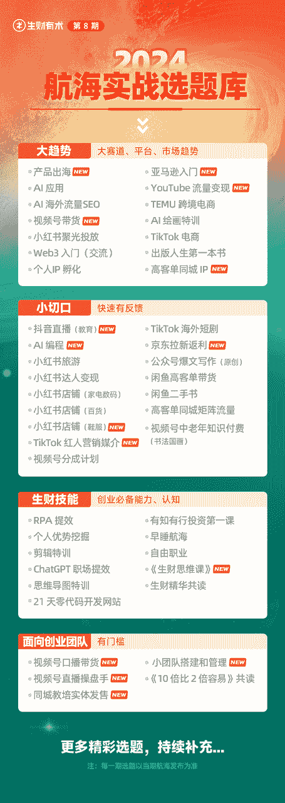

|  |
| --- |

1.  更深度的垂直高阶付费航海：和航海教练合作，开辟进阶航海。

1.  航海+AI：把AI融入航海各方面，如AI教练，AI知识库，AI鼓励师等。

【我的思考】作为新人，一定要关注平台动向，这些是亦仁观察市场后得出的结论，我们选择项目最好能够和其中的几条结合，一方面自己做项目有更多实操机会，一方面借助生财平台进行放大。

# 十、生财福利

## 1、生财会员日活动

https://t.zsxq.com/9BM1z

## 2、生财思维课

https://t.zsxq.com/2osWY

| 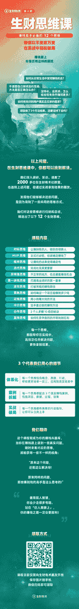 | 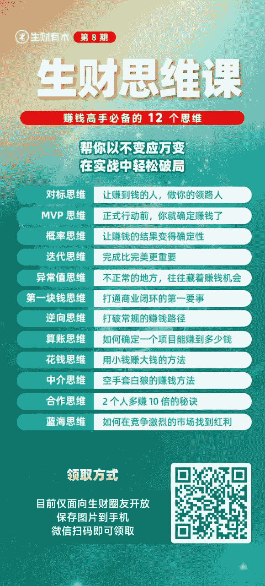 |
| --- | --- |

## 3、生财「扬帆正当时」定制手机壳和亦仁的一封「生财家书」（私信鱼丸领取兑换码）

https://t.zsxq.com/kxK9y

## 4、生财十大赛道

https://t.zsxq.com/kfslK

| 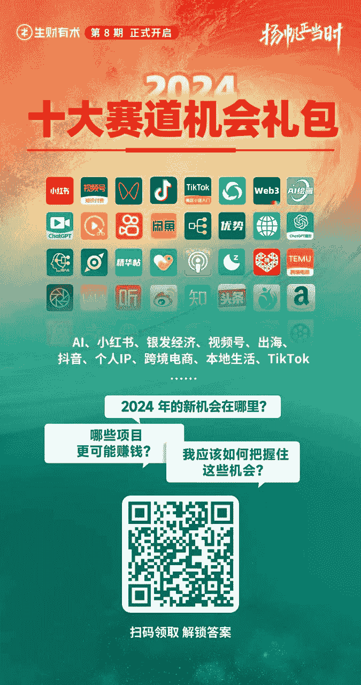 |
| --- |

## 5、生财相关干货资料

《2022年生财日历电子版合集》《2021年生财日历电子版合集》《2020年生财日历电子版合集》《人生亏钱指南》《100+赚钱高手提供的2021年赚钱建议》《亦仁百问百答》《亦仁益语》等，都是圈友和官方共同出品的精华。我把部分内容放在下面，也欢迎其他圈友补充，基本每隔一段时间都有新资料，要么官方发布，要么圈友整理，总之，干货源源不断！

[《生财日历2022》-生财有术社群出品.pdf](https://internal-api-drive-stream.feishu.cn/space/api/box/stream/download/all/OizJb5JijoMpWmx0qW9cLhUKneh)

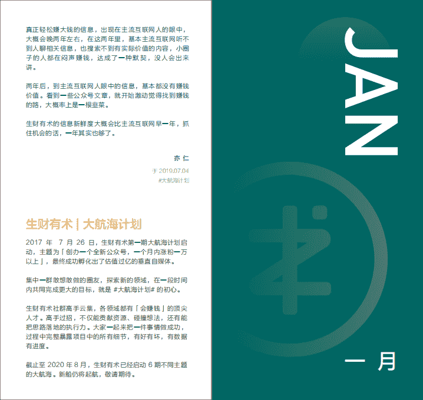

[《生财日历2021》-生财有术社群出品.pdf](https://internal-api-drive-stream.feishu.cn/space/api/box/stream/download/all/Ucojbzgu2ofmYpxThpFcGPUYnYf)

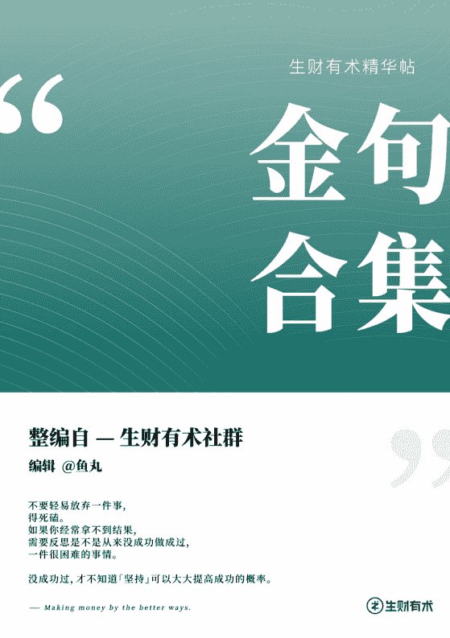

[《生财日历2020》-生财有术社群出品.pdf](https://internal-api-drive-stream.feishu.cn/space/api/box/stream/download/all/S1bGbAd5goxp55x21Gecy7SYnie)

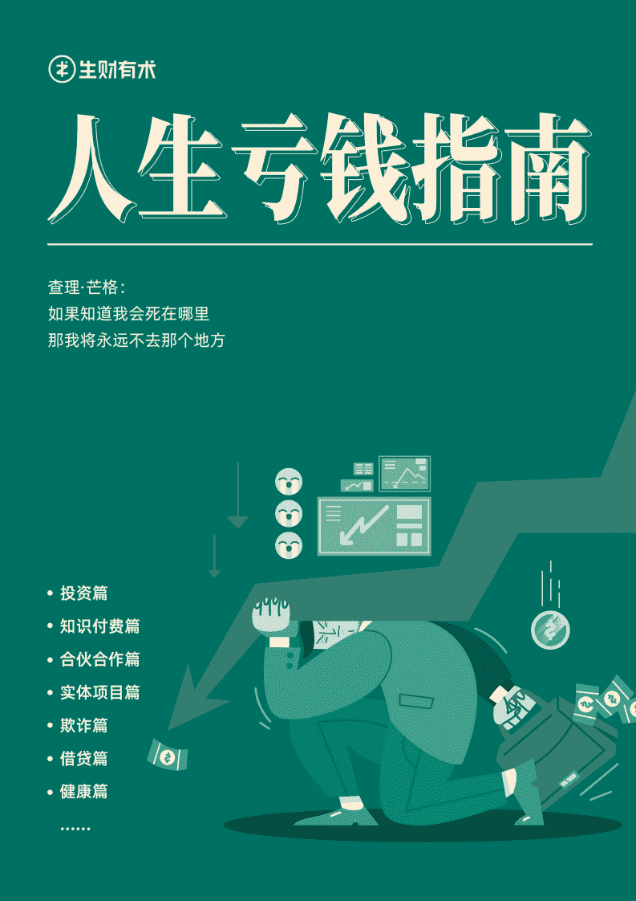

[《人生亏钱指南》生财有术出品.pdf](https://internal-api-drive-stream.feishu.cn/space/api/box/stream/download/all/ZqRMbsBE3oSFWkxVLUCccJOmnWe)

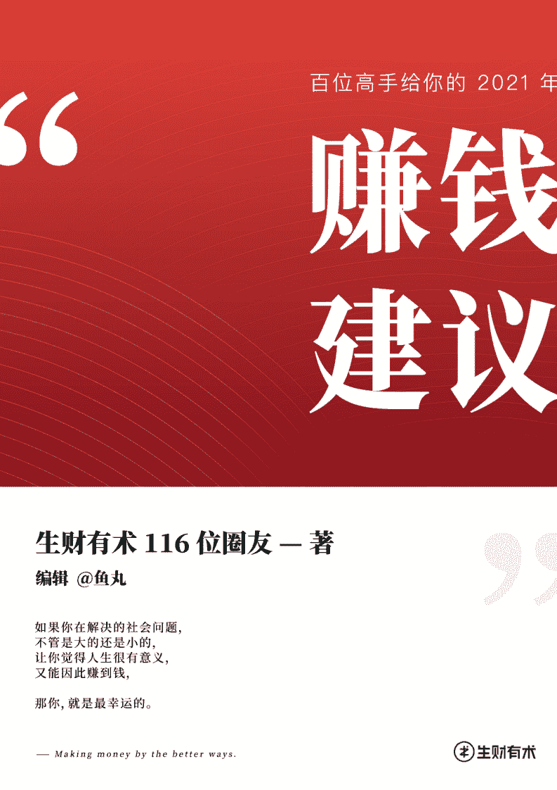

[100+赚钱高手提供的2021年赚钱建议-生财有术出品-完整版.pdf](https://internal-api-drive-stream.feishu.cn/space/api/box/stream/download/all/Syc0bwnhJogiMkxMawPcqepin3f)

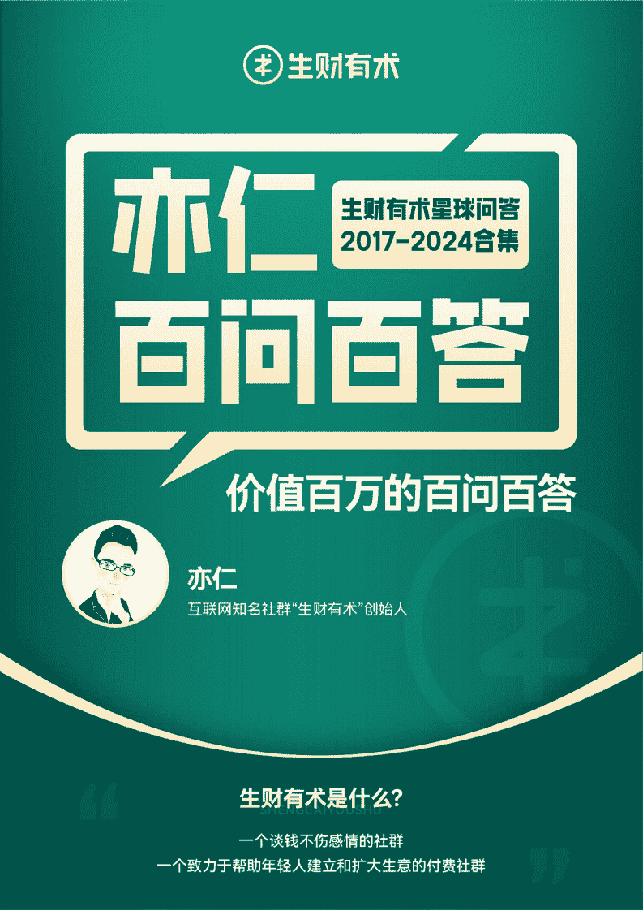

[《亦仁百问百答》——生财有术星球问答_2017-2024合集.pdf](https://internal-api-drive-stream.feishu.cn/space/api/box/stream/download/all/STpabFWckoY7S2xE0FtclD99nfB)

[亦仁益语.pdf](https://internal-api-drive-stream.feishu.cn/space/api/box/stream/download/all/UqLSbqJ64oPSqOxzqP9cP4zonsf)

## 6、生财有术项目精选

| 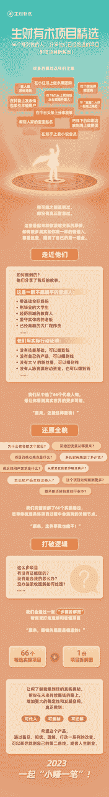 |
| --- |

## 7、项目训练营（和航海稍有区别，不定时发布）

+   **5天项目拆解营**

找到新机会后，快速掌握梳理完整项目方案的能力，为落地做好准备。

+   **6 天扬帆计划营**

手把手带你建账号，发布第一条内容，开启你的项目之旅。

+   **7 天赚钱机会挖掘项目营**

带你快速学习如何在小红书、抖音、视频号等平台上，挖掘能赚钱的新机会。

| 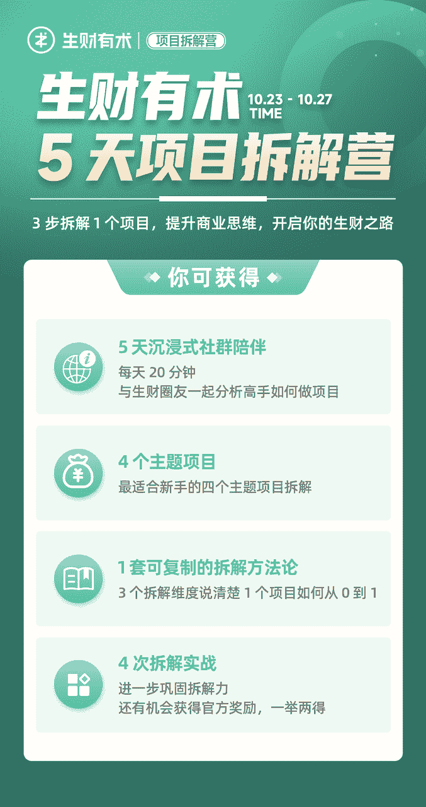 | 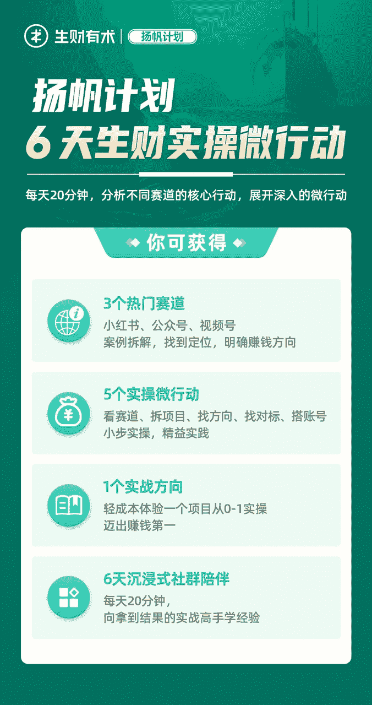 | 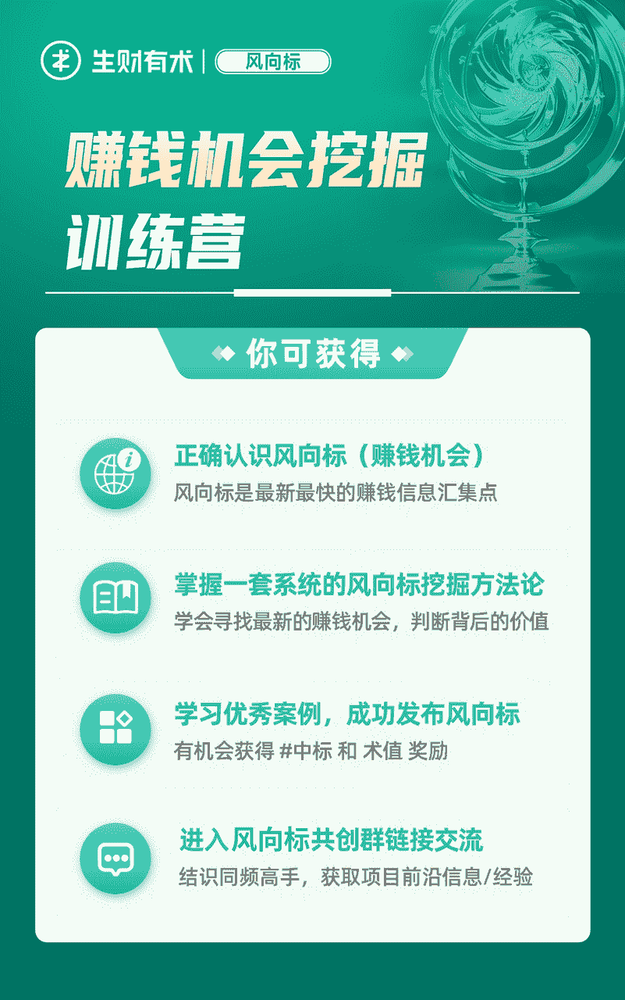 |
| --- | --- | --- |

# 十一、实战经验（生财小白从0-1进阶之路）

## 1、精华帖拆解

我看过500篇精华帖，每次看完都形成笔记，在自己的小圈子日更分享，2023累计分享365天，大概10万字左右，让我见识到了不同的商业模式、商业逻辑、商业思维、商业案例，打破自己固有认知：原来赚钱居然可以这样？

因此，我建议新圈友看帖子千万不要走马观花，而是应该脚踏实地，每看完一篇就要有收获，哪怕不能立刻下场实操，也要多想几个问题：他能拿到结果的关键因素是什么？我自己能否做类似的项目？如果能做，我需要具备哪些条件？如果不能，我在认知方面获得哪些启发？如此，让你刷帖就不再是“看后即忘”。

因[生财有术 | 第七期龙珠&碎片发放](https://shengcaiyoushu01.feishu.cn/sheets/shtcnoJmxPnbL8POSlFttgQoH5b)精华帖都会获得龙珠或碎片，因此除了生财搜索引擎，还可以看往期的精华帖文档【生财有术 | 第七期精华帖】

同时，看完后要自己写作，每次动笔不仅是对自己项目的梳理，还能够看出和高手的差距，比如你没被加精华，说明复盘贴还不足以给到圈友足够大的收获，还不是非常完善的SOP，还需要多打磨、多历练。

曾经有人问我，是不是只有拿到大结果才可能被加精华？我的回答是不一定，比如我精华中有2篇帖子，一篇是生财线下聚会复盘，一篇是电子书代找项目，非常小的项目，照样拿精华。所以，只要你的内容有价值，就尽管写，剩下的交给亦仁帮你判断吧。两篇帖子如下，希望给新圈友信心，我这种小白都能做到，你肯定也可以：

|  |
| --- |

【生财技能】一线实战经验，总结AI写作项目的100个核心问题和解决方案https://t.zsxq.com/uQJ7l

【生财技能】AI代写不会变现？50个问题+解决方案给你助力！https://t.zsxq.com/IgxhP

【生财技能】AI写作的三大易上手变现方式详细教程https://t.zsxq.com/aYtj7

**【生财技能】利用deepseek+ima知识库，3分钟搭建**强大的个人知识库和共享知识库，大幅提效！https://t.zsxq.com/j10aP

**【实战篇：基于生财风向标，承接找书项目**，6天变现2400，适合小白的上手项目】https://t.zsxq.com/19XUDYX4z

**【****精**简复盘：“ChatGPT应用及探讨”2023北京同城聚会SOP】https://wx.zsxq.com/dweb2/index/topic_detail/814482855545252

## 2、风向标发布

记得第一次发布风向标相当紧张，担心会不会被人看不起，会不会已经有人写过，发布之后还修改了3次。后来发现，生财每天产生大量的风向标，基本每个领域的信息差都会第一时间发出，且大家很忙，也没有人太多在意你发的是不是重复的，如有有人发过，自然不会中标，交给官方审核即可。

我自己觉得，重点应该聚焦在如何提升自己的商业敏感度上。比如我看风向标，会思考：这一条是我所在的行业，为啥我没发现还能有赚钱机会？这一条虽不是我的领域，但对我的项目是否有帮助？这一条为啥中标，是异常值还是趋势？这一条为啥没中，是不是有人写过，或者看似能拿到结果，但其实另有门道？看的风向标越多，越会激发头脑风暴。

目前我累积发布近100条风向标，也在持续发布，学习研究方面，除了生财搜索引擎，还可以通过以下文档快速查看：

01、风向标发布排行榜：

https://i.shengcaiyoushu.com/t/BOA7DFv2

02、第七期中标风向标合集：

https://i.shengcaiyoushu.com/t/BOA788Dc

03、第六期风向标中标合集：

https://i.shengcaiyoushu.com/t/BOA7Tzv2

## 3、志愿者经历

生财每年有4次固定航海，如果加上续航，估计5-6次。我一共参与4次志愿者，累计服务130多名船员，确实是非常深刻的体验，我有几个方面的收获：

第一是带头作用，要想更好地鼓励船员，自己先得做到。志愿者群里大家非常卷，不断想着如何能够更好的服务好船员，而自己带头打卡，就是最好的示范，这也让有懒惰心理的我，不停克服惰性，挑战自己。

第二是高效沟通，每天都和船员私信沟通，收获几位好友。航海是很好和其他圈友链接的机会，特别是志愿者，毕竟没有人会拒绝一个为自己全心全意服务的人，哈哈哈。我会咨询大家问题卡点，比如风向标航海中，对于打卡中标的，相互交流中标经验，以及潜在项目机会，对于未中标和未打卡的，发中标圈友链接，多加鼓励。

第三是时间安排，让自己每天工作节奏井然有序。一般是11点前提醒大家打卡，在特殊节点，比如12次就能上岸并拿回押金的，12点前重点提醒，保证大部分船员都能拿回押金，实施层面看，效果还不错。而且我的风格是金句提醒，金句来自生财大佬，或者航海家。举例我3月份的【chatGPT提效航海的21天催打卡文案】，加上打卡链接，效果很不错。其他志愿者们，拿去不谢。

1.  千里之行，始于足下，给自己一个好的开始！

1.  世界上最可怕的事，就是优秀的人比你还努力

1.  何以解忧，唯有实战！

1.  进窄门、见微光、走远路

1.  一个人可以走得很快，一群人可以走的更远

1.  积跬步，致千里；积小流，成江海

1.  现在的竞争，不再仅仅是人和人的竞争，团队和团队的竞争，更是背后圈子和圈子的竞争

1.  对待每件事都要全力以赴，争做第一，这是一种人生态度

1.  领导者制定规则，普通人遵循规则，草台班子玩转规则

1.  认知越清晰，执行越坚定

1.  战术上可以短期，战略上必须长期

1.  尝试需要勇气，坚持更需智慧

1.  人如果能找到自己擅长做的事情，是极其幸运的，但这个过程是曲折的

1.  不断试错和实干，排除错误选项，离自己的优势更进一步！

1.  发现小趋势、小机会，不掉队，建立自己的业务体系和基本盘，有自己的代表作

1.  定位和生态，你至少要占据一个！

1.  能力决定下限，机会决定上限，保持空杯心态，不断复盘迭代！

1.  让自己变得稀缺，才有价值！

1.  刻意练习，不断打破+重构，真的不是说说而已

1.  穷人的回忆都是创伤，恐怖的执行才能逆袭！

1.  极致利他，方能成事，荣幸相伴，江湖再会！

第四是商业嗅觉，和船员、领队、志愿者不断沟通，才能打破自身信息差。比如作为公众号爆文写作航海志愿者，哪些选题容易出爆款？怎么写标题吸引眼球？如何快速借助AI工具生成文章？哪些细分领域值得批量产出？怎么能放大流量主收益？等，充分交流后也许才有启发，而这些非常锻炼你的商业嗅觉。

|  | 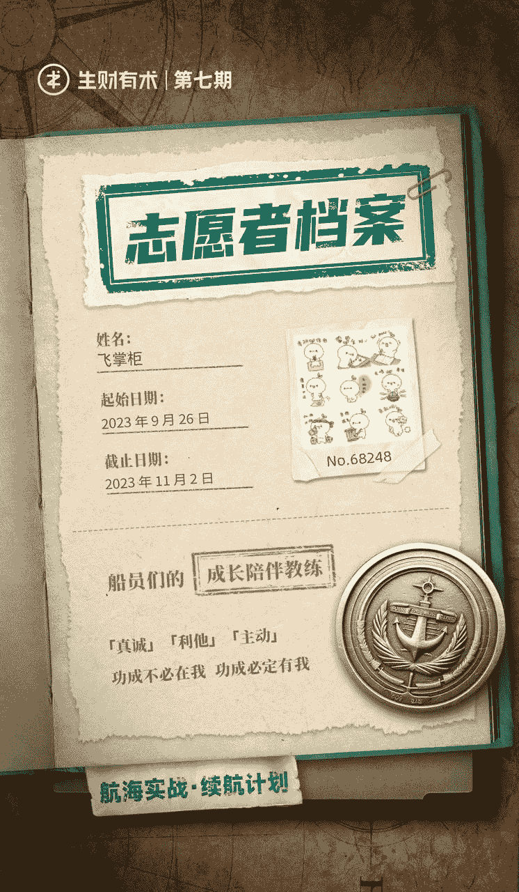 | 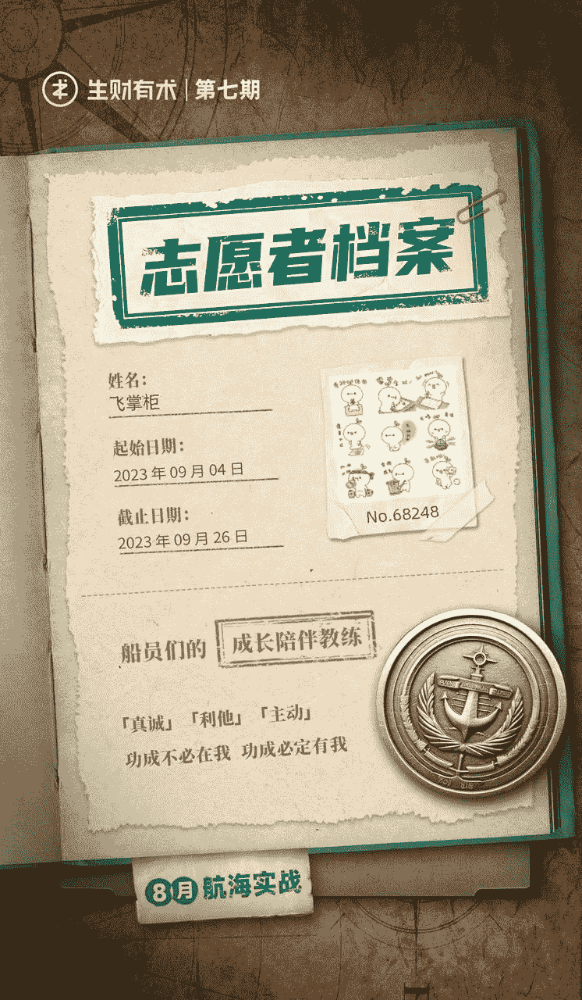 | 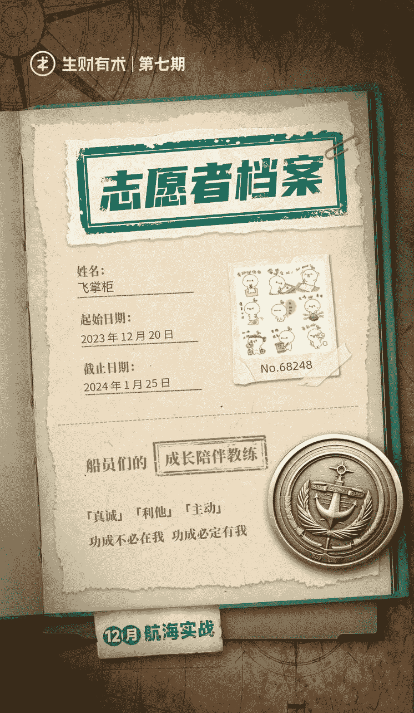 |
| --- | --- | --- | --- |

## 4、航海实战：项目从0-1

起初面对众多可选择的方向，比如知乎写作、小红书引流、公众号流量主、闲鱼二手书、抖音短视频带货、视频号带货、小红书带货、优势挖掘、AI代写、AI绘画、国内电商、跨境电商、海外工具等，自己眼花缭乱不说，还很焦虑，究竟应该选择哪个？

毕竟每个项目都需要花费时间精力，甚至有些项目并非零成本投入，因此不断刷精华帖，看风向标，参加线下聚会，期望能够得到建议。终于，参加完第一次航海，我就决定探索AI方向，这里我分享几点选择理由：

第一，如果你有主业，项目方向最好不要和主业偏离太大。我主业是金融IT咨询师，给银行、证券公司、保险公司、期货公司、基金公司、金控集团等金融机构做IT系统咨询规划和需求分析，这些B端客户有AI工具融入、AI场景结合的需求，因此做AI方向对主业有发展。

第二，如果你是全职副业，那么项目方向天花板要足够高，且符合未来方向。AI对于各行业的冲击想必不用多说，市场上的新闻铺天盖地，很多公司都在陆续推出AI产品，因此长期可做，且GJ和ZF也在大力推送AIGC在行业中的场景应用，涉及到教育、医疗、法律等专业领域，自媒体只是其中一部分。

第三，选择方向能和其他平台结合，有利于拓宽项目维度。比如我选AI方向，其实和知乎、公众号、小红书、抖音、快手、视频号等平台都能结合，AI可以帮助自己写文章、做图片，生成视频，这些都是内容产出，而内容是可以“一鱼多吃”的。

决定做AI后，我开始搭建产品，孵化出AI+公众号、AI+电子书代找代下、AI+小红书、AI+抖音、AI+视频号、AI+快手、AI+直播带货等细分项目。另外还做了读书会项目、陪伴群项目、北京落户咨询项目等，都是来自生财给我的启发。

## 5、航海实战：项目从1-N

做项目的过程中，由于客户不断提出新问题，我不得不调整项目方向，以及需要他人支持，因此必须从单打独斗变成团队合作。比如客户问到：你能否支持信用卡付款？能否开专用发票或者普通发票？能否公对公签合同？等，这些是个人做项目无法完成的。

当你个人已经能够完成某个项目的闭环后，相当于跑通了0-1的过程，那么接下来就想着怎么1-N放大。个人到团队，就是不错的选择。从他人的能力出发，和自己形成互补。面对客户一起交付，有了想法一起探讨，这些会逼迫你不断切入新的项目，或者商业的卡点中，去寻找对应的解决方案，以cover掉问题。

我目前项目的合伙人均来自生财圈友，航海实战后，大家因为相同的价值观走到一起，对于项目的基础认知和未来方向判断一致，于是一拍即可，即可开干。经过一年，跑通0-1闭环后，持续放大，所有项目输出内容大概100多万字，累计服务1000多位会员，60多位合伙人。

一个人也许可以走得很快，但一群人才能走得更远，进入生财圈就要充分利用平台的资源，包括项目SOP、官方服务、社群高手等，当然更要在其中多做贡献，持续践行利他精神，成为对圈友有助力的人。

我见到赚钱多的高手，多数喜欢分享，你说是不是毫无保留呢？不见得，但藏起来生怕别人知道的做法，注定走不长久。况且互联网时代，很多内容大家都在创作，说不定你以为只有你这里有，其实已经烂大街。

## 6、线上社群：角色带入

如果你还不知道自己擅长什么方向，可以看下如下角色，比如职场人、老板、大学生、自由职业者等角色，其他角色可以用生财索引站搜索。我自己当初是小白，但有主业，想着开辟第二曲线，于是带入职场人角色，看其他圈友是怎么做的，找对标，先模仿，再超越。

在生财，我见过太多圈友是从小白成长起来的，所谓的大佬，并不一定出生就在高点，而是经过无数风雨。所以说再多没有用，实操为王！

我也听过不少人想做创新，想做创新的第一步，是要先把已有的项目跑通，而很多项目SOP市面上已经有很多，你要做的是找到他们然后执行，在实践过程中加入自己的经验和思考，而不是一上来就想写一份专属于自己的文档，还想着别人为啥想不到，殊不知被多少人已经写烂。

1）微创新：其实是在小处优化，没跑通的项目，优化之后争取从0到1，已经跑通的项目，争取提升效率+降低成本。这些都是“微创新”，站在巨人的肩膀上看的更远，也更容易落地，从脚底开始，有时候反而更难。

| 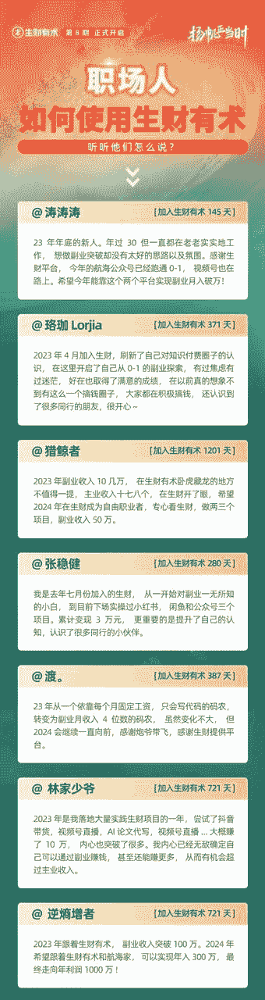 | 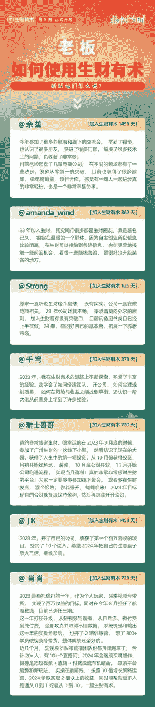 | 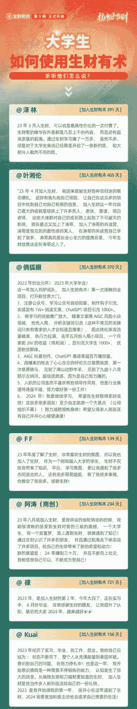 | 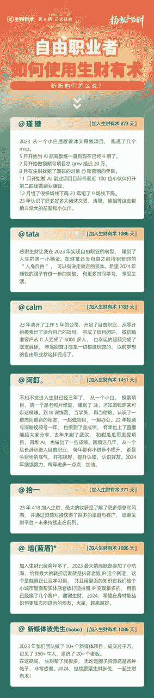 |
| --- | --- | --- | --- |

2）大的IP相当于网红，中等IP相当于圈红，小的IP相当于群红。如果你还没有能力成为网红、圈红，那么就先成为群红，做项目不一定非得是某个专业领域，社群本身就是产品，也就是自己可以建个群，在社群内具有一定影响力，先成为这个社群的KOL。

3）小的IP做久了，要通过加入一些优质的圈子，成为圈红，这样能够吸引更多志同道合的人，以及客户。比如在生财这个圈子，我见到的很多年入百万的大佬，他们同样有主业，但是不影响在副业的光芒，他们加入生财，是自己本身已经积累一定IP属性，通过生财内部的曝光得到放大，比如涛哥、梁靠谱、理白、七小等。

## 7、线下聚会：十条心得

加入生财后，一开始是参加其他大佬的组局，到后来慢慢自己上手，围绕财富流、AI、搞钱等主题，作为组局官组织10余场聚会，帮助150多位圈友相互连接，自己也获得超多成长，再次感谢各位圈友线下碰撞带给我的诸多启发！以下是部分聚会合影：

| 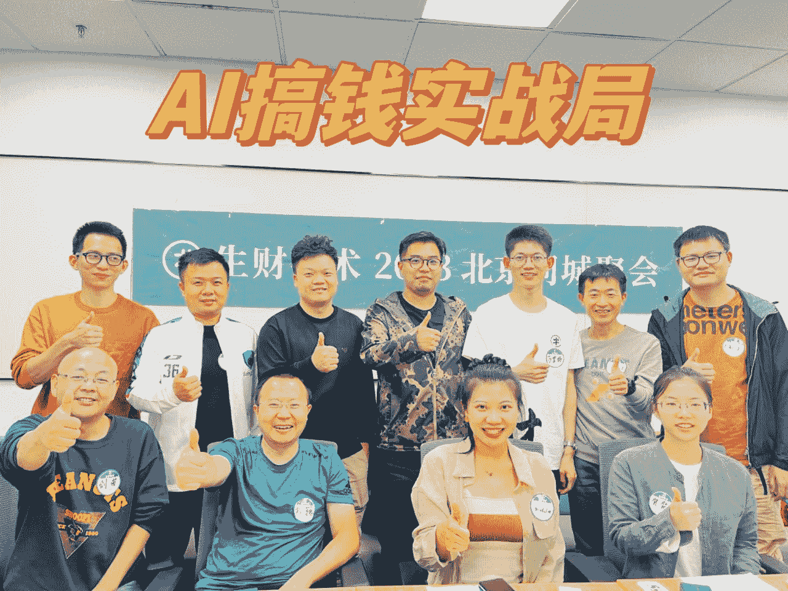 |  |  |
| --- | --- | --- |
|  |  |  |
|  |  |  |
|  |  |  |

### 1）扩大认知半径

指的是通过学习，不断增加知识和理解，拓宽我们的视野。可以是新技能、新方向、新思路，读万卷书、行万里路、阅人无数，通过碰撞和交流增加对自身所在领域的认知，持续保持好奇心，扩充自身知识库。

### 2）明确能力半径

对自己有清晰的定位和认识，明确核心能力、当前优势和限制不足。知道自己擅长什么，不擅长什么，可以帮助我们更有效地设定目标和优先事项，专业的人就该做专业的事，这样标签才能足够强化。

### 3）缩小行动半径

知道自己优缺点之后，应该集中子弹（自身精力、周围资源、所需人脉、资金支持等）在那些最能产出结果的领域。先完成从0到1的闭环，然后再探索从1到N的放大。

### 4）选择大于努力

能做的项目很多，做哪个不做哪个，都是选择，而选择大于努力，毕竟前行方向不对，所有风都是逆风。要知道自己能力最匹配的项目是什么，然后集中优势资源去攻克。

### 5）不断打开自己

做项目非常忌讳闭门造车，有很多内容不是自己学，才能输出。去参加一些课程，线下和高手见面，去听他人怎么输出，然后总结精华，转化成自己的东西。

### 6）多多换位思考

经常碰到客户挑战你，同行挤兑你，用户质疑你，这时候，你要换位思考，是不是自己的产品体系有问题？是不是触碰到了同行的利益？能否和同行在某些细节产生合作？自己能力是否还有欠缺，所以没有说服用户？等问题，这些都会让你不断完善自身。

### 7）持续输出检验

市场和用户是最好的试金石，是骡子是马拉出来溜溜，让自己持续曝光在视野之下，才能不断优化IP的方法论，立住标签，同时直面客户问题，积累一线经验，当他人咨询的时候才会不怵。

### 8）死磕写作能力

图文、视频、音频是信息传递的载体，特别是文字，任何时候我们都需要和他人交流，无论是家人、同事、客户还是合作方，写作能力非常锻炼一个人的输出，毕竟你写的好不好，只有经过验证才有结论。

### 9）接收正负反馈

你输出的内容是要给用户看的，表达的观点正确与否，宣传的产品能否转化，都得看用户买不买账，正反馈有利于你总结成功经验，下次不断改进，负反馈有利于你防止踩坑，从这个角度上说，用户也是你的合作方，他们给你输入了很多建议。正负反馈会让一个人加速成长！

### 10）无财作力，少有斗智，既饶争时

有人说，这是实现财富自由的三部曲，原文来自《史记-七十列传·货殖列传》“是以无财作力，少有斗智，既饶争时，此其大经也。”意思是：

（1）无财作力：没有钱的时候，用劳动力换钱，拼命积累能力。对应刚入职的年轻人。

（2）少有斗智：稍微有点钱的时候，懂得投资思维和杠杆思维，用智慧赚钱。对应在职场5-10年的中青年。

（3）既饶争时：有了不少积蓄的时候，要利用制度、体系，搭建公司、团队，用时间换空间，让钱去生钱。比如对于公司高管或者创始人，此时他们的时间非常宝贵。

而现实中，有不少佼佼者很早时候就进入了下一个阶段，所以要时刻注重搭建自己的管道收入，多向他们学习取经～

# 十二、写在最后

我从一个啥都不懂的小白，到如今取得一点点成绩，不敢妄自菲薄，要努力的地方还有很多。关于本文的写作，我也参考了其他10位生财高手的精华帖，附录如下，在此一一感谢，也推荐大家去看（特别是新手），加深对如何使用生财的理解。

1.  【杨涛：采访了50位新圈友后，我知道大家想要什么了， ---暨新手如何正确使用生财有术】https://t.zsxq.com/0ao9u

1.  【七小：《看了100+精华帖后，我梳理了一套赚钱的知识体系（超全新人指南！）》】https://t.zsxq.com/E7rha

1.  【HEXIN：生财10问，测一下你对生财的使用方法了解有多深？】https://t.zsxq.com/CREdK

1.  【沐文：【生财指南书】如何在生财赚回门票钱---生财SOP基础版】https://t.zsxq.com/WoIIR

1.  【郭晓文：【生财使用实例&锦囊】从搞钱新手到最懂新手的男人，我在生财有术的三年】https://t.zsxq.com/uLEA0

1.  【王小新：《圈友说：我是真把生财用明白了！—生财使用方法论》】https://t.zsxq.com/MTswB

1.  【十里村 村长：《生财九字箴言，让你在这里真的赚到钱！》】https://t.zsxq.com/WUAlq

1.  【轩辕：老水手教你如何用生财航海做成6位数项目】https://t.zsxq.com/YqZX1

1.  【轩辕：如何使用生财完成自由职业转型】https://t.zsxq.com/Mgl5D

1.  【罗卜：生财新手思维导图2份】

|  |  |
| --- | --- |