# 我是如何通过小红书打粉日赚千元的全套流程

> 来源：[https://xuqiwei1986.feishu.cn/docx/WfHKdSEbOoiY1OxYtVxctB0Bn1f](https://xuqiwei1986.feishu.cn/docx/WfHKdSEbOoiY1OxYtVxctB0Bn1f)

> 📚 做任何项目都应该是小闭环、正反馈。

# 一、内容大纲

1.  《了解小红书打粉行业》

1.  《打粉最重要的四大因素》

1.  《3天如何快速养号》

1.  《如何快速正确找对标》

1.  《如何快速制作作品》

1.  《如何正确发布作品》

1.  《如何安全有效导流》

1.  《如何快速变现》

1.  《最小MVP流程》

# **二、《了解小红书打粉行业》**

> 大家**好，我是千韭，韭菜的韭，**今天分享的是我怎么通过小红书打粉来做到日赚千元的，这是我自己用打粉方法成功跑通的项目，做的是情感赛道，只要按照流程去执行，绝对没问题。另外我收集了全行业的打粉爆款SOP模板，有需要可以找我要，看看有没有你的行业，纯免费分享。

>

> 后续也会**持续的更新****，因为我**自**己也一直****在用小红书**打粉，所以对于小红书的政策改变，玩法更新等，都会及时进行研究，这套方法是适用全行业的。

>

> 接下来我们正式进入分享，**打粉**指的是通过在小红书平台上，发布**爆款作品**，并且**留下钩子**让客户**添加微信**为目的，目前主流的都是以**领取资料**、免费咨询、服务等噱头来吸引客户，从而让客户添加微信进行后续的转化变现。

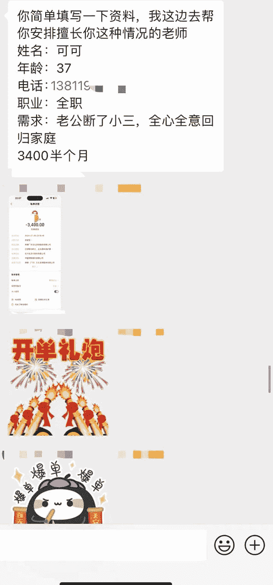

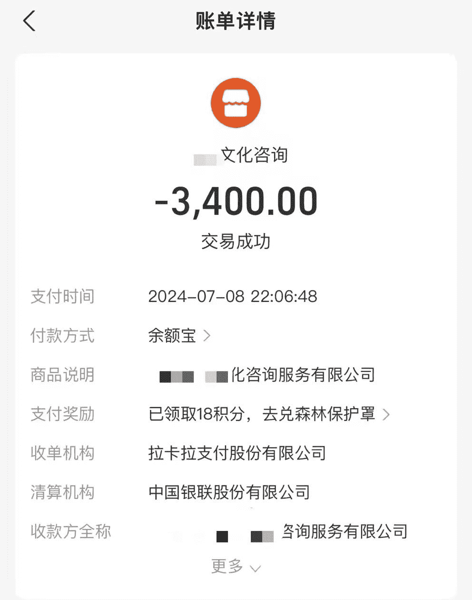

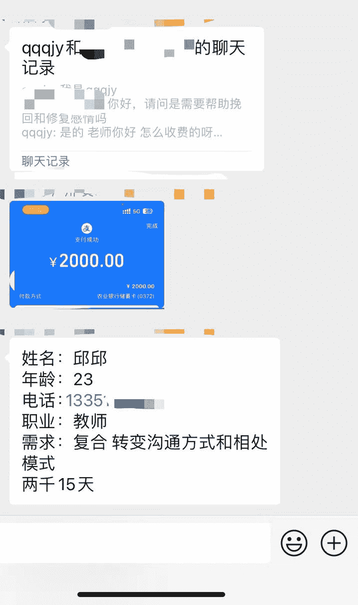

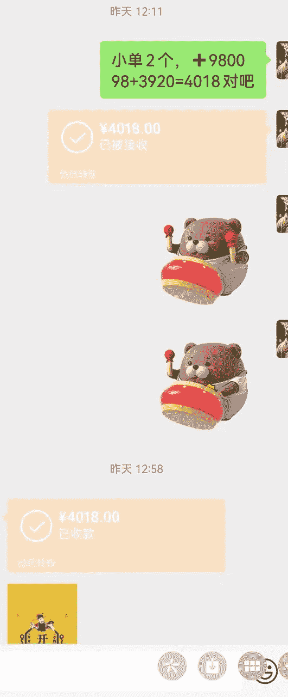

### 四大主流打粉方式

#### （1）稳定输出型打粉

> 目前大部分**企业机构****也都在**用**这种方**式打粉，因为这种打粉方式在获客**方面更****持久、更**稳定，但缺点也很明显，就是需要通过长时间的作品更新，才能起到获客的效果，当然，我是推荐大家在打粉方式上要雨露均沾，爆力废号型打粉和稳定输出型打粉都要同步进行，这样在数据上会更稳当。

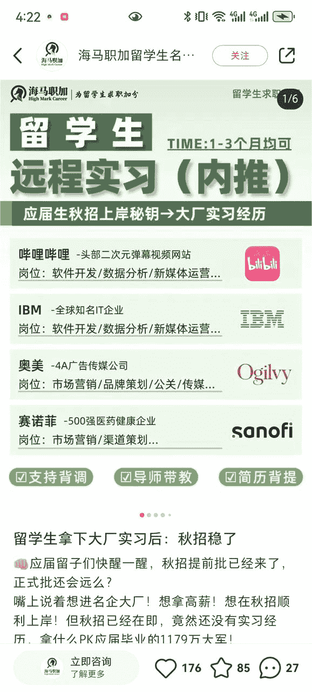

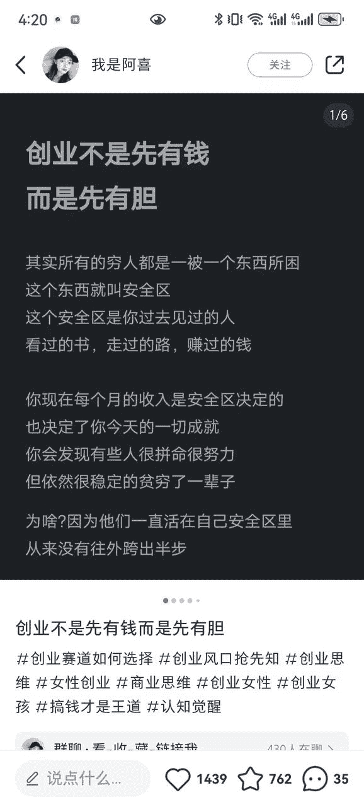

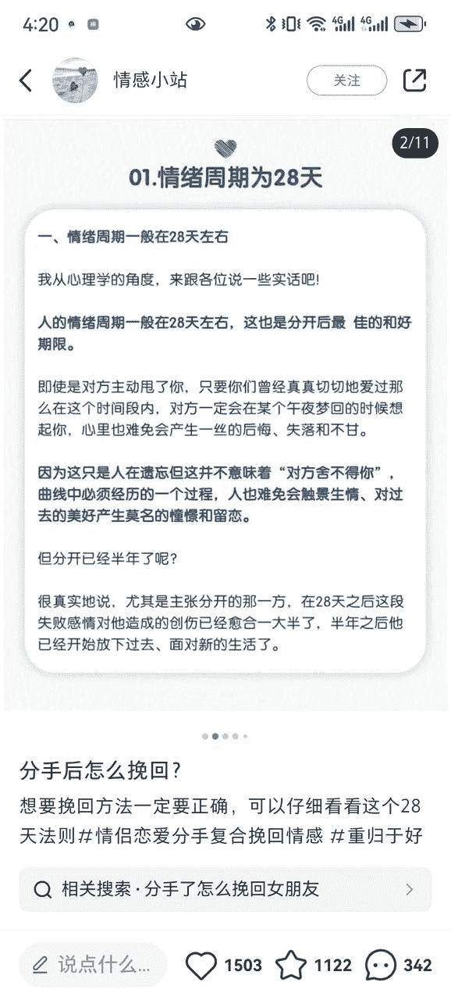

---

#### （2）暴力废号型打粉

> 目前废号打粉是**个人玩家****最为常见的打****粉方式，****它的**优点在于能**够快速获**取大量的客户，但**缺点同样****明显，就**是容易被平台封禁，该打粉方式需要通过购买大量的小红书账号，用矩阵的方式进行爆款模板的铺设，通过平台赛马机制跑出爆款作品，同样推荐大家也要把废号打粉方式进行完全掌握。

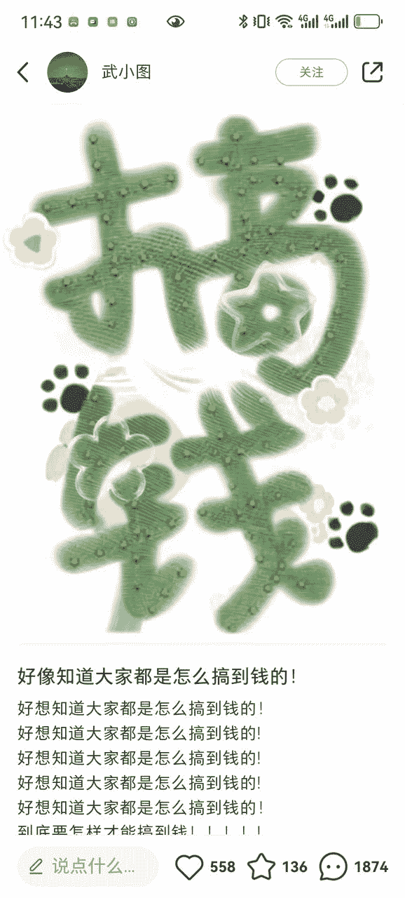

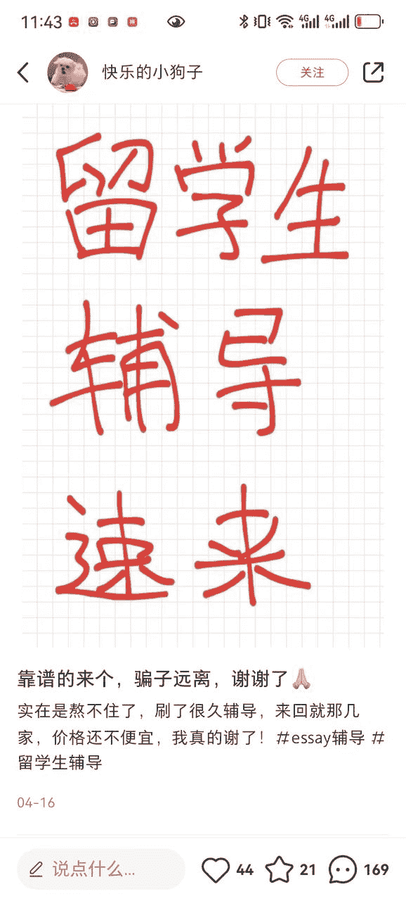

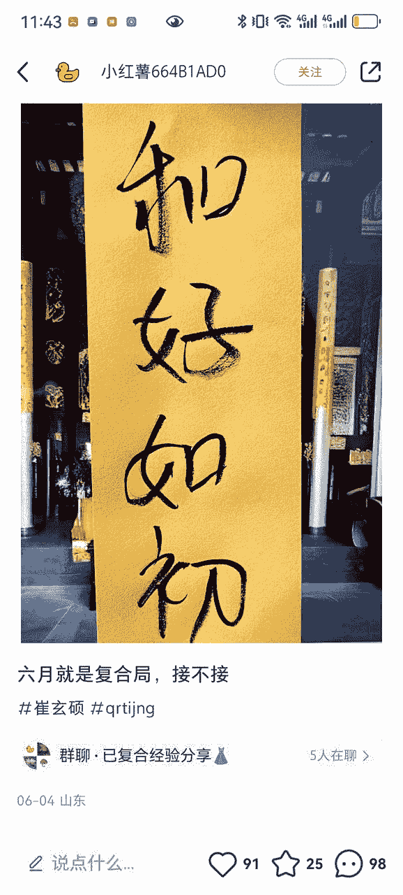

---

#### （3）代发合作型打粉

> 代发指的是**通过别人**的小红书账号，来发自己的**爆款**作品！目前市面上有专门的团队**提供代发**服务、均价在**5元-10元**每篇，也有人专门出售这类**代发粉**，**均价在3元****-5**元每个。**你自**己也可以通过稳定输出打粉或者暴力废号打粉的方式，在小红书平台上获取这些代发粉，组建自己的代发团队，代发的价格每篇由自己确定，在组建的时候，要分长期代发粉和临时代发粉。

> 所谓长期代发粉，就是让对方把小红书的账号，修改成自己所要求**的账号，****然后**通过稳定输出型打粉方法，进行长期更新获客，但这里需要注意的是，有部分代发粉会偷偷卖账号的粉给其他商家。

> **而临**时代发粉，则通过暴力废号型**打粉方**式，进行爆款模板的铺设来获客，这类代发的账号容易被封禁，所以需要长期持续的招募。

---

#### （4）疯狂截留型打粉

> 这类打粉方式是通过在**别人的作品**里，进行发**评论**引导，或者**私信****意向度高的****用户，小**红**书平台每**个账号，每**天仅有1**0次私信的机会，所以这里需要学会辨别真实用户，还是同行账号，另外A种B收也是属于疯狂截留型打粉，所谓的A种B收最容易理解的就是，假如代发粉发的贴子爆了，而你就需要在作品下进行评论，再通过评论回复的方式，将评论置顶在前面，还有一种方式就是，直接让代发粉手动将你的评论进行置顶。

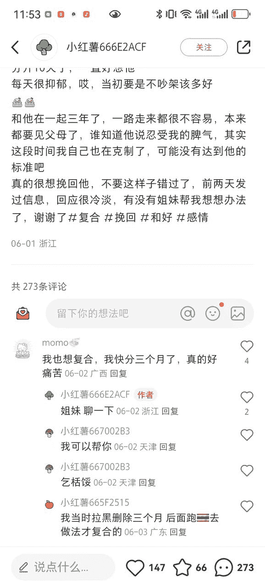

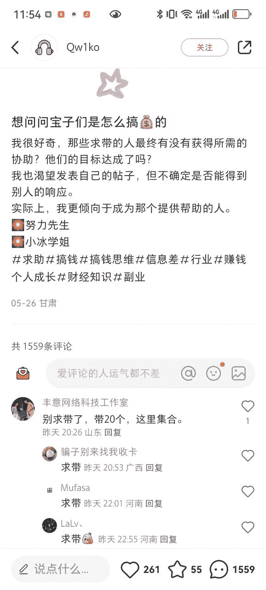

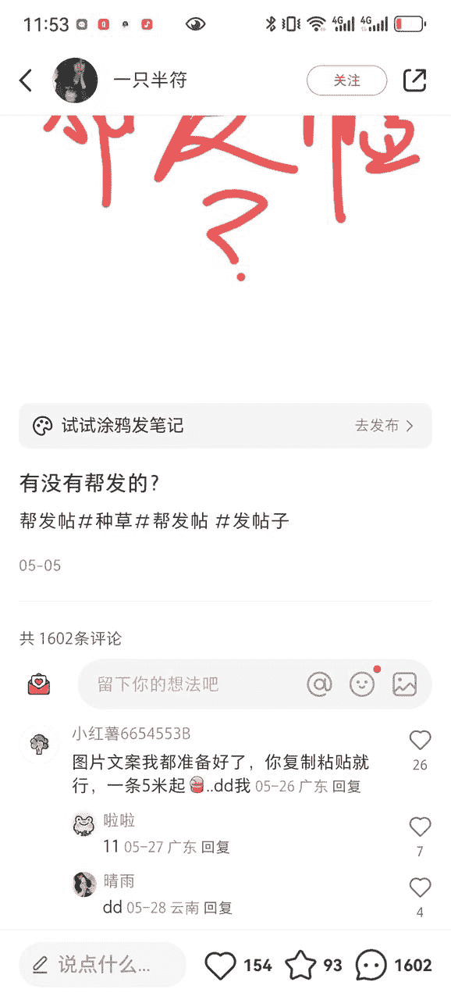

---

### 四种打粉变现方式

#### （1）出售粉丝变现

> 出售粉丝指的是向**机构或个人**出售粉丝，市面上有专门收购各种粉**的人，他们****有的是中介****、有的是**机构，收粉的标准和价格会根据行业、要求不同而不同，一般是以数量为单位进行结算，每个行业的单价都不同，这里列举一些市场上的标准价格仅供参考。

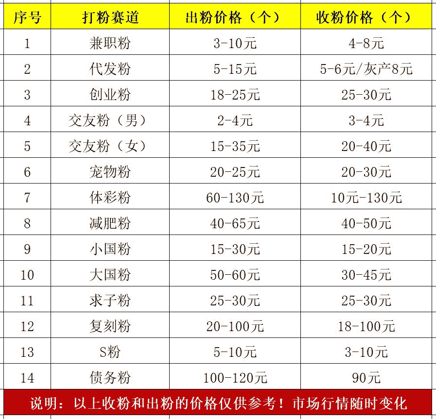

---

#### （2）机构合作变现

> 和机构合作一般分**两种模式**，有按照**数量结算**的、也有按照**分成结算****的，这**里以情感行业举例，按照数量结算**一般**是每个有效粉的价格在20元-40元区间，需符合**有效粉的**标准才计数，这里**所谓的有效、指的****是机构给**出有效粉的标准，而分成结算的方式则是按机构成交来算，一般分成在每单20-40%，这些都要自行和机构沟通确认，和机构合作也有很多注意事项，比如签署合作合同、如何规避吃单、骗单等行为。

---

#### （3）自产自销变现

> **一般最****常见的就**是通过，自己在小红书上打创业粉**，然后加**微信卖资料、卖课程、卖项目等变现方式，目前主**流的知识****付费均属**于这种模式，可以**搭建自**己的个人IP，持续不断地给自己的粉丝，提供价值变现，但这种变现方式，需要具备一定的能力，已经属于个人IP范涛了，这类变现方式可持续变现，因为当下会给你付费购买知识的人，大概率五年后依旧愿意付费。

---

#### （4）售卖坑位变现

> 售卖坑位也有**两种**方式，第一种是你的账号发布的**作品爆流****了，可以****和收粉商或****者机构**谈好价格，用A种B收的模式来评论区接资源，第二种方式就是作品爆流后，直接让收粉商或者机构把账号登过去，自己管理私信和评论，这两种方式都是不确保资源量的，价格需自行和对方谈。

---

# 三、《打粉最重要的四大因素》

> 小红书打粉有四个**最重要**的因素，每个因素都是**环环相扣****，只**要在一个因素上出现了问题，都会导致打粉失败，这四个因素分别是手机、网络、账号、模板，接下来我们针对这四个因素一一进行讲解。

### 手机设备

#### （1）苹果手机

> 一般打粉**前期**只有两三台的话，可以考虑选购**苹果8以上****的型****号，****在操作和性能上都**比较顺畅丝滑，**而且**刷机也很方便，可以用爱思助手很快就能够解决刷机的问题，选购方面可以在淘宝、拼多多、闲鱼、转转上面购买，一般价格在450-500元区间，但需尽量避免购买到工作室机。

---

#### （2）安卓手机

> 安卓手机适合**量大****的玩家****，因为市**面上有很多针对安卓，开发的黑科技软件，像批**量养**号、批量评论、批量**私信等，安卓部分**老机型容易被平台风控，所以**建议**选购红米或小米**10以上****机型，**选购渠道和苹果手机一样，但安卓买到工作室机的概率会更大，一般价格在450-550元区间，买回来后需要进行一次深度的刷机，可以用线刷大师来解决，如果自己不会刷，可以到线下手机维修店花钱解决。

---

### 宽带网络

#### （1）4G网络手机卡

> 这种卡就是大家平常在**营业厅**办理的手机卡，一般情况下，每个人都可以**分别在三**大营业厅（移动**、联****通、电**信），各办理**5张**手机卡，采用的搭配方式是1张主卡拖2张副卡，而副卡只要每张额外支付10元的卡费，即可共享主卡的流量，当然，你也可以找当地的业务员进行办理，都是一样的。

---

#### （2）软路由

> 软路由目前是工作室的**最终归宿**，它能够很好的**规避****IP重复、聚集等问****题，可以在拼**多多上购买一个软路由**盒子，大**概价格在300元-50**0元区间**，然后在你买软路由盒子的商家里购买IP、每条IP的价格大概在20-50元/每月，尽量购买那种独享IP，可以有效避免不良商家重复售卖同IP的情况，有优点就会存在缺点，缺点就是前期投入上比较贵。

---

#### （3）流量卡

> 流量卡一般就是**全国跳****的卡，这****种卡有利**也有弊，利方面就**是能够通**过切换IP来规避IP聚集的问**题，弊**方面就是能切换的IP不会有很多，这类卡首次购买需10元卡费，需额外充值15元30G流量，后续只需要每个月缴纳15元月租即可长期使用，每次充值都是以30天为期。

---

#### （4）本地宽带

> 本地宽带一般**不太建议**用来做小红书打粉，一方面是因为**成本**上**会更贵**，另外一方面是也会存在IP聚集的问题，之前了解到有人通过联通、电信、移动分别购买了多条宽，速度上肯定是没话说，至于效果上相对还是没有软路由更实用。

---

### 平台账号

#### （1）营业厅卡

> 这类卡养号**容易出**恭喜、或过推广，目前是出号**概率最大**的一种号卡，因为这类卡的**权重****出生就****比较高**，具体什么原因也不详，总的来说每个人都必须要办些营业厅手机卡来做，这样能够更快、更容易拿到结果。

---

#### （2）厅卡号

> **这类****厅卡号，相**对来说和第一种营业**厅手**机卡的区别不是**很大，****同样****是让**人在营业厅里办的卡，每个号的价格在5-20元区间，但这种卡也有弊端，真正的厅卡号不容易买到，有些不良商家，拿接码号当厅卡号来卖，另外就是有一定的概率存在账号会被人改掉的情况，但是这种概率很小很小！可以忽略。

---

#### （3）地推号

> 地推号指的是一些**地推团队**，在比较偏远的地方利用礼品、**奖品****等方式来让****中老年人****注册小红书**账号，这类号不是经常有，一般可以在百度帖吧里的地推吧找到这类源头资源，价格和厅卡号相差不多，每个号也是5-20元区间，当然！前提是能买到真的地推号。

---

#### （4）国内号

> 国内号分老号和新号，而**新号**则比较便宜，每个号的价格在**2-6元**区间，一般用来打**私信截留**或者发**评论截留**的比较多，很多工作室用软件**批量操作**的，用的就是这类号，主要是**成本低**、但效果不佳。

> 而**老号**主要体现在注册时间上，有些**注册时间****可达几年**，正常来**说这**类账号的权重**会很高**，但很多老号之前都被人用来**做过广告、要**么就违规过，想要买到真正的国内老号比较难，价格一般在10-30元区间。

---

#### （5）香港号

> 这类号由**香港**那边的手机号码注册的，也分新号和老号，这类号声称可以拿号直接登**录即可发****帖、发****评论、发****私信，不需要**养号为宣传噱头，其实很少能达到这种效果，至少测试以来，不养号基本发帖不能过推广，发私信和评论也很容易被系统吞掉，买这类号需自行测试鉴别，价格分别在10-20元区间。

---

#### （6）美国号

> 这类号由**国外****的手机号**码注册的号，同样也分新号和老**号，**一般新手玩**家不建议购**买这类号，因为它需要梯子**、或者结**合比特浏览器的模式来玩，操作**起来相对较为**复杂，后期可考虑尝试！价格分别在10-30元区间。

---

### 爆款模板

> **模板很重要**！无论是稳定输出型模板、还是暴力废**号型的模**板，都很重要，大家**要充****分的****理解“低**粉爆款”这个概念，**平常要多**刷小红书，把自己的账号**刷成自**己行业的垂直内容，这样就能够时刻的关注到行业内，最新最热的爆款模板，平台也要学会随手积累素材的习惯，建立自己的爆款素材库！

---

#### （1）稳定输出型模板

> 这类模板可以通过**关注****各大**机构账号，行业头部博主**来进**行模板的获取，也需要把**账号的垂**直刷成稳定输出型，经常把意向度高**的模板**进行点赞、评论、收藏的话，时间久了你打开小红书平台，给你呈现的内容大部分都是这类模板了。

---

#### （2）暴力废号型模板

> 这类模板是**最容易**找到的，直接在小红书平台**搜索相关**关键词，进行内容**筛选为最热**，找时间在**30天内**，点赞量高于**1000次**的，模板**类型符合****暴力废号****型的**，点进去查看作品评论，看评论内容是否都是需求用户，如果是就可以进行模仿。

---

# 四、《3天如何快速养号》

### 养号是玄学还是常规

> 很多小红书博主都说**养号是玄学****，没有意**义！养不养都一**个样，那****真的是**这样吗？其实不然，经过大**量的测****试发**现，养号是打粉的常规操作，无论你在什么平台上买的号，无论买的是什么号，我都建议你先养号，因为养号能够增加账号的成功率、以及权重，养过的号和没有养过的号还是存在一定的差别。

> 新注册的号虽然**没有违规****，但是权重都**相对比较低，**养号是为**了模拟正常用户的使用行为，提高账号的活跃度，和加分项，获得后期作品更多的推荐量。

> 平台**了解我们**的过程，是通过我们在账号上的**行为**来判断的，所以我们在搜索某个行业的关键词，刷某个行**业的****内容，系****统就会自**动的给账号打上相应的标签，使得后面打开小红书平台，系统就会推送你经常关注的内容给你，而这就是我们想要的，证明系统已经把我们的账号进行了初步归类。

> **模拟正常用户****使用小**红书，也同样在告诉平台，我**们不是机**器号，我们是正常的用户，避免被系统误判为营销号或者僵尸号，这种**情况很****常见，一**般新账号上来就发广告、到处发私信和评论的，很容易就会被系统判定为营销号，那么在后续的运营中，会存在低权重、低曝光的情况，甚至是直接把账号进行降权处理。

---

### 新注册号的起号流程

> 请大家**严格按照****起号的**要求来执行，养号是每位小伙伴的必修**课，**每天花1-2小时来刷小红书，收藏、点赞、关注、评论都需要做，一般新号要做三天的养号行为，后面会介绍每天的养号流程和标准。

---

#### （1）小红书账号注册

> 拿到新号先**不要急****着修改资料****，而是**先刷首页的发现，大概刷10个**作品左右，期**间每个作品都要完整的看完**，确保完播率，然后**再点首页的附近，会**弹出是否**开通定位，选不要即可，然后继续刷15分钟-30分钟的作品，期间刷到的任何作品都不点赞、不关注、不评论、不转发，刷完就可以了。

---

#### （2）首次修改账号资料

> 这是**第一次修改**资料，一定要把账号修改成**素人生活号**，头像可以选择风景、或者路人的头像，名字自行取，但不要和行**业相关，**就素人名称即可，**城市尽可能选**择和IP属地相同，年龄**设置在2**5-35岁之间，在隐私设置**里设置在线状态**为关闭状态，**在隐**藏设置里把关注与粉丝列表的选项打开，隐藏关注和粉丝列表。

---

### 如何刷账号垂直度

> **打开小**红书平台，**首页上**方最右边有个放大镜，点击后在搜索框中输入行**业关键词，这里****以情感行业为**案例，会以“分手挽回”“情感修复”“婚姻挽回”等热门相关关键词进行搜索，就会出来行业相关的作品，我们打开第一个作品开始，模拟正常用户往下观看作品。

> **如果你想**偷懒的话，可以在**上方****右侧的筛选选**项中把笔记类型改成**视频，这样你****就可以打**开第一个视频**，把手机放在旁边，大概**2-3分钟后翻下**一个视频。**每刷2-3个作品就要点赞/评论/收藏/关注，具体怎么分配看自己，但每天的硬性指标是要完成最低20个关注和20个评论，总的时长大概在1-2小时，可以把时间分为早上、中午、下午、晚上。

---

### 如何增加基础粉丝

> 在刷作品的时候，**主动****在作品**里评论，而且评论必须是那种能让人私信你的内容，比如情感行业的**评论就**是，“我**想要复**合，教教我”“怎样才能挽回，帮帮我”等等，这样就会有很多人关注你，初始的粉丝量就会蹭蹭往上涨，效果立竿见影。

---

### 结束养号的标准

> 重复“**账号垂直定位**”流程3天左右的时间，**账号粉丝**在**20粉****以上**，如果三天没有达到这个数量，那**就是你偷懒**没**有发够评**论，要么就是发的评论内容不正确，账号关注在60个以上。

> 其次打开小红书后，系统给你**推荐的作品****都是行**业相关内容，大概10条当中有6条即可，接下来就可以进入发作品的阶段了。

---

### 二次修改账号资料

> 完成了**养号流程**，接下来要把自己的账号**再次修改**资料，名称**7天内**只能够修改一次，所以暂时**不着急****修改，而简介7天**内可以修改三次，所以我们需要先**把头像、背景、****简介等信**息修改成行业相关的内容，但**不要放违**规内容，最好的修改方法就是找多位自己的同行账号，看人家是如何设置的，直接借鉴对方的内容进行修改最安全。

---

### 资料修改案例参考

> 以**情感行业**为例：

> **（1）**xxx机构/xxx老师（告诉用户我是谁）

> （2）国家二级心理咨询师（我很**专业**）

> **（3**）帮助500+情侣复合（我拿到结果）

> **（4）**两性情感 | 分手挽回 | 情感分析（我能为你带来什么）

---

# 五、《如何快速正确找对标》

### 如何找稳定输出型对标

> 稳定输出型的对标**最直接**的办法，就是通过搜索**精准关键词**进行寻找，这里以情感行业为例，搜索“婚姻**挽回”“**情感挽回”、会出来一堆的作**品，那**如何筛选稳定输出**型的****对标呢****，初步从****封面上去判断，**最简单的判断方法就是封面上的内容较为正规，看上去就很正式，这类大概率就是稳定输出型的对标了，点进对方的账号查看更多的作品，看其他作品是否点赞量也很高，如果是的话，可以用Excel表格将其记录下来，方便后续跟进。

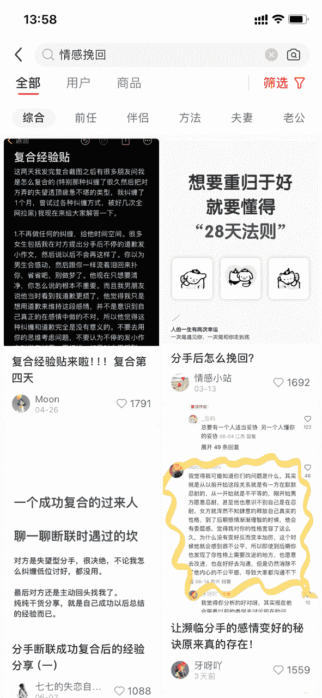

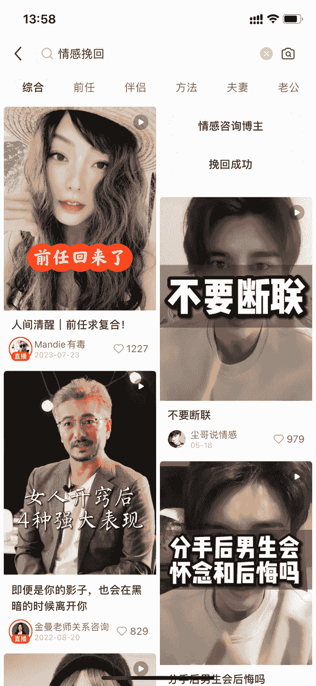

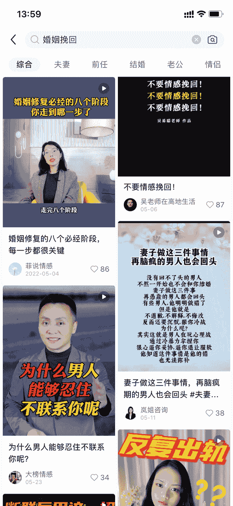

---

### 如何找暴力废号型对标

> 这类对标应该是**最好找**的了，直接在**养号期**间，把账号刷成行业**垂直****状态，**就可以刷出一堆废号型的对标作**品，但****是这类对**标一般都是找作品，而不是找账号，因为这类账号死的快，所以找到作品直接下载，然后对着作品进行临摹创作，切记不要照抄！

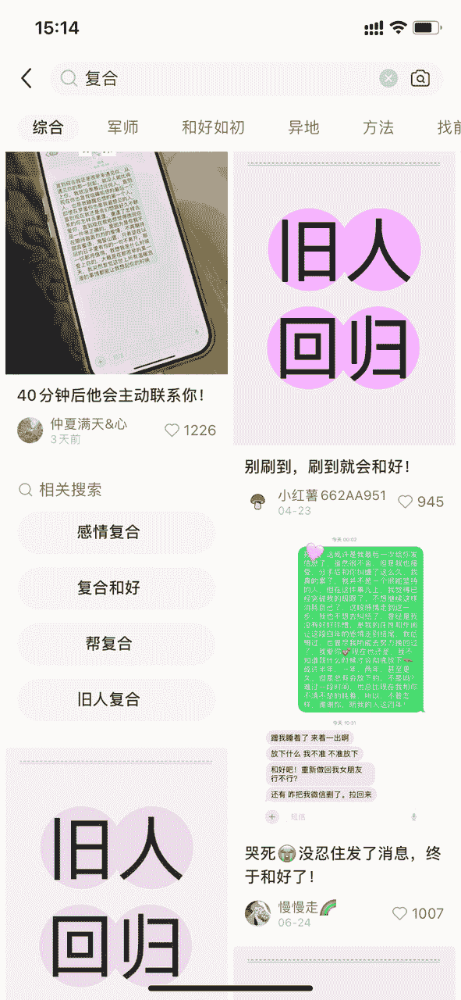

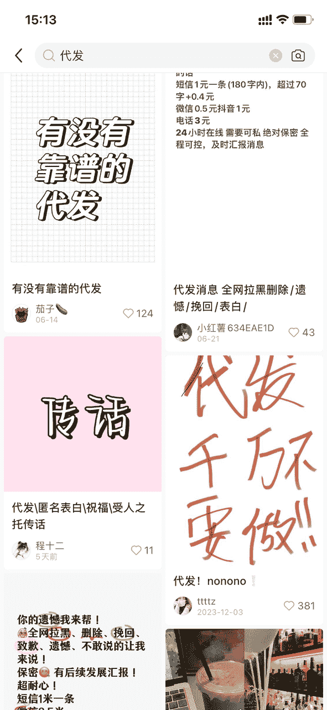

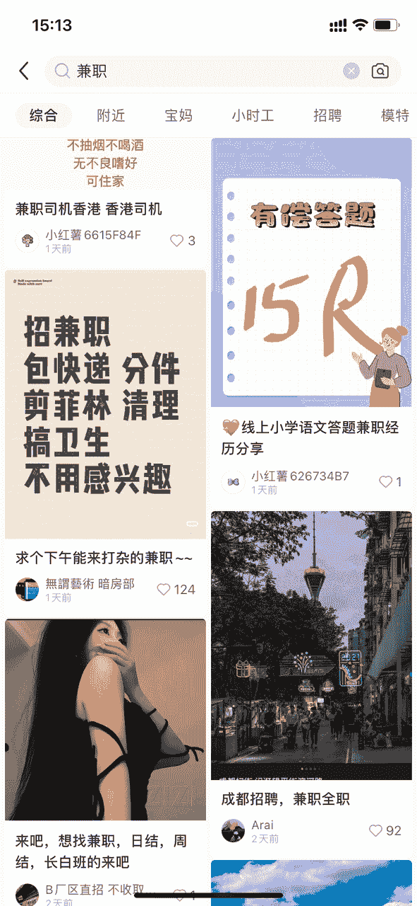

---

### 如何拆分对标各项数据

> **当你找到**对标账号以后，需要对账号进**行拆解**，为什么要拆解呢？**因为能够**最快速的了解到，**行业当**下最容易火的内容，**最适**合的下钩子方法**，转化率****最高**的话术，当你拆解到了一定数量后，基本你就掌握了该行业在小红书的秘密了。

#### （1）作品封面的重要性

> 以情感行业为例，通过在小红书平台里搜索“情感挽回**”，并且**进行筛选“最热”，出来后第**一篇是算法**推送为最热的作品，点赞量将**近有1**700次，这**篇作品之****所以**能够爆，和封面图的关系很大**，重点突出**了“想要重归于好”“28天”**“分手后怎**么挽回”这些字样**！那么对于**有这类需求的人群会停留，在小红书这种双侧信息流模式的浏览风格下，作品被往下滑走的概率是非常大的，所以吸睛的封面是提高小眼睛量的重要环节。

> **封面做的好 = 小眼睛量就高**

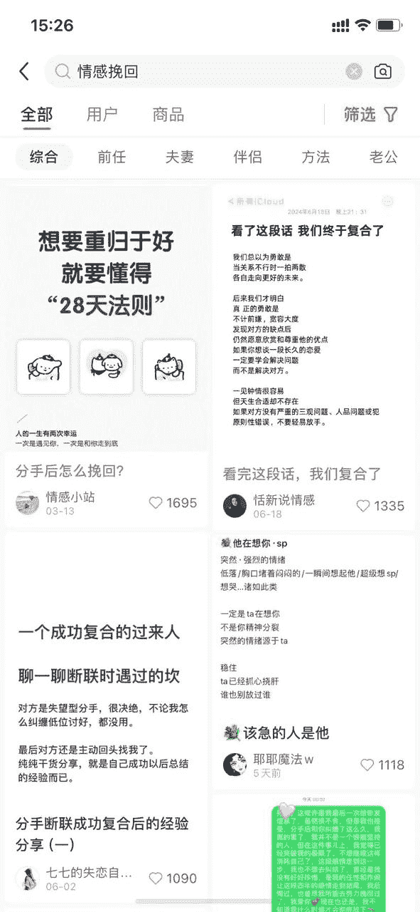

---

#### （2）作品内容的阅读性

> 当封面点击进来后，内容能否**留住用户**，留的住用户才能够产生**后续****的动作，**例如点赞、收藏、评论、转发，**所以内****容也是非****常重要的****，当你找到对**标作品后，内容不建议直接照抄，而是通过GPT或者百度的文心一言进行仿写，仿写后建议自己阅读一遍，看是否存在需要微调的地方。

> 文心一言指令：请对照以上的内容进行仿写，不改变原本内容的含义，但内容重复率不要超过50%，内容用词要生动且通俗易懂，不要用一些不常用、不常见的词句。

> 并且检查内容是否包含以下违禁词，如包含请替换，如不包含请忽略。

> 算命替换成蒜命

> 塔罗替换成塔锣

> 复合替换成腹合

> 电话替换成電話

> 联系替换成聯系

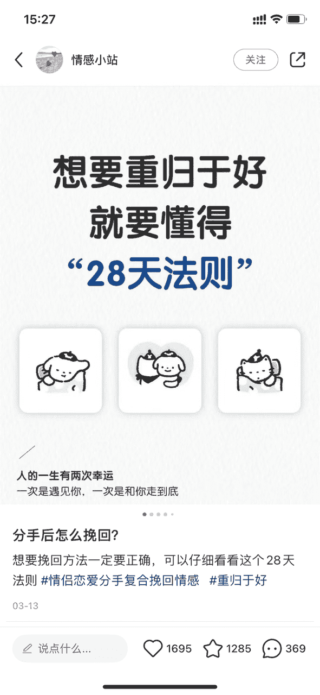

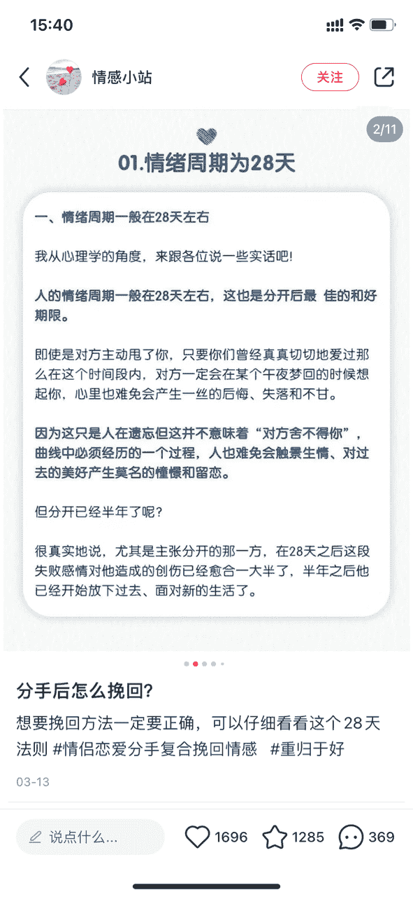

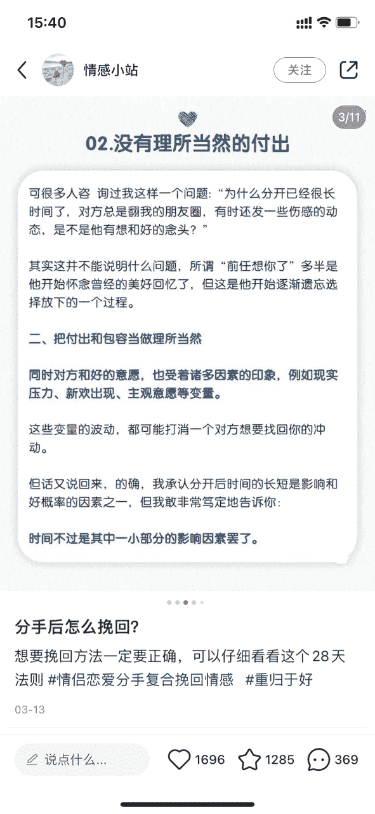

---

#### （3）作品评论区的布局

> 目前作品评论区也是一个**很重要****的点**，不管作品有没**有开始爆**，都可以适当的，找一**些水军来引导评**论**区的舆**论方向，一般一条评论价格在0.5元-1元区间，比如上述图中，你想让大家都在评论区里发“接““求带”“买了”等，那么最好的办法就是先让水军，或者自己的小号在评论区里发，后续就会有很多人跟着发这样的评论。

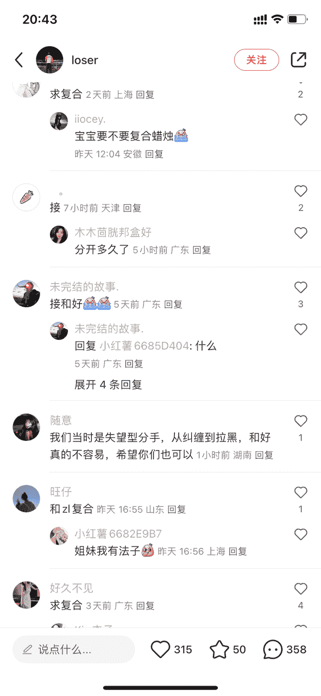

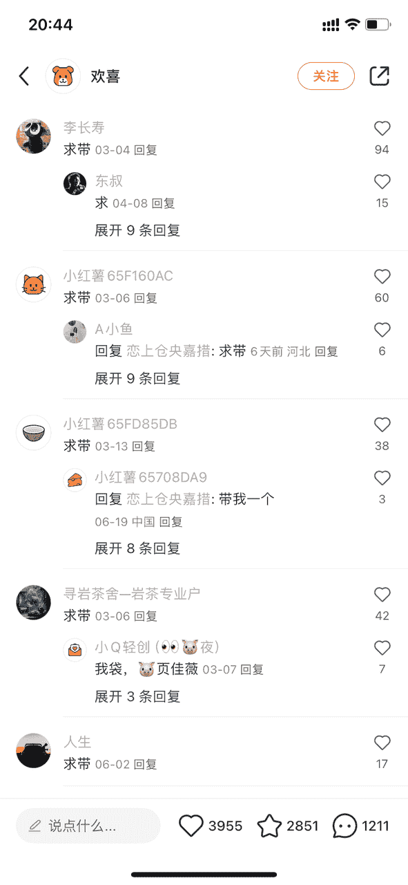

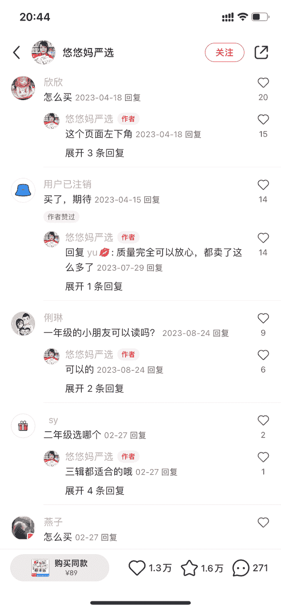

---

# 六、《如何快速制作作品》

## 收集行业爆款作品

> 在制作作品之前，我们需要先**收集近期**行业的爆款作品，并且要**一次性****收集齐50篇，****如果你想**对行业有更深层次的了解，建议你**收集齐1**00篇，用Excel**表格进行**统计，做这个的目的是为了培养网感，另外一个原因是让你了解行业的爆款选题方向，也方便解决后续内容更新的问题。

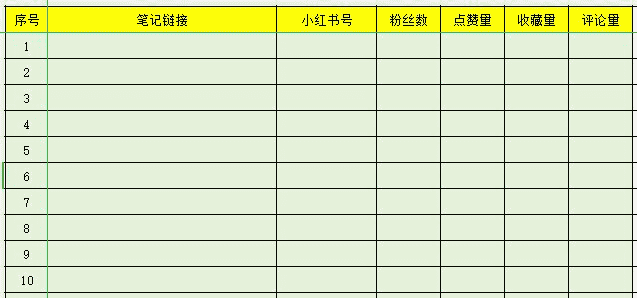

---

## 快速制作爆款封面

> 小红书是**双屏瀑布流**的方式进行展现的，目前依旧是以**图文**为主，所以这里也是以**快速制作****爆款**内容的方式，来教大家，制作爆款内容的工具没要求，这里演示用的是可画免费版工具。

> 打开可画网页版（www.canva.cn）选择合适的封面，这里以情感行业的作品为案例，如下图：

> 对的，你没有看错！这就是**一比一****的复**制，爆款的作品之所以爆，**肯定**是有它爆的原因，它已**经经**过平台和用**户的**筛选，所以我们要做**的就是复****制，**那么爆的概率会很大，当然爆款是赛马机制，不是说发了就一定会爆，另外复制的时候可以调整下内容的顺序，或者改掉一些不重要的字。

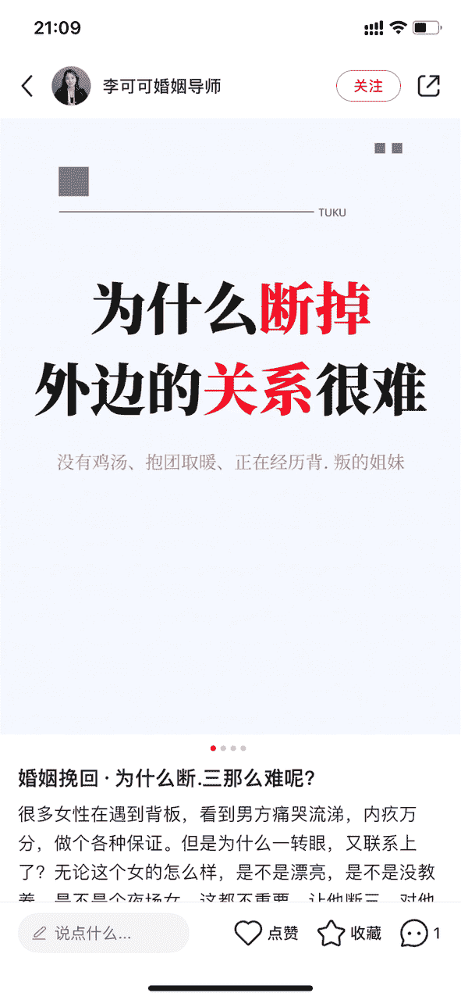

---

## 如何快速制作内容

> 内容和封面的制作方式是**一致的****，直****接在可画****工具**里，点封面上方的+号**进行复制**模板即可**，然后用**微信截图识别文字的功能（Alt + A）点击文字识**别即可把**内容抠出来，内容方面**可以**完全复制，也可以适当修改，这个看你自己，在做之前可以先用小红书违禁词检测（https://xh.newrank.cn/analysis/forbiddenWords），有些违禁词同行能发，但是你不行，一方面是账号权重问题，另外一方面就是运气问题。

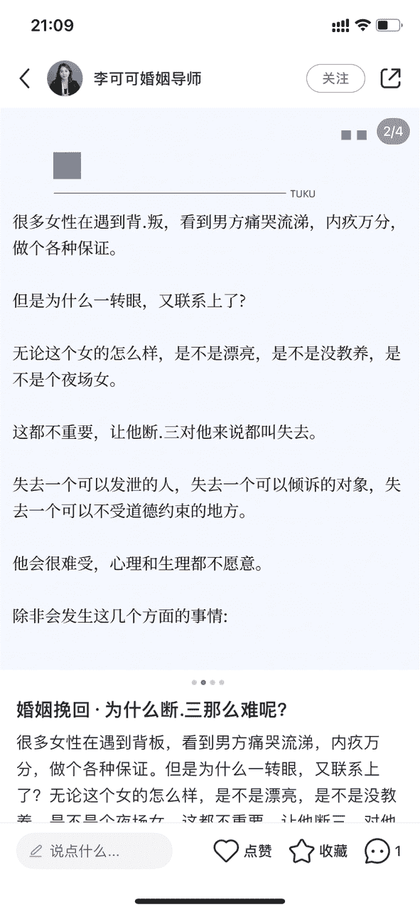

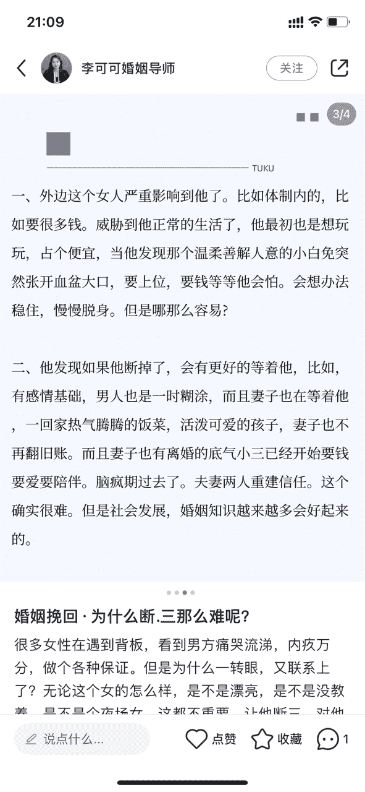

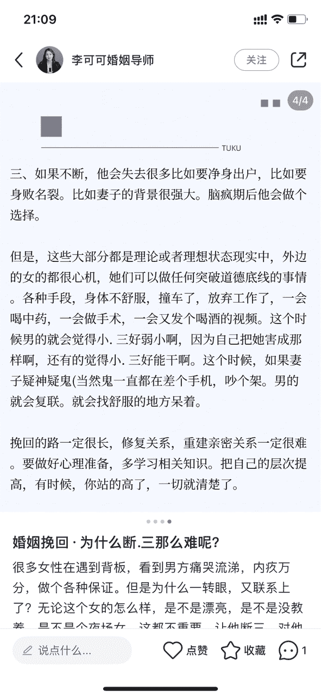

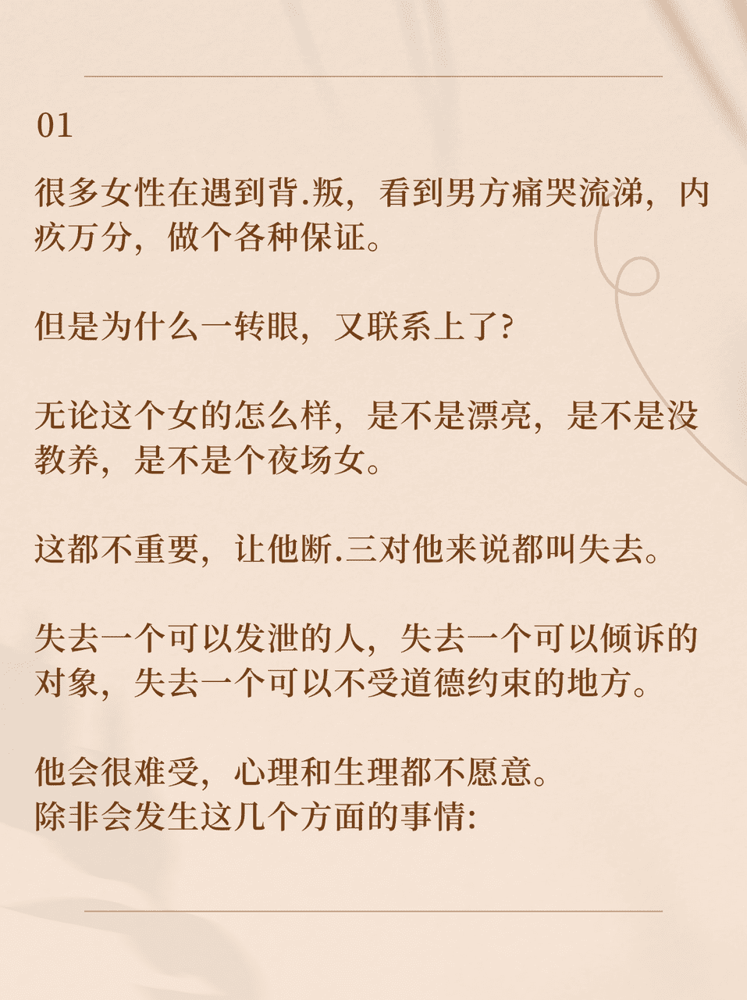

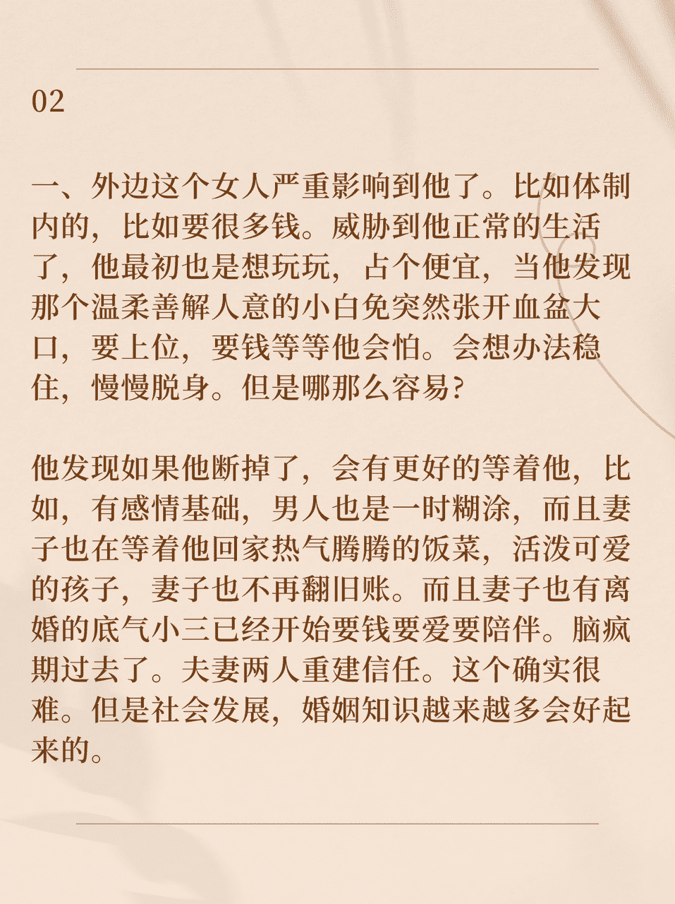

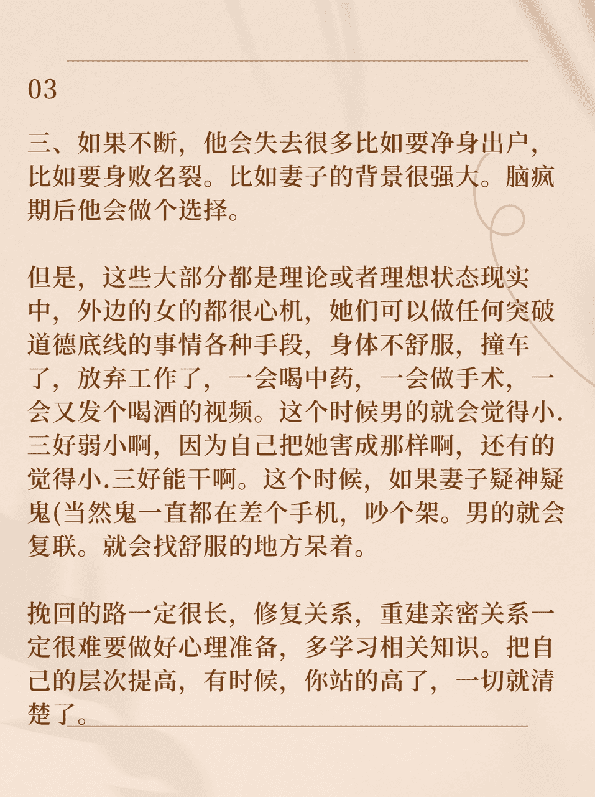

---

# 七、《如何正确发布作品》

## 发布作品时标题如何填

> 小红书**双屏瀑布流**作品展示中，一个是展示**封面图**，而另外一个就是**标题**，所以标题的填写除了要**吸引人**，而且还要**融合SEO**，在输入”背叛的婚姻如何挽回“这个关**键词的时**候，你会发现，每输入一个字、**下拉搜索**结果就会变**动，而这**些词即是我们的选题**方向，**也是我们标题布局的方向，我**们需要把****关键词**融入发布标题中，后续只要有相关需求的人搜索该关键词，或相关词，我们的作品大概率会被展示出来。

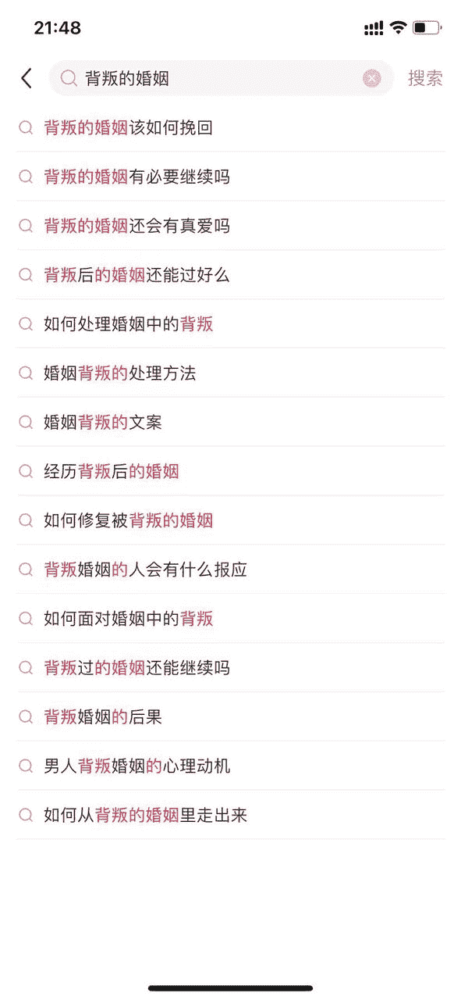

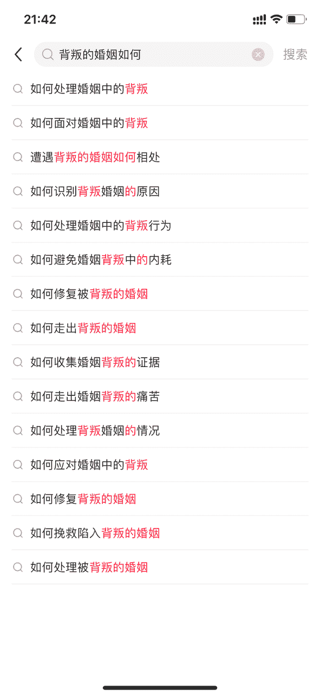

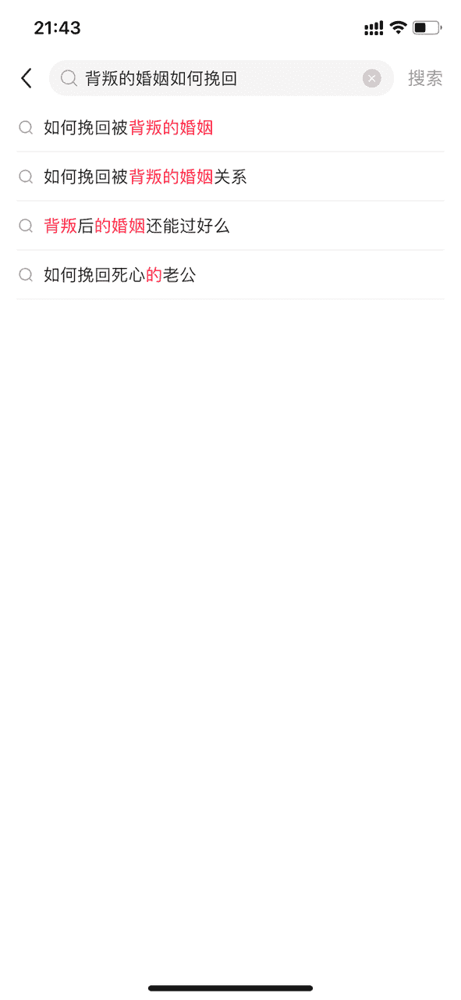

---

## 发布作品时简介如何写

> 作品简介中也可以融入**一次**关键词，另外也需要**参考对标****作品，****是否将图**文中的内容以文字的形式放进简介中，如果是的话，那么我们照着做就行了，只是额外再融入关键词即可，这样是做的目的是为了增加该关键词的出现频率，有一定的权重值。

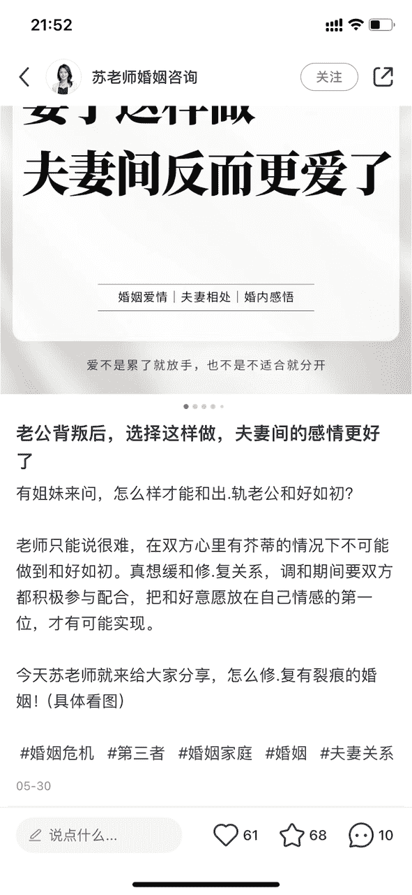

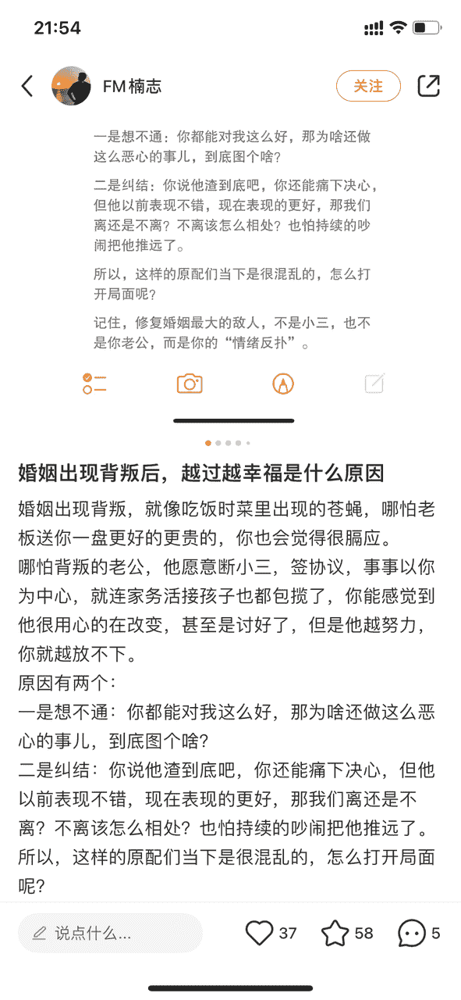

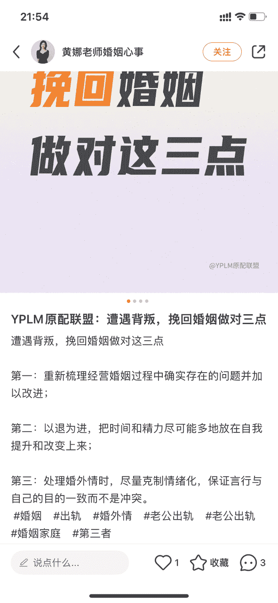

---

## 发布作品时话题怎么加

> 发布话题的时候，首先**参考对标**作品的话题填的是什么，**照着抄****就行****，如果对**标作品没有放话题，那查看系统是否有推荐的话题，选择和自己内容相关的即可，如果系统也没有推荐，那么就自行填入五个左右的相关话题。

---

## 发布作品时时间怎么选

1.  午休高峰：**11点**

1.  下班高峰：**16点**

1.  睡前高峰：**20点**

1.  有个别行业可能会存在**时段不同**，可自行测试

1.  每天发布的作品建议在**1-2个**

---

# 八、《如何安全有效导流》

## 作品评论区置顶

> 小红书导流的**方法**一直在变，不断的和**平台**在斗智斗勇，而**评论区导流****这个方**法变得比较少，当作品爆了以后**，评论区**有两种导流方法，第一种就是发评**论内容引**导私信，然后将该条评论进行**置顶****，如**果是代发的贴子，那可**以通**过A种B收的方式**来进**行，不过需要通过水军将评论的点赞和评论都打上去，这样就可以排在前面，另外一种就是引导进群聊，两种方式都可以交替使用。

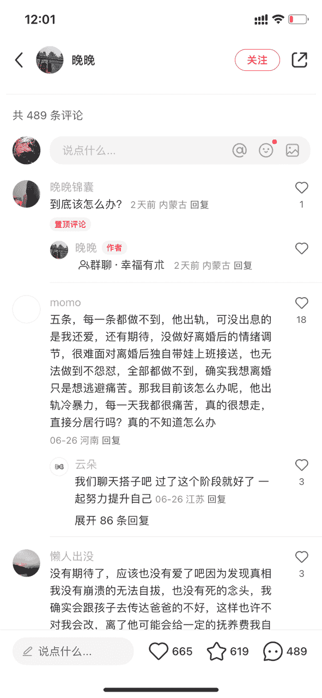

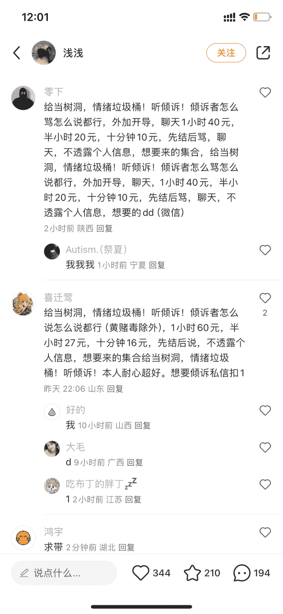

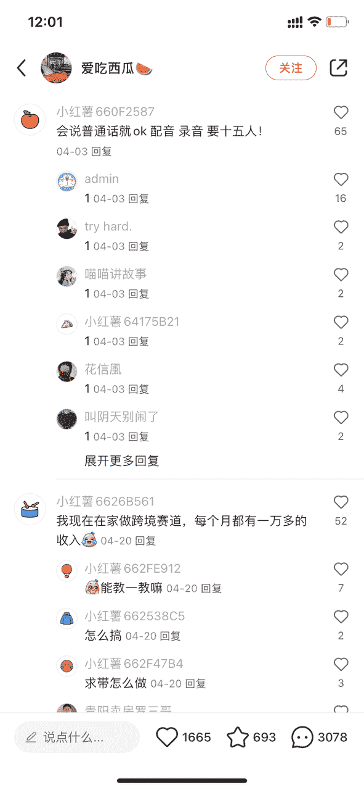

---

## 私信导流

1.  在聊天的过程中不要直接说**敏感字**眼（微信、私信、钱）等

1.  可以**主动私信****评论的客****户、**私信前可以先尝试进行关注对方、点赞对方，间隔10分钟左右再**来私信对方**，如果对方回关你，那么发私信**就不会有**任何问**题，但**如果对方没有回关的情况下，那么私信只能够给对方发一条信息，其次也需控制频率、否则会给系统屏蔽，俗称吞私信。

1.  在私信导流的时候，尽量是和用户**索要微信号**，自己不要发、避免遇到**同行举报**

## 群聊导流

> 群聊导流是目前**较为常用**的方法，搭配**评论区**的方法使用，可以实现**全自动****，不**过细节上需要注意的**是，**尽量建群和发消息、发作品的账号能分割开，避免有人投**诉把群封****了后**，连带把发作品的账号也处罚了，另外就是在群名、群聊、群置顶内容的时候，需要不断的测试修改、比如某些字词放不上去，就变着法子不断更换字词，直到把你想要的内容放上去为止。

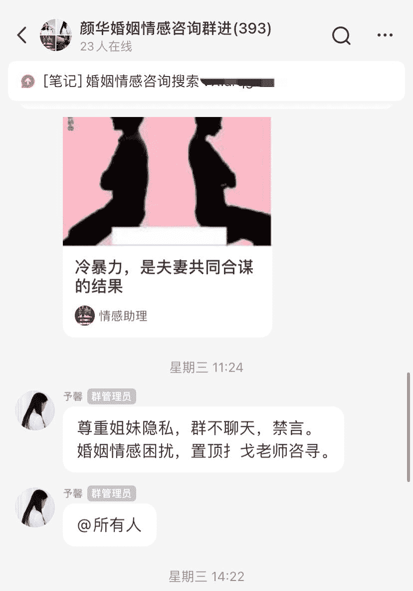

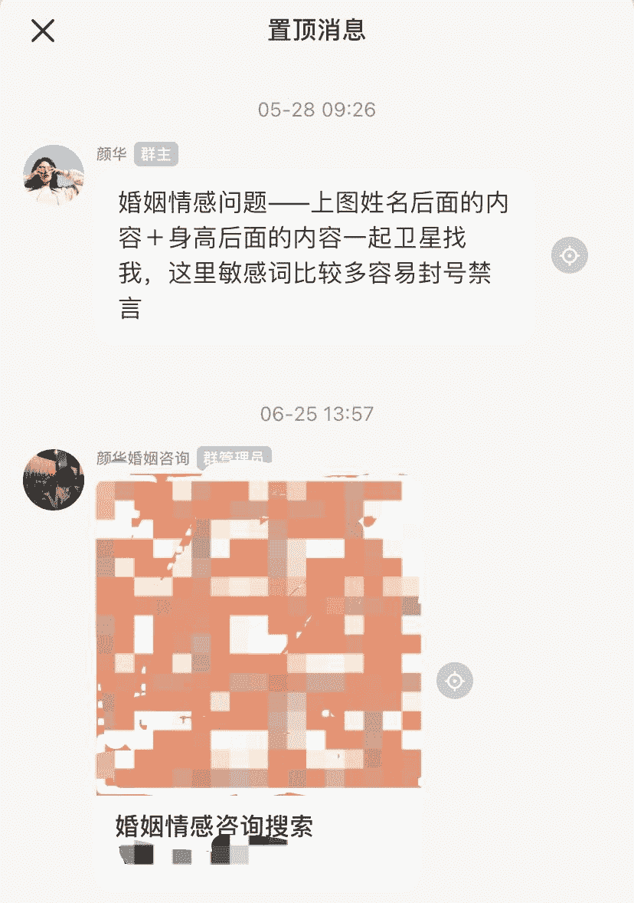

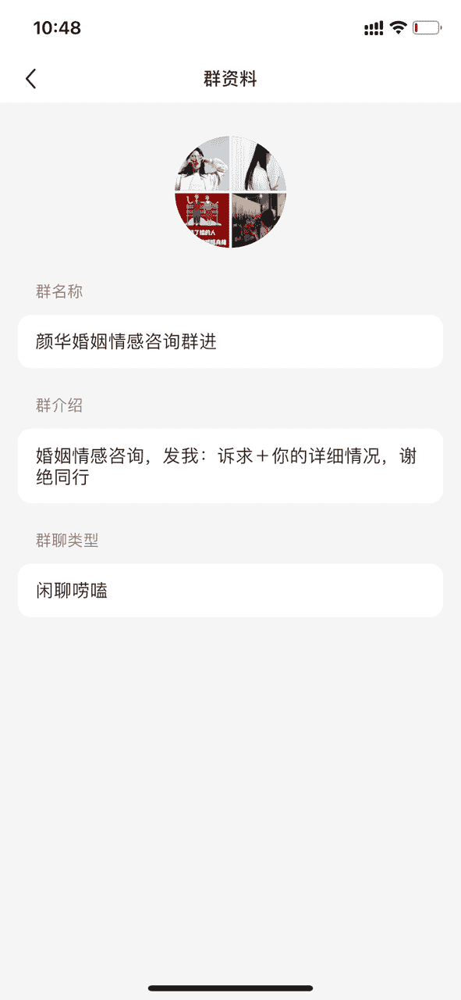

---

# 九、《如何快速变现》

## 如何找收粉的渠道

> 收粉的渠道有很多，最常见的就是行业微信群，差不多一个入群门槛大概在29-99元区间，只要你进去一个以后，后续会有一堆人加你，并且他们自己也经营这类微信群，这类群无论是出粉，还是收粉，都要留个心眼，因为骗子实在是太多了，出粉的给假粉，收粉的不结账。

> 其次也要看你做的是什么行业，有些行业直接可以通过淘宝、抖音、小红书等平台主动询问对方是否收粉，也有的人会主动找到你，私信告诉你是否出粉，当然前提是你的账号流量爆了，这些人才会找到你。

> 最稳当的办法就是直接找机构合作，线下线上都可以去谈，并且还可以签合同。

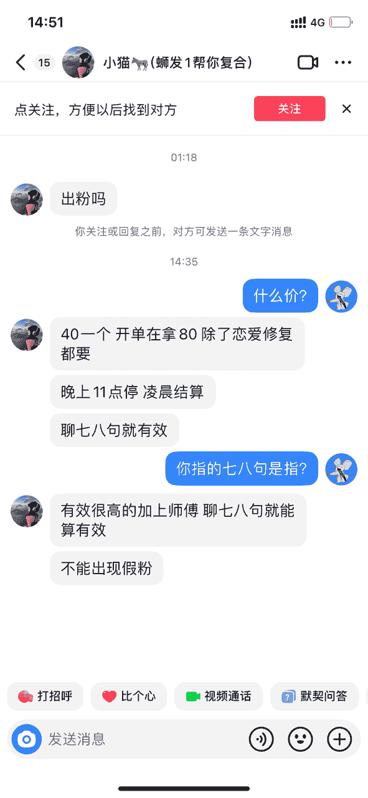

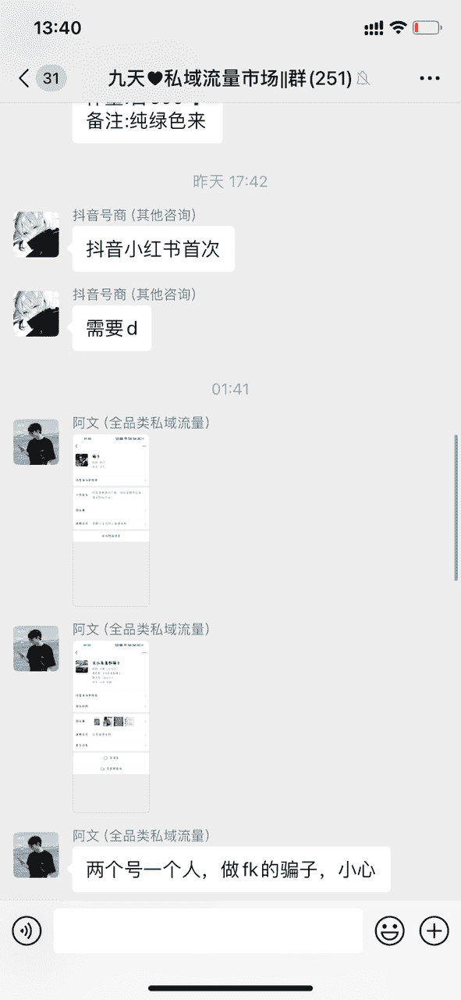

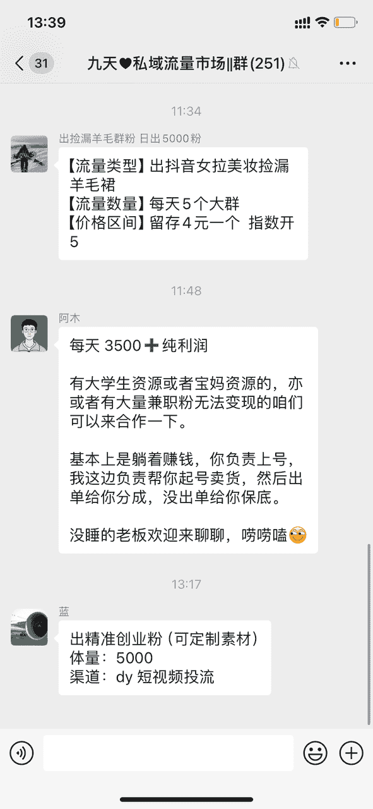

---

## 如何找合作的机构

> 找机构合作有**两种办法****，一种是****线下沟****通、**另外一种是通过线上沟通，大家可能**不知道很**多招聘平台，其实不是单纯的招聘，有很多都是找合作的，比如以情感为例，很多情感公司是在招聘渠道运营经理或者总监，然后薪资也很高，那么大部分都不是真正想招，而是想找合作分成的。

> **一般多聊**几个公司，就能大**概了解****到行业合**作分成的比例，前期不需要签署任何的合同，但如果每天的量开始慢慢大起来，那么一起要签署合同以及拟定标准，包括一些禁止事项，比如偷单、骗单等。

---

## 如何自己打粉变现

> 如果自己能解决**后端转化**的话，这块是很暴利的，但得自己有产品、有渠道。一般常见**的像FK**、小国、兼职、创业等赛道，**都可**以自己解决后端，只**不过需要**花费很大的精力，而且还要确保整个交易链条不出错。

> 前期是**不建议****大家去费精****力去搞**这块，最重要还是把引流的问题给解决掉，只要有流量、有资源，做什么都容易、变现的问题是最简单的事情。

---

# 十、《最小MVP流程》

## 购买和办理手机及营业厅卡

> 首先你能看到这里，应该是对**小红书打粉**有一定的了解了，那么接下来要**动起来**，学完只是**理论**、实践才是**真理**。

> 我的建议是能**够买3台****或以**上的手机，因为机器越多，成功的概率就越高，并**且去营业厅****办理三**张及以上的手机卡，月租选最便宜的，但需要有流量，流量最好是20G以上，用1张主卡绑定2张副卡的模式办理，你营业厅直接和工作人员说，她就会给你推荐卡了。

> 手机的话就在**淘宝**或者**拼多多**里买**红米9或者10****，如**果时**间比**较充裕，也可以自己在闲鱼或**者转转**上面收，买好以**后拿回来记得**先刷机，在百度搜索“安卓手机双清”、照着操作即可。

## 确认和调研赛道

> 如果你自己**没有合适**的产品，那么首先要**先解决赛道**的问题，这里**推荐的赛道**分**别有资料**、护肤、美妆、创业、兼职、祛痘、小国、初高中教育、减肥、交友、男科、情感挽回、医美健康、逾期负债等，几乎适用于全部行业。

> 结合自己的**实际情况**进行选择，前期不要去管**后端变现**的问题，即使**浪费掉资源**都无所谓，你的**首要目标**就是**打出粉**，你只要知道这个赛道能变现即可。

## 收集和制作作品

> 确定好赛道后，那么接下来就是**收集对标**账号和作品，收集齐**100篇****行业爆**款作品，**用Exce**l表格把它记录下**来，然后****花时间去**拆分它，一定要完成20篇的拆解，分析它的封面亮点在哪里**，为**什么会爆？分析它的内容触动点在哪里，是什么原因大家会喜欢？同样把它用Excel表格记录下来，这两步一定要做，而且还要认认真真的做，这样你才有网感，这样你才能够快速了解行业。

> 有一定熟悉感觉后，接下来就用**可画工具**去一比一制作作品吧，先**一次性**做够10篇，如果你是一天一更的话，那你一台机器就可以解决10天的更新量了，具体做多少篇你自己衡量。

## 发布作品

> 发布作品一般建议是**中午和晚上****，这个要**看你的行业，最好的办法就是看你的对标账**号，统计**10个账号的发**布时间，**你大概就能找出最合适的更新时间段了，这里建议最好的每日两更，而且是稳定的持续输出，坚持每天发布是最有力的说服。

## 设置导流流程

> **作品发布后**，前期会存在几种情况，第一就**是小眼**睛很少，那么你要**检查下，**看看能不能过推广，在创作中心里的薯条推广，**查看你发**布的作品是否出现在那里，如果**出现证明这**条内容没问题，如果没**出现**，那么证明内容**不行**，如果你连续发了两天，一条都没有过推广，那么你就要排查你的手机是否干净！你的IP是否干净。

> **如果没有出现以上的**问题，那么前期小眼**睛在10**0-5**00**区间，都属于正常范围，不用过度关注，持续更新即可。

> 提前创建好**群聊**、设置好群聊的**引导信息**，然后就用**A种B收****的方**式在作品评论区留言，并且将其置顶即可。

## 变现

> 只要你能够从小红书里**引流到微信**的用户超过10个，那么你就可以**开始考虑**变现的问题了，找机构合作或者找个人合作都随你自己，手里有筹码、有案例，你就可以和对方讨价还价。