# 超出预期-5月视频号口播航海中期报告

> 来源：[https://xuqiwei1986.feishu.cn/docx/PuDpdjj3IoUZfmx574mcPXpanIc](https://xuqiwei1986.feishu.cn/docx/PuDpdjj3IoUZfmx574mcPXpanIc)

大家好，我是李超鹏，郭晓文老师的合伙人。过去2年一边做项目一边带学员，带了1000多位学员在抖音和视频号赚到了钱。

这次5月提前开船的视频号口播带货航海，我作为主教练，给大家汇报下情况。

# 中期成绩

视频号口播航海过半，跟大家汇报下情况（截至开船的第2周）

本次航海船员数量553，其中有246人出单，变现率为44%

总GMV31w，总佣金约15w，人均出单1497元

这样的成绩比我预想中的要好一些。毕竟，这次航海我们把重心聚焦在如何做好口播上面，并没有做批量的切片分发。每一次出单都是船员们反复磨砺出镜表现的结果。

但，2个人出镜就有1个人出单，是因为大家的表现力都很好吗？

# 出成绩的真实原因

我收到了一些学员的反馈，大家对下面几个动作的好评高：

+   这期航海我们把品、文案、对标视频都选好了，并做成了素材库定期更新，纯纯喂饭了

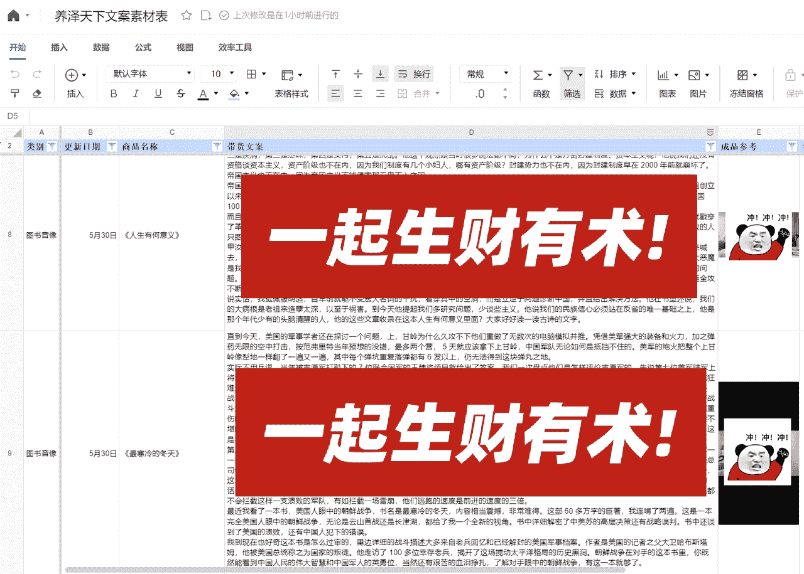

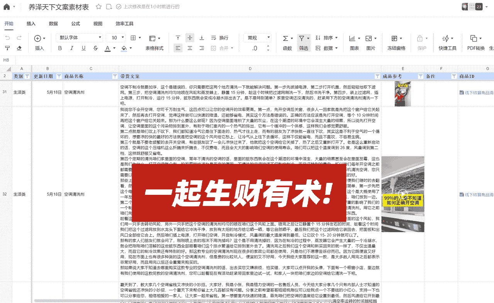

+   我们为船员们配备了40多位有实战经验的答疑学长，随时回复大家遇到的问题

+   我们定期对学员的作品进行点评，针对实战作品打分、找优化点

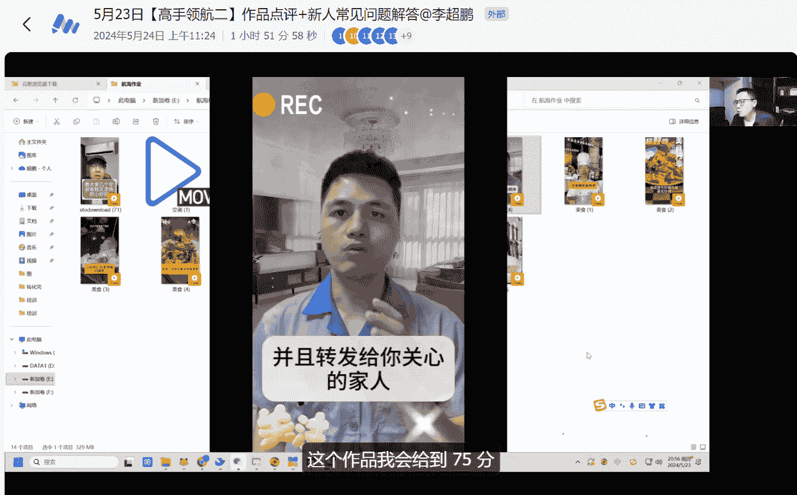

+   诚然，这些是取得成绩的要素之一，但所有这一切的基础其实是：

**项目处在红利期**

亦仁说过：项目有红利的典型特征就是小白能赚钱

+   当前视频号口播赛道上的达人，大多数还属于菜鸡互啄。新进入的同学不需要很强的表现力也能分到一杯羹。

+   从大环境上看，视频号的用户粘性在增加，商业化的进程在加速，是为数不多还在增长的平台之一；

+   从内容形式上看，口播的形式更加适合个体创业者，原因是

1.  每个人的脸和个性都是独特的，能一定程度的避开同质化内容的内卷，也能一定程度避免和大团队的竞争；

1.  一旦掌握了真人口播的技能，就有迈向更高的天花板的可能，并不一定比团队赚的少；

1.  无论哪个平台，真人出镜始终是平台最喜欢的表现形式，无论风云如何变换，都不会消亡

+   当前有红利，普通人才会有机会

# 口播项目的关键点

那有红利是不是一定能拿到成绩呢？当然不是。还有这几个关键点：

## 赛道选择

+   视频号口播有红利，但并不意味着所有的细分赛道都有红利，有些赛道已经人满为患，有些赛道天天违规被平台虐的死去活来。

+   我们考察赛道的时候要去看赚钱的人处在什么水平线，如果赚钱的人很菜，代表我们也能一战。如果赚钱的人已经人均战神，那就只能绕道让行

+   针对这一点，航海已经为学员解决了赛道的问题，我们给到了大家百货、图书等多个不同品类的选择；

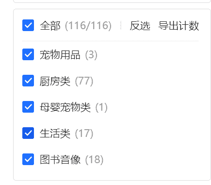

+   当然，我们更希望我们的船员能够具备自己找赛道的能力，所以在接下来的航海中还会教大家如何挖掘和选择赛道

## 对标素材的选择

+   微信的影响力太大了，一举一动都被人拿着放大镜看。作为微信的组件之一，视频号不得不保守行事。很多抖音上能发的内容到视频号就会违规；很多模糊地带的素材一律被判违规

+   而且视频号由于发展时间段，平台规则不完善，很多政策和规则反复调整，今天还能爆的内容明天就算你违规。虽然上线到现在只有4岁，却活出了40岁更年期的情绪波动

+   在这种前提下，对标素材的选择就显得尤为重要。由于当前视频号没有文案查重，所以出镜人通常只需要把爆款的文案自己念一遍即可。一旦对标的文案高危，自己也难逃违规的命运

+   所以这次航海我们只给船员提供低风险的文案。虽然这会降低爆率，但是对于新人而言，平稳的出单比承受高风险押注爆单更重要

一不小心就是下方结果↓

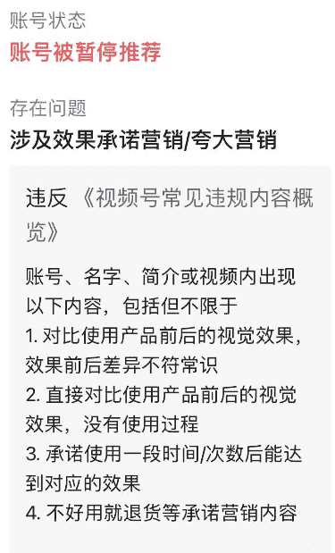

## 出镜人的表达

同一条文案不同的人演绎出来，效果天差地别。本次航海也把重心放到了这一块。一个好的作品应该在场景、服装、表现、文案处理各个环节上细心打磨，这也是自媒体创业者需要具备的关键技能

表达不及格的时候，就拿着一个文案反复拍，不停的换文案只是换不同的地方失败而已

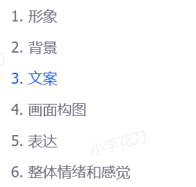

## 数量数量！

由于以下因素，作品是否能够爆具有一定随机性

+   作品推流无法做到完全精准

+   同时段的竞争对手强度不一样

但这并不代表这完全取决于运气，能对抗概率的只有数量。

# 遇到的问题

我也注意到，我们这次航海也遇到了下面几个问题：

## 把握不好违规风险

我们的船员会在航海素材库以外找一些爆款文案，如果不知道如何判断风险，就会踩坑；风险识别的详细内容在航海手册里面有，我在这里只强调一下关键点

+   视频号营销最常见的两类违规是：**煽动营销**和**夸大宣传**

+   煽动营销的典型特征是：吓唬客户甚至制造恐慌，以达到营销目的。比方说渲染核废水营销井盐、利用热点食品安全事件营销厨房用品。

+   这里的关窍是，你可以制造焦虑，但是不能制造恐慌。我们举个营销空调清洗剂的例子，你可以说“你看看这空调滤网有多脏，这吹出来的风都是脏的”，但不能说“你看看这空调滤网有多脏，这样的风会危害全家人的健康”。前者是事实描述，后者渲染健康风险制造恐慌

+   夸大宣传就是字面意思，把效果吹的神乎其神。典型的文案套路包括：

+   只要你用了我们家的xxx，就能xxxxx(效果承诺，当然不行)

+   每天一杯，持续一个星期，你会发现自己和以前大不相同（给时间保证不行，每个人的情况不同；而且不能做效果前后对比）

+   不管你是xx、还是xx、还是xx，各种xx问题用这款产品都管用（又扯犊子了，怎么可能包治百病）

**对于违规边界的探索需要一定的时间，**如果暂时把握不准，推荐优先使用航海素材库

## 数据不好，却不知道问题所在

+   大家想一想，为什么要参加航海？一方面是知道一个项目具体要怎么做，另一方面呢，是为了有个交流的地方，遇到了问题可以相互讨论对不，所以如果卡住了还是自己闷头研究，那还来航海干嘛

+   所以，如果不知道自己的问题在哪，最好的方式是把自己的作品发到群里，公开处刑（可以把账号信息做脱敏处理）

就像这样↓

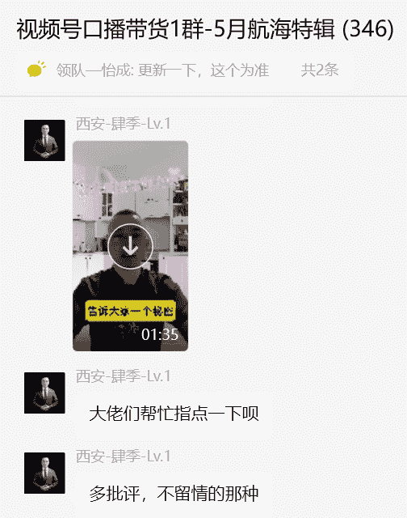

+   如果你只是概括性的问，大家只能泛泛的答，最后你只能拿到一个没有针对性的建议

+   不仅仅是我们的船员，建议所有的新手脸皮都厚一点，小白做不好不丢人，藏着掖着才丢人

+   我虽然每周都会有作业点评，但我只会点评典型案例。而且这种时效性对于个人来说是不够的，你需要立刻马上得到反馈

## 问题沟通效率低

如果一个提问缺失细节和背景，可能得不到解答；就算被响应了，回答的人也要不停的要求补充细节，沟通成本高

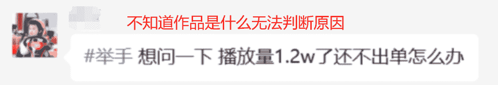

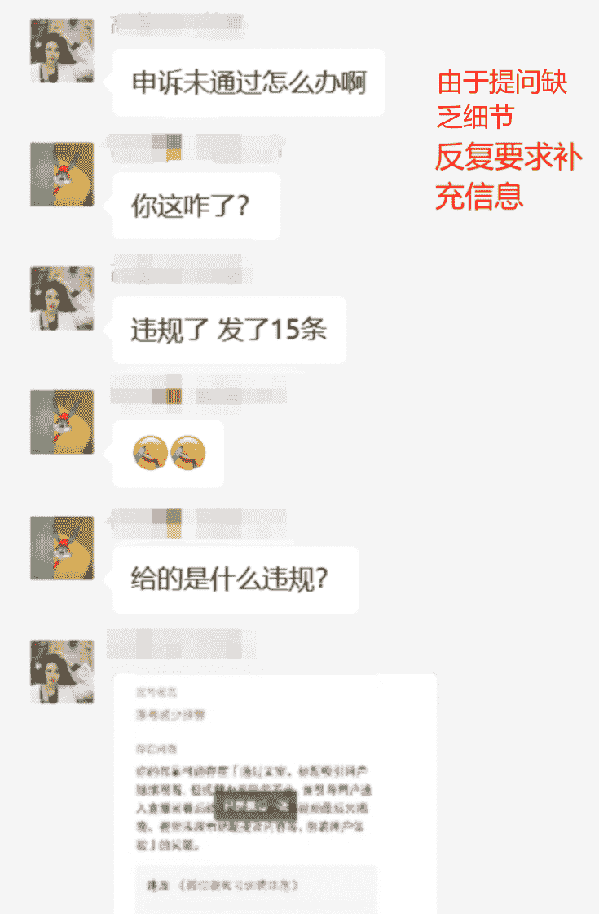

+   提问的时候把背景信息尽量描述清楚，降低别人帮助的难度。有时候不是别人不想回答，只是看了一眼觉得这个问题缺失细节根本无法回答，也就略过了

+   这不仅仅对我们的船员有用，各位新手小白也务必注意呀

# 航程过半，要警惕哪些坑

航海到了后半段，有些坑已经开始凸显

## 出不了单，算了吧

看到一半以上的同学都出单了，还没有出单的同学心态已经准备爆炸了。还是那句话，每个人的经验、天赋、能投入的时间都不一样，不要和别人比，和自己比。还可以做几个动作：

+   把自己的作品发到群里，看看到底差在哪

+   找到优秀的航海成员，查看他的打卡记录，有哪些值得你借鉴的点

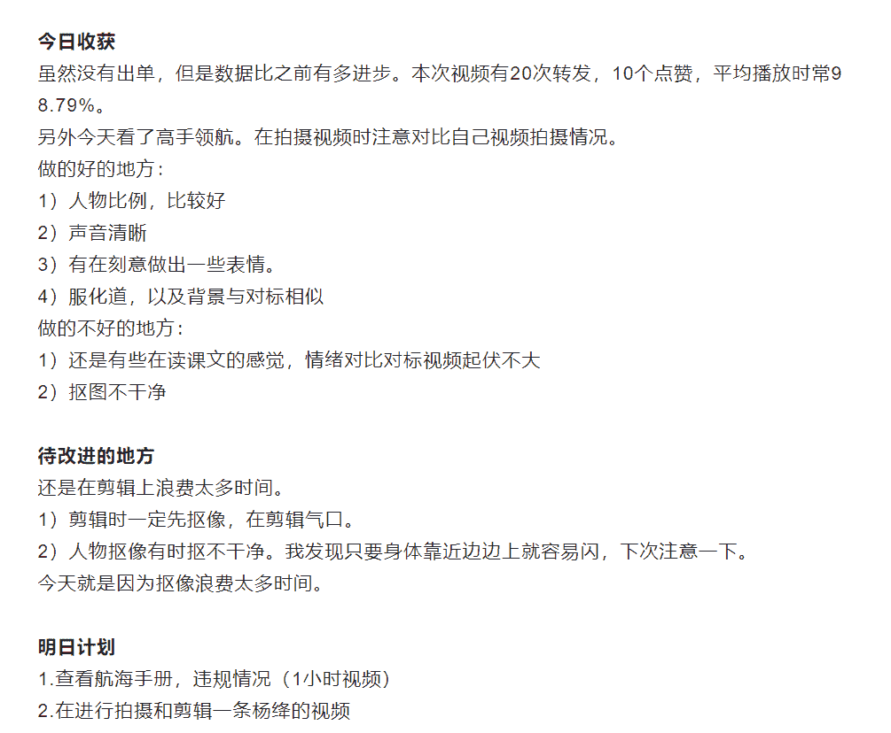

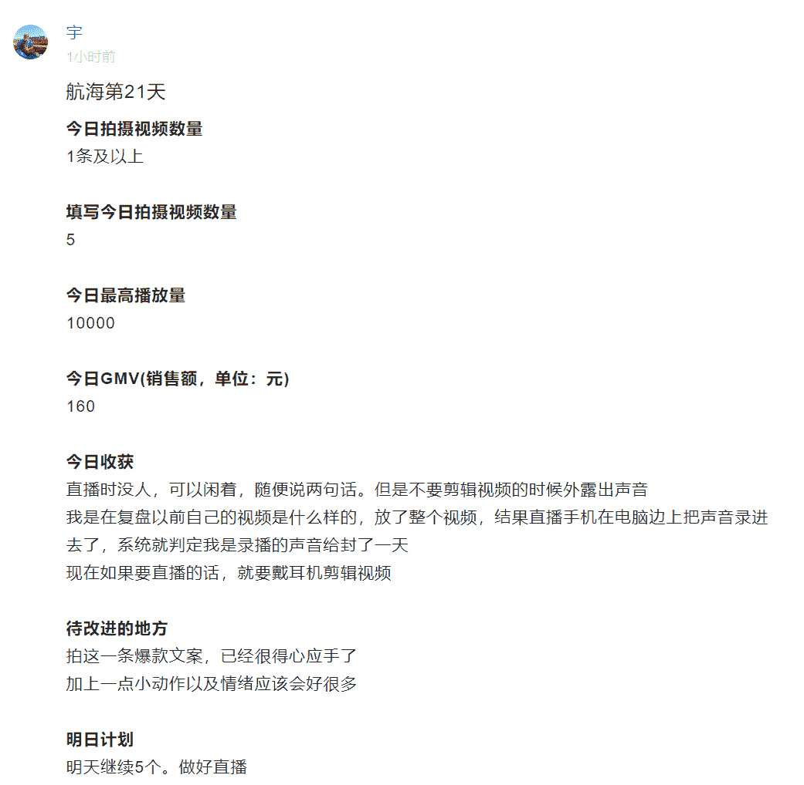

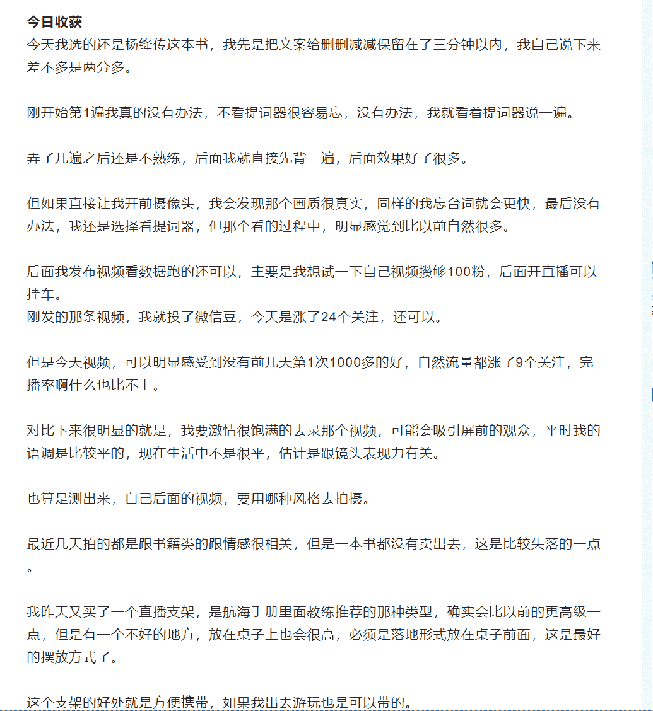

## 出了几单就不出了，烦死了

想想，你开始做这个项目有多久了？也就20天。这20天的时间你已经出单了，其实已经是很好的成绩了。如果要做到持续出单，你需要做的是：

+   检查自己的作品，持续给自己打分，能不能每次优化一点，每次哪怕增加0.5分？

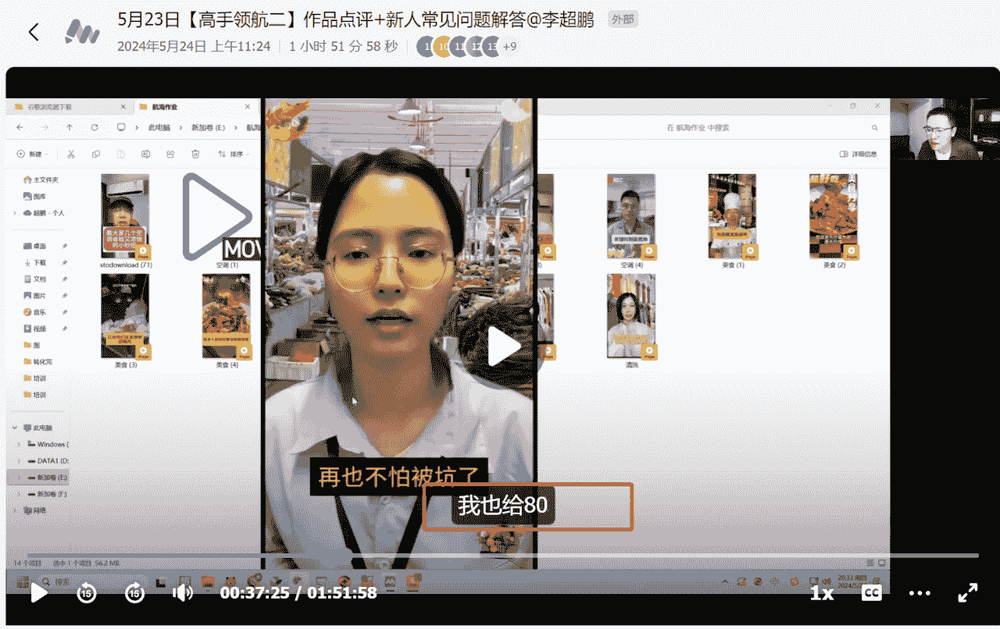

+   尝试开始分析，为什么之前的作品能出单，适合拍这类作品就把这类作品都拍一遍；如果是运气那能否用数量去调整概率

## 打卡任务已经完成了，我可以歇一歇了

歇个鬼，打卡是为了退保证金吗？打卡是为了保持状态啊同学们。能断打卡1天就会有第2天、一旦断了3天，你就会发现无比轻松，回到参加航海之前的状态，爽是爽了，项目就和你无关了。我给你的建议是：

+   看看航海好事，看看还有那么多优秀的人在持续进步；

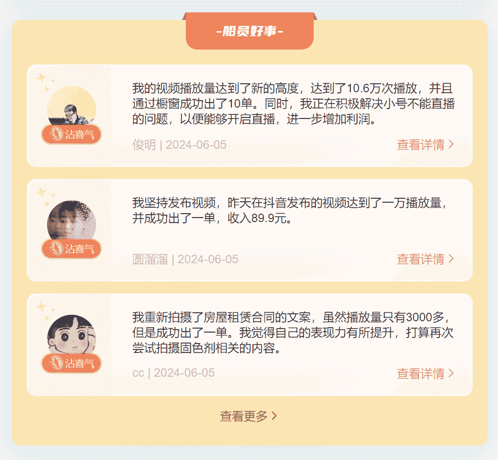

+   给自己定一个够得着的目标，哪怕是拍出一个70分的作品

无论目标是什么，都先给自己一个目标↓

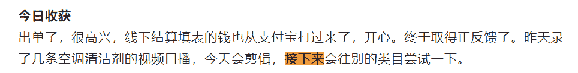

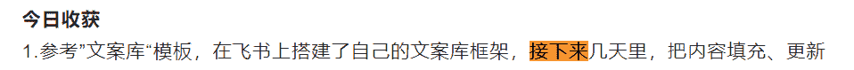

## 我不想拍教练给我的素材了，我要拍自己想拍的东西

有想法很好，但我要提醒的是：

+   一定要选能变现的内容，空有流量不变现的都是流量陷阱；

+   一定要学完风险控制的内容再去选材，否则容易账号不保

+   6月6号晚上8点来听对标思维课，教你挖掘更多适合你自己的赛道

# 航海群的氛围

+   我们这艘船的活跃度超过了我的预期，常常是几个小时不看就是这个画面

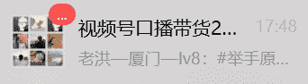

+   这里离不开我们的热心同学、助教、志愿者、领队持续发光发热，希望大家能够保持下去

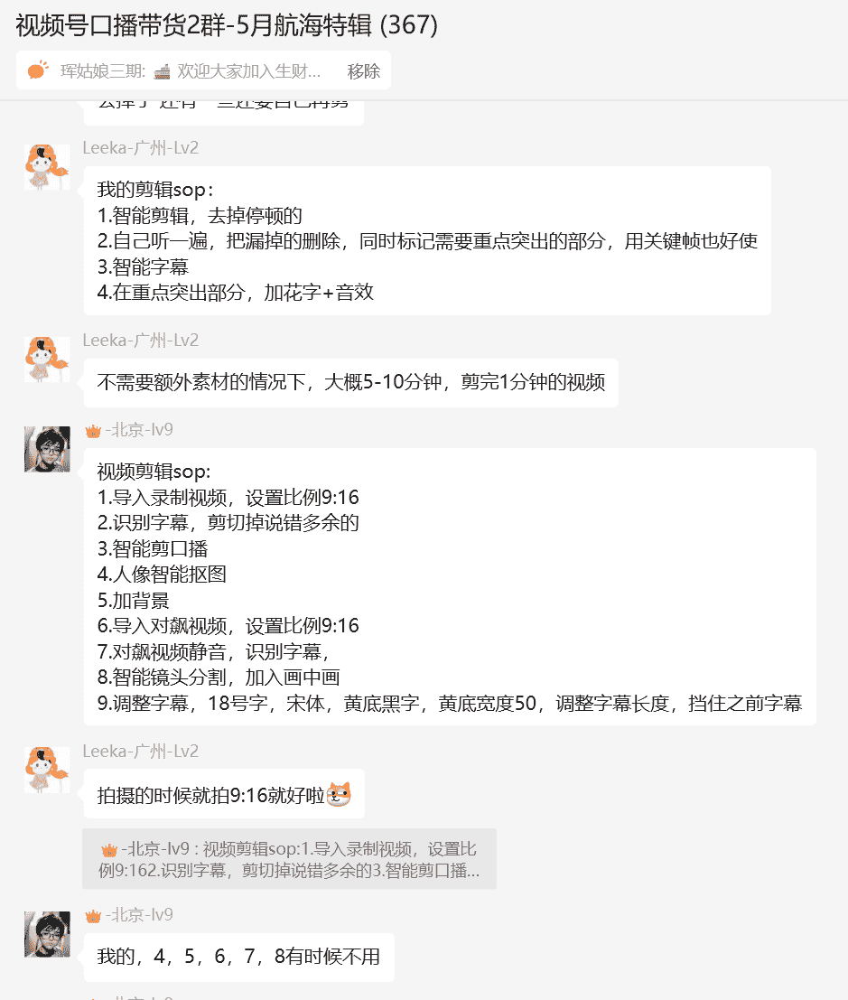

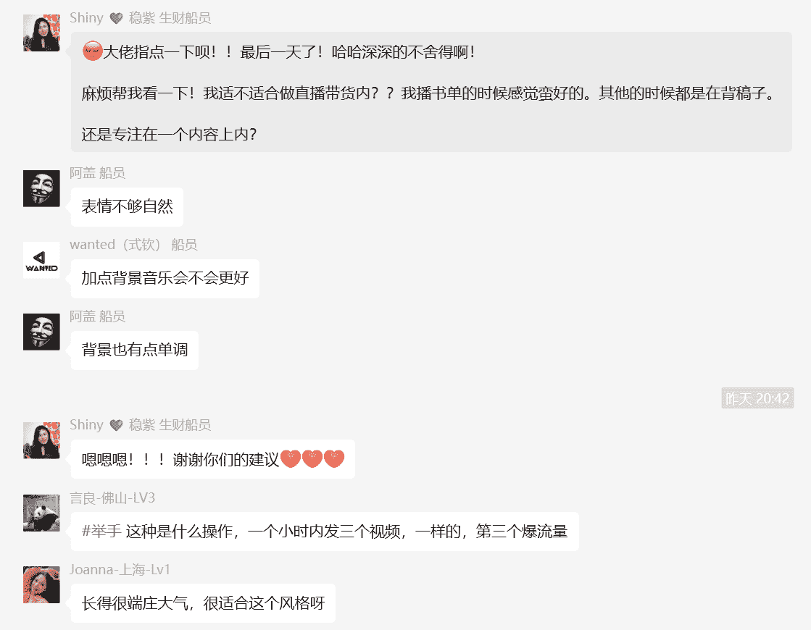

+   做项目，圈子很重要

# 两位船员故事

我常常被问到：

+   真人出镜这件事情到底难不难？

+   现在还有机会吗？

刚好这次航海的2个船员的故事可以为上面的问题做注脚

**我们的船员-汪少**，3年前还在学校的时候就已经意识到出镜做短视频是一个有潜力的方向。但在原地心动了3年，期间一直没有入手的契机。直到参加这次航海之前还没有发过一个作品。

原因和大多数人一样：顾虑太多。以下为汪少的原话：

> 说来好笑但也很真实，我之前从来没有做过真人出镜，没加入生财前，我了解的普通人能赚很多钱的途径就是通过短视频，但我就是害怕，害怕被熟人刷到，害怕表现不好被网暴(这里真是想的多)，觉得自己尴尬，还给自己找个理由说，安卓手机拍自己太丑了，等有钱换ipone再说。

但航海后来发生了什么？

汪少发的第一个视频就爆了，收获了14万的播放量，赚取了750元佣金（错过了开播时机，否则有佣金翻10倍的机会）

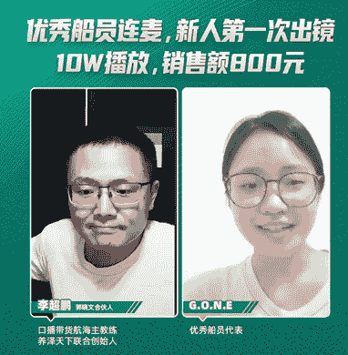

其实很多人一直揣着开门的钥匙，只是缺乏一个推开大门的勇气和契机

**我们的另一位船员-前行，**从去年12月开始出镜发作品，已经是视频号的老手了。拍了300条，还有拿过300多万的播放。但当我问他之前的项目变现了多少钱的时候，我震惊了：没赚钱

为啥呢？因为做的是“三不视频”，不带货，不引流，不赚钱。

但改发当前类目的素材之后，爆单如期而至，目前佣金已经超过了1w

访谈的时候我产生了一个疑问：之前发了300多条作品都不赚钱，到底是怎么坚持下来的？前行告诉我：看到那些赚钱的拍的也不是很牛逼，自己上也行，然后就不停拍不停剪不停优化，每天重复动作，就这样过来了。

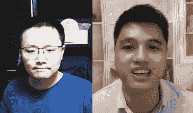

你只管好好播种、浇水、施肥，花到了时节自然会开

各位船员们，行百里者半九十，咱们不要半场开香槟，期待大家持之以恒；

生财圈友们，祝大家耕种到花开的时节

ps：6月7日晚还有第三位船员的故事，感兴趣的不妨点开下方图片来听听

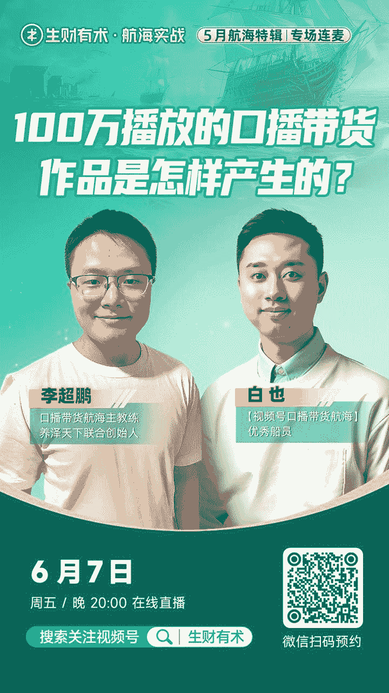