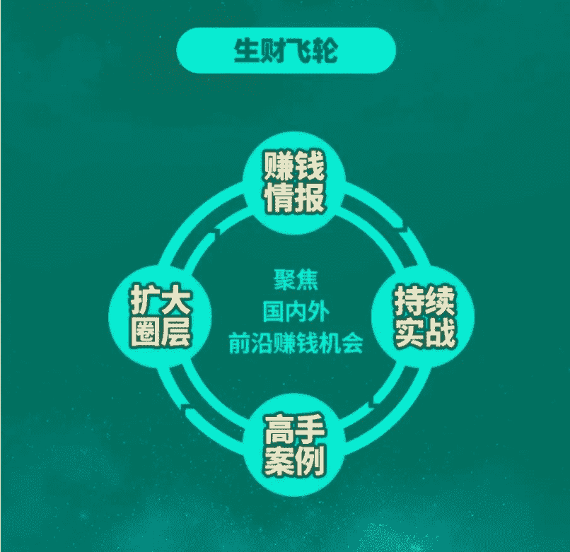
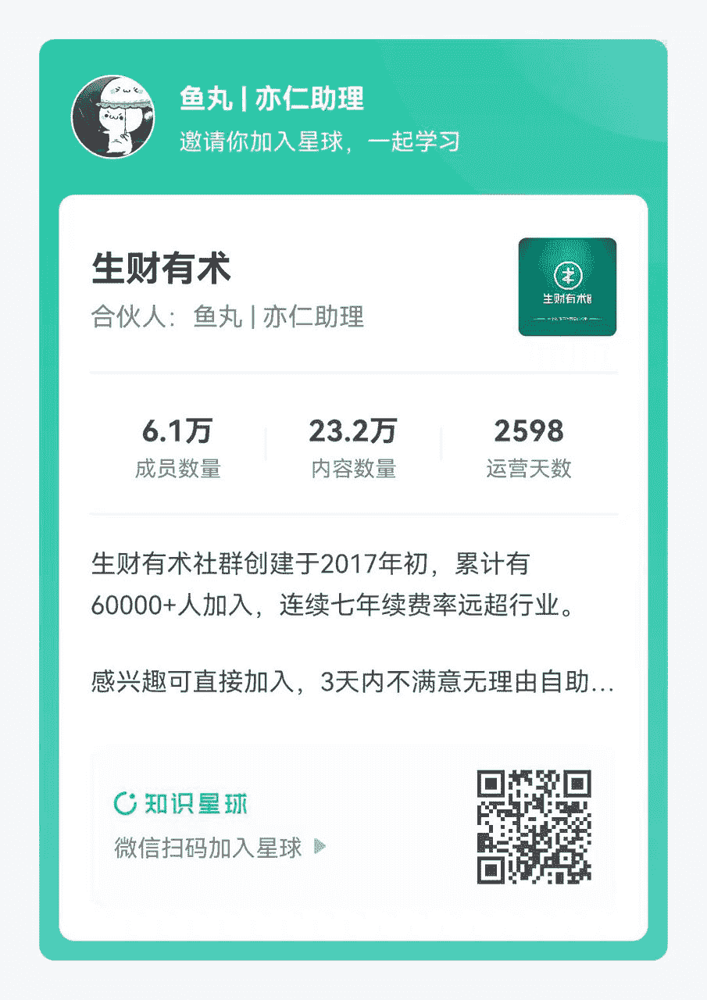

# 2024生财十大赛道机会-使用说明书

> 来源：[https://xuqiwei1986.feishu.cn/docx/RFMJdz0PVo1HvFx9JRQc0lJOn3e](https://xuqiwei1986.feishu.cn/docx/RFMJdz0PVo1HvFx9JRQc0lJOn3e)

> 你好，生财圈友。

>

> 生财有术去年一年的发帖量是**114987**篇帖子，和**50127**篇风向标。

>

> 什么感觉？是不是觉得像是到了一片项目海洋中，初入可能还觉得惊喜，沉浸在各类项目和经验帖里；再往后就容易陷入焦虑、自卑、迷茫等一系列情绪里。在这样一片白茫茫的文字海域里，确实很难不迷失。

>

> 这时候，你可能会开始考虑：

>

> **到底****怎么选择一个好的赛道，以及****可以****长期深耕的项目****呢****？**

>

> 生财上线的《2024生财十大赛道机会》，希望能帮大家找到一些新思路。

>

> 也是从去年开始，生财意识到不垂直就没有深度，没有深度，就只能赚一点很短期的钱。过去一年，我们内部构思了50个垂直赛道，并从中选出了10个重点领域，希望帮助大家在一些垂直领域中避免与高级玩家的正面竞争。

>

> 某些正在发生的趋势，比如，视频号、小红书、抖音、AI产品、TikTok、出海等方向下，我们会深度地将案例、情报、课程、航海、圈子、资源等整合，帮助大家一站式获取到自己想要的。

>

> **生财要往垂类机会走，往更深度的内**容去走，如此才能让圈友取得更垂直的结果。

>

> 这也是我们此次发布十大赛道的意义。

## 零、2024生财十大赛道机会

> 手机阅读请往右滑动查看，了解更多

多维表格（HdCzbn2CHahiS5sWG5HcIZL6npc_tblqo40KVaLNfKWl）

---

## 一、为什么要发布十大赛道？

这个问题，我想亦仁在323的航海家千人见面会上已经给出了答案：

在过去的一两年间，我们发现赚钱的方式越来越呈现两极分化。

一方面，普通人赚钱变得越来越困难，市场变得越来越复杂。另一方面，一些高手利用资本、团队和自媒体的力量，快速实现了跨越式的发展。

当市场机会减少时，高端玩家会发现并抓住那些之前看不到的机会。而对于小玩家来说，变得越来越困难，因为他们面临着更为强大的对手。

为了帮助普通人应对这种变化，我们在自身战略上进行了一些调整，向更精准的方向发展。

以前我们对生财的印象是包罗万象，涵盖各种主题内容。但现在，我们可能会更加专注于内容和资源的细分领域。

不垂直就没有深度，没有深度，就只能赚一点很短期的钱。过去一年，我们内部构思了50个垂直赛道，并从中选出了10个重点领域，希望帮助大家在一些垂直领域中避免与高级玩家的正面竞争。

某些正在发生的趋势，比如，视频号、小红书、抖音、AI产品、TikTok、出海等方向下，我们会深度地将案例、情报、课程、航海、圈子、资源等整合，帮助大家一站式获取到自己想要的。

**生财要往垂类机会走，往更深度的内**容去走，如此才能让圈友取得更垂直的结果。

这也是我们此次发布十大赛道的意义。

---

## 二、为什么是这十大赛道机会？

这么多的项目，为什么是这10个赛道机会呢？

当然，自信地说，过去7年，生财最核心的优势就是能带着圈友找到最前沿的项目机会，这其中除了大量的线索积累，也依赖于亦仁的专业判断。

但到了生财的第八年，上线十大赛道机会的背后，我们沉淀了一些判断赛道项目的原则：

1、主流平台：主流内容、电商平台，要选择有增长空间的平台；

这也就是亦仁常说的，这个平台要能承载生财带着百人、甚至千人、万人进来。不能说一上百人，就会被平台关注，机会就会有大幅的收窄，这样能操作的空间就比较有限，大家都没法玩了。

[**所以**](https://shengcaiyoushu01.feishu.cn/wiki/MG7Fw7VxBiI5NIkcqc3cLxWnndc)**大**[**家能在**](https://shengcaiyoushu01.feishu.cn/docx/WYLPdOjB6owYE7xaw3aczeLInoc)**我**[**们的赛道机会**](https://shengcaiyoushu01.feishu.cn/wiki/QtuDwvCVkiUSIxk6Wl7cxbz7nre)**里**[**看到：**](https://shengcaiyoushu01.feishu.cn/docx/YpBcdxfy6o27SfxAeXVclQVgnPt)抖音、小红书、TikTok、视频号这样的平台赛道机会。

**2、足够大的项目空间：有较为长期的商业机会，5**人以内小团队能有一年100万收入的空间；

老话说，站在风口猪都能飞，话糙理不糙。怎么借好时代的势能，这很关键。

[**所以大家**](https://shengcaiyoushu01.feishu.cn/wiki/NrPaw3bNGiTwykkwCFMcoxBqnjb)**能**[**在我**](https://shengcaiyoushu01.feishu.cn/wiki/DY7vwXDkkifdFbkwuWXc5b2Bnyb)**们**[**的机会赛**](https://shengcaiyoushu01.feishu.cn/wiki/YWRLwLsR9ipp2bk0TRacqgnPn4f)**道**[**里看**](https://shengcaiyoushu01.feishu.cn/wiki/JHzMwbyptikA4NkRbMycOBNSnf3)**到**[**：银发经**](https://shengcaiyoushu01.feishu.cn/wiki/ULJLwfTR3iV2v1ksbIKcPjLXnzy)济、出海、跨境电商、AI、个人IP这样的趋势赛道机会。

**3、完整的项目模型：具体的实操项目，可以形成**项目闭环，能结合新的流量出现10X增长；

一个好的的项目模型，是可以持续复制、矩阵的 。

就像小排老师说的：

> 蜜雪冰城的加盟商，按照总部给定的SOP进行操作，一个月也能挣小几万，简简单单 —— 这是个体户。

>

> 但对于蜜雪冰城来说，它有32180家店，把一个小的生意模型，复制了32180次 —— 这是企业家。

[**所以大家**](https://shengcaiyoushu01.feishu.cn/wiki/QR2TwnFqriHocSkFfAlcxQTanZe)**能**在我们的赛道机会里看到：本地生活 这样稳定发展的赛道机会。

以上十个赛道符合我们对24年的趋势判断，也希望在未来一年，生财能和圈友们在这10个赛道下找到10倍的增长空间。

当然，我们也会不断迭代项目的筛选逻辑，找到最有机会的赛道。

---

## 三、十大赛道机会可以怎么用？

花了这么长时间整理的内容，可以怎么用呢？

大家对今年的生财权益图还有印象吗？图里关于生财飞轮的介绍就是十大赛道机会的正确打开方式。

赚钱情报、持续实战、高手案例、扩大圈层。

我们在生财看到了很多高手的成长轨迹，大概就是这样的成长路径：

1.  在风向标或者精华帖里看到生财好的赚钱机会；

1.  参加航海，下场实战，跑通路径，然后成为赚到钱的那20%；

1.  发精华帖，带动更多的圈友下场，进一步形成航海实战项目，让更多普通人赚钱，进而自己赚到更多的钱；

1.  成为领域内的头部，垂直深耕这个赛道，成为高手；

更具体一点，你看：

+   2023年4月18日加入生财，从失业打工者**到通**过公众号爆文一年就月入10万的圈友@张波；https://t.zsxq.com/19cakW7ls

+   从风向标捡了个项目，实操一个月净利 30** 多万，垂直落**地企业信用管理项目的圈友@summer https://t.zsxq.com/19sWCUsg4

+   三家医院主治医师到生财销冠靠谱，再到生财、自己品牌和课程多**料，**每月靠卖东西就有百万利润的生财销冠@靠谱；https://t.zsxq.com/19FnqKEdK

+   **从白**手起家到成为一个月数千万GMV的电商IP@盗坤；https://t.zsxq.com/19yDccSTS

+   ……

还有许许多多的生财人，都是在这个过程中，不断循环，获取更多的赚钱情报，继续深耕，持续扩大自己的影响力。

这就是赛道文档的正确打开方式，对应**的，本次的赛道文**档**将会分成三**个**重要板块：**生财的赛道时间线、赛道项目库和赛道实战库。

---

### **1、赛道项目库**

所谓项目库，就是星球**精华帖、风向标、主信息流**的汇总。

+   在**风向标**里，我们可以找到赛道最新最快的平台趋势、玩法分享和提效工具，一条看似微不足道的风向标，可能就是一个大机会的起点；

+   通过**精华帖**，我们则可以借助前辈的经验，站在巨人的肩膀上，更好地拿到结果。这些精华帖，有的能解决做项目遇到的心态问题，有的能解决实操过程中遇到的项目卡点，也有的能帮助你突破瓶颈，找到 10 倍增长的可能性；

+   在**主信息流**里，我们可以找到业务的同行者。这里可能没有石破天惊的大成绩，但相信能帮助你找到属于自己的前行方向。

在项目库，我们可以完成对项目的初步了解和认知，找到最新的赚钱情报，明确我们要不要做这个项目，以及可能有哪些路径上手这个项目。

---

### **2、赛道实战库**

所谓实战库，那就是不玩虚的，在这里我们沉淀了生财近3W+用户一次又一次的21天实战经验。

想全是问题，做才有答案，你会在这里看到前行者们一次次的持续实战。

在赛道文档里，我们将通过以下 4 个板块，呈现实战库：

+   **航海实战****：**每一期的航海选题背后，都经过深度调研。我们会把星球里出现的风向标、精华帖做汇总梳理，再找一线实战的圈友调研，最终找到最适合航海的那条船；

+   **高手领航****：**没人带怎么办，我们邀请了有实操经验的圈友，尝试解决你在这个过程中会遇到的问题；很多时候，一个问题我们琢磨半个月，可能找实操过的圈友直接问，一分钟就解决了；

+   **航海好事****：**我们鼓励大家分享实操过程中的每一件好事，21 天里，相互赋能，彼此支持，尝试每天解决一个小问题，最终一起乘风破浪；

+   **航海资料****：**航海手册是整个航海最核心的板块，它汇总了项目常见玩法，从 mvp 路径，到进阶技能，看完万字手册，相信可以解决项目 80%以上的疑问。除此之外，每次高手领航的内容，也会沉淀在这个板块。

在这里，我们不断挥着手里的船桨，去往那个叫成功的彼岸。

当然目前有的趋势赛道可能比较新，我们还没来得及开始航海实战，但是在新的一年，我们会带着圈友们在这个领域持续深耕，做一些新的尝试。

---

### **3、生财的赛道时间线**

最后，是关于这条时间线。

如果大家细看时间线会发现，在生财帖子的历史长河里，总能第一时间关注到最新的市场趋势，然后会有一些实战的高手们通过自己在一线的搏杀，创出第一个MVP，吃到第一只螃蟹，慢慢的玩法越来越成熟，可以通过航海承载更多的人航行。

今年这条时间线会持续更新，生财这个大平台会继续肩负起侦察的责任，找到最新的行进方向，配置好航行船上的物料、人员，带着大家一路向前。

那么剩下来的，就是圈友们挥着浆一路前行，你们有的会成为领航的高手，带着一些新人前进；有的会成为新一任的瞭望兵，找到最新的前沿机会；有的会成为精华帖的创作者，引领着一个个新进生财的新朋友；有的会成为进阶的航海家，去探索未知的海域……

在这条时间线下，我们一定还能一起做一些更酷的事情，直到一起冲向百万，再冲向千万。

## 写在最后

本文档内容源自**生财有术**社群

生财有术第八期开放中，全年最佳加入时间就是现在

生财有术星球入口，可直接扫码加入

▼

非圈友可以扫码添加鱼丸，领取 3 天免费体验卡，查看礼包内近 180 天内容

（已有鱼丸微信无需重复添加）

**▼**

