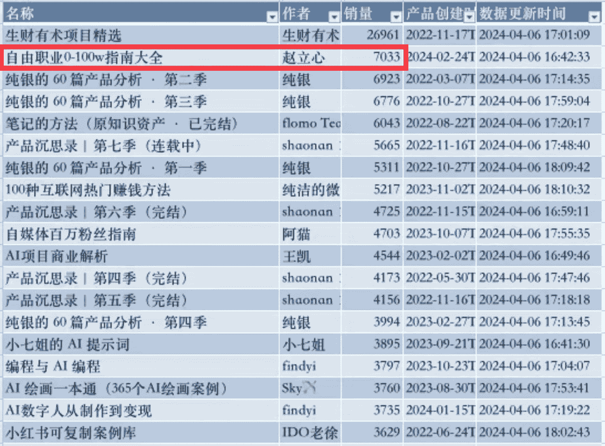
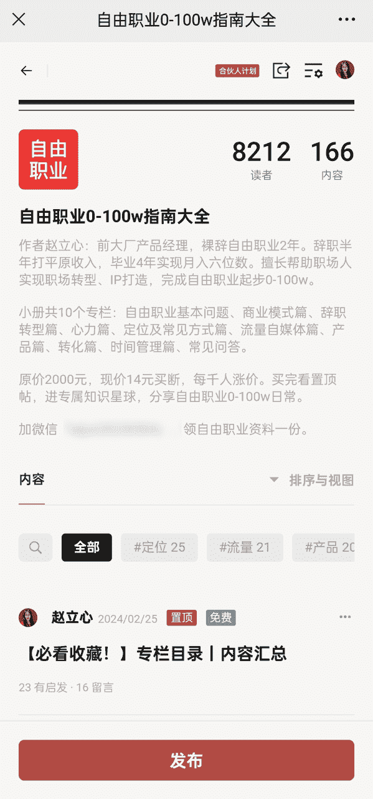
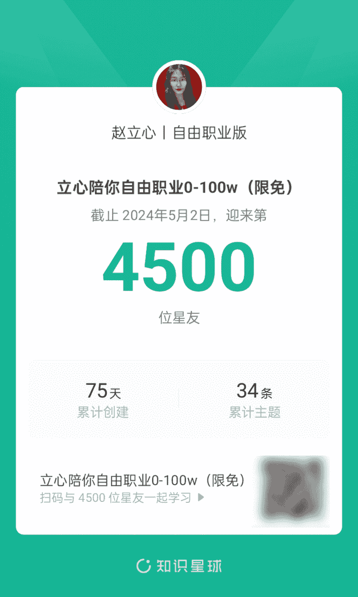

# 2024-05-22自由职业指数型增长标准打法：用10元单品，一周引流5000+新用户，撬动近50万收益

> 来源：[https://xuqiwei1986.feishu.cn/docx/HDzsd3zdwo0bUdx47tJcWAdynSh](https://xuqiwei1986.feishu.cn/docx/HDzsd3zdwo0bUdx47tJcWAdynSh)

> 🔗 原文链接： h[ttps://scys.com/ar](https://scys.com/articleDetail/xq_topic/1522484125412112)ticleDetail/xq_t...

>

大家好，我是生财龙珠圈友立心，前大厂产品经理，裸辞1.5年实现月入六位数。目前是一名职场转型及自由职业教练。

在上个月，我突破了之前自由职业的瓶颈，实现了自己的10倍之旅， 付费用户达到近1w人，变现近50w。

我推出的小报童专栏《自由职业0-100w指南大全》， 2天卖出近6000册，6天总销量冲上全网第二 ，仅次于生财官方出的项目精选，截止目前一共卖出8000+册。

这个动作实现了 引流加好友5000+人，变现50w ，我的知识星球也从100人暴涨到4000+人。前后还被四家出版社邀请，出版这个专栏。

最震撼的是，截止目前， 有700+人有效参与分销（卖出了单子） ，这个数据持续还在涨。还有很多社群在自发的讨论，引发群里疯狂抢购。

很多几十万粉丝的号主下场推荐，头部卖了几百单的大佬，我之前都根本不认识，甚至很多kol在几个人拿一个人的码分销冲榜。

成绩和真大佬比可能不值一提。但这个动作在持续稳定的为我带来收入。并且，我觉得 它背后是一套对于大部分自由职业者，普适可用的方式。

这篇就给大家分享一下，我是如何突破自由职业瓶颈，实现10倍跨越。以及这套标准化的玩法详情。具体包括——

1、职场人想做自由职业，如何突破焦虑迷茫和收入不稳定，构建核心竞争力？

2、如何通过一套标准化流程，实现自由职业的跨越式发展？

3、普通人做流量、转化、产品三端，如何实现能够实现指数型增长？

4、自由职业的10倍增长从何开始？有哪些需要重点关注的事情？

全文17000+字 ，详细写了我的方法论和很多做法的细节，详情请移步：

[h](https://j7329dxmbu.feishu.cn/docx/GTo6drjueoAU0YxhmWhcB7vqnnt)ttps://j7329dxmbu.feishu.cn/docx/GTo6drjueoAU0YxhmWhcB7vqnnt

感谢大家的耐心收看，希望能对大家有所帮助，也希望看到更多优秀的朋友在自由职业之路上实现突破。

整个商业闭环里面细节还蛮多的，篇幅有限，无法把所有都说的特别详细。大家如果有什么需要，也欢迎和我交流。

【往期龙珠贴】

职场IP品牌活动，四天收入近8w，普通职场人[如何通过IP+内容+活动突破职场天花板 https:](https://articles.zsxq.com/id_fo2foaxj2cx0.html)//articles.zsxq.com/id_fo2foaxj2cx0.html

大厂裸辞一年半，跑通职场个人IP，千人私域半月被动收入近六位数，我的历程分享 https://t.zsxq.com/11m3BTCz6

[视频号第一次直播卖课，单场净利16000+ http](https://articles.zsxq.com/id_lg037c6uozh8.html)s://articles.zsxq.com/id_lg037c6uozh8.html