# 4.17 亦仁快问快答 （汇总扩充版）

> 来源：[https://xuqiwei1986.feishu.cn/docx/G8n5d39B6oIGNFxwFdXciFtonld](https://xuqiwei1986.feishu.cn/docx/G8n5d39B6oIGNFxwFdXciFtonld)

PS：里面的蓝色字体部分，都是可以跳转的链接！

PS：里面的蓝色字体部分，都是可以跳转的链接！

PS：里面的蓝色字体部分，都是可以跳转的链接！

具体回复部分，二级标题是老大已回答/ 我们能找到相关资料来回答的。

一级标题是老大没回答，我们也不好回答的。

---

🎉 独**家揭秘 **🎉

---

一篇不容错过的深度好文，带你一探生财有术的奥秘！

在这个信息爆炸📚的时代，我们为您精心策划了一场知识盛宴——

一篇文章，N种读法！您可以像品茗一样，从开头慢慢品味到结尾；也可以像寻宝🔍一样，跳跃至最吸引您的宝藏篇章。

**

【前情提要**】

昨夜，群星闪耀之时，亦仁大佬在群内投下了一枚重磅炸弹💣——《在线快问快答》！ 瞬间点燃了我们这些长期遨游在生财有术海洋中的大学生的热情，我们毫不犹豫地为这些珍贵的回复附上了《参考文献》的标签🔖（全部索引自生财索引站的精选内容）。

随着问题的雪球越滚越大，深夜十点亦仁大佬的置顶回复“问题有点多，一晚上回不完”；这激发了我们帮助整理评论并加上参考文献的想法，旨在分析圈友们最关心的内容，为新圈友更快融入生财有术的氛围贡献一份力量🔥。

我们相信，这对于新加入的圈友们来说，无疑是一份珍贵的指南🧭，一份能够迅速融入生财有术大家庭的温暖助力🚀。

**

【揭秘时刻**】

经过通宵达旦的努力，我们终于将这份心血凝成的文字呈现给您。

这不仅仅是一篇文章，这是一次知识的探险，一场思维🌟的碰撞，一段成长的历程。

### 阅读须知

>

1.  每个问题尽量都有回答，但有些我们无法代替亦仁老大作答 🌹

1.  每个问题的回答都尽可能精准，每个人都是不同的个体，我们更多的是提供与问题匹配度尽可能高的生财资料，加大问题被解决的可能 ✔

>

# 一、搜索采集与数据分析

**采集方法来源：**[大哥说我精华帖没用户思维?! 一气之下，我分析了40W评论数据！挖掘出了生财小白的7个痛点问题！](https://mkfwp3u79v.feishu.cn/docx/doxcnyx1dadaQMBpjoUVeupdbQh)

**首先，我们收集了截**止于**2024.4.**18.3：25的218条评论提问，共计12866字。

由于内容全是一个接一个的问题评论，我们在意的并不是某个具体的问题（当然也很重要）我们希望看到的是这些问题通过大数定律之后可以看到生财对某个话题的重视程度。

## 1.1 词频分析

我们首先对采集到的文本进行分词并排序后得到圈友关注较多的词汇。（文件附下）

生财有术始于赚钱的项目，刚好“项目”一次也是提及最多的词汇

于是我们将词云做成“术”的形状，

正如亦仁大大的信中写到**“**市场并不缺一个得到版的生财有术，也不缺一个混沌版的生财有术，但一定会有一个分享最全最新赚钱机会的生财有术。”

寓意，**一切从项目开始结缘**

大家没有忘记更没有偏离初心

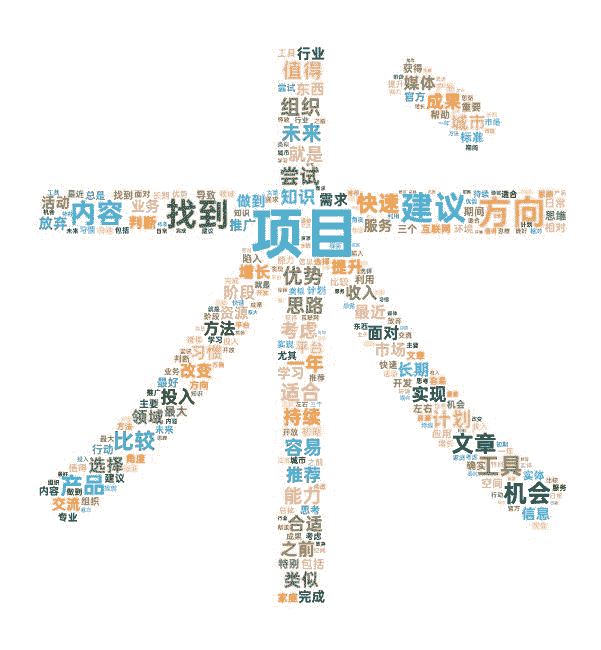

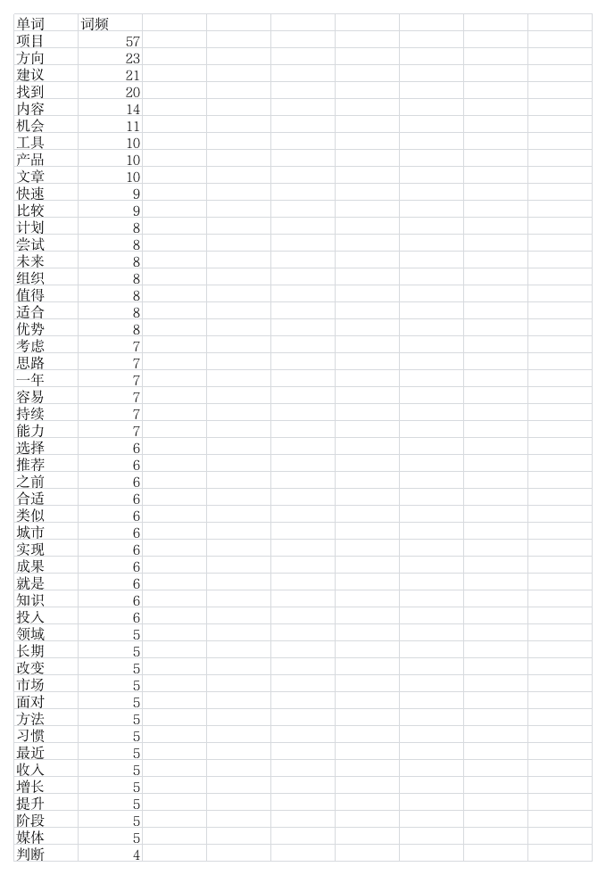

[微词云导出分词的结果数据.xlsx](https://internal-api-drive-stream.feishu.cn/space/api/box/stream/download/all/KOnMbO3Oxo7VdKx3zPacKxtZnKg)

## 1.2 问题整合分类

### 个人成长/心态

### 项目疑问/选择/实操

### 创业职业疑问/策略

### 生财疑问/反馈/建议

# 二、具体回复以及参考内容列表（持续更新ing）

## 老大，有没有小航海计划啦？三五人的那种快速尝试、快速变现的

## 接下来的 AI 领域会不会加大力度？

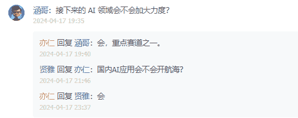

## 对于未来的不确，是什么力量让你走下去的？

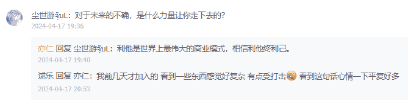

[没有任何道路可以通往真诚，在生财有术，真诚本身就是道路。  我提醒自己，如果不擅长社交，那就做一个真诚的人。如果不知道怎么赚钱，那就](https://t.zsxq.com/19FJfzrNR)做对别人有价值的事情。  慢慢地我们就会发现，真诚是效率最高的沟通方式，而利他是最好的商业模式。  保持真诚，保持利他。这一条原则，让我在过去十几年里持续受益。

## 每次航海，可选的项目非常多，但是最终开放给圈友报名的，可以感觉出来是经过了取舍。那么这背后，决定一个项目是否成为正式航线的判断标准是什么呢？谢谢亦仁老师解答～

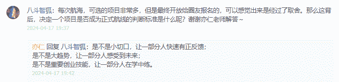

https://wx.zsxq.com/dweb2/index/topic_detail/4844852524811188

## 昨天刚加入，总体有点懵，内容太多了。目前无副业，正寻求，有没有好的建议，快速适应生财，并入门。

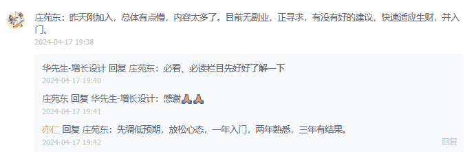

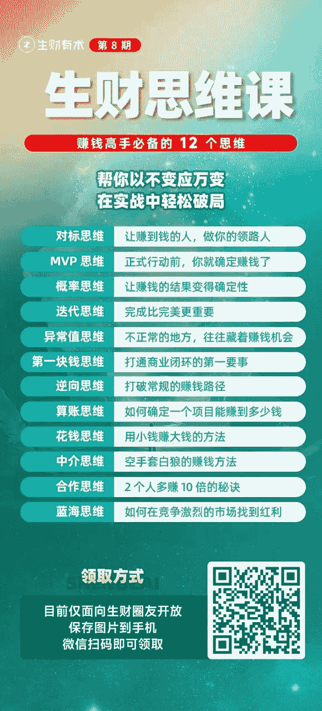

新人指南 https://wx.zsxq.com/dweb2/index/columns/18245288222

## 如果有机会，最想对7年前刚开始做“生财有术”的“亦仁”说什么呢？

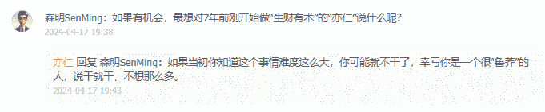

[很多人会轻视自己在做的业务。  觉得自己在做的业务又苦又累，没赚什么钱、没有机会、](https://t.zsxq.com/19qewAyf3)看不到前景，你看谁谁谁做的业务特么多轻松多赚钱。  可能对方也是这么看你的业务。

## 如果干什么都会后悔的话，如何去选择。

不为过去后悔，永远相信未来。帅张：我的7条职场建议和10条创业经验分享

## 大大推荐几本书呗

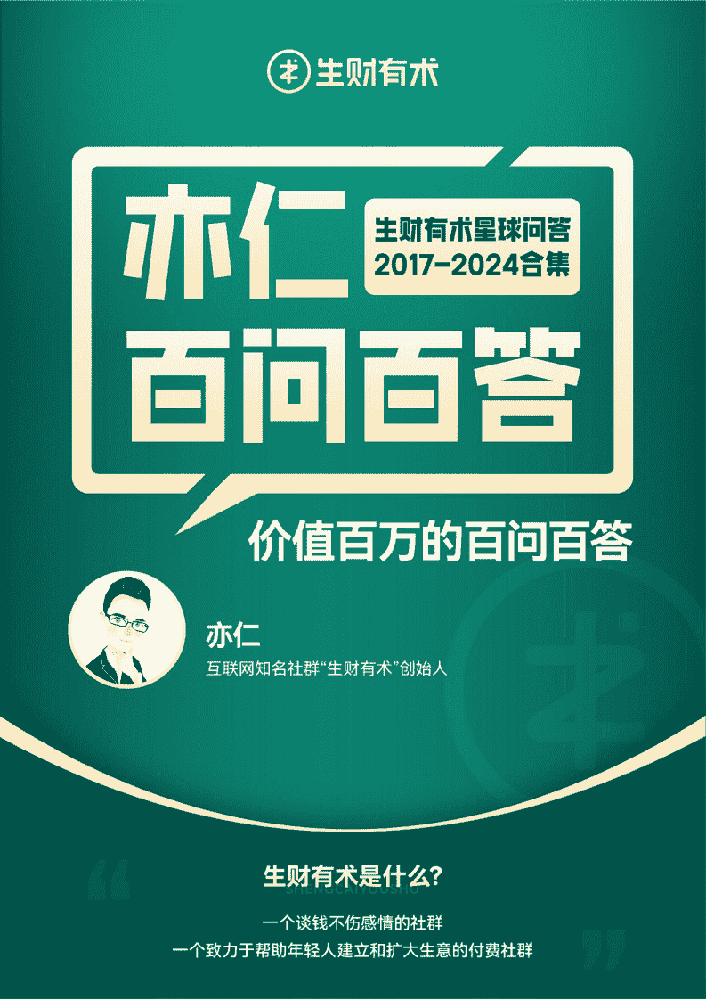

[《亦仁百问百答》——生财有术星球问答_2017-2024合集.pdf](https://internal-api-drive-stream.feishu.cn/space/api/box/stream/download/all/V5jVbTIrHo2etmx8Eczc84nXnYb)

[亦仁益语.pdf](https://internal-api-drive-stream.feishu.cn/space/api/box/stream/download/all/J0SRbz0kiosQLNxsAuSckgyxnxc)

## 亦仁现在已经有宝宝了，想问下你对孩子的期望是什么？你会如何刻意培养孩子这些期望！

## 亦仁大大，怎样让小航海的尝试变成自己长期的事业呢，感觉自己一直从0到0.5地循环，有点心气跌了

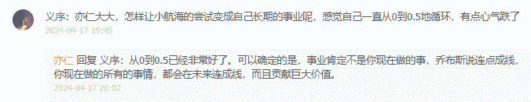

## 亦仁，想问下你如今做了生财，从财富包括事业包括社会地位上都比较成功，这会对你的性格上造成一些改变嘛，或者是哪方面对你性格影响最大，在回想开年演讲上你谈到了之前不那么自信

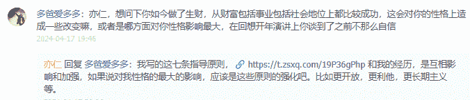

图中 链接直达：👉 https://t.zsxq.com/19P36gPhp

## 对于一个没有形成基本盘的人，流量和项目如何取舍先后！

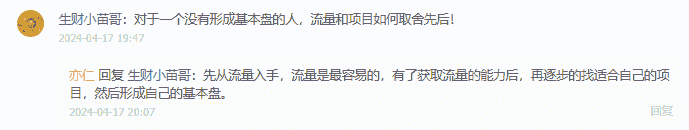

## 老大，同城生态下有什么赚钱机会，和如何组织人员起来一起做这个项目

**圈友案例仅供参考：**

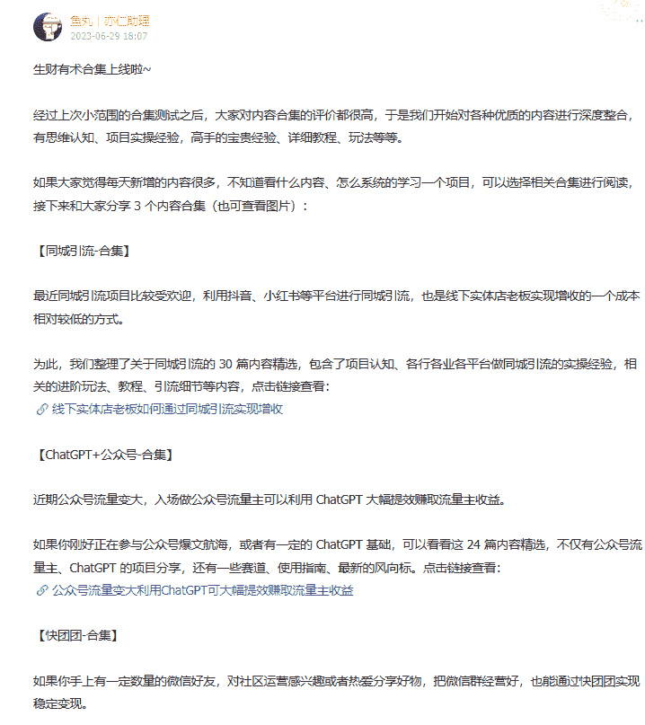

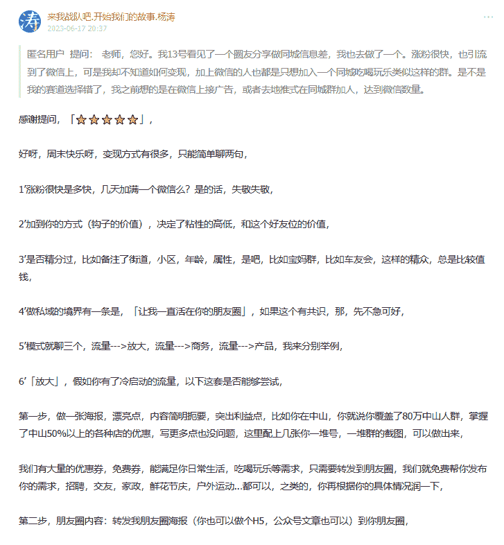

图1 链接直达：👉 https://wx.zsxq.com/dweb2/index/topic_detail/214448128884221

图2 链接直达：👉 https://wx.zsxq.com/dweb2/index/topic_detail/584458122188484

## 老大，如果让你再选一次，你还选择做生财还是做海外工具?为什么?

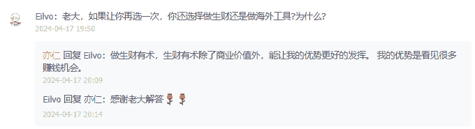

## 提问：同城生态（同城航海）具体会怎么开展

## 目前在流通的龙珠有多少颗？会否出现「通货膨胀」？

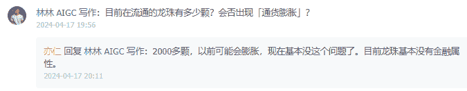

龙珠介绍：https://wx.zsxq.com/dweb2/index/topic_detail/582512214418244

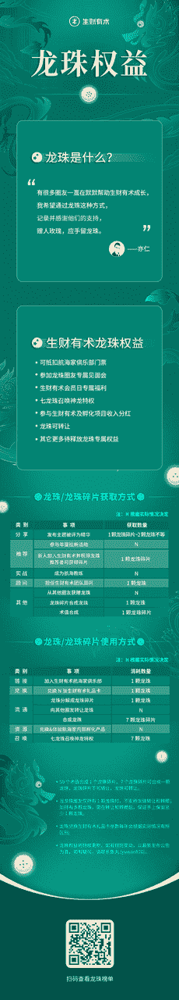

## 我是半年前加入的圈友，24年之前的航海都有小红书ip，今年三月只有小红书商单号，想问下以后还会开小红书ip航海吗

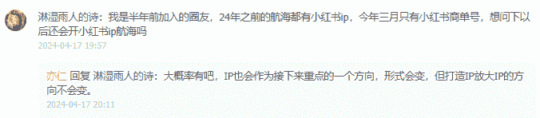

航海手册：https://scys.com/view/docx/QWfQdS9bCoYX7uxv43pccryRn2g

## 你好，亦仁大大。 眼下有主业8人小团队，4人业务➕4人运营。但目前市场趋于下滑姿态，想问您的是，目前是继续深耕做精主业，还是腾出时间测试其他项目呢

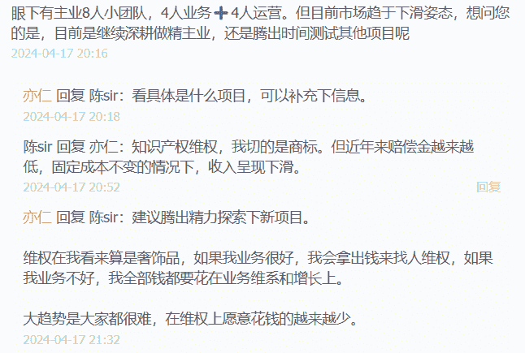

## 我想知道下亦仁一天的日常（日程表就够了）。提这个问题，是我想感受下不同层级创业的感受，还有时间管理方面的建议。

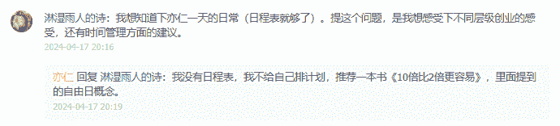

## 希望河南线下讨论可以多点，有时候时间管理不好，可以给点建议吗大佬，大一学生，前段时间进的生财

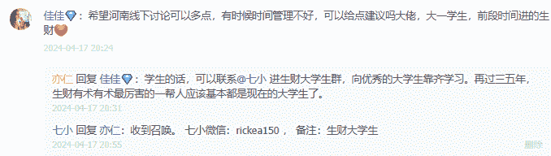

**圈友案例仅供参考：**

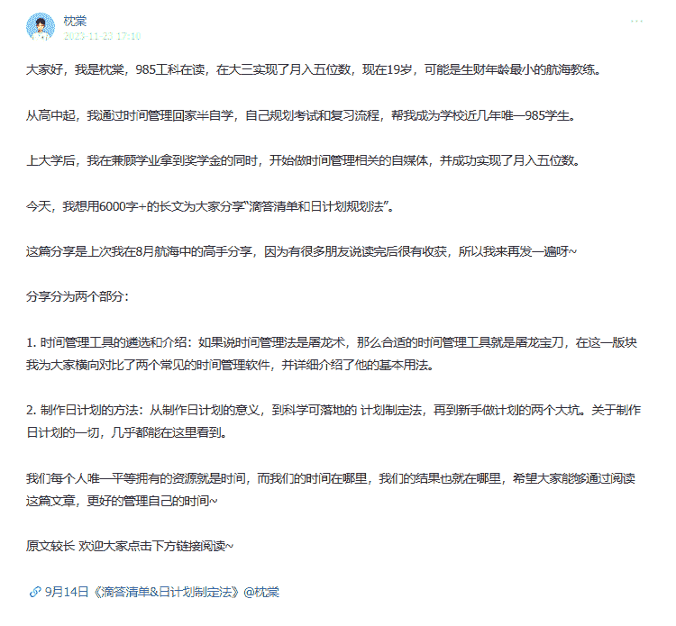

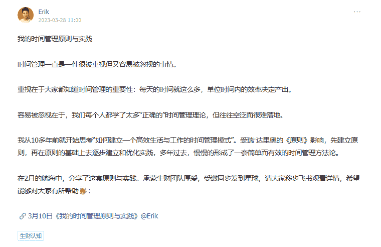

图1 链接直达：👉 https://wx.zsxq.com/dweb2/index/topic_detail/188482818221122

图2 链接直达：👉 https://wx.zsxq.com/dweb2/index/topic_detail/584512552251254

## 每年只在四月有续费优惠吗？我明年续费时还不到四月

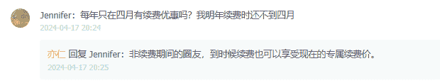

## 感觉目前的航海有点敷衍，跟自己看手册差不多

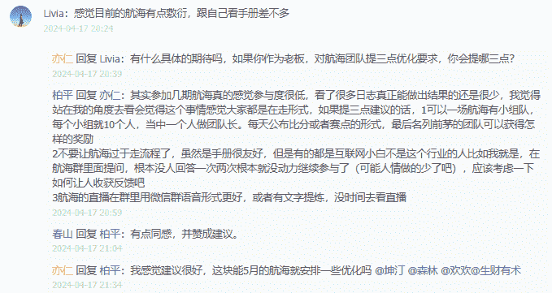

## 老大web3领域会加大力度吗？

## 用思维导图把优秀的帖子做一遍，是否有价值

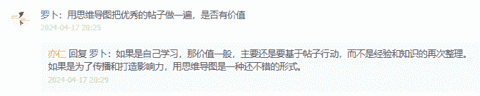

## 亦仁老板好，我想做个养老领域资源对接，这个方向天花板有多高

## 亦仁大大 你好 我想请问 我目前大三 我想以创业的导向来做项目 比如我现在做的小红书店铺 我是否能在这个项目上做个5年以上？是否值得我深耕？还是说更多要倾向于实体业务？以及什么体量的时候我可以拓展团队？

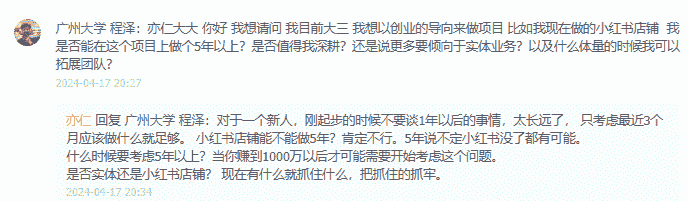

## 创业的过程中，面对不断出现的机会和合作，怎么在多个机会面前保持专注？或者怎么做一个更有效的选择

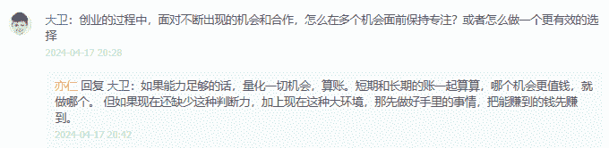

## 亦仁老师晚好！目前我在做大学生品牌ip，由于名字起的好，每年9月有极大自然流，来的学生都是有各种需求附加的泛粉（求职、考研、留学）。我个人作为主理人，希望把它做成全国做大的青年品牌，成为各种产品的销售点，相当于大学生成长品类（升学、求职、副业）的李佳琦，不知道您看可行吗

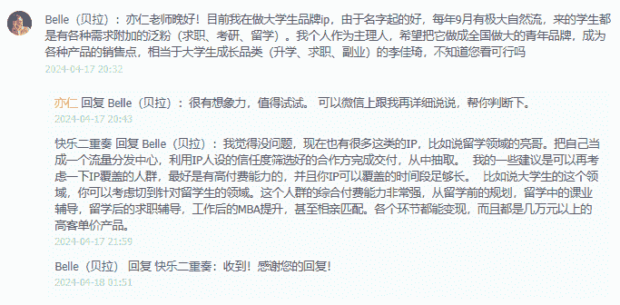

## 想问一下，你怎么看待弹幕游戏。

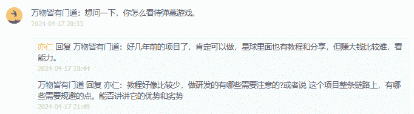

**圈友案例仅供参考：**

可能存在风险。

相关内容：

《抖音弹幕游戏直播，风口已经形成，未来2年最吸金的直播形式》

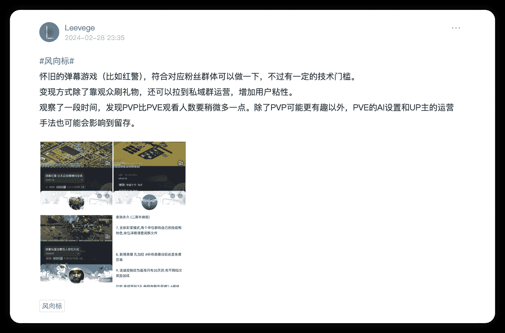

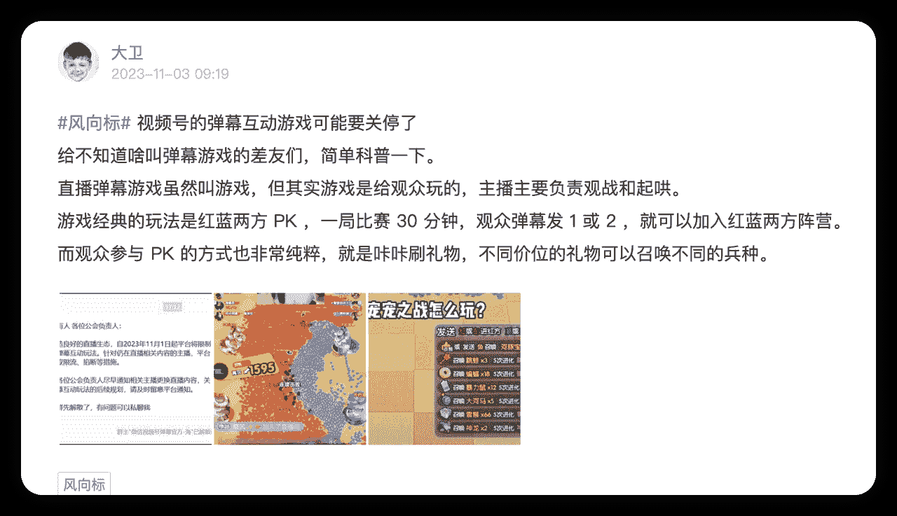

链接直达：👉 https://t.zsxq.com/193VNiajt

## 今年给出的十大赛道很好，可否在每个赛道给出类似文件？例如生财内部的50个赛道这些都整理分享出来？这样便于更快大家找到合适方向。 2、跨行初学者来说，在这么多好的项目快速的找到方向有什么好的方法？ 3、航海可以很好让初学者入门；生财可否有航海类似机制，让找到方向的伙伴，将找到的方向发展成自己未来的事业。可以是副业，或是创业。

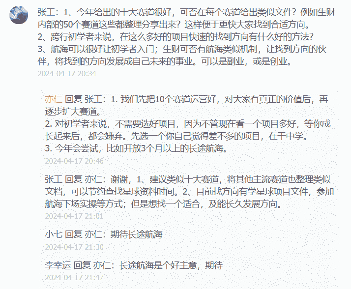

## 亦仁老大，之前提到的共享空间项目流产了，那么有可能在线下某些城市搞个具有官方扶持性质的共享办公地点么，譬如作为生财的城市联络点，圈友可以去那里办公也可以去交流

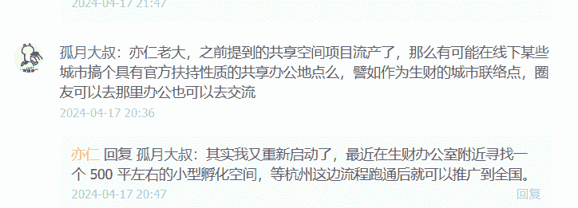

## 亦仁老板，您在创业最艰难的时候是怎么度过的呀？😂去年去创业开倒闭公司后就有点觉得自己是不是太菜了过去内耗有点严重，想听听亦仁大大是如何度过的😂

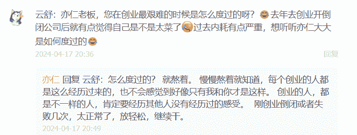

## 亦仁老板生财有没有规划线下组局激励机制？对于参与者和组局官，在关注组局内容准备质量、参与完整度、体验感、收获感等方面的同时，尽可能的扩大线下范围的交流，甚至是增加官方收编or参与的线下航海或者线下小课？ 个人觉得，对一个社群的体感，线下占了挺大的比重，加入生财 4 年整，除了主动搜索，其实已经基本没在信息流里看非官方发的内容。 项目搜索引擎&航海&圈友面基是我对生财最大的印象，不知道是不是大家都有这个感觉。但是线下组织出现阶段性疲软，我觉得可以考虑优化一下。

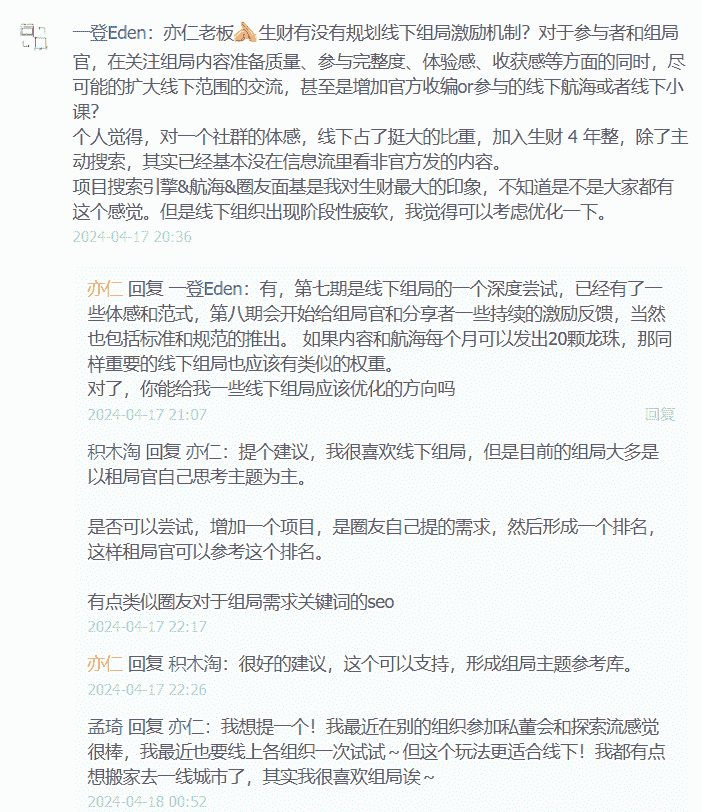

## 生产大量优质内容；但是很多人可能有阅读纸质版本的习惯，纸质可能阅读效率更高。 但是生财也有版权的考虑，所以很多资料只能电子版版本阅读。 有没有好的解决办法解决一下。

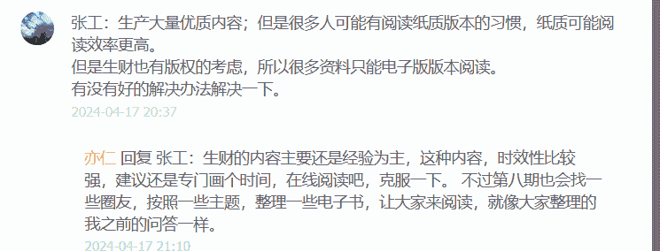

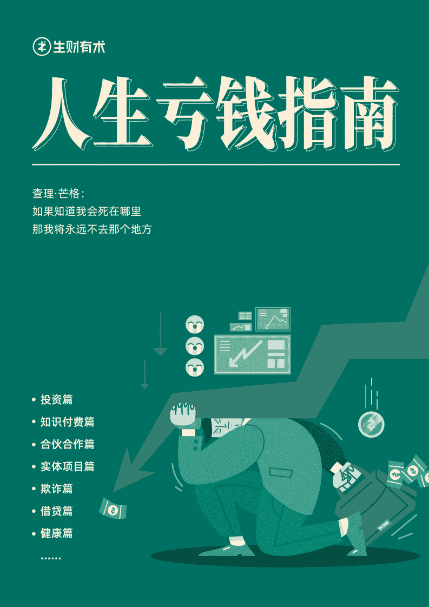

[《人生亏钱指南》生财有术出品.pdf](https://internal-api-drive-stream.feishu.cn/space/api/box/stream/download/all/NcCjb0pAho6p8JxIY0PceVc8n5e)

[《亦仁百问百答》——生财有术星球问答_2017-2024合集.pdf](https://internal-api-drive-stream.feishu.cn/space/api/box/stream/download/all/DW1JbGw70o255DxqAD9cm2FMn8e)

[亦仁益语.pdf](https://internal-api-drive-stream.feishu.cn/space/api/box/stream/download/all/ENUPborpboIEObxPtErcfTbenkh)

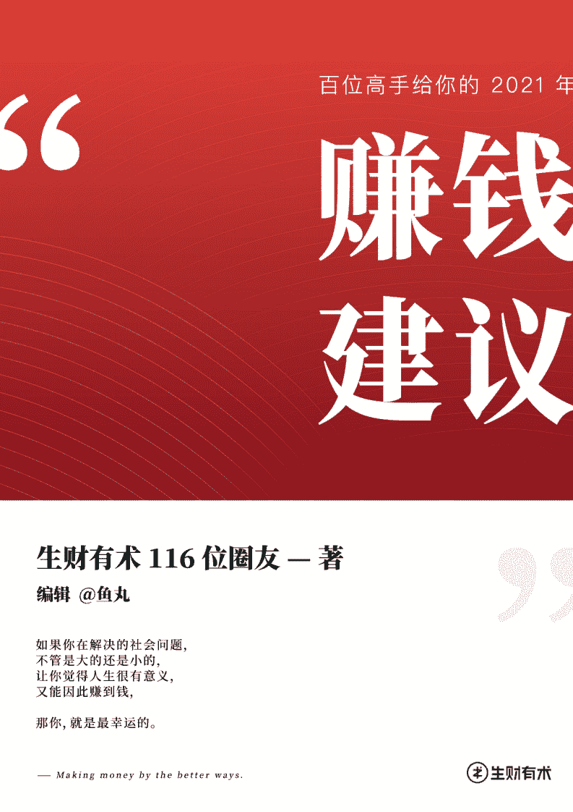

[100+赚钱高手提供的2021年赚钱建议-生财有术出品-完整版.pdf](https://internal-api-drive-stream.feishu.cn/space/api/box/stream/download/all/SlKzbAby5oVAX5xfIvAcNLYNnyh)

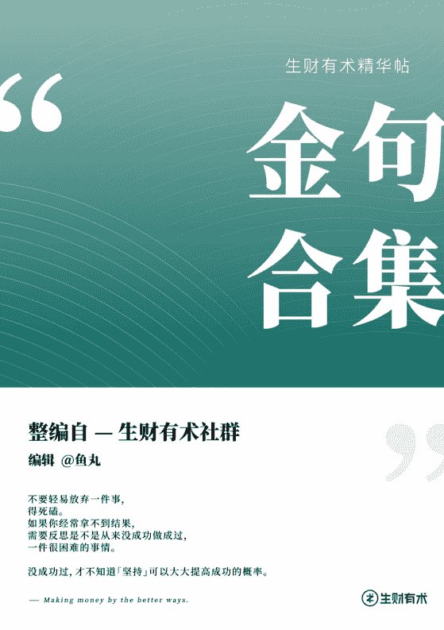

[《生财日历2020》-生财有术社群出品.pdf](https://internal-api-drive-stream.feishu.cn/space/api/box/stream/download/all/BKafb8VJNol8EAxq0lYcNJcbnVf)

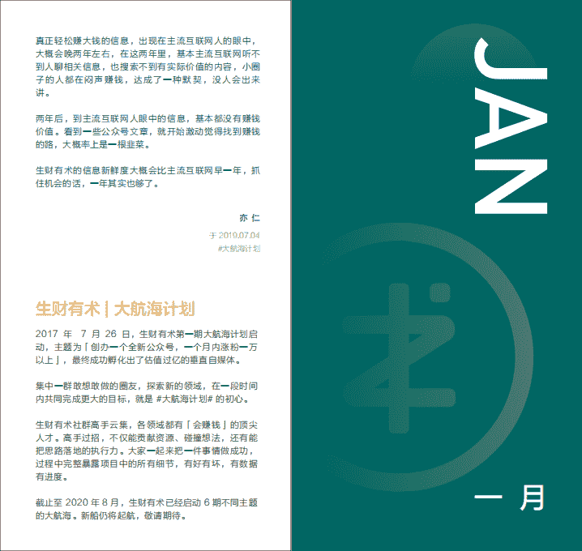

[《生财日历2021》-生财有术社群出品.pdf](https://internal-api-drive-stream.feishu.cn/space/api/box/stream/download/all/Uhpybc7uuoHsyWxOYepcAHhKnkf)

[《生财日历2022》-生财有术社群出品.pdf](https://internal-api-drive-stream.feishu.cn/space/api/box/stream/download/all/JSWdbVGJ5oyw7xxX1TwcOwMvnkd)

## 短剧CPS很火，赚钱多有种思路，最适合普通人的是哪种？是剪辑视频发布，赚取分佣吗？

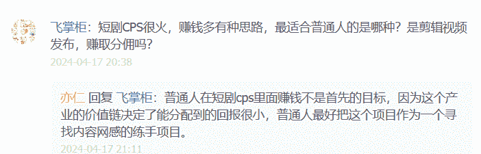

最适合新人练手的项目——短剧CPS

https://t.zsxq.com/194CRpuaB

生财有术中，大家能看到很多实操文档，教大家如何做短剧 CPS

本篇为大家分析一下短剧 CPS 项目，解答诸如以下问题：

短剧 CPS 项目还能做吗？

短剧 CPS 项目收益大吗？稳定吗？

短剧 CPS 项目关键点是什么？

短剧 CPS 项目有其他机会点吗？

……

https://t.zsxq.com/19p2rVk9n

## 接下来的房产市场是否值得投资？长租公寓呢？租房二手房东呢？

拥有 12 家房产公司，分享一下还有哪些值得下场的机会？

https://t.zsxq.com/1975wItbO

5年用闲钱买房赚了50万，小城市房产投资经验，纯干货！！！

https://t.zsxq.com/19GYhFeuU

## Suno音乐很火，有哪些好的变现方式渠道？特别是对于普通人

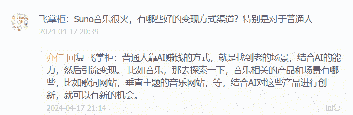

新手怎样通过ChatGPT编程落地工具站产品

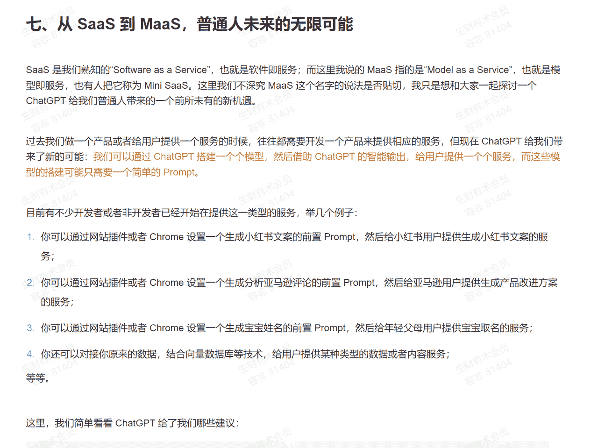

## 亦仁大大，十大赛道重点项目有没有可能直接带着大家下场一起跑项目赚钱，比如带货由生财给大家对接供应链之类的，单兵作战成效不高

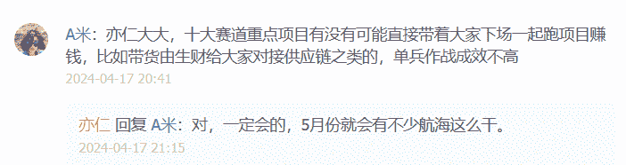

## 哈哈哈我不信，20个字以内告诉我，怎么才能拿到精华帖（最近在小群跟朋友们聊得最多的话题）

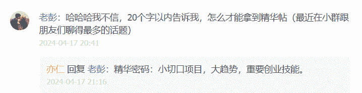

没有任何道路可以通往真诚，在生财有术，真诚本身就是道路

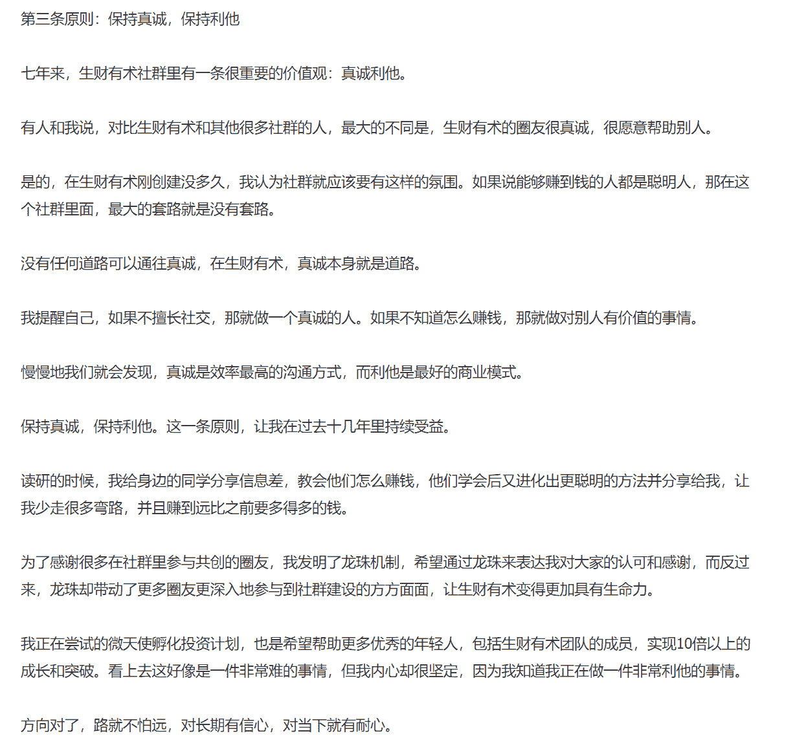

## 大大，如果做自由职业 你觉得最好在哪个城市定居比较利于赚钱？

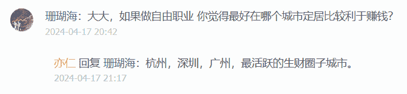

8 月航海 | 数字游民 | 实战手册

[《自由职业者入门手册》](https://t.zsxq.com/19GouBYuH)

## 大大，出海做哪个国家比较好？发达国家还是发展中国家？

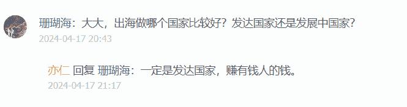

海外市场大，需求广，海外工具则是可以入局的一个赛道。

https://t.zsxq.com/19q09Mo5Z

[如果你对](https://wx.zsxq.com/dweb2/index/footprint/88445284528822)出海产品感兴趣，那不妨看看志愿者@波本零 整理的【产品出海合集】，里面包含了商业认知、商业模式、赚钱案例等 59 篇文章，希望能给你一些思路。

https://t.zsxq.com/19hbgeSiI

## 今天续费啦，期待下一年生财新的变化

https://t.zsxq.com/19xNZgICA

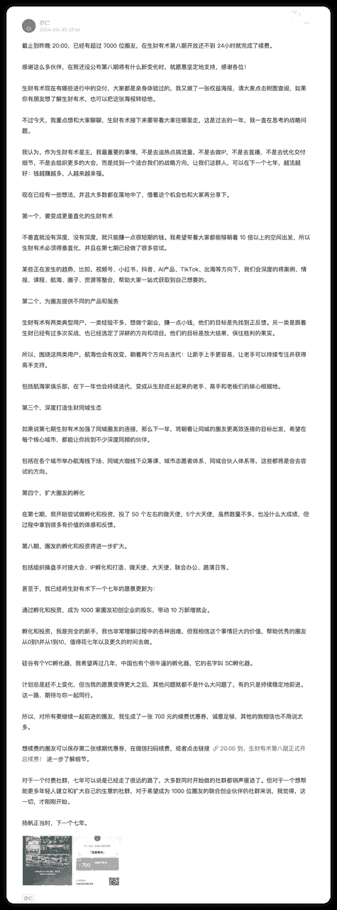

## 金融（银行、风险管理）领域亦仁有看到圈友有什么需求么？

## 请问亦仁大大，针对高中生选科，对未来职业规划有什么建议方向么？

## 有没有可能航海之中可以组织小团队，一群人能走的更远

## 老大，想要加入团队的渠道有哪些呢

## 亦仁大大 你好 我想请问 目前看到生财的项目内容好多，又想尝试做，但是每个坚持不了很久，那我应该怎么选择呢，另外热门的还挺多，自学可能慢，怕学着学着这热门的项目这么多人在做，自己感觉入晚了。

## 做知乎好物有一些成绩，垂直类目变现6位，但流量越来越少收益不断下降，现在不知道该如何转型，想听听您的建议

## 老大，看到或者想到哪些词能马上让你行动起来

## 老大。公众号AI 爆文是个好项目吗？不少人认为没有沉淀，觉得号注销了就什么都没了，没办法把资源带走。

## 接下来可不可以线下或者线上小航海组织一个重度参与的小组航海，成员之间配合，督促

## 请问大大，一个项目做多久还没赚到钱就可以放弃了？

## 航海我觉得作为新手需要个预热期，不然容易跟不上节奏，造成水打卡

## 上期的海外短剧没抢到名额这次还会有吗？有的话还会限额嘛

## 老大，如果是新手小白的话，你建议是做什么项目，如果是你自己的话，只要一个最好的就可以（生财航海有的）

## 做公众号爆文写作半年多了，感觉现在流量主越来越难，越来越卷。 想求教一下：公众号写作项目如何找到切入点，做成一个长期主意的项目？

## 老大，18岁新人，资金1w,该推荐生财哪一个小项目，有网赚经验，目前在干撸货每日有小部分收入

## 距离线下活动还有1个半月，怎么能在线下沙龙招上人来参加，活动流程该怎么做能让大家觉着来活动物超所值。感谢大大～

## 如果让你推荐一个新手小白（不爱写作、不会剪辑、不愿分享）可以快速跑通0-1的项目，你会推荐哪个？

## 大哥，美团外卖头部鲜花代运营找我加盟她家的品牌，她说在北京开一家店成本在5万左右，每个月利润能有2-3万，大促期间利润能有10万左右。但是这个是实体门店，你建议我做吗？

## 亦仁，如何在面对家庭琐碎事有一个强大的且乐观的心态

## 想请问下。AI+写作这个领域有多大的天花板？

[AI写作 合集](https://scys.com/content/collection?id=IfRPI0BQ&number=81404&timestamp=1713390063269&signature=5f06500055b85d01b2af16b4b5a6c88a5005ad1b)

## 总听到别人说，放大10倍比放大2倍更容易，因为10倍增长是模式的改变，而2倍增长很多人习惯通过加倍努力去实现。 但是我始终想不明白，如何从2倍增长，跳到10倍增长，请亦仁大大解惑

##

[【逐段翻译版】10x Is Easier Than 2x.epub](https://internal-api-drive-stream.feishu.cn/space/api/box/stream/download/all/UqtmbWD0PotHgLxZqUEcN9cYnnB)

## 老板，请问后续的航海有没有多一点的续航计划，有时候可能一期航海刚刚熟悉，想着后续再跟一次，结果航海就没有了

## 对于互联网创业者，你认为什么是必要掌握的

## 报名汉服设计课程在Ai时代还需要吗？

## 亦仁大大，对于盖洛普，是否建议以盖洛普结果来作为自己的选项目的全部依据，还是把它当作一个科学算命的东西就好了？

## 大大，如何去评估一个项目适不适合自己？做多久没结果就要换赛道呢？

链接直达：https://t.zsxq.com/19BZjkXLt

## 亦仁老大，我有2个问题 1：亦仁老大创业初期的时候有没有过在做一个项目做了一段时间没有拿到太多正反馈，从而准备放弃的时候？如果有/没有，那又是什么原因支撑着你坚持在一个项目上面做下去的呢？ 2：问了一部分生财的圈友，有些圈友觉得生财慢慢变成了一个“镰刀筛选器”（生财筛选了一波有付费意识的人，然后收割的人自己给某个项目做了一圈包装然后发帖分享“分享操作步骤，欢迎链接”去收徒培训），想问下亦仁老大怎么看这种事情，生财以后会加强这方面的管理嘛？谢谢亦仁老大解答

## 现在我很迷茫，加入几个月了，航海参加了视频号，但是还没有拿到成果，但是一直相信生财是有术的，现在主业比较忙，有点想后面从项目0-1拿到结果再换个不怎么加班，多时间的主业，然后继续搞这个副业，请问老大，我这个决定是不是比较稳合适？

## 亦仁哥，创业日常应该也有低谷期，请问这个时候怎么给自己提供能量和情绪价值？

## 年初刚加入生财，第一次航海报名了小红书店铺和视频号带货都没有开单，对自己的网感、选品和操作产生了怀疑。 请问亦仁大大，有没有可以跟着大佬做项目？小萌新可以近距离接触正确的人和事，夯实基本功。 本次航海体验下来，感觉人数规模很大，而且还没有拿到正反馈，希望能跑通一次，尝到变现的甜头呀

## 如何让自己优先处理重要的信息，我发现我是优先处理简单信息，然后重要客户的信息就被推迟了，有可能服务就不及时，有可能流失客户，然后就死循环

# 老大，关于个人技能提升这块有没有可能开展一期抖音运营的，因为不管是工作上还是副业上运营特别的重要，但是一直不太懂

## 亦仁大大，最近在看个人优势挖掘的手册，运用手册中从成就事件中找优势和从重复行为中找优势，思考半天，也没想到一件成就事件，没有找到答案。想问亦仁大大，如何找到自己的优势，做擅长的事情。

## 看完了大家的评论，确实想不到问什么。 但确实又想参与进来，所以决定在亦仁的帖子下，感谢杨爽哥哥随手的互动点赞！

## 亦仁老大这么多年最重要的日常习惯是什么？现在想早点培养的习惯是什么？

## 每个人的时间都是有限的，你是如何在有限的时间内，从海量的内容中识别出中标风向标和精华文章的，每篇内容都看吗？

# 如何正确的选择一条路，走到亮？ 如七年前的生财有术。亦仁大大，肯定是见过很多很多以后。正确判断未来趋势。

# 现在人在云南的一个市级城市，互联网环境几乎没有，主要是靠线上，对一线城市了解较少，现实情况暂时不能改变城市，从发展角度，有什么建议吗

# 亦仁老板好，听到身边的人在做的事情逐步走向正道且赚到了钱，反观自己还是不温不火，成长很慢，这种情况要怎么破？

# 你好👋，亦仁老板，视频号直播卖图书想深耕有哪三个方向可以发力？

# 什么时候出一个生财知识库AI助手，通过对话，结合生财的内容，给出实操方法

# 如何提升心境？

# 有没有做ai国学赛道的？专门的易学预测治病风水之类的？

# 我目前负债40w，01年的 每个月都有个2-3w，手里还有目前也还有其他项目没有去操作。但是我平时很多时间更想去玩，而不是去挣钱 该怎么办

# 亦仁是哪里人？家乡的环境对你的生活起到了什么样的作用？

# 有赚钱的想法 但总是没啥行动有啥方法嘛，计划总是败于实践

# 计划在数字人方向深耕，比如大品牌的核心代理商，但是这段时间的市场调查和实战体感是，需求其实并没有那么大，有一点迷茫。想问问亦仁，我选的这个方向是不是值得做7年，怎么判断的。

# 亦仁老板晚上好，前面创业熬了六年退股了，停了大半年还没找到方向，好像人没有自信了，有下场爆文，但是没法坚持更新，拿到的结果也小，不知道自己内心真正想要什么了，假如你是我，想知道你会怎么破局？ 感恩！

# 关于个人成长：请问亦仁老大每天都会做的三个习惯是什么？

# 想问问亦仁，一个相对私人生活的问题，希望方便的话可以解答哦，就是目前阶段是如何规划一天的时间分配，以及自己的精神和心力是如何去做调节分配

# 亦仁大大，下一个七年会有什么不一样的东西出现呢

# hi！能不能提供一个web3.0目前最应该薅的一个羊毛实操项目（lv0）

# 听说可以薅亦仁大大了 请问亦仁大大，2024年知识付费赛道如何破局持续变现的呢？

# 亦仁大大:目前比较困惑主业没有什么发展空间，自己一人在外边，多年和家人异地，想改变现状，想辞职回老家，从事自由职业，不知道如何开始。航海也参加几期，没有拿到什么结果，也没有深耕。亦仁大大有没有什么好的建议，马上35感觉自己一事无成，好失败，每次女儿视频，就问爸爸什么时候回来陪我。

# 亦仁大大，想要小航海小团队的组建，人不多一起推行计划的那种

# 我希望生财的航海体验感要优化一下，比如航海做成一个专业的训练营，有专门的干货介绍，教练的带教，也要有相应的作业要求，还有问题求助，有专业的解答就好了，体验感会好很多，个人建议一下，希望亦仁大佬能看到

# 亦仁老师未来看好那些赛道？ 心理学怎么样呢？

# 可以搞一个生财AI小助手，把手册或者精华帖不定时的喂给他，这样圈友有问题了可以先问小助手，没有答案再来提问

## 绿色陪玩桌游吧想要实现年利润百万级的收入，亦仁会从哪些角度去思考，从而把这个业务盘子做大（已经跑通从0到1）

**圈友案例仅供参考：**

链接直达：👉 https://wx.zsxq.com/dweb2/index/topic_detail/181412881521112

# 保持开放在面对未知没有什么掌控感的时候感觉很难

# 哈哈，什么时候来福建，有没有全国巡演计划？

## 我也想加入微天使，还需要做什么努力呀？

链接直达：👉 https://wx.zsxq.com/dweb2/index/topic_detail/211225251118481

# 生财孵化器目前有什么进度吗？比如什么时候会公布，入驻条件如何？

# 大大，我是大四应届毕业生，在去年年底加入的生财，也是在那时候注册了一家公司，但是目前没有项目也不知道该干什么，我能利用这个公司做些什么呢？

# 以前全职炒股赚了几百万，现在不行了，但是也没亏，年纪也近40了，接下来该怎么办

# 今年最重要的一件事是？

# 请问亦仁老板，2024年 AI + 私域工具，有哪些赚钱机会呢？

## 老大，web3的变局能给普通人带来什么机会

**圈友案例仅供参考：**

链接直达：👉 https://wx.zsxq.com/dweb2/index/topic_detail/588518844544554

# 对于新手来说，要实现的目标感觉难度太大了怎么办？想一年存十万，也已经找了两个方向，一个是闲鱼高客单，一个是AI代写。 但目前取得的成果不多，闲鱼高客单做了45天，到目前只挣了600左右，这个赛道有信心实现一个月三千，AI代写还没跑通最小MVP 之后还想找别的赛道，也有考虑过60分带30分的。每次遇到困难，会感觉十万真不容易，望而生畏，有时也会陷入自我怀疑

# 海外投资可以关注哪个赛道

# 你好，亦仁星主~我加入生财三年~除了付费给生财，也给好几个生财圈友付费~感觉都挺值得，就是自己悟性太差或则执行力问题，生财内容太丰富~我估计三年连10%内容未能看完~也不知知道是否又跟我类似的圈友，我是否应该续费？还是先停一停？先将生财的知识消化一下~有什么建议？

# 亦仁，你觉得你人生目前为止，你面对过最大的挑战是什么？你是怎么思考的？然后是怎么解决或者面对这个问题的？

# 老师好，今天刚加入，主业服装设计老师，想请问怎样用好生财，拓宽收入？ AI➕服装设计，会不会有好的发展前景？

# 能不能在航海结束后，让还想持续做的小白组成小团队？坚持做下去，不然很多人就做着做着就做不下了，下次海航又就改变方向了，放大不了

# 您对AI学术的前景怎么看，或者有哪些可以深挖的点？目前四人团队，年度营收1500W左右，快陷入瓶颈期了

# 传统行业在职；如何快速在生财跨行找到自己未来发展方向，副业或创业。

# 出海工具站航海感觉找到能做且能赚钱的需求太难了，怎么办？

# 和朋友在做小红书旅游，1个多月也出了30来篇帖子，费用总投入小1w，现在没有一个成交反馈 做项目遇到类似这种问题，精力还要不要继续在当前的项目呢？怎么判断当前项目是否还值得做

# 个人短视频带货、直播发展，应该如何逐渐从单人转变为退团甚至是一个公司

# 24年3月加入生财，坚持每天看一篇文章写一篇观后感，提前为入驻小红书平台做准备，希望初期能有个不打击心态的结果，也感谢生财的大佬们在这里分享的点滴精华，很受益。

# 如果目前还没有找到适合自己的方向，你会怎么做？

**圈友案例仅供参考：**

图1 链接直达：👉 https://wx.zsxq.com/dweb2/index/topic_detail/211428485448411

图2 链接直达：👉 https://wx.zsxq.com/dweb2/index/topic_detail/214514455848821

# 加入生财的一年，尝试了许多项目，也都有拿到一些正反馈，但总有一些主观或客观原因导致这个项目没有继续下去，想问亦仁大大，该如何在众多有反馈的项目中，找到一个适合自己并可以长期深耕的项目？

# 亦仁哥，我总是会陷入焦虑和迷茫，主业教培时间占据了大部分，现在主业教培都在缩减人手，抽空做副业成果也不大，完全脱离主业做副业，没有稳定的收入又很容易心态崩，现在还负着十几万债务，所以感觉到好迷茫

# 老大，2-3人从年100万利润跨越到下一个阶段3-500万，可以从哪些方面突破呀？感谢老大

# 视频号纯直播和视频口播，，精力不够，2选1推荐哪个？

# 今年是我加入的第二年，我要如何用好生财，让我提升认知、持续赚到钱？

# 可以像今晚上这样定期和大家互动？解决大家一些积累比较多的问题。 2、或者可以定期安排类似机制？解答大家在各个阶段做项目，创业的各种问题。

# 请问如何在生财，寻找创业伙伴，如何获得融资？感谢大佬

# 直播卖货应该是赚钱比较快的方式，为什么没有这方面的航海？

# 亦仁老师，最近在负责新同事都培训，困惑在写sop这一个环节上了，没有明晰的思路，无法很条理清晰的写下来，内部培训我更喜欢录成视频课，但是视频课的坏处是迭代会比较慢，每一次补充内容就要重新录制，而且我观察到生财的航海手册等等，基本都是文字为主要构成，我也想写成文档培训，但一旦开始写，就很乱，没有清晰的思路，我想问，咱们航海的手册的sop，有一个大概的标准吗，要写成什么样的完成度和细节度，才能成为手册放出来，一般是按照什么思路来写的呢，又是怎么把这么多航海高手的内容条理有序的整合在一个手册中，想要独立完成一份航海手册，要具备怎样的能力。问题有点多，实在是抱歉

# 说一些自己的感悟。生财真的带给自己很大的成长，没有取得成果的小伙伴，也不用焦虑，专心磨剑，机会来了自然可以接住。自己这两年在主业和副业上的进步都很大，带给自己的回吧，可能超过了门票的数百倍。也越来越相信利他终究利己。就像今天这个帖子可能翻一翻又有很多收获。二四年大家一起加油

# 2024开个理财赛道？

# 人无远虑，毕有近忧。海外工具站项目十年后还值得做吗？公众号爆文项目你怎么看，现在获利机会大不大？是否是一个短期项目？明年后年再过五年公众号爆文项目还值得做吗？

# 亦仁大大，我是今年即将毕业的大学生，想做自由职业，有什么好的建议嘛？

**圈友案例仅供参考：**

图1 链接直达：👉 https://wx.zsxq.com/dweb2/index/topic_detail/411254282841458

图2 链接直达：👉 https://wx.zsxq.com/dweb2/index/topic_detail/811428441244522

图3 链接直达：👉 https://wx.zsxq.com/dweb2/index/topic_detail/211822545422441

# 老大，有没有考虑有出条赛道和“情感，情商，交际”这方面相关的，感觉对于我们这种社恐i人挺重要的，我的小伙伴都反应不太敢去线下，我也是，虽然一直告诉自己可以当个鼓掌的人，但是每次去都需要心理准备，而且很怕说出来的话不合适之类的。还有就是交际，很多关系都是停留在了表面，不会维护，生财很多小伙伴就做得很好，有时候幸好有他们不然我会更自闭

# 合伙投资新开一家汽车美容快修店，有个靠谱的股东店长，懂维修懂汽车美容，属于实干型。但是营销能力差一点。其他优势不明显。想找一个爆品，在线上的一个平台爆起来，把店搞起来。应该怎样做？

# 我负责某部委的三级机构，主要职能是组织公益活动和公共服务。 在生财常看常做常新，有一个思路，通过生财链接过硬的培训或项目交付，以官方名义联合各地高校、政府组织线上线下新媒体创就业培训，培训成果用于乡村振兴农产品上行，各地政府提供场地设施资源。 以政府主导，市场运作的形式将生财的优势成果更加规范、规模、规律的进行复制落地应用。 不知思路是否可行？咱们生财有没有兴趣，有的话可以带团队到访或邀请来北京洽谈。

# 亦仁大佬，我是一个33岁的宝妈，孩子4岁，之前一直在职场，位置上海，月薪15k-20k，私域运营岗位。去年孩子三天两头生病，实在没人带孩子，辞职在家带孩子了。在家久了，最近一直很迷茫，参加了几次航海都没有找到方向，而且我这个年龄，找到合适工作不容易了，特别是找到可以兼顾家庭的。想求一份年收入15-30万左右的可以长期做的项目，同时可以兼顾家庭，可以长期做的更好。这个项目如果需要投入，我可以投入10万以内的资金，每天工作8小时没有问题，最好是2个月左右的投入就可以看到正向回报；如果需要去跟师傅学习，半年以内都是可以的。这是我第一次提问，恳请得到亦仁和大家的帮助，平时可能还不好意思说这些苦恼。

# 请问亦总，1、对现阶段电商如何看？2、对普通人来说，例如跨境类电商，或者闲鱼电商是一个很好长远方向吗？3、跨行初学者，当做长远发展方向，这些电商项目方向应该如何选？4、对于普通人，副业或初创，想将电商类发展长远方向，有什么好的建议。谢谢

**圈友案例仅供参考：**

图1 链接直达：👉 https://wx.zsxq.com/dweb2/index/topic_detail/188184512225482

图2 链接直达：👉 https://wx.zsxq.com/dweb2/index/topic_detail/188545255818822

图3 链接直达：👉 https://wx.zsxq.com/dweb2/index/topic_detail/188518215252812

# 亦仁大大，我是一名程序员，去年这个时候加入的生财，对AI方向特别感兴趣。当时刚好看到了生财的手册，提到AI绘画小程序有年入百万的机会，就开始了开发。 花了4、5个月的业余时间完成了基于midjourney的AI绘画小程序的开发。但是自己不会推广，也没有做过相关的事情，找了一些教程，各个平台发文，都没有大的反馈。后面又持续迭代小程序，想着把功能、体验做的更好，可以更好推广，也可以激发用户的自传播。一直到去年底，还是没有什么起色。 然后看到生财有出海站的航海，里面也有推广相关的内容，就想着参加这个航海，可以学一些推广的方法应用到自己的小程序上。 经过一次出海站的航海，反而让我觉得出海才是未来，一个月的航海也让我收获了非常多的东西，觉得自己之前做小程序犯了太多的错误了，浪费了太多时间。 现在有点纠结，国内的小程序放弃掉，感觉有点可惜，毕竟花了很多的心思，感觉做的也还不错；持续投入又不知道有没有结果；还是说接下来专注出海的业务就好。希望亦仁大大可以给点建议 🙏

# 程序员一个，想入手海外工具站这一块，请问一下要怎么入门

**圈友案例仅供参考：**

图1 链接直达：👉 https://wx.zsxq.com/dweb2/index/topic_detail/188184441821422

图2 链接直达：👉 https://wx.zsxq.com/dweb2/index/topic_detail/811844452441512

# 正准备做面向生财圈友的生财工具站，亦仁对工具站的内容和运营有什么建议吗？ 目前想法： 开发或收录 航海项目、志愿者、生财 相关的工具，一些高频、适合移动端使用的上线微信小程序。

# 后续有没有招募圈友内测各种产品迭代的计划？比如航海、线下聚会等等

# 希望后续能多一些这样的帖子。当然我知道这个非常占用亦仁的时间，两个月一次或者由团队专业一点的人来回答也行，通过大家的提问也能看到一些机会，知道大家在考虑什么。感觉收获挺大的

# 老大，我想学习文字的底层逻辑，懵懵的，又好像有一点点明白，但总体来说是蒙的！

# Tk海外短剧的市场怎么样？

**圈友案例仅供参考：**

图1 链接直达：👉 https://wx.zsxq.com/dweb2/index/topic_detail/2855822282882881

图2 链接直达：👉 https://wx.zsxq.com/dweb2/index/topic_detail/811215584412142

图3 链接直达：👉 https://wx.zsxq.com/dweb2/index/topic_detail/588115184524814

# 最近执行力变得好差，有什么方法调节吗

**圈友案例仅供参考：**

图1 链接直达：👉 https://wx.zsxq.com/dweb2/index/topic_detail/212844452128121

图2 链接直达：👉 https://wx.zsxq.com/dweb2/index/topic_detail/212858188848111

# 十年财务人，国企财务经理，注册会计师，高级会计师，职业上升通道几乎没有了。今年初刚加入生财，从最开始的亢奋吸取到现在的漫无目的而焦虑不安，也就短短三个月。想找一个副业，让自己更加有安全感。 亦仁大大，请指点一二：我想走自媒体之路，针对我的情况，方向是什么？可以如何切入？

**圈友案例仅供参考：**

图1 链接直达：👉 https://wx.zsxq.com/dweb2/index/topic_detail/188828514212512

图2 链接直达：👉 https://wx.zsxq.com/dweb2/index/topic_detail/214424151842451

图3 链接直达：👉 https://wx.zsxq.com/dweb2/index/topic_detail/811418888242242

# h5小游戏适合小团队入手么，

# 内向的人适合参加线下的聚会吗哈哈

链接直达：https://articles.zsxq.com/id_hxfq7xmj5w9r.html

# 老大，我试了好几个赛道，没有拿到我想要的结果，是继续走现有的赛道，还是换赛道呢？怎样才能试到适合自己又赚钱的副业呢？

图一链接直达：https://wx.zsxq.com/dweb2/index/topic_detail/588122881488544

图二链接直达：https://scys.com/view/docx/FmtDd2M7wocG50x5W3WclpI7n8X

# 航海结束，有拿到正反馈的朋友，能不能开一个实训营，带着大家一起玩，适当收费也行。最重要的是可以甄别这个人是不是真的拿到正反馈。

# 心中想要多接触人和事，但行动的时候却胆怯，如果是你，你会如何做，如何改变呢

# 老大，有个ai相关的小程序，有变现，转化率也还行，但是搞不到更多流量怎么办。

# 亦仁大佬晚上好， 从现在的角度，我认为10年后对我来说依然非常重要的东西有：健康（饮食、运动、作息），自由（经济、自由），亲密关系（家人、友情、爱情），爱好（听歌、旅游）。（目前没有想出还有没有遗漏） 想请教下亦仁大佬，有什么好的办法或者方式能让我去具体的细化自己5年里面应该怎么做，做什么？三年里面应该怎么做，做什么？一年里面应该怎么做，做什么的思路或者方案么🤝🤝非常感谢

# 对于没有工作经验的在校大学生，您有什么建议或者忠告？新的十条赛道或航海，有没有比较适合我这个定位的，能够更快获得成长的推荐？感谢🙏🏻亦仁老大

# 8月续费的有活动么

# 航海期间提供了厂家资源，但是航海结束，立马就关闭了，导致航海期间上架的产品全部得自己找货源，改价……希望航海能考虑开设通道，结束后产品仍能有对接通道，而不是直接全部关闭

# 亦仁哥，毕业第二年，目前计划稳定工作，下班做调酒类ip账号（爱好），或寻求第二、甚至第三收入，是否正确，加入生财半年多，2次航海也是0-1阶段没坚持下去，挺迷茫的。

# 不习惯展示自己怎么办

# 生财后期会考虑组织【构建产品】的航海吗？

# 亦仁老板，想请教您，和绘画相关的赛道有没有你看好的？ai绘画出来后行业收到很大冲击，是不是转ai绘画好一点？

# 亦仁大大，我是一个上班族，从事私域运营的工作有4年了，我今年想要做一个专注于养生赛道的私域运营账号，分享市面上养生赛道私域运营的案例和玩法。但是产品这块我还没有，我该怎么做可以快速落地呢？

# 做自媒体搜索流量市场空间大吗？谢谢亦仁解答

# 老大您觉得如何学习知识更高效点？就是说，尽可能的提升自己对某个知识点的理解能力。除了不断的整理重构应用知识外，还需要做什么来增强这个理解力（学习力）

# 老大您好，想问一下您怎么看待疗愈这个赛道？ 疗愈赛道里，工具和陪伴那个更重要？ 在着手做一个疗愈陪伴类似私聊的产品，以标准课分享+一对一咨询+阶段性体验课为主。您有什么建议嘛？

# 今天生财的续费人数是否低于预期了？感觉今年续费和拉新都可能会少比往年少一部分，感觉是大环境问题，生财这个产品很好，感觉就是大家手里可能都没钱了，可能知识付费会减少。是这样子嘛

# 如何找到自己的优势，并且利用自己的优势赚到钱？

# 任何的项目都能做到100w，那么完成项目，最重要的两个能力是什么？如何提升这方面的能力？

# 希望能组织3-5人的小航海，让专注于某条赛道的同频人能一直耕耘下去，而不是时刻更换赛道

# 亦仁你好，我想问问：如何更好的借助生财赋能自己。 目前自己有个项目在跑，但是后端是别人的，完成了从0-1，拉了个4个人的小团队，目前月利润3万➕，现在痛点是不知道怎么放大。 是不是要打造出一个自己的产品，还是不断的与其他人合作？还是打包做培训？ 目前只是觉得自己一直在做私域沉淀，虽然没有自己的产品，但是积累了私域，就是不知道如何持续变现。 希望看到能帮忙答疑解惑！

# 老大，可以多加一些线上聚会吗哈哈哈

#

# 公众号刚爆两三篇在快速涨粉中，这会儿开始接广合适吗？或者什么时候开始接广更合适些（如爆文数粉丝量等相对量化指标）？ （另航海对于真小白的实操案例和解答是否可以多一些？航海确实部分过于流程化，全小白更多还是自己摸索。我个人在探索过程中的一些细节问题，想在星球中找到答案还是比较困难，理论类的大框架的分享偏多了。细节些的案例对新人小白可能更有帮助）

#

# 去年加入到现在参加了好几个航海，大部份都能跑通赚到钱，包括闲鱼二手书，小红书无人直播，抖音直播教育（没跑通），闲鱼高客单，3月航海视频号中老年知识付费（单视频最高播放最高3w，没继续做），这次志愿者小组轻松里程第一，私域在做心力教练ip，能感觉也有反馈写作不错 能感觉到每次航海都对很多项目感兴趣，都想尝试，能感觉到我喜欢帮助别人。尤其是熟悉的圈友朋友，航海的时候跟他们聊选什么项目很开心 但是接触到很多人说是要深耕，不要老是换项目；我就很迷茫，不知道该怎么办，感觉聚焦有点吃力，同时又觉得去年是突破了0-1，拿到了从市场上赚钱的这个信心，按道理今年需要1-10尝试的慢下来沉下来，但是感觉内心有阻力又不知道是什么 想听听老大的想法和建议

# 想知道老大以前创业初期的时间作息是咋样的

# 如果健康不太允许，时间也不多的情况下，工作成为了娱乐，做什么事更容易拿到结果？

# 亦仁大大，今年的航海会分阶级嘛？比如一期之前参加过，跑通了流程，第二期，那些跑通0-1的小伙伴组队继续航海？

# 目前还是在抖音上，两三年了，宝宝号6000粉丝，个人情感号一万七，却始终没有变现成功，找到自己可持续发展的方向，一直没有实现从0到1，我是继续抖音，还是转战小红书和视频号从零开始呢？

# 亦仁，你好。 我想问，“脱单陪跑”这个项目，是否可以做到仅靠一个人，是否可以做到年入百万以上？ 如果可以，需要基本什么样的核心能力，已经成功的因素是那些？ 期待解答。

**圈友案例仅供参考：**

图1 链接直达：👉 https://wx.zsxq.com/dweb2/index/topic_detail/2855822228518811

图2 链接直达：👉 https://wx.zsxq.com/dweb2/index/topic_detail/8855841182884542

# 🙌想提问一个问题，我的问题是，我在看生财咱圈友文章的时候，经常会出现别的文章链接，不知道应该选择继续读本文章还是点进去看其他的文章 如果进其他的文章再出来读原文章就很容易跟不上，不知道这该如何是好

# 能请亦仁大大分享一下未来 3～5 年比较看好的行业吗？以及想知道一下，亦仁大大心中的偶像是谁哇

# 老大，我是一个90后创业者，出生时候因为医疗事故损伤了语言神经，导致我说话比别人慢。但我从未放弃，去年在视频号卖Ai课程卖了8000多份，还在生财发帖得到很多圈友支持。其实现在大家都很难，但是有一些特殊群体其实更难，我在想怎么能利用生财去帮助他们来赚钱呢？我其实一直都想跟您交流一下。

# 亦仁大大，请给想赚钱的年轻人提出你认为最实用的建议。

# 今晚22:47问陈雪生财有没有在招人，22:48她发来链接，23:08我发了简历过去。目前想面试私域增长岗，想问下亦仁，我可以获得一次面试机会，加入生财吗？ 一句话概况我： 985硕，央企管培生6年。 销售、服务的一线和中端支持都有做过。 超强学习能力、执行能力、自驱能力。 想要找到一个认可的组织，也愿意从最基层一线做起。

# 感觉生财遇到了瓶颈，在副业赛道上独占鳌头，但是副业的势也会有尽的时候，这是周期使然。生财想抬高一线服务已经拿到结果的老板，也做了努力和尝试，龙珠俱乐部也好、私董会也好，甚至现在的航海家也好，这些创新的尝试 在我的理解是都是为了突破生财的想象力 但是好像结果都不太如意 亦仁有总结复盘过吗？我感觉亦仁很用力，但好像劲使错了，所以经常后继乏力。

# 现在互联网那么多信息，圈子那么多文章，怎么避免大脑过于兴奋…呢？然后兴奋完了发现还是没有方面？感觉很容易迷乱…

**圈友案例仅供参考：**

图1 链接直达：👉 https://wx.zsxq.com/dweb2/index/topic_detail/211258185258581

图2 链接直达：👉 https://wx.zsxq.com/dweb2/index/topic_detail/182585218582422

# 请问老大，如何摒弃学生思维?如何抓住根本避免无效努力?

**圈友案例仅供参考：**

图1 链接直达：👉 https://wx.zsxq.com/dweb2/index/topic_detail/188411814424522

图2 链接直达：👉 https://wx.zsxq.com/dweb2/index/topic_detail/188554411182422

# 另外一个问题，就是这三年，亦仁你听过最深刻的批评是什么？

# 亦仁老师 您好 请问英语老师ip打造有什么建议呢 另外您对于二手奢侈品类（手表）行业怎么看 感谢🙏

# 如果目标是年赚百万，软件工具类自媒体账号，尤其是介绍 Ai 工具的账号值得投入精力深耕吗？这类账号有哪些经过验证的变现路径呢？

# 老大 如何制定10x的人生和财富原则

**圈友案例仅供参考：**

这里是大家的作业，有很多圈友的建议和指南：👉 https://wx.zsxq.com/dweb2/index/topic_detail/8855818822848552

[【逐段翻译版】10x Is Easier Than 2x.epub](https://internal-api-drive-stream.feishu.cn/space/api/box/stream/download/all/PVn6bFxCPocNJfxrNqYcQ12Vnle)

# 亦仁老师，我目前在做大学生的高数期末冲刺课程以及考研数学，这方面是否能坚持做下去？如果不太能的话，应该朝哪个方向努力？有全阶段（小学到大学）的数学教学能力，带过团队，有组织管理能力。

# 怎么能训练自己写出教程呢

## 如何快速从1到10

链接直达：👉 https://wx.zsxq.com/dweb2/index/topic_detail/418828888188118

## 亦仁大大，跨境电商做亚马逊还有前景吗？出海做什么平台好？

**圈友案例仅供参考：**

图1 链接直达：👉 https://wx.zsxq.com/dweb2/index/topic_detail/811842515551142

图2 链接直达：👉 https://wx.zsxq.com/dweb2/index/topic_detail/188545255818822

## 老大，项目做了快一年，跑通了但扩量一直没突破，心理很焦虑、迷茫，这种情况怎么破？（指心理层面）

## 老大 求问公众号流量主项目接下来的前景和普通人的切入点。目前自己认知范围内看做的人越来越多爆款越来越难 新手拿到正反馈不太容易 如果你来做你会怎么做

## 生财员工可以申请微天使吗！ 想做一个在生财实习的自媒体账号，定好变现路径以后自己跑了试试，然后申请微天使哈哈哈哈

## 亦仁大大，什么才是有价值的文章我分辨不出来，也写不出来呜呜~

## 一直很佩服亦仁老师，也想和亦仁老师有更深层的交流！要还有什么渠道能拿到亦仁老师的微天使呢？

链接直达：👉 https://wx.zsxq.com/dweb2/index/topic_detail/211225251118481

# 三、番外篇：我们的一点小感慨

还记得我们开头说要分析圈友们的偏向吗

很震惊的是，经过这一年在生财大量阅读过去的精华龙珠贴、跟着生财一年的成长。

每当看到亦仁老大的观点时，脑中总能浮现出几篇印象中的文章。

说不清什么时候看见的，但是就仿佛刻在脑海中一样。

爱因斯坦说过“所谓教育，就是一个人把在学校所学全部忘光后剩下的东西。 ”

这一年，在生财，就仿佛经受了这样一场润物细无声的教育洗礼。

说不清，但有忘不掉。

如果让我用一句话来表达我的感慨，可能就是“扬帆正当时”了

# 四、共创者名单

发起人：七小

[七小的个人使用说明书  2024.03.27](https://mkfwp3u79v.feishu.cn/docx/FmWBdUJpcozlgxxdH2ScKR5snKc)

三位整理人：容非、彻易、隆盛

