# 虚拟产品之：我是如何通过卖项目月入2万的？

> 来源：[https://xuqiwei1986.feishu.cn/docx/MAPPdvqDJoB3VexegsocL2Xkngf](https://xuqiwei1986.feishu.cn/docx/MAPPdvqDJoB3VexegsocL2Xkngf)

为了做【全自动成交系统】，我们集中精力研发了一个可以永久做的项目：通过卖项目做到日赚2000+的虚拟产品

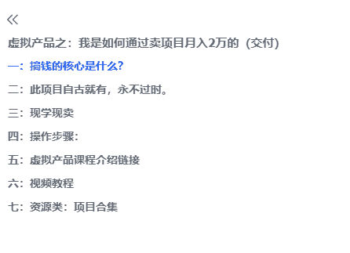

如果你想拥有一份长期事业或副业，想收入翻5倍10倍甚至更多，建议你认真看完这篇文章，定会颠覆你的认知！

2013年步入网创圈，当过“韭菜”也挥过“镰刀”。

头几年，和大多数人一样，做过很多项目，当过“韭菜”被“割”了无数刀。

被割怕了以后发现，做项目真的太累，花了钱还浪费时间，最后很难拿到结果。

于是在3年前，我醒悟了，由做项目转型为卖项目。

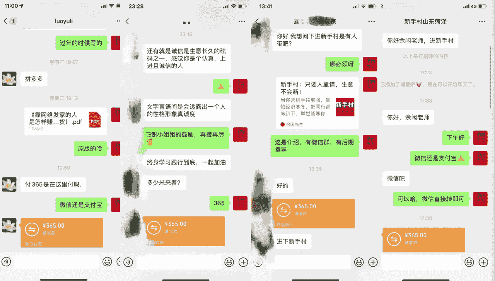

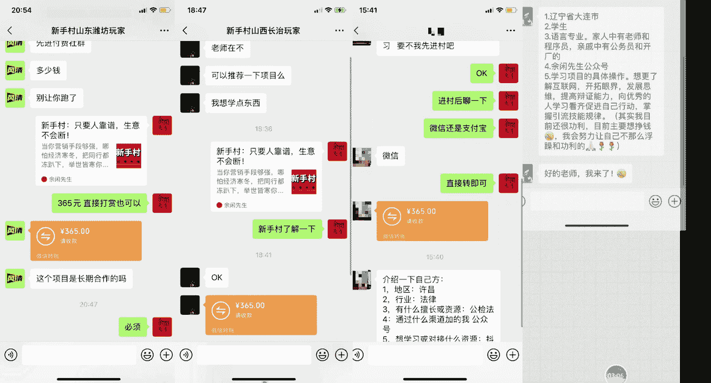

这3年间，实操过多个项目，但主要以卖项目为主。

如：社群、虚拟项目自动收益、小红书卖虚拟资料、抖音带货、影视解说、中视频、抖音小程序、抖音搬金项目等等，课程也出了几十个版本。

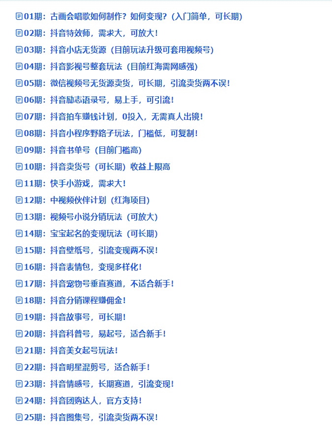

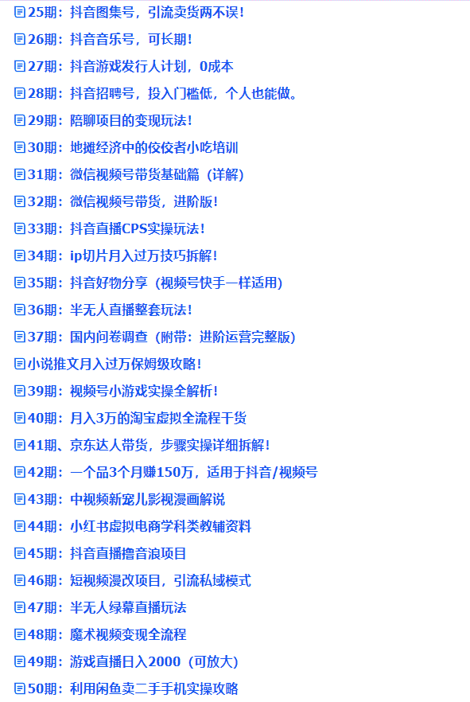

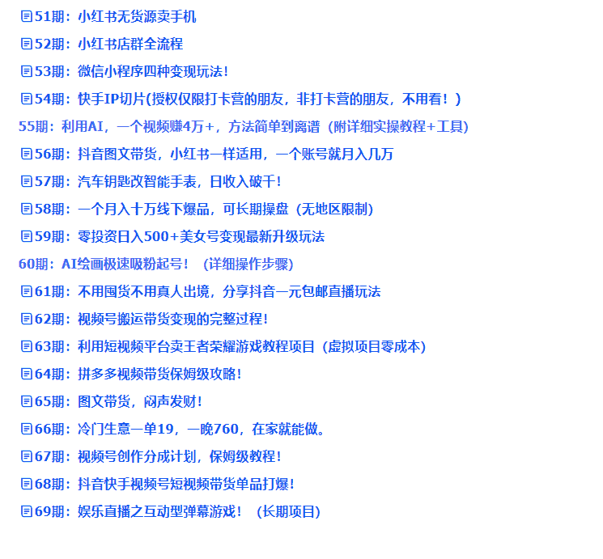

这几年，我通过卖项目，累计收益65w。

这就是卖项目的魅力！！

说实话，如果要我们自己去实操影视解说、小说推文、短剧挂载，靠发作品的方式来收益这65w+，那要等到猴年马月甚至都实现不了！！

而我所取得这些成绩的方法，我认为，每个人都是可以复制的。

**现在网赚圈普遍存在一个现象：**几乎99%的人都被割过韭菜，普通人做项目，赚钱越来越难，反而卖项目、搞培训的，赚得盆满钵满。

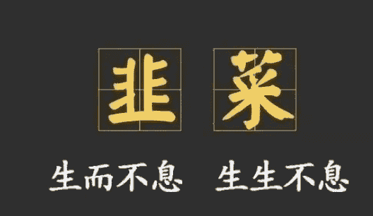

（本文提到的“割韭菜”，只是为了让读者更容易理解，不存在任何违法、违规行为的引导）

如果你被割过韭菜，可以仔细回想一下被割韭菜的经历，整个流程中收益最大的人是谁？

为什么自己花几百几千甚至上万报名加入的项目，找了一个老师，他每天轻轻松松赚几千上万，而你呢？

每天累死累活的操作项目一毛钱挣不到，或者一天挣十几、几十块钱。

也仔细的想一下，你做的那些项目有几个是赚到钱或者赚回学费的。

**原因何在？**

我来告诉你，你认为你跟你的老师操作的是同一个项目，其实根本不是一个项目。

你的老师的角色是卖项目，而你是做项目！

他把某个项目包装成一个非常牛逼、非常赚钱的项目卖给你，而你呢？却是老老实实操作这个项目，结果是你操作下来赚得很少，甚至连培训费都赚不回来。（这是普遍情况，也不否定有真正落地能赚到钱的项目，但是极少极少）而这些被包装出来的项目，就算卖项目的本人去做，也未必赚多少！

**举个例子：**现在很卷的小说推文、短剧CPS、小红书卖虚拟资料项目，大部分人折腾一个星期也赚不了100块，但看那些卖这个项目的人，收一个学员980-6980不等，这不比自己做这个项目香太多了！

就算他一个月只收10人，至少也是月入过万了，而学员呢？想要靠操作这个项目来月入过万，则需要付出多少？

如果你热衷于做项目，也小赚了一点，那更要卖项目了。

如果你做某个项目月入3000，那么你转型来卖这个项目可以做到月入过万甚至更多，卖项目就是这么暴利。

好好想一下，这个现象的整体逻辑，真正赚钱的是什么？

所以我认为：做项目不如卖项目，当韭菜不如割韭菜，卖项目就是最赚钱的项目！

站在网赚圈食物链顶端的一定是卖项目、搞培训的人。

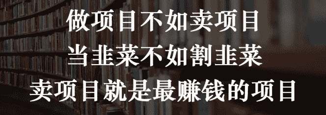

**我相信，能耐心看到这里的朋友，已经按耐不**住了，如何才能成为导师卖项目、卖培训呢？

看到这里有人又要钻牛角尖了：你说的卖项目是带人割韭菜吗！

对此，我只能呵呵一笑了，因为这样问的人，思维还没有到哪一步。

卖项目，本质是知识付费，而非割韭菜，卖项目是建立在能够给学员交付的基础上，需要给学员答疑、服务指导、督促学员执行等等，至于赚多赚少就因人而异了。如果做不到交付，那无疑就是纯粹的割韭菜了。

就好比买一件衣服，商家要赚你差价；买房买车时，明知道里面的水很深，明知道他们会赚不少，但还是决定买下来，这不叫割韭菜。

因为商家做到了交付的，至于商品好不好用，性价比如何，因人而异！

但倘若衣服有个洞实在穿不了，房子迟迟不交、车子有故障，这就不算交付，就算割韭菜了。

纵观整个网赚圈，只有做项目的和卖项目的两种人，其中95%的人每天关注的是某个项目是否靠谱、能不能做，而另外5%的人是聚焦如何搞创业粉，如何卖项目。

**想要成为导师卖项目，我认为只要做好**以下三个方面，就不愁没有卖不出去的项目：

**一是包装自己****：**也就是IP打造，包装自己是一个网赚大佬的形象，展示自己实力强悍、经验丰富等方面，一般是通过公众号、朋友圈等渠道来包装。正所谓人靠衣装马靠鞍，任何一个做生意的不可能不包装自己。生意做得越大的越展示自己。

**二是精准引流****：**这是做任何项目几乎都逃避不了的话题，流量是任何项目的命根子。若没流量，再好的项目也卖不出去，酒香也怕巷子深！流量大了，再烂的项目，你也能卖出去，总有人会买单。

**三是包装项目****：**在项目原本的基础上，可以适当包装，扩大其功能效果，市面上的绝大部分广告都有扩大产品功能效果的宣传，只要不要超出原则，这很正常。你生活看到的任何一个广告，都有包装扩大其功能效果的特点。

比如你的项目是卖虚拟资料变现，可以包装为“零基础3天上手，卖XX虚拟资料，一部手机轻松实现每天300+”。

**我也想卖项目，有什么方法吗？**

现在，我们正式推出了**《虚拟产品实战营》**，带学员操作知识付费项目（卖项目）只是虚拟产品之一，而这个网创虚拟产品就是教你如何成为导师，通过卖项目收学员变现。

这个项目跟你之前做的其他项目不一样，因为你在其他项目中角色是学员（韭菜），而《网创虚拟项目》教你的是卖项目，角色是导师（镰刀）

**统一回答几个问题**

**1.项目保证赚钱吗？**

一切保证效果和收益的项目承诺，基本上都是忽悠！

因人而异，如加入了，不按讲的去做，连毛都赚不了。

就像同一个班那么多同学，老师都一样，有人能上重点大学，有的人只能上专科！

**2.有什么要求，需要准备什么？**

这套卖项目的模式，运营成本低，入门门槛低，个人/工作室都可以操作。要求有一定的互联网基础，必须要有电脑，对电脑配置无要求，只有手机是干不成什么事的，准备至少1个微信号来承接流量，每天能拿出1-2个小时的业余时间，做好出单可能需要半个月甚至1个月积累期的思想准备。

3.小白可以学习吗？项目长久吗？

这套课程针对的就是小白，因为我怎么说他就怎么做，不会有其他的想法，直到拿到结果，全程陪跑，学会为止。不管你是在网赚的路上，苦苦寻找了几年的项目，教了几千几万的学费没有拿到结果的人；还是刚踏入网赚圈，想找点副业的人，那你更幸运了，因为你少交了很多很多的学费，不如一步到位，换个思维，直接卖项目、做培训。

这个项目永久可做，想在网上赚钱的人一直都在，知识付费永不过时。

4.我啥项目都没有，怎么卖项目收学员？

卖项目不是只教卖某一个具体的项目，可卖的项目太多太多，可以是你自有的项目，也可以是经过学习后转化为自己的项目，还可以是我们的项目。

课程中提供如何打造属于自己的付费项目课程、包装自己的付费项目。

如：找项目渠道、写课程大纲、录制课程、写项目介绍、课程目录、定价、项目包装等等。

提供包装好的赚钱项目，所有的后端服务以及资源都给你准备好了，接下来就是干就完了。

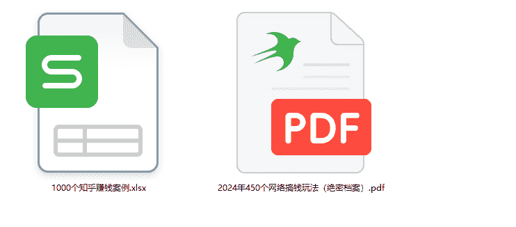

这里给你准备了1450篇时下最新网创项目，你发朋友圈也好，公众号改编也行，够你用5年，当然最好改编一下，要不然太同质化了。

**5.项目卖给谁？**

这就是涉及到引流的问题。

要知道，做项目的人远远多余卖项目的人，因为想要通过互联网赚钱的人实在太多了，课程教学了至少3种适用的引流方法，比如我们教的其中一种引流方法，只要按照方法去做，积少成多，只要有流量，就不愁项目卖不出去。

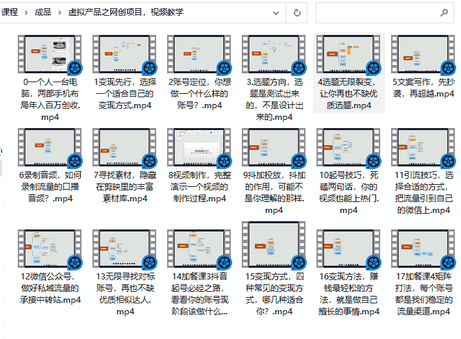

**如何加入**

《网创虚拟项目》这套课程内容，完全是我这10年来所积累的实战经验，从IP打造、到引流，到包装，到运营，到变现等等。

我们今后将长期奋战在这个项目上，毫不夸张的说，知识付费、卖项目可以玩一辈子。

[**加入成本也很低，仅需2**](https://uze6sdvqdg.feishu.cn/docx/VbGtdbn7Yoix8PxW9NXcvYaLnQb?from=from_copylink)**8**[**8元，当然不止这一个版**](https://uze6sdvqdg.feishu.cn/docx/PiK9dBAu2oqfysx9b45cvv3SnJe?from=from_copylink)**块**，目前虚拟版块有：全自动交友流量变现项目，一本万利的学科资料项目，后期更新的最新玩法一样免费学习。

虚拟产品背靠全自动交易系统，所以变现也是多样化。

目前虚拟产品实战群收费：288元（享受以下五大权益）

**1、【全自动交易系统】一级代理80%**分佣权限（可开下级，收取下级20%分佣）

2、【全自动交易系统】之虚拟产品系列课免费学习

**3、收代理288元，拉实战群，利润100%(我们定的是2**88元，收多少都是你自己的，我这边不抽一分钱，但也为了良性发展，你最低收288元）

**4**、利用全自动交易系统做收费微信群，直推客户进群佣金分拥，比如客户进群付费9.9-29.9，最低利润都是80%

**5、你招收的体验群代理，你也可以抽取他收**益的20%（你在后台直接给他调控20%）

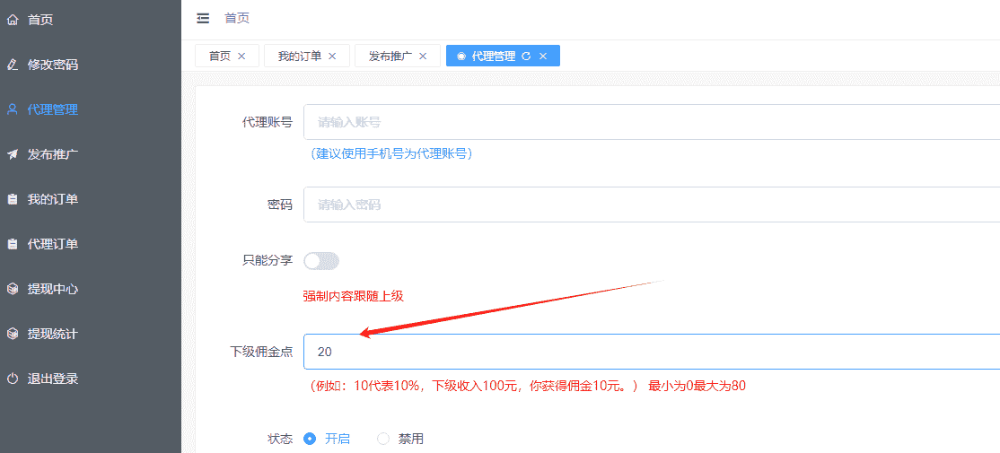

**交付方式：**

视频课程+售后服务指导，可谓是保姆式教学陪跑，课程的玩法一直免费更新，群内交流，不定期视频号开播交流分享。

**特别说明：**

1.虚拟产品系列课之网创项目虚拟项目为授课和指导服务，不做任何承诺和保证赚多少，成绩因人而异，但能够保证做好教学和服务。

2.没有执行力，三天打鱼两天晒网的人不要参加。

3.授课和服务为虚拟产品，交付后概不退费。

以上三点为要约邀请声明，可作为解决纠纷的法律依据。