# 海外游戏广告创意设计手册

> 来源：[https://xuqiwei1986.feishu.cn/docx/Rj37dNJHUoX9SdxTX4ic4gFKnmb](https://xuqiwei1986.feishu.cn/docx/Rj37dNJHUoX9SdxTX4ic4gFKnmb)

**这****是 仟仟 发布在 赚钱 的第 **2 篇帖子，全文共18,463字

**嗨喽赚钱的小伙伴们大家好，我**是赚钱新人 仟仟｜海外游戏广告创意设计师

[海外游戏买量创意设计工具使用指南](https://yku6yoje2z.feishu.cn/wiki/CalAweADii0ROakrmKQcHxMhnWf)先非常感谢龙哥大大和赚钱的小伙伴们，在赚钱发的第一篇帖子👉 就被加精了，给了我很大的鼓励和支持，也有点受之有愧，跟其他的精华帖比起来还是略微单薄，所以这次带来第二篇干货分享，用几个小目标学费换回来的近2w字经验贴分享给赚钱的小伙伴，当做见面礼，希望能对大家有帮助，继续为赚钱添砖加瓦❤️

在此特别感谢第一个赚钱圈友 给我的鼓励，才得以让第二篇帖子这么快能跟大家见面

---

# **打破买量玄学，掌握流量密码**

## **广告投放的本质：**

### 将**合适的信息**以**合适的成本**通过**合适的媒介**触达到**合适的人**，以此影响他们做出**预期的決策**

**遵循广告平台特性**

**遵循品类特性**

**尊重用户🫡**

---

#### **本文目的：**

1.  赚钱找对标的帖子很多，不过在内容层面的还比较少，也看到很多圈友会对如何做内容比较感兴趣，正好本职工作就是打造爆款广告，实现用户增长，在这方面略有经验可以分享给大家

1.  很多国内厂商出海会有水土不服，可能是因为国内买量渠道在机器学习机制的成熟度上，和海外渠道有很大差异，不建议套用国内的测试思路和经验，，过往的成功经验可能也会造成非常大的思维认知局限，因此借由这个帖子做个简单的介绍

>

#### **适合人群：**

1.  手游出海广告主/同行朋友们（轻度休闲类更适用）

1.  **对游戏出海感兴趣的伙伴们**

1.  **对出海感兴趣的内容创作者**

>

#### **阅读建议：**

1.  文档图文视频内容较多，建议使用电脑端阅读

1.  全文信息较多，大家可以按目录跳到相关章节阅读

---

# 目录框架

## 工作流展示

老规矩，先放上**海外发行素材推广工作流**，方便大家查找关键信息，以及理解下文提到的相关信息处在哪个环节，应如何使用

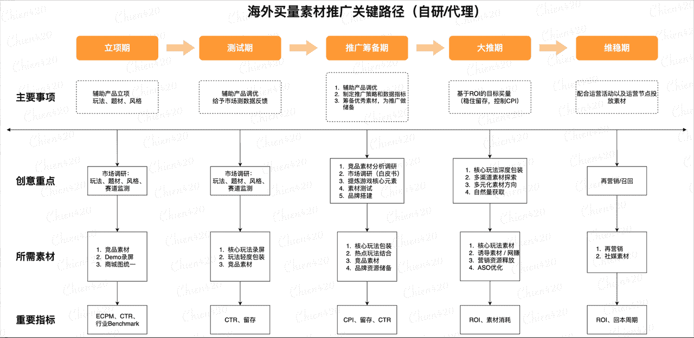

# 以下开始正文部分👇

# 一、理论基础篇

## **1.1 海外主流投放渠道介绍**

> 以下只展示常用的一些渠道，按使用优先级排序，测评根据作者过往项目/经验来判定，可能有较强的主观性，仅供参考

| **渠道类型** | **渠道** | **用途** | **适合推广阶段** | **用户质量** | **流量获取难易度** | **适合游戏类型** |
| --- | --- | --- | --- | --- | --- | --- |
| **大媒体** | **Meta/FB** | +   素材测试 | 全周期 | 中等 | 中等 | 基本各种玩法通吃，算法也比较成熟，因此是绕不开的素材测试和获客渠道 |
|  | **Google** | +   素材测试 | 全周期 | 高（特定受众） | 难 | 长线产品如重度游戏 |
|  | **Twitter/X** | +   获取高价值用户 | +   维持期 | 高（特定受众） | 难 | 长线产品如重度游戏 |
|  | **TikTok** | +   推广铺量 | +   加量推广期 | 一般 | 中等 | 内容型产品、小游戏、短线产品 |
|  | Kwai | +   推广铺量 | +   加量推广期 | 差 | 易 | 网赚类 |
|  | Snapchat | +   补量 | +   维持期 | / | / | / |
| **视频渠道** | **Unity** | +   推广铺量 | 全周期 | 参差不齐，特定受众还不错 | 中等 | 中长线产品、休闲游戏 |
|  | **Applovin** | +   推广铺量 | +   加量推广期 | 参差不齐，特定受众还不错 | 中等 | 中长线产品、休闲游戏 |
|  | Chartboost | +   补量 | +   维持期 | / | / | / |
|  | ironSource | +   补量 | +   加量推广期 | / | / | / |
|  | Vungle | +   补量 | +   维持期 | / | / | / |
|  | moloco | +   补量 | +   维持期 | / | / | / |
| **其他网盟渠道** | / | +   补量 | +   维持期 | 差 | / （易有假量） | / |

### **1.1.1 主流广告渠道特性**

**因平台规则/政策存在变动性，每**年都有更新，因此下表仅供参考，具体的实操需要以投放优化师实际反馈为主，如有不对的也欢迎指正

### 1.1.2（补充）Kwai平台特性

> Kwai算是比较新的平台，规则政策算法一直在调整，为避免结论信息对大家有误导，补充一点项目背景信息：2023年巴西市场，休闲网赚类产品

1.  **内容性渠道，****且流量较**为下沉，用户质量 快手<TT<FB<谷歌，所以对素材的内容要求比品质要求高

1.  **素材以真人为主，****真人剧情**、真人试玩、口播等，且由于市场品类特性，红人效应非常明显

1.  **吸睛点需要前置****，包括不限于设**置首帧图、前3s有爆点等手段，且信息量需要密集，持续给用户反馈（平台特性所致，相比于FB和谷歌有强制看完的广告版位，kwai和tt用户对不感兴趣内容可自由切走）

1.  **素材测试周期极快**，基本上前两天就可以判断该素材是否能爆，因此素材爆的逻辑相比于FB和谷歌，会显得没有那么规律

1.  相比于其他几个平台，**算法比较垃圾（不够成熟）**，基本靠大量的素材去碰命中率，因此好的素材方向需要大批量素材进行验证

## **1.2 数据基础篇**

介绍了平台，接下来就是数据了，各平台数据指标含义底层逻辑基本差不多，只是在算法上有所差异

### **1.2.1 相关数据解释及公式**

### 1.2.2 数据漏斗-用户为何而流失？

大家总说**买量是玄学**，其实是因为从用户观看广告到最后付费转化，中间有非常多的环节，而各环节之间关联性极强，某一个环节没有做好可能就会带来大量的流失（可看下文的流失漏斗），因此常常会摸不着头脑从而觉得毫无规律可言

所以理解数据不能仅看字面含义，弄懂数据的整个链路以及数据之间的关联关系是掌握流量密码的第一步

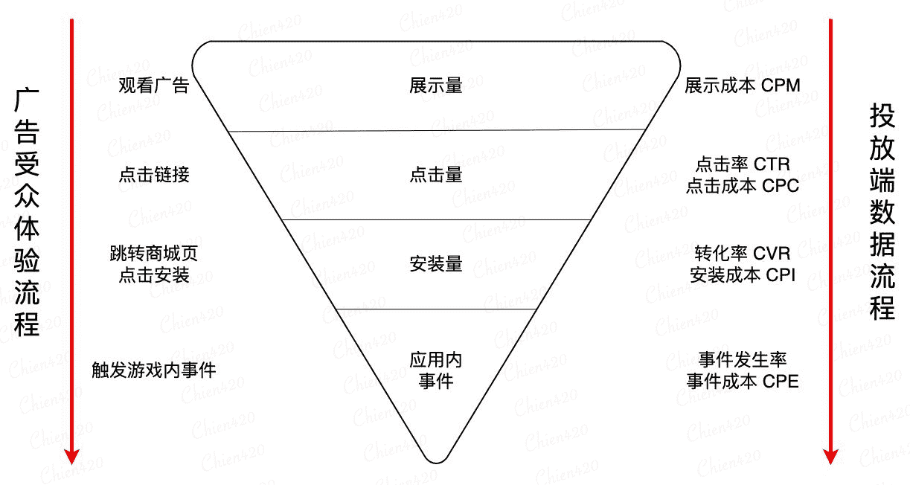

> **👇注释版👇**

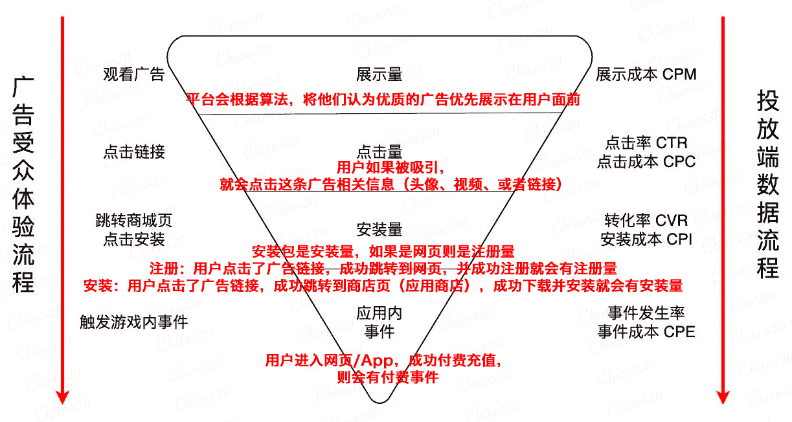

### 1.2.3 广告前端关键数据解释及影响因素

> **目前素材测试最稳定的渠道**是FB，学习期比较稳定，因此以下案例均以FB渠道举例

跟素材直接挂钩的是点击率，可以直接评判素材是否吸引人，其他数据可能会受市场竞争、品类、投放策略等影响

### **1.2.4 版位效果**

[h](https://www.facebook.com/business/ads-guide/update/video/facebook-feed)ttps://www.facebook.com/business/ads-guide/update/video/facebook-feed

**了解不同版位的****特性，可以针对主流**版位制作素材，提高用户观感，这里还是以FB举例

如核心画面区域（重点内容不要超框或被裁减）、logo和字幕大小（太大丑，太小看不清）、按钮或者文案引导位置等

| **FB动态** | **ins快拍** |
| --- | --- |
| **FB搜索** | **AN激励视频** |

## **1.3 市场避坑指南**

**游戏出海主要涉及以下七大市场：港澳台、**东南亚、日韩、欧美、中东北非、印度、南美

这些市场的划分基于语言、经济程度、文化特征等因素，通常以T1、T2、T3的形式来表示不同层次的市场

+   **T1市场**：美国、日韩、德法英澳加、北欧（挪威、瑞典、丹麦）、港澳台

+   **T2市场**：俄罗斯、中欧（波兰、捷克）、中东

+   **T3市场**：东南亚（泰国、越南、菲律宾、印尼等）、拉美（巴西）、非洲（肯尼亚、南非）

### **1.3.1 **市场白皮书

**具体的实操中，需要结合行业和产品**做市场调研白皮书，这个环节非常重要！！！

**因白皮书信息量过大，且产品不同，受众不同，结论会有差异，因此这**里放上我们工作中常用的一套框架供大家参考

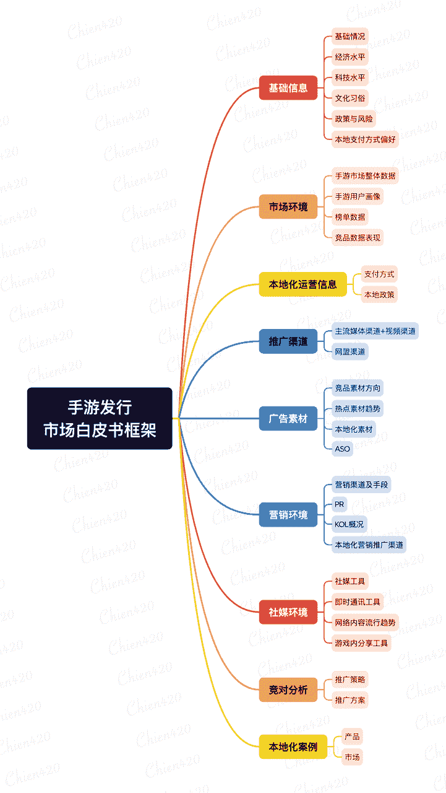

### 1.3.2 不同国家市场偏好-实战经验分享

> **市**场基础的知识大家可以自行GPT，就不再赘述了，这里重点放上我们在工作实战中积累的各国家的一些经验分享，以蓝海或者出海难度不太高的市场为主

#### **1.3.2.1 **台湾（港澳台 出海第一站）

1.  台湾与大陆的风俗习惯接近，没有明显的信仰教派，适合作为出海第一站，避免与政治挂钩，互联网覆盖率高。

1.  **虽然人口不及其他地****区**，但是高收入群体占比较多，玩家付费能力相当强；同时因为人口较少，素材衰退速度极快，推广后期素材迭代压力会很大

1.  有当地特色的美食，日常用语习惯与大陆有较大差别，文化认知与大陆相似度高。

1.  **重度**RPG游戏素材较多**，买量素**材出现最多的关键词是抽卡、真假三国/后宫和角色展示，素材制作可以围绕这些点去尝试

1.  **港台素材风格接**近电视广告，有大量旁白，素材可考虑配音

1.  台湾字体方面使用台湾繁体，翻译繁体的时候需要注[意](https://www.2weima.com/jianfan.html)，且用词方面有台湾独特的一套用词。👉免费在线繁体字转换工具 - 支持简体 港澳繁体 台湾繁体互相转换 - 外贸工具 (2weima.com)

1.  台湾的**玩家社交属性很强**，很爱互动和自传播，可以利用在社交和营销传播。但同时玩家举报投诉的风险也会比较高

1.  台湾厂商**竞品间举报风险较高****，**需额外注意

1.  台湾社媒使用率上：FB远超过其他的媒体，IG和Twitter紧随其后

1.  即时通讯方面，近年line成为台湾最受欢迎的聊天APP，社群群组也成为玩家的一大讨论区

1.  **台湾用户的自主意识高，看重**品牌口碑和声量，营销需要具有话题性和传播性

1.  PR 媒体有 游戏论坛（如 巴哈姆特）、流行文化论坛（如 Dcard）、电视和网络新闻媒体（YAHOO、东森）等

1.  YTB KOL 以泛生活类型为主，整体内容多元，趣味性强（吃播、多人综艺、LGBT、动漫漫画、游戏类频道较多；尤其是多人频道较为受欢迎，内容多样化且比较成熟）；Twitch 实况直播分为 游戏、秀场，游戏主播以男性为主，看重技术；秀场主播以女性为主，看重才艺和颜值

1.  游戏多采用话题性营销，搞笑、无厘头的内容更受欢迎，形式丰富多样；本地推广渠道丰富，但大部分主品牌曝光，转化落地能力差，可寻找高性价比渠道进行推广

1.  **台湾互联网普及度极高，且**网络水平十分发达，苹果和安卓的份额几乎相同

1.  台湾的节日类型名称和大陆十分相近，但是需要注意的是台湾的节日时间上和大陆有很多不同

#### **1.3.2.2 **中东（不差钱，但本地化难度大）

感兴趣可以先看下这个视频，随便看下评论区感受下中东人民的豪气吧👇

[为啥中东人的网上冲浪离不开中国人](https://www.bilibili.com/video/BV1sr421u7Fc?buvid=Y74807788FE2C5FA496D88B7328F40BC1E91&from_spmid=search.search-result.0.0&is_story_h5=false&mid=EqFIJs689G%2F8Tqlv6EkcpA%3D%3D&plat_id=116&share_from=ugc&share_medium=iphone&share_plat=ios&share_session_id=CEC022DC-4CA0-474D-A51A-372804BB0353&share_source=COPY&share_tag=s_i&spmid=united.player-video-detail.0.0&timestamp=1729068927&unique_k=m9kYO0W&up_id=19319172)？【差评君】_哔哩哔哩_bilibili

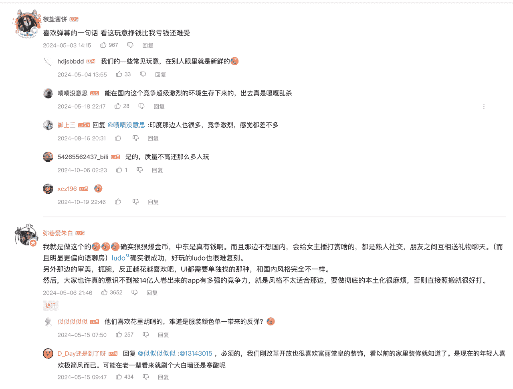

> **端内研发需要做的适配：**UI习惯（从右往左适配），语言，美术和剧情（避免暴露、血腥等文化禁忌）

> **端外发行一定要做的适配：**素材制作、商城物料适配、本地支付、KOL等营销资源

1.  中东地区主要**以阿拉伯语和英语为主**

1.  **阿拉伯语的阅读习惯是从右到左**，图片内容的指向也习惯从右到左；

1.  除了数字和英文是按照正常排序，其他的排序都是反过来的；

1.  关闭按钮在左上

1.  宗教文化禁忌多（重点关注，避免引起宗教冲突）

在中东地区，国家众多且各国之间文化存在差异，宗教的敏感度是一个关键点，若触犯禁忌则极易导致用户严重流失。例如在游戏配色方面，逊尼派偏好绿色，而什叶派偏好 蓝色。在食物方面，游戏中不能出现猪、酒等元素

| **国家** | **避坑点/经验分享** |
| --- | --- |
| 中东地区统一的注意事项 | 1.  不得体的文字：低俗文字、宣扬同性恋文化、谈及性的文字是绝对不允许的 |
| 沙特阿拉伯 | 1.  **沙特阿拉伯完全禁酒，**沙特阿拉伯是伊斯兰教最大的朝圣地——麦加的所在地，这里饮用酒精饮料是完全禁止的。 在这里生产、进口、销售和饮用酒精均属于违法行为，没有例外。 |
| 阿联酋 | 1.  酒不得入境阿联酋，以及犹太人企业的产品（如可口可乐）也不许通关。即使是外商进入也最多限带一瓶。 |
| 卡塔尔 | 1.  卡塔尔禁止穆斯林饮酒和吃猪肉，同时也忌用猪的形象作为装饰图案，外形丑陋和不洁之食物，如甲鱼、螃蟹及死动物，均属忌吃之物。 |
| 以色列 | 1.  **犹太人有吃k**osher food的习惯，不可以吃猪肉。 |

1.  喜欢：沙特阿拉伯人崇尚白色（纯洁）、绿色（生命）

1.  不喜欢：黄色（死亡）

1.  喜欢：骆驼

1.  不喜欢：不用包头巾的女性形象，忌用字：安拉或宗教题材东西

#### **1.3.2.3 **东南亚（人口红利大）

| **国家** | **避坑点/经验分享** |
| --- | --- |
| 越南 | 1.  **越南有专属的版号要求，**发行越南市场整体需要提早至少2-3个月进行版号筹备申请，同时必须由当地具有G1牌照的公司进行申请版号（即代理商），因此发行越南也需要筛选适合的代理商进行合作 |
| 马来西亚 | 1.  马来族人口在当地占主要地位，但人均经济水平不高，华人在经济占主导地位，他们将成为产品内高付费人群 |
| 泰国 | 1.  泰国政府对手游发行包容性强，发行无需申请牌照，更有利于手游出海和在当地发展 |
| 印尼 | 1.  人口基数大，近东南亚一半人口，红利有待挖掘，但宗教，文化复杂，需要全方位本地化 |

#### **1.3.2.4 **相关推荐阅读：

海外运营上手必看:手游出海相关问题汇总 - GameRes游资网

> 文章主要介绍了国内与海外中重度IAP手游从立项期的产品定位、功能设计到筹备期的市场环境、发行策略、宣发打法，再到上线期的运营维护，用户维系这几个阶段其中的各项差异

[美术、程序、策划、运营，出海本地化的四个要](https://www.gameres.com/846111.html)点你了解多少? - GameRes游资网

> 在做本地化的过程中，CP往往先对美术进行本地化，美术本地化可以归纳为四点：UI本地化、外观本地化、游戏内本地化、美术字本地化。

> 策划方面以文字内容为主，分为三个部分：文字本地化、语音本地化、UI字符本地化。

[谷歌分享:进军东南亚手游市场，如何获取用户? | 游戏](http://www.gamelook.com.cn/2021/11/459303)大观 | GameLook.com.cn

> 21年11月3日，谷歌大中华区新客户部移动业务负责人Hongxian Li以“东南亚手游市场深度剖析与获客策略”为主题，从市场概况、消费者洞察与用户获取策略三个方面详细的剖析了东南亚手游市场的情况。

[如何提高自然新增、拿推荐?手游ASO优化9大要点 | 游戏](http://www.gamelook.com.cn/2019/06/361675)大观 | GameLook.com.cn

[全网最详细!东南亚最大手游市场泰国:H1收入$ 2.6亿，腾讯](http://www.360doc.com/content/23/0726/08/1090055364_1090055364.shtml)、米哈游、字节争霸，二游、SLG出海亮眼

### **1.3.3 **一些容易忽略但很重要的Tips

#### **1.3.3.1 **简单点，再简单点

1.  广告本身时长较短，一般15-30s之间，节奏会比较快，因此素材内容和节奏把控非常重要

1.  相较于国内的套路满满，海外的素材会更加简单直白，尤其是越发达国家，越看重广告素材展示的玩法

1.  老外数学能力都不大好，因此如果涉及到数字计算、福利展示的，尽量简单直白一点，弯弯绕绕老外看不懂（例如9.9+9.9=19.8就比较复杂了，老外反应不过来）

#### **1.3.3.2 **本地化细节

用户对广告所展示的任何信息都非常敏锐，包括文案、数字（甚至标点）、音效，非常看重素材的逻辑

如果广告素材出现文案表达有误（本地化翻译重灾区）、音效嘈杂、广告没有逻辑、重点不突出等情况，都会导致数据效果很差 （这一点我们做过调研）

为避免大家在一些[基础的细节问题踩](https://docs.oracle.com/cd/E19253-01/819-0402/819-0402.pdf)坑，这里放上👉 国际语言环境指南 PDF全文共222页，大家可以将此作为工具书，挑有需要的部分看

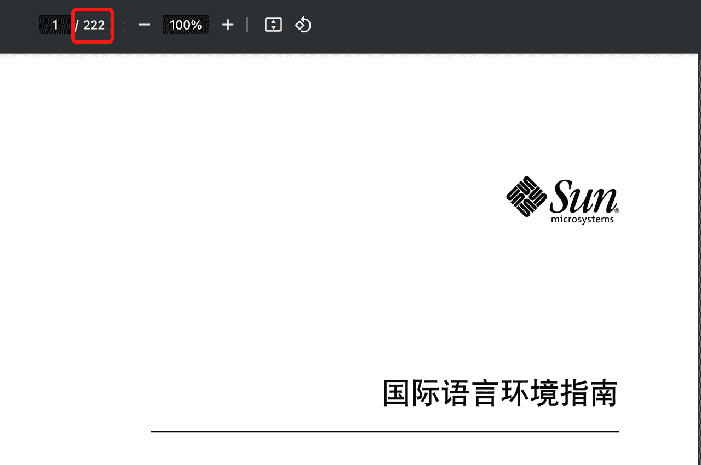

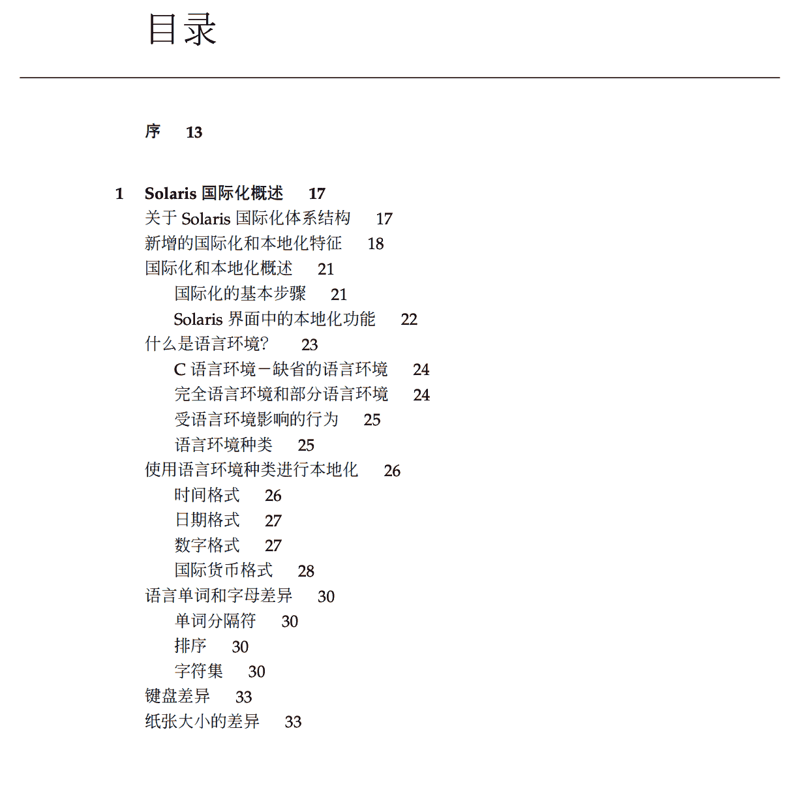

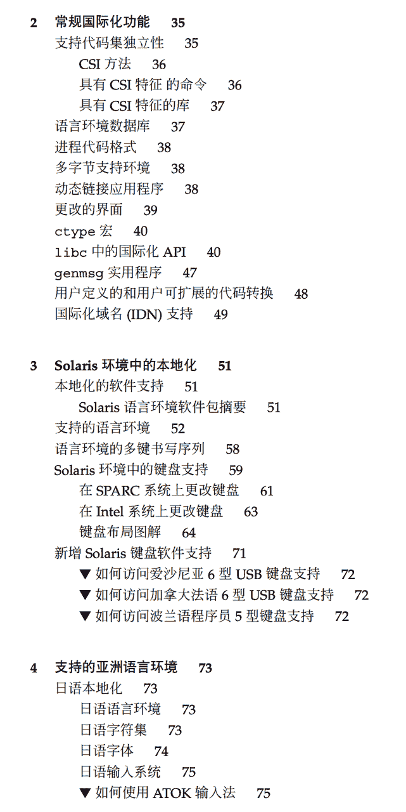

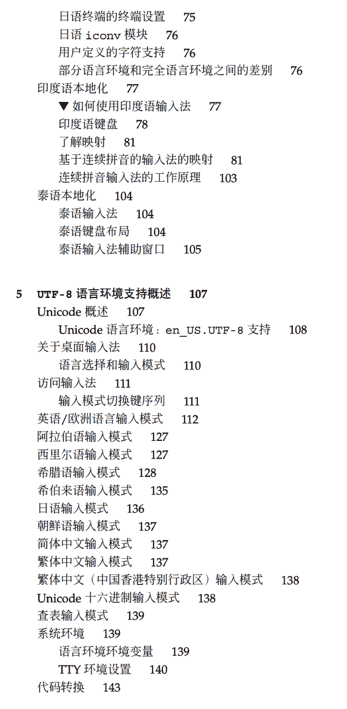

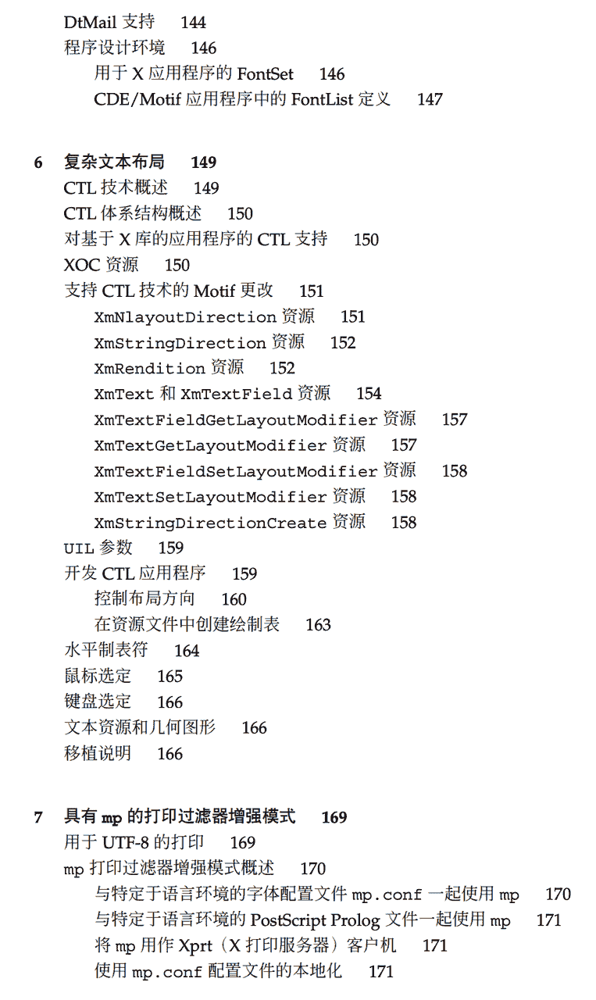

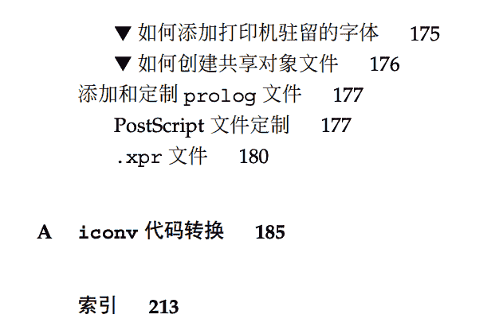

#### **1.3.3.3 **货币分隔符与数额大小

不论是什么类型的广告，只要涉及到充值相关，都会有金额展示，这里就需要结合目标市场的汇率和市场GDP情况来设定具体的展示数值

+   货币单位和表示规则在世界各地差别很大，本地和国际货币符号可能是不同的；

+   **数额不是越大吸引力越大**，很可能引起用户的投诉如虚假广告，而在一些货币不值钱的市场（越南盾、印尼盾、津巴布韦等），反而需要夸张化

**下图以巴西、印尼举例，**需要注意数字分隔符，以及数额大小置信度

记不清的这里为大家准备好了转换网站👉：https://www.curvert.com/en/

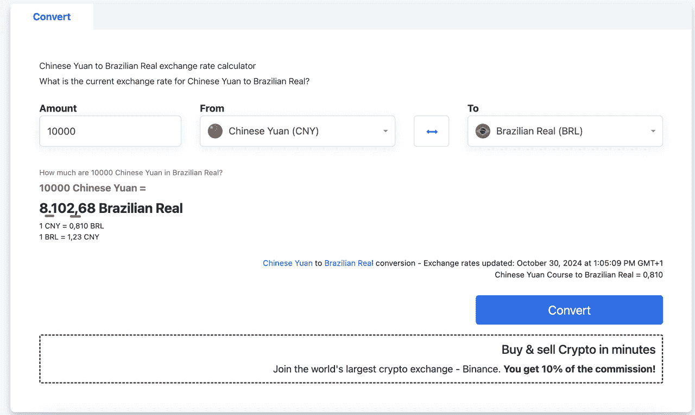

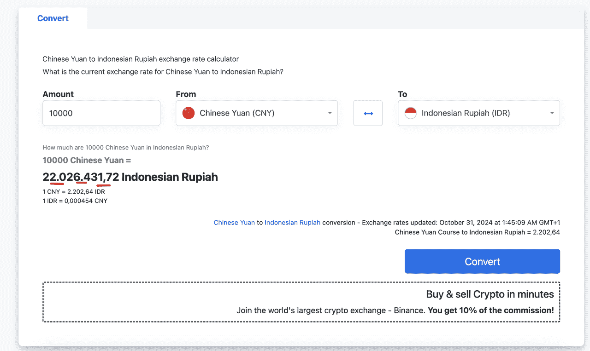

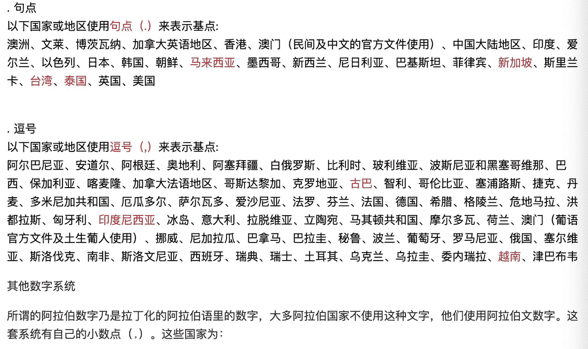

## **1.4 广告素材中的人性**

过往做广告素材会很看重本地化，现在本地化依然重**要，**但是现在我们发现还有更重要的一点就是人性，不论市场/产品/玩法怎么变化，不变的永远都是人性

但是人性是很复杂的，需要经过一定的阅历才能感同身受，而这一块我深知自身经验浅薄，因此这一部分仅表达一些个人粗浅的见解🫡

### 1.4.1 人性，在大多市场中，是共通的！

> 以下部分内容摘自DataEye，原文如下，推荐阅读👇

> 腾讯、米哈游、海彼背后：出海本地化，大部分人都错了！

全球玩家人性是共通的，因此如果足够能撬动人性，文化差异就相对不重要，这一判断解释了一系列问题：中国游戏出海（不论大小厂商），为何都可能每隔一段时间出现在全球畅销榜、免费榜上，为何总有机会？是因为，看似“突破文化差异”，实则撬动人性。

人性是最底层、最核心、最关键的因素，本地化解决的是其它三层因素（历史文化观念、当代思潮审美、潮流风向热点）的问题

**一**款游戏、一支广告，如果能足够能撬动人性，那么它不特别需要本地化也会非常突出（并不是说本地化不重要，先撬动人性，再通过本地化锦上添花）

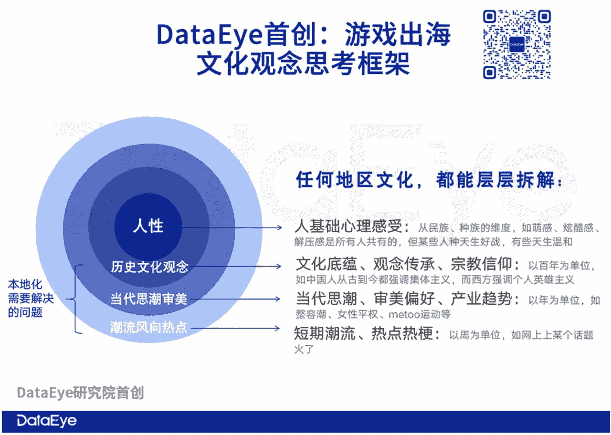

**可以撬动人性的点：**

1、品质感，典型如腾讯、网易、米哈游的游戏、素材内容

2、割草爽感，典型如《弹壳特攻队》《割草的100种方式》

3、自由度+益智+喜感，典型如“划线救狗狗”素材

4、规整感/清理感/秩序感，典型如《Happy Hospital: Doctor ASMR》

5、性感/美感

6、奶萌感/Q萌感

7、紧迫感/危机感

8、炫酷感/绚丽感

9、轻松休闲感/解压感

10、打击感/冲击感

从这10个感受（或者说从人性的角度），去思考游戏玩法、内容创意，思路会打开很多。

基于人性，再根据不同的产品/平台特性进行尺度的把控

+   例如像Twitter、谷歌这些渠道用户质量高的，素材品质相应提升，更多通过品牌化吸引用户，对于Kwai或者视频渠道等用户定位较为下沉的，可以用更加接地气、赤裸的素材吸引用户

+   例如有些市场做本地化，喜欢真人类，我们掌握之后就进行元素替换（明星、网红、素人等）；或者不同类型的奖励吸引用户，这都属于本地化

在推广后期，大家在外在的包装层面都有一定的积累了，遇到的瓶颈更多的是如何挖掘玩法的**趣味性，内在玩法的**包装才是撬动人性的部分，每个品类的用户都有各自的痛点，这里可以结合产品的用户画像进行结合分析，挖掘痛点需求点

### **1.4.2 **稍微拓展一点🤏：

#### **马斯洛需求层次理论**

**说到挖掘需求和痛点就**不得不提起 马斯洛需求层次理论，这里放上一些理论依据参考供大家拓展阅读，正好前段时间写论文有用到，分享给大家 （可以按照这个理论用GPT输出一些创意idear，有意想不到的效果哦）

结合马斯洛需求层次理论探究游戏设计满足的用户需求

[基于马斯洛需求层次理论的手机游戏设计研究_马鹍鹏.pdf](https://internal-api-drive-stream.feishu.cn/space/api/box/stream/download/all/KNUkb4DXaoLLbMxf1jtcg1InnFb)

#### 12大游戏玩法动机和用户原型

[GameRefinary定义的12大游戏玩法动机](https://www.gamerefinery.com/gamerefinery-player-motivations-archetypes/)和用户原型：GameRefinery Player Motivations & Archetypes

**1、游戏用户动机：**

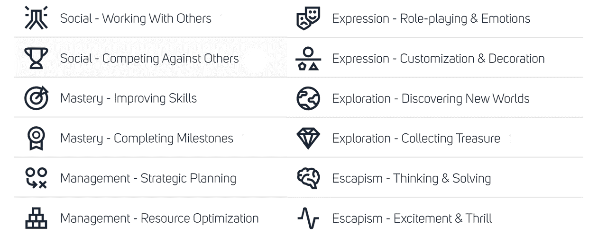

|  | **动机** | **行为** |
| --- | --- | --- |
| **自我实现** | 标榜自我，归属感，价值观 | 建造装扮、养成、剧情、冒险、解谜、升级 |
| **尊重需求** | 成就，地位，信心，尊重，关怀，炫耀 | 排行榜，PK，奖励 |
| **社会需求** | 亲情，爱情，友情，信仰 | 社交，宠物系统，魔法 |
| **安全需求** | 生理安全，心理安全 | 解救，求生， |
| **生理需求** | 健康，衣食住行等原始需求 | ASMR（解压） |

**2、游戏用户原型**

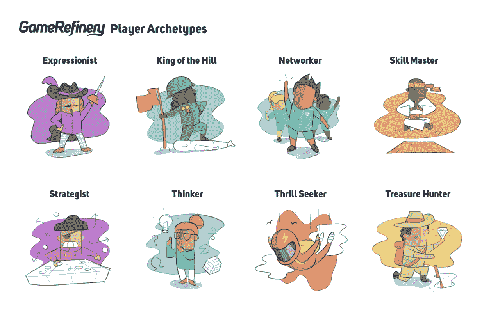

## **1.5 素材制作思路**

了解了前面的数据、市场、人性部分，接下来就是要解**决具体素材**相关的问题了，也就是如何打造“合适的信息”的问题

### **1.5.1 用户转化链路**

> 以下部分内容摘自DataEye，原文如下，推荐阅读👇

> 这一篇我们写了一年！这些研判正在成为现实！丨DataEye全年推文精选

> 创意遇瓶颈咋办？这有3个吸量秘诀（实操干货，已验证）

**大多数玩家产生下载安**装的动机，是看了多个广告，而不是只看完一个广告，所以品牌宣传很重要！

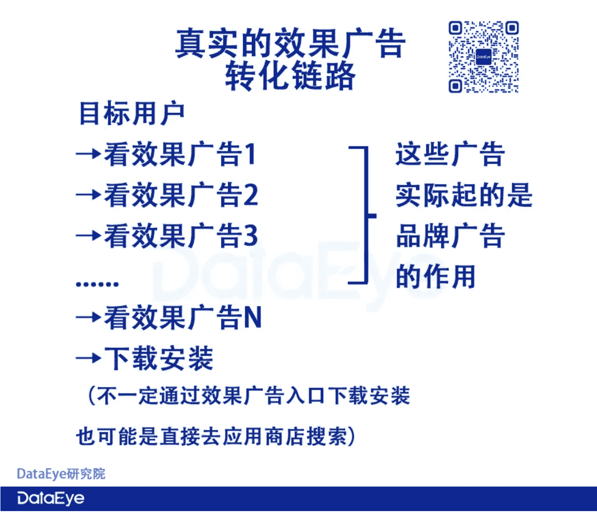

### **1.5.2 设计思路：****转换视角，从用户兴趣点出发**

**低效的思路：**提炼自家产品卖点→通过卖点延伸构建创意→传达给用户

**本质是从供给侧出发：我觉得这**些内容有趣能吸引你，你觉得好，用户不一定觉得好。

比较奏效的思路是是反过来：观察用户偏好→构建创意→结合游戏卖点，设法将游戏植入

本质是从需求侧出发：你喜欢什么内容我做给你，顺带植入产品。

### **1.5.3 素材框架**

创意内容=吸睛点+游戏卖点+转化点，并通过不同的创意形式展示。

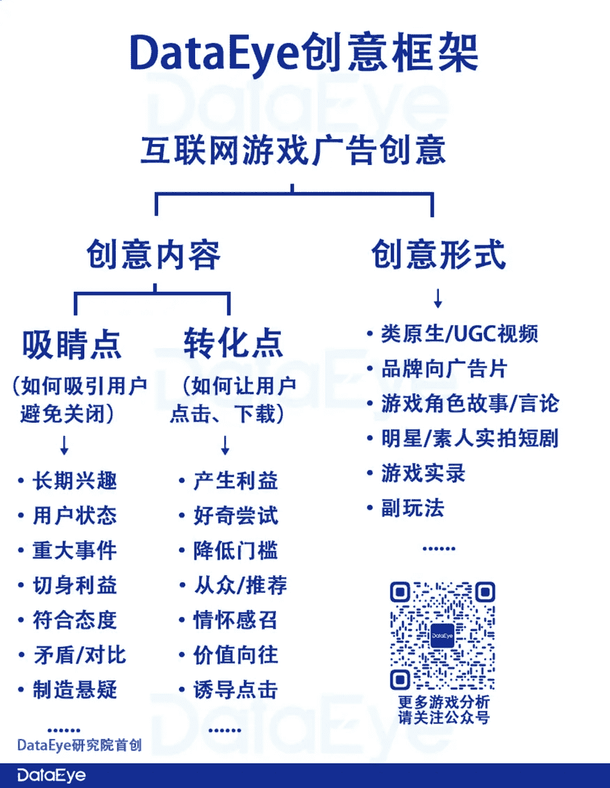

1、创意内容-吸睛点：如何吸引目标用户注意力，避免划走广告

+   长期兴趣：即目标用户的兴趣元素，常见的如真人美女帅哥、精美画质。长期兴趣是对圈定的目标用户而言的，不同用户的长期兴趣有很大差别

+   用户状态：即目标用户当下的情绪、状态、场景、任务

+   重大事件：包括名人明星、重要新闻、社交圈话题、反直觉情况、紧张情景、反转的剧情，比如“新活动、新玩法上线”

+   切身利益：即与目标用户切身利益高度相关，或者能提供刺激的元素，比如红包提现、限时活动、恋爱社交

+   符合态度：即与目标用户的情感、情绪、态度、价值观一致，比如吐槽言论、走心文案、价值宣言

+   矛盾对比：即两个差距较大的点比较，比如“高情商VS低情商”，或者放大矛盾比如“**游戏福利全平台最丰厚”

2、创意内容-转化点：如何让目标用户点击广告、完成下载

+   产生利益：为目标用户带来利益的元素不仅吸睛，同时也能直接带来下载，比如高质量游戏体验，再如福利码、红包提现

+   好奇尝试：即引发目标用户好奇、尝试、挑战的心态，比如广告中玩家挑战失败，或者是戏剧性的转变逆袭，或是新奇体验（包括新玩法、新游戏上线）

+   降低门槛：即降低目标用户跳转下载、操作、体验的难度，强调轻松简单，“有攻略、有套路、易上手”

+   从众/推荐：即强调游戏玩的人多，或是明星、KOL、朋友推荐

+   情怀感召：打情怀牌，撬动用户对过往经历的怀念

+   价值向往：即强调一个精神价值，比如“自由”“公平”“低氪”

3、创意形式：用什么样的形式展示创意

+   类UGC短片（类原生视频）：模拟普通玩家、KOL视角，发布的短视频内容，较简单粗糙（甚至旁白普通话不准、混剪的片段不清晰）类似“种草视频”“原生视频”，强调真实性。广告属性较弱。

+   品牌向广告片：厂商制作的品牌向广告片，以展示游戏特色为主，强调专业性、精致感。广告属性较强。

+   游戏角色故事/言论：厂商以游戏素材为基础包装具体情节、具体人物、具体场景，多以游戏角色为视角，强调戏剧性、游戏可玩性。广告属性中等。

+   素人实拍短剧：素人出镜演出短剧，或者真实场景、道具，强调与目标用户相关性、故事性。广告属性中等。

+   游戏实录

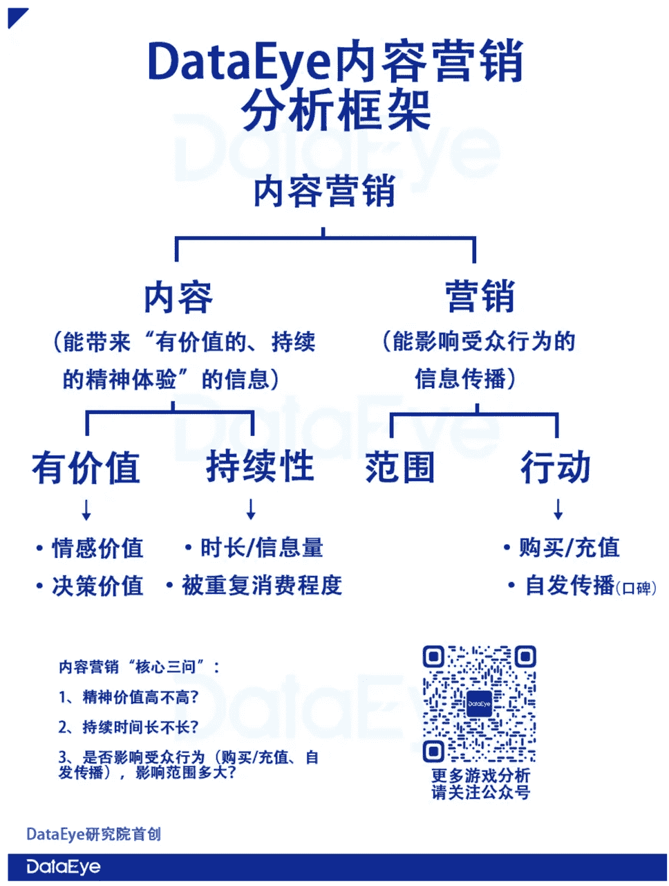

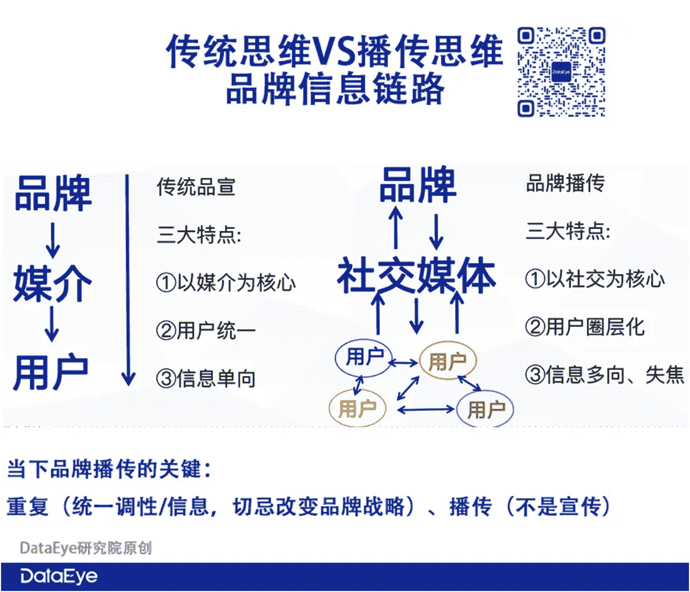

### **1.5.4 素材制作细节**

**关**键要素关键词（素材做完后自查，查漏补缺）：首帧、福利/夸张/吸睛片头、引导文案、口播、玩法展示、福利点、落版/CTA

1.  避免纯核心玩法展示：需要加上吸量片头包装，并且衔接要自然有关联

1.  避免没有关联的fake和核心玩法硬接：衔接要自然有关联，减少理解成本

1.  添加真人手指，女性受众则添加女性手指（可以带指甲油），男性受众游戏则用男性手指

1.  注意素材展示效果，画面重点内容放在中心位置

1.  文案和按钮引导勾起用户的兴趣，加强对玩家的引导和互动

1.  趣味性落板/CTA 引导用户下载，为用户制造期待感，进一步引导用户下载

### 1.5.5 一图读懂素材制作思路

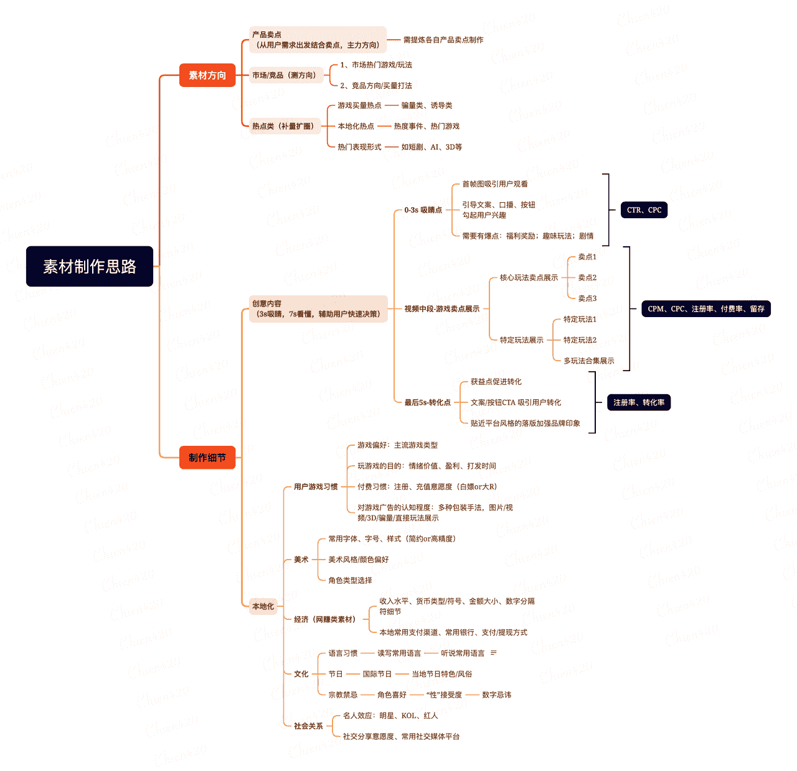

## **1.6 本章常见数据问题Q&A**

### **1、怎么平衡点击率和留存？**

**这应该是大多数从业者很困扰的一**个难题了，又要获客成本低，又要用户质量好，先解决目标的问题再给出具体的提升方案👇

+   看战略目标：长线产品看留存，短线产品看获客成本

+   看产品推广阶段：前期留存为主，后期破圈获客为主，整体还是看ROI

明确目标之后，点击率和留存可以动态平衡，以下一些基础的提升方案，具体的要因产品而异

**如何提升点击率：**[首帧图、标题、](https://yku6yoje2z.feishu.cn/docx/Rj37dNJHUoX9SdxTX4ic4gFKnmb#share-CFCQd73tSoRUYJxtJwmcuF41nob)文案、前三秒吸睛点/爆点的设置，可以参考👆上面讲到的素材制作思路篇

**如何提升留存：**提升核心玩法占比，如果是热点/骗量类素材，一定要做好玩法融合

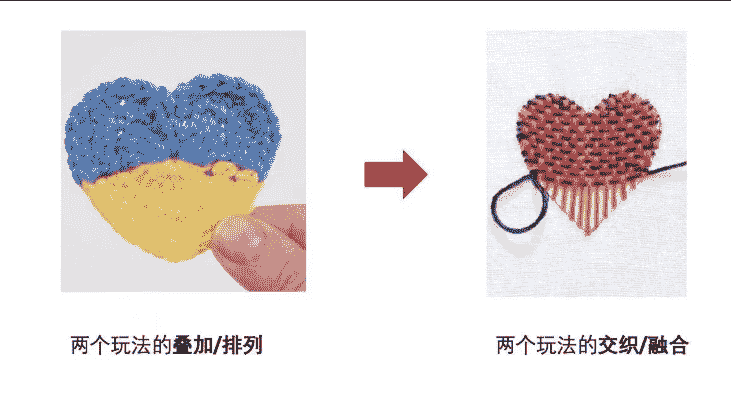

### **2、怎样把CPM做低**

**先看👆数**[**据基础篇：**](https://yku6yoje2z.feishu.cn/docx/Rj37dNJHUoX9SdxTX4ic4gFKnmb#share-OxlOd1UAzoePhqxdLGfc9Qvunp2)**影响CPM的因素（按优先级）**

+   竞争情况（广告中游戏玩法在流量池是否具备竞争力）

+   受众（版位、地区、年龄等受众设定）

+   广告质量排名（低质的广告会减少曝光）

+   **重度游戏CPM高，超休游戏CPM低，越贵**的用户CPM越高，越便宜的用户CPM越低

**素材层面：**CPM= (Spend/Impression)*1000，在**受众版位固**定的情况下，想要降低CPM可以提高曝光量，优质新颖的广告平台会给到更多的曝光（创意趣味、内容新颖）；或者将广告内容轻度化包装，改变素材属性

**投放层面：**1、避开流量高峰期 （如黑五、双十一、圣诞等节日，流量会非常贵）2、账户如果被标记成垃圾账号（如被投诉，不感兴趣数高），流量获取成本，CPM也会高

### 3、怎样把CPC做低

**先看👆数**[**据基础篇：**](https://yku6yoje2z.feishu.cn/docx/Rj37dNJHUoX9SdxTX4ic4gFKnmb#share-OxlOd1UAzoePhqxdLGfc9Qvunp2)**影响CPC的因素（按优先级）**

素材内容——CTR影响（广告素材本身是否优质）

CPM影响（广告展现的游戏玩法是否具备竞争力）

[**CP**](https://www.facebook.com/business/help/1406571646230212?helpref=faq_content)**C=**[** Spen**](https://www.facebook.com/business/help/659185130844708?helpref=faq_content)d / Click 总费用除以链接点击量

素材越吸引人，点击的用户越多（或者重**复点击），**那么**CPC就越****低，一般常出现**在趣味性广告或者诱导性广告中（例如美女/福利类），所以除了创意以外，也要重视文案类引导

### 4、除了看点击转化注册之外，还有什么数据值得关注

**跟公司的推广策略有关**

例如有些公司追求大规模大DAU，可以走低成本路线，那么重点关注影响CPI的一些数据指标，如点击率和转化率

**但是，这里敲黑板，****花钱买来的教训👉D****AU往上推的前提是留存要好、付费要好，CPI相应的能控**制住，盈利空间能等比往上走才值得往上推

而**有些公司较为关注回收**情况，那么从广告展示—安装—付费（最后一步），每个环节的数据都需要关注，包括留存、LTV、ROI等数据，ROI永远是最终目标

# 二、实操篇（案例分享）

1.  以下涉及到的案例均是过往实战项目，挑选出可能对大家更有帮助的进行分享，考虑到实效性和可对标性，会附上时间维度和项目相关信息，虽然广告素材一直在迭代创新，但是大部分结论依然适用，方法论依然适用

1.  以下案例遵循：“市场/竞品趋势分析-如何打造爆款素材-完整项[**目经验**](https://yku6yoje2z.feishu.cn/docx/Rj37dNJHUoX9SdxTX4ic4gFKnmb#share-VpfYdfexWoMlnWxOdH4cEmiRnld)复盘”的链路层层递进，帮助大家理解理论篇相关知识如何运用

1.  以下提到的工具网站均在[海外游戏买量创意设计工具使用指南](https://yku6yoje2z.feishu.cn/wiki/CalAweADii0ROakrmKQcHxMhnWf)有提到，这里作为延展说明

## 2.1 案例一：投入数百万刀，以为掌握了流量密码，结果项目凉了

> 项目背景：休闲手游，主投英语区，用户受众属于Match3类

> 核心对标产品以**花园类**：Gardenscapes、Homes**cap****es**、Lily's gard**en，**装扮类Project Makeover，三消Candy Crush，剧情类Matchington Mansion等游戏为代表

案例一分为前后两部分，第一部分**先上干货👇，第**二部分开始项**目复盘**

### 干货篇-**谷歌素材创意趋势分享**

> 案例说明：这份案例解读是22年与谷歌同学一起做的分析文档，拿出来供大家参考，让大家对海外游戏广告素材有个大体的了解

**名词解释：吸量以及IPM**

+   吸量：指的是素材带量的潜力，简单理解就是受用户欢迎的程度

+   IPM：千次展示下载量（成效率），跟吸量的区别是，素材A与B同时竞争，素材B可能没有素材A吸量，竞争不过素材A，但是如果素材B单独投放，效果也会很好，安装量也非常可观👍

### **2.1.1 **整体大方向趋势：

#### **解谜&失败玩法：**依然是最吸量的玩法，最吸量和高IPM

> 代表游戏：Gardenscapes、Homescapes

| ###### 要点： |  |  |  |
| --- | --- | --- | --- |

[1200x1800_hs_video626_nb_en_29s_31mb.mp4.mp4](https://internal-api-drive-stream.feishu.cn/space/api/box/stream/download/all/HO6IbrnmkoKv1txbVqXcU5EBn4c)

[1200x1800_gs_video594_nb_en_30s_48mb.mp4.mp4](https://internal-api-drive-stream.feishu.cn/space/api/box/stream/download/all/EvNYbKsu9oza7jxjv3CcgmWJn7c)

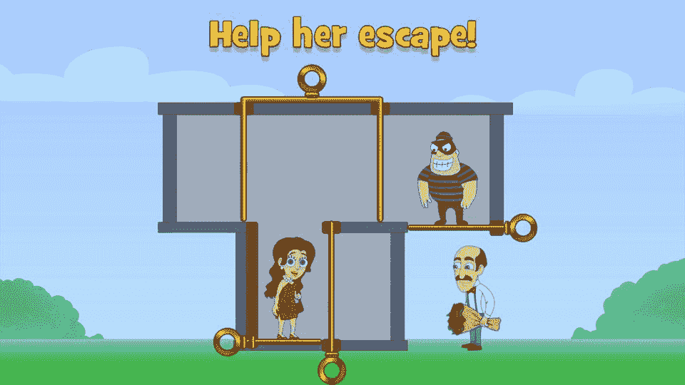

[2112x1188_hs_video609_nb_en_60s_45mb.mp4.mp4](https://internal-api-drive-stream.feishu.cn/space/api/box/stream/download/all/VmMXbye1dojUstxLxSNcqF2Cnne)

#### 换装&反馈：新兴趋势，**最吸量和最高的IPM**

> 代表游戏：Project Makeover

| ###### 要点： |  |  |
| --- | --- | --- |

[JUMP-V-P1-180-27s-B1-0-0-EN.mp4](https://internal-api-drive-stream.feishu.cn/space/api/box/stream/download/all/UFF2bPHR7o1MUWxj1LXcgUVNn5e)

[JUMP-V-P1-56-30s-B1-0-0-EN.mp4](https://internal-api-drive-stream.feishu.cn/space/api/box/stream/download/all/DYWWbEOLpokL7Ix0GydcbAvknbe)

#### 故事剧情：较**吸量****和****低IPM**

> 代表游戏：Matchington Mansion、Lily's garden

| 1.  戏剧性的生活化禁忌类剧情 |  |  |
| --- | --- | --- |

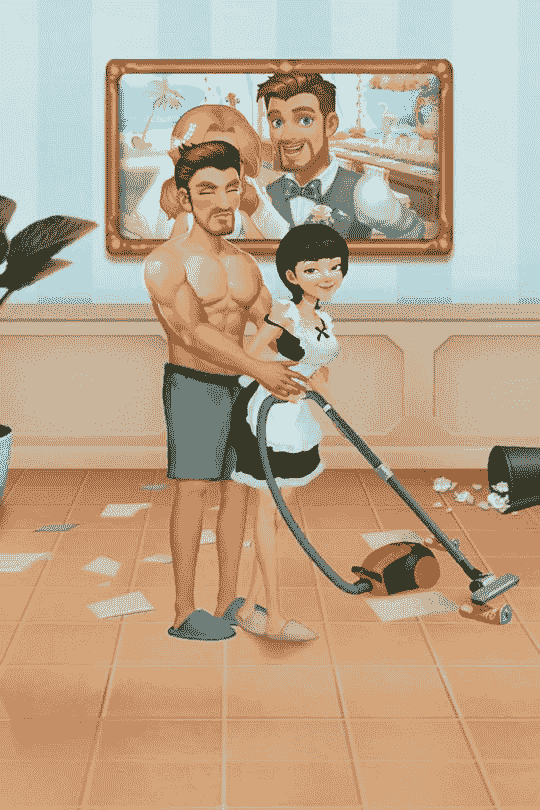

[HOP-V-P1-1560-29s-B1-0-1-EN.mp4](https://internal-api-drive-stream.feishu.cn/space/api/box/stream/download/all/Ltt6bI2m9oCOnlx1S7FcdZNJnIV)

[V486 LG SHS AllGoesWrong 30 P AllBadges.mp4](https://internal-api-drive-stream.feishu.cn/space/api/box/stream/download/all/RklhbBgeNokHuWx270McnZQPnJf)

#### 预告片/**电影（H**ook）+包装后的游戏玩法：较吸量和低IPM

| ### 要点： |  |  |
| --- | --- | --- |

[kr1013831kr 12673 ccs lt level5000 concept2 lollipophammer vid30 1080x1920 en.mp4](https://internal-api-drive-stream.feishu.cn/space/api/box/stream/download/all/SBK1bE3INoBnrxxX00XchVlpnAf)

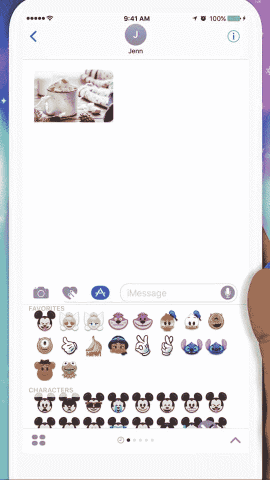

[DEB_599750414_EN_1080x1920_WinterTextChatThumbstopper_WRP_CID20553.mp4.mp4](https://internal-api-drive-stream.feishu.cn/space/api/box/stream/download/all/WQzqbi5zXoQXk6xeFv3cIcnVnfd)

#### 包装后的核**心玩法（**增强游戏性）：中等吸量和低IPM

| ### 要点： |  |  |
| --- | --- | --- |

[Boxing Landscape v2.mp4](https://internal-api-drive-stream.feishu.cn/space/api/box/stream/download/all/KIlZbaR8zoK1iQxIq0dcjEvOnTh)

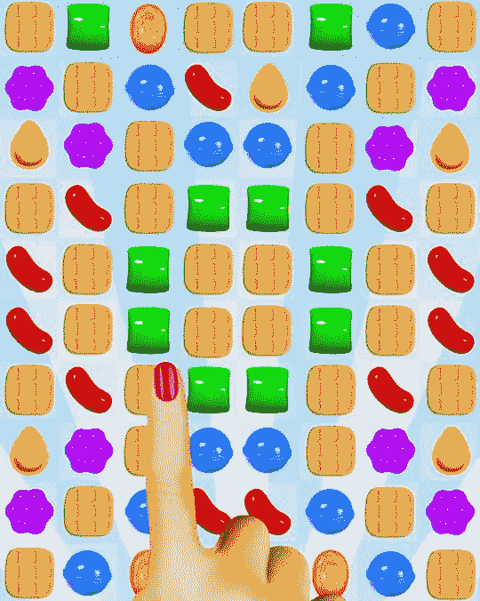

[kr1025302kr_15890_ccs_lt_11331-r30-multiboard-patterns-op34-calculation-score_vid15_1080x1350_en.mp4.mp4](https://internal-api-drive-stream.feishu.cn/space/api/box/stream/download/all/E91LbH8PRo5APYx9KKFcdrQtnve)

#### 真人+核心玩法：**不吸量和低IPM**

| ### 要点： |  |
| --- | --- |

[2112x1188_fd_video364_nb_en_30s_38mb.mp4.mp4](https://internal-api-drive-stream.feishu.cn/space/api/box/stream/download/all/TXybb4CtKo0f0fxoWsdcB71fnZc)

### **2.1.2 **优秀素材创意展示：

> 从吸量和IPM两个维度出发

#### 融合玩法成为主流：最吸量，IPM最高，高于平均的2.2倍

> 代表游戏：Fishdom、Royal Match

简单且易引起玩家参与挑战的IQ玩法仍然很受欢迎

| 田忌赛马+大鱼吃小鱼（热点玩法与核心元素的巧妙结合） | 三消+解救国王 |
| --- | --- |

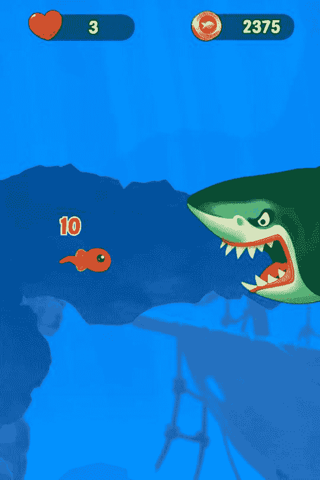

[1200x1800_fd_video797v7_nb_en_30s_13mb.mp4.mp4](https://internal-api-drive-stream.feishu.cn/space/api/box/stream/download/all/IFeIbhmuTof4shxWIDAc7SkKn5e)

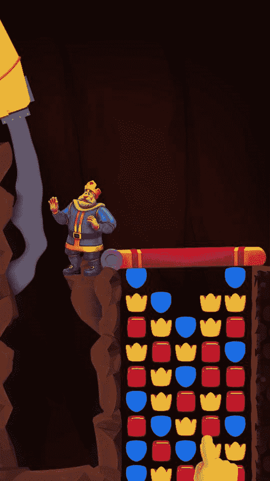

[Royal Match 323x01 -Swipe and enjoy.mp4](https://internal-api-drive-stream.feishu.cn/space/api/box/stream/download/all/ROdObtkOtoSk9HxfREFcHW8enGh)

#### 故事剧情+（诱导类）核心玩法：最吸量，IPM最高，高于平均的2倍

> 代表游戏：Lily's garden、Homescapes

戏剧的剧情&带有情感诱导的虚假广告，一般是剧情加上包装后的游戏内没有的玩法

|  |  |
| --- | --- |

[v856 LG CHO KickedOutCheat 30 P AllBadges.mp4](https://internal-api-drive-stream.feishu.cn/space/api/box/stream/download/all/X079bx9M4o1sT6xT2HScb3Owned)

[1200x1800_gs_video990v1_nb_ru_30s_33mb_6+.mp4.mp4](https://internal-api-drive-stream.feishu.cn/space/api/box/stream/download/all/MBzZb3hdMop59mxCNXZc6uzLnBg)

#### 电影故事情节+核心玩法：最吸量，IPM高于平均的1.2倍

> 代表游戏：Merge Mansion、Love&Pies、Homescapes

高品质的片头与游戏实际的核心玩法相结合，同样可以不断吸引着人们的注意力

| 前五秒动画电影+核心玩法 | 小CG+解决困难 | 狗血剧情+游戏内没有的玩法 |
| --- | --- | --- |

[PoliceEnding MedCut2 Gameplay 9x16$MM0061 85.mp4](https://internal-api-drive-stream.feishu.cn/space/api/box/stream/download/all/BmTybE28XoNUrUxDZWscNIIrnke)

[20211006 EN 30s Story amelia disaster choices 1080x1350 Port.mp4](https://internal-api-drive-stream.feishu.cn/space/api/box/stream/download/all/NLLgbt5sxoC5cZx5GAscVN7tnhd)

[1200x1800_hs_video922v4_nb_ru_30s_45mb_6+.mp4.mp4](https://internal-api-drive-stream.feishu.cn/space/api/box/stream/download/all/IBhQbSvcCoOXurx2rjVc2L6CnPg)

#### 换装类：最吸量，IPM高于平均的2.5倍

> 代表游戏：Project Makeover

无论游戏本身玩法如何，以Project makeover为代表的装扮类素材在整个品类中，依然有很强的吸引力

|  |  |
| --- | --- |

[JUMP-P1-VNO1165-28s-B0-E6-EN-3D.mp4](https://internal-api-drive-stream.feishu.cn/space/api/box/stream/download/all/EngIb1ueiondhyxfq8JcBLapnr1)

[JUMP-P1-VNO1161-29s-B0-E0-EN-3D.mp4](https://internal-api-drive-stream.feishu.cn/space/api/box/stream/download/all/VCdMbPjI7onyq9xfSCCcHLRznZe)

#### **合成&收集玩法：吸量能力**一般，但是IPM高于平均的3.4倍

> 代表游戏：Merge Dragons、Merge Magic

角色收集、丰富多样的角色展示类素材表现也非常好

|  |  |
| --- | --- |

[MD_select_dragon_tapping_to_hatch_1920x1080_2a1d92.mp4](https://internal-api-drive-stream.feishu.cn/space/api/box/stream/download/all/SbScbFTaXo2Xryxb9wIcEha3nYe)

[MM_character_location_merge_sloth_reskin_1080x1920_1be17a.mp4](https://internal-api-drive-stream.feishu.cn/space/api/box/stream/download/all/OaXjbuTO9oVTukxk4IFc5JFEntd)

### **2.1.3 **不好的案例展示：

**雷点Tips：**

1.  **不要仅仅展示核心玩法**，需要有剧情

1.  片头和玩法硬接导致理解成本高，故事和玩法没有关联

1.  在剧情类素材中，最后一定要加个正向结局，happy ending或者添加搞笑元素，不要设计情绪很down的悲伤结局，让用户的情绪一直很压抑

1.  **慎用横版视频**（针对谷歌平台），除非品质很高，电影或者CG级别

1.  **剧情关联性不强**，连接不紧密，拼凑感强

| 用横版展示非常简单的游戏核心，IPM低 | 角色引入+核心玩法，故事和玩法没有关联，理解成本高，IPM低 | 悲伤的故事情节：低IPM，如果想要改善，可以添加一些有趣的元素或者改成快乐的结局 |
| --- | --- | --- |
|  |  |  |

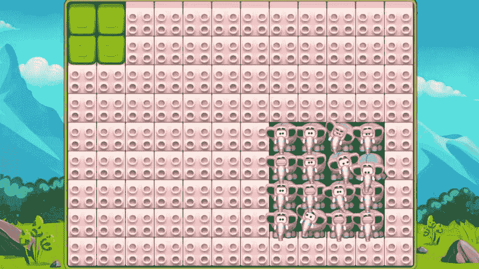

[Toy Blast - Brickrescuetoy-org 30s L.mp4](https://internal-api-drive-stream.feishu.cn/space/api/box/stream/download/all/Aj4abvJAdoRwJuxiuuOcHsccnWf)

[kr1014699kr 12185 ccs lt championsrace pm video2 vid30 1080x1920 en.mp4](https://internal-api-drive-stream.feishu.cn/space/api/box/stream/download/all/VLtNbzjAdoMeVixtkrYch51dnYf)

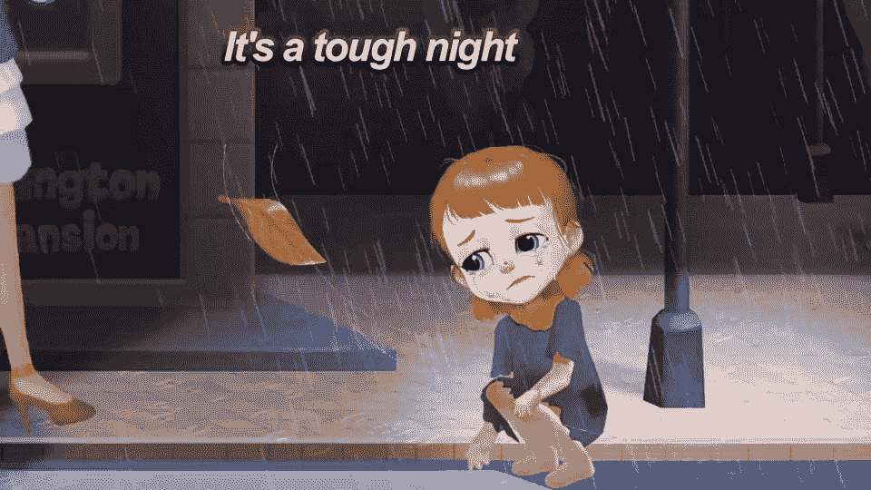

[HOP-V-L-1480-21s-B1-0-0-EN.mp4](https://internal-api-drive-stream.feishu.cn/space/api/box/stream/download/all/RVOSbGEeqo0m16xEPVdc14wvnCg)

| 纯核心玩法展示，低IPM | 竖版视频改成横版的，IPM并不会好 | 故事情节关联性不强，连接不紧密，IPM低，可以通过增强与玩家的互动来改进 |
| --- | --- | --- |
|  |  |  |

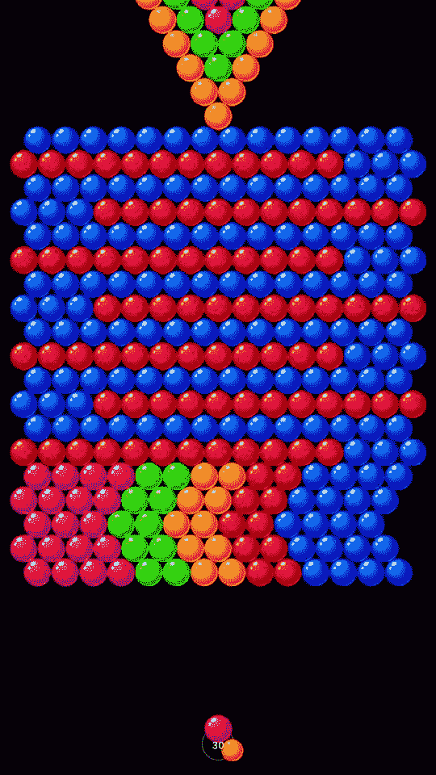

[bubblepop video portrait 200819 jyyoon A1 A01.mp4](https://internal-api-drive-stream.feishu.cn/space/api/box/stream/download/all/IX1obgQfuo3OomxEB6achDVanzd)

[1920x1080_hs_video662_nst_en_26s_33mb.mp4.mp4](https://internal-api-drive-stream.feishu.cn/space/api/box/stream/download/all/IcJZbrH0foATWaxNHZAcYw9mnfg)

[V486 LG SHS AllGoesWrong 30 P AllBadges.mp4](https://internal-api-drive-stream.feishu.cn/space/api/box/stream/download/all/Dn1FbH6lXoPYgjxpz2bcNVolnZe)

### **2.1.4 素材制作避坑秘方：**

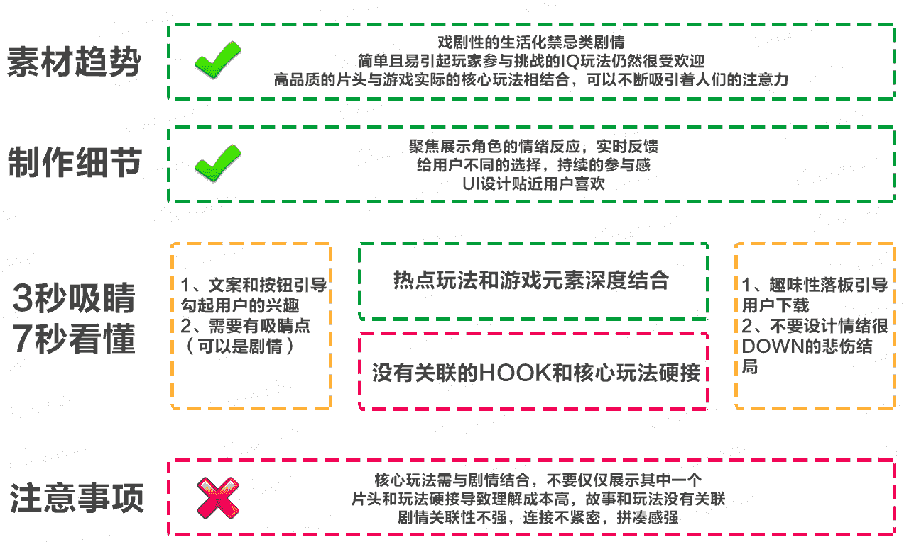

#### **一些小元素为素材增加Buff：**

1.  在开头加入help、challenge等按钮，勾起用户的兴趣；

1.  文案、字体颜色设计colorful，贴近用户喜欢；

1.  添加女性手指(休闲游戏女性玩家居多，重度游戏反之）；

1.  倒计时或者生命值增加紧迫感；

1.  聚焦人物表情；

1.  给用户不同的选择；

1.  失败结局、失败展示；

1.  Endcard的创意做法、解锁更多小游戏玩法

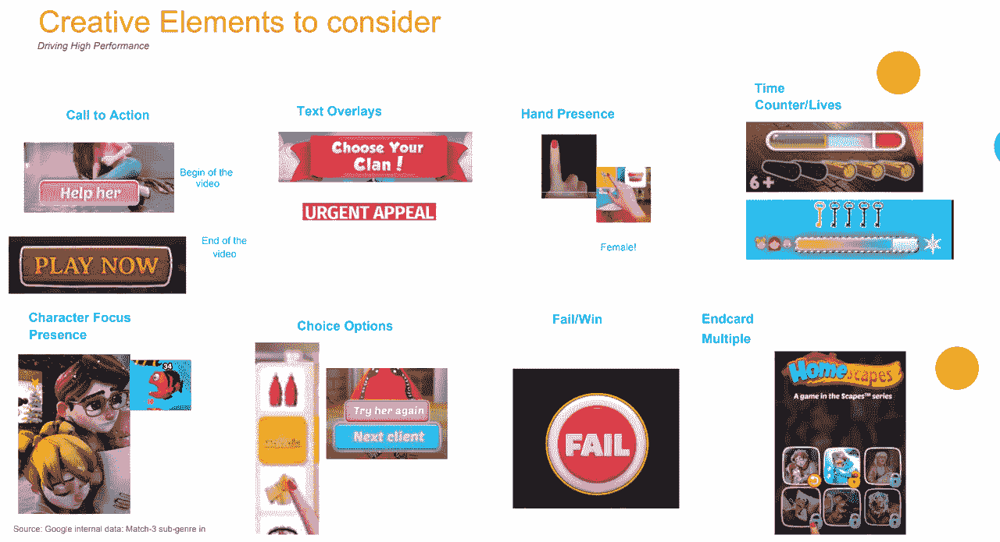

### 项目篇-血泪史复盘

**一句话说明项目历程：**跟很多失败项目一样，陪跑三年，从立项到推广，投入数百万刀，抱以期待的明星产品最后不了了之

项目细节就不展开了， 当时做了个内部复盘（下面部分截图），基本该踩的坑都踩了一**遍，现在想想很多事情的**确是在自嗨（不论是产品还是市场），看到市场上什么热做什么，没有考虑用户的实际需求

**例如前期产**品玩法底层逻辑就有很大的问题，都说立项定生死，一直在错误的路上狂奔

后期在市场推广层面，素材策略上追逐各种骗量小游戏玩法，目光短浅，过于关注前期的点击率和CPI成本（追求素材数据好看），忽略后端的留存和ROI数据，产品端只能不断添加各种非核心的玩法内容，妄图承接这部分用户提高留存，结果导致出来的产品四不像，陷入了死循环，做得越多死的越快。。。

市面上的广告非常多，数据也很好，但不是所有的都能作为当前产品以及当前阶段的对标

最简单的一个标准判断广告是否符合要求，广告引进的用户，留存和ROI是越来越好，还是越来越差？如果是前者，恭喜你找到了流量密码，如果是后者，放弃幻想老老实实回归产品核心吧

走[过很多的弯路，交了太多](https://mp.weixin.qq.com/s/b1ohjpZVfkZP8vOkSy8Kew)的学费，才逐渐懂得“用户体验第一”这个不是空话，这里放上前几天看到的一篇帖子与君共勉👉 游戏行业，确实太傲慢了

> "言必称创新，就是傲慢；用户明明还在，轻易否定某些题材或品类，就是傲慢；用户痛点和诉求明明还在，就是不改，就是傲慢；盲目的追逐热点和一味的自我表达也都是傲慢……

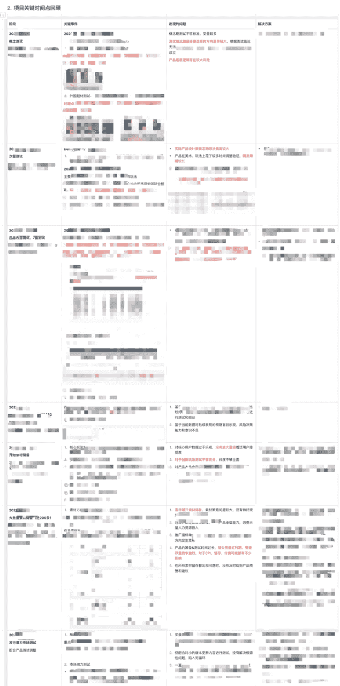

## 2.2 案例二：如何打造100w刀消耗爆款素材

> 案例二主要分享一些素材策略方法论的东西，包括如何找对标方向，如何有效测试，如何迭代

> 以下项目截图仅供演示作用（可能是我随便找的截图），因此可能会有信息不匹配现象，也没办法太过深入展开，大家了解意思就好

### **2.2.1  **从竞品推广趋势找潜力方向

sensortower看对标产品在目标市场的推广趋势图，找到量级增长的区间，记录下来，尤其关注尖峰前一两周的素材

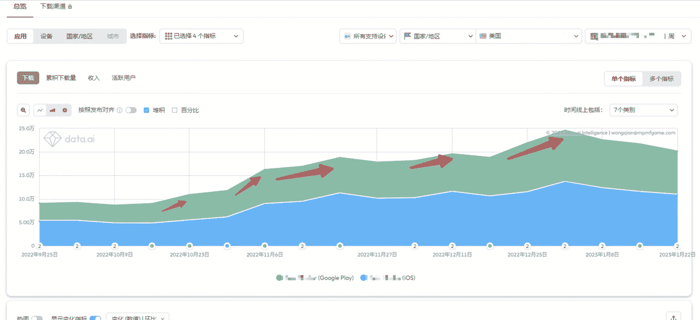

### **2.2.2  **素材收集分析

**去三方广****告平台，**我这**里拿广大**大演示，搜索这一时期的广告素材（如果只想看视频素材就选视频），按照展示估值进行去重排序，将所有的素材下载下来，我这里使用多维表格进行素材分析，将关键信息录入，打标签，就能推断竞品大致的素材方向以及迭代路线

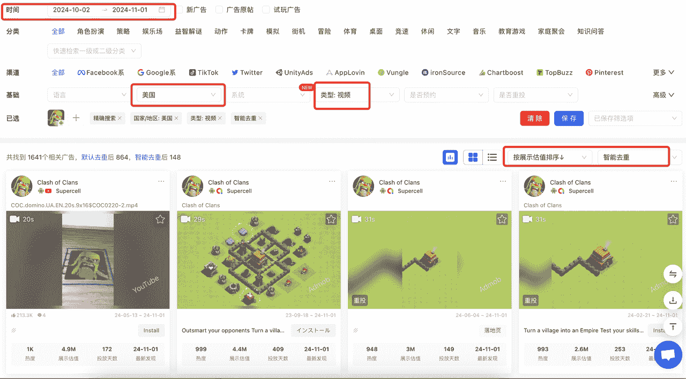

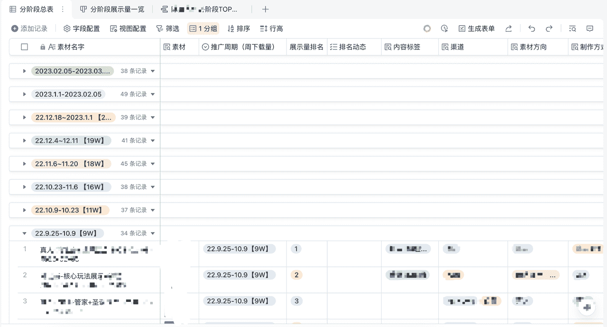

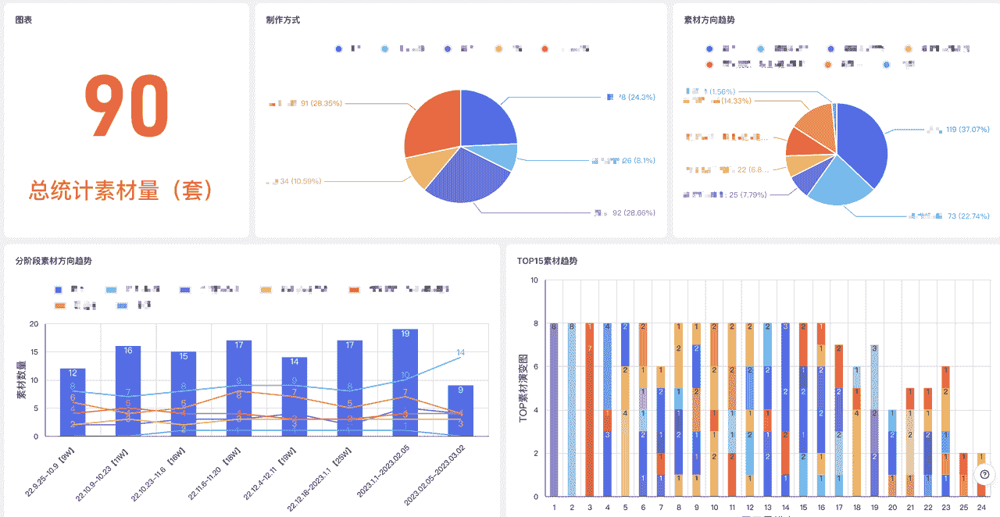

提炼关键信息，确定要测试的方向，开始制作素材（也可先扒改测试）

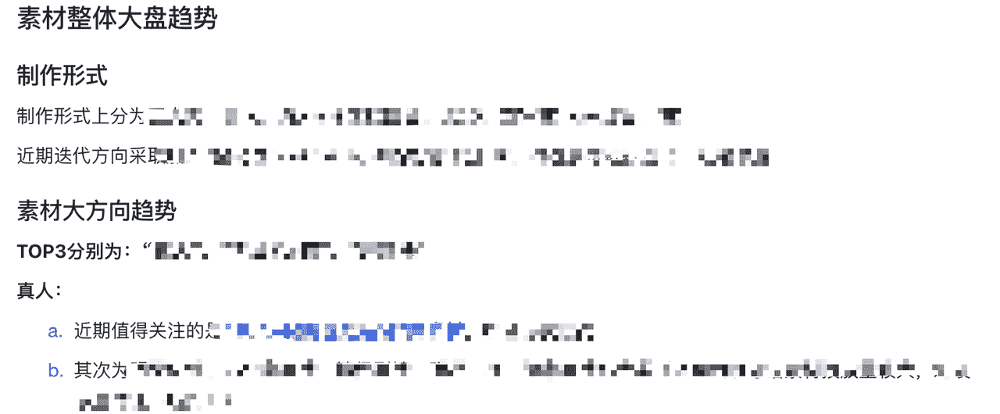

### 2.2.3  如何测试素材方向，以及怎么拓展？

+   需要AB对比测试，可以得出比较客观明确的结论（首先需要保证素材正常测试，且数据充分置信）

+   列出需要测试的方向，根据周期分配每个方向的数量，如果方向多，每个方向2条左右，如果方向少，每个方向可以多几条不同的对比测试

+   投放测试的时候，尽量一个方向一个组，这样可以对大方向以及子方向横纵向对比测试

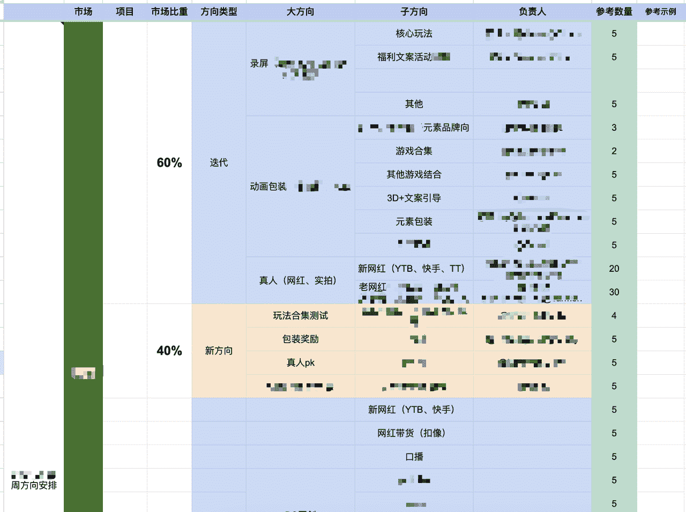

### **2.2.4  **测试分析-怎么看素材数据？

一般素材测试周期跟投放指标强相关，如果需要关注后端数据如留存、ROI回收等，素材测试一般在3-5天，如果产品比较短线，或者立项测试为主，测试周期会更快，一般1-3天就能判断素材好坏

具体的数据怎么分析可以看👆的数[据基础篇，](https://yku6yoje2z.feishu.cn/docx/Rj37dNJHUoX9SdxTX4ic4gFKnmb#share-BPdcdrp0Io66Shx9N2HcnmNBnLh)且不同产品归因不同，不详细展开了

### **2.2.5  **梳理素材方向

**单方向单条素材的对比分析方法参考上面分析步骤，根**据当时的想法进行复盘，得出后续的优化规划

这里推荐按照素材标签进行方向整理（下面方向随便写的，仅供演示）

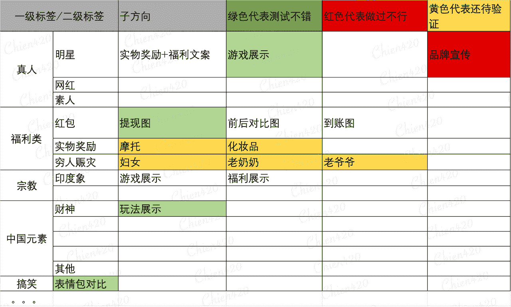

### **2.2.6  形成正向闭环**

**稳定可迭代**的方向才称之为素材方向，**爆款是可以重复打造的！**

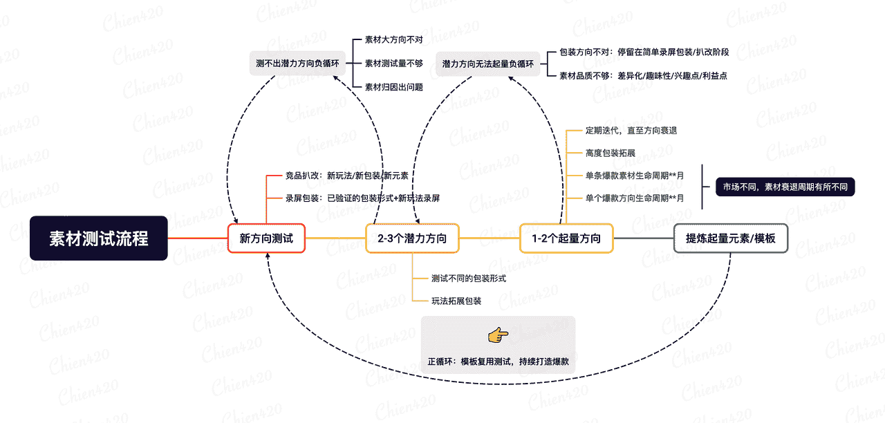

### **2.2.7 总结-爆款素材特性**

+   爆款素材有一个共性：**创新，**新的热门玩法、热门玩法新包装形式等，对比竞品素材有足够的差异化才能有竞争力

+   素材衰退周期跟市场（用户规模，人均重复观看次数/洗的次数）、素材质量（原创/扒改）息息相关

+   不同市场素材生命周期不同，T1 美日韩>T2 欧洲 >T3 拉美/东南亚；又因为国家经济情况、用户/市场规模等因素有不同

+   核心玩法类周期长于骗量类

## **2.3 **案例三：推到榜一的小游戏为何不赚钱？

**项目背景：**代理发行一款美食模拟器类小游戏，IAP类产品，主推TT和FB渠道，因为属于内容型产品，因此投放在TT的效果较好

**项目实际成果：**港台地区**免费游戏榜TOP1**，连续霸榜泰国、老挝iOS模拟游戏榜、免费游戏榜10天

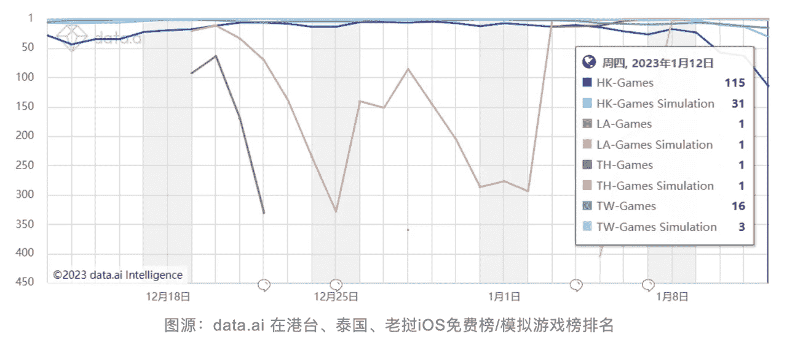

#### **2.3.1 素材推广链路**

#### **2.3.2 **素材推广策略制定

1.  小游戏产品较为短线，因此整体素材筹备期不长，共计一个半月的时间

1.  因为产品在国内抖音有参与过发行人计划，因此有大量的UGC内容供参考，为我们出海提供了很多的内容创作方向，因此前期方向探索比较顺利，扒改国内数据量不错的视频到海外市场投放测试，然后根据数据情况进行迭代创新

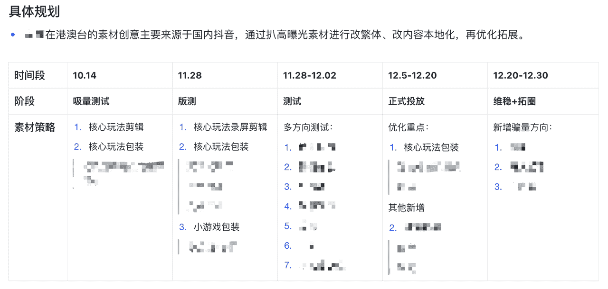

#### **2.3.3 **针对目标市场进行产品本地化

对标竞品素材以及热点信息来源：TikTok

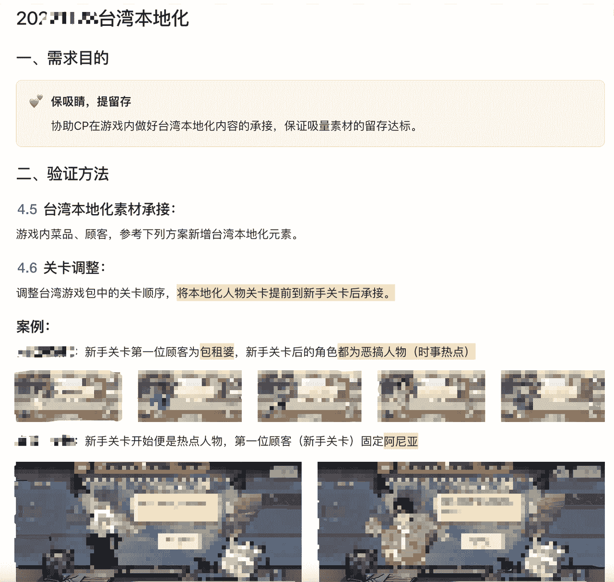

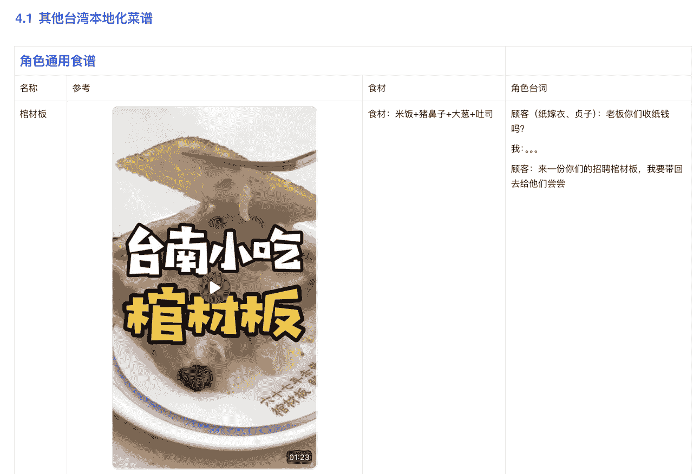

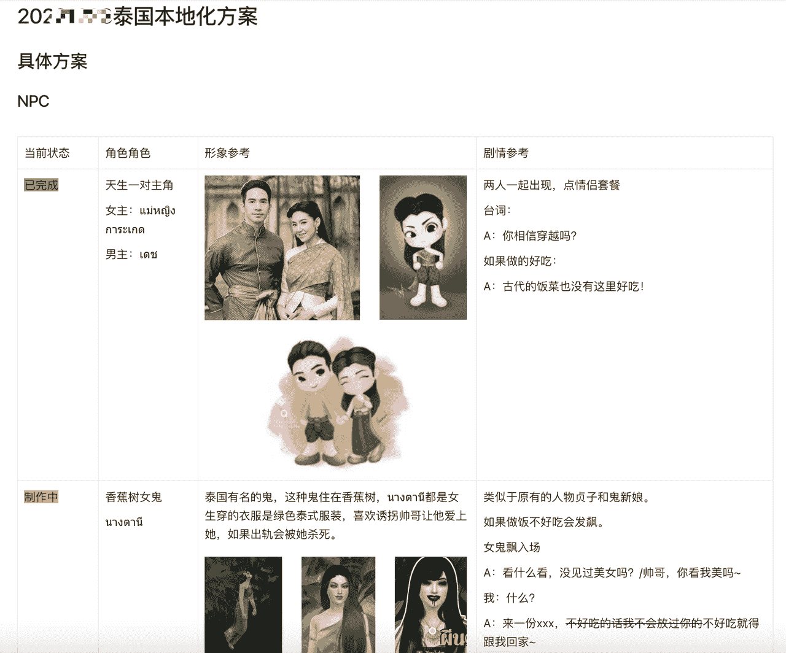

**根据素材**的评论进行分析，提炼关键词信息，例如围绕着阅读理解这个词就是我们的一个小爆款方向，还有反向操作、重口味等等都是可以发散的点

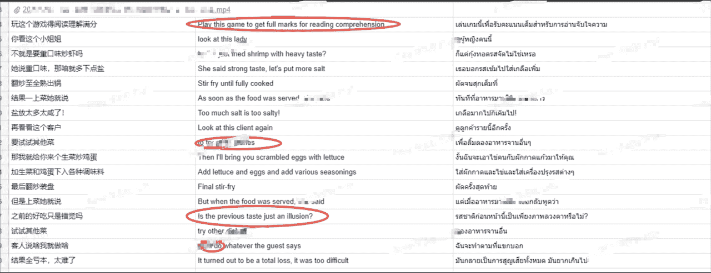

#### **2.3.4 **造势，引爆话题

在各渠道铺开大量的素材之后，配合TT直播，制造话题，吸引用户自发UGC创作，最终是有很多自来水KOL宣传的，借着这波热度，产品迎来推广爆发

当时的“扬帆出海”写的PR稿👇

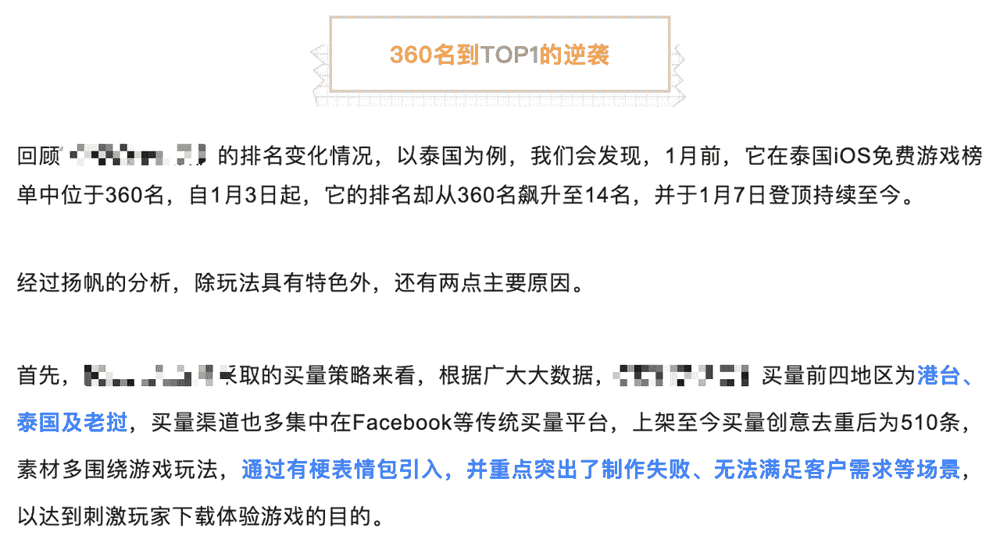

#### **2.3.5 **复盘

整个项目推广过程中各个环节配合的都还不错，实现了基本的预期，流水也达到了之前的预期标准，开始回答为什么说这个项目虽然数据好看，但是没赚到钱？

该项目投入人力（市场发行侧）：1运营+1.5投放+3设计师+2营销+1社媒运营，差不多小10人

扣除代理费各种成本费用，并没有实现盈利，相当于只赚了个吆喝

**核心原因：**

1.  产品LTV空间过小，只能短平快一波流，且质量不高，只能在T2、T3国家市场推广，没办法达到效益的最大化

1.  受制于本地化-饮食文化的差异限制，发达国家测试效果并不好，可推广的市场盘子过小

1.  预估过于乐观，对于这种小型项目投入的人力资源过多

**两点建议：**

1.  对于大部分想要尝试小游戏出海的伙伴们，建议评估好盈利空间，例如针对港澳台市场，什么样的数据预期有发行潜力？

1.  极低单价轻度休闲产品

1.  内购占比高的休闲产品

1.  中重度高arpu产品（做付费率以及ARPPU）

1.  同时对于竞对产品的推广数据（不论是三方平台还是PR稿），保持辩证的态度，先不说数据的真假，就算是真的，竞对可能是为了练手，锻炼团队能力，或者打出声量名气，但是如果你抱着赚钱的目的，照着这个推广策略去做，先不说就算能百分之百复刻，结果可能也是亏的，不要被数据迷惑，很多坑只有踩过才知道

## **2.4 本章常见问题Q&A**

### 1、为什么我报以期望的爆款结果数据并不好？

**除了客观情况（例**如市场、账户或者技术问题）外，保守地说，99%都是在自嗨（第一个案例就是我的血泪史），只是你以为用户会需要这些，但是其实并不是，当你对爆款素材的心态变成了“理应如此”，那就是打破买量玄学，掌握流量密码的时候了，买量就是不断猜想-验证的闭环，用户会骗人但是数据不会撒谎

数据不好不可怕，最可怕的是数据不好还不知道问题在哪里，那可能认知的确存在比较大的偏差了，离用户太远了，需要再近一点去发现问题，可以对照着上面的理论篇去寻找问题然后解决

### 2、为什么案例这么标题党？

首先本文宗旨以干货分享为主，这是肯定的

案例标题党有**两个考虑：**

1.  一方面[的确是钩子可以](https://yku6yoje2z.feishu.cn/docx/Rj37dNJHUoX9SdxTX4ic4gFKnmb#share-MUyKdkhn5on62mx9N5bcsJt1nqg)让更多人看到，同时我知道可能有些小伙伴就是因为这个而进来的，更多的是想给直接看案例的小伙伴们看到我们这个行业的现状，之前看过很多赚钱圈友发的复盘贴，我也很有收获，希望大家在进入一个新的领域新的赛道保持冷静，还是前文最开始就写的三点（如果略过了建议从头仔细再看看👉 广告投放的本质）

**遵循广告平台特性**

**遵循品类特性**

**尊重用户🫡**

1.  给同行朋友们的一些避坑指南，真心希望大家能少走点弯路，也是给大家和自己一点前进的动力和信心，行业很卷，市场很难，不要焦虑，买量可能最痛苦的就是，看到同行数据很好，但是自己的数据怎么成本就这么高？留存就这么差？实践出真知，测一测就知道深浅了，做难而正确的事情，在正确的方向上，慢一点无所谓，就像我在赚钱学习到的，熬总会出头只要留在牌桌上

# 附录：

[海外游戏买量创意设计工具使用指南](https://yku6yoje2z.feishu.cn/docx/VGEgdPo31o4wCPxlGiCcRmcGnkd?302from=wiki)

[为啥中东人的网上冲浪离不开中国人](https://www.bilibili.com/video/BV1sr421u7Fc?buvid=Y74807788FE2C5FA496D88B7328F40BC1E91&from_spmid=search.search-result.0.0&is_story_h5=false&mid=EqFIJs689G%2F8Tqlv6EkcpA%3D%3D&plat_id=116&share_from=ugc&share_medium=iphone&share_plat=ios&share_session_id=CEC022DC-4CA0-474D-A51A-372804BB0353&share_source=COPY&share_tag=s_i&spmid=united.player-video-detail.0.0&timestamp=1729068927&unique_k=m9kYO0W&up_id=19319172)？【差评君】_哔哩哔哩_bilibili

海外运营上手必看:手游出海相关问题汇总 - GameRes游资网

[美术、程序、策划、运营，出海本地化的四个要](https://www.gameres.com/846111.html)点你了解多少? - GameRes游资网

[谷歌分享:进军东南亚手游市场，](http://www.gamelook.com.cn/2021/11/459303)如何获取用户? | 游戏大观 | GameLook.com.cn

[如何提高自然新增、拿推荐?手游ASO优化9大要点 | 游戏](http://www.gamelook.com.cn/2019/06/361675)大观 | GameLook.com.cn

[全网最详细!东南亚最大手游市场泰国:H1收入$ 2.6亿，腾讯](http://www.360doc.com/content/23/0726/08/1090055364_1090055364.shtml)、米哈游、字节争霸，二游、SLG出海亮眼

[国际语言环境指南](https://docs.oracle.com/cd/E19253-01/819-0402/819-0402.pdf)

腾讯、米哈游、海彼背后：出海本地化，大部分人都错了！

结合马斯洛需求层次理论探究游戏设计满足的用户需求

[基于马斯洛需求层次理论的手机游戏设计研究_马鹍鹏.pdf](https://internal-api-drive-stream.feishu.cn/space/api/box/stream/download/all/GbMMbSWWpou6rGxcULqcHXV7nvc)

这一篇我们写了一年！这些研判正在成为现实！丨DataEye全年推文精选

创意遇瓶颈咋办？这有3个吸量秘诀（实操干货，已验证）

# 写在最后

1.  游戏是一个略有门槛的行业，讲究的是团队作战，虽然赚钱很多同学是做电商、自媒体的个体，但是我相信任何行业的底层逻辑都是互通的，并且这些经验经过大量的学费去验证过，一定程度上是能够帮大家避坑的

1.  篇幅有限，相关经验总结也只是走马观花带大家了解一些基础的知识，再加上受制于作者过往经验的限制，文中的经验结论可能会有一定的局限性和错漏之处，仅做抛砖引玉之用，也欢迎大家交流指正

1.  虽然前面介绍了很多术层面的内容，但是作为内容创作者，为平台为用户提供更优质的内容才是王道，希望有更多优秀的伙伴们，一起努力输出更加优质的内容

1.  没想到这篇帖子最终会有近两万字这么长，其实很多内容还没有详细展开，后面有机会再跟大家分享👋

# **作者相关**

**过往经验介绍：**

**时间线：**17年大学计算机专业毕业来到深圳，19年以广告视频设计师身份进入游戏行业，半年国内发行后转战海外发行至今，21年作为发行设计负责人开始带团队至今，同年攻读哈工大MBA，24年毕业

**成长路径：**行业小白-业务骨干-业务负责人，从0-1搭建团队，目前在从1-100的过程中，因此有比较丰富的一线业务实操经验，也懂大部分跨行朋友或者需要攻克新业务新市场的伙伴们的痛难点（因为我也经历过）

**我的优势：**前**段时间找**醒醒老师做了个盖洛普测试👇，基本符合我对自己的认知判断，分享这些帖子也算是个人优势的实战发挥，以文交友，希望能遇到更多同频的伙伴们

前十才干：学习｜成就｜统筹｜专注｜积极｜完美｜交往｜沟通｜行动｜思维

**我能提供的：**海外游戏发行相关经验；大厂设计师资源；计算机&MBA相关人脉，欢迎来撩❤️

如果本文对你有信息增量，可以给点鼓励呀，新人真的很需要正反馈😆