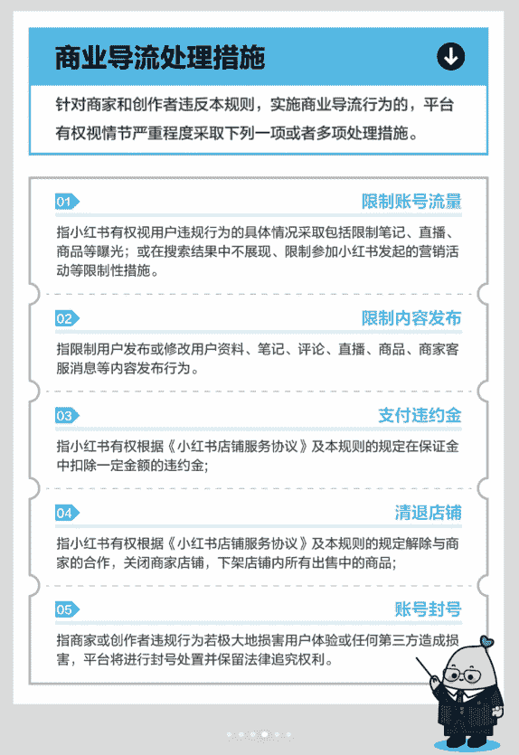
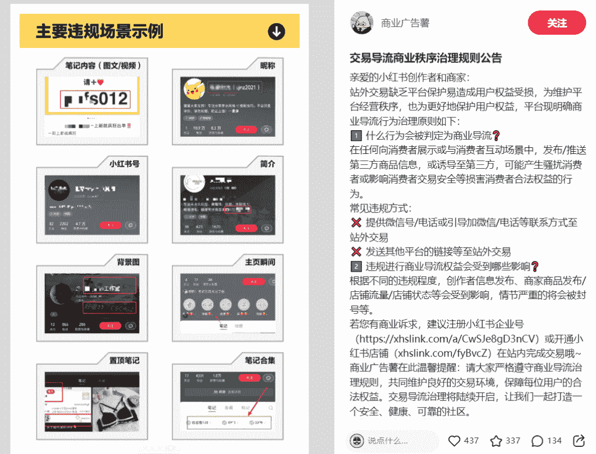
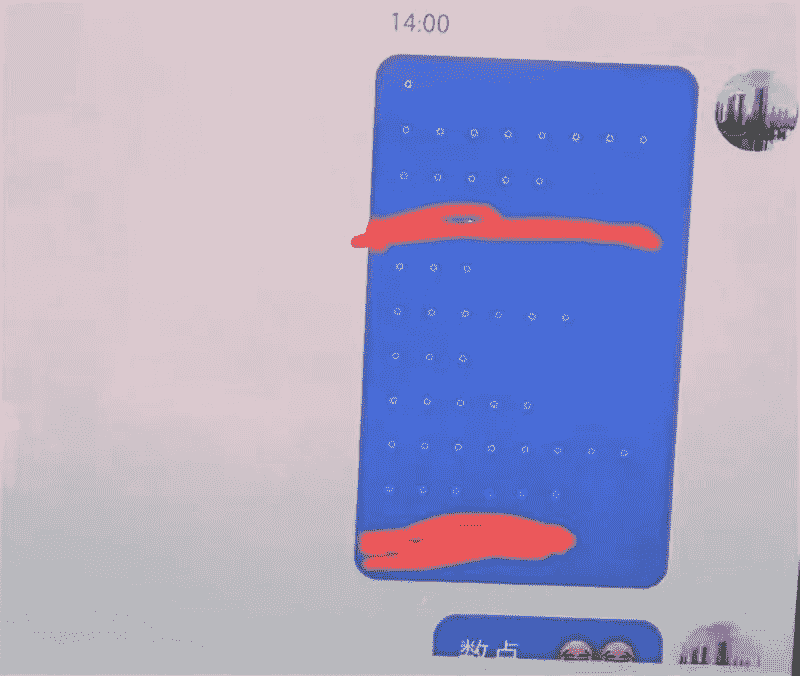
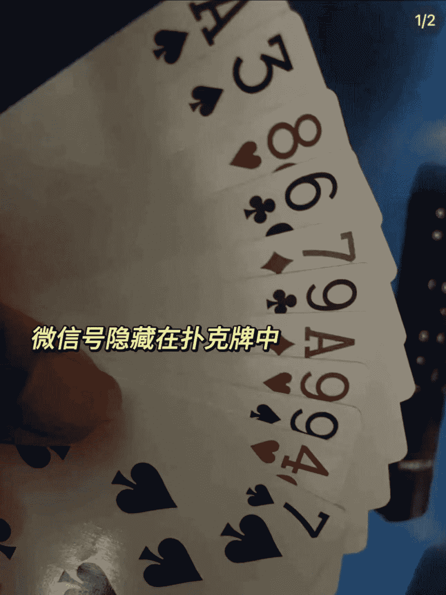
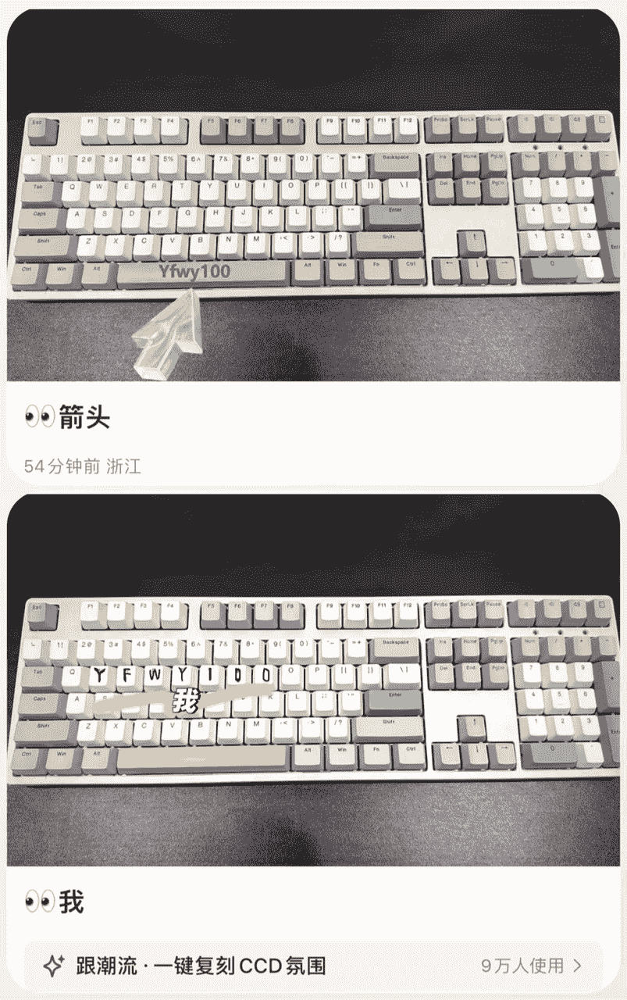
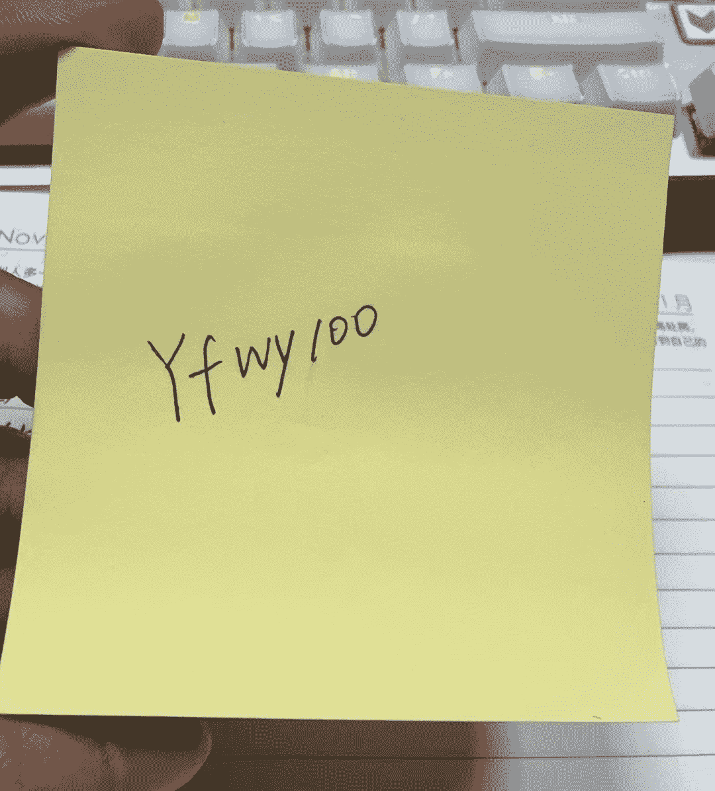
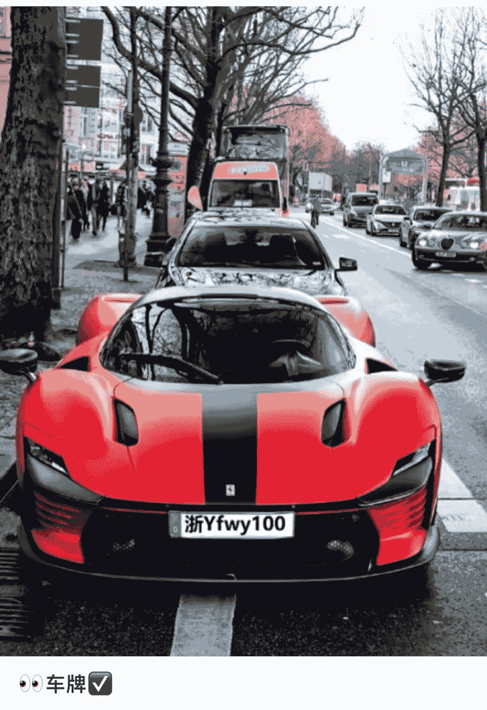
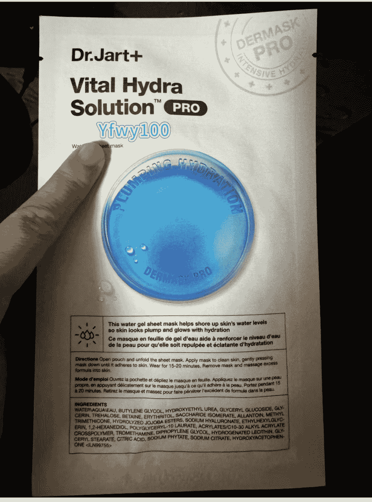

# 2024-12-16小红书加强站外导流监控，严厉打击微信号发布行为

> 来源：[https://xuqiwei1986.feishu.cn/docx/Nu5DdZJruoEMYrxATwkcXWVfnoV](https://xuqiwei1986.feishu.cn/docx/Nu5DdZJruoEMYrxATwkcXWVfnoV)

> 🔗 原文链接： h[ttps://scys.com/ar](https://scys.com/articleDetail/xq_topic/4848242848554818)ticleDetail/xq_t...

> ⏰ 剪存时间：2024-12-16 21:58:52 (UTC+8)

> ✂️ 本文档由 [飞书剪存 ](https://www.feishu.cn/hc/zh-CN/articles/606278856233?from=in_ccm_clip_doc)一键生成

最近的2个月小红书动作非常多，最大的一个动作之一，就是在抓小红书站外导流，不让发微信号。

小红书导流监控迭代升级之后，很多朋友也都收到了违规提示，也包括我们自己的账号，从警告到禁言全站私信评论区7天禁言+限流，继续违规就升级到14天……

原本常见的留微信方式，都会被平台管控。比如，之前专业号还能把群聊名称设置为微信号，现在不行了。以前交个聚光保护费，可以让用户发微信，现在也不行了。

**所以有预算，获客成熟的老板 **，直接选择做聚光投流，光明正大的给客户发微信号。

那不花钱的账号，还有没有导流活路？ ——分享两个最近测试可行的导流方式

# **01**

# **“摩斯”密码**

**【使用方式】： **在私信时，用点数代替微信号/手机号的数字，直接发给用户。

可以延伸出用任何emoji代替点数，还可以用扑克牌的数字排列一下，拍一张照片。

素材来源：叁斤

【缺点】：我第一次看到的时候觉得很赞，但是实操的时候发现，他有一个弊端，当你的微信号里边有数字“0”的时候，是没办法用点数代替的。

# **02**

# **小号发微信笔记**

**【使用方式】： **先用小号发一篇带微信号的笔记，可以分别在下面3个场景下使用

①在用户私信咨询的时候，发你的这条小号的笔记；

②用大号收藏小号的笔记，把收藏夹公开，引导用户去看你的收藏夹；

③引导用户进微信群聊，用小号在群里发小号的笔记。

这个方法以前其实也已经在使用，只不过现在管得更严格。如果像以前，对微信号不做任何处理的方式，你的笔记只有自己看得见，别人是看不到的。

**那怎么样才能够不被检测出来呢？**

**我**经过大量的案例测试和思考总结，我找到了一个方法，可以套用， 我自创个名字叫"看似"合理。就是说，在这个图片的 「这个位置」，本身就可能是一串「数字和字母」（你的微信）

比如说英文报纸，里边本身就有大量的字母，那你把微信号混在里面，「看着好像很合理」，所以就没法快速识别出来。

那是不是只要图片里本身就有字母和数字，就一定没问题呢？

我拿键盘照片，做了一组案例对比：

❌上面的图，把微信 **「放在空格键」 **的这张不行，发出去被系统私密了；

✅下面这张，把微信 **「放在按键」 **上可以发出去。

所以，大家发现没有，非常重要的关键点，一定要把握住微信放置的位置！！！ 问一问自己，「这个位置」出现数字和字母，看着合理吗？

掌握这个宗旨，我带大家做5组测试题 ，都是我已经发布测试过的。

你边看边记下自己的答案，最后文末对一下正确答案！边学边练，相信你肯定能掌握！

—————

GO!考试开始！

小红书导流方式选择题（单选 每题2分）

请根据以下图片，选择发布之后，是否会被平台自动检测违规？

**第1题：便利贴纸**

A.违规❌ B不违规✅

**第2题：汽车车牌**

A. 违规❌ B不违规✅

**第3题：面膜包装**

A.违规❌ B不违规✅

**第4题：赵丽颖照片**

A. 违规❌ B不违规✅

**第5题：个人海报**

A. 违规❌ B不违规✅

好了， **以上正确答案是：ABBBB **，满分10分，评论区交流一下你得了几分哈哈

可能比较有难度的是第4题和第5题，为啥这2个可以呢，其实是因为这个图，你忘掉自己是导流目的，忘掉那串数字字母是微信，仅作为一张海报图，排版上出现数字和字母是不是也是正常的？

好了，相信大家都已经掌握啦，然后你们就可以举一反三的去做自己的导流图啦~~

**最后，再强调2个细节：**

**1.尽量用小号配合导流。**

因为虽说平台他不能直接检测出来，但是拦不住你可能会 被同行投诉举报 呀。用大号就有被举报首罚风险。

我拿我的A账号举报我发了微信的B号，测试了一下，举报成功了。对，没错，自己举报自己，浅浅牺牲一下自己哈哈哈～

不过，比较神奇是，A收到了举报成功的消息通知，但是，我的B（被举报的号）并没有违规提醒，而且笔记还正常展示，没被私密。

我个人猜测可能是被举报的次数还没有到达一定的量，但能明确一点，被举报还是会判违规，毕竟系统已经给了A违规回馈。

2.如果是经由大号发的微信，在用户确认收到后，立马撤回

以上就是不花钱的导流方式思考和分享，欢迎大家交流更多好用的导流方式，最后，祝大家微信导流爆单！